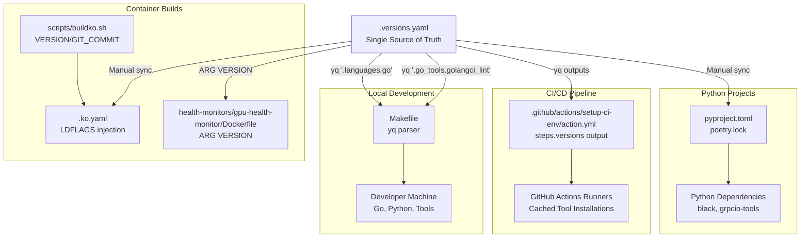
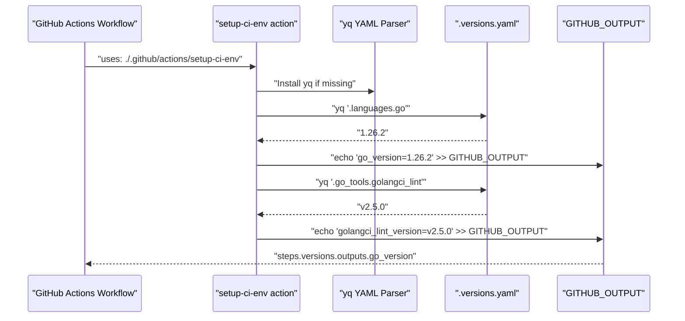

<!-- source: DeepWiki mcp.deepwiki.com · repo NVIDIA/NVSentinel · page 9.7 Version Management · fetched 2026-10-26 -->

# Version Management

<details>
<summary>Relevant source files</summary>

The following files were used as context for generating this wiki page:

- [.github/actions/publish-container/action.yml](.github/actions/publish-container/action.yml)
- [.github/actions/sbom-and-attest/action.yml](.github/actions/sbom-and-attest/action.yml)
- [.github/actions/setup-ci-env/action.yml](.github/actions/setup-ci-env/action.yml)
- [.gitignore](.gitignore)
- [.ko.yaml](.ko.yaml)
- [.versions.yaml](.versions.yaml)
- [Makefile](Makefile)
- [distros/kubernetes/nvsentinel/charts/preflight/templates/mutatingwebhook.yaml](distros/kubernetes/nvsentinel/charts/preflight/templates/mutatingwebhook.yaml)
- [distros/kubernetes/nvsentinel/charts/preflight/tests/mutatingwebhook_test.yaml](distros/kubernetes/nvsentinel/charts/preflight/tests/mutatingwebhook_test.yaml)
- [distros/kubernetes/nvsentinel/policies/must-have-sbom.yaml](distros/kubernetes/nvsentinel/policies/must-have-sbom.yaml)
- [distros/kubernetes/nvsentinel/policies/must-have-slsa.yaml](distros/kubernetes/nvsentinel/policies/must-have-slsa.yaml)
- [health-monitors/gpu-health-monitor/Dockerfile](health-monitors/gpu-health-monitor/Dockerfile)
- [log-collector/Dockerfile.cleanup](log-collector/Dockerfile.cleanup)
- [make/docker.mk](make/docker.mk)
- [preflight-checks/dcgm-diag/Dockerfile](preflight-checks/dcgm-diag/Dockerfile)
- [preflight-checks/nccl-allreduce/Dockerfile](preflight-checks/nccl-allreduce/Dockerfile)
- [scripts/build-image-list.sh](scripts/build-image-list.sh)
- [scripts/buildko.sh](scripts/buildko.sh)
- [scripts/check-image-attestations.sh](scripts/check-image-attestations.sh)
- [scripts/verify-image-provenance.sh](scripts/verify-image-provenance.sh)

</details>


This document describes NVSentinel's centralized version management system, which ensures consistency across local development, CI/CD pipelines, and container builds through a single source of truth: the `.versions.yaml` file.

For information about the broader CI/CD pipeline architecture, see [CI/CD Pipeline Overview](#9.1). For build system details, see [Build System and Makefile](#9.6).

## Purpose and Single Source of Truth

NVSentinel uses [`.versions.yaml:1-87`]() as the canonical definition for all tool, language, and dependency versions. This file prevents version drift across:

- Local development environment setup
- GitHub Actions CI/CD workflows
- Docker container base images
- Python Poetry dependencies
- Go module tooling

The version management system eliminates the need to manually synchronize versions across multiple configuration files, reducing maintenance overhead and preventing environment-specific bugs.

Sources: [`.versions.yaml:1-87`](), [`Makefile:15-39`]()

## Version Configuration Schema

The `.versions.yaml` file organizes versions into logical categories:

| Category | Purpose | Example Keys |
|----------|---------|--------------|
| `languages` | Runtime language versions | `go`, `python` |
| `build_tools` | Package managers and build systems | `poetry`, `poetry_plugin_export` |
| `go_tools` | Go development tooling | `golangci_lint`, `gotestsum`, `gocover_cobertura` |
| `protobuf` | Protocol Buffer toolchain | `protobuf`, `protoc_gen_go`, `grpcio_tools` |
| `linting` | Code quality tools | `shellcheck`, `addlicense`, `black` |
| `container_tools` | Container build utilities | `docker_buildx`, `ko` |
| `testing_tools` | Testing infrastructure | `kind`, `helm`, `kwok`, `ctlptl` |
| `cluster` | Kubernetes cluster dependencies | `prometheus_operator`, `gpu_operator` |

**Version Format Conventions:**
- Go versions: `1.26.2` (semantic versioning) [`.versions.yaml:34`]()
- Python versions: `3.13` [`.versions.yaml:35`]()
- Tool versions with `v` prefix: `v2.5.0` (e.g., `golangci_lint`) [`.versions.yaml:44`]()
- Tool versions without prefix: `2.3.3` (e.g., `poetry`) [`.versions.yaml:39`]()
- Container tools: `v0.18.0` (e.g., `ko`) [`.versions.yaml:70`]()

Sources: [`.versions.yaml:32-87`]()

## Version Propagation Architecture



**Version Propagation Flow Diagram**

This diagram illustrates how `.versions.yaml` serves as the root configuration that propagates to all environments through dedicated parsing and update mechanisms.

Sources: [`.versions.yaml:1-87`](), [`Makefile:23-39`](), [`.github/actions/setup-ci-env/action.yml:21-50`](), [`.ko.yaml:20-138`](), [`health-monitors/gpu-health-monitor/Dockerfile:15-16`]()

## Local Development Environment Setup

The [`Makefile:1-122`]() and [`scripts/setup-dev-env.sh`]() automate development environment configuration by reading versions from `.versions.yaml`.

### Version Loading in Makefile

The main Makefile uses `yq` to ingest versions into variables for build targets:

```makefile
# From Makefile:23-39
ADDLICENSE_VERSION := $(shell $(YQ) '.linting.addlicense' .versions.yaml)
BLACK_VERSION := $(shell $(YQ) '.linting.black' .versions.yaml)
GO_VERSION := $(shell $(YQ) '.languages.go' .versions.yaml)
GOLANGCI_LINT_VERSION := $(shell $(YQ) '.go_tools.golangci_lint' .versions.yaml)
KO_VERSION := $(shell $(YQ) '.container_tools.ko' .versions.yaml)
```

Sources: [`Makefile:23-39`]()

### Tool Installation via Makefile

The Makefile provides targets to install specific versions of tools required for the Go toolchain:

```makefile
# From Makefile:159-176
install-golangci-lint:
	@echo "Installing golangci-lint $(GOLANGCI_LINT_VERSION)..."
    # ... logic to download specific version from github.com/golangci/golangci-lint
```

Sources: [`Makefile:131-156`](), [`Makefile:159-176`]()

## CI/CD Environment Setup

The [`.github/actions/setup-ci-env/action.yml:1-143`]() composite action replicates local environment setup in GitHub Actions runners.

### Version Loading in GitHub Actions



**CI Version Loading Sequence**

The action uses `yq` to parse `.versions.yaml` and exports versions as GitHub Actions outputs for use in subsequent workflow steps.

**Output Variables Generation:**

```yaml
# From .github/actions/setup-ci-env/action.yml:32-51
- name: Load versions from .versions.yaml
  id: versions
  shell: bash
  run: |
    echo "go_version=$(yq '.languages.go' .versions.yaml)" >> $GITHUB_OUTPUT
    echo "python_version=$(yq '.languages.python' .versions.yaml)" >> $GITHUB_OUTPUT
    echo "poetry_version=$(yq '.build_tools.poetry' .versions.yaml)" >> $GITHUB_OUTPUT
    echo "golangci_lint_version=$(yq '.go_tools.golangci_lint' .versions.yaml)" >> $GITHUB_OUTPUT
    # ... additional version outputs
```

Sources: [`.github/actions/setup-ci-env/action.yml:21-52`]()

### Tool Installation with Caching

The CI action leverages GitHub Actions caching to speed up workflow execution:

```yaml
# From .github/actions/setup-ci-env/action.yml:65-75
- name: Cache Poetry dependencies
  uses: actions/cache@v4.3.0
  with:
    path: |
      ~/.cache/pypoetry
      ~/.cache/pip
    key: ${{ runner.os }}-poetry-${{ steps.versions.outputs.poetry_version }}-${{ hashFiles('**/poetry.lock', '**/pyproject.toml') }}
```

**Cached Artifacts:**
- Poetry dependencies: `~/.cache/pypoetry` [`.github/actions/setup-ci-env/action.yml:69`]()
- Protocol Buffers: `/usr/local/bin/protoc` [`.github/actions/setup-ci-env/action.yml:126`]()
- Helm plugins: `~/.local/share/helm/plugins` [`.github/actions/setup-ci-env/action.yml:89`]()

Sources: [`.github/actions/setup-ci-env/action.yml:65-93`](), [`.github/actions/setup-ci-env/action.yml:122-131`]()

## Container Build Version Management

NVSentinel uses `ko` for Go services and `docker buildx` for Python/specialized services.

### Ko Build Injection

For Go services, version metadata is injected during the build process via `ldflags`:

```yaml
# From .ko.yaml:24-26
ldflags:
  - "-s -w"
  - "-X main.version={{.Env.VERSION}} -X main.commit={{.Env.GIT_COMMIT}} -X main.date={{.Env.BUILD_DATE}}"
```

The `scripts/buildko.sh` script exports these environment variables before calling `ko build`:

```bash
# From scripts/buildko.sh:22-25
export VERSION="${VERSION:-v0.1.0}"
export GIT_COMMIT="${GIT_COMMIT:-dev}"
BUILD_DATE=$(date -u +%FT%TZ)
export BUILD_DATE
```

Sources: [`.ko.yaml:24-26`](), [`scripts/buildko.sh:22-25`]()

### Python Docker Build and Poetry

For Python-based monitors like the GPU Health Monitor, the `Dockerfile` uses `poetry` (version defined in `.versions.yaml`) to build wheels and manage dependencies:

```dockerfile
# From health-monitors/gpu-health-monitor/Dockerfile:25-26
RUN --mount=type=cache,target=/root/.cache/pip \
    pip install poetry==2.3.3 poetry-plugin-export==1.10.0

# From health-monitors/gpu-health-monitor/Dockerfile:37
RUN poetry version $(echo "${VERSION}" | sed 's/^v//')
```

Sources: [`health-monitors/gpu-health-monitor/Dockerfile:25-37`](), [`.versions.yaml:39-40`]()

### Docker Buildx and Metadata

For Docker-based builds, versions are passed as build arguments and recorded in metadata files. The `.github/actions/publish-container/action.yml` action then uses these digests for SBOM generation and attestation:

```yaml
# From .github/actions/publish-container/action.yml:81-83
if [ -f "$DOCKER_METADATA_FILE" ]; then
  DIGEST=$(jq -r '."containerimage.digest"' "$DOCKER_METADATA_FILE")
```

Sources: [`.github/actions/publish-container/action.yml:81-83`]()

## Version Verification and Provenance

NVSentinel implements strict verification of container images to ensure they match the expected versions and build sources.

### Image List Generation

The `scripts/build-image-list.sh` script generates a dynamic list of images based on the current `SAFE_REF_NAME` (derived from the git branch):

```bash
# From scripts/build-image-list.sh:45-65
declare -a dynamic_images=(
  "${CONTAINER_REGISTRY}/${CONTAINER_ORG}/nvsentinel/csp-health-monitor:${SAFE_REF_NAME}"
  "${CONTAINER_REGISTRY}/${CONTAINER_ORG}/nvsentinel/event-exporter:${SAFE_REF_NAME}"
  # ...
)
```

Sources: [`scripts/build-image-list.sh:45-65`]()

### Attestation and SBOM Generation

The pipeline automatically generates SBOMs and attestations for every container push. The `publish-container` action triggers this after a successful build:

```yaml
# From .github/actions/publish-container/action.yml:116-121
- name: Generate SBOM and Attest
  uses: ./.github/actions/sbom-and-attest
  with:
    image_name: ${{ steps.image.outputs.name }}
    image_digest: ${{ steps.image.outputs.digest }}
```

Sources: [`.github/actions/publish-container/action.yml:116-121`]()

## Summary of Version Sources

| Entity | Primary Version Source | Propagation Method |
|--------|------------------------|--------------------|
| Go Runtime | `.versions.yaml` | `Makefile` -> `setup-ci-env` |
| Python Runtime | `.versions.yaml` | `Dockerfile` -> `poetry` |
| CI Tools | `.versions.yaml` | `setup-ci-env/action.yml` |
| Container Images | Git Tag / Branch | `scripts/buildko.sh` / `scripts/build-image-list.sh` |
| Helm Charts | `Chart.yaml` | Manual Update |
| Cluster Deps | `.versions.yaml` | `values.yaml` sync |

Sources: [`.versions.yaml:1-87`](), [`Makefile:23-39`](), [`.github/actions/setup-ci-env/action.yml:21-50`](), [`scripts/buildko.sh:22-25`]()

---

