# Page: Home

# Home

<details>
<summary>Relevant source files</summary>

The following files were used as context for generating this wiki page:

- [README.md](README.md)
- [RELEASE_NOTES_v1.0.0.md](RELEASE_NOTES_v1.0.0.md)
- [ROADMAP.md](ROADMAP.md)
- [demos/local-fault-injection-demo/Makefile](demos/local-fault-injection-demo/Makefile)
- [demos/local-fault-injection-demo/README.md](demos/local-fault-injection-demo/README.md)
- [demos/local-fault-injection-demo/scripts/00-setup.sh](demos/local-fault-injection-demo/scripts/00-setup.sh)
- [demos/local-fault-injection-demo/scripts/01-show-cluster.sh](demos/local-fault-injection-demo/scripts/01-show-cluster.sh)
- [demos/local-fault-injection-demo/scripts/02-inject-error.sh](demos/local-fault-injection-demo/scripts/02-inject-error.sh)
- [demos/local-fault-injection-demo/scripts/03-verify-cordon.sh](demos/local-fault-injection-demo/scripts/03-verify-cordon.sh)
- [demos/local-fault-injection-demo/scripts/99-cleanup.sh](demos/local-fault-injection-demo/scripts/99-cleanup.sh)
- [demos/local-slinky-drain-demo/scripts/00-setup.sh](demos/local-slinky-drain-demo/scripts/00-setup.sh)
- [distros/kubernetes/README.md](distros/kubernetes/README.md)
- [distros/kubernetes/nvsentinel/charts/gpu-health-monitor/files/dcgmerrorsmapping.csv](distros/kubernetes/nvsentinel/charts/gpu-health-monitor/files/dcgmerrorsmapping.csv)
- [distros/kubernetes/nvsentinel/charts/preflight/templates/deployment.yaml](distros/kubernetes/nvsentinel/charts/preflight/templates/deployment.yaml)
- [distros/kubernetes/nvsentinel/values-full.yaml](distros/kubernetes/nvsentinel/values-full.yaml)
- [distros/kubernetes/nvsentinel/values-tilt.yaml](distros/kubernetes/nvsentinel/values-tilt.yaml)
- [distros/kubernetes/nvsentinel/values.yaml](distros/kubernetes/nvsentinel/values.yaml)
- [docs/INTEGRATIONS.md](docs/INTEGRATIONS.md)
- [docs/OVERVIEW.md](docs/OVERVIEW.md)
- [platform-connectors/pkg/transformers/metadata/transformer_test.go](platform-connectors/pkg/transformers/metadata/transformer_test.go)
- [tests/helpers/preflight.go](tests/helpers/preflight.go)
- [tilt/Tiltfile](tilt/Tiltfile)
- [tilt/helpers.star](tilt/helpers.star)

</details>


## Purpose and Scope

This wiki documents **NVSentinel**, a comprehensive GPU node resilience system for Kubernetes that automatically detects, classifies, and remediates hardware and software faults in GPU nodes. This page provides an introduction to the system architecture, key components, and navigation to detailed documentation.

For installation instructions, see **Getting Started > Installation and Quick Start**. For architectural details, see **Architecture > System Overview**. For hands-on learning, see **Getting Started > Fault Injection Demo**.

**Sources:** [README.md:1-13](), [docs/OVERVIEW.md:1-13]()

---

## What is NVSentinel

NVSentinel is a **microservices-based fault management system** designed for GPU clusters running on Kubernetes. It continuously monitors GPU hardware health, system logs, and cloud provider events, then automatically responds to failures by cordoning nodes, draining workloads, and triggering remediation workflows.

The system operates in production GPU clusters to:
- Detect GPU XID errors, thermal failures, ECC errors, and NVSwitch faults [docs/OVERVIEW.md:21-22]()
- Prevent new workload scheduling on faulty nodes via cordon/taint [docs/OVERVIEW.md:32-33]()
- Gracefully evacuate running workloads from degraded hardware [docs/OVERVIEW.md:33-34]()
- Trigger automated repair workflows via cloud provider APIs [docs/OVERVIEW.md:34-35]()
- Maintain complete audit trails of all fault events [docs/OVERVIEW.md:45-46]()

**Target Environment:** Kubernetes 1.25+ clusters with NVIDIA GPU Operator (DCGM), designed for AI/ML training infrastructure and HPC workloads. [README.md:19-21](), [docs/OVERVIEW.md:7-8]()

**Sources:** [README.md:7-10](), [docs/OVERVIEW.md:4-33]()

---

## System Architecture

NVSentinel implements an **event-driven architecture** where health monitors detect faults, platform connectors normalize and persist events to a datastore, and response modules watch for specific conditions via change streams to take automated action. [README.md:163-206](), [docs/OVERVIEW.md:15-17]()

### Component Architecture

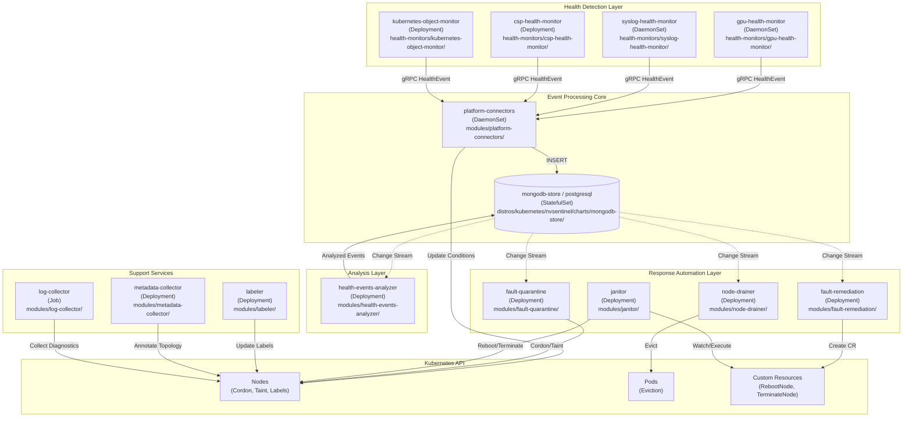

**Key Design Principles:**
- **Decoupled Communication:** Modules communicate primarily via datastore change streams, not direct RPC. [docs/OVERVIEW.md:17-18]()
- **Independent Scaling:** Each module can scale replicas independently based on load. [distros/kubernetes/nvsentinel/values-full.yaml:161-169]()
- **Progressive Enablement:** Monitoring can run alone; response modules are enabled gradually. [docs/OVERVIEW.md:55-57]()
- **Failure Isolation:** Module failures do not cascade; the datastore acts as a central coordinator. [docs/OVERVIEW.md:32-33]()

**Sources:** [README.md:163-206](), [distros/kubernetes/README.md:52-76](), [docs/OVERVIEW.md:15-38]()

---

## Core Components

### Component Summary Table

| Component | Type | Language | Purpose | Default State |
|-----------|------|----------|---------|---------------|
| `gpu-health-monitor` | DaemonSet | Python | Monitors GPU hardware via DCGM (XID errors, thermal, ECC) | Enabled [distros/kubernetes/nvsentinel/values.yaml:144]() |
| `syslog-health-monitor` | DaemonSet | Go | Parses system logs via journalctl for hardware faults | Enabled [distros/kubernetes/nvsentinel/values.yaml:160]() |
| `csp-health-monitor` | Deployment | Go | Polls cloud provider APIs for maintenance events | Disabled [distros/kubernetes/nvsentinel/values.yaml:158]() |
| `kubernetes-object-monitor` | Deployment | Go | Policy-based monitoring of K8s resources via CEL | Disabled [distros/kubernetes/nvsentinel/values.yaml:172]() |
| `platform-connectors` | DaemonSet | Go | gRPC server receiving events, persists to datastore | Enabled [distros/kubernetes/nvsentinel/values-tilt.yaml:131]() |
| `mongodb-store` | StatefulSet | — | Event persistence with change streams | Disabled (internal) [distros/kubernetes/nvsentinel/values.yaml:170]() |
| `health-events-analyzer` | Deployment | Go | Pattern detection, aggregation pipelines | Disabled [distros/kubernetes/nvsentinel/values.yaml:146]() |
| `fault-quarantine` | Deployment | Go | CEL-based rules engine for cordoning nodes | Disabled [distros/kubernetes/nvsentinel/values.yaml:148]() |
| `node-drainer` | Deployment | Go | Pod eviction with namespace-specific strategies | Disabled [distros/kubernetes/nvsentinel/values.yaml:150]() |
| `fault-remediation` | Deployment | Go | Creates maintenance CRs via Go templates | Disabled [distros/kubernetes/nvsentinel/values.yaml:152]() |
| `janitor` | Deployment | Go | Executes node reboots/terminations via cloud APIs | Disabled [distros/kubernetes/nvsentinel/values.yaml:154]() |
| `labeler` | Deployment | Go | Auto-labels nodes with DCGM/driver versions | Enabled [distros/kubernetes/nvsentinel/values.yaml:162]() |
| `metadata-collector` | Deployment | Go | Collects GPU topology (PCI, UUIDs) | Enabled [distros/kubernetes/nvsentinel/values.yaml:164]() |
| `log-collector` | Job | Python | Diagnostic log collection on faults | Disabled [distros/kubernetes/nvsentinel/values-full.yaml:226]() |

**Production Strategy:** Start with a monitoring-only configuration (`gpuHealthMonitor.enabled: true`, `faultQuarantine.enabled: false`), validate detection accuracy, then progressively enable response automation. [docs/OVERVIEW.md:55-57]()

**Sources:** [distros/kubernetes/README.md:87-115](), [distros/kubernetes/nvsentinel/values.yaml:143-180](), [docs/OVERVIEW.md:30-38]()

---

## Event Lifecycle and Data Flow

The following sequence shows a complete fault lifecycle from detection to remediation, using actual code module names and Kubernetes API interactions:

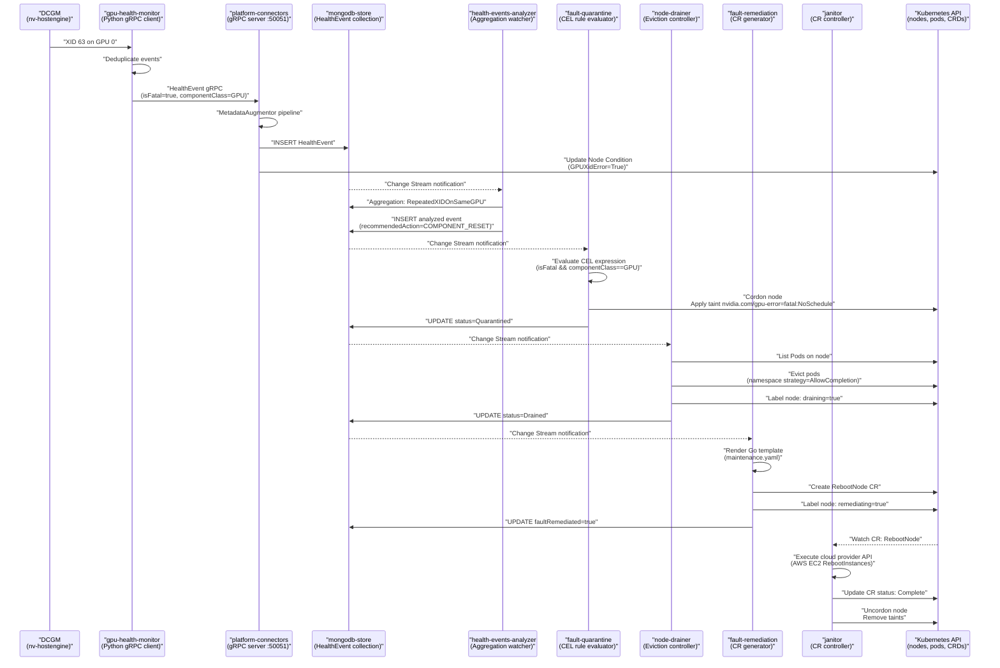

**Event Data Model:** Each `HealthEvent` contains metadata such as `nodeName`, `componentClass`, `componentID`, `checkName`, `isFatal`, and `severity`. Platform connectors augment these with cloud provider metadata and node topology before persistence. [docs/OVERVIEW.md:26-27](), [distros/kubernetes/nvsentinel/values.yaml:105-106]()

**Change Stream Watchers:** Response modules use datastore change streams (MongoDB `watch()` or PostgreSQL `LISTEN/NOTIFY`) for real-time processing. Circuit breakers in `fault-quarantine` prevent mass node quarantines based on configurable thresholds. [distros/kubernetes/README.md:145-150](), [docs/OVERVIEW.md:45-46]()

**Sources:** [README.md:163-206](), [demos/local-fault-injection-demo/README.md:75-95](), [docs/OVERVIEW.md:15-38]()

---

## Key Features

### Fault Detection
- **GPU Hardware Monitoring:** DCGM integration detects XID errors, thermal issues, ECC errors, and NVLink failures. [docs/OVERVIEW.md:21-22]()
- **System Log Analysis:** `journalctl` parsing for kernel panics, driver crashes, and hardware errors. [docs/OVERVIEW.md:22-23]()
- **Cloud Provider Events:** Integration with AWS, GCP, Azure, and OCI APIs for maintenance events. [docs/OVERVIEW.md:23-24]()
- **Custom Policies:** CEL-based monitoring of any Kubernetes resource via `kubernetes-object-monitor`. [docs/OVERVIEW.md:24-25]()

### Automated Response
- **Quarantine:** CEL rules determine when to cordon nodes and apply taints; includes a circuit breaker to prevent mass outages. [distros/kubernetes/README.md:136-169]()
- **Graceful Draining:** Namespace-specific eviction strategies including `Immediate`, `AllowCompletion`, and `DeleteAfterTimeout`. [distros/kubernetes/README.md:171-193]()
- **Remediation Workflows:** Go templates generate maintenance resources (e.g., `RebootNode`, `GPUReset`) consumed by the `janitor`. [distros/kubernetes/README.md:195-218]()
- **Multi-Cloud Execution:** The `janitor` executes reboots and terminations via cloud provider APIs. [docs/OVERVIEW.md:35-36]()

### Operational Safety
- **Dry-Run Mode:** Global flag to log all actions without executing them (cordon, drain, remediation). [distros/kubernetes/nvsentinel/values.yaml:16](), [distros/kubernetes/nvsentinel/values-full.yaml:59-69]()
- **Progressive Enablement:** Modules can be enabled one by one as confidence grows. [docs/OVERVIEW.md:55-57]()
- **Circuit Breakers:** Configurable limits on the percentage of nodes that can be quarantined simultaneously. [distros/kubernetes/README.md:145-149]()
- **Manual Override:** Use labels like `k8saas.nvidia.com/ManagedByNVSentinel: "false"` to exempt specific nodes. [distros/kubernetes/README.md:161]()

**Sources:** [README.md:37-47](), [distros/kubernetes/README.md:115-149](), [docs/OVERVIEW.md:30-38]()

---

## Technology Stack

### Languages and Frameworks
- **Go:** Used for core processing modules (`platform-connectors`, `fault-quarantine`, `node-drainer`, `fault-remediation`, `janitor`). [tilt/Tiltfile:126-145]()
- **Python:** Used for health monitors requiring DCGM bindings (`gpu-health-monitor`) and diagnostic collection. [distros/kubernetes/nvsentinel/values.yaml:143-165]()
- **gRPC/Protobuf:** Protocol for inter-service communication (monitors → connectors). [README.md:41-41](), [docs/OVERVIEW.md:26-27]()
- **CEL (Common Expression Language):** Policy evaluation in `fault-quarantine` and `kubernetes-object-monitor`. [distros/kubernetes/README.md:138-140]()

### Data Storage
- **MongoDB:** Primary event store with change streams (default). [distros/kubernetes/nvsentinel/values-tilt.yaml:145-148]()
- **PostgreSQL:** Supported alternative datastore using `LISTEN/NOTIFY`. [distros/kubernetes/nvsentinel/values.yaml:33-35](), [docs/OVERVIEW.md:45-46]()

### Kubernetes Integration
- **Helm 3.0+:** Modular chart architecture with subcharts for each module. [distros/kubernetes/README.md:52-76]()
- **client-go / controller-runtime:** Kubernetes API interaction and custom resource controllers. [distros/kubernetes/nvsentinel/values.yaml:99-103]()

### Build and CI/CD
- **Ko:** Build system for Go container images. [docs/OVERVIEW.md:61-62]()
- **GitHub Actions:** CI/CD pipeline for linting, testing, and multi-platform image publishing. [docs/OVERVIEW.md:61-63]()

**Sources:** [README.md:1-6](), [distros/kubernetes/README.md:1-6](), [docs/OVERVIEW.md:60-63]()

---

## Getting Started

### Quick Installation

```bash
# Prerequisites: Kubernetes 1.25+, Helm 3.0+, NVIDIA GPU Operator

# 1. Install cert-manager (required for TLS)
helm repo add jetstack https://charts.jetstack.io
helm upgrade --install cert-manager jetstack/cert-manager \
  --namespace cert-manager --create-namespace \
  --version v1.19.1 --set installCRDs=true --wait

# 2. Install NVSentinel (monitoring-only by default)
NVSENTINEL_VERSION=v1.0.0
helm upgrade --install nvsentinel oci://ghcr.io/nvidia/nvsentinel \
  --version "$NVSENTINEL_VERSION" \
  --namespace nvsentinel --create-namespace --wait
```

**Default Configuration:** Only health monitors are enabled. Response automation modules must be explicitly enabled via Helm values. [docs/OVERVIEW.md:55-57]()

**Verification:**
```bash
kubectl get pods -n nvsentinel
kubectl get nodes  # Verify GPU nodes are visible
```

For complete installation steps, see **Getting Started > Installation and Quick Start**.

**Sources:** [README.md:15-96](), [distros/kubernetes/README.md:8-50]()

---

## Try the Demo

The **Local Fault Injection Demo** demonstrates the complete fault detection and quarantine workflow on a laptop without GPU hardware:

```bash
cd demos/local-fault-injection-demo
make demo  # Automated: creates KIND cluster, installs NVSentinel, injects fault, verifies cordon
```

**What it demonstrates:**
1. **GPU Health Monitor** detects an injected error from a simulated DCGM. [demos/local-fault-injection-demo/README.md:103-104]()
2. **Platform Connectors** persists the health event to **MongoDB**. [demos/local-fault-injection-demo/README.md:124-125]()
3. **Fault Quarantine** evaluates CEL rules and cordons the node. [demos/local-fault-injection-demo/README.md:131-133]()
4. **Kubernetes API** reflects the node as `SchedulingDisabled`. [demos/local-fault-injection-demo/README.md:137-139]()

**Duration:** ~5-10 minutes. [demos/local-fault-injection-demo/README.md:42-43]()

For a detailed walkthrough, see **Getting Started > Fault Injection Demo**.

**Sources:** [demos/local-fault-injection-demo/README.md:1-142](), [demos/local-fault-injection-demo/scripts/00-setup.sh:1-25]()

---

## Navigation Guide

### For New Users
- **Getting Started > Core Concepts:** Health events, quarantine, drain, remediation lifecycle.
- **Getting Started > Fault Injection Demo:** Hands-on walkthrough of fault detection.
- **Architecture > System Overview:** Architecture layers and component relationships.

### For Operators
- **Getting Started > Installation and Quick Start:** Helm installation and prerequisites.
- **Deployment > Configuration Guide:** Helm values, module configuration, safety settings.
- **Deployment > Production Deployment:** Progressive enablement strategy and rollout checklist.
- **Operations and Observability > Troubleshooting Guide:** Common issues and debugging procedures.

### For Developers
- **Development > Development Environment Setup:** Tool installation and local development.
- **Development > Local Development with Tilt:** Live reload workflow for code changes.
- **Development > Testing Strategy:** Unit tests, integration tests, E2E validation.
- **CI/CD and Build System > CI/CD Pipeline Overview:** GitHub Actions workflows and quality gates.

### Component Deep Dives
- **Health Monitoring:** [GPU Health Monitor](#4.1), [Syslog Health Monitor](#4.2), [CSP Health Monitor](#4.3).
- **Event Processing:** [Platform Connectors](#5.1), [Health Events Analyzer](#5.2).
- **Fault Management:** [Fault Quarantine Module](#6.1), [Node Drainer Module](#6.2), [Fault Remediation Module](#6.3), [Janitor and Maintenance Execution](#6.4).

### Advanced Topics
- **Plugin System > Custom Drain Plugins:** `DrainRequest` CRD for external drain controllers.
- **Support Services > Event Exporter:** Streaming events to external monitoring systems.
- **Deployment > Multi-Cloud Deployment:** AWS, GCP, Azure, OCI configuration.
- **Operations and Observability > Scale Testing:** KWOK-based validation with large-scale simulated nodes.

**Sources:** [README.md:1-282](), [docs/OVERVIEW.md:1-141]()

---

# Page: Getting Started

# Getting Started

<details>
<summary>Relevant source files</summary>

The following files were used as context for generating this wiki page:

- [README.md](README.md)
- [demos/local-fault-injection-demo/Makefile](demos/local-fault-injection-demo/Makefile)
- [demos/local-fault-injection-demo/README.md](demos/local-fault-injection-demo/README.md)
- [demos/local-fault-injection-demo/scripts/00-setup.sh](demos/local-fault-injection-demo/scripts/00-setup.sh)
- [demos/local-fault-injection-demo/scripts/01-show-cluster.sh](demos/local-fault-injection-demo/scripts/01-show-cluster.sh)
- [demos/local-fault-injection-demo/scripts/02-inject-error.sh](demos/local-fault-injection-demo/scripts/02-inject-error.sh)
- [demos/local-fault-injection-demo/scripts/03-verify-cordon.sh](demos/local-fault-injection-demo/scripts/03-verify-cordon.sh)
- [demos/local-fault-injection-demo/scripts/99-cleanup.sh](demos/local-fault-injection-demo/scripts/99-cleanup.sh)
- [demos/local-slinky-drain-demo/scripts/00-setup.sh](demos/local-slinky-drain-demo/scripts/00-setup.sh)
- [distros/kubernetes/README.md](distros/kubernetes/README.md)
- [distros/kubernetes/nvsentinel/charts/gpu-health-monitor/files/dcgmerrorsmapping.csv](distros/kubernetes/nvsentinel/charts/gpu-health-monitor/files/dcgmerrorsmapping.csv)
- [distros/kubernetes/nvsentinel/charts/preflight/templates/deployment.yaml](distros/kubernetes/nvsentinel/charts/preflight/templates/deployment.yaml)
- [distros/kubernetes/nvsentinel/values-full.yaml](distros/kubernetes/nvsentinel/values-full.yaml)
- [distros/kubernetes/nvsentinel/values-tilt.yaml](distros/kubernetes/nvsentinel/values-tilt.yaml)
- [distros/kubernetes/nvsentinel/values.yaml](distros/kubernetes/nvsentinel/values.yaml)
- [docs/INTEGRATIONS.md](docs/INTEGRATIONS.md)
- [docs/OVERVIEW.md](docs/OVERVIEW.md)
- [platform-connectors/pkg/transformers/metadata/transformer_test.go](platform-connectors/pkg/transformers/metadata/transformer_test.go)
- [tests/helpers/preflight.go](tests/helpers/preflight.go)
- [tilt/Tiltfile](tilt/Tiltfile)
- [tilt/helpers.star](tilt/helpers.star)

</details>


## Purpose and Scope

This section provides an introduction to deploying and using NVSentinel for the first time. It covers prerequisite requirements, installation options, and initial verification steps. NVSentinel is a GPU fault detection and remediation system for Kubernetes that monitors GPU health, system logs, and cloud provider maintenance events to automate node recovery [docs/OVERVIEW.md:3-5]().

For detailed installation procedures, see [Installation and Quick Start](#2.1). For hands-on learning through an interactive demo, see [Fault Injection Demo](#2.2). For understanding fundamental concepts, see [Core Concepts](#2.3).

## Prerequisites

NVSentinel requires the following infrastructure to be in place before installation [README.md:17-21]():

| Component | Version | Purpose | Required |
|-----------|---------|---------|----------|
| **Kubernetes** | 1.25+ | Container orchestration platform | Yes |
| **Helm** | 3.0+ | Kubernetes package manager | Yes |
| **cert-manager** | v1.19.0+ | TLS certificate management for webhooks and internal DB | Yes [distros/kubernetes/README.md:15]() |
| **NVIDIA GPU Operator** | Latest | Includes DCGM for GPU monitoring | For GPU monitoring [README.md:21]() |
| **Persistent Storage** | 10GB+ | For MongoDB/PostgreSQL event store | Yes [distros/kubernetes/README.md:16]() |

### Storage Requirements

NVSentinel supports MongoDB and PostgreSQL as database backends [docs/OVERVIEW.md:43-45](). Both provide change streams (MongoDB) or LISTEN/NOTIFY (PostgreSQL) for real-time event processing. The default MongoDB deployment via the Bitnami chart typically requires:

- **Replica Count**: 3 nodes recommended for production change stream support [distros/kubernetes/nvsentinel/values-tilt.yaml:148]().
- **Persistence**: Enabled by default with 10Gi per replica [distros/kubernetes/README.md:16]().

**Sources:** [README.md:17-21](), [distros/kubernetes/README.md:10-17](), [docs/OVERVIEW.md:43-45](), [distros/kubernetes/nvsentinel/values.yaml:25-56]()

## Installation Decision Flow

The following diagram shows how to choose your installation path based on your hardware availability and goals:

"Installation Decision Flow"
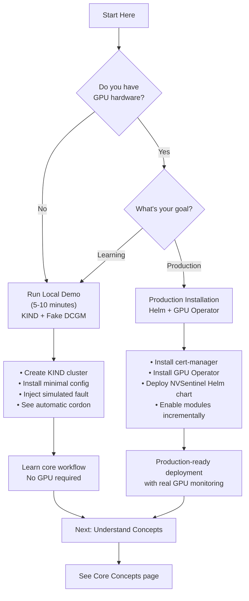

**Sources:** [README.md:15-103](), [demos/local-fault-injection-demo/README.md:33-47]()

## Quick Demo Path (No GPU Required)

The local fault injection demo provides a complete NVSentinel workflow without requiring GPU hardware [demos/local-fault-injection-demo/README.md:5-6](). It simulates a fatal GPU hardware fault (corrupt InfoROM) using DCGM's error injection capability [demos/local-fault-injection-demo/README.md:79-81]().

### Demo Architecture: Natural Language to Code Entity Space

This diagram maps high-level demo components to the specific Helm charts and code entities used in the local setup.

"Demo Component Mapping"
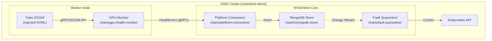

### Demo Workflow

```bash
# Automated execution
cd demos/local-fault-injection-demo
make demo  # Runs setup, injects fault, and verifies [demos/local-fault-injection-demo/Makefile]

# Or Step-by-Step
./scripts/00-setup.sh        # Creates cluster & installs [demos/local-fault-injection-demo/scripts/00-setup.sh:135]
./scripts/01-show-cluster.sh  # Initial state check
./scripts/02-inject-error.sh  # Simulates hardware failure
./scripts/03-verify-cordon.sh # Verifies node protection
```

**Sources:** [demos/local-fault-injection-demo/README.md:33-72](), [demos/local-fault-injection-demo/scripts/00-setup.sh:135-270]()

## Production Installation Path

For real GPU clusters, follow these steps to deploy the stable release.

### Step 1: Install Dependencies

```bash
# Install cert-manager (Required for TLS) [README.md:52-60]
helm repo add jetstack https://charts.jetstack.io --force-update
helm upgrade --install cert-manager jetstack/cert-manager \
  --namespace cert-manager --create-namespace \
  --version v1.19.1 --set installCRDs=true --wait

# Install Prometheus (Optional, for metrics) [README.md:62-74]
helm repo add prometheus-community https://prometheus-community.github.io/helm-charts --force-update
helm upgrade --install prometheus prometheus-community/kube-prometheus-stack \
  --namespace monitoring --create-namespace --set alertmanager.enabled=false --wait
```

### Step 2: Install NVSentinel

```bash
NVSENTINEL_VERSION=v1.0.0

helm upgrade --install nvsentinel oci://ghcr.io/nvidia/nvsentinel \
  --namespace nvsentinel --create-namespace \
  --version "$NVSENTINEL_VERSION" \
  --timeout 15m --wait
```

**Sources:** [README.md:50-86](), [distros/kubernetes/README.md:18-41]()

## Default Configuration (Safe Mode)

By default, NVSentinel only enables **Health Monitoring** modules, specifically `gpuHealthMonitor`, `syslogHealthMonitor`, `labeler`, and `metadataCollector` [distros/kubernetes/nvsentinel/values.yaml:143-164](). This is "safe" as it only observes and reports node conditions without taking disruptive actions like cordoning or draining [docs/OVERVIEW.md:56]().

"Progressive Enablement Strategy"
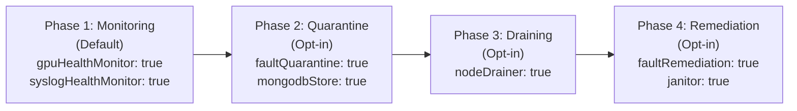

### Module Enable Flags

Configure these in your `values.yaml` to activate specific automation layers [distros/kubernetes/nvsentinel/values.yaml:143-180]():

| Module | Flag | Purpose |
|--------|------|---------|
| **Quarantine** | `global.faultQuarantine.enabled` | Cordons nodes based on CEL rules [distros/kubernetes/nvsentinel/values-full.yaml:150-155] |
| **Drainer** | `global.nodeDrainer.enabled` | Evicts pods using per-namespace strategies [distros/kubernetes/nvsentinel/values-full.yaml:157-162] |
| **Remediation** | `global.faultRemediation.enabled` | Creates break-fix CRDs (e.g., RebootNode) [distros/kubernetes/nvsentinel/values-full.yaml:164-169] |
| **Janitor** | `global.janitor.enabled` | Executes maintenance via Cloud APIs [distros/kubernetes/nvsentinel/values-full.yaml:171-175] |

**Sources:** [README.md:100-101](), [docs/OVERVIEW.md:55-58](), [distros/kubernetes/nvsentinel/values.yaml:143-180]()

## Dry-Run Mode

NVSentinel includes a global `dryRun` flag [distros/kubernetes/nvsentinel/values.yaml:16](). When set to `true`, modules will log the actions they *would* have taken (e.g., "Would cordon node X") without actually modifying the Kubernetes cluster or calling Cloud APIs [distros/kubernetes/nvsentinel/values-full.yaml:59-69]().

```yaml
global:
  dryRun: true # Test mode: log actions without executing [distros/kubernetes/nvsentinel/values.yaml:16]
```

**Sources:** [distros/kubernetes/nvsentinel/values.yaml:16](), [distros/kubernetes/nvsentinel/values-full.yaml:59-69]()

## Next Steps

After successful installation:

1. **Verify Installation**: Run the validation script: `./scripts/validate-nvsentinel.sh --version v1.0.0 --verbose` [README.md:95]().
2. **Check Logs**: Ensure monitors are detecting GPUs: `kubectl logs -n nvsentinel -l app.kubernetes.io/name=gpu-health-monitor`.
3. **Explore Integrations**: Learn how to use NVSentinel taints for scheduling [docs/INTEGRATIONS.md:103]().
4. **Understand Core Concepts**: Review [Core Concepts](#2.3) for details on the event lifecycle.

**Sources:** [README.md:88-96](), [docs/INTEGRATIONS.md:3-33]()

---

# Page: Installation and Quick Start

# Installation and Quick Start

<details>
<summary>Relevant source files</summary>

The following files were used as context for generating this wiki page:

- [distros/kubernetes/nvsentinel/charts/csp-health-monitor/templates/deployment.yaml](distros/kubernetes/nvsentinel/charts/csp-health-monitor/templates/deployment.yaml)
- [distros/kubernetes/nvsentinel/charts/event-exporter/templates/deployment.yaml](distros/kubernetes/nvsentinel/charts/event-exporter/templates/deployment.yaml)
- [distros/kubernetes/nvsentinel/charts/fault-quarantine/templates/deployment.yaml](distros/kubernetes/nvsentinel/charts/fault-quarantine/templates/deployment.yaml)
- [distros/kubernetes/nvsentinel/charts/fault-remediation/templates/deployment.yaml](distros/kubernetes/nvsentinel/charts/fault-remediation/templates/deployment.yaml)
- [distros/kubernetes/nvsentinel/charts/gpu-health-monitor/files/dcgmerrorsmapping.csv](distros/kubernetes/nvsentinel/charts/gpu-health-monitor/files/dcgmerrorsmapping.csv)
- [distros/kubernetes/nvsentinel/charts/health-events-analyzer/templates/deployment.yaml](distros/kubernetes/nvsentinel/charts/health-events-analyzer/templates/deployment.yaml)
- [distros/kubernetes/nvsentinel/charts/node-drainer/templates/deployment.yaml](distros/kubernetes/nvsentinel/charts/node-drainer/templates/deployment.yaml)
- [distros/kubernetes/nvsentinel/charts/preflight/templates/deployment.yaml](distros/kubernetes/nvsentinel/charts/preflight/templates/deployment.yaml)
- [distros/kubernetes/nvsentinel/templates/_helpers.tpl](distros/kubernetes/nvsentinel/templates/_helpers.tpl)
- [distros/kubernetes/nvsentinel/templates/configmap-datastore.yaml](distros/kubernetes/nvsentinel/templates/configmap-datastore.yaml)
- [distros/kubernetes/nvsentinel/templates/daemonset.yaml](distros/kubernetes/nvsentinel/templates/daemonset.yaml)
- [distros/kubernetes/nvsentinel/templates/job-external-mongodb-setup.yaml](distros/kubernetes/nvsentinel/templates/job-external-mongodb-setup.yaml)
- [distros/kubernetes/nvsentinel/values-atlas-gcp.yaml](distros/kubernetes/nvsentinel/values-atlas-gcp.yaml)
- [distros/kubernetes/nvsentinel/values-full.yaml](distros/kubernetes/nvsentinel/values-full.yaml)
- [distros/kubernetes/nvsentinel/values-tilt.yaml](distros/kubernetes/nvsentinel/values-tilt.yaml)
- [distros/kubernetes/nvsentinel/values.yaml](distros/kubernetes/nvsentinel/values.yaml)
- [docs/INTEGRATIONS.md](docs/INTEGRATIONS.md)
- [platform-connectors/pkg/transformers/metadata/transformer_test.go](platform-connectors/pkg/transformers/metadata/transformer_test.go)
- [scripts/validate-nvsentinel.sh](scripts/validate-nvsentinel.sh)
- [tests/helpers/preflight.go](tests/helpers/preflight.go)
- [tests/uat/kind/README.md](tests/uat/kind/README.md)
- [tests/uat/kind/cert-manager-values.yaml](tests/uat/kind/cert-manager-values.yaml)
- [tests/uat/kind/kwok-node-template.yaml](tests/uat/kind/kwok-node-template.yaml)
- [tests/uat/kind/nvidia-dcgm-daemonset.yaml](tests/uat/kind/nvidia-dcgm-daemonset.yaml)
- [tests/uat/kind/nvidia-driver-daemonset.yaml](tests/uat/kind/nvidia-driver-daemonset.yaml)
- [tests/uat/kind/prometheus-operator-values.yaml](tests/uat/kind/prometheus-operator-values.yaml)
- [tilt/Tiltfile](tilt/Tiltfile)
- [tilt/dcgm-fake/gpu-spec.yaml](tilt/dcgm-fake/gpu-spec.yaml)
- [tilt/helpers.star](tilt/helpers.star)
- [tilt/nvidia-dcgm-daemonset.yaml](tilt/nvidia-dcgm-daemonset.yaml)
- [tilt/nvidia-driver-daemonset.yaml](tilt/nvidia-driver-daemonset.yaml)

</details>


This page provides step-by-step instructions for installing NVSentinel in a Kubernetes cluster and verifying the deployment. It covers production installation via Helm, dependency setup, basic configuration, and verification procedures.

**Scope**: This guide focuses on getting NVSentinel running quickly with default settings. For detailed configuration options, see page [11.2](). For production deployment strategies and progressive enablement, see page [11.3](). For local development setup with Tilt, see page [10.2]().

---

## Prerequisites

NVSentinel requires a Kubernetes cluster with specific versions and supporting infrastructure:

| Component | Version | Purpose | Required |
|-----------|---------|---------|----------|
| **Kubernetes** | 1.25+ | Container orchestration platform | Yes |
| **Helm** | 3.0+ | Package manager for Kubernetes | Yes |
| **cert-manager** | v1.19.0+ | TLS certificate management | Yes |
| **Prometheus Operator** | Latest | Metrics collection (PodMonitor CRDs) | No (recommended) |
| **NVIDIA GPU Operator** | Latest | GPU monitoring via DCGM | Yes (for GPU monitoring) |
| **Persistent Storage** | - | MongoDB/PostgreSQL storage | Yes (10GB+ recommended) |

**Architecture Support**: NVSentinel supports both `amd64` and `arm64` architectures [distros/kubernetes/nvsentinel/values-tilt.yaml:95-102](). Container images are built for both platforms.

Sources: [distros/kubernetes/nvsentinel/values-tilt.yaml:17-102](), [distros/kubernetes/nvsentinel/values.yaml:17-23]()

---

## Installation Flow

### Deployment Lifecycle
The following diagram illustrates the deployment sequence and component readiness checks.

Title: NVSentinel Installation Workflow
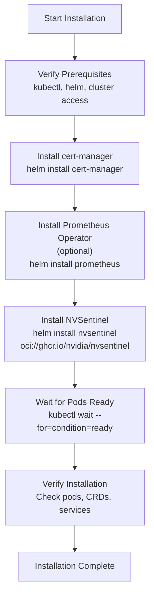

Sources: [tilt/Tiltfile:43-89](), [scripts/validate-nvsentinel.sh:78-106]()

---

## Production Installation via Helm OCI Registry

### Step 1: Install cert-manager

cert-manager manages TLS certificates for secure communication between NVSentinel components and for MongoDB/PostgreSQL client authentication [distros/kubernetes/nvsentinel/values.yaml:99-103]().

```bash
# Add Jetstack Helm repository
helm repo add jetstack https://charts.jetstack.io --force-update

# Install cert-manager with CRDs
helm upgrade --install cert-manager jetstack/cert-manager \
  --namespace cert-manager \
  --create-namespace \
  --version v1.19.1 \
  --set installCRDs=true \
  --wait
```

Sources: [tilt/Tiltfile:43-52](), [tests/uat/kind/cert-manager-values.yaml:15-55]()

### Step 2: Install Prometheus Operator (Optional)

Prometheus Operator provides `PodMonitor` CRDs used by NVSentinel for metrics collection. While optional, it's recommended for production observability [distros/kubernetes/nvsentinel/values.yaml:23]().

```bash
# Add Prometheus community Helm repository
helm repo add prometheus-community https://prometheus-community.github.io/helm-charts --force-update

# Install Prometheus Operator (minimal configuration)
helm upgrade --install prometheus prometheus-community/kube-prometheus-stack \
  --namespace monitoring \
  --create-namespace \
  --set prometheus.enabled=true \
  --set alertmanager.enabled=false \
  --set grafana.enabled=false \
  --set kubeStateMetrics.enabled=false \
  --set nodeExporter.enabled=false \
  --wait
```

Sources: [tilt/Tiltfile:54-68](), [distros/kubernetes/nvsentinel/values.yaml:23-24]()

### Step 3: Install NVSentinel

Install NVSentinel from the GitHub Container Registry (GHCR) OCI registry:

```bash
# Set version (check releases for latest)
NVSENTINEL_VERSION=v1.0.0

# Install NVSentinel with default configuration
helm upgrade --install nvsentinel oci://ghcr.io/nvidia/nvsentinel \
  --namespace nvsentinel \
  --create-namespace \
  --version "$NVSENTINEL_VERSION" \
  --timeout 15m \
  --wait
```

**Default Behavior**: The default configuration ([distros/kubernetes/nvsentinel/values.yaml:144-181]()) enables only **monitoring components**:
- `gpuHealthMonitor.enabled: true` [distros/kubernetes/nvsentinel/values.yaml:144]()
- `syslogHealthMonitor.enabled: true` [distros/kubernetes/nvsentinel/values.yaml:160]()
- `metadataCollector.enabled: true` [distros/kubernetes/nvsentinel/values.yaml:164]()
- `labeler.enabled: true` [distros/kubernetes/nvsentinel/values.yaml:162]()

**Action-taking modules are disabled by default** for safety:
- `faultQuarantine.enabled: false` [distros/kubernetes/nvsentinel/values.yaml:148]()
- `nodeDrainer.enabled: false` [distros/kubernetes/nvsentinel/values.yaml:150]()
- `faultRemediation.enabled: false` [distros/kubernetes/nvsentinel/values.yaml:152]()
- `janitor.enabled: false` [distros/kubernetes/nvsentinel/values.yaml:154]()
- `mongodbStore.enabled: false` [distros/kubernetes/nvsentinel/values.yaml:170]()

Sources: [distros/kubernetes/nvsentinel/values.yaml:144-181](), [distros/kubernetes/nvsentinel/values.yaml:16-170]()

---

## Helm Chart Structure

The NVSentinel Helm chart follows a modular architecture with independent subcharts for each component.

Title: NVSentinel Subchart Dependencies
```mermaid
graph TB
    subgraph "Main Chart [nvsentinel]"
        MainChart["Chart.yaml"]
        ValuesYaml["values.yaml"]
    end
    
    subgraph "Health Monitor Subcharts"
        GPUMon["gpu-health-monitor"]
        SyslogMon["syslog-health-monitor"]
        CSPMon["csp-health-monitor"]
        K8sMon["kubernetes-object-monitor"]
        SlurmMon["slurm-drain-monitor"]
    end
    
    subgraph "Core Processing Subcharts"
        FQ["fault-quarantine"]
        ND["node-drainer"]
        FR["fault-remediation"]
        HEA["health-events-analyzer"]
    end
    
    subgraph "Infrastructure & Support"
        MongoDB["mongodb-store"]
        Postgres["postgresql"]
        Janitor["janitor"]
        Labeler["labeler"]
        Preflight["preflight"]
    end
    
    MainChart -.->|condition: global.gpuHealthMonitor.enabled| GPUMon
    MainChart -.->|condition: global.syslogHealthMonitor.enabled| SyslogMon
    MainChart -.->|condition: global.cspHealthMonitor.enabled| CSPMon
    MainChart -.->|condition: global.kubernetesObjectMonitor.enabled| K8sMon
    MainChart -.->|condition: global.slurmDrainMonitor.enabled| SlurmMon
    
    MainChart -.->|condition: global.faultQuarantine.enabled| FQ
    MainChart -.->|condition: global.nodeDrainer.enabled| ND
    MainChart -.->|condition: global.faultRemediation.enabled| FR
    MainChart -.->|condition: global.healthEventsAnalyzer.enabled| HEA
    
    MainChart -.->|condition: global.mongodbStore.enabled| MongoDB
    MainChart -.->|condition: postgresql.enabled| Postgres
    MainChart -.->|condition: global.janitor.enabled| Janitor
    MainChart -.->|condition: global.labeler.enabled| Labeler
    MainChart -.->|condition: global.preflight.enabled| Preflight
```

Sources: [distros/kubernetes/nvsentinel/values.yaml:144-181](), [distros/kubernetes/nvsentinel/values-full.yaml:138-181]()

---

## Basic Configuration

### Enabling Modules

To enable action-taking modules, override the `global` flags in a custom values file:

```yaml
# custom-values.yaml
global:
  mongodbStore:
    enabled: true
  faultQuarantine:
    enabled: true
  nodeDrainer:
    enabled: true
  faultRemediation:
    enabled: true
```

Sources: [distros/kubernetes/nvsentinel/values.yaml:144-171](), [distros/kubernetes/nvsentinel/values-tilt.yaml:52-85]()

### Dry-Run Mode

Enable dry-run to log actions without executing them (e.g., logging cordons without actually cordoning nodes) [distros/kubernetes/nvsentinel/values.yaml:16](). This is supported across modules via CLI flags like `--dry-run` [distros/kubernetes/nvsentinel/charts/fault-remediation/templates/deployment.yaml:92]().

```yaml
global:
  dryRun: true
```

Sources: [distros/kubernetes/nvsentinel/values.yaml:16](), [distros/kubernetes/nvsentinel/values-full.yaml:59-69](), [distros/kubernetes/nvsentinel/charts/fault-remediation/templates/deployment.yaml:92]()

### Datastore Configuration

NVSentinel supports MongoDB (default) or PostgreSQL. Configuration is centralized under `global.datastore` [distros/kubernetes/nvsentinel/values.yaml:33-56](). Components like `platform-connector` mount client certificates based on the provider [distros/kubernetes/nvsentinel/templates/daemonset.yaml:118-125]().

```yaml
global:
  datastore:
    provider: "mongodb" # or "postgresql"
    connection:
      host: "nvsentinel-mongodb"
      port: 27017
      database: "HealthEventsDatabase"
```

Sources: [distros/kubernetes/nvsentinel/values.yaml:33-56](), [distros/kubernetes/nvsentinel/templates/daemonset.yaml:118-125](), [tilt/Tiltfile:153-160]()

---

## Installation Verification

### Verify Pod Status

Check that all expected pods are running in the target namespace (default: `nvsentinel`) [scripts/validate-nvsentinel.sh:51]().

```bash
kubectl get pods -n nvsentinel
```

### Validation Script

Use the provided validation script to perform automated health checks on the deployment [scripts/validate-nvsentinel.sh:1-47]().

```bash
# Run validation script
./scripts/validate-nvsentinel.sh --version v1.0.0 --namespace nvsentinel
```

The script verifies:
1. **Namespace existence** [scripts/validate-nvsentinel.sh:83-88]()
2. **Datastore connectivity** [scripts/validate-nvsentinel.sh:90-92]()
3. **Image versions** across all NVSentinel pods [scripts/validate-nvsentinel.sh:108-114]()
4. **Image pull secrets** [scripts/validate-nvsentinel.sh:159-163]()

Sources: [scripts/validate-nvsentinel.sh:1-163]()

---

## Preflight Verification

If `global.preflight.enabled` is `true`, NVSentinel performs GPU health checks before pod admission [distros/kubernetes/nvsentinel/values-tilt.yaml:100](). In development environments like Tilt, this can be configured to use fake DCGM diagnostics for faster E2E passes [distros/kubernetes/nvsentinel/values-tilt.yaml:104-124]().

### Preflight Components
- **Webhook Server**: Validates incoming pod requests.
- **Init Containers**: Injected into pods to run diagnostics like `preflight-dcgm-diag` [distros/kubernetes/nvsentinel/values-tilt.yaml:119]().

Title: Preflight Admission Data Flow
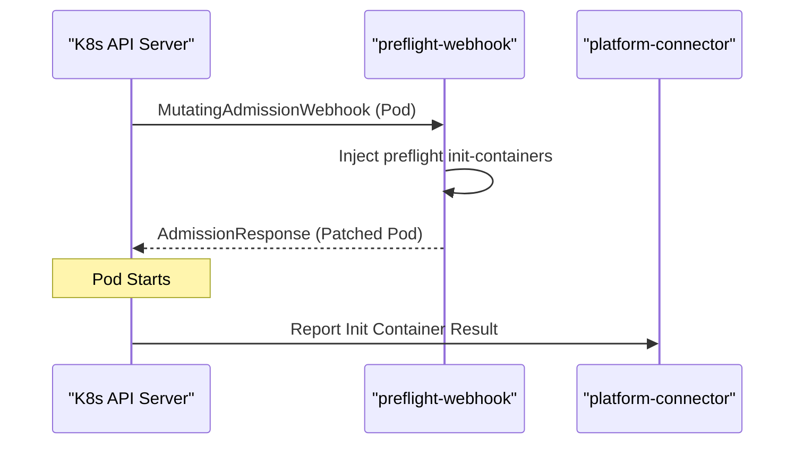

Sources: [distros/kubernetes/nvsentinel/values-tilt.yaml:100-124](), [docs/INTEGRATIONS.md:29-32]()

---

## Troubleshooting

### Common Issues

| Issue | Verification Command | Potential Fix |
|-------|----------------------|---------------|
| **Datastore Connection** | `kubectl logs -l app.kubernetes.io/name=nvsentinel` | Verify `global.datastore.connection` values [distros/kubernetes/nvsentinel/values.yaml:49-56]() |
| **Missing GPU Metadata** | `cat /var/lib/nvsentinel/gpu_metadata.json` | Ensure `metadata-collector` is running [distros/kubernetes/nvsentinel/values.yaml:106]() |
| **DCGM Connection** | `kubectl describe pod -l app.kubernetes.io/name=gpu-health-monitor` | Check `global.dcgm.service.endpoint` [distros/kubernetes/nvsentinel/values.yaml:110-117]() |

Sources: [distros/kubernetes/nvsentinel/values.yaml:106-117](), [scripts/validate-nvsentinel.sh:54-60]()

---

# Page: Fault Injection Demo

# Fault Injection Demo

<details>
<summary>Relevant source files</summary>

The following files were used as context for generating this wiki page:

- [README.md](README.md)
- [demos/README.md](demos/README.md)
- [demos/local-custom-remediation-demo/Makefile](demos/local-custom-remediation-demo/Makefile)
- [demos/local-custom-remediation-demo/README.md](demos/local-custom-remediation-demo/README.md)
- [demos/local-custom-remediation-demo/config/memoryreclaim-crd.yaml](demos/local-custom-remediation-demo/config/memoryreclaim-crd.yaml)
- [demos/local-custom-remediation-demo/config/nvsentinel-values.yaml](demos/local-custom-remediation-demo/config/nvsentinel-values.yaml)
- [demos/local-custom-remediation-demo/memory-pressure-monitor/go.sum](demos/local-custom-remediation-demo/memory-pressure-monitor/go.sum)
- [demos/local-custom-remediation-demo/memory-pressure-monitor/main.go](demos/local-custom-remediation-demo/memory-pressure-monitor/main.go)
- [demos/local-custom-remediation-demo/memory-reclaim-controller/go.mod](demos/local-custom-remediation-demo/memory-reclaim-controller/go.mod)
- [demos/local-custom-remediation-demo/memory-reclaim-controller/go.sum](demos/local-custom-remediation-demo/memory-reclaim-controller/go.sum)
- [demos/local-fault-injection-demo/Makefile](demos/local-fault-injection-demo/Makefile)
- [demos/local-fault-injection-demo/README.md](demos/local-fault-injection-demo/README.md)
- [demos/local-fault-injection-demo/scripts/00-setup.sh](demos/local-fault-injection-demo/scripts/00-setup.sh)
- [demos/local-fault-injection-demo/scripts/01-show-cluster.sh](demos/local-fault-injection-demo/scripts/01-show-cluster.sh)
- [demos/local-fault-injection-demo/scripts/02-inject-error.sh](demos/local-fault-injection-demo/scripts/02-inject-error.sh)
- [demos/local-fault-injection-demo/scripts/03-verify-cordon.sh](demos/local-fault-injection-demo/scripts/03-verify-cordon.sh)
- [demos/local-fault-injection-demo/scripts/99-cleanup.sh](demos/local-fault-injection-demo/scripts/99-cleanup.sh)
- [demos/local-slinky-drain-demo/scripts/00-setup.sh](demos/local-slinky-drain-demo/scripts/00-setup.sh)
- [distros/kubernetes/README.md](distros/kubernetes/README.md)
- [docs/OVERVIEW.md](docs/OVERVIEW.md)

</details>


## Purpose and Scope

This page provides a detailed walkthrough of the **Local Fault Injection Demo**, an interactive demonstration that runs entirely on a local machine without requiring GPU hardware. The demo illustrates NVSentinel's core fault detection and quarantine workflow, from GPU error detection through automated node cordoning.

**What this demo covers:**
- Simulating GPU hardware failures using a simulated DCGM environment [demos/local-fault-injection-demo/README.md:102]().
- Observing health event flow from detection to the persistent data store [demos/local-fault-injection-demo/README.md:12-13]().
- Verifying automated node quarantine (cordon) behavior triggered by fatal errors [demos/local-fault-injection-demo/README.md:11]().
- Understanding the event-driven architecture in practice using MongoDB change streams [demos/local-fault-injection-demo/README.md:106]().

**What this demo does NOT cover:**
- Production installation and configuration (see [Installation and Quick Start](2.1)).
- Pod eviction (Node Drainer) or remediation workflows (Fault Remediation), which are disabled to simplify the demo [demos/local-fault-injection-demo/scripts/00-setup.sh:175-178]().
- Real GPU hardware monitoring (DCGM integration is simulated) [demos/local-fault-injection-demo/README.md:5-6]().

The demo focuses on the **detection-to-quarantine** pipeline. Node Drainer, Fault Remediation, Health Events Analyzer, and Janitor modules are disabled to minimize resource usage and simplify the learning experience [demos/local-fault-injection-demo/scripts/00-setup.sh:175-182]().

**Location:** `demos/local-fault-injection-demo/` [demos/local-fault-injection-demo/README.md:1]()

---

## Prerequisites and System Requirements

### Required Tools

| Tool | Minimum Version | Purpose |
|------|----------------|---------|
| `docker` | 20.10+ | Container runtime for KIND [demos/local-fault-injection-demo/README.md:24]() |
| `kind` | 0.20+ | Kubernetes IN Docker cluster [demos/local-fault-injection-demo/README.md:26]() |
| `kubectl` | 1.25+ | Kubernetes CLI [demos/local-fault-injection-demo/README.md:25]() |
| `helm` | 3.0+ | Kubernetes package manager [demos/local-fault-injection-demo/README.md:27]() |
| `jq` | 1.6+ | JSON parsing in scripts [demos/local-fault-injection-demo/README.md:28]() |

### System Resources
- **Disk Space:** ~10GB free (Docker images + KIND cluster) [demos/local-fault-injection-demo/README.md:19]().
- **Memory:** 4GB minimum, 8GB recommended [demos/local-fault-injection-demo/README.md:20]().
- **CPU:** 2 cores minimum [demos/local-fault-injection-demo/README.md:21]().
- **GPU:** **Not required** (simulation mode) [demos/local-fault-injection-demo/README.md:16]().

**Sources:** [demos/local-fault-injection-demo/README.md:14-32](), [demos/local-fault-injection-demo/scripts/00-setup.sh:45-75]()

---

## Demo Architecture

The demo deploys a **minimal NVSentinel configuration** in a single-node KIND cluster. This configuration includes only the components necessary to demonstrate fault detection and quarantine.

### Deployment Topology

```mermaid
graph TB
    subgraph "KIND_Cluster_[nvsentinel-demo]"
        subgraph "Control_Plane_Node"
            "kube-apiserver"["kube-apiserver"]
            "mongodb-store"["mongodb-store (Pod)"]
        end
        
        subgraph "Worker_Node"
            "fake-dcgm"["fake-dcgm (DaemonSet)"]
            "gpu-health-monitor"["gpu-health-monitor (DaemonSet)"]
        end
        
        subgraph "Core_Components"
            "platform-connectors"["platform-connectors (Deployment)"]
            "fault-quarantine"["fault-quarantine (Deployment)"]
            "simple-health-client"["simple-health-client (Deployment)"]
        end
    end
    
    "fake-dcgm" -->|"DCGM_API"| "gpu-health-monitor"
    "gpu-health-monitor" -->|"gRPC_HealthEvent"| "platform-connectors"
    "platform-connectors" -->|"Insert_Event"| "mongodb-store"
    "mongodb-store" -.->|"Change_Stream"| "fault-quarantine"
    "fault-quarantine" -->|"Cordon_Node"| "kube-apiserver"
```

**Architecture Notes:**
- **Fake DCGM:** Simulates NVIDIA GPU monitoring with NVML injection [demos/local-fault-injection-demo/README.md:102]().
- **Single MongoDB Instance:** Uses a 1-node replica set to enable change streams without high resource overhead [demos/local-fault-injection-demo/scripts/00-setup.sh:209]().
- **Disabled Modules:** To keep the demo focused, `nodeDrainer`, `faultRemediation`, and `janitor` are explicitly disabled [demos/local-fault-injection-demo/scripts/00-setup.sh:175-182]().

**Sources:** [demos/local-fault-injection-demo/README.md:97-142](), [demos/local-fault-injection-demo/scripts/00-setup.sh:135-300]()

---

## Demo Workflow

The demo consists of four primary phases. Users can run the automated workflow (`make demo`) or execute scripts individually for learning.

### Phase 0: Setup (`00-setup.sh`)
**Purpose:** Create KIND cluster and install minimal NVSentinel deployment.
- **Cluster Creation:** Creates a cluster named `nvsentinel-demo` with one worker node [demos/local-fault-injection-demo/scripts/00-setup.sh:87-93]().
- **Cert-Manager:** Installs `cert-manager` for internal TLS requirements [demos/local-fault-injection-demo/scripts/00-setup.sh:107-121]().
- **NVSentinel Install:** Deploys NVSentinel via Helm with a minimal `values.yaml` [demos/local-fault-injection-demo/scripts/00-setup.sh:150-281]().

### Phase 1: Initial State Inspection (`01-show-cluster.sh`)
**Purpose:** Verify cluster health before fault injection.
- Checks if the worker node is `Ready` and `SchedulingEnabled` [demos/local-fault-injection-demo/scripts/01-show-cluster.sh:55-71]().
- Verifies all NVSentinel pods are `Running` [demos/local-fault-injection-demo/scripts/01-show-cluster.sh:73-95]().
- Confirms no health-related node conditions exist [demos/local-fault-injection-demo/scripts/01-show-cluster.sh:128]().

### Phase 2: Fault Injection (`02-inject-error.sh`)
**Purpose:** Simulate a GPU hardware failure.
- **DCGM Injection:** Executes `dcgmi test --inject` inside the `fake-dcgm` pod to simulate a fatal InfoROM corruption (Field 84) on GPU 0 [demos/local-fault-injection-demo/README.md:81]().
- **Detection:** The `gpu-health-monitor` detects this change during its next poll cycle and reports it to `platform-connectors` [demos/local-fault-injection-demo/README.md:87-88]().

### Phase 3: Automated Response Verification (`03-verify-cordon.sh`)
**Purpose:** Confirm that the node was automatically quarantined.
- **Cordon Check:** Polls the Kubernetes API to see if the node `spec.unschedulable` has been set to `true` [demos/local-fault-injection-demo/README.md:91]().
- **Condition Check:** Verifies the presence of health-related node conditions (e.g., `GPUXidError`) [demos/local-fault-injection-demo/scripts/01-show-cluster.sh:98-122]().

**Sources:** [demos/local-fault-injection-demo/README.md:34-73](), [demos/local-fault-injection-demo/scripts/00-setup.sh:1-150]()

---

## Detailed Implementation: Code Entity Space

This diagram maps the demo actions to specific code entities and data structures within the NVSentinel repository.

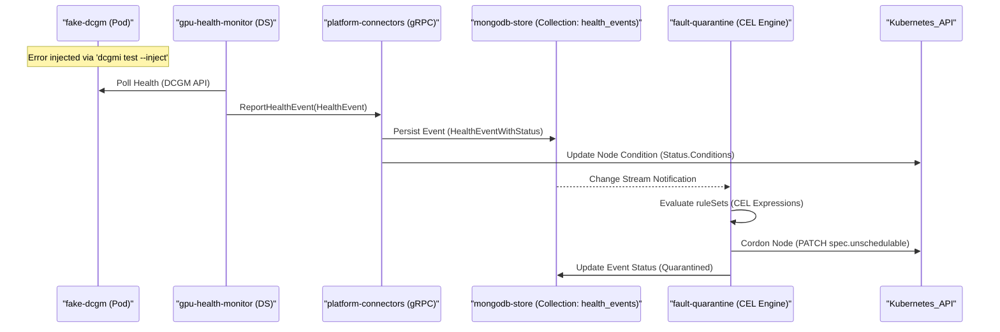

### Key Components in Code

| Code Entity | File Path | Role |
|-------------|-----------|------|
| `gpu-health-monitor` | `charts/gpu-health-monitor/` | Polls DCGM and sends gRPC events [distros/kubernetes/README.md:63]() |
| `platform-connectors` | `charts/platform-connectors/` | gRPC server for event ingestion and persistence [distros/kubernetes/README.md:62]() |
| `fault-quarantine` | `charts/fault-quarantine/` | Watches MongoDB and executes cordon/taint logic [distros/kubernetes/README.md:66]() |
| `mongodb-store` | `charts/mongodb-store/` | Event database providing change streams [distros/kubernetes/README.md:72]() |
| `ruleSets` | `values.yaml` (fault-quarantine) | CEL expressions used to match fatal events [distros/kubernetes/README.md:152-169]() |

**Sources:** [distros/kubernetes/README.md:52-76](), [demos/local-fault-injection-demo/README.md:108-142](), [README.md:117-166]()

---

## Extended Scenario: Custom Remediation Demo

While the basic fault injection demo focuses on quarantine, the **Custom Remediation Demo** shows how NVSentinel can be extended to handle non-GPU faults and trigger custom repair workflows.

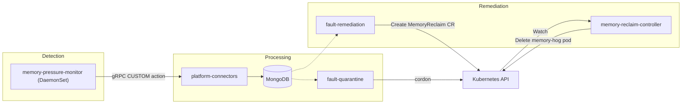

### Implementation Details
- **Custom Monitor:** A Go DaemonSet that reads `/proc/meminfo` and sends a `CUSTOM` health event with `customRecommendedAction: "RECLAIM_MEMORY"` [demos/local-custom-remediation-demo/README.md:113-126]().
- **Custom Action Mapping:** Configured in Helm to map the "RECLAIM_MEMORY" action to a specific CRD (`MemoryReclaim`) [demos/local-custom-remediation-demo/README.md:162-171]().
- **Third-Party Controller:** The `memory-reclaim-controller` watches for these CRs and executes the repair by deleting specific pods [demos/local-custom-remediation-demo/README.md:150-153]().

**Sources:** [demos/local-custom-remediation-demo/README.md:1-171]()

---

## Cleanup

To destroy the demo environment and reclaim system resources, use the provided cleanup script:

```bash
# Deletes the KIND cluster and local temporary files
./scripts/99-cleanup.sh
```

This command deletes the `nvsentinel-demo` cluster [demos/local-fault-injection-demo/scripts/00-setup.sh:83](). Note that persistent data in MongoDB is lost as persistence is disabled for this demo [demos/local-fault-injection-demo/scripts/00-setup.sh:248]().

**Sources:** [demos/local-fault-injection-demo/README.md:46](), [demos/local-fault-injection-demo/scripts/00-setup.sh:77-85]()

---

# Page: Core Concepts

# Core Concepts

<details>
<summary>Relevant source files</summary>

The following files were used as context for generating this wiki page:

- [commons/go.sum](commons/go.sum)
- [data-models/pkg/protos/health_event.pb.go](data-models/pkg/protos/health_event.pb.go)
- [data-models/protobufs/health_event.proto](data-models/protobufs/health_event.proto)
- [distros/kubernetes/nvsentinel/charts/gpu-health-monitor/files/dcgmerrorsmapping.csv](distros/kubernetes/nvsentinel/charts/gpu-health-monitor/files/dcgmerrorsmapping.csv)
- [distros/kubernetes/nvsentinel/charts/preflight/templates/deployment.yaml](distros/kubernetes/nvsentinel/charts/preflight/templates/deployment.yaml)
- [distros/kubernetes/nvsentinel/values-full.yaml](distros/kubernetes/nvsentinel/values-full.yaml)
- [distros/kubernetes/nvsentinel/values-tilt.yaml](distros/kubernetes/nvsentinel/values-tilt.yaml)
- [distros/kubernetes/nvsentinel/values.yaml](distros/kubernetes/nvsentinel/values.yaml)
- [docs/INTEGRATIONS.md](docs/INTEGRATIONS.md)
- [event-exporter/go.mod](event-exporter/go.mod)
- [event-exporter/go.sum](event-exporter/go.sum)
- [fault-quarantine/go.mod](fault-quarantine/go.mod)
- [fault-quarantine/go.sum](fault-quarantine/go.sum)
- [fault-remediation/go.mod](fault-remediation/go.mod)
- [fault-remediation/go.sum](fault-remediation/go.sum)
- [health-events-analyzer/go.mod](health-events-analyzer/go.mod)
- [health-events-analyzer/go.sum](health-events-analyzer/go.sum)
- [health-monitors/gpu-health-monitor/gpu_health_monitor/protos/health_event_pb2.py](health-monitors/gpu-health-monitor/gpu_health_monitor/protos/health_event_pb2.py)
- [health-monitors/gpu-health-monitor/gpu_health_monitor/protos/health_event_pb2.pyi](health-monitors/gpu-health-monitor/gpu_health_monitor/protos/health_event_pb2.pyi)
- [health-monitors/syslog-health-monitor/go.mod](health-monitors/syslog-health-monitor/go.mod)
- [node-drainer/go.mod](node-drainer/go.mod)
- [node-drainer/go.sum](node-drainer/go.sum)
- [platform-connectors/go.mod](platform-connectors/go.mod)
- [platform-connectors/go.sum](platform-connectors/go.sum)
- [platform-connectors/pkg/transformers/metadata/transformer_test.go](platform-connectors/pkg/transformers/metadata/transformer_test.go)
- [store-client/go.mod](store-client/go.mod)
- [tests/helpers/healthevent.go](tests/helpers/healthevent.go)
- [tests/helpers/preflight.go](tests/helpers/preflight.go)
- [tilt/Tiltfile](tilt/Tiltfile)
- [tilt/helpers.star](tilt/helpers.star)

</details>


## Purpose and Scope

This page defines the fundamental concepts of NVSentinel: **Health Events**, **Monitoring**, **Quarantine**, **Drain**, and **Remediation**. It explains the technical implementation of the event lifecycle, data flow between components, and the transition from high-level operational states to specific code entities.

NVSentinel is designed as a modular, event-driven system where coordination occurs through a shared datastore (MongoDB or PostgreSQL) and the Kubernetes API, rather than direct RPC calls between core logic modules [distros/kubernetes/nvsentinel/values.yaml:25-35]().

---

## Health Events

A **Health Event** is the primary data structure in NVSentinel, representing a detected hardware or software fault.

### Data Structure and Code Entities
In the codebase, these are defined as Protobuf messages which are then used to generate Python and Go bindings [data-models/protobufs/health_event.proto:1-50]().

| Field | Code Identifier | Description |
|-------|-----------------|-------------|
| **Agent** | `agent` | The monitor that reported the event (e.g., `gpu-health-monitor`) [data-models/protobufs/health_event.proto:27]() |
| **Check Name** | `check_name` | Specific fault type (e.g., `GPUXidError`) [data-models/protobufs/health_event.proto:29]() |
| **Severity** | `is_fatal` | Boolean indicating if the node must be isolated immediately [data-models/protobufs/health_event.proto:30]() |
| **Impact** | `entities_impacted` | List of specific GPUs (by UUID) or other components affected [data-models/protobufs/health_event.proto:35]() |
| **Strategy** | `processing_strategy` | Dictates if the event should trigger remediation or just be logged (`STORE_ONLY` vs `EXECUTE_REMEDIATION`) [data-models/protobufs/health_event.proto:41]() |

**Sources:** [data-models/protobufs/health_event.proto:1-50](), [health-monitors/gpu-health-monitor/gpu_health_monitor/protos/health_event_pb2.py:1-100]()

---

## Health Monitoring

Monitors are the "sensors" of the system. They operate at different levels of the stack to provide comprehensive coverage.

### Monitor Taxonomy

| Component | Implementation | Detection Source | Scope |
|-----------|----------------|------------------|-------|
| **GPU Health Monitor** | Python [distros/kubernetes/nvsentinel/values.yaml:143-144]() | DCGM (XIDs, ECC, Thermal) [distros/kubernetes/nvsentinel/values.yaml:110-112]() | Per-Node (DaemonSet) |
| **Syslog Health Monitor** | Go [distros/kubernetes/nvsentinel/values.yaml:159-160]() | Journalctl (Kernel Panics, Driver Crashes) [distros/kubernetes/nvsentinel/values.yaml:105-106]() | Per-Node (DaemonSet) |
| **CSP Health Monitor** | Go [distros/kubernetes/nvsentinel/values.yaml:157-158]() | AWS/GCP/Azure/OCI APIs (Maintenance events) [distros/kubernetes/nvsentinel/values-full.yaml:172-174]() | Cluster-wide |
| **K8s Object Monitor** | Go [distros/kubernetes/nvsentinel/values.yaml:171-172]() | K8s API (CEL expressions on resources) [distros/kubernetes/nvsentinel/values-full.yaml:205-207]() | Cluster-wide |

### Natural Language to Code Entity Space: Monitoring
The following diagram bridges the concept of "Monitoring" to the actual gRPC service and message definitions.

```mermaid
graph TD
    subgraph "Natural Language: Detection"
        A["Hardware Fault"]
        B["Cloud Maintenance"]
    end

    subgraph "Code Entity: Health Monitors"
        GPU["gpu-health-monitor (Python)"]
        CSP["csp-health-monitor (Go)"]
    end

    subgraph "Code Entity: Platform Connectors"
        PC["platform-connectors (Go)"]
        PC_RPC["HealthEventOccurredV1"]
    end

    subgraph "Data Model"
        HE["HealthEvent (Protobuf)"]
    end

    A --> GPU
    B --> CSP
    GPU -->| "calls gRPC" | PC_RPC
    CSP -->| "calls gRPC" | PC_RPC
    PC_RPC -->| "unmarshals" | HE
```
**Sources:** [platform-connectors/go.mod:1-24](), [data-models/protobufs/health_event.proto:1-50](), [distros/kubernetes/nvsentinel/values.yaml:143-173]()

---

## Event Processing Pipeline

The `platform-connectors` module acts as the gateway. It receives events via gRPC, typically over a Unix domain socket for node-local monitors.

### Data Flow Logic
1. **Ingestion**: The `PlatformConnector` service receives a `HealthEvents` stream [platform-connectors/go.mod:7-24]().
2. **Persistence**: Events are stored in the configured datastore via the `store-client` abstraction [store-client/go.mod:1-24]().
3. **Conditioning**: The connector updates the Kubernetes `Node` object status, adding or updating conditions based on the fault [platform-connectors/go.mod:20-22]().

**Sources:** [platform-connectors/go.mod:1-24](), [store-client/go.mod:1-24](), [distros/kubernetes/nvsentinel/values.yaml:25-56]()

---

## Fault Quarantine and Circuit Breaking

**Quarantine** is the logic that isolates a node from the scheduler.

### CEL-Based Rules
Quarantine decisions are driven by **Common Expression Language (CEL)**. This allows administrators to define complex logic like "only cordon if the event is fatal AND the node is not explicitly excluded from management" [fault-quarantine/go.mod:8-8]().

### Circuit Breaker Implementation
To prevent a "storm" of quarantines (e.g., a top-of-rack switch failure causing all GPUs to report errors), a circuit breaker is used. It is configured via a percentage of the cluster and a cooldown duration.

| Parameter | Default Key | Description |
|-----------|-------------|-------------|
| **Max Percentage** | `maxQuarantinePercent` | Maximum % of nodes allowed to be quarantined simultaneously |
| **Cooldown** | `cooldownDuration` | Period to wait before allowing more quarantines after a trip |

**Sources:** [fault-quarantine/go.mod:1-24](), [distros/kubernetes/nvsentinel/values-full.yaml:150-155]()

---

## Node Drain and Remediation

Once a node is quarantined (cordoned), the **Node Drainer** and **Fault Remediation** modules take over.

### Drain Strategies
Draining is the graceful eviction of pods. Strategies are applied per-namespace [node-drainer/go.mod:1-27]():
- `Immediate`: Forceful deletion.
- `AllowCompletion`: Wait for the pod to finish (common for batch jobs).
- `DeleteAfterTimeout`: Wait for a grace period, then delete.

### Remediation Templates
Remediation is triggered by the creation of a Custom Resource (CR). These CRs are generated using **Go Templates**, allowing for dynamic field injection like `NodeName` or `HealthEventID` [fault-remediation/go.mod:1-26]().

### Natural Language to Code Entity Space: Remediation
This diagram maps the maintenance lifecycle to specific CRDs and the `janitor` module.

```mermaid
graph LR
    subgraph "Natural Language: Action"
        R1["Reset GPU"]
        R2["Reboot Node"]
    end

    subgraph "Code Entity: Custom Resources (CRDs)"
        GR["GPUReset (v1alpha1)"]
        RN["RebootNode (v1alpha1)"]
    end

    subgraph "Code Entity: Modules"
        FR["fault-remediation"]
        JAN["janitor"]
    end

    subgraph "Infrastructure"
        CSP_API["Cloud Provider API"]
        NV_SMI["nvidia-smi"]
    end

    R1 --> GR
    R2 --> RN
    FR -->| "applies template" | GR
    FR -->| "applies template" | RN
    JAN -->| "reconciles" | GR
    JAN -->| "reconciles" | RN
    GR -->| "executes" | NV_SMI
    RN -->| "triggers" | CSP_API
```
**Sources:** [distros/kubernetes/nvsentinel/values-tilt.yaml:266-283](), [fault-remediation/go.mod:1-26](), [node-drainer/go.mod:1-27]()

---

## The Event Lifecycle

The following state machine describes the end-to-end flow of a fault through the system components.

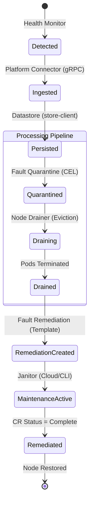

### State Definitions

1. **Detected**: A monitor identifies a failure condition (e.g., XID error) [distros/kubernetes/nvsentinel/values-full.yaml:138-140]().
2. **Ingested**: The event is validated and stored in the database [platform-connectors/go.mod:1-24]().
3. **Quarantined**: The node is cordoned and tainted based on CEL rules [fault-quarantine/go.mod:8-12]().
4. **Drained**: All user pods are evicted based on the configured strategy [node-drainer/go.mod:1-27]().
5. **Remediated**: The repair action (e.g., `GPUReset`) is confirmed successful by the `janitor` [distros/kubernetes/nvsentinel/values-tilt.yaml:266-277]().

**Sources:** [distros/kubernetes/nvsentinel/values-full.yaml:131-176](), [fault-remediation/go.mod:1-26](), [platform-connectors/go.mod:1-24]()

---

# Page: Architecture

# Architecture

<details>
<summary>Relevant source files</summary>

The following files were used as context for generating this wiki page:

- [commons/go.sum](commons/go.sum)
- [distros/kubernetes/nvsentinel/charts/gpu-health-monitor/files/dcgmerrorsmapping.csv](distros/kubernetes/nvsentinel/charts/gpu-health-monitor/files/dcgmerrorsmapping.csv)
- [distros/kubernetes/nvsentinel/charts/preflight/templates/deployment.yaml](distros/kubernetes/nvsentinel/charts/preflight/templates/deployment.yaml)
- [distros/kubernetes/nvsentinel/values-full.yaml](distros/kubernetes/nvsentinel/values-full.yaml)
- [distros/kubernetes/nvsentinel/values-tilt.yaml](distros/kubernetes/nvsentinel/values-tilt.yaml)
- [distros/kubernetes/nvsentinel/values.yaml](distros/kubernetes/nvsentinel/values.yaml)
- [docs/INTEGRATIONS.md](docs/INTEGRATIONS.md)
- [event-exporter/go.mod](event-exporter/go.mod)
- [event-exporter/go.sum](event-exporter/go.sum)
- [fault-quarantine/go.mod](fault-quarantine/go.mod)
- [fault-quarantine/go.sum](fault-quarantine/go.sum)
- [fault-remediation/go.mod](fault-remediation/go.mod)
- [fault-remediation/go.sum](fault-remediation/go.sum)
- [health-events-analyzer/go.mod](health-events-analyzer/go.mod)
- [health-events-analyzer/go.sum](health-events-analyzer/go.sum)
- [health-monitors/syslog-health-monitor/go.mod](health-monitors/syslog-health-monitor/go.mod)
- [node-drainer/go.mod](node-drainer/go.mod)
- [node-drainer/go.sum](node-drainer/go.sum)
- [platform-connectors/go.mod](platform-connectors/go.mod)
- [platform-connectors/go.sum](platform-connectors/go.sum)
- [platform-connectors/pkg/transformers/metadata/transformer_test.go](platform-connectors/pkg/transformers/metadata/transformer_test.go)
- [store-client/go.mod](store-client/go.mod)
- [tests/helpers/preflight.go](tests/helpers/preflight.go)
- [tilt/Tiltfile](tilt/Tiltfile)
- [tilt/helpers.star](tilt/helpers.star)

</details>


## Purpose and Scope

This document provides a high-level overview of NVSentinel's architecture, covering its layered design, core principles, and key technologies. NVSentinel is a Kubernetes-native GPU node resilience system that automatically detects, quarantines, and remediates hardware and software faults in GPU clusters.

For detailed information about specific architectural aspects, see:
- **[System Overview](#3.1)**: High-level architecture showing layers (detection, processing, response) and component relationships.
- **[Event-Driven Architecture](#3.2)**: MongoDB change streams, asynchronous communication patterns, and decoupled component design.
- **[Data Flow and Processing Pipeline](#3.3)**: Complete event flow from detection through analysis to remediation with sequence diagrams.
- **[Data Models and Storage](#3.4)**: HealthEvent data structures, MongoDB/PostgreSQL schemas, and store-client abstraction.
- **[Multi-Language Architecture](#3.5)**: Python and Go service integration, gRPC communication, and shared internal modules.

## Overview

NVSentinel implements a **microservices-based, event-driven architecture** where independent components communicate asynchronously via database change streams and synchronously via gRPC. The system follows a clear separation of concerns across functional layers that process health events from detection through automated remediation.

**Core Architecture Characteristics:**

| Characteristic | Implementation | Benefit |
|----------------|----------------|---------|
| **Decoupled Components** | MongoDB/PostgreSQL change streams for async communication | Independent scaling, failure isolation |
| **Event-Driven Processing** | Change stream watchers with aggregation pipelines | Temporal decoupling, crash recovery via resume tokens |
| **Progressive Pipeline** | Status fields trigger downstream processing | Observable, auditable remediation flow |
| **Stateless Services** | External state in MongoDB and Kubernetes API | Horizontal scalability, simple restarts |
| **Kubernetes-Native** | CRDs, DaemonSets, Deployments, CEL expressions | Natural integration with cluster lifecycle |

The architecture prioritizes **reliability** (ring buffers, circuit breakers, resume tokens), **observability** (Prometheus metrics, audit trails), and **extensibility** (plugin system, CEL rules, Go templates).

**Sources**: [distros/kubernetes/nvsentinel/values-full.yaml:21-32](), [distros/kubernetes/nvsentinel/values.yaml:144-181]()

## Layered Architecture

NVSentinel is organized into functional layers that process health events from detection through automated remediation.

### System Architecture Diagram

This diagram maps the natural language components to their corresponding code entities and services.

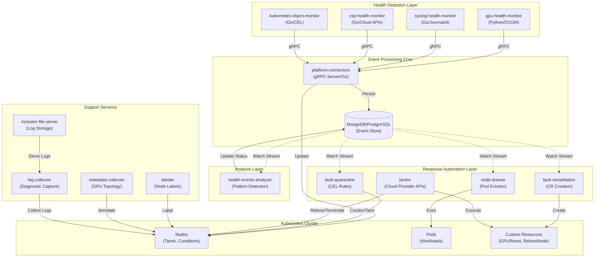

**Sources**: [distros/kubernetes/nvsentinel/values.yaml:143-180](), [tilt/Tiltfile:126-145]()

## Design Principles

### 1. Event-Driven Communication
All components communicate asynchronously via database change streams (MongoDB native change streams or PostgreSQL LISTEN/NOTIFY), eliminating direct dependencies. Health monitors send events to `platform-connectors` via gRPC, which persists them to the datastore. Downstream components watch these streams to react to new events.

**Sources**: [distros/kubernetes/nvsentinel/values.yaml:25-56](), [platform-connectors/go.mod:18-19]()

### 2. Progressive Remediation Pipeline
Fault remediation flows through a staged pipeline where each component updates status fields to trigger downstream processing:
**Detection** → **Quarantine** → **Drain** → **Remediation** → **Execution**.
This ensures that nodes are safely cordoned and workloads are gracefully evicted before any hardware maintenance (like a GPU reset or node reboot) is performed.

**Sources**: [distros/kubernetes/nvsentinel/values-full.yaml:150-175](), [distros/kubernetes/nvsentinel/values-tilt.yaml:266-285]()

### 3. Stateless Components with External State
NVSentinel components are stateless, storing all persistent state in MongoDB/PostgreSQL or the Kubernetes API. This enables horizontal scaling and simple restarts without data loss. The system uses resume tokens for change streams to ensure processing resumes exactly where it left off.

**Sources**: [distros/kubernetes/nvsentinel/values.yaml:99-103](), [store-client/go.mod:18-20]()

### 4. Circuit Breaker Protection
The `fault-quarantine` module implements a circuit breaker to prevent mass node quarantines during cluster-wide events or false positives. If the percentage of quarantined nodes exceeds a threshold, the circuit trips and stops further automated cordoning.

**Sources**: [distros/kubernetes/nvsentinel/values-full.yaml:69-70](), [fault-quarantine/go.mod:8-12]()

### 5. Kubernetes-Native Design
NVSentinel leverages standard Kubernetes primitives:
- **DaemonSets** for node-local monitoring (`gpu-health-monitor`, `syslog-health-monitor`).
- **Deployments** for central controllers.
- **CRDs** for maintenance actions (`GPUReset`, `RebootNode`).
- **CEL (Common Expression Language)** for flexible quarantine rules and object monitoring.

**Sources**: [distros/kubernetes/nvsentinel/values.yaml:171-172](), [fault-quarantine/go.mod:8-9](), [platform-connectors/go.mod:9-10]()

## Key Technologies

NVSentinel uses a polyglot architecture combining Go and Python services.

### Code Entity Mapping Diagram

This diagram bridges the functional names to the specific code modules and files.

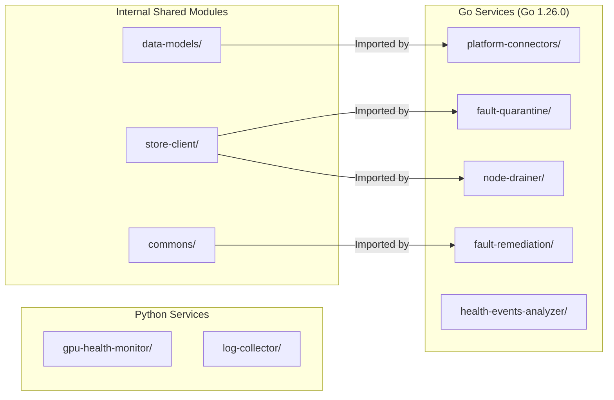

**Sources**: [platform-connectors/go.mod:1-5](), [fault-quarantine/go.mod:112-120](), [node-drainer/go.mod:112-120](), [store-client/go.mod:1-5]()

## Component Organization

### Deployment Model
NVSentinel is deployed via Helm and supports various cloud providers (AWS, GCP, Azure, OCI).

| Resource Type | Components | Purpose |
|---------------|------------|---------|
| **DaemonSet** | Health Monitors, Labeler, Metadata Collector | Node-local detection and labeling |
| **Deployment** | Platform Connectors, Fault Management Modules | Centralized event processing and orchestration |
| **StatefulSet** | MongoDB (optional) | High-availability event storage |
| **Job** | Database Setup, Maintenance Execution | One-time or triggered maintenance tasks |

**Sources**: [distros/kubernetes/nvsentinel/values.yaml:89-98](), [distros/kubernetes/nvsentinel/values-full.yaml:40-130](), [tilt/Tiltfile:146-161]()

### Development vs. Production
In production, NVSentinel interacts with real hardware and cloud APIs. For development, the project provides a comprehensive local setup using **KIND** and **KWOK** (Kubernetes Without Kubelet) to simulate nodes and GPUs.

**Sources**: [tilt/Tiltfile:75-125](), [distros/kubernetes/nvsentinel/values-tilt.yaml:104-125]()

---
For detailed information on component relationships, see **[System Overview](#3.1)**.
For implementation details of the event-driven patterns, see **[Event-Driven Architecture](#3.2)**.
To trace a fault from detection to fix, see **[Data Flow and Processing Pipeline](#3.3)**.

---

# Page: System Overview

# System Overview

<details>
<summary>Relevant source files</summary>

The following files were used as context for generating this wiki page:

- [README.md](README.md)
- [demos/local-fault-injection-demo/Makefile](demos/local-fault-injection-demo/Makefile)
- [demos/local-fault-injection-demo/README.md](demos/local-fault-injection-demo/README.md)
- [demos/local-fault-injection-demo/scripts/00-setup.sh](demos/local-fault-injection-demo/scripts/00-setup.sh)
- [demos/local-fault-injection-demo/scripts/01-show-cluster.sh](demos/local-fault-injection-demo/scripts/01-show-cluster.sh)
- [demos/local-fault-injection-demo/scripts/02-inject-error.sh](demos/local-fault-injection-demo/scripts/02-inject-error.sh)
- [demos/local-fault-injection-demo/scripts/03-verify-cordon.sh](demos/local-fault-injection-demo/scripts/03-verify-cordon.sh)
- [demos/local-fault-injection-demo/scripts/99-cleanup.sh](demos/local-fault-injection-demo/scripts/99-cleanup.sh)
- [demos/local-slinky-drain-demo/scripts/00-setup.sh](demos/local-slinky-drain-demo/scripts/00-setup.sh)
- [distros/kubernetes/README.md](distros/kubernetes/README.md)
- [distros/kubernetes/nvsentinel/charts/csp-health-monitor/templates/deployment.yaml](distros/kubernetes/nvsentinel/charts/csp-health-monitor/templates/deployment.yaml)
- [distros/kubernetes/nvsentinel/charts/event-exporter/templates/deployment.yaml](distros/kubernetes/nvsentinel/charts/event-exporter/templates/deployment.yaml)
- [distros/kubernetes/nvsentinel/charts/fault-quarantine/templates/deployment.yaml](distros/kubernetes/nvsentinel/charts/fault-quarantine/templates/deployment.yaml)
- [distros/kubernetes/nvsentinel/charts/fault-remediation/templates/deployment.yaml](distros/kubernetes/nvsentinel/charts/fault-remediation/templates/deployment.yaml)
- [distros/kubernetes/nvsentinel/charts/gpu-health-monitor/files/dcgmerrorsmapping.csv](distros/kubernetes/nvsentinel/charts/gpu-health-monitor/files/dcgmerrorsmapping.csv)
- [distros/kubernetes/nvsentinel/charts/health-events-analyzer/templates/deployment.yaml](distros/kubernetes/nvsentinel/charts/health-events-analyzer/templates/deployment.yaml)
- [distros/kubernetes/nvsentinel/charts/node-drainer/templates/deployment.yaml](distros/kubernetes/nvsentinel/charts/node-drainer/templates/deployment.yaml)
- [distros/kubernetes/nvsentinel/charts/preflight/templates/deployment.yaml](distros/kubernetes/nvsentinel/charts/preflight/templates/deployment.yaml)
- [distros/kubernetes/nvsentinel/templates/_helpers.tpl](distros/kubernetes/nvsentinel/templates/_helpers.tpl)
- [distros/kubernetes/nvsentinel/templates/configmap-datastore.yaml](distros/kubernetes/nvsentinel/templates/configmap-datastore.yaml)
- [distros/kubernetes/nvsentinel/templates/daemonset.yaml](distros/kubernetes/nvsentinel/templates/daemonset.yaml)
- [distros/kubernetes/nvsentinel/templates/job-external-mongodb-setup.yaml](distros/kubernetes/nvsentinel/templates/job-external-mongodb-setup.yaml)
- [distros/kubernetes/nvsentinel/values-atlas-gcp.yaml](distros/kubernetes/nvsentinel/values-atlas-gcp.yaml)
- [distros/kubernetes/nvsentinel/values-full.yaml](distros/kubernetes/nvsentinel/values-full.yaml)
- [distros/kubernetes/nvsentinel/values-tilt.yaml](distros/kubernetes/nvsentinel/values-tilt.yaml)
- [distros/kubernetes/nvsentinel/values.yaml](distros/kubernetes/nvsentinel/values.yaml)
- [docs/INTEGRATIONS.md](docs/INTEGRATIONS.md)
- [docs/OVERVIEW.md](docs/OVERVIEW.md)
- [platform-connectors/pkg/transformers/metadata/transformer_test.go](platform-connectors/pkg/transformers/metadata/transformer_test.go)
- [tests/helpers/preflight.go](tests/helpers/preflight.go)
- [tilt/Tiltfile](tilt/Tiltfile)
- [tilt/helpers.star](tilt/helpers.star)

</details>


This page describes NVSentinel's high-level architecture, showing how components are organized into functional layers and how they interact to provide automated GPU fault detection and remediation.

For detailed event flow sequences, see [Data Flow and Processing Pipeline](#3.3). For information about the event-driven communication model, see [Event-Driven Architecture](#3.2).

## Overview

NVSentinel implements a **layered microservices architecture** where components are organized by function into five distinct layers. This design enables:

- **Independent scaling**: Each layer can scale independently based on load.
- **Failure isolation**: Problems in one layer don't cascade to others.
- **Progressive enablement**: Operators can enable layers incrementally as confidence grows.
- **Clear separation of concerns**: Each component has a single, well-defined responsibility.

The system uses an **event-driven architecture** where all coordination happens through a shared datastore (MongoDB or PostgreSQL), eliminating direct inter-component dependencies and simplifying operational complexity [README.md:41-45]().

Sources: [README.md:163-184](), [docs/OVERVIEW.md:15-18]()

## Architectural Layers

**Five-Layer Architecture Diagram**

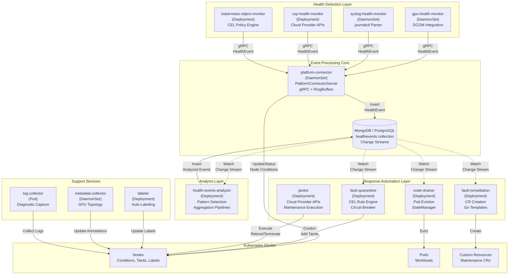

### Layer 1: Health Detection

**Purpose:** Monitor hardware and software health across the cluster [docs/OVERVIEW.md:19-25]().

Components in this layer detect faults through different mechanisms:

| Component | Type | Detection Method | Data Source |
|-----------|------|-----------------|-------------|
| `gpu-health-monitor` | DaemonSet | DCGM field values | GPU telemetry via DCGM hostengine [docs/OVERVIEW.md:21]() |
| `syslog-health-monitor` | DaemonSet | Pattern matching | `journalctl` system logs [docs/OVERVIEW.md:22]() |
| `csp-health-monitor` | Deployment | API polling | CSP APIs (AWS, GCP, Azure, OCI) [docs/OVERVIEW.md:23]() |
| `kubernetes-object-monitor` | Deployment | CEL expressions | Kubernetes resource state [docs/OVERVIEW.md:24]() |

All monitors generate health events and send them to `platform-connectors` via gRPC [README.md:186-193]().

Sources: [README.md:163-184](), [docs/OVERVIEW.md:19-25]()

### Layer 2: Event Processing Core

**Purpose:** Normalize, validate, persist, and distribute health events.

The processing core consists of two components that work together:

**`platform-connector` (DaemonSet):**
- Runs gRPC server listening on Unix Domain Socket [distros/kubernetes/nvsentinel/templates/daemonset.yaml:126]().
- Routes events to both Kubernetes API (node conditions) and datastore [README.md:195-196]().
- Persists events to the database and updates node status [docs/OVERVIEW.md:26]().

**Datastore (MongoDB or PostgreSQL):**
- Stores health events in a central database [README.md:44]().
- Provides change streams (MongoDB) or LISTEN/NOTIFY (PostgreSQL) for real-time event propagation [docs/OVERVIEW.md:43-46]().
- Enables asynchronous, decoupled communication between layers [docs/OVERVIEW.md:17-18]().

Sources: [distros/kubernetes/nvsentinel/templates/daemonset.yaml:82-160](), [docs/OVERVIEW.md:43-46](), [README.md:41-47]()

### Layer 3: Analysis

**Purpose:** Detect patterns and aggregate related events.

**`health-events-analyzer` (Deployment):**
- Watches change stream for health events to identify patterns [docs/OVERVIEW.md:36]().
- Generates recommended actions based on historical data [docs/OVERVIEW.md:36]().
- Runs as a Deployment with configurable replica counts [distros/kubernetes/nvsentinel/charts/health-events-analyzer/templates/deployment.yaml:24]().

Sources: [docs/OVERVIEW.md:36](), [distros/kubernetes/nvsentinel/charts/health-events-analyzer/templates/deployment.yaml:15-112]()

### Layer 4: Response Automation

**Purpose:** Take automated corrective actions based on health events [docs/OVERVIEW.md:30-35]().

Each component watches for specific event patterns and takes targeted actions:

| Component | Trigger Condition | Action | Deployment Config |
|-----------|------------------|--------|-------------------|
| `fault-quarantine` | Fatal health events | Cordon/Taint nodes via CEL rules [docs/OVERVIEW.md:32]() | [distros/kubernetes/nvsentinel/values-full.yaml:150-155]() |
| `node-drainer` | Quarantined nodes | Gracefully evict workloads [docs/OVERVIEW.md:33]() | [distros/kubernetes/nvsentinel/charts/node-drainer/templates/deployment.yaml:14-120]() |
| `fault-remediation` | Drained nodes | Create maintenance CRDs (reboot/reset) [docs/OVERVIEW.md:34]() | [distros/kubernetes/nvsentinel/charts/fault-remediation/templates/deployment.yaml:14-115]() |
| `janitor` | Maintenance CRDs | Execute maintenance via Cloud APIs [docs/OVERVIEW.md:35]() | [distros/kubernetes/nvsentinel/values-full.yaml:171-175]() |

Sources: [docs/OVERVIEW.md:30-35](), [distros/kubernetes/nvsentinel/values-full.yaml:138-175]()

### Layer 5: Support Services

**Purpose:** Provide metadata enrichment, labeling, and diagnostics.

| Component | Type | Function |
|-----------|------|----------|
| `labeler` | Deployment | Tags nodes with DCGM and driver versions [docs/OVERVIEW.md:37]() |
| `metadata-collector` | DaemonSet | Collects GPU topology, PCI addresses, and UUIDs [distros/kubernetes/nvsentinel/values.yaml:163-164]() |
| `log-collector` | Sidecar/Job | Diagnostic log collection triggered by remediation [distros/kubernetes/nvsentinel/charts/fault-remediation/templates/deployment.yaml:147-154]() |

Sources: [docs/OVERVIEW.md:37](), [distros/kubernetes/nvsentinel/charts/fault-remediation/templates/deployment.yaml:147-154]()

## Communication Patterns

**Event Flow Diagram**

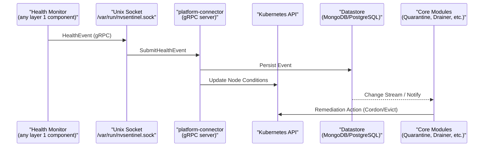

**Key Communication Mechanisms:**

1. **gRPC over Unix Domain Socket**: Health monitors communicate with the local `platform-connector` via `/var/run/nvsentinel` socket [distros/kubernetes/nvsentinel/templates/daemonset.yaml:126]().
2. **Datastore Change Streams**: Response automation components watch for relevant event patterns without polling [docs/OVERVIEW.md:43-46]().
3. **Kubernetes API**: Direct updates for node conditions, pod eviction, and CRD creation [docs/OVERVIEW.md:17-35]().

Sources: [distros/kubernetes/nvsentinel/templates/daemonset.yaml:126](), [docs/OVERVIEW.md:43-46](), [README.md:195-206]()

## Deployment Model

NVSentinel deploys entirely within Kubernetes using standard workload types [distros/kubernetes/nvsentinel/values-full.yaml:40-175]():

| Workload Type | Components |
|---------------|-----------|
| **DaemonSet** | `platform-connector`, `gpu-health-monitor`, `syslog-health-monitor`, `metadata-collector` [distros/kubernetes/nvsentinel/templates/daemonset.yaml:17]() |
| **Deployment** | `fault-quarantine`, `node-drainer`, `fault-remediation`, `health-events-analyzer`, `csp-health-monitor`, `labeler` |
| **StatefulSet** | `mongodb-store` (when enabled as internal DB) [distros/kubernetes/nvsentinel/values-tilt.yaml:126-170]() |

Sources: [distros/kubernetes/nvsentinel/templates/daemonset.yaml:17](), [distros/kubernetes/nvsentinel/values-full.yaml:138-175]()

## Progressive Enablement Model

NVSentinel uses a **monitoring-first safety model** where only read-only components are enabled by default [README.md:100]():

**Default Configuration (Safe):**
```yaml
global:
  dryRun: false
  
  # Health Monitors (enabled by default)
  gpuHealthMonitor:
    enabled: true
  syslogHealthMonitor:
    enabled: true

  # Core Modules (disabled by default)
  faultQuarantine:
    enabled: false
  nodeDrainer:
    enabled: false
  faultRemediation:
    enabled: false
```

**Recommended Enablement Sequence:**

1. **Phase 1 (Monitoring)**: Deploy with defaults, validate event detection accuracy [docs/OVERVIEW.md:56]().
2. **Phase 2 (Quarantine)**: Enable `faultQuarantine`, observe cordoning behavior [docs/OVERVIEW.md:32]().
3. **Phase 3 (Draining)**: Enable `nodeDrainer`, validate graceful workload migration [docs/OVERVIEW.md:33]().
4. **Phase 4 (Remediation)**: Enable `faultRemediation` + `janitor`, test automated repairs [docs/OVERVIEW.md:34-35]().

Sources: [README.md:100](), [docs/OVERVIEW.md:56](), [distros/kubernetes/nvsentinel/values.yaml:143-154]()

## Data Store as System Backbone

The MongoDB or PostgreSQL datastore serves as NVSentinel's **central nervous system**, enabling asynchronous, decoupled communication between all components [docs/OVERVIEW.md:17-18]().

**Datastore Architecture Diagram**

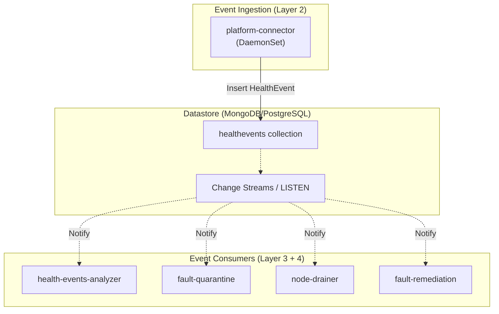

**Key Benefits:**
1. **No Direct Dependencies**: Components never communicate directly [docs/OVERVIEW.md:17]().
2. **Audit Trail**: All health events are persisted with full audit trails [docs/OVERVIEW.md:46]().
3. **Failure Isolation**: If one consumer fails, others continue processing.

Sources: [docs/OVERVIEW.md:17-18, 43-46](), [README.md:41-47]()

## CSP Health Monitor Architecture

The CSP health monitor provides cloud-native fault detection and proactive quarantine [docs/OVERVIEW.md:23]().

**Component Relationships:**

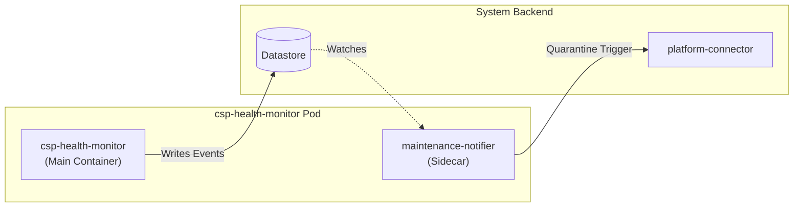

- **Main Container**: Polls CSP APIs (AWS, GCP, Azure, OCI) for scheduled maintenance and hardware events [docs/OVERVIEW.md:23]().
- **Sidecar (maintenance-notifier)**: Watches the datastore for maintenance events and triggers quarantine via the platform connector [distros/kubernetes/nvsentinel/charts/csp-health-monitor/templates/deployment.yaml:159-161]().

Sources: [docs/OVERVIEW.md:23](), [distros/kubernetes/nvsentinel/charts/csp-health-monitor/templates/deployment.yaml:93-161]()

---

# Page: Event-Driven Architecture

# Event-Driven Architecture

<details>
<summary>Relevant source files</summary>

The following files were used as context for generating this wiki page:

- [commons/pkg/flags/database_flags_test.go](commons/pkg/flags/database_flags_test.go)
- [fault-quarantine/pkg/eventwatcher/event_watcher.go](fault-quarantine/pkg/eventwatcher/event_watcher.go)
- [node-drainer/pkg/evaluator/evaluator_integration_test.go](node-drainer/pkg/evaluator/evaluator_integration_test.go)
- [node-drainer/pkg/queue/queue_test.go](node-drainer/pkg/queue/queue_test.go)
- [store-client/pkg/adapter/legacy_adapter.go](store-client/pkg/adapter/legacy_adapter.go)
- [store-client/pkg/config/env_loader.go](store-client/pkg/config/env_loader.go)
- [store-client/pkg/config/env_loader_test.go](store-client/pkg/config/env_loader_test.go)
- [store-client/pkg/datastore/behavioral_contract_test.go](store-client/pkg/datastore/behavioral_contract_test.go)
- [store-client/pkg/datastore/interface_compliance_test.go](store-client/pkg/datastore/interface_compliance_test.go)
- [store-client/pkg/datastore/interfaces.go](store-client/pkg/datastore/interfaces.go)
- [store-client/pkg/datastore/providers/mongodb/health_store.go](store-client/pkg/datastore/providers/mongodb/health_store.go)
- [store-client/pkg/datastore/providers/mongodb/health_store_test.go](store-client/pkg/datastore/providers/mongodb/health_store_test.go)
- [store-client/pkg/datastore/providers/mongodb/register.go](store-client/pkg/datastore/providers/mongodb/register.go)
- [store-client/pkg/datastore/providers/mongodb/watcher/unmarshaller.go](store-client/pkg/datastore/providers/mongodb/watcher/unmarshaller.go)
- [store-client/pkg/datastore/providers/mongodb/watcher/watch_store.go](store-client/pkg/datastore/providers/mongodb/watcher/watch_store.go)
- [store-client/pkg/datastore/providers/mongodb/watcher/watch_store_test.go](store-client/pkg/datastore/providers/mongodb/watcher/watch_store_test.go)
- [store-client/pkg/datastore/providers/mongodb/watcher_factory.go](store-client/pkg/datastore/providers/mongodb/watcher_factory.go)
- [store-client/pkg/datastore/providers/postgresql/changestream.go](store-client/pkg/datastore/providers/postgresql/changestream.go)
- [store-client/pkg/datastore/providers/postgresql/database_client_test.go](store-client/pkg/datastore/providers/postgresql/database_client_test.go)
- [store-client/pkg/datastore/providers/postgresql/datastore.go](store-client/pkg/datastore/providers/postgresql/datastore.go)
- [store-client/pkg/datastore/providers/postgresql/health_events.go](store-client/pkg/datastore/providers/postgresql/health_events.go)
- [store-client/pkg/datastore/providers/postgresql/pipeline_filter.go](store-client/pkg/datastore/providers/postgresql/pipeline_filter.go)
- [store-client/pkg/datastore/providers/postgresql/sql_filter_builder.go](store-client/pkg/datastore/providers/postgresql/sql_filter_builder.go)
- [store-client/pkg/datastore/providers/postgresql/watcher_factory.go](store-client/pkg/datastore/providers/postgresql/watcher_factory.go)
- [store-client/pkg/helper/datastore_helper.go](store-client/pkg/helper/datastore_helper.go)
- [store-client/pkg/query/builder.go](store-client/pkg/query/builder.go)
- [store-client/pkg/storewatcher/config.go](store-client/pkg/storewatcher/config.go)
- [store-client/pkg/storewatcher/watch_store.go](store-client/pkg/storewatcher/watch_store.go)
- [store-client/pkg/utils/pq.go](store-client/pkg/utils/pq.go)
- [store-client/pkg/utils/pq_test.go](store-client/pkg/utils/pq_test.go)
- [store-client/pkg/watcher/factory.go](store-client/pkg/watcher/factory.go)

</details>


## Purpose and Scope

This document describes the event-driven architecture that forms the core communication mechanism in NVSentinel. It covers how components communicate asynchronously via the datastore, the implementation of MongoDB change streams and PostgreSQL alternatives, and the decoupled design that enables independent scaling and failure isolation.

The architecture centers on the `store-client` abstraction, which provides a unified `ChangeStreamWatcher` interface for consuming events regardless of the underlying database provider [store-client/pkg/datastore/interfaces.go:113-119]().

---

## Architecture Overview

NVSentinel employs a **publish-subscribe event-driven architecture** where the datastore (MongoDB or PostgreSQL) acts as the central event bus. Components communicate exclusively through persisted events—no component directly calls another component's API. This design eliminates tight coupling and enables each service to operate independently.

### Core Event-Driven Pattern

```mermaid
graph TB
    subgraph "Event Producers"
        GPU["GPU Health Monitor<br/>(Python)"]
        Syslog["Syslog Health Monitor<br/>(Go)"]
        CSP["CSP Health Monitor<br/>(Go)"]
        K8s["Kubernetes Object Monitor<br/>(Go)"]
    end
    
    subgraph "Event Processing Core"
        PC["Platform Connectors<br/>gRPC Server<br/>Event Ingestion"]
    end
    
    subgraph "Event Bus"
        DB[("MongoDB/PostgreSQL<br/>Change Streams<br/>LISTEN/NOTIFY")]
    end
    
    subgraph "Event Consumers"
        HEA["Health Events Analyzer<br/>Pattern Detection"]
        FQ["Fault Quarantine<br/>CEL Rule Evaluation"]
        ND["Node Drainer<br/>Pod Eviction"]
        FR["Fault Remediation<br/>CR Creation"]
    end
    
    GPU -->|gRPC HealthEvent| PC
    Syslog -->|gRPC HealthEvent| PC
    CSP -->|gRPC HealthEvent| PC
    K8s -->|gRPC HealthEvent| PC
    
    PC -->|INSERT Event| DB
    
    DB -.->|Watch Stream| HEA
    DB -.->|Watch Stream| FQ
    DB -.->|Watch Stream| ND
    DB -.->|Watch Stream| FR
    
    HEA -->|INSERT Analyzed Event| DB
    FQ -->|UPDATE status| DB
    ND -->|UPDATE status| DB
    FR -->|UPDATE faultRemediated| DB
```

**Sources:** [fault-quarantine/pkg/eventwatcher/event_watcher.go:123-141](), [store-client/pkg/datastore/providers/postgresql/health_events.go:71-83]()

---

## Datastore Abstraction and Watchers

The `store-client` module provides a database-agnostic layer for watching events. Consumers interact with the `ChangeStreamWatcher` interface, which hides the complexity of the underlying database protocol [store-client/pkg/datastore/interfaces.go:113-119]().

### MongoDB Change Streams

MongoDB change streams provide real-time notification of changes. The `ChangeStreamWatcher` in `store-client/pkg/datastore/providers/mongodb/watcher/watch_store.go` manages the lifecycle of these streams:

1.  **Connection Management**: Validates connectivity and pings the database [store-client/pkg/datastore/providers/mongodb/watcher/watch_store.go:138-143]().
2.  **Resume Tokens**: Looks up existing tokens in a dedicated collection to resume processing from the last known state [store-client/pkg/datastore/providers/mongodb/watcher/watch_store.go:171-181]().
3.  **Consistency**: Uses `Majority` write and read concerns for resume tokens to ensure data integrity [store-client/pkg/datastore/providers/mongodb/watcher/watch_store.go:156-161]().
4.  **Full Document Lookup**: Configured with `UpdateLookup` to ensure the consumer receives the complete document even on partial updates [store-client/pkg/datastore/providers/mongodb/watcher/watch_store.go:165]().

### PostgreSQL LISTEN/NOTIFY

For PostgreSQL, the system uses a hybrid approach combining `LISTEN/NOTIFY` for real-time triggers and polling for reliability [store-client/pkg/datastore/providers/postgresql/datastore.go:158-160]().

-   **Server-side Filtering**: Uses SQL `WHERE` clauses to filter events before they reach the application [store-client/pkg/datastore/providers/postgresql/datastore.go:201-202]().
-   **Snake Case Mapping**: Automatically converts PascalCase collection names to snake_case table names for PostgreSQL compatibility [store-client/pkg/datastore/providers/postgresql/datastore.go:149-151]().

**Sources:** [store-client/pkg/datastore/providers/mongodb/watcher/watch_store.go:115-190](), [store-client/pkg/datastore/providers/postgresql/datastore.go:138-165]()

---

## Event Flow Lifecycle

### Event Processing with Change Streams

The `EventWatcher` in `fault-quarantine` demonstrates the typical consumer loop:

```mermaid
sequenceDiagram
    participant DB as MongoDB/PostgreSQL
    participant CSW as ChangeStreamWatcher
    participant EW as EventWatcher
    participant Callback as processEventCallback
    
    Note over DB,CSW: Connection & Resumption
    CSW->>DB: Open Stream (with Resume Token)
    
    Note over CSW,EW: Event Distribution
    DB-->>CSW: Change Event
    CSW->>EW: Events() Channel
    
    Note over EW,Callback: Processing Logic
    EW->>EW: processEvent()
    EW->>Callback: Invoke Logic
    Callback-->>EW: Return model.Status
    
    Note over EW,CSW: Acknowledgment
    EW->>CSW: MarkProcessed(ResumeToken)
    CSW->>DB: Update Resume Token Collection
```

**Sources:** [fault-quarantine/pkg/eventwatcher/event_watcher.go:123-144](), [fault-quarantine/pkg/eventwatcher/event_watcher.go:35-38]()

---

## Component Implementation: Fault Quarantine

The `FaultQuarantine` module serves as a primary example of this architecture. It utilizes an `EventWatcher` to consume health events and trigger node isolation [fault-quarantine/pkg/eventwatcher/event_watcher.go:32-42]().

### Key Entities and Functions

| Entity | Role | Location |
|---|---|---|
| `EventWatcher` | Manages the datastore watch loop and metrics | [fault-quarantine/pkg/eventwatcher/event_watcher.go:32-42]() |
| `MarkProcessed` | Updates the resume token to ensure at-least-once delivery | [fault-quarantine/pkg/eventwatcher/event_watcher.go:135-140]() |
| `UnmarshalDocument` | Converts raw datastore events into Go `HealthEventWithStatus` models | [fault-quarantine/pkg/eventwatcher/event_watcher.go:149-154]() |
| `GetRecordUUID` | Retrieves the primary key (ObjectID or UUID) for DB lookups | [fault-quarantine/pkg/eventwatcher/event_watcher.go:166-169]() |

### Observability and Metrics

Event processing is heavily instrumented with Prometheus metrics:
-   `change_stream_resume_token_recoveries_total`: Tracks recovery from stale resume tokens [store-client/pkg/datastore/providers/mongodb/watcher/watch_store.go:44-51]().
-   `TotalEventsReceived`: Incremented every time the watcher yields an event [fault-quarantine/pkg/eventwatcher/event_watcher.go:125]().
-   `ProcessingErrors`: Tracked by error type (e.g., `unmarshal_error`, `mark_processed_error`) [fault-quarantine/pkg/eventwatcher/event_watcher.go:136]().

**Sources:** [fault-quarantine/pkg/eventwatcher/event_watcher.go:123-141](), [store-client/pkg/datastore/providers/mongodb/watcher/watch_store.go:44-51]()

---

## Resiliency and Fault Tolerance

### Resumability
Consumers persist a **Resume Token** after successfully processing an event. On restart, the `store-client` retrieves this token from the `ResumeTokens` collection [store-client/pkg/storewatcher/watch_store.go:152-165](). If no token is found, the stream starts from the current head of the log [store-client/pkg/storewatcher/watch_store.go:169]().

### Workqueue Deduplication
The `NodeDrainer` uses an `EventQueueManager` to prevent concurrent processing of the same event. If an event is re-enqueued while already in-flight, it is marked as "dirty" and only processed again after the current task completes [node-drainer/pkg/queue/queue_test.go:174-184]().

### At-Least-Once Delivery
Because the resume token is only updated *after* the event processing logic completes, NVSentinel guarantees that an event will be retried if the pod crashes during processing [fault-quarantine/pkg/eventwatcher/event_watcher.go:132-140]().

**Sources:** [store-client/pkg/storewatcher/watch_store.go:152-179](), [node-drainer/pkg/queue/queue_test.go:139-190](), [fault-quarantine/pkg/eventwatcher/event_watcher.go:123-144]()

---

## Configuration and Environment

The event-driven system is configured primarily via environment variables defined in the `store-client` module:

| Environment Variable | Description | Default |
|---|---|---|
| `MONGODB_URI` | Connection string for MongoDB | - |
| `DATASTORE_PROVIDER` | Choice of `mongodb` or `postgresql` | `mongodb` |
| `MONGODB_CHANGE_STREAM_RETRY_DEADLINE_SECONDS` | Timeout for stream reconnection | `60` |
| `MONGODB_TOKEN_COLLECTION_NAME` | Collection where resume tokens are stored | `ResumeTokens` |

**Sources:** [store-client/pkg/config/env_loader.go:56-74](), [store-client/pkg/config/env_loader.go:77-86](), [store-client/pkg/config/env_loader.go:170-185]()

---

# Page: Data Flow and Processing Pipeline

# Data Flow and Processing Pipeline

<details>
<summary>Relevant source files</summary>

The following files were used as context for generating this wiki page:

- [distros/kubernetes/nvsentinel/charts/gpu-health-monitor/files/dcgmerrorsmapping.csv](distros/kubernetes/nvsentinel/charts/gpu-health-monitor/files/dcgmerrorsmapping.csv)
- [distros/kubernetes/nvsentinel/charts/preflight/templates/deployment.yaml](distros/kubernetes/nvsentinel/charts/preflight/templates/deployment.yaml)
- [distros/kubernetes/nvsentinel/templates/configmap.yaml](distros/kubernetes/nvsentinel/templates/configmap.yaml)
- [distros/kubernetes/nvsentinel/values-full.yaml](distros/kubernetes/nvsentinel/values-full.yaml)
- [distros/kubernetes/nvsentinel/values-tilt.yaml](distros/kubernetes/nvsentinel/values-tilt.yaml)
- [distros/kubernetes/nvsentinel/values.yaml](distros/kubernetes/nvsentinel/values.yaml)
- [docs/DATA_FLOW.md](docs/DATA_FLOW.md)
- [docs/INTEGRATIONS.md](docs/INTEGRATIONS.md)
- [docs/README.md](docs/README.md)
- [docs/audit-logging.md](docs/audit-logging.md)
- [docs/configuration/README.md](docs/configuration/README.md)
- [docs/index.yml](docs/index.yml)
- [docs/tracing.md](docs/tracing.md)
- [platform-connectors/main.go](platform-connectors/main.go)
- [platform-connectors/pkg/connectors/kubernetes/k8s_connector.go](platform-connectors/pkg/connectors/kubernetes/k8s_connector.go)
- [platform-connectors/pkg/connectors/kubernetes/k8s_connector_envtest_test.go](platform-connectors/pkg/connectors/kubernetes/k8s_connector_envtest_test.go)
- [platform-connectors/pkg/connectors/kubernetes/k8s_platform_connector_test.go](platform-connectors/pkg/connectors/kubernetes/k8s_platform_connector_test.go)
- [platform-connectors/pkg/connectors/kubernetes/process_node_events.go](platform-connectors/pkg/connectors/kubernetes/process_node_events.go)
- [platform-connectors/pkg/transformers/metadata/transformer_test.go](platform-connectors/pkg/transformers/metadata/transformer_test.go)
- [tests/helpers/preflight.go](tests/helpers/preflight.go)
- [tests/syslog_health_monitor_test.go](tests/syslog_health_monitor_test.go)
- [tilt/Tiltfile](tilt/Tiltfile)
- [tilt/helpers.star](tilt/helpers.star)

</details>


## Purpose

This document describes the end-to-end flow of health data within NVSentinel, from initial detection by distributed monitors to final remediation actions. It details the gRPC ingestion path, the parallel processing architecture of Platform Connectors, and the asynchronous event-driven lifecycle managed via Datastore change streams (MongoDB) or polling (PostgreSQL).

---

## System Overview

NVSentinel employs a decoupled architecture where **Health Monitors** act as event producers and **Platform Connectors** serves as the central ingestion hub. Data is distributed via high-performance ring buffers to both the Kubernetes API (for immediate visibility) and a persistent Datastore (MongoDB or PostgreSQL) which acts as the system's event bus.

```mermaid
graph TB
    subgraph "Detection Layer" ["Detection Layer (Producers)"]
        GPUMon["gpu-health-monitor (Python)"]
        SyslogMon["syslog-health-monitor (Go)"]
        CSPMon["csp-health-monitor (Go)"]
        K8sObjMon["kubernetes-object-monitor (Go)"]
    end
    
    subgraph "Ingestion Layer" ["Platform Connectors (Ingestion Hub)"]
        GRPCServer["gRPC Server<br/>HealthEventOccurredV1()"]
        RingBufMgr["Ring Buffer Manager"]
        
        subgraph "Parallel Pipelines" ["Parallel Pipelines"]
            K8sRB["'kubernetes' RingBuffer"]
            DBRB["'databaseStore' RingBuffer"]
        end
        
        K8sConn["k8s_connector<br/>updateNodeConditions()"]
        DBConn["DatabaseStoreConnector<br/>FetchAndProcessHealthMetric()"]
    end
    
    subgraph "Persistence Layer" ["Persistence Layer (Event Bus)"]
        DB[("Datastore<br/>'healthevents' collection/table")]
        Streams["Change Streams / Watchers"]
    end
    
    subgraph "Response Layer" ["Response Layer (Consumers)"]
        FQ["fault-quarantine<br/>(Cordon/Taint)"]
        ND["node-drainer<br/>(Pod Eviction)"]
        FR["fault-remediation<br/>(Maintenance CRs)"]
        HEA["health-events-analyzer<br/>(Pattern Detection)"]
    end
    
    GPUMon -->|"gRPC/UDS"| GRPCServer
    SyslogMon -->|"gRPC/UDS"| GRPCServer
    CSPMon -->|"gRPC/UDS"| GRPCServer
    
    GRPCServer --> RingBufMgr
    RingBufMgr --> K8sRB
    RingBufMgr --> DBRB
    
    K8sRB --> K8sConn
    DBRB --> DBConn
    
    K8sConn -->|"UpdateStatus()"| K8sAPI["Kubernetes Node Status"]
    DBConn -->|"Insert()"| DB
    
    DB --> Streams
    Streams --> FQ
    Streams --> ND
    Streams --> FR
    Streams --> HEA
```

**Sources:**
- [platform-connectors/main.go:60-178]()
- [platform-connectors/pkg/connectors/kubernetes/process_node_events.go:51-118]()
- [docs/INTEGRATIONS.md:67-101]()

---

## Event Ingestion and Distribution

### gRPC Ingestion
Monitors communicate with `platform-connectors` using the `HealthEventOccurredV1` gRPC method. The server is initialized in `platform-connectors/main.go` and handles incoming `protos.HealthEvent` objects [platform-connectors/main.go:38-44]().

### Parallel Ring Buffers
To ensure high throughput and prevent slow downstream consumers (like the Kubernetes API) from blocking database persistence, `platform-connectors` uses internal ring buffers [platform-connectors/main.go:112-113]().

| Buffer Name | Consumer Class | Responsibility |
| :--- | :--- | :--- |
| `kubernetes` | `K8sConnector` | Updates `NodeStatus` conditions and manages message truncation [platform-connectors/pkg/connectors/kubernetes/process_node_events.go:49-58]() |
| `databaseStore` | `DatabaseStoreConnector` | Persists the full event to the configured provider (MongoDB/PostgreSQL) [platform-connectors/main.go:155-178]() |

### Metadata Enrichment and Overrides
The pipeline supports transformation stages defined in the `ConfigMap` [distros/kubernetes/nvsentinel/templates/configmap.yaml:22-39]().
- **MetadataAugmentor**: Enriches events with node labels such as GPU driver versions or instance types [distros/kubernetes/nvsentinel/templates/configmap.yaml:40-47]().
- **OverrideTransformer**: Allows modifying event fields (e.g., `isFatal`, `recommendedAction`) based on CEL-like `when` expressions [distros/kubernetes/nvsentinel/templates/configmap.yaml:48-75]().

**Sources:**
- [platform-connectors/main.go:180-210]()
- [platform-connectors/pkg/connectors/kubernetes/process_node_events.go:160-209]()

---

## Event Processing Pipeline

Once persisted, events trigger a chain of reactions managed by specialized modules.

### Sequence: Detection to Remediation
The following diagram traces a fatal GPU error (e.g., XID 119) through the system as seen in E2E testing scenarios [tests/syslog_health_monitor_test.go:67-88]().

```mermaid
sequenceDiagram
    participant Mon as "syslog-health-monitor"
    participant PC as "platform-connectors"
    participant DB as "MongoDB / PostgreSQL"
    participant FQ as "fault-quarantine"
    participant ND as "node-drainer"
    participant FR as "fault-remediation"

    Mon->>PC: HealthEventOccurredV1(XID 119, isFatal=true)
    
    par 
        PC->>K8s: updateNodeConditions(SysLogsXIDError)
        PC->>DB: Insert HealthEvent
    end

    DB-->>FQ: Change Stream / Watcher
    Note over FQ: Match rule: event.isFatal == true
    FQ->>K8s: Cordon Node & Apply Taints
    FQ->>DB: Update Status (Quarantined)

    DB-->>ND: Change Stream (Status Change)
    ND->>K8s: Evict Pods (DrainRequest)
    ND->>DB: Update Status (Drain Succeeded)

    DB-->>FR: Change Stream (Drain Complete)
    Note over FR: Map to action: COMPONENT_RESET
    FR->>K8s: Create GPUReset / Maintenance CR
    FR->>DB: Update Status (Remediation InProgress)
```

**Sources:**
- [tests/syslog_health_monitor_test.go:72-88]()
- [platform-connectors/pkg/connectors/kubernetes/process_node_events.go:83-96]()
- [distros/kubernetes/nvsentinel/values-tilt.yaml:268-277]()

---

## Health Events Analyzer (Pattern Detection)

The `health-events-analyzer` performs secondary analysis on the event stream to detect complex patterns like "XID Bursts" [distros/kubernetes/nvsentinel/values.yaml:145-146]().

### Processing Logic
1. **Event Reception**: Listens for non-fatal events via the datastore stream.
2. **Rule Evaluation**: Evaluates historical events over a time window.
3. **Aggregation**: If a pattern matches (e.g., multiple ECC errors), it generates a new "Synthetic" HealthEvent with `isFatal=true` and submits it back to the pipeline.

### Code Entity Bridge: Pipeline Components
| System Concept | Code Entity | File Reference |
| :--- | :--- | :--- |
| Condition Update | `K8sConnector.processNodeCondition` | [platform-connectors/pkg/connectors/kubernetes/process_node_events.go:160-163]() |
| Event Storage | `DatabaseStoreConnector` | [platform-connectors/main.go:155-159]() |
| Message Truncation | `truncateNodeConditionMessage` | [platform-connectors/pkg/connectors/kubernetes/process_node_events.go:185-186]() |
| Remediation Mapping | `maintenance.actions` | [distros/kubernetes/nvsentinel/values-tilt.yaml:267-270]() |

**Sources:**
- [platform-connectors/pkg/connectors/kubernetes/process_node_events.go:145-158]()
- [distros/kubernetes/nvsentinel/values.yaml:143-154]()

---

## Reliability and Observability

### Trace Correlation
To debug the pipeline, NVSentinel uses OpenTelemetry tracing. `platform-connectors` initializes the tracer to correlate monitor events with downstream actions [platform-connectors/main.go:70-72]().

### Audit Logging
HTTP write operations to Kubernetes and CSP APIs are captured by the `auditlogger` to provide a forensic trail of remediation actions [platform-connectors/main.go:66-68]().

### Dry Run Mode
The system supports a global `dryRun` flag. When enabled, modules like `fault-quarantine` and `node-drainer` log intended actions (cordoning, evictions) without executing them against the cluster [distros/kubernetes/nvsentinel/values-full.yaml:59-69]().

**Sources:**
- [docs/configuration/README.md:19-26]()
- [docs/configuration/README.md:76-91]()
- [platform-connectors/main.go:60-87]()

---

# Page: Data Models and Storage

# Data Models and Storage

<details>
<summary>Relevant source files</summary>

The following files were used as context for generating this wiki page:

- [api/go.mod](api/go.mod)
- [api/go.sum](api/go.sum)
- [commons/pkg/statemanager/statemanager.go](commons/pkg/statemanager/statemanager.go)
- [commons/pkg/statemanager/statemanager_test.go](commons/pkg/statemanager/statemanager_test.go)
- [data-models/go.mod](data-models/go.mod)
- [data-models/go.sum](data-models/go.sum)
- [data-models/pkg/model/health_event_extentions.go](data-models/pkg/model/health_event_extentions.go)
- [data-models/pkg/protos/health_event.pb.go](data-models/pkg/protos/health_event.pb.go)
- [data-models/protobufs/health_event.proto](data-models/protobufs/health_event.proto)
- [demos/local-custom-remediation-demo/memory-pressure-monitor/go.mod](demos/local-custom-remediation-demo/memory-pressure-monitor/go.mod)
- [docs/state-manager.md](docs/state-manager.md)
- [health-monitors/gpu-health-monitor/gpu_health_monitor/protos/health_event_pb2.py](health-monitors/gpu-health-monitor/gpu_health_monitor/protos/health_event_pb2.py)
- [health-monitors/gpu-health-monitor/gpu_health_monitor/protos/health_event_pb2.pyi](health-monitors/gpu-health-monitor/gpu_health_monitor/protos/health_event_pb2.pyi)
- [store-client/pkg/client/mongodb_client.go](store-client/pkg/client/mongodb_client.go)
- [store-client/pkg/client/mongodb_pipeline_builder.go](store-client/pkg/client/mongodb_pipeline_builder.go)
- [store-client/pkg/client/mongodb_pipeline_test.go](store-client/pkg/client/mongodb_pipeline_test.go)
- [store-client/pkg/client/pipeline_builder.go](store-client/pkg/client/pipeline_builder.go)
- [store-client/pkg/client/pipeline_builder_test.go](store-client/pkg/client/pipeline_builder_test.go)
- [store-client/pkg/client/postgresql_pipeline_builder.go](store-client/pkg/client/postgresql_pipeline_builder.go)
- [tests/helpers/healthevent.go](tests/helpers/healthevent.go)
- [tests/scale-tests/event-generator/go.mod](tests/scale-tests/event-generator/go.mod)
- [tests/scale-tests/event-generator/go.sum](tests/scale-tests/event-generator/go.sum)
- [tilt/csp-api-mock/go.mod](tilt/csp-api-mock/go.mod)
- [tilt/csp-api-mock/go.sum](tilt/csp-api-mock/go.sum)
- [tilt/simple-health-client/go.mod](tilt/simple-health-client/go.mod)
- [tilt/simple-health-client/go.sum](tilt/simple-health-client/go.sum)

</details>


This page documents the data models and storage layer of NVSentinel, including the Protobuf-based data structures, the store-client abstraction that provides a unified interface for MongoDB and PostgreSQL, and the database schemas used for event persistence and change stream propagation.

---

## Overview of Data Architecture

NVSentinel uses a centralized datastore as its nervous system. All health detection flows into it via the `PlatformConnector` gRPC service, and all response components watch it for relevant events. The system supports both MongoDB and PostgreSQL as backend storage engines, abstracted through the `store-client` library.

### Data Architecture Components

```mermaid
graph TB
    subgraph "Data Models (Go/Python)"
        Proto["data-models/pkg/protos<br/>Protobuf Definitions"]
        HealthEvent["HealthEvent<br/>Core Event Structure"]
        HEWS["HealthEventWithStatus<br/>Workflow Persistence"]
    end
    
    subgraph "Store Client Abstraction"
        DatabaseClient["DatabaseClient Interface<br/>store-client/pkg/client/interfaces.go"]
        MongoImpl["MongoDBProvider<br/>store-client/pkg/datastore/providers/mongodb/"]
        PgImpl["PostgreSQLHealthEventStore<br/>store-client/pkg/datastore/providers/postgresql/"]
    end
    
    subgraph "Persistence Layer"
        MongoDB["MongoDB<br/>HealthEvents collection"]
        PostgreSQL["PostgreSQL<br/>health_events table"]
    end
    
    subgraph "Event Producers"
        PC["Platform Connectors<br/>DatabaseStoreConnector"]
    end
    
    subgraph "Event Consumers"
        FQ["Fault Quarantine<br/>ChangeStreamWatcher"]
        ND["Node Drainer<br/>ChangeStreamWatcher"]
    end
    
    Proto --> DatabaseClient
    DatabaseClient --> MongoImpl
    DatabaseClient --> PgImpl
    MongoImpl --> MongoDB
    PgImpl --> PostgreSQL
    
    PC -->|InsertMany| DatabaseClient
    
    MongoDB -.->|Change Stream| FQ
    PostgreSQL -.->|Logical Decoding| ND
```
**Sources:** `store-client/pkg/client/mongodb_client.go:32-35` (), `data-models/go.mod:1-10` ()

---

## Data Models Module

The `data-models` module contains the source-of-truth Protobuf definitions. These are compiled into Go and Python bindings to ensure consistency across the multi-language architecture.

### HealthEvent Protobuf
The `HealthEvent` message is the fundamental structure for fault reports.

| Field | Type | Description |
|-------|------|-------------|
| `nodeName` | `string` | The Kubernetes node where the fault occurred. |
| `checkName` | `string` | Identifier for the monitor (e.g., `GpuXidError`). |
| `componentClass` | `string` | Category (e.g., `GPU`, `Software`). |
| `isFatal` | `bool` | Whether the fault requires node evacuation. |
| `recommendedAction` | `enum` | Action suggested by the monitor (e.g., `RESTART_VM`). |
| `metadata` | `map<string, string>` | Arbitrary key-value pairs for diagnostic context. |

**Sources:** `health-monitors/gpu-health-monitor/gpu_health_monitor/protos/health_event_pb2.pyi:107-133` (), `data-models/pkg/protos/health_event.pb.go:1-10` ()

### HealthEventWithStatus
This structure wraps a `HealthEvent` with operational metadata used by NVSentinel to track the lifecycle of a fault.

**Key Status Fields:**
- `nodeQuarantined`: String status tracking the quarantine state. [health-monitors/gpu-health-monitor/gpu_health_monitor/protos/health_event_pb2.pyi:72]()
- `userPodsEvictionStatus`: An `OperationStatus` tracking drain progress. [health-monitors/gpu-health-monitor/gpu_health_monitor/protos/health_event_pb2.pyi:74]()
- `faultRemediated`: Boolean indicating if the fix was applied. [health-monitors/gpu-health-monitor/gpu_health_monitor/protos/health_event_pb2.pyi:76]()
- `spanIds`: Trace identifiers for cross-component observability. [health-monitors/gpu-health-monitor/gpu_health_monitor/protos/health_event_pb2.pyi:78]()

**Sources:** `health-monitors/gpu-health-monitor/gpu_health_monitor/protos/health_event_pb2.pyi:56-79` (), `health-monitors/gpu-health-monitor/gpu_health_monitor/protos/health_event_pb2.pyi:81-89` ()

---

## Store Client Abstraction

The `store-client` provides a unified client implementation for interacting with the backend datastores. It handles database-specific logic such as MongoDB BSON marshaling and change stream token management.

### Store Client Interface (Code Entity Space)
The `mongoEvent` struct implements the `Event` interface, providing a database-agnostic way to access record metadata.

```mermaid
classDiagram
    class Event {
        <<interface>>
        +GetDocumentID() string
        +GetRecordUUID() string
        +GetNodeName() string
        +GetResumeToken() []byte
        +UnmarshalDocument(v interface{}) error
    }
    class mongoEvent {
        -rawEvent mongoWatcher.Event
        +GetDocumentID() string
        +GetRecordUUID() string
        +GetNodeName() string
        +UnmarshalDocument(v interface{}) error
    }
    Event <|-- mongoEvent
```
**Sources:** `store-client/pkg/client/mongodb_client.go:39-41` (), `store-client/pkg/client/mongodb_client.go:43-85` ()

### Key Implementation Details
- **Document Identification**: In MongoDB, the `_id` field is extracted and converted to a hex string to serve as the document ID. [store-client/pkg/client/mongodb_client.go:69-78]()
- **Node Name Extraction**: The client deep-parses the raw BSON document to extract `healthevent.nodename` for routing and filtering. [store-client/pkg/client/mongodb_client.go:113-131]()
- **Type Normalization**: Since `bson.Unmarshal` into `map[string]interface{}` preserves MongoDB-specific types (like `primitive.DateTime`), the client includes a `normalizeMongoTypes` step to convert them to standard Go types. [store-client/pkg/client/mongodb_client.go:211-216]()

---

## Pipeline Builders

NVSentinel uses database-specific pipeline builders to filter events from the change streams (MongoDB Change Streams or PostgreSQL Logical Replication).

### Agnostic Pipeline Construction
While specific builders exist for MongoDB and PostgreSQL, the system promotes the use of `BuildInsertOnlyPipelineAgnostic()` to maintain provider independence.

- **MongoDB Insert Pipeline**: Matches documents where `operationType` is `insert`. [store-client/pkg/client/mongodb_client.go:226-232]()
- **Quarantine Update Pipeline**: Matches updates to the `healtheventstatus.nodequarantined` field. [store-client/pkg/client/mongodb_client.go:234-240]()

**Sources:** `store-client/pkg/client/mongodb_client.go:220-232` ()

---

## Ring Buffer and Ingestion Flow

To handle high-frequency event bursts (e.g., GPU XID storms), the system utilizes a batching and queuing mechanism before persistence.

```mermaid
sequenceDiagram
    participant Monitor as Health Monitor (Python/Go)
    participant PC as Platform Connector
    participant RB as RingBuffer (WorkQueue)
    participant Store as DatabaseStoreConnector
    participant DB as MongoDB/PostgreSQL

    Monitor->>PC: gRPC: HealthEventOccurred
    PC->>RB: Enqueue Event
    PC-->>Monitor: Acknowledgement
    Note over RB,Store: Async Processing
    Store->>RB: Pull Batch
    Store->>DB: InsertMany(Documents)
    DB-->>Store: Commit Success
```

### Ingestion Logic
The `PlatformConnector` receives events via gRPC and places them into a `RingBuffer`. The `DatabaseStoreConnector` then pulls these events in batches to perform bulk inserts into the configured datastore.

**Sources:** `api/go.mod:1-10` (), `store-client/pkg/client/mongodb_client.go:166-218` ()

---

# Page: Multi-Language Architecture

# Multi-Language Architecture

<details>
<summary>Relevant source files</summary>

The following files were used as context for generating this wiki page:

- [api/go.mod](api/go.mod)
- [api/go.sum](api/go.sum)
- [commons/go.sum](commons/go.sum)
- [data-models/go.mod](data-models/go.mod)
- [data-models/go.sum](data-models/go.sum)
- [demos/local-custom-remediation-demo/memory-pressure-monitor/go.mod](demos/local-custom-remediation-demo/memory-pressure-monitor/go.mod)
- [docs/designs/030-grpc-tls-authentication.md](docs/designs/030-grpc-tls-authentication.md)
- [docs/designs/031-OTEL-traces.md](docs/designs/031-OTEL-traces.md)
- [docs/designs/032-feature-flag-tracking.md](docs/designs/032-feature-flag-tracking.md)
- [event-exporter/go.mod](event-exporter/go.mod)
- [event-exporter/go.sum](event-exporter/go.sum)
- [fault-quarantine/go.mod](fault-quarantine/go.mod)
- [fault-quarantine/go.sum](fault-quarantine/go.sum)
- [fault-remediation/go.mod](fault-remediation/go.mod)
- [fault-remediation/go.sum](fault-remediation/go.sum)
- [health-events-analyzer/go.mod](health-events-analyzer/go.mod)
- [health-events-analyzer/go.sum](health-events-analyzer/go.sum)
- [health-monitors/gpu-health-monitor/poetry.lock](health-monitors/gpu-health-monitor/poetry.lock)
- [health-monitors/gpu-health-monitor/pyproject.toml](health-monitors/gpu-health-monitor/pyproject.toml)
- [health-monitors/syslog-health-monitor/go.mod](health-monitors/syslog-health-monitor/go.mod)
- [log-collector/poetry.lock](log-collector/poetry.lock)
- [log-collector/pyproject.toml](log-collector/pyproject.toml)
- [node-drainer/go.mod](node-drainer/go.mod)
- [node-drainer/go.sum](node-drainer/go.sum)
- [platform-connectors/go.mod](platform-connectors/go.mod)
- [platform-connectors/go.sum](platform-connectors/go.sum)
- [store-client/go.mod](store-client/go.mod)
- [tests/scale-tests/event-generator/go.mod](tests/scale-tests/event-generator/go.mod)
- [tests/scale-tests/event-generator/go.sum](tests/scale-tests/event-generator/go.sum)
- [tilt/csp-api-mock/go.mod](tilt/csp-api-mock/go.mod)
- [tilt/csp-api-mock/go.sum](tilt/csp-api-mock/go.sum)
- [tilt/simple-health-client/go.mod](tilt/simple-health-client/go.mod)
- [tilt/simple-health-client/go.sum](tilt/simple-health-client/go.sum)

</details>


This document describes NVSentinel's polyglot architecture, which combines Python services for GPU hardware monitoring with Go services for Kubernetes-native operations. For information about how these services communicate via gRPC, see the protobuf definitions in the `data-models` module.

## Overview

NVSentinel employs a strategic multi-language architecture that leverages Python's hardware integration ecosystem and Go's Kubernetes-native capabilities. Python services handle low-level GPU monitoring via NVIDIA DCGM bindings, while Go services implement all Kubernetes operations, event processing, and automation logic. The two ecosystems communicate exclusively through gRPC with protobuf-defined interfaces, ensuring type safety and language independence.

## Language Division

The codebase is divided into two primary language ecosystems, each selected for specific technical requirements:

| Component | Language | Rationale | Location |
|-----------|----------|-----------|----------|
| GPU Health Monitor | Python 3.10 | NVIDIA DCGM Python bindings, hardware abstraction | [health-monitors/gpu-health-monitor/pyproject.toml:8-16]() |
| Log Collector | Python 3.10 | System log parsing, CLI tooling | [log-collector/pyproject.toml:8-10]() |
| Platform Connectors | Go 1.26.x | gRPC server, high-throughput event processing | [platform-connectors/go.mod:1-5]() |
| Health Events Analyzer | Go 1.26.x | Stream processing, aggregation pipelines | [health-events-analyzer/go.mod:1-5]() |
| Fault Quarantine | Go 1.26.x | Kubernetes API integration, CEL evaluation | [fault-quarantine/go.mod:1-5]() |
| Node Drainer | Go 1.26.x | Pod eviction, Kubernetes lifecycle management | [node-drainer/go.mod:1-5]() |
| Fault Remediation | Go 1.26.x | Custom resource creation, Go template rendering | [fault-remediation/go.mod:1-5]() |
| Event Exporter | Go 1.26.x | External event streaming and integration | [event-exporter/go.mod:1-5]() |

**Python Selection**: Python is used for services requiring direct hardware integration or specialized log parsing. The GPU Health Monitor depends on `nvidia-dcgm` and `grpcio` for reporting hardware faults. The Log Collector service uses Python for its `file_server_cleanup` logic, leveraging `click` and `prometheus-client` [log-collector/pyproject.toml:9-10]().

**Go Selection**: All Kubernetes-native operations are implemented in Go 1.26, leveraging `k8s.io/client-go` and `controller-runtime` [platform-connectors/go.mod:22-23](). Go's static typing and performance are prioritized for the core event processing pipeline and fault management modules like `fault-quarantine`, which utilizes `google/cel-go` for rule evaluation [fault-quarantine/go.mod:8]().

Sources: [platform-connectors/go.mod:1-24](), [log-collector/pyproject.toml:1-10](), [fault-quarantine/go.mod:1-24](), [node-drainer/go.mod:1-27]()

## gRPC Communication Layer

Python and Go services communicate via gRPC, with interfaces defined using Protocol Buffers. This allows the Python-based `gpu-health-monitor` to stream events to the Go-based `platform-connectors`.

### Python to Go Event Flow

The following diagram illustrates the flow from hardware detection in Python to persistence in Go.

```mermaid
sequenceDiagram
    participant DCGM as "NVIDIA DCGM<br/>(C++ Library)"
    participant PyMonitor as "gpu_health_monitor<br/>(Python)"
    participant UDS as "Unix Domain Socket<br/>/var/run/nvsentinel.sock"
    participant PCServer as "platform-connectors<br/>(Go gRPC Server)"
    participant DB as "MongoDB/PostgreSQL"

    DCGM->>PyMonitor: "GPU Health Event"
    PyMonitor->>PyMonitor: "Serialize to Protobuf"
    PyMonitor->>UDS: "gRPC: HealthEventOccurredV1()"
    UDS->>PCServer: "Receive HealthEvents"
    PCServer->>PCServer: "Validate & Augment"
    PCServer->>DB: "Store via store-client.Store"
```

Sources: [platform-connectors/go.mod:18-19](), [data-models/go.mod:8](), [store-client/go.mod:1-24]()

### Cross-Language Type Mapping

The system ensures consistency between Python and Go types through shared Protobuf definitions provided by the `data-models` module.

| Protobuf Entity | Python Mapping | Go Mapping |
|-----------------|----------------|------------|
| `HealthEvent` | `health_event_pb2.HealthEvent` | `pb.HealthEvent` |
| `ProcessingStrategy` | `health_event_pb2.ProcessingStrategy` | `pb.ProcessingStrategy` |
| `RecommendedAction` | `health_event_pb2.RecommendedAction` | `pb.RecommendedAction` |

Sources: [data-models/go.mod:1-17](), [platform-connectors/go.mod:19]()

## Shared Internal Modules (Go)

Go services share common functionality through internal modules, managed within the monorepo using Go `replace` directives. This ensures that core logic for data persistence and Kubernetes interaction is reused across all Go components.

```mermaid
graph TB
    subgraph "Go Services"
        PC["platform-connectors"]
        FQ["fault-quarantine"]
        HEA["health-events-analyzer"]
        FR["fault-remediation"]
        EE["event-exporter"]
    end
    
    subgraph "Shared Internal Modules"
        Commons["commons<br/>Logging, Config, K8s Utils"]
        DataModels["data-models<br/>Protobuf Definitions"]
        StoreClient["store-client<br/>DB Abstraction Layer"]
    end
    
    PC --> Commons
    PC --> DataModels
    PC --> StoreClient
    
    FQ --> Commons
    FQ --> DataModels
    FQ --> StoreClient
    
    HEA --> Commons
    HEA --> DataModels
    HEA --> StoreClient

    FR --> Commons
    FR --> DataModels
    FR --> StoreClient

    EE --> Commons
    EE --> DataModels
    EE --> StoreClient
```

Sources: [platform-connectors/go.mod:120-124](), [fault-quarantine/go.mod:115-119](), [health-events-analyzer/go.mod:110-114](), [fault-remediation/go.mod:113-117](), [event-exporter/go.mod:104-108]()

### Module Roles

*   **`commons`**: Provides shared utilities for logging and Prometheus metrics registration [commons/go.sum]().
*   **`data-models`**: Central repository for all Go structs and Protobuf-generated code representing health events and system state [data-models/go.mod:1-10]().
*   **`store-client`**: An abstraction layer for database operations, supporting both MongoDB and PostgreSQL. It uses `go.mongodb.org/mongo-driver` and `github.com/lib/pq` [store-client/go.mod:13-18]().

Sources: [store-client/go.mod:1-24](), [data-models/go.mod:1-10]()

### Monorepo Development with Replace Directives

To maintain consistency and allow atomic changes across modules, NVSentinel uses `replace` directives in `go.mod` files:

```go
// Example from node-drainer/go.mod
replace github.com/nvidia/nvsentinel/store-client => ../store-client
replace github.com/nvidia/nvsentinel/data-models => ../data-models
replace github.com/nvidia/nvsentinel/commons => ../commons
```

This configuration ensures that services always build against the local versions of internal modules rather than remote tags [node-drainer/go.mod:113-117]().

Sources: [node-drainer/go.mod:112-120](), [platform-connectors/go.mod:119-125]()

## Python Package Structure

Python services use Poetry for dependency management and follow a structured layout for CLI and core logic.

| Component | File/Directory | Role |
|-----------|----------------|------|
| Entry Point | `file_server_cleanup.cli:cli` | Click-based CLI entry point for log collector [log-collector/pyproject.toml:22]() |
| Dependencies | `pyproject.toml` | Poetry configuration and requirements [log-collector/pyproject.toml:1-20]() |
| Formatting | `black` | Uncompromising code formatter [health-monitors/gpu-health-monitor/poetry.lock:4-5]() |

### Poetry Dependency Management

The Python environment is strictly versioned via `poetry.lock` to ensure reproducible builds. Key dependencies include `prometheus-client` for observability [log-collector/pyproject.toml:10]() and `black` for development [log-collector/pyproject.toml:13]().

Sources: [log-collector/pyproject.toml:1-23](), [health-monitors/gpu-health-monitor/poetry.lock:1-50]()

## Shared Data Access (store-client)

The `store-client` module is the primary integration point for all Go services requiring data persistence. It abstracts the underlying database and provides tracing via OpenTelemetry [store-client/go.mod:20]().

```mermaid
graph LR
    subgraph "Go Consumers"
        PC["platform-connectors"]
        FQ["fault-quarantine"]
        ND["node-drainer"]
    end
    
    subgraph "store-client"
        MDB["go.mongodb.org/mongo-driver"]
        PG["github.com/lib/pq"]
        OTEL["go.opentelemetry.io/otel"]
    end
    
    PC -->|"Persistence API"| store-client
    FQ -->|"Watch/Query API"| store-client
    ND -->|"Update API"| store-client
    store-client --> MDB
    store-client --> PG
    store-client --> OTEL
```

Sources: [store-client/go.mod:13-20](), [platform-connectors/go.mod:85](), [node-drainer/go.mod:13]()

---

# Page: Health Monitoring

# Health Monitoring

<details>
<summary>Relevant source files</summary>

The following files were used as context for generating this wiki page:

- [distros/kubernetes/nvsentinel/charts/gpu-health-monitor/files/dcgmerrorsmapping.csv](distros/kubernetes/nvsentinel/charts/gpu-health-monitor/files/dcgmerrorsmapping.csv)
- [distros/kubernetes/nvsentinel/charts/gpu-health-monitor/templates/configmap.yaml](distros/kubernetes/nvsentinel/charts/gpu-health-monitor/templates/configmap.yaml)
- [distros/kubernetes/nvsentinel/charts/gpu-health-monitor/templates/daemonset-dcgm-3.x.yaml](distros/kubernetes/nvsentinel/charts/gpu-health-monitor/templates/daemonset-dcgm-3.x.yaml)
- [distros/kubernetes/nvsentinel/charts/gpu-health-monitor/templates/daemonset-dcgm-4.x.yaml](distros/kubernetes/nvsentinel/charts/gpu-health-monitor/templates/daemonset-dcgm-4.x.yaml)
- [distros/kubernetes/nvsentinel/charts/gpu-health-monitor/values.yaml](distros/kubernetes/nvsentinel/charts/gpu-health-monitor/values.yaml)
- [distros/kubernetes/nvsentinel/charts/preflight/templates/deployment.yaml](distros/kubernetes/nvsentinel/charts/preflight/templates/deployment.yaml)
- [distros/kubernetes/nvsentinel/values-full.yaml](distros/kubernetes/nvsentinel/values-full.yaml)
- [distros/kubernetes/nvsentinel/values-tilt.yaml](distros/kubernetes/nvsentinel/values-tilt.yaml)
- [distros/kubernetes/nvsentinel/values.yaml](distros/kubernetes/nvsentinel/values.yaml)
- [docs/INTEGRATIONS.md](docs/INTEGRATIONS.md)
- [health-monitors/gpu-health-monitor/gpu_health_monitor/cli.py](health-monitors/gpu-health-monitor/gpu_health_monitor/cli.py)
- [health-monitors/gpu-health-monitor/gpu_health_monitor/logger.py](health-monitors/gpu-health-monitor/gpu_health_monitor/logger.py)
- [health-monitors/gpu-health-monitor/gpu_health_monitor/platform_connector/metrics.py](health-monitors/gpu-health-monitor/gpu_health_monitor/platform_connector/metrics.py)
- [health-monitors/gpu-health-monitor/gpu_health_monitor/platform_connector/platform_connector.py](health-monitors/gpu-health-monitor/gpu_health_monitor/platform_connector/platform_connector.py)
- [health-monitors/gpu-health-monitor/gpu_health_monitor/tests/test_logger.py](health-monitors/gpu-health-monitor/gpu_health_monitor/tests/test_logger.py)
- [health-monitors/gpu-health-monitor/gpu_health_monitor/tests/test_platform_connector/test_platform_connector.py](health-monitors/gpu-health-monitor/gpu_health_monitor/tests/test_platform_connector/test_platform_connector.py)
- [platform-connectors/pkg/transformers/metadata/transformer_test.go](platform-connectors/pkg/transformers/metadata/transformer_test.go)
- [tests/gpu_health_monitor_test.go](tests/gpu_health_monitor_test.go)
- [tests/helpers/preflight.go](tests/helpers/preflight.go)
- [tilt/Tiltfile](tilt/Tiltfile)
- [tilt/helpers.star](tilt/helpers.star)

</details>


## Purpose and Scope

The Health Monitoring subsystem is responsible for detecting and reporting hardware and infrastructure issues in GPU-enabled Kubernetes clusters. It serves as the detection layer of NVSentinel, providing structured data to the core processing modules. This document covers the overall architecture, event flow patterns, and integration points of the health monitoring system. 

For detailed information about individual monitor implementations, see:
- GPU Health Monitor: [GPU Health Monitor](#4.1)
- Syslog Health Monitor: [Syslog Health Monitor](#4.2)
- CSP Health Monitor: [CSP Health Monitor](#4.3)
- Kubernetes Object Monitor: [Kubernetes Object Monitor](#4.4)

For information about how health events trigger fault management actions, see [Event Processing](#5).

Sources: [distros/kubernetes/nvsentinel/values-full.yaml:21-32](), [docs/INTEGRATIONS.md:67-76]()

## System Architecture

Health monitors operate as independent DaemonSets or Deployments that detect faults and report them to the `platform-connectors` via gRPC over Unix domain sockets. This decoupled design allows monitors to be added, removed, or upgraded independently without affecting the core system.

### High-Level Architecture

**Health Monitoring Data Flow**

```mermaid
graph TB
    subgraph "Health Detection Layer - DaemonSets"
        GPU["gpu-health-monitor<br/>DaemonSet<br/>DCGM Integration"]
        SYSLOG["syslog-health-monitor<br/>DaemonSet<br/>journalctl parsing"]
    end
    
    subgraph "Health Detection Layer - Deployments"
        CSP["csp-health-monitor<br/>Deployment<br/>Cloud APIs"]
        K8SOBJ["kubernetes-object-monitor<br/>Deployment<br/>CEL Policies"]
    end
    
    subgraph "Event Ingestion"
        PC["platform-connectors<br/>gRPC Server<br/>/var/run/nvsentinel.sock"]
    end
    
    subgraph "Storage & Distribution"
        MONGO[("MongoDB Store<br/>'healthevents' collection")]
        STREAM["Change Streams<br/>Event Bus"]
    end
    
    subgraph "Core Processing"
        FQ["fault-quarantine<br/>Node Cordon"]
        ND["node-drainer<br/>Workload Eviction"]
    end
    
    GPU -->|"HealthEvent gRPC"| PC
    SYSLOG -->|"HealthEvent gRPC"| PC
    CSP -->|"HealthEvent gRPC"| PC
    K8SOBJ -->|"HealthEvent gRPC"| PC
    
    PC -->|"persist"| MONGO
    MONGO --> STREAM
    
    STREAM -.->|"watch"| FQ
    STREAM -.->|"watch"| ND
    
    PC -->|"update status"| K8S["Kubernetes API<br/>Node Conditions"]
```

Sources: [docs/INTEGRATIONS.md:77-101](), [distros/kubernetes/nvsentinel/values.yaml:141-175](), [distros/kubernetes/nvsentinel/values-full.yaml:131-180]()

### Monitor Deployment Patterns

Health monitors use two deployment patterns based on their data sources and resource requirements:

| Monitor | Deployment Type | Reason | Default Configuration |
|---------|----------------|--------|---------------|
| `gpu-health-monitor` | DaemonSet | Requires local DCGM access per node | `enabled: true` |
| `syslog-health-monitor` | DaemonSet | Requires local journald access per node | `enabled: true` |
| `csp-health-monitor` | Deployment | Queries cluster-wide cloud provider APIs | `enabled: false` |
| `kubernetes-object-monitor` | Deployment | Watches cluster-wide Kubernetes resources | `enabled: false` |

Sources: [distros/kubernetes/nvsentinel/values.yaml:141-175](), [distros/kubernetes/nvsentinel/charts/gpu-health-monitor/templates/daemonset-dcgm-4.x.yaml:15-17](), [distros/kubernetes/nvsentinel/charts/preflight/templates/deployment.yaml:15-18]()

## Core Health Monitors

The system provides four primary health monitors, each specialized for different fault detection mechanisms.

### GPU Health Monitor
Monitors GPU hardware health via the NVIDIA Data Center GPU Manager (DCGM). It detects critical issues such as XID errors, thermal problems, ECC errors, and NVLink failures. It utilizes a `DCGMWatcher` class to poll the DCGM hostengine.
*   **For details, see [GPU Health Monitor](#4.1)**

### Syslog Health Monitor
Parses system logs via `journalctl` to identify kernel panics, driver crashes, and hardware faults that may not be captured by DCGM. It is particularly effective at detecting "GPU has fallen off the bus" events and other low-level driver issues.
*   **For details, see [Syslog Health Monitor](#4.2)**

### CSP Health Monitor
Integrates with Cloud Service Provider APIs (AWS, GCP, Azure, OCI) to monitor for scheduled maintenance events, spot instance interruptions, and underlying hardware degradation reported by the cloud platform.
*   **For details, see [CSP Health Monitor](#4.3)**

### Kubernetes Object Monitor
A policy-based monitor that evaluates CEL (Common Expression Language) expressions against any Kubernetes resource. This allows operators to generate health events from custom signals, such as specific pod conditions or node labels.
*   **For details, see [Kubernetes Object Monitor](#4.4)**

Sources: [distros/kubernetes/nvsentinel/values-full.yaml:137-180](), [health-monitors/gpu-health-monitor/gpu_health_monitor/dcgm_watcher/dcgm.py:85-90](), [docs/INTEGRATIONS.md:71-75]()

## Health Event Communication

Health monitors communicate with the `platform-connectors` using gRPC over Unix domain sockets. The `PlatformConnectorEventProcessor` in the GPU monitor handles the transformation of DCGM events into gRPC messages.

### gRPC Event Flow

**Health Event Submission Sequence**

```mermaid
sequenceDiagram
    participant Mon as "PlatformConnectorEventProcessor"
    participant Socket as "/var/run/nvsentinel.sock"
    participant PC as "platform-connectors"
    participant DB as "MongoDB Store"
    participant K8s as "Kubernetes API"
    
    Mon->>Socket: HealthEventOccurredV1(HealthEvents)
    Socket->>PC: Forward Request
    
    par Persistence
        PC->>DB: Persist to 'healthevents'
    and Status Update
        PC->>K8s: Update Node Condition
    end
    
    PC-->>Mon: gRPC Response (Empty HealthEvents)
```

Sources: [health-monitors/gpu-health-monitor/gpu_health_monitor/platform_connector/platform_connector.py:44-54](), [health-monitors/gpu-health-monitor/gpu_health_monitor/tests/test_platform_connector/test_platform_connector.py:71-74](), [distros/kubernetes/nvsentinel/charts/gpu-health-monitor/templates/daemonset-dcgm-4.x.yaml:95-96]()

### HealthEvent Data Structure

The `HealthEvent` is the standardized data structure used across all monitors (defined in `health_event.proto`). It contains:
*   **Check Name**: The specific test that failed (e.g., `GpuXidError`).
*   **Impacted Entities**: List of affected hardware components (GPU UUIDs, PCI addresses).
*   **Severity**: Whether the event is fatal (`isFatal`) and requires immediate quarantine.
*   **Recommended Action**: Suggested remediation (e.g., `COMPONENT_RESET`, `RESTART_VM`).
*   **Metadata**: Node name, agent ID, and generation timestamp.

Sources: [health-monitors/gpu-health-monitor/gpu_health_monitor/platform_connector/platform_connector.py:105-120](), [health-monitors/gpu-health-monitor/gpu_health_monitor/tests/test_platform_connector/test_platform_connector.py:139-147]()

## Node Condition Updates

The `platform-connectors` automatically translates health events into Kubernetes Node Conditions. This makes the health status visible to standard Kubernetes tools and other controllers.

*   **Condition Type**: Typically matches the `checkName` (e.g., `GpuInforomWatch`).
*   **Status**: Set to `True` when a fault is detected and `False` when it is resolved.
*   **Message**: Contains details about the specific error and impacted entities (PCI addresses and UUIDs).

Sources: [docs/INTEGRATIONS.md:14-18](), [tests/gpu_health_monitor_test.go:127-128](), [tests/gpu_health_monitor_test.go:143-160]()

## Summary of Available Monitors

| Monitor | Key Code Entities / Files | Primary Role |
|---------|---------------------------|--------------|
| **GPU** | `DCGMWatcher`, `PlatformConnectorEventProcessor` | Hardware-level DCGM metrics and XID detection |
| **Syslog** | `syslog-health-monitor` | Kernel and driver log pattern matching |
| **CSP** | `csp-health-monitor` | Cloud maintenance and lifecycle events |
| **K8s Object** | `kubernetes-object-monitor` | Policy-driven monitoring of K8s resources |

Sources: [health-monitors/gpu-health-monitor/gpu_health_monitor/cli.py:162-168](), [distros/kubernetes/nvsentinel/values-tilt.yaml:48-97]()

---

# Page: GPU Health Monitor

# GPU Health Monitor

<details>
<summary>Relevant source files</summary>

The following files were used as context for generating this wiki page:

- [distros/kubernetes/nvsentinel/charts/gpu-health-monitor/templates/configmap.yaml](distros/kubernetes/nvsentinel/charts/gpu-health-monitor/templates/configmap.yaml)
- [distros/kubernetes/nvsentinel/charts/gpu-health-monitor/templates/daemonset-dcgm-3.x.yaml](distros/kubernetes/nvsentinel/charts/gpu-health-monitor/templates/daemonset-dcgm-3.x.yaml)
- [distros/kubernetes/nvsentinel/charts/gpu-health-monitor/templates/daemonset-dcgm-4.x.yaml](distros/kubernetes/nvsentinel/charts/gpu-health-monitor/templates/daemonset-dcgm-4.x.yaml)
- [distros/kubernetes/nvsentinel/charts/gpu-health-monitor/values.yaml](distros/kubernetes/nvsentinel/charts/gpu-health-monitor/values.yaml)
- [health-monitors/gpu-health-monitor/Makefile](health-monitors/gpu-health-monitor/Makefile)
- [health-monitors/gpu-health-monitor/gpu_health_monitor/cli.py](health-monitors/gpu-health-monitor/gpu_health_monitor/cli.py)
- [health-monitors/gpu-health-monitor/gpu_health_monitor/dcgm_watcher/dcgm.py](health-monitors/gpu-health-monitor/gpu_health_monitor/dcgm_watcher/dcgm.py)
- [health-monitors/gpu-health-monitor/gpu_health_monitor/dcgm_watcher/metrics.py](health-monitors/gpu-health-monitor/gpu_health_monitor/dcgm_watcher/metrics.py)
- [health-monitors/gpu-health-monitor/gpu_health_monitor/logger.py](health-monitors/gpu-health-monitor/gpu_health_monitor/logger.py)
- [health-monitors/gpu-health-monitor/gpu_health_monitor/platform_connector/metrics.py](health-monitors/gpu-health-monitor/gpu_health_monitor/platform_connector/metrics.py)
- [health-monitors/gpu-health-monitor/gpu_health_monitor/platform_connector/platform_connector.py](health-monitors/gpu-health-monitor/gpu_health_monitor/platform_connector/platform_connector.py)
- [health-monitors/gpu-health-monitor/gpu_health_monitor/tests/conftest.py](health-monitors/gpu-health-monitor/gpu_health_monitor/tests/conftest.py)
- [health-monitors/gpu-health-monitor/gpu_health_monitor/tests/test_dcgm_watcher/test_dcgm.py](health-monitors/gpu-health-monitor/gpu_health_monitor/tests/test_dcgm_watcher/test_dcgm.py)
- [health-monitors/gpu-health-monitor/gpu_health_monitor/tests/test_logger.py](health-monitors/gpu-health-monitor/gpu_health_monitor/tests/test_logger.py)
- [health-monitors/gpu-health-monitor/gpu_health_monitor/tests/test_platform_connector/test_platform_connector.py](health-monitors/gpu-health-monitor/gpu_health_monitor/tests/test_platform_connector/test_platform_connector.py)
- [health-monitors/gpu-health-monitor/poetry.lock](health-monitors/gpu-health-monitor/poetry.lock)
- [health-monitors/gpu-health-monitor/pyproject.toml](health-monitors/gpu-health-monitor/pyproject.toml)
- [log-collector/poetry.lock](log-collector/poetry.lock)
- [log-collector/pyproject.toml](log-collector/pyproject.toml)
- [tests/gpu_health_monitor_test.go](tests/gpu_health_monitor_test.go)
- [tilt/dcgm-fake/Dockerfile](tilt/dcgm-fake/Dockerfile)

</details>


## Overview

The GPU Health Monitor is a Python-based DaemonSet that monitors GPU health by integrating with NVIDIA DCGM (Data Center GPU Manager). It detects hardware faults (XID errors, NvLink failures, thermal violations, etc.), deduplicates events using an in-memory cache, and forwards them via gRPC to Platform Connectors for persistence and analysis.

**Key Capabilities:**
- **DCGM Integration**: Polls DCGM health checks and parses error codes from watch failures [health-monitors/gpu-health-monitor/gpu_health_monitor/dcgm_watcher/dcgm.py:30-40]().
- **XID Error Detection**: Detects GPU errors (memory, thermal, NvLink) and categorizes them by severity [health-monitors/gpu-health-monitor/gpu_health_monitor/platform_connector/platform_connector.py:149-167]().
- **Event Deduplication**: Maintains per-entity cache (`entity_cache`) to suppress duplicate events [health-monitors/gpu-health-monitor/gpu_health_monitor/platform_connector/platform_connector.py:35-42]().
- **gRPC Communication**: Sends `HealthEvent` protobuf messages to Platform Connectors via Unix domain socket [health-monitors/gpu-health-monitor/gpu_health_monitor/platform_connector/platform_connector.py:311-335]().

This page covers DCGM integration, event processing logic, deduplication mechanisms, and gRPC communication. For downstream event handling, see [Platform Connectors](#5.1). For the broader health monitoring ecosystem, see [Health Monitoring](#4).

**Sources:** [health-monitors/gpu-health-monitor/gpu_health_monitor/platform_connector/platform_connector.py:44-67](), [health-monitors/gpu-health-monitor/gpu_health_monitor/cli.py:55-78]()

## Architecture and Data Flow

The GPU Health Monitor runs as a DaemonSet pod on each GPU node, polling DCGM health checks and forwarding events to Platform Connectors via gRPC over a Unix domain socket.

### Natural Language to Code Entity Space: Data Flow
Title: GPU Health Monitor Data Flow Architecture
```mermaid
graph TB
    subgraph "GPU Hardware"
        GPUs["NVIDIA GPUs"]
    end
    
    subgraph "DCGM Layer"
        DCGM["DCGM Service<br/>(nvidia-dcgm:5555)"]
        HealthWatches["DCGM Health Watches<br/>dcgm_structs.DCGM_HEALTH_WATCH_*"]
    end
    
    subgraph "GPU Health Monitor Pod"
        DCGMWatcher["dcgm.DCGMWatcher<br/>_perform_health_check()"]
        Callback["PlatformConnectorEventProcessor<br/>health_event_occurred()"]
        EntityCache["entity_cache<br/>dict[str, EntityCacheEntry]"]
        MetadataReader["metadata.MetadataReader<br/>get_pci_address()"]
        GRPCClient["gRPC Client<br/>send_health_event_with_retries()"]
    end
    
    subgraph "Platform Connectors (same node)"
        UnixSocket["Unix Socket<br/>/var/run/nvsentinel.sock"]
        PCServer["PlatformConnectorServicer<br/>HealthEventOccurredV1"]
    end
    
    GPUs --> DCGM
    DCGM --> HealthWatches
    HealthWatches -->|"dcgm_group.health.Check()"| DCGMWatcher
    
    DCGMWatcher -->|"_fire_callback_funcs()"| Callback
    Callback --> EntityCache
    Callback --> MetadataReader
    Callback --> GRPCClient
    
    GRPCClient -->|"platformconnector_pb2.HealthEvents"| UnixSocket
    UnixSocket --> PCServer
```
**Sources:** [health-monitors/gpu-health-monitor/gpu_health_monitor/dcgm_watcher/dcgm.py:109-122](), [health-monitors/gpu-health-monitor/gpu_health_monitor/platform_connector/platform_connector.py:133-148](), [health-monitors/gpu-health-monitor/gpu_health_monitor/platform_connector/platform_connector.py:311-335]()

**Event Processing Flow:**

| Step | Component | Action | Code Reference |
|------|-----------|--------|----------------|
| 1 | `DCGMWatcher` | Poll DCGM based on `PollIntervalSeconds` | [cli.py:164-168](), [health-monitors/gpu-health-monitor/gpu_health_monitor/dcgm_watcher/dcgm.py:39]() |
| 2 | `DCGMWatcher` | Execute `_perform_health_check` via `pydcgm` | [dcgm.py:183-207]() |
| 3 | `PlatformConnectorEventProcessor` | Invoke `health_event_occurred(health_details, gpu_ids)` | [platform_connector.py:133-148]() |
| 4 | Deduplication | Check `entity_cache` for duplicate errors | [platform_connector.py:187-191]() |
| 5 | Metadata Enrichment | Add GPU UUID, PCI address, chassis serial | [platform_connector.py:168-178]() |
| 6 | gRPC Send | Send `HealthEvents` via Unix socket with retries | [platform_connector.py:311-335]() |

**Sources:** [health-monitors/gpu-health-monitor/gpu_health_monitor/platform_connector/platform_connector.py:44-385](), [health-monitors/gpu-health-monitor/gpu_health_monitor/cli.py:158-164]()

## DCGM Integration

### Health Check Polling

The GPU Health Monitor uses the `dcgm.DCGMWatcher` class to poll DCGM health checks at a configurable interval. It initializes by discovering all available entities (GPUs and Switches) to create a monitoring group [health-monitors/gpu-health-monitor/gpu_health_monitor/dcgm_watcher/dcgm.py:124-143]().

**DCGMWatcher Configuration:**

| Parameter | Source | Purpose |
|-----------|-------|---------|
| `addr` | `--dcgm-addr` CLI arg | DCGM gRPC endpoint [cli.py:57]() |
| `poll_interval_seconds` | `PollIntervalSeconds` config | Health check frequency [cli.py:164]() |
| `callbacks` | `enabled_event_processors` | Event processors to invoke [cli.py:165]() |

**Sources:** [health-monitors/gpu-health-monitor/gpu_health_monitor/dcgm_watcher/dcgm.py:30-50](), [health-monitors/gpu-health-monitor/gpu_health_monitor/cli.py:162-168]()

### DCGM Health Watches

DCGM reports health status for multiple hardware subsystems. Each watch maps to a `checkName` in the health event:

| DCGM Watch Name | Check Name | Detects |
|-----------------|------------|---------|
| `DCGM_HEALTH_WATCH_NVLINK` | `GpuNvlinkWatch` | NvLink failures |
| `DCGM_HEALTH_WATCH_MEM` | `GpuMemWatch` | Memory errors (XID) |
| `DCGM_HEALTH_WATCH_THERMAL` | `GpuThermalWatch` | Temperature violations |
| `DCGM_HEALTH_WATCH_PCIE` | `GpuPcieWatch` | PCIe replay rate |
| `DCGM_HEALTH_WATCH_INFOROM` | `GpuInforomWatch` | Corrupt InfoROM |

The monitor converts DCGM watch names to check names using `_convert_dcgm_watch_name_to_check_name()` [platform_connector.py:85-87]().

**Sources:** [health-monitors/gpu-health-monitor/gpu_health_monitor/platform_connector/platform_connector.py:78-87](), [health-monitors/gpu-health-monitor/gpu_health_monitor/dcgm_watcher/dcgm.py:52-63]()

### DCGM Error Code Mapping

The monitor maps DCGM error codes to `RecommendedAction` enum values using a CSV configuration file (`dcgmerrorsmapping.csv`) passed via `--dcgm-error-mapping-config-file` [cli.py:58-60]().

**Fatality Logic:**
- Events are fatal (`isFatal=true`) if `recommendedAction != NONE` [platform_connector.py:303-309]().
- Fatal events trigger quarantine in the Fault Quarantine module.

**Sources:** [health-monitors/gpu-health-monitor/gpu_health_monitor/platform_connector/platform_connector.py:303-309](), [health-monitors/gpu-health-monitor/gpu_health_monitor/cli.py:115-122]()

### DCGM Connectivity Failure Detection

The monitor sends a special `GpuDcgmConnectivityFailure` event if DCGM becomes unreachable. When connectivity is restored, `clear_dcgm_connectivity_failure()` is called to send a healthy event [platform_connector.py:92-131]().

**Sources:** [health-monitors/gpu-health-monitor/gpu_health_monitor/platform_connector/platform_connector.py:337-384](), [health-monitors/gpu-health-monitor/gpu_health_monitor/tests/test_platform_connector/test_platform_connector.py:626-728]()

## Event Deduplication

The GPU Health Monitor maintains an in-memory cache (`entity_cache`) to suppress duplicate events and track entity health state.

### Entity Cache Architecture

Title: GPU Health Monitor Deduplication Logic
```mermaid
graph TB
    subgraph "PlatformConnectorEventProcessor"
        EntityCache["entity_cache: dict[str, EntityCacheEntry]"]
        CacheKey["_build_cache_key()<br/>checkName|entityType|entityValue"]
        CacheEntry["EntityCacheEntry<br/>active_errors: set[str]"]
    end
    
    subgraph "Processing Logic"
        IncomingEvent["Incoming DCGM Event"]
        CheckCache["Check entity_cache[key]"]
        Decision{"Error code in<br/>active_errors?"}
        SendEvent["send_health_event_with_retries()"]
        UpdateCache["Update entity_cache[key]<br/>(Post-Success)"]
        Suppress["Suppress Event"]
    end
    
    IncomingEvent --> CheckCache
    CheckCache --> Decision
    Decision -->|"No (New/Changed)"| SendEvent
    Decision -->|"Yes (Duplicate)"| Suppress
    SendEvent --> UpdateCache
```
**Sources:** [health-monitors/gpu-health-monitor/gpu_health_monitor/platform_connector/platform_connector.py:35-42](), [health-monitors/gpu-health-monitor/gpu_health_monitor/platform_connector/platform_connector.py:89-90](), [health-monitors/gpu-health-monitor/gpu_health_monitor/platform_connector/platform_connector.py:291-300]()

### Deduplication Logic

The deduplication algorithm in `health_event_occurred()` ensures that redundant events are not flooded to the Platform Connectors.

**For Unhealthy Events:**
1. Build cache key: `key = _build_cache_key(check_name, "GPU", gpu_id)` [platform_connector.py:187]().
2. Retrieve entry: `entry = self.entity_cache.get(key)` [platform_connector.py:188]().
3. If the error code is not in `entry.active_errors`, the event is considered new and added to `pending_cache_updates` [platform_connector.py:189-195]().

**For Healthy Events:**
1. If an entity previously had errors and now passes, a healthy event is sent to clear the state [platform_connector.py:241-267]().

**Sources:** [health-monitors/gpu-health-monitor/gpu_health_monitor/platform_connector/platform_connector.py:133-302](), [health-monitors/gpu-health-monitor/gpu_health_monitor/tests/test_platform_connector/test_platform_connector.py:420-493]()

## gRPC Communication

The GPU Health Monitor sends events to Platform Connectors via gRPC over a Unix domain socket.

### Unix Socket Configuration

**Socket Path:** Defaults to path provided in `eventprocessors.platformconnector` configuration [cli.py:39-43]().

The socket is shared via a host path volume mount between the monitor and the connector [distros/kubernetes/nvsentinel/charts/gpu-health-monitor/templates/daemonset-dcgm-4.x.yaml:111-114]().

### Retry Mechanism

The `send_health_event_with_retries()` method implements exponential backoff to handle transient communication failures.

**Retry Configuration:**

| Parameter | Value | Purpose |
|-----------|-------|---------|
| `MAX_RETRIES` | `10` | Maximum retry attempts [platform_connector.py:31]() |
| `INITIAL_DELAY` | `5` seconds | First retry delay [platform_connector.py:32]() |

**Sources:** [health-monitors/gpu-health-monitor/gpu_health_monitor/platform_connector/platform_connector.py:311-335]()

### Metadata Enrichment

Before sending events, the monitor enriches them with GPU-specific metadata using `MetadataReader`.

| Metadata Type | Field | Source |
|---------------|-------|--------|
| GPU UUID | `entitiesImpacted` | Metadata file [platform_connector.py:173-178]() |
| PCI Address | `entitiesImpacted` | Metadata file [platform_connector.py:168-172]() |
| Chassis Serial | `metadata` | Metadata file [platform_connector.py:228-230]() |

If critical metadata (PCI/UUID) is missing for a remediation event, the monitor downgrades the `recommendedAction` to `RESTART_VM` to ensure safety [platform_connector.py:202-213]().

**Sources:** [health-monitors/gpu-health-monitor/gpu_health_monitor/platform_connector/platform_connector.py:168-213](), [health-monitors/gpu-health-monitor/gpu_health_monitor/tests/test_platform_connector/test_platform_connector.py:495-624]()

## Dual DCGM Version Support

The GPU Health Monitor supports both DCGM 3.x and 4.x versions through separate container images and DaemonSets.

### Version Selection

| DCGM Version | Image Suffix | Node Selector Label |
|--------------|--------------|---------------------|
| 3.x | `-dcgm-3.x` | `nvsentinel.dgxc.nvidia.com/dcgm.version: "3.x"` [distros/kubernetes/nvsentinel/charts/gpu-health-monitor/templates/daemonset-dcgm-3.x.yaml:127]() |
| 4.x | `-dcgm-4.x` | `nvsentinel.dgxc.nvidia.com/dcgm.version: "4.x"` [distros/kubernetes/nvsentinel/charts/gpu-health-monitor/templates/daemonset-dcgm-4.x.yaml:127]() |

**Sources:** [health-monitors/gpu-health-monitor/Makefile:115-179](), [distros/kubernetes/nvsentinel/charts/gpu-health-monitor/templates/daemonset-dcgm-4.x.yaml:127]()

## Development and Testing

### Unit Tests

The test suite validates core logic using mock DCGM responses and a local gRPC server.

| Test File | Focus |
|-----------|-------|
| `test_dcgm.py` | DCGM group creation, polling, and health response parsing [test_dcgm.py:39-207]() |
| `test_platform_connector.py` | gRPC message formation, deduplication, and metadata enrichment [test_platform_connector.py:77-839]() |

**Sources:** [health-monitors/gpu-health-monitor/gpu_health_monitor/tests/test_dcgm_watcher/test_dcgm.py:1-207](), [health-monitors/gpu-health-monitor/gpu_health_monitor/tests/test_platform_connector/test_platform_connector.py:1-839]()

---

# Page: Syslog Health Monitor

# Syslog Health Monitor

<details>
<summary>Relevant source files</summary>

The following files were used as context for generating this wiki page:

- [.coderabbit.yaml](.coderabbit.yaml)
- [distros/kubernetes/nvsentinel/charts/syslog-health-monitor/templates/_helpers.tpl](distros/kubernetes/nvsentinel/charts/syslog-health-monitor/templates/_helpers.tpl)
- [distros/kubernetes/nvsentinel/charts/syslog-health-monitor/values.yaml](distros/kubernetes/nvsentinel/charts/syslog-health-monitor/values.yaml)
- [health-monitors/syslog-health-monitor/main.go](health-monitors/syslog-health-monitor/main.go)
- [health-monitors/syslog-health-monitor/pkg/common/common.go](health-monitors/syslog-health-monitor/pkg/common/common.go)
- [health-monitors/syslog-health-monitor/pkg/common/common_test.go](health-monitors/syslog-health-monitor/pkg/common/common_test.go)
- [health-monitors/syslog-health-monitor/pkg/gpufallen/gpufallen_handler.go](health-monitors/syslog-health-monitor/pkg/gpufallen/gpufallen_handler.go)
- [health-monitors/syslog-health-monitor/pkg/gpufallen/gpufallen_handler_test.go](health-monitors/syslog-health-monitor/pkg/gpufallen/gpufallen_handler_test.go)
- [health-monitors/syslog-health-monitor/pkg/gpufallen/metrics.go](health-monitors/syslog-health-monitor/pkg/gpufallen/metrics.go)
- [health-monitors/syslog-health-monitor/pkg/gpufallen/types.go](health-monitors/syslog-health-monitor/pkg/gpufallen/types.go)
- [health-monitors/syslog-health-monitor/pkg/patterns/xid.go](health-monitors/syslog-health-monitor/pkg/patterns/xid.go)
- [health-monitors/syslog-health-monitor/pkg/sxid/metrics.go](health-monitors/syslog-health-monitor/pkg/sxid/metrics.go)
- [health-monitors/syslog-health-monitor/pkg/sxid/sxid_handler.go](health-monitors/syslog-health-monitor/pkg/sxid/sxid_handler.go)
- [health-monitors/syslog-health-monitor/pkg/sxid/sxid_handler_test.go](health-monitors/syslog-health-monitor/pkg/sxid/sxid_handler_test.go)
- [health-monitors/syslog-health-monitor/pkg/sxid/types.go](health-monitors/syslog-health-monitor/pkg/sxid/types.go)
- [health-monitors/syslog-health-monitor/pkg/syslog-monitor/syslogmonitor.go](health-monitors/syslog-health-monitor/pkg/syslog-monitor/syslogmonitor.go)
- [health-monitors/syslog-health-monitor/pkg/syslog-monitor/syslogmonitor_test.go](health-monitors/syslog-health-monitor/pkg/syslog-monitor/syslogmonitor_test.go)
- [health-monitors/syslog-health-monitor/pkg/syslog-monitor/types.go](health-monitors/syslog-health-monitor/pkg/syslog-monitor/types.go)
- [health-monitors/syslog-health-monitor/pkg/xid/metrics/metrics.go](health-monitors/syslog-health-monitor/pkg/xid/metrics/metrics.go)
- [health-monitors/syslog-health-monitor/pkg/xid/parser/csv.go](health-monitors/syslog-health-monitor/pkg/xid/parser/csv.go)
- [health-monitors/syslog-health-monitor/pkg/xid/parser/csv_test.go](health-monitors/syslog-health-monitor/pkg/xid/parser/csv_test.go)
- [health-monitors/syslog-health-monitor/pkg/xid/parser/factory.go](health-monitors/syslog-health-monitor/pkg/xid/parser/factory.go)
- [health-monitors/syslog-health-monitor/pkg/xid/parser/parser.go](health-monitors/syslog-health-monitor/pkg/xid/parser/parser.go)
- [health-monitors/syslog-health-monitor/pkg/xid/parser/sidecar.go](health-monitors/syslog-health-monitor/pkg/xid/parser/sidecar.go)
- [health-monitors/syslog-health-monitor/pkg/xid/parser/sidecar_test.go](health-monitors/syslog-health-monitor/pkg/xid/parser/sidecar_test.go)
- [health-monitors/syslog-health-monitor/pkg/xid/xid_handler.go](health-monitors/syslog-health-monitor/pkg/xid/xid_handler.go)
- [tests/scale_test.go](tests/scale_test.go)
- [tests/uat/tests.sh](tests/uat/tests.sh)

</details>


## Purpose and Scope

The Syslog Health Monitor is a specialized DaemonSet component responsible for monitoring system-level logs via the `systemd` journal (`journalctl`) on each Kubernetes node. Its primary function is to detect hardware and driver-level faults—specifically NVIDIA GPU XID errors, SXID (Switch XID) errors, and "GPU fallen off bus" events—that are reported to the kernel log but might be missed by higher-level API monitoring.

The monitor parses these logs via a polling loop, matches them against a known catalog of error codes (including an embedded NVIDIA XID Catalog), and publishes normalized `HealthEvents` to the Platform Connector via gRPC. It supports persistent state tracking using cursors to ensure no log lines are missed across restarts.

## System Architecture

The monitor is structured around a polling loop that invokes a series of specialized handlers. Each handler is responsible for a specific class of system log pattern.

### Logic Flow: Log to Health Event
The following diagram illustrates how a raw log line from `journalctl` is transformed into a structured `HealthEvent` through the internal handler ecosystem.

```mermaid
graph TD
    subgraph "Log Acquisition"
        J["systemd journal"] -- "journalctl" --> M["main.runPollingLoop"]
        M -- "Polls" --> SM["syslogmonitor.SyslogMonitor.Run"]
    end

    subgraph "Code Entity Space: Handlers"
        SM -- "executeCheck" --> XH["xid.XIDHandler"]
        SM -- "executeCheck" --> GH["gpufallen.GPUFallenHandler"]
        SM -- "executeCheck" --> SH["sxid.SXIDHandler"]
    end

    subgraph "Data Processing"
        XH -- "ProcessLine" --> CP["parser.CSVParser"]
        CP -- "Lookup" --> XC["Xid-Catalog.xlsx (Embedded)"]
        XH -- "Metadata Lookup" --> MR["metadata.Reader"]
        XH -- "Optional RPC" --> SP["parser.SidecarParser"]
    end

    subgraph "Output"
        XH -- "SubmitHealthEvents" --> PC["pb.PlatformConnectorClient"]
        GH -- "SubmitHealthEvents" --> PC
    end

    style XC stroke-dasharray: 5 5
```
**Diagram 1: Code Entity Space Mapping**
Sources: [health-monitors/syslog-health-monitor/main.go:160-161](), [health-monitors/syslog-health-monitor/pkg/syslog-monitor/syslogmonitor.go:193-214](), [health-monitors/syslog-health-monitor/pkg/xid/xid_handler.go:68-106](), [health-monitors/syslog-health-monitor/pkg/common/common.go:64-65]()

### Component Relationships
The monitor bridges the gap between the host operating system's log facilities and the NVSentinel gRPC API.

| Component | Role | File Reference |
| :--- | :--- | :--- |
| `SyslogMonitor` | Orchestrates the polling of journal logs across multiple check definitions and manages cursor persistence. | [health-monitors/syslog-health-monitor/pkg/syslog-monitor/syslogmonitor.go:42-59]() |
| `XIDHandler` | Specifically handles `NVRM: Xid` patterns, mapping them to recommended actions and correlating PCI IDs to UUIDs. | [health-monitors/syslog-health-monitor/pkg/xid/xid_handler.go:37-66]() |
| `CSVParser` | Uses an embedded Excel catalog to resolve XID numbers to human-readable mnemonics and actions. | [health-monitors/syslog-health-monitor/pkg/xid/parser/csv.go:73-90]() |
| `SidecarParser` | An alternative parser that delegates XID decoding to an external REST service (e.g., `xid-analyzer-sidecar`). | [health-monitors/syslog-health-monitor/pkg/xid/parser/sidecar.go:34-52]() |
| `GPUFallenHandler` | Detects "fallen off the bus" strings and suppresses duplicate events if an XID was already seen. | [health-monitors/syslog-health-monitor/pkg/gpufallen/gpufallen_handler.go:32-52]() |

Sources: [health-monitors/syslog-health-monitor/pkg/syslog-monitor/syslogmonitor.go:150-190](), [health-monitors/syslog-health-monitor/pkg/xid/xid_handler.go:15-31]()

## Implementation Details

### XID Detection and Resolution
The monitor includes an embedded version of the official NVIDIA XID Error Catalog (`Xid-Catalog.xlsx`). When an XID error is detected (e.g., `NVRM: Xid (PCI:0000:03:00): 48`), the `CSVParser` performs the following:

1.  **Pattern Matching**: Uses `patterns.XIDPattern` to extract the PCI address and XID code. [health-monitors/syslog-health-monitor/pkg/xid/parser/csv.go:169-173]()
2.  **Catalog Lookup**: Matches the XID code against the embedded Excel sheet to find the `RecommendedAction`. [health-monitors/syslog-health-monitor/pkg/common/common.go:100-121]()
3.  **Action Mapping**: Converts string actions (e.g., "RESET_GPU") into protobuf enums (e.g., `pb.RecommendedAction_COMPONENT_RESET`). [health-monitors/syslog-health-monitor/pkg/common/common.go:68-88]()

### NVL5 (Next-Gen Link) Decoding
For newer architectures, the monitor supports complex NVL5 XID decoding (codes 144-150). These messages include `intrInfo` and `errorStatus` fields that require bit-pattern matching.

```mermaid
graph LR
    subgraph "NVL5 Logic"
        Msg["NVRM: Xid ... Link 10 (0x04082907 0x00000008...)"]
        Regex["reXidNVL5Pattern"]
        Match["matchesNVL5Rule"]
        Rule["NVL5DecodingRule"]
    end

    Msg -- "Raw String" --> Regex
    Regex -- "Grouped Fields" --> Match
    Rule -- "Binary Mask" --> Match
    Match -- "Resolution String" --> Action["RecommendedAction"]
```
**Diagram 2: NVL5 Bit-Pattern Matching**
Sources: [health-monitors/syslog-health-monitor/pkg/xid/parser/csv.go:50-53](), [health-monitors/syslog-health-monitor/pkg/common/common.go:124-160]()

### GPU UUID Correlation
Logs often refer to PCI addresses (e.g., `0000:03:00`), while remediation modules require GPU UUIDs. The `XIDHandler` resolves this by:
1.  **Metadata Reader**: Querying `gpu_metadata.json` (from `metadata-collector`) to map PCI to UUID. [health-monitors/syslog-health-monitor/pkg/xid/xid_handler.go:140-148]()
2.  **Log Parsing**: Parsing `NVRM` mapping lines in the log to build a `pciToGPUUUID` map. [health-monitors/syslog-health-monitor/pkg/xid/xid_handler.go:75-84]()

## Data Flow

The monitor operates as a polling service driven by `main.runPollingLoop`.

1.  **Initialization**: The monitor parses flags and initializes the `SyslogMonitor` with persistent state. [health-monitors/syslog-health-monitor/main.go:133-136]()
2.  **Journal Reading**: For each check, the monitor calls `journalctl` with the appropriate filters (e.g., `_TRANSPORT=kernel`). [health-monitors/syslog-health-monitor/pkg/syslog-monitor/syslogmonitor.go:197]()
3.  **Processing**: Each line is passed to the corresponding handler's `ProcessLine` method. [health-monitors/syslog-health-monitor/pkg/xid/xid_handler.go:68]()
4.  **Submission**: If a fault is detected, a `pb.HealthEvents` message is sent via gRPC to the Platform Connector. [health-monitors/syslog-health-monitor/main.go:118]()

### Fault Detection Strategy
The monitor distinguishes between "Unhealthy" and "Healthy" events:
*   **Unhealthy**: Detected via XID, SXID, or GPU Fallen patterns.
*   **Healthy**: Detected via "GPU reset executed" log lines, which trigger a recovery event. [health-monitors/syslog-health-monitor/pkg/xid/xid_handler.go:86-89]()

Sources: [health-monitors/syslog-health-monitor/main.go:160-161](), [health-monitors/syslog-health-monitor/pkg/xid/xid_handler.go:108-115]()

## Configuration and Metrics

### Command-Line Flags
| Flag | Description | Default |
| :--- | :--- | :--- |
| `--checks` | List of checks to enable (e.g., `SysLogsXIDError`). | `SysLogsXIDError,SysLogsSXIDError,SysLogsGPUFallenOff` |
| `--xid-analyser-endpoint` | URL for an external XID decoding sidecar. | `""` |
| `--polling-interval` | Interval between journal polls. | `30m` |
| `--processing-strategy` | `EXECUTE_REMEDIATION` or `STORE_ONLY`. | `EXECUTE_REMEDIATION` |

Sources: [health-monitors/syslog-health-monitor/main.go:59-77]()

### Metrics
The monitor exposes Prometheus metrics on port `2112`:
*   `xid_processing_latency_seconds`: Latency of XID parsing. [health-monitors/syslog-health-monitor/pkg/xid/metrics/metrics.go:23]()
*   `syslog_health_monitor_gpu_fallen_errors`: Counter for GPU fallen events. [health-monitors/syslog-health-monitor/pkg/gpufallen/metrics.go:24-30]()
*   `xid_processing_errors_total`: Counter for parsing errors. [health-monitors/syslog-health-monitor/pkg/xid/metrics/metrics.go:32]()

Sources: [health-monitors/syslog-health-monitor/main.go:68](), [health-monitors/syslog-health-monitor/pkg/xid/xid_handler.go:72]()

---

# Page: CSP Health Monitor

# CSP Health Monitor

<details>
<summary>Relevant source files</summary>

The following files were used as context for generating this wiki page:

- [.lychee.toml](.lychee.toml)
- [commons/go.mod](commons/go.mod)
- [distros/kubernetes/nvsentinel/charts/csp-health-monitor/templates/serviceaccount.yaml](distros/kubernetes/nvsentinel/charts/csp-health-monitor/templates/serviceaccount.yaml)
- [distros/kubernetes/nvsentinel/charts/csp-health-monitor/values.yaml](distros/kubernetes/nvsentinel/charts/csp-health-monitor/values.yaml)
- [docs/configuration/csp-health-monitor.md](docs/configuration/csp-health-monitor.md)
- [docs/csp-health-monitor-iam.md](docs/csp-health-monitor-iam.md)
- [docs/runbooks/README.md](docs/runbooks/README.md)
- [docs/runbooks/csp-health-monitor-iam.md](docs/runbooks/csp-health-monitor-iam.md)
- [health-monitors/csp-health-monitor/Makefile](health-monitors/csp-health-monitor/Makefile)
- [health-monitors/csp-health-monitor/cmd/csp-health-monitor/main.go](health-monitors/csp-health-monitor/cmd/csp-health-monitor/main.go)
- [health-monitors/csp-health-monitor/cmd/maintenance-notifier/main.go](health-monitors/csp-health-monitor/cmd/maintenance-notifier/main.go)
- [health-monitors/csp-health-monitor/go.mod](health-monitors/csp-health-monitor/go.mod)
- [health-monitors/csp-health-monitor/go.sum](health-monitors/csp-health-monitor/go.sum)
- [health-monitors/csp-health-monitor/pkg/config/config.go](health-monitors/csp-health-monitor/pkg/config/config.go)
- [health-monitors/csp-health-monitor/pkg/csp/aws/aws.go](health-monitors/csp-health-monitor/pkg/csp/aws/aws.go)
- [health-monitors/csp-health-monitor/pkg/csp/aws/aws_test.go](health-monitors/csp-health-monitor/pkg/csp/aws/aws_test.go)
- [health-monitors/csp-health-monitor/pkg/csp/aws/informer.go](health-monitors/csp-health-monitor/pkg/csp/aws/informer.go)
- [health-monitors/csp-health-monitor/pkg/csp/gcp/gcp.go](health-monitors/csp-health-monitor/pkg/csp/gcp/gcp.go)
- [health-monitors/csp-health-monitor/pkg/event/gcp_normalizer.go](health-monitors/csp-health-monitor/pkg/event/gcp_normalizer.go)
- [health-monitors/csp-health-monitor/pkg/event/processor.go](health-monitors/csp-health-monitor/pkg/event/processor.go)
- [health-monitors/csp-health-monitor/pkg/triggerengine/trigger.go](health-monitors/csp-health-monitor/pkg/triggerengine/trigger.go)
- [health-monitors/csp-health-monitor/pkg/triggerengine/trigger_test.go](health-monitors/csp-health-monitor/pkg/triggerengine/trigger_test.go)
- [health-monitors/syslog-health-monitor/pkg/syslog-monitor/fake_journal.go](health-monitors/syslog-health-monitor/pkg/syslog-monitor/fake_journal.go)
- [health-monitors/syslog-health-monitor/pkg/syslog-monitor/journal_stub.go](health-monitors/syslog-health-monitor/pkg/syslog-monitor/journal_stub.go)
- [janitor/go.mod](janitor/go.mod)
- [janitor/go.sum](janitor/go.sum)
- [store-client/go.sum](store-client/go.sum)

</details>


## Purpose and Scope

The **CSP Health Monitor** is a centralized monitoring service (typically running as a single-replica deployment) that integrates with Cloud Service Provider (CSP) APIs—specifically **AWS** and **GCP**—to detect scheduled maintenance events, capacity constraints, and infrastructure-level health issues. Unlike the GPU or Syslog monitors which run as DaemonSets on every node, the CSP monitor performs cluster-wide API polling to identify events affecting any node within the managed cluster.

This monitor provides the "Early Warning" system for cloud-provider-initiated events, such as instance retirements or hardware maintenance, allowing NVSentinel to proactively quarantine and drain nodes before the provider forces a reboot or termination.

**Sources:** [health-monitors/csp-health-monitor/go.mod:1-31](), [distros/kubernetes/nvsentinel/charts/csp-health-monitor/values.yaml:66-96](), [docs/csp-health-monitor-iam.md:1-6]()

## Architecture and Data Flow

The CSP Health Monitor consists of two primary logical components often deployed in the same pod: the **Main Monitor** (Polling Engine) and the **Quarantine Trigger Engine** (Sidecar).

### Component Relationship Diagram

```mermaid
graph TB
    subgraph "Cloud Provider Infrastructure"
        AWS_API["AWS Health API"]
        GCP_API["GCP Compute/Logging API"]
    end

    subgraph "CSP Health Monitor Pod"
        direction TB
        subgraph "Main Monitor Container [cmd/csp-health-monitor]"
            AWS_P["AWSClient [pkg/csp/aws]"]
            GCP_P["GCPClient [pkg/csp/gcp]"]
            PROC["Processor [pkg/event]"]
            STORE_C["Store [pkg/datastore]"]
        end

        subgraph "Quarantine Trigger Engine Sidecar [cmd/maintenance-notifier]"
            TE["Engine [pkg/triggerengine]"]
            UDS_C["PlatformConnectorClient [data-models/pkg/protos]"]
        end
    end

    subgraph "NVSentinel Core"
        DB[("MongoDB / PostgreSQL")]
        PC["Platform Connector Service"]
    end

    AWS_API --> AWS_P
    GCP_API --> GCP_P
    AWS_P --> PROC
    GCP_P --> PROC
    PROC --> STORE_C
    STORE_C -->|"Persist MaintenanceEvent"| DB

    TE -->|"Poll Active Events"| DB
    TE -->|"Trigger HealthEvent"| UDS_C
    UDS_C -->|"gRPC over UDS"| PC
```

**Sources:** [health-monitors/csp-health-monitor/pkg/triggerengine/trigger.go:58-86](), [health-monitors/csp-health-monitor/cmd/maintenance-notifier/main.go:105-126](), [distros/kubernetes/nvsentinel/charts/csp-health-monitor/values.yaml:31-43]()

## Cloud Provider Integrations

### AWS Integration
The `AWSClient` uses the AWS Health SDK to query the `DescribeEvents`, `DescribeAffectedEntities`, and `DescribeEventDetails` APIs. It maps AWS-specific event codes to internal maintenance types.

| AWS Event Type Code | Internal Mapping |
|---------------------|------------------|
| `AWS_EC2_INSTANCE_REBOOT_MAINTENANCE_SCHEDULED` | Reboot Maintenance |
| `AWS_EC2_INSTANCE_POWER_MAINTENANCE_SCHEDULED` | Power Maintenance |
| `AWS_EC2_ULTRASERVER_MAINTENANCE_INITIATED` | UltraServer Maintenance |

The monitor uses a `NodeInformer` to map AWS Instance IDs (found in the Health API) to Kubernetes Node names by checking the `spec.providerID` field of Node objects. It requires specific IAM permissions such as `health:DescribeEvents` and `health:DescribeAffectedEntities`.

**Sources:** [health-monitors/csp-health-monitor/pkg/csp/aws/aws.go:42-79](), [health-monitors/csp-health-monitor/pkg/csp/aws/aws.go:104-113](), [health-monitors/csp-health-monitor/pkg/csp/aws/aws.go:174-181](), [docs/csp-health-monitor-iam.md:62-67]()

### GCP Integration
GCP integration leverages the Compute Engine API to detect `upcomingMaintenance` events and the Cloud Logging API to ingest `compute.instances.upcomingMaintenance` logs. This dual approach ensures both polling-based discovery and event-driven updates are captured. It requires the `logging.logEntries.list` IAM permission.

**Sources:** [health-monitors/csp-health-monitor/go.mod:8-9](), [distros/kubernetes/nvsentinel/charts/csp-health-monitor/values.yaml:80-84](), [docs/csp-health-monitor-iam.md:7-12]()

## Event Processing Pipeline

The `Processor` in `pkg/event/processor.go` is responsible for the lifecycle of a `MaintenanceEvent`. It performs state inheritance to ensure continuity as cloud events progress from "Scheduled" to "Ongoing" to "Completed".

### State Inheritance Logic
1.  **Pending to Ongoing**: When an event status moves to `StatusMaintenanceOngoing`, the processor looks up the prior `StatusDetected` event for that node to inherit the `ScheduledStartTime` and `ResourceID`.
2.  **Ongoing to Completed**: When a `StatusMaintenanceComplete` signal is received, it retrieves the latest `Ongoing` event to preserve the original `MaintenanceType` and `ActualStartTime`.

```mermaid
sequenceDiagram
    participant CSP as Cloud Provider API
    participant PROC as Processor.inheritState [pkg/event/processor.go]
    participant DB as Datastore (Store) [pkg/datastore]

    CSP->>PROC: New Event (Status: Ongoing)
    PROC->>DB: FindLatestActiveEventByNodeAndType()
    DB-->>PROC: Return Prior Pending Event
    PROC->>PROC: Copy ScheduledStartTime & ResourceID
    PROC->>DB: Save Updated Ongoing Event
```

**Sources:** [health-monitors/csp-health-monitor/pkg/event/processor.go:75-111](), [health-monitors/csp-health-monitor/pkg/event/processor.go:116-147](), [health-monitors/csp-health-monitor/pkg/event/processor.go:152-213]()

## Quarantine Trigger Engine

The `Engine` in `pkg/triggerengine/trigger.go` acts as the bridge between the CSP-specific `MaintenanceEvent` (stored in the DB) and the standard NVSentinel `HealthEvent` (sent to Platform Connector).

### Key Functions
-   **checkAndTriggerEvents**: Periodically queries the datastore for events that have reached the "trigger window" (defined by `triggerQuarantineWorkflowTimeLimitMinutes`).
-   **triggerQuarantine**: Converts a `MaintenanceEvent` into a `pb.HealthEvent` with `ComponentClass_CSP_INFRASTRUCTURE` and sends it to the `PlatformConnector` via gRPC over UDS.
-   **isNodeReady**: After maintenance is marked complete, the engine monitors the Kubernetes Node status via the `k8sClient`. It only triggers a "Healthy" event once the node is back in `Ready` state and the `PostMaintenanceHealthyDelayMinutes` has passed.

**Sources:** [health-monitors/csp-health-monitor/pkg/triggerengine/trigger.go:118-150](), [health-monitors/csp-health-monitor/pkg/triggerengine/trigger.go:153-188](), [health-monitors/csp-health-monitor/cmd/maintenance-notifier/main.go:105-126](), [distros/kubernetes/nvsentinel/charts/csp-health-monitor/values.yaml:71-76]()

## Configuration Reference

The monitor is configured via a `config.toml` file generated by the Helm chart.

| Parameter | Default | Description |
|-----------|---------|-------------|
| `maintenanceEventPollIntervalSeconds` | 60 | How often the Trigger Engine checks the DB for events. |
| `triggerQuarantineWorkflowTimeLimitMinutes` | 30 | Lead time before maintenance to start the quarantine/drain. |
| `postMaintenanceHealthyDelayMinutes` | 15 | Wait time after maintenance before marking node healthy. |
| `processingStrategy` | `EXECUTE_REMEDIATION` | Can be `STORE_ONLY` for observability-only mode. |
| `nodeReadinessTimeoutMinutes` | 60 | Timeout for monitoring node readiness post-maintenance. |

**Sources:** [distros/kubernetes/nvsentinel/charts/csp-health-monitor/values.yaml:52-57](), [distros/kubernetes/nvsentinel/charts/csp-health-monitor/values.yaml:71-79](), [health-monitors/csp-health-monitor/pkg/config/config.go:1-30]()

## Metrics

The CSP Health Monitor and its sidecar export Prometheus metrics for operational visibility:

-   `csp_monitor_errors`: Counter of SDK or K8s client errors, labeled by CSP (`aws`, `gcp`).
-   `trigger_poll_cycles`: Counter of how many times the Trigger Engine has polled the DB.
-   `trigger_events_found`: Number of maintenance events identified for action, labeled by trigger type (`quarantine`, `healthy`).
-   `trigger_datastore_query_duration_seconds`: Histogram of DB query latency.
-   `trigger_uds_send_errors`: Counter of gRPC communication failures between the sidecar and Platform Connector.

**Sources:** [health-monitors/csp-health-monitor/pkg/csp/aws/aws.go:124-128](), [health-monitors/csp-health-monitor/pkg/triggerengine/trigger.go:102-108](), [health-monitors/csp-health-monitor/pkg/triggerengine/trigger.go:126-138](), [health-monitors/csp-health-monitor/cmd/maintenance-notifier/main.go:115-116]()

---

# Page: Kubernetes Object Monitor

# Kubernetes Object Monitor

<details>
<summary>Relevant source files</summary>

The following files were used as context for generating this wiki page:

- [distros/kubernetes/nvsentinel/charts/kubernetes-object-monitor/templates/clusterrole.yaml](distros/kubernetes/nvsentinel/charts/kubernetes-object-monitor/templates/clusterrole.yaml)
- [distros/kubernetes/nvsentinel/charts/kubernetes-object-monitor/templates/configmap.yaml](distros/kubernetes/nvsentinel/charts/kubernetes-object-monitor/templates/configmap.yaml)
- [distros/kubernetes/nvsentinel/charts/kubernetes-object-monitor/templates/deployment.yaml](distros/kubernetes/nvsentinel/charts/kubernetes-object-monitor/templates/deployment.yaml)
- [distros/kubernetes/nvsentinel/charts/kubernetes-object-monitor/values.yaml](distros/kubernetes/nvsentinel/charts/kubernetes-object-monitor/values.yaml)
- [docs/monitoring-critical-operators.md](docs/monitoring-critical-operators.md)
- [health-monitors/kubernetes-object-monitor/Makefile](health-monitors/kubernetes-object-monitor/Makefile)
- [health-monitors/kubernetes-object-monitor/Tiltfile](health-monitors/kubernetes-object-monitor/Tiltfile)
- [health-monitors/kubernetes-object-monitor/go.mod](health-monitors/kubernetes-object-monitor/go.mod)
- [health-monitors/kubernetes-object-monitor/go.sum](health-monitors/kubernetes-object-monitor/go.sum)
- [health-monitors/kubernetes-object-monitor/main.go](health-monitors/kubernetes-object-monitor/main.go)
- [health-monitors/kubernetes-object-monitor/pkg/config/types.go](health-monitors/kubernetes-object-monitor/pkg/config/types.go)
- [health-monitors/kubernetes-object-monitor/pkg/controller/reconciler.go](health-monitors/kubernetes-object-monitor/pkg/controller/reconciler.go)
- [health-monitors/kubernetes-object-monitor/pkg/controller/reconciler_test.go](health-monitors/kubernetes-object-monitor/pkg/controller/reconciler_test.go)
- [health-monitors/kubernetes-object-monitor/pkg/initializer/initializer.go](health-monitors/kubernetes-object-monitor/pkg/initializer/initializer.go)
- [health-monitors/kubernetes-object-monitor/pkg/publisher/publisher.go](health-monitors/kubernetes-object-monitor/pkg/publisher/publisher.go)
- [tests/data/k8s-rule-override.yaml](tests/data/k8s-rule-override.yaml)
- [tests/helpers/kubernetes_object_monitor.go](tests/helpers/kubernetes_object_monitor.go)
- [tests/kubernetes_object_monitor_test.go](tests/kubernetes_object_monitor_test.go)

</details>


## Purpose and Scope

The Kubernetes Object Monitor is a policy-based health detection component that watches Kubernetes resources and generates health events based on Common Expression Language (CEL) rules. It enables operators to define custom health checks by observing the state of any Kubernetes object (Pods, Nodes, Events, custom resources) and emitting structured health events when policy conditions are met. [health-monitors/kubernetes-object-monitor/pkg/config/types.go:20-27]()

This monitor is distinct from other health detection components: for GPU hardware monitoring, see [GPU Health Monitor](#4.1); for system log analysis, see [Syslog Health Monitor](#4.2); for cloud provider maintenance events, see [CSP Health Monitor](#4.3).

**Sources:** [health-monitors/kubernetes-object-monitor/pkg/config/types.go:20-27]()

---

## System Overview

The Kubernetes Object Monitor operates as a cluster-wide Deployment that continuously watches specified Kubernetes resources using the Kubernetes API. When resource states match configured CEL expressions, it generates health events and sends them to Platform Connectors via gRPC. [health-monitors/kubernetes-object-monitor/main.go:35-78]()

### Position in Architecture

```mermaid
graph TB
    subgraph "Health Detection Layer"
        K8sObj["kubernetes-object-monitor<br/>(main.go)"]
        GPU["GPU Health Monitor"]
        Syslog["Syslog Health Monitor"]
        CSP["CSP Health Monitor"]
    end
    
    subgraph "Event Processing Core"
        PC["Platform Connector<br/>(gRPC Server)"]
        DB[("MongoDB/PostgreSQL")]
    end
    
    subgraph "Kubernetes Cluster"
        API["Kubernetes API Server"]
        Resources["Watched Resources<br/>(unstructured.Unstructured)"]
    end
    
    API --> Resources
    Resources -.->|Watch| K8sObj
    K8sObj -->|CEL Evaluation| K8sObj
    K8sObj -->|"HealthEventOccurredV1 (gRPC)"| PC
    GPU -->|HealthEvent gRPC| PC
    Syslog -->|HealthEvent gRPC| PC
    CSP -->|HealthEvent gRPC| PC
    
    PC --> DB
```

**Sources:** [health-monitors/kubernetes-object-monitor/main.go:69-78](), [health-monitors/kubernetes-object-monitor/pkg/publisher/publisher.go:117-117]()

---

## Architecture and Design

### CEL Policy-Based Detection

The Kubernetes Object Monitor uses the Common Expression Language (CEL) for policy evaluation. CEL expressions allow operators to define arbitrary conditions based on Kubernetes resource state. The `Evaluator` class handles the lifecycle of these expressions. [health-monitors/kubernetes-object-monitor/pkg/initializer/initializer.go:111-115]()

- **Resource Specs**: Defines the GVK (Group, Version, Kind) to watch. [health-monitors/kubernetes-object-monitor/pkg/config/types.go:29-33]()
- **Predicate Expressions**: CEL string evaluated against the resource. [health-monitors/kubernetes-object-monitor/pkg/config/types.go:35-37]()
- **Node Association**: Optional CEL expression to map a non-node resource (like a Pod) to a specific Node. [health-monitors/kubernetes-object-monitor/pkg/config/types.go:39-41]()

### Component Structure

The `InitializeAll` function in `initializer.go` sets up the controller-runtime manager and registers reconcilers for each unique GVK defined in the policies. [health-monitors/kubernetes-object-monitor/pkg/initializer/initializer.go:65-130]()

```mermaid
graph TB
    subgraph "kubernetes-object-monitor process"
        Manager["ctrl.Manager<br/>(initializer.go)"]
        Reconciler["ResourceReconciler<br/>(controller.NewResourceReconciler)"]
        Evaluator["policy.Evaluator<br/>(policy.NewEvaluator)"]
        Publisher["publisher.Publisher<br/>(publisher.New)"]
        PCClient["pb.PlatformConnectorClient"]
    end
    
    subgraph "Configuration"
        ConfigMap["ConfigMap<br/>(config.toml)"]
    end
    
    subgraph "Kubernetes API"
        Informer["Informer Cache<br/>(controller-runtime)"]
    end
    
    ConfigMap -->|"config.Load()"| Manager
    Informer -->|"Reconcile(Request)"| Reconciler
    Reconciler -->|"evaluator.Evaluate()"| Evaluator
    Evaluator -->|"Match Result"| Reconciler
    Reconciler -->|"publisher.PublishHealthEvent()"| Publisher
    Publisher -->|"HealthEventOccurredV1"| PCClient
```

**Sources:** [health-monitors/kubernetes-object-monitor/pkg/initializer/initializer.go:92-129](), [health-monitors/kubernetes-object-monitor/pkg/publisher/publisher.go:51-106](), [health-monitors/kubernetes-object-monitor/pkg/initializer/initializer.go:172-195]()

---

## Configuration

### Policy Definition

Policies are defined in a TOML configuration file, typically mounted via a ConfigMap. [distros/kubernetes/nvsentinel/charts/kubernetes-object-monitor/templates/configmap.yaml:24-57]()

| Field | Type | Description |
|-------|------|-------------|
| `name` | string | Unique identifier for the policy. [health-monitors/kubernetes-object-monitor/pkg/config/types.go:21]() |
| `resource` | ResourceSpec | GVK of the object to monitor. [health-monitors/kubernetes-object-monitor/pkg/config/types.go:23]() |
| `predicate.expression` | string | CEL expression that returns `true` if the object is unhealthy. [health-monitors/kubernetes-object-monitor/pkg/config/types.go:36]() |
| `healthEvent.isFatal` | bool | If true, triggers immediate remediation (e.g., Cordon/Drain). [health-monitors/kubernetes-object-monitor/pkg/config/types.go:45]() |
| `healthEvent.processingStrategy` | string | Overrides the global strategy (`EXECUTE_REMEDIATION` or `STORE_ONLY`). [health-monitors/kubernetes-object-monitor/pkg/config/types.go:50]() |

### Deployment Arguments

The monitor is configured via CLI flags in the Deployment template. [distros/kubernetes/nvsentinel/charts/kubernetes-object-monitor/templates/deployment.yaml:52-59]()

- `--policy-config-path`: Path to the TOML policy file. [health-monitors/kubernetes-object-monitor/main.go:44-48]()
- `--platform-connector-socket`: gRPC endpoint for event submission. [health-monitors/kubernetes-object-monitor/main.go:69-73]()
- `--resync-period`: Interval for periodic reconciliation (default 5m). [health-monitors/kubernetes-object-monitor/main.go:59-63]()

**Sources:** [health-monitors/kubernetes-object-monitor/pkg/config/types.go:21-51](), [health-monitors/kubernetes-object-monitor/main.go:44-73](), [distros/kubernetes/nvsentinel/charts/kubernetes-object-monitor/templates/configmap.yaml:24-57]()

---

## Health Event Generation

### Entity Impact Tracking

The monitor populates the `EntitiesImpacted` field in the health event, allowing the system to track specific resources (e.g., a failing Pod) even if the event is associated with a Node. [health-monitors/kubernetes-object-monitor/pkg/publisher/publisher.go:68-80]()

```go
// From publisher.go
if resourceInfo != nil {
    entityValue = fmt.Sprintf("%s/%s", resourceInfo.Namespace, resourceInfo.Name)
    entitiesImpacted = []*pb.Entity{
        {
            EntityType:  resourceInfo.GVK(),
            EntityValue: entityValue,
        },
    }
}
```

**Sources:** [health-monitors/kubernetes-object-monitor/pkg/publisher/publisher.go:68-80]()

### State Management and Annotations

The monitor uses the `AnnotationManager` to record policy matches directly on the Kubernetes objects. This provides immediate visibility via `kubectl describe`. [health-monitors/kubernetes-object-monitor/pkg/initializer/initializer.go:172-176]()

- **Annotation Key**: `nvsentinel.nvidia.com/k8s-object-monitor-policy-matches`. [tests/helpers/kubernetes_object_monitor.go:35-35]()
- **Behavior**: The annotation is added when a policy matches and cleared when the resource returns to a healthy state. [tests/kubernetes_object_monitor_test.go:69-119]()

**Sources:** [health-monitors/kubernetes-object-monitor/pkg/initializer/initializer.go:172-176](), [tests/helpers/kubernetes_object_monitor.go:35-35](), [tests/kubernetes_object_monitor_test.go:69-119]()

---

## Processing Strategy

The monitor respects a `processingStrategy` which determines the downstream impact of events. [health-monitors/kubernetes-object-monitor/pkg/publisher/publisher.go:53-62]()

| Strategy | Behavior |
|----------|----------|
| `EXECUTE_REMEDIATION` | Events trigger active remediation like node draining. [health-monitors/kubernetes-object-monitor/main.go:74-78]() |
| `STORE_ONLY` | Events are persisted to the database for observability but do not trigger automated actions. [tests/kubernetes_object_monitor_test.go:125-189]() |

**Sources:** [health-monitors/kubernetes-object-monitor/main.go:74-78](), [health-monitors/kubernetes-object-monitor/pkg/publisher/publisher.go:53-62](), [tests/kubernetes_object_monitor_test.go:125-189]()

---

## RBAC and Security

The monitor uses dynamic RBAC generation. The Helm chart iterates through the configured policies and generates a `ClusterRole` with the necessary `get`, `list`, and `watch` permissions for every resource type being monitored. [distros/kubernetes/nvsentinel/charts/kubernetes-object-monitor/templates/clusterrole.yaml:15-65]()

```yaml
rules:
  - apiGroups: [""]
    resources: ["nodes"]
    verbs: ["get", "list", "watch", "patch", "update"]
  # Automatically generated for other resources:
  - apiGroups: ["apps"]
    resources: ["daemonsets"]
    verbs: ["get", "list", "watch"]
```

**Sources:** [distros/kubernetes/nvsentinel/charts/kubernetes-object-monitor/templates/clusterrole.yaml:15-65]()

---

## Metrics and Observability

The monitor integrates with the standard NVSentinel metrics registry and exports controller-runtime metrics. [health-monitors/kubernetes-object-monitor/main.go:94-96]()

- **Port**: Default `2112`. [distros/kubernetes/nvsentinel/charts/kubernetes-object-monitor/templates/deployment.yaml:55-55]()
- **Key Metrics**:
    - `nvsentinel_policy_matches_total`: Counter for CEL policy matches, labeled by policy name and resource. [health-monitors/kubernetes-object-monitor/pkg/controller/reconciler_test.go:67-76]()
    - `nvsentinel_agent_status`: Gauge indicating if the monitor is in `STORE_ONLY` mode. [health-monitors/kubernetes-object-monitor/main.go:97-97]()

**Sources:** [health-monitors/kubernetes-object-monitor/main.go:49-53](), [health-monitors/kubernetes-object-monitor/main.go:94-97](), [distros/kubernetes/nvsentinel/charts/kubernetes-object-monitor/templates/deployment.yaml:55-55]()

---

# Page: Event Processing

# Event Processing

<details>
<summary>Relevant source files</summary>

The following files were used as context for generating this wiki page:

- [commons/go.sum](commons/go.sum)
- [distros/kubernetes/nvsentinel/templates/configmap.yaml](distros/kubernetes/nvsentinel/templates/configmap.yaml)
- [event-exporter/go.mod](event-exporter/go.mod)
- [event-exporter/go.sum](event-exporter/go.sum)
- [fault-quarantine/go.mod](fault-quarantine/go.mod)
- [fault-quarantine/go.sum](fault-quarantine/go.sum)
- [fault-remediation/go.mod](fault-remediation/go.mod)
- [fault-remediation/go.sum](fault-remediation/go.sum)
- [health-events-analyzer/go.mod](health-events-analyzer/go.mod)
- [health-events-analyzer/go.sum](health-events-analyzer/go.sum)
- [health-monitors/syslog-health-monitor/go.mod](health-monitors/syslog-health-monitor/go.mod)
- [node-drainer/go.mod](node-drainer/go.mod)
- [node-drainer/go.sum](node-drainer/go.sum)
- [platform-connectors/go.mod](platform-connectors/go.mod)
- [platform-connectors/go.sum](platform-connectors/go.sum)
- [platform-connectors/main.go](platform-connectors/main.go)
- [platform-connectors/pkg/connectors/kubernetes/k8s_connector.go](platform-connectors/pkg/connectors/kubernetes/k8s_connector.go)
- [platform-connectors/pkg/connectors/kubernetes/k8s_connector_envtest_test.go](platform-connectors/pkg/connectors/kubernetes/k8s_connector_envtest_test.go)
- [platform-connectors/pkg/connectors/kubernetes/k8s_platform_connector_test.go](platform-connectors/pkg/connectors/kubernetes/k8s_platform_connector_test.go)
- [platform-connectors/pkg/connectors/kubernetes/process_node_events.go](platform-connectors/pkg/connectors/kubernetes/process_node_events.go)
- [store-client/go.mod](store-client/go.mod)
- [tests/syslog_health_monitor_test.go](tests/syslog_health_monitor_test.go)

</details>


## Purpose and Scope

Event Processing is the central coordination layer in NVSentinel that receives health events from monitors, normalizes and persists them to the datastore, and performs pattern detection to identify complex fault scenarios. This page provides an overview of the event processing architecture and the interaction between its two primary components: Platform Connectors and Health Events Analyzer.

For details on Platform Connectors (event ingestion and gRPC server), see [Platform Connectors](#5.1). For Health Events Analyzer (pattern detection and rule evaluation), see [Health Events Analyzer](#5.2). For common event processing patterns and implementation details, see [Event Processing Patterns](#5.3).

---

## Architecture Overview

The Event Processing layer consists of two primary components that communicate asynchronously through the datastore:

```mermaid
graph TB
    subgraph "Health Monitors"
        GPU["GPU Health Monitor<br/>(DCGM)"]
        Syslog["Syslog Health Monitor<br/>(journalctl)"]
        CSP["CSP Health Monitor<br/>(Cloud APIs)"]
        K8s["K8s Object Monitor<br/>(CEL Policies)"]
    end
    
    subgraph "Platform Connectors (Ingestion)"
        GRPC["gRPC Server<br/>HealthEventOccurredV1"]
        Validator["Event Validator"]
        Augmentor["MetadataAugmentor<br/>Pipeline"]
        K8sConditions["Node Condition<br/>Updater"]
    end
    
    subgraph "Datastore (Event Bus)"
        DB[("MongoDB/PostgreSQL<br/>healthevents collection<br/>Change Streams")]
    end
    
    subgraph "Health Events Analyzer (Pattern Detection)"
        Watcher["ChangeStreamWatcher"]
        EventProc["EventProcessor<br/>client.EventProcessor"]
        RuleEngine["Rule Evaluation<br/>Aggregation Pipelines (MongoDB)<br/>XidBurstDetector (PostgreSQL)"]
        Publisher["Event Publisher<br/>gRPC Client"]
    end
    
    subgraph "Downstream Consumers"
        FQ["Fault Quarantine"]
        ND["Node Drainer"]
        FR["Fault Remediation"]
    end
    
    GPU -->|gRPC HealthEvents| GRPC
    Syslog -->|gRPC HealthEvents| GRPC
    CSP -->|gRPC HealthEvents| GRPC
    K8s -->|gRPC HealthEvents| GRPC
    
    GRPC --> Validator
    Validator --> Augmentor
    Augmentor --> DB
    Augmentor --> K8sConditions
    
    DB -.->|Watch Stream| Watcher
    Watcher --> EventProc
    EventProc --> RuleEngine
    RuleEngine -->|Matched Rules| Publisher
    Publisher -->|New HealthEvents| DB
    
    DB -.->|Watch Stream| FQ
    DB -.->|Watch Stream| ND
    DB -.->|Watch Stream| FR
    
    K8sConditions -.->|Update| K8sAPI["Kubernetes API<br/>Node.Status.Conditions"]
```

**Event Processing Data Flow**

Sources: [platform-connectors/main.go:60-87](), [platform-connectors/pkg/connectors/kubernetes/k8s_connector.go:1-100]()

---

## Event Lifecycle

Health events flow through the system in a multi-stage pipeline:

```mermaid
sequenceDiagram
    participant Monitor as Health Monitor
    participant PC as Platform Connectors
    participant DB as Datastore
    participant HEA as Health Events Analyzer
    participant K8s as Kubernetes API
    
    Monitor->>PC: HealthEventOccurredV1 (gRPC)
    Note over PC: Validate event schema
    Note over PC: Augment with metadata
    PC->>DB: INSERT HealthEventWithStatus
    PC->>K8s: Update Node Condition
    
    DB-->>HEA: Change Stream Event
    Note over HEA: EventProcessor receives event
    Note over HEA: Evaluate rules against history
    
    alt Rule Matched
        HEA->>HEA: Apply aggregation pipeline<br/>or XID burst detection
        HEA->>PC: Publish analyzed event (gRPC)
        PC->>DB: INSERT analyzed HealthEvent
        PC->>K8s: Update Node Condition<br/>(e.g. RepeatedXIDErrorOnSameGPU)
    end
    
    DB-->>Monitor: Change Stream Event (downstream)
    Note over Monitor: Fault Quarantine,<br/>Node Drainer,<br/>Fault Remediation<br/>react to analyzed events
```

**Health Event Lifecycle Sequence**

Sources: [platform-connectors/pkg/connectors/kubernetes/process_node_events.go:51-118](), [health-events-analyzer/go.mod:7-20]()

---

## Platform Connectors: Event Ingestion

Platform Connectors serves as the gRPC server endpoint that receives health events from all monitors and persists them to the datastore.

### Key Responsibilities

| Function | Description | Implementation |
|----------|-------------|----------------|
| **gRPC Server** | Receives `HealthEventOccurredV1` calls from monitors | `platform-connectors` binary |
| **Event Validation** | Validates event schema and required fields | `platform-connectors/pkg/pipeline` |
| **Metadata Augmentation** | Enriches events with node metadata, timestamps | `MetadataAugmentor` pipeline |
| **Persistence** | Stores `HealthEventWithStatus` documents in datastore | `DatabaseStoreConnector` |
| **Node Condition Updates** | Sets Kubernetes node conditions based on check name | `K8sConnector.updateNodeConditions` |

### Event Structure

Events ingested by Platform Connectors follow the `HealthEventWithStatus` schema defined in the data models module.

Sources: [platform-connectors/pkg/connectors/kubernetes/process_node_events.go:51-58](), [platform-connectors/go.mod:12-12]()

---

## Health Events Analyzer: Pattern Detection

Health Events Analyzer watches the datastore for new health events and evaluates complex rules to detect patterns that indicate deeper hardware or software issues.

### Core Components

```mermaid
graph LR
    subgraph "Health Events Analyzer Components"
        Reconciler["Reconciler<br/>reconciler.Reconciler"]
        EventProc["EventProcessor<br/>client.EventProcessor"]
        
        subgraph "Rule Evaluation Strategies"
            MongoDB["MongoDB Strategy<br/>Aggregation Pipelines<br/>$setWindowFields"]
            Postgres["PostgreSQL Strategy<br/>XidBurstDetector<br/>In-memory burst tracking"]
        end
        
        Publisher["Publisher<br/>publisher.PublisherConfig"]
    end
    
    Datastore[("Datastore<br/>Change Streams")]
    
    Datastore -->|Watch| Reconciler
    Reconciler --> EventProc
    EventProc --> MongoDB
    EventProc --> Postgres
    MongoDB --> Publisher
    Postgres --> Publisher
    Publisher -->|gRPC| PlatformConn["Platform Connectors"]
```

**Health Events Analyzer Component Architecture**

### Rule Evaluation System

Health Events Analyzer supports multiple database strategies for pattern detection:

| Datastore | Strategy | Implementation |
|-----------|----------|----------------|
| **MongoDB** | Aggregation pipelines with `$setWindowFields` | Pipelines execute directly in MongoDB via change streams |
| **PostgreSQL** | Go-based `XidBurstDetector` | In-memory burst tracking with sliding windows |

Sources: [health-events-analyzer/go.mod:7-20](), [store-client/go.mod:1-24]()

---

## EventProcessor Framework

The `EventProcessor` is a unified abstraction in `store-client` that handles change stream event processing with standardized metrics and error handling.

### Key Design Decision: At-Least-Once Delivery

The EventProcessor ensures resilience by managing the database resume token:

1.  **Success**: Resume token advances, event is marked as "consumed".
2.  **Failure**: Resume token does NOT advance if `MarkProcessedOnError` is false.
3.  **Pod Restart**: Change stream resumes from the last successful event, ensuring no events are missed.

Sources: [store-client/go.mod:1-24](), [health-events-analyzer/go.mod:11-11]()

---

## XID Burst Detection

XID (GPU error code) burst detection identifies patterns of GPU errors that indicate hardware degradation. The system tracks "bursts" of errors and triggers rules when errors repeat across multiple bursts.

### Burst Parameters

- **Burst Window**: Short window (e.g., 3 minutes) to group related errors.
- **Lookback Period**: Long window (e.g., 24 hours) to identify repeating patterns.
- **Sticky XIDs**: Specific critical XID codes (e.g., 74, 79, 119) that trigger high-priority remediation.

Sources: [health-events-analyzer/go.mod:7-20](), [health-monitors/syslog-health-monitor/go.mod:1-19]()

---

## Summary

Event Processing in NVSentinel consists of two asynchronously-coupled components:

| Component | Role | Key Technologies |
|-----------|------|------------------|
| **Platform Connectors** | Event ingestion, validation, persistence | gRPC server, Metadata augmentation, K8s API |
| **Health Events Analyzer** | Pattern detection, rule evaluation | Change streams, Aggregation pipelines, XID burst detection |

For implementation details, see [Platform Connectors](#5.1), [Health Events Analyzer](#5.2), and [Event Processing Patterns](#5.3).

---

# Page: Platform Connectors

# Platform Connectors

<details>
<summary>Relevant source files</summary>

The following files were used as context for generating this wiki page:

- [distros/kubernetes/nvsentinel/templates/configmap.yaml](distros/kubernetes/nvsentinel/templates/configmap.yaml)
- [docs/configuration/event-exporter.md](docs/configuration/event-exporter.md)
- [docs/configuration/fault-quarantine.md](docs/configuration/fault-quarantine.md)
- [docs/configuration/fault-remediation.md](docs/configuration/fault-remediation.md)
- [docs/configuration/gpu-health-monitor.md](docs/configuration/gpu-health-monitor.md)
- [docs/configuration/kubernetes-object-monitor.md](docs/configuration/kubernetes-object-monitor.md)
- [docs/configuration/labeler.md](docs/configuration/labeler.md)
- [docs/configuration/mongodb-store.md](docs/configuration/mongodb-store.md)
- [docs/configuration/node-drainer.md](docs/configuration/node-drainer.md)
- [docs/configuration/platform-connectors.md](docs/configuration/platform-connectors.md)
- [docs/configuration/syslog-health-monitor.md](docs/configuration/syslog-health-monitor.md)
- [docs/designs/033-grpc-sink-connector.md](docs/designs/033-grpc-sink-connector.md)
- [docs/platform-connectors.md](docs/platform-connectors.md)
- [platform-connectors/main.go](platform-connectors/main.go)
- [platform-connectors/pkg/connectors/grpcsink/grpc_sink_connector.go](platform-connectors/pkg/connectors/grpcsink/grpc_sink_connector.go)
- [platform-connectors/pkg/connectors/grpcsink/grpc_sink_connector_test.go](platform-connectors/pkg/connectors/grpcsink/grpc_sink_connector_test.go)
- [platform-connectors/pkg/connectors/grpcsink/metrics.go](platform-connectors/pkg/connectors/grpcsink/metrics.go)
- [platform-connectors/pkg/connectors/kubernetes/k8s_connector.go](platform-connectors/pkg/connectors/kubernetes/k8s_connector.go)
- [platform-connectors/pkg/connectors/kubernetes/k8s_connector_envtest_test.go](platform-connectors/pkg/connectors/kubernetes/k8s_connector_envtest_test.go)
- [platform-connectors/pkg/connectors/kubernetes/k8s_platform_connector_test.go](platform-connectors/pkg/connectors/kubernetes/k8s_platform_connector_test.go)
- [platform-connectors/pkg/connectors/kubernetes/metrics.go](platform-connectors/pkg/connectors/kubernetes/metrics.go)
- [platform-connectors/pkg/connectors/kubernetes/process_node_events.go](platform-connectors/pkg/connectors/kubernetes/process_node_events.go)
- [platform-connectors/pkg/connectors/store/store_connector.go](platform-connectors/pkg/connectors/store/store_connector.go)
- [platform-connectors/pkg/connectors/store/store_connector_test.go](platform-connectors/pkg/connectors/store/store_connector_test.go)
- [platform-connectors/pkg/ringbuffer/metrics.go](platform-connectors/pkg/ringbuffer/metrics.go)
- [platform-connectors/pkg/ringbuffer/ring_buffer.go](platform-connectors/pkg/ringbuffer/ring_buffer.go)
- [platform-connectors/pkg/ringbuffer/ring_buffer_test.go](platform-connectors/pkg/ringbuffer/ring_buffer_test.go)
- [tests/syslog_health_monitor_test.go](tests/syslog_health_monitor_test.go)

</details>


## Overview

Platform Connectors is the central communication hub in NVSentinel that receives health events from all monitoring components and distributes them to three primary destinations: the Kubernetes API (for node conditions and events), the datastore (for persistence), and an optional gRPC Sink for external streaming. It operates as a gRPC server, providing a robust event validation and metadata augmentation pipeline with ring buffer-based delivery guarantees.

This module is part of the **Event Ingestion & Storage** layer. It normalizes disparate health signals into a standard `HealthEvent` protobuf format and ensures they are reliably persisted for analysis by the [Health Events Analyzer](5.2).

**Sources:** [platform-connectors/main.go:60-87](), [distros/kubernetes/nvsentinel/templates/configmap.yaml:22-39](), [docs/configuration/platform-connectors.md:3-5]()

## System Architecture

Platform Connectors consists of a gRPC server (`PlatformConnectorServer`), a sequential transformation pipeline, and dedicated ring buffers for the Kubernetes connector (`K8sConnector`), the database store connector (`DatabaseStoreConnector`), and the gRPC Sink connector.

### Data Flow and Code Entities

```mermaid
graph TB
    subgraph "Health Monitors"
        GPU["GPU Monitor"]
        SYSLOG["Syslog Monitor"]
        K8S_OBJ["K8s Object Monitor"]
    end
    
    subgraph "Platform Connectors Process [main.go]"
        GRPC["server.PlatformConnectorServer<br/>SendHealthEvent()"]
        
        subgraph "pipeline.Pipeline [pkg/pipeline]"
            META["MetadataAugmentor<br/>(Transformer)"]
            OVER["OverrideTransformer<br/>(Transformer)"]
        end
        
        subgraph "Reliable Delivery [pkg/ringbuffer]"
            K8S_RING["RingBuffer: kubernetes"]
            DB_RING["RingBuffer: databaseStore"]
            SINK_RING["RingBuffer: grpcSink"]
        end
        
        K8S_CONN["kubernetes.K8sConnector<br/>FetchAndProcessHealthMetric()"]
        DB_CONN["store.DatabaseStoreConnector<br/>FetchAndProcessHealthMetric()"]
        SINK_CONN["grpcsink.GRPCSinkConnector"]
    end
    
    subgraph "External Systems"
        K8S_API["Kubernetes API<br/>Node Status/Events"]
        DB["Datastore<br/>MongoDB/PostgreSQL"]
        EXT_SINK["External gRPC Sink"]
    end
    
    GPU -->|"gRPC (protos.HealthEvents)"| GRPC
    SYSLOG -->|"gRPC (protos.HealthEvents)"| GRPC
    K8S_OBJ -->|"gRPC (protos.HealthEvents)"| GRPC
    
    GRPC -->|"Transform()"| META
    META --> OVER
    OVER -->|"Enqueue()"| K8S_RING
    OVER -->|"Enqueue()"| DB_RING
    OVER -->|"Enqueue()"| SINK_RING
    
    K8S_RING -->|"Dequeue()"| K8S_CONN
    DB_RING -->|"Dequeue()"| DB_CONN
    SINK_RING -->|"Dequeue()"| SINK_CONN
    
    K8S_CONN -->|"updateNodeConditions()"| K8S_API
    DB_CONN -->|"insertHealthEvents()"| DB
    SINK_CONN --> EXT_SINK
```

**Sources:** [platform-connectors/main.go:107-178](), [platform-connectors/pkg/ringbuffer/ring_buffer.go:47-51](), [platform-connectors/pkg/connectors/kubernetes/k8s_connector.go:45-51](), [platform-connectors/pkg/connectors/store/store_connector.go:37-44]()

## gRPC Server and Transformation Pipeline

The service exposes a gRPC endpoint `SendHealthEvent` defined in `protos.PlatformConnector`. Before events are queued for persistence, they pass through a configurable `pipeline.Pipeline`.

### Metadata Augmentation
The `MetadataAugmentor` transformer enriches events with node labels (e.g., GPU topology, instance types). It uses an LRU cache to minimize calls to the Kubernetes API.
- **Cache Size:** Configurable via `cacheSize` (default: 50).
- **TTL:** Configurable via `cacheTTLSeconds` (default: 3600s).
- **Allowed Labels:** A whitelist of labels to import into the event metadata.

### Override Transformer
The `OverrideTransformer` applies CEL (Common Expression Language) rules to modify event properties. This allows for centralized suppression or escalation of specific errors.
- **Rules:** Defined in `overrides.toml`.
- **Logic:** If a `when` expression matches, the `override` block updates fields like `isFatal`, `isHealthy`, or `recommendedAction`.

**Sources:** [platform-connectors/main.go:180-210](), [distros/kubernetes/nvsentinel/templates/configmap.yaml:40-75](), [docs/configuration/platform-connectors.md:33-56](), [docs/configuration/platform-connectors.md:114-128]()

## Reliable Delivery with Ring Buffers

To decouple gRPC ingestion from slow downstream I/O (like database writes or K8s API latency), Platform Connectors uses a `RingBuffer` implementation based on Kubernetes `workqueue`.

- **At-Least-Once Delivery:** Events are only removed from the queue after successful processing (`HealthMetricEleProcessingCompleted`).
- **Exponential Backoff:** If a connector fails (e.g., database is down), the `AddRateLimited` method ensures the event is retried with increasing delays.
- **Queue Separation:** Kubernetes and Database connectors have independent buffers to prevent one from blocking the other.

**Sources:** [platform-connectors/pkg/ringbuffer/ring_buffer.go:97-138](), [platform-connectors/pkg/ringbuffer/ring_buffer.go:30-34](), [platform-connectors/pkg/ringbuffer/ring_buffer.go:78-88]()

## Kubernetes Connector

The `K8sConnector` is responsible for translating `HealthEvent` objects into Kubernetes-native `NodeConditions` and `Events`.

### Node Condition Lifecycle

```mermaid
graph LR
    EVENT["protos.HealthEvent"]
    MAP["buildConditionEventsMap()"]
    PROC["processNodeCondition()"]
    AGG["aggregateEventMessages()"]
    TRUNC["truncateNodeConditionMessage()"]
    UPDATE["clientset.CoreV1().Nodes().UpdateStatus()"]

    EVENT --> MAP
    MAP --> PROC
    PROC --> AGG
    AGG --> TRUNC
    TRUNC --> UPDATE
```

- **Aggregation:** Multiple errors on a single node (e.g., multiple XIDs) are concatenated into the `Message` field, delimited by semicolons.
- **Truncation:** Messages are truncated to `MaxNodeConditionMessageLength` (default 1024) to comply with etcd limits, while ensuring the `Recommended Action=` marker remains visible.
- **Resolution:** When an event with `isHealthy: true` arrives, the connector removes the corresponding error message from the condition. If no errors remain, the condition status transitions to `False` and the reason is updated to `...IsHealthy`.

**Sources:** [platform-connectors/pkg/connectors/kubernetes/process_node_events.go:51-118](), [platform-connectors/pkg/connectors/kubernetes/process_node_events.go:145-158](), [platform-connectors/pkg/connectors/kubernetes/process_node_events.go:232-260](), [platform-connectors/pkg/connectors/kubernetes/process_node_events.go:184-194]()

## Datastore Persistence

The `DatabaseStoreConnector` handles the persistence of health events. It utilizes the `store-client` library to remain database-agnostic.

### Persistence Logic
The connector pulls `QueuedHealthEvents` from its `RingBuffer`. It converts `protos.HealthEvent` into the database model `model.HealthEventWithStatus`. This structure includes metadata such as the trace ID and a state machine for tracking remediation progress.

- **Batch Insertion:** Events are processed in batches as they arrive in the ring buffer.
- **Retry Mechanism:** If the database is unreachable, the connector utilizes the ring buffer's `AddRateLimited` functionality to retry up to `StoreConnectorMaxRetries`.

**Sources:** [platform-connectors/pkg/connectors/store/store_connector.go:92-155](), [platform-connectors/pkg/connectors/store/store_connector.go:186-200](), [platform-connectors/pkg/connectors/store/store_connector.go:117-146]()

## Configuration

The module is configured via a central JSON file, typically mounted from a ConfigMap.

| Parameter | Helm Path | Description |
|-----------|-----------|-------------|
| `K8sConnectorQps` | `platformConnector.k8sConnector.qps` | Rate limit for K8s API calls. |
| `MaxNodeConditionMessageLength` | `platformConnector.k8sConnector.maxNodeConditionMessageLength` | Max bytes for node condition text. |
| `StoreConnectorMaxRetries` | `platformConnector.mongodbStore.maxRetries` | Retries for DB insertion. |
| `pipeline` | `platformConnector.pipeline` | Ordered list of transformers. |
| `enableGRPCSinkConnector` | `platformConnector.grpcSinkConnector.enabled` | Enable external gRPC event sink. |

**Sources:** [distros/kubernetes/nvsentinel/templates/configmap.yaml:22-39](), [platform-connectors/pkg/connectors/kubernetes/k8s_connector.go:39-43](), [docs/configuration/platform-connectors.md:180-212]()

---

# Page: Health Events Analyzer

# Health Events Analyzer

<details>
<summary>Relevant source files</summary>

The following files were used as context for generating this wiki page:

- [distros/kubernetes/nvsentinel/charts/health-events-analyzer/values.yaml](distros/kubernetes/nvsentinel/charts/health-events-analyzer/values.yaml)
- [health-events-analyzer/main.go](health-events-analyzer/main.go)
- [health-events-analyzer/pkg/analyzer/xid_burst_detector.go](health-events-analyzer/pkg/analyzer/xid_burst_detector.go)
- [health-events-analyzer/pkg/analyzer/xid_burst_detector_test.go](health-events-analyzer/pkg/analyzer/xid_burst_detector_test.go)
- [health-events-analyzer/pkg/config/rules.go](health-events-analyzer/pkg/config/rules.go)
- [health-events-analyzer/pkg/publisher/publisher.go](health-events-analyzer/pkg/publisher/publisher.go)
- [health-events-analyzer/pkg/reconciler/reconciler.go](health-events-analyzer/pkg/reconciler/reconciler.go)
- [health-events-analyzer/pkg/reconciler/reconciler_test.go](health-events-analyzer/pkg/reconciler/reconciler_test.go)
- [tests/health_events_analyzer_test.go](tests/health_events_analyzer_test.go)
- [tests/helpers/health_events_analyzer.go](tests/helpers/health_events_analyzer.go)
- [tests/helpers/kube.go](tests/helpers/kube.go)

</details>


## Overview

The Health Events Analyzer is an event processing component that watches MongoDB/PostgreSQL for health events, detects temporal and spatial patterns using aggregation pipelines, and publishes analyzed events when patterns indicate deeper system issues. The analyzer identifies patterns such as repeated XID errors on the same GPU, XID errors across different processing clusters, and multiple remediation cycles that suggest hardware degradation.

Unlike simple event forwarding, the analyzer applies **stateful pattern detection** to distinguish transient issues from systemic problems. For example, a single XID 13 error may be an application error, but XID 13 appearing in multiple bursts on the same GPC/TPC combination within 24 hours indicates hardware failure requiring diagnostic testing.

The analyzer integrates with the fault management pipeline by publishing new health events with `agent="health-events-analyzer"` and `checkName` set to the matched rule name. These analyzed events can trigger downstream actions via the [Fault Quarantine Module](6.1) and [Fault Remediation Module](6.3).

**Key Capabilities:**
- **XID Burst Detection:** Groups XID errors into bursts separated by time gaps, tracks sticky vs non-sticky XIDs.
- **Multi-Database Support:** MongoDB aggregation pipelines for complex queries, Go-based detection for PostgreSQL.
- **Pattern Recognition:** Temporal patterns (repeated events over time) and spatial patterns (same GPU, different GPUs, same GPC/TPC).
- **Configurable Rules:** TOML-based rule definitions with enable/disable flags per rule.

**Sources:** [health-events-analyzer/pkg/reconciler/reconciler.go:15-54](), [tests/health_events_analyzer_test.go:44-86]()

## Component Architecture

The Health Events Analyzer operates as a single-replica Deployment that processes health events from MongoDB/PostgreSQL using the `Reconciler` and `EventProcessor` components. The reconciler applies aggregation pipelines (MongoDB) or stateful burst detection (PostgreSQL) to identify patterns, then publishes analyzed events via the `Publisher` to Platform Connectors.

### High-Level Architecture

```mermaid
graph TB
    subgraph "Datastore (MongoDB or PostgreSQL)"
        DB[("HealthEventWithStatus<br/>Collection/Table")]
        CS["ChangeStreamWatcher<br/>or LISTEN/NOTIFY"]
    end
    
    subgraph "Health Events Analyzer Deployment"
        Reconciler["reconciler.Reconciler<br/>processHealthEvent()"]
        EventProc["client.EventProcessor<br/>Start() loop"]
        TomlRules["config.TomlConfig<br/>HealthEventsAnalyzerRules"]
        XidDetector["analyzer.XidBurstDetector<br/>(PostgreSQL only)"]
        Publisher["publisher.Publisher<br/>Publish()"]
        DBClient["client.DatabaseClient<br/>Aggregate()"]
    end
    
    subgraph "Platform Connectors"
        UDS["Unix Domain Socket<br/>/var/run/nvsentinel.sock"]
    end
    
    DB -->|"Watch insert operations"| CS
    CS -->|"HealthEventWithStatus"| EventProc
    EventProc -->|"SetEventHandler"| Reconciler
    
    Reconciler -->|"validateAllSequenceCriteria()"| TomlRules
    Reconciler -->|"getPipelineStages()"| DBClient
    DBClient -->|"Aggregate(pipeline)"| DB
    
    Reconciler -->|"PostgreSQL: ProcessEvent()"| XidDetector
    XidDetector -->|"shouldTrigger=true"| Publisher
    
    Reconciler -->|"Rule matched"| Publisher
    Publisher -->|"gRPC: HealthEventOccurredV1()"| UDS
```

### Reconciler Structure

The `Reconciler` struct in [health-events-analyzer/pkg/reconciler/reconciler.go:47-54]() contains the core processing components:

| Field | Type | Purpose |
|-------|------|---------|
| `config` | `HealthEventsAnalyzerReconcilerConfig` | TOML rules, publisher, datastore config. |
| `datastore` | `datastore.DataStore` | Abstraction over MongoDB/PostgreSQL. |
| `databaseClient` | `client.DatabaseClient` | MongoDB-specific client for aggregation. |
| `eventProcessor` | `client.EventProcessor` | Unified event stream processor. |
| `xidDetector` | `*analyzer.XidBurstDetector` | PostgreSQL-specific XID burst detection. |
| `useXidDetector` | `bool` | True if datastore is PostgreSQL. |

**Deployment Characteristics:**
- **Replica Count:** 1 (single deployment, not DaemonSet) [distros/kubernetes/nvsentinel/charts/health-events-analyzer/values.yaml:15]().
- **Scope:** Cluster-wide (processes events for all nodes).
- **Concurrency:** Sequential event processing (EventProcessor guarantees ordering).
- **Resume Capability:** Uses resume tokens to recover from pod restarts without losing events [health-events-analyzer/pkg/reconciler/reconciler.go:121-126]().

**Sources:** [health-events-analyzer/pkg/reconciler/reconciler.go:47-137](), [distros/kubernetes/nvsentinel/charts/health-events-analyzer/values.yaml:15]()

## Event Processing Flow

The analyzer processes health events using the `EventProcessor` from `store-client`, which handles change stream watching, resume token management, and event delivery. The reconciler's `processHealthEvent()` method is called for each event and applies pattern detection logic.

### Event Processing Sequence

```mermaid
sequenceDiagram
    participant CS as datastore.ChangeStreamWatcher
    participant EP as client.EventProcessor
    participant R as reconciler.Reconciler
    participant Rules as validateAllSequenceCriteria()
    participant XID as analyzer.XidBurstDetector
    participant P as publisher.Publisher
    participant DB as client.DatabaseClient
    
    CS->>EP: Next event from change stream
    EP->>R: processHealthEvent(ctx, event)
    
    alt PostgreSQL and GPU XID event
        R->>XID: ProcessEvent(event)
        XID-->>R: shouldTrigger=true, burstCount
        R->>P: Publish(RepeatedXidError)
    end
    
    loop For each rule in config
        R->>Rules: validateAllSequenceCriteria(rule, event)
        Rules->>Rules: getPipelineStages(rule, event)
        Rules->>DB: Aggregate(pipelineStages)
        DB-->>Rules: Results with ruleMatched field
        
        alt Rule matched
            Rules-->>R: true
            R->>P: Publish(rule.Name, rule.RecommendedAction)
        else Rule not matched
            Rules-->>R: false
        end
    end
    
    EP->>CS: Mark event as processed (if no error)
```

### processHealthEvent Implementation

The `processHealthEvent()` method in [health-events-analyzer/pkg/reconciler/reconciler.go:140-192]() implements the event handler interface:

**Processing Steps:**
1. **Tracing:** Start an OpenTelemetry span linked to the ingestion trace [health-events-analyzer/pkg/reconciler/reconciler.go:143-148]().
2. **Metrics Tracking:** Record event reception with node label [health-events-analyzer/pkg/reconciler/reconciler.go:152-162]().
3. **XID Detection:** If PostgreSQL is used, call `handleXidDetector()` [health-events-analyzer/pkg/reconciler/reconciler.go:75-81]().
4. **Rule Evaluation:** Iterate through TOML rules and process matches [health-events-analyzer/pkg/reconciler/reconciler.go:204-219]().
5. **Error Handling:** If processing fails, return error; `EventProcessor` is configured with `MarkProcessedOnError: false` to ensure retries [health-events-analyzer/pkg/reconciler/reconciler.go:125-126]().

**Sources:** [health-events-analyzer/pkg/reconciler/reconciler.go:140-219](), [health-events-analyzer/pkg/reconciler/reconciler.go:121-128]()

## Pattern Detection Rules

The analyzer uses TOML-based rules to define pattern detection logic. Each rule specifies MongoDB aggregation pipeline stages that query historical events to identify patterns.

### Rule Configuration Structure

The `HealthEventsAnalyzerRule` struct in [health-events-analyzer/pkg/config/rules.go:23-32]() defines the rule schema:

| Field | Type | Purpose |
|-------|------|---------|
| `Name` | `string` | Unique rule identifier, used as `checkName` in published events. |
| `Description` | `string` | Human-readable explanation of pattern. |
| `Stage` | `[]string` | MongoDB aggregation pipeline stages as JSON strings. |
| `RecommendedAction` | `string` | Action to set in published event (e.g., `CONTACT_SUPPORT`). |
| `Message` | `string` | Custom message for published event. |
| `EvaluateRule` | `bool` | Enable/disable rule evaluation via Helm values. |

### Rule Categories

The Health Events Analyzer includes rules for several pattern categories:

#### Multiple Remediations Pattern
**Rule:** `MultipleRemediations`  
**Purpose:** Detect if 5+ remediations completed within 7 days on same node [distros/kubernetes/nvsentinel/charts/health-events-analyzer/values.yaml:71-109]().

#### XID Burst Detection Patterns
**Concept:** XID errors are grouped into "bursts" separated by time gaps. A burst continues if events arrive within 180 seconds. Sticky XIDs (74, 79, 95, 109, 119) extend burst boundaries for up to 3 hours [distros/kubernetes/nvsentinel/charts/health-events-analyzer/values.yaml:210-215]().

| Rule | Pattern | Time Window | Threshold |
|------|---------|-------------|-----------|
| `RepeatedXIDErrorOnSameGPU` | Fatal XIDs (non-31) on same GPU | 24 hours | 5 bursts |
| `RepeatedXID31OnSameGPU` | XID 31 on same GPU | 24 hours | 2 bursts |
| `RepeatedXID31OnDifferentGPU` | XID 31 on 2+ different GPUs | 24 hours | Spatial match |

#### GPC/TPC Spatial Patterns (XID 13)
**Concept:** XID 13 errors indicate SM issues. Errors on the same GPC and TPC suggest localized hardware failure [distros/kubernetes/nvsentinel/charts/health-events-analyzer/values.yaml:46-47]().

**Sources:** [distros/kubernetes/nvsentinel/charts/health-events-analyzer/values.yaml:42-109](), [health-events-analyzer/pkg/config/rules.go:23-32]()

## XID Burst Detection

The analyzer distinguishes between transient GPU errors and hardware failure patterns using burst logic.

### Burst Definition
A **burst** is a sequence of XID errors separated by time gaps ≤ 180 seconds. For **Sticky XIDs** (74, 79, 95, 109, 119), the burst continues if a sticky XID occurred within the previous 10800 seconds (3 hours) [distros/kubernetes/nvsentinel/charts/health-events-analyzer/values.yaml:210-230]().

### MongoDB Pipeline Approach
The pipeline uses `$setWindowFields` and `$shift` to compute burst IDs [distros/kubernetes/nvsentinel/charts/health-events-analyzer/values.yaml:194-206]():

```mermaid
graph TB
    Events["Sorted events by timestamp"]
    
    subgraph "Window Function Processing"
        PrevTs["$shift to get prevTimestamp"]
        CheckSticky["Check if current XID in [74, 79, 95, 109, 119]"]
        Check3Hours["Check if any sticky XID within previous 3 hours"]
        ComputeBurst["Increment burstId if gap > 180s and no recent sticky"]
    end
    
    subgraph "Burst Grouping"
        Group["$group by burstId"]
        Count["Count occurrences of target XID"]
    end
    
    Events --> PrevTs
    PrevTs --> CheckSticky --> Check3Hours --> ComputeBurst --> Group --> Count
```

### PostgreSQL Go-Based Detection
For PostgreSQL, the analyzer uses `XidBurstDetector` [health-events-analyzer/pkg/reconciler/reconciler.go:75-81](). The parameters are extracted from the `RepeatedXidError` rule's pipeline configuration to ensure consistency [health-events-analyzer/pkg/analyzer/xid_burst_detector.go:133-142]().

The `XidBurstDetector` implements the same logic as the MongoDB pipeline:
- `BurstWindow`: 180 seconds [health-events-analyzer/pkg/analyzer/xid_burst_detector.go:95]().
- `StickyWindow`: 3 hours [health-events-analyzer/pkg/analyzer/xid_burst_detector.go:96]().
- `BurstThreshold`: 5 [health-events-analyzer/pkg/analyzer/xid_burst_detector.go:98]().

**Sources:** [distros/kubernetes/nvsentinel/charts/health-events-analyzer/values.yaml:194-230](), [health-events-analyzer/pkg/reconciler/reconciler.go:75-81](), [health-events-analyzer/pkg/analyzer/xid_burst_detector.go:35-142]()

## Aggregation Pipeline Construction

The analyzer builds MongoDB aggregation pipelines dynamically by parsing TOML rule stages and resolving references to the incoming event.

### 'this.' Reference Resolution
Rule stages can reference the current event's fields using the `"this."` prefix. The parser resolves these references to actual values:

| Reference | Resolves To |
|-----------|-------------|
| `"this.healthevent.nodename"` | Current event's node name |
| `"this.healthevent.errorcode.0"` | First error code |
| `"this.healthevent.generatedtimestamp.seconds"` | Event timestamp in seconds |

### Agent Filter Stage
Every pipeline starts with a filter to exclude events from `"health-events-analyzer"` itself to prevent infinite loops.

**Sources:** [distros/kubernetes/nvsentinel/charts/health-events-analyzer/values.yaml:118-137](), [health-events-analyzer/pkg/reconciler/reconciler.go:131-137]()

## Event Publishing

When a rule matches, the analyzer publishes a new health event. The `publisher.Publisher` transforms the original event and sends it to Platform Connectors via gRPC.

### Event Transformation
The `Publisher.Publish()` method creates a new event [health-events-analyzer/pkg/publisher/publisher.go:118-135]():
- `Agent`: Set to `"health-events-analyzer"`.
- `CheckName`: Set to the rule name.
- `RecommendedAction`: Set from the rule configuration.
- `IsFatal`: Set to `true` if `RecommendedAction != NONE` [health-events-analyzer/pkg/publisher/publisher.go:156-160]().

### Retry Logic
The publisher implements exponential backoff retry for `codes.Unavailable` gRPC errors [health-events-analyzer/pkg/publisher/publisher.go:44-56](). It performs up to 5 retries with a base delay of 5 seconds [health-events-analyzer/pkg/publisher/publisher.go:34-37]().

**Sources:** [health-events-analyzer/pkg/publisher/publisher.go:34-168](), [health-events-analyzer/pkg/reconciler/reconciler.go:165-180]()

## Metrics and Observability

The analyzer tracks performance and detection results using Prometheus metrics.

| Metric Name | Type | Purpose |
|-------------|------|---------|
| `total_events_received` | Counter | Total events received from the datastore [health-events-analyzer/pkg/reconciler/reconciler.go:162](). |
| `total_events_successfully_processed` | Counter | Events processed without errors [health-events-analyzer/pkg/reconciler/reconciler.go:182](). |
| `total_event_processing_error` | Counter | Errors during processing [health-events-analyzer/pkg/reconciler/reconciler.go:169](). |
| `fatal_event_publishing_error` | Counter | Failures when sending events to Platform Connector [health-events-analyzer/pkg/publisher/publisher.go:79-91](). |

**Sources:** [health-events-analyzer/pkg/reconciler/reconciler.go:162-182](), [health-events-analyzer/pkg/publisher/publisher.go:79-91]()

---

# Page: Event Processing Patterns

# Event Processing Patterns

<details>
<summary>Relevant source files</summary>

The following files were used as context for generating this wiki page:

- [commons/pkg/flags/database_flags_test.go](commons/pkg/flags/database_flags_test.go)
- [commons/pkg/statemanager/statemanager.go](commons/pkg/statemanager/statemanager.go)
- [commons/pkg/statemanager/statemanager_test.go](commons/pkg/statemanager/statemanager_test.go)
- [docs/state-manager.md](docs/state-manager.md)
- [fault-quarantine/pkg/eventwatcher/event_watcher.go](fault-quarantine/pkg/eventwatcher/event_watcher.go)
- [node-drainer/pkg/evaluator/evaluator_integration_test.go](node-drainer/pkg/evaluator/evaluator_integration_test.go)
- [node-drainer/pkg/queue/queue_test.go](node-drainer/pkg/queue/queue_test.go)
- [store-client/pkg/adapter/legacy_adapter.go](store-client/pkg/adapter/legacy_adapter.go)
- [store-client/pkg/client/mongodb_client.go](store-client/pkg/client/mongodb_client.go)
- [store-client/pkg/config/env_loader.go](store-client/pkg/config/env_loader.go)
- [store-client/pkg/config/env_loader_test.go](store-client/pkg/config/env_loader_test.go)
- [store-client/pkg/datastore/behavioral_contract_test.go](store-client/pkg/datastore/behavioral_contract_test.go)
- [store-client/pkg/datastore/interface_compliance_test.go](store-client/pkg/datastore/interface_compliance_test.go)
- [store-client/pkg/datastore/interfaces.go](store-client/pkg/datastore/interfaces.go)
- [store-client/pkg/datastore/providers/mongodb/health_store.go](store-client/pkg/datastore/providers/mongodb/health_store.go)
- [store-client/pkg/datastore/providers/mongodb/health_store_test.go](store-client/pkg/datastore/providers/mongodb/health_store_test.go)
- [store-client/pkg/datastore/providers/mongodb/register.go](store-client/pkg/datastore/providers/mongodb/register.go)
- [store-client/pkg/datastore/providers/mongodb/watcher/watch_store.go](store-client/pkg/datastore/providers/mongodb/watcher/watch_store.go)
- [store-client/pkg/datastore/providers/mongodb/watcher/watch_store_test.go](store-client/pkg/datastore/providers/mongodb/watcher/watch_store_test.go)
- [store-client/pkg/datastore/providers/postgresql/changestream.go](store-client/pkg/datastore/providers/postgresql/changestream.go)
- [store-client/pkg/datastore/providers/postgresql/datastore.go](store-client/pkg/datastore/providers/postgresql/datastore.go)
- [store-client/pkg/datastore/providers/postgresql/health_events.go](store-client/pkg/datastore/providers/postgresql/health_events.go)
- [store-client/pkg/helper/datastore_helper.go](store-client/pkg/helper/datastore_helper.go)
- [store-client/pkg/query/builder.go](store-client/pkg/query/builder.go)
- [store-client/pkg/storewatcher/config.go](store-client/pkg/storewatcher/config.go)
- [store-client/pkg/storewatcher/watch_store.go](store-client/pkg/storewatcher/watch_store.go)
- [store-client/pkg/utils/pq.go](store-client/pkg/utils/pq.go)
- [store-client/pkg/utils/pq_test.go](store-client/pkg/utils/pq_test.go)

</details>


This page documents the common event processing patterns used throughout NVSentinel's event-driven architecture. These patterns enable asynchronous, decoupled processing of health events from detection through remediation across multiple database providers (MongoDB and PostgreSQL).

---

## Overview

NVSentinel uses an event-driven architecture where all components communicate asynchronously through the datastore. Components watch for events via **change streams** (MongoDB) or **LISTEN/NOTIFY** (PostgreSQL), process them according to business logic, and publish new events back to the datastore.

- **Decoupling**: Components operate independently via the `DataStore` abstraction [store-client/pkg/datastore/providers/postgresql/datastore.go:35-41]().
- **Resumability**: Resume tokens allow processing to continue after restarts without data loss [store-client/pkg/datastore/providers/mongodb/watcher/watch_store.go:89-92]().
- **Provider Agnostic**: The system supports both MongoDB and PostgreSQL through a unified interface [store-client/pkg/datastore/providers/postgresql/datastore.go:127-130]().

---

## Core Event Processing Patterns

### 1. Unified Change Stream Watching Pattern

All processing components follow a unified pattern using the `ChangeStreamWatcher` abstraction. This allows the same business logic to run regardless of whether the backend is MongoDB or PostgreSQL.

**Change Stream Architecture (Code Entity Space)**

```mermaid
graph TB
    subgraph "Datastore Provider Layer"
        MS[MongoDBDataStore]
        PS[PostgreSQLDataStore]
    end
    
    subgraph "Watcher Implementation"
        MCW[ChangeStreamWatcher - MongoDB]
        PCW[PostgreSQLChangeStreamWatcher]
    end

    subgraph "Consumer (e.g., Fault Quarantine)"
        Init[NewEventWatcher]
        Watcher[EventWatcher]
    end
    
    Init -->|Wraps| Watcher
    PS -->|NewChangeStreamWatcher| PCW
    MS -->|NewChangeStreamWatcher| MCW
    Watcher -->|Consumes| MCW
    Watcher -->|Consumes| PCW
```
Sources: [store-client/pkg/datastore/providers/postgresql/datastore.go:139-165](), [store-client/pkg/datastore/providers/mongodb/watcher/watch_store.go:94-113](), [fault-quarantine/pkg/eventwatcher/event_watcher.go:56-68]()

**Key Components**:
- **`ChangeStreamWatcher`**: Interface providing an `Events()` channel for consumers [store-client/pkg/datastore/providers/mongodb/watcher/watch_store.go:94-113]().
- **`MarkProcessed`**: Method to commit the current position in the stream, preventing duplicate processing upon restart [fault-quarantine/pkg/eventwatcher/event_watcher.go:135-140]().
- **`UnmarshalDocument`**: Provider-agnostic method to convert raw database events into `HealthEventWithStatus` models [store-client/pkg/client/mongodb_client.go:166-175]().

---

### 2. Workqueue Deduplication Pattern

To ensure node-level consistency, components like the `Node Drainer` use a workqueue with deduplication logic based on `DocumentID`. This prevents the same event from being processed concurrently by multiple workers.

**Deduplication Logic (Code Entity Space)**

```mermaid
graph TD
    subgraph "Ingestion"
        E1[Event 1: Node-A, ID-101]
        E2[Event 2: Node-A, ID-101]
        E3[Event 3: Node-A, ID-102]
    end

    subgraph "EventQueueManager"
        EQM[EnqueueEventGeneric]
        WQ[Workqueue]
    end

    E1 --> EQM
    E2 --> EQM
    E3 --> EQM

    EQM -->|ID-101 In-Flight| Dirty[Mark ID-101 Dirty]
    EQM -->|ID-102 New| WQ
    Dirty -->|On Done| WQ
```
Sources: [node-drainer/pkg/queue/queue_test.go:139-160](), [node-drainer/pkg/queue/queue_test.go:174-180]()

**Implementation Details**:
- **`EnqueueEventGeneric`**: Extracts the unique `_id` and node name to manage queue state [node-drainer/pkg/queue/queue_test.go:103-104]().
- **Dirty Items**: If an event with the same `EventID` is re-enqueued while still in-flight, the workqueue marks it "dirty" and only queues it again after the current processing completes [node-drainer/pkg/queue/queue_test.go:174-183]().

---

### 3. State Machine and Node Labeling Pattern

NVSentinel coordinates cross-module operations (Quarantine -> Drain -> Remediation) using a centralized state machine reflected in Kubernetes node labels.

**State Transition Flow (Natural Language to Code)**

```mermaid
graph TD
    subgraph "Labels"
        None[No Label]
        Q[quarantined]
        D[draining]
        DS[drain-succeeded]
        R[remediating]
    end

    subgraph "Triggers"
        FQ[fault-quarantine]
        ND[node-drainer]
        FR[fault-remediation]
    end

    None -->|Fault Detected| Q
    Q -->|Start Drain| D
    D --> ND
    ND -->|Success| DS
    DS -->|Start Remediation| R
    R --> FR
```
Sources: [docs/state-manager.md:22-66](), [commons/pkg/statemanager/statemanager.go:18-66]()

**State Label Values**:
| State | Applied By | Description |
| :--- | :--- | :--- |
| `quarantined` | `fault-quarantine` | Fault detected, node cordoned [docs/state-manager.md:73]() |
| `draining` | `node-drainer` | Workload evacuation in progress [docs/state-manager.md:74]() |
| `drain-succeeded`| `node-drainer` | All workloads evacuated [docs/state-manager.md:75]() |
| `remediating` | `fault-remediation` | Recovery action in progress [docs/state-manager.md:77]() |

---

### 4. Database-Agnostic Metadata Extraction

To support both document (MongoDB) and relational (PostgreSQL) backends, NVSentinel implements normalization logic to extract indexable fields.

- **MongoDB Extraction**: Uses `bson.M` and type assertions to pull `nodename` and `healthevent` details from change stream documents [store-client/pkg/client/mongodb_client.go:87-131]().
- **PostgreSQL Extraction**: Uses `extractIndexFields` to pull fields from the `HealthEvent` protobuf before serializing to a `JSONB` document column [store-client/pkg/datastore/providers/postgresql/health_events.go:103-128]().

**Sources**: [store-client/pkg/client/mongodb_client.go:87-131](), [store-client/pkg/datastore/providers/postgresql/health_events.go:103-128]()

---

### 5. Resume Token and Persistence Pattern

Components maintain continuity across restarts by persisting the last processed event ID.

1.  **Lookup**: On startup, `ChangeStreamWatcher` looks up the `ResumeToken` for its `clientName` [store-client/pkg/datastore/providers/mongodb/watcher/watch_store.go:171-176]().
2.  **Ingestion**: Events are streamed from the database starting after the token [store-client/pkg/storewatcher/watch_store.go:161-167]().
3.  **Checkpointing**: After successful processing, `MarkProcessed` updates the token store [fault-quarantine/pkg/eventwatcher/event_watcher.go:134-140]().

**Sources**: [store-client/pkg/datastore/providers/mongodb/watcher/watch_store.go:171-176](), [store-client/pkg/storewatcher/watch_store.go:161-167](), [fault-quarantine/pkg/eventwatcher/event_watcher.go:134-140]()

---

# Page: Fault Management

# Fault Management

<details>
<summary>Relevant source files</summary>

The following files were used as context for generating this wiki page:

- [commons/go.sum](commons/go.sum)
- [distros/kubernetes/nvsentinel/charts/gpu-health-monitor/files/dcgmerrorsmapping.csv](distros/kubernetes/nvsentinel/charts/gpu-health-monitor/files/dcgmerrorsmapping.csv)
- [distros/kubernetes/nvsentinel/charts/preflight/templates/deployment.yaml](distros/kubernetes/nvsentinel/charts/preflight/templates/deployment.yaml)
- [distros/kubernetes/nvsentinel/values-full.yaml](distros/kubernetes/nvsentinel/values-full.yaml)
- [distros/kubernetes/nvsentinel/values-tilt.yaml](distros/kubernetes/nvsentinel/values-tilt.yaml)
- [distros/kubernetes/nvsentinel/values.yaml](distros/kubernetes/nvsentinel/values.yaml)
- [docs/INTEGRATIONS.md](docs/INTEGRATIONS.md)
- [event-exporter/go.mod](event-exporter/go.mod)
- [event-exporter/go.sum](event-exporter/go.sum)
- [fault-quarantine/go.mod](fault-quarantine/go.mod)
- [fault-quarantine/go.sum](fault-quarantine/go.sum)
- [fault-remediation/go.mod](fault-remediation/go.mod)
- [fault-remediation/go.sum](fault-remediation/go.sum)
- [health-events-analyzer/go.mod](health-events-analyzer/go.mod)
- [health-events-analyzer/go.sum](health-events-analyzer/go.sum)
- [health-monitors/syslog-health-monitor/go.mod](health-monitors/syslog-health-monitor/go.mod)
- [node-drainer/go.mod](node-drainer/go.mod)
- [node-drainer/go.sum](node-drainer/go.sum)
- [platform-connectors/go.mod](platform-connectors/go.mod)
- [platform-connectors/go.sum](platform-connectors/go.sum)
- [platform-connectors/pkg/transformers/metadata/transformer_test.go](platform-connectors/pkg/transformers/metadata/transformer_test.go)
- [store-client/go.mod](store-client/go.mod)
- [tests/helpers/preflight.go](tests/helpers/preflight.go)
- [tilt/Tiltfile](tilt/Tiltfile)
- [tilt/helpers.star](tilt/helpers.star)

</details>


The Fault Management subsystem orchestrates automated responses to hardware and software failures in GPU nodes. It implements a multi-phase pipeline that progresses faulty nodes through quarantine, workload evacuation, and remediation while maintaining cluster stability through circuit breaker protection.

NVSentinel is designed as a set of independent modules that coordinate through a shared data store and the Kubernetes API [distros/kubernetes/nvsentinel/values-full.yaml:21-29](). No module communicates directly with another; instead, they watch for specific event patterns and update the health event document status, creating a state machine progression.

This page provides an architectural overview of the fault management pipeline. For detailed implementation information, see:
- [Fault Quarantine Module](#6.1) — CEL-based rules, node cordoning, tainting, circuit breaker, and manual intervention handling
- [Node Drainer Module](#6.2) — Pod eviction strategies, namespace modes, partial drain, and cancellation handling
- [Fault Remediation Module](#6.3) — CR creation via Go templates, equivalence groups, log collection, and deduplication
- [Janitor and Maintenance Execution](#6.4) — Multi-cloud maintenance operations, node reboots, terminations, and CR execution

## Architecture Overview

The fault management subsystem consists of controllers that typically use MongoDB change streams (or PostgreSQL LISTEN/NOTIFY) as an event bus [distros/kubernetes/nvsentinel/values.yaml:25-35](). This provides loose coupling and guaranteed event ordering.

### Fault Management State Machine

The following diagram illustrates the lifecycle of a fault from detection to recovery.

```mermaid
stateDiagram-v2
    [*] --> HealthEventInserted: "Health monitor detects issue"
    
    HealthEventInserted --> Evaluating: "fault-quarantine watches insert"
    Evaluating --> CircuitBreakerCheck: "CEL rules match"
    CircuitBreakerCheck --> Quarantined: "< Threshold nodes cordoned"
    CircuitBreakerCheck --> Blocked: ">= Threshold nodes cordoned"
    Blocked --> [*]: "Manual intervention required"
    
    Quarantined --> Draining: "node-drainer watches status"
    Draining --> DrainSucceeded: "All pods evicted"
    DrainSucceeded --> RemediationInProgress: "fault-remediation watches status"
    RemediationInProgress --> RemediationComplete: "Maintenance CRD created"
    RemediationComplete --> CloudOperation: "janitor watches CRD"
    CloudOperation --> NodeRebooting: "VM reboot initiated"
    NodeRebooting --> Recovered: "Health monitor sends healthy event"
    
    Recovered --> [*]: "Node returns to service"
```

**Sources:**
- [distros/kubernetes/nvsentinel/values-full.yaml:150-175]()
- [distros/kubernetes/nvsentinel/values-tilt.yaml:55-82]()

### Component Relationship and Data Flow

All modules operate independently. Coordination happens through the data store and the Kubernetes API.

```mermaid
graph TB
    subgraph "Data Store"
        HE["HealthEvents Collection"]
        CS["Change Streams"]
    end
    
    subgraph "Fault Management Controllers"
        FQ["fault-quarantine<br/>(pkg/controller)"]
        ND["node-drainer<br/>(pkg/drainer)"]
        FR["fault-remediation<br/>(pkg/remediator)"]
        JAN["janitor<br/>(pkg/janitor)"]
    end
    
    subgraph "Kubernetes Cluster"
        K8S_API["K8s API Server"]
        NODES["Nodes"]
        CRDS["Maintenance CRDs<br/>(GPUReset/RebootNode)"]
    end

    HE --> CS
    CS -->|"isfatal=true"| FQ
    CS -->|"status=Quarantined"| ND
    CS -->|"drain_status=Succeeded"| FR
    
    FQ -->|"Update Node Cordon"| K8S_API
    FQ -->|"Update HE Status"| HE
    
    ND -->|"Evict Pods"| K8S_API
    ND -->|"Update HE Status"| HE
    
    FR -->|"Create CRD"| K8S_API
    FR -->|"Update HE Status"| HE
    
    K8S_API -->|"Watch CRDs"| JAN
    JAN -->|"Cloud API Call"| CLOUD["Cloud Provider API"]
```

**Sources:**
- [fault-quarantine/go.mod:7-23]()
- [node-drainer/go.mod:7-26]()
- [fault-remediation/go.mod:7-25]()

## Core Pipeline Modules

### Fault Quarantine Module
The **Fault Quarantine** module is the first responder in the fault management pipeline. It evaluates incoming health events against Common Expression Language (CEL) rules [fault-quarantine/go.mod:8-9](). If a match is found, it cordons the node to prevent new workloads from being scheduled. To protect cluster availability, it includes a **Circuit Breaker** that halts automated cordoning if a configurable percentage of the cluster is affected [distros/kubernetes/nvsentinel/values-full.yaml:150-155]().

For details, see [Fault Quarantine Module](#6.1).

### Node Drainer Module
Once a node is quarantined, the **Node Drainer** handles the graceful eviction of existing workloads [node-drainer/go.mod:1-27](). It supports per-namespace eviction strategies and coordinates with external plugins like Slurm for HPC workloads [distros/kubernetes/nvsentinel/values-tilt.yaml:93-94](). This ensures that sensitive workloads are not abruptly terminated unless necessary.

For details, see [Node Drainer Module](#6.2).

### Fault Remediation Module
The **Fault Remediation** module triggers the actual recovery action after a node has been successfully drained. It renders Go templates to create Kubernetes Custom Resources (CRDs) like `GPUReset` or `RebootNode` [distros/kubernetes/nvsentinel/values-tilt.yaml:265-283](). It also facilitates diagnostic data gathering through the Log Collector before the node is reset [distros/kubernetes/nvsentinel/values.yaml:163-164]().

For details, see [Fault Remediation Module](#6.3).

### Janitor and Maintenance Execution
The **Janitor** is the cloud-aware execution engine. It watches for maintenance CRDs and performs actions such as reboots or terminations via cloud provider APIs [distros/kubernetes/nvsentinel/values-full.yaml:171-175](). It supports AWS, GCP, Azure, and OCI [distros/kubernetes/nvsentinel/values-full.yaml:173]().

For details, see [Janitor and Maintenance Execution](#6.4).

## Deployment and Safety

By default, NVSentinel installs in **monitoring-only mode** [distros/kubernetes/nvsentinel/values.yaml:143-175](). Fault management modules must be explicitly enabled via Helm values:

| Module | Helm Key | Default |
|--------|----------|---------|
| Fault Quarantine | `global.faultQuarantine.enabled` | `false` [distros/kubernetes/nvsentinel/values.yaml:148]() |
| Node Drainer | `global.nodeDrainer.enabled` | `false` [distros/kubernetes/nvsentinel/values.yaml:150]() |
| Fault Remediation | `global.faultRemediation.enabled` | `false` [distros/kubernetes/nvsentinel/values.yaml:152]() |
| Janitor | `global.janitor.enabled` | `false` [distros/kubernetes/nvsentinel/values.yaml:154]() |

**Dry-Run Mode:** All modules support a `global.dryRun` flag [distros/kubernetes/nvsentinel/values-full.yaml:59-69](). When enabled, the system logs the actions it *would* take (e.g., "Would cordon node X") without actually modifying the Kubernetes cluster or cloud resources.

**Sources:**
- [distros/kubernetes/nvsentinel/values.yaml:143-175]()
- [distros/kubernetes/nvsentinel/values-full.yaml:59-69]()

---

# Page: Fault Quarantine Module

# Fault Quarantine Module

<details>
<summary>Relevant source files</summary>

The following files were used as context for generating this wiki page:

- [docs/METRICS.md](docs/METRICS.md)
- [fault-quarantine/main.go](fault-quarantine/main.go)
- [fault-quarantine/pkg/breaker/breaker.go](fault-quarantine/pkg/breaker/breaker.go)
- [fault-quarantine/pkg/breaker/breaker_test.go](fault-quarantine/pkg/breaker/breaker_test.go)
- [fault-quarantine/pkg/breaker/types.go](fault-quarantine/pkg/breaker/types.go)
- [fault-quarantine/pkg/common/common.go](fault-quarantine/pkg/common/common.go)
- [fault-quarantine/pkg/informer/k8s_client.go](fault-quarantine/pkg/informer/k8s_client.go)
- [fault-quarantine/pkg/informer/k8s_client_interface.go](fault-quarantine/pkg/informer/k8s_client_interface.go)
- [fault-quarantine/pkg/informer/node_informer.go](fault-quarantine/pkg/informer/node_informer.go)
- [fault-quarantine/pkg/metrics/metrics.go](fault-quarantine/pkg/metrics/metrics.go)
- [fault-quarantine/pkg/reconciler/reconciler.go](fault-quarantine/pkg/reconciler/reconciler.go)
- [fault-quarantine/pkg/reconciler/reconciler_e2e_test.go](fault-quarantine/pkg/reconciler/reconciler_e2e_test.go)
- [node-drainer/pkg/metrics/metrics.go](node-drainer/pkg/metrics/metrics.go)
- [store-client/pkg/client/interfaces.go](store-client/pkg/client/interfaces.go)
- [store-client/pkg/client/postgresql_client.go](store-client/pkg/client/postgresql_client.go)
- [store-client/pkg/datastore/providers/postgresql/database_client.go](store-client/pkg/datastore/providers/postgresql/database_client.go)
- [tests/fault_management_test.go](tests/fault_management_test.go)
- [tests/fault_quarantine_test.go](tests/fault_quarantine_test.go)

</details>


## Purpose and Scope

The Fault Quarantine Module (FQM) is responsible for detecting unhealthy nodes based on health events and preventing workload scheduling on them through Kubernetes cordoning and tainting operations. FQM evaluates health events against configurable CEL-based rulesets, applies priority-based taint resolution, and provides circuit breaker protection to prevent mass node failures from destabilizing the cluster.

This document covers the fault quarantine decision logic, circuit breaker implementation, and Kubernetes node lifecycle operations.

**Sources:** [fault-quarantine/pkg/reconciler/reconciler.go:49-101](), [fault-quarantine/pkg/reconciler/reconciler.go:103-115]()

---

## Architecture Overview

```mermaid
graph TB
    subgraph "Event Source"
        MONGO[("MongoDB<br/>Health Events Collection")]
        CS["ChangeStreamWatcher<br/>datastore.ChangeStreamWatcher"]
    end
    
    subgraph "Fault Quarantine Module"
        EW["EventWatcher<br/>eventwatcher.EventWatcher"]
        REC["Reconciler<br/>reconciler.Reconciler"]
        CB["CircuitBreaker<br/>breaker.CircuitBreaker"]
        EVAL["RuleSetEvaluator<br/>evaluator.RuleSetEvaluator"]
        NI["NodeInformer<br/>informer.NodeInformer"]
    end
    
    subgraph "Kubernetes Operations"
        K8S["FaultQuarantineClient<br/>informer.FaultQuarantineClient"]
        NODES["Kubernetes Nodes API"]
        CM["ConfigMap<br/>Circuit Breaker State"]
    end
    
    MONGO -->|Insert Events| CS
    CS -->|Event Stream| EW
    EW -->|ProcessEvent| REC
    REC -->|Check Threshold| CB
    CB -->|Read/Write State| CM
    REC -->|Evaluate Rules| EVAL
    EVAL -->|Query Node State| NI
    REC -->|Cordon/Taint| K8S
    K8S -->|Update| NODES
    NI -->|Cache| NODES
    
    REC -->|Update Status| MONGO
```

**Diagram: Fault Quarantine Module Architecture**

The FQM consists of five key components:

| Component | Implementation | Responsibility |
|-----------|---------------|----------------|
| **Reconciler** | `reconciler.Reconciler` | Orchestrates event processing, rule evaluation, and quarantine decisions. [fault-quarantine/pkg/reconciler/reconciler.go:76-93]() |
| **EventWatcher** | `eventwatcher.EventWatcher` | Consumes datastore events, handles resume tokens, and tracks metrics. [fault-quarantine/pkg/reconciler/reconciler.go:40-40]() |
| **CircuitBreaker** | `breaker.CircuitBreaker` | Sliding window tracking of cordon events to prevent mass node failures. [fault-quarantine/pkg/reconciler/reconciler.go:80-80]() |
| **RuleSetEvaluator** | `evaluator.RuleSetEvaluator` | Evaluates CEL expressions against health events to determine quarantine actions. [fault-quarantine/pkg/reconciler/reconciler.go:39-39]() |
| **NodeInformer** | `informer.NodeInformer` | Maintains a cached view of Kubernetes nodes for efficient querying. [fault-quarantine/pkg/informer/k8s_client.go:71-74]() |

**Sources:** [fault-quarantine/pkg/reconciler/reconciler.go:76-115](), [fault-quarantine/pkg/informer/k8s_client.go:46-53](), [fault-quarantine/pkg/breaker/breaker.go:49-80]()

---

## Event Processing Pipeline

```mermaid
graph TB
    START["Health Event Insert<br/>model.HealthEventWithStatus"]
    CB_CHECK{"Circuit Breaker<br/>Check"}
    CB_TRIPPED["Halt Processing<br/>metrics.ProcessingErrors"]
    NODE_CHECK{"Node Already<br/>Quarantined?"}
    HEALTHY_CHECK{"Event<br/>IsHealthy?"}
    
    EVAL_RULES["Evaluate Rulesets<br/>reconciler.evaluateRulesets"]
    RULE1["GPU Fatal Error<br/>evaluator.Evaluate"]
    RULE2["CSP Maintenance<br/>evaluator.Evaluate"]
    
    PRIORITY["Priority Resolution<br/>reconciler.updateTaintMaps"]
    COLLECT_TAINTS["Collect Taints<br/>reconciler.collectTaints"]
    
    APPLY_QUARANTINE["QuarantineNode<br/>informer.UpdateNode"]
    UPDATE_METRICS["Update Prometheus<br/>metrics.TotalNodesQuarantined"]
    UPDATE_STATUS["Update Datastore<br/>UpdateDocumentStatus"]
    
    START --> CB_CHECK
    CB_CHECK -->|Tripped| CB_TRIPPED
    CB_CHECK -->|Not Tripped| NODE_CHECK
    
    NODE_CHECK -->|No| HEALTHY_CHECK
    
    HEALTHY_CHECK -->|No| EVAL_RULES
    
    EVAL_RULES --> RULE1
    EVAL_RULES --> RULE2
    
    RULE1 --> PRIORITY
    RULE2 --> PRIORITY
    
    PRIORITY --> COLLECT_TAINTS
    COLLECT_TAINTS --> APPLY_QUARANTINE
    APPLY_QUARANTINE --> UPDATE_METRICS
    UPDATE_METRICS --> UPDATE_STATUS
```

**Diagram: Event Processing Flow**

### Processing Stages

#### 1. Circuit Breaker Check
The first operation is checking if the circuit breaker is tripped via `IsTripped`. If tripped, processing for cordoning events is halted.

**Sources:** [fault-quarantine/pkg/breaker/breaker.go:186-221](), [fault-quarantine/pkg/reconciler/reconciler.go:80-80]()

#### 2. Node Quarantine State Detection
The reconciler checks node annotations to determine if a node is already in a quarantine state. This state is managed via specific annotation keys defined in `common`.

**Sources:** [fault-quarantine/pkg/reconciler/reconciler.go:41-41](), [fault-quarantine/pkg/common/common.go:21-23]()

#### 3. Rule Evaluation
Rulesets evaluate health events using CEL expressions. The `evaluator` package handles the mapping of health event fields to CEL variables.

**Sources:** [fault-quarantine/pkg/reconciler/reconciler.go:208-211](), [tests/fault_quarantine_test.go:35-64]()

#### 4. Priority-Based Taint Resolution
When multiple rulesets match, the reconciler resolves which taints to apply based on configured priorities.

**Sources:** [fault-quarantine/pkg/reconciler/reconciler.go:64-68]()

#### 5. Kubernetes API Operations
The `FaultQuarantineClient` performs node updates using a retry mechanism with exponential backoff to handle API server conflicts.

**Sources:** [fault-quarantine/pkg/informer/k8s_client.go:138-172](), [fault-quarantine/pkg/informer/k8s_client.go:174-188]()

---

## Circuit Breaker Protection

The circuit breaker prevents cascading failures when many nodes simultaneously develop faults. It tracks unique cordoned nodes in a sliding time window and trips when a threshold percentage is exceeded.

### Sliding Window Implementation
The circuit breaker uses a ring buffer with 1-second granularity (`bucketSize`). As time passes, `slideWindow` shifts the buffer and expires old cordon events.

**Sources:** [fault-quarantine/pkg/breaker/breaker.go:50-59](), [fault-quarantine/pkg/breaker/breaker.go:85-135]()

### Threshold Calculation
The threshold is calculated as `math.Ceil(float64(totalNodes) * TripPercentage / 100)`. Total nodes are retrieved from the `NodeInformer` cache.

**Sources:** [fault-quarantine/pkg/breaker/breaker.go:197-216](), [fault-quarantine/pkg/informer/k8s_client.go:122-131]()

### State Persistence
Circuit breaker state is persisted to a Kubernetes ConfigMap to survive pod restarts.
- `status`: Current state (`CLOSED` or `TRIPPED`).
- `cursor`: Controls stream resume behavior (`RESUME` or `CREATE`).

**Sources:** [fault-quarantine/pkg/informer/k8s_client.go:85-120](), [fault-quarantine/pkg/informer/k8s_client.go:190-206]()

---

## Node Quarantine Operations

### Manual Intervention Handling
The module monitors for manual uncordon or untaint actions. If a user manually clears a node, FQM detects this via the `NodeInformer` and can update its internal tracking or metrics.

**Sources:** [fault-quarantine/pkg/metrics/metrics.go:65-79](), [tests/fault_quarantine_test.go:96-169]()

### Dry-Run Mode
When `DryRun` is enabled, the module simulates the quarantine process. It evaluates rules and prepares updates but skips the final Kubernetes `Update` call that modifies node spec.

**Sources:** [fault-quarantine/main.go:153-153](), [tests/fault_management_test.go:37-95]()

### Metrics
The module exports Prometheus metrics for monitoring the quarantine lifecycle:

| Metric Name | Type | Description |
|-------------|------|-------------|
| `fault_quarantine_events_received_total` | Counter | Total events from the datastore. |
| `fault_quarantine_nodes_quarantined_total` | Counter | Nodes moved to unschedulable state. |
| `fault_quarantine_breaker_state` | Gauge | Current circuit breaker state (1 for active). |
| `fault_quarantine_node_remediation_duration_seconds` | Histogram | End-to-end time from fault to unquarantine. |

**Sources:** [fault-quarantine/pkg/metrics/metrics.go:30-205](), [docs/METRICS.md:20-68]()

---

**Sources:** [fault-quarantine/pkg/reconciler/reconciler.go:1-115](), [fault-quarantine/pkg/breaker/breaker.go:1-221](), [fault-quarantine/pkg/informer/k8s_client.go:1-210](), [fault-quarantine/pkg/metrics/metrics.go:1-205](), [fault-quarantine/main.go:1-164]()

---

# Page: Node Drainer Module

# Node Drainer Module

<details>
<summary>Relevant source files</summary>

The following files were used as context for generating this wiki page:

- [distros/kubernetes/nvsentinel/charts/csp-health-monitor/templates/configmap.yaml](distros/kubernetes/nvsentinel/charts/csp-health-monitor/templates/configmap.yaml)
- [distros/kubernetes/nvsentinel/charts/fault-quarantine/templates/configmap.yaml](distros/kubernetes/nvsentinel/charts/fault-quarantine/templates/configmap.yaml)
- [distros/kubernetes/nvsentinel/charts/fault-remediation/templates/configmap.yaml](distros/kubernetes/nvsentinel/charts/fault-remediation/templates/configmap.yaml)
- [distros/kubernetes/nvsentinel/charts/health-events-analyzer/templates/configmap.yaml](distros/kubernetes/nvsentinel/charts/health-events-analyzer/templates/configmap.yaml)
- [distros/kubernetes/nvsentinel/charts/incluster-file-server/templates/deployment.yaml](distros/kubernetes/nvsentinel/charts/incluster-file-server/templates/deployment.yaml)
- [distros/kubernetes/nvsentinel/charts/node-drainer/templates/configmap.yaml](distros/kubernetes/nvsentinel/charts/node-drainer/templates/configmap.yaml)
- [distros/kubernetes/nvsentinel/charts/node-drainer/values.yaml](distros/kubernetes/nvsentinel/charts/node-drainer/values.yaml)
- [docs/syslog-health-monitor.md](docs/syslog-health-monitor.md)
- [health-monitors/syslog-health-monitor/pkg/metadata/reader.go](health-monitors/syslog-health-monitor/pkg/metadata/reader.go)
- [health-monitors/syslog-health-monitor/pkg/metadata/reader_test.go](health-monitors/syslog-health-monitor/pkg/metadata/reader_test.go)
- [health-monitors/syslog-health-monitor/pkg/xid/types.go](health-monitors/syslog-health-monitor/pkg/xid/types.go)
- [health-monitors/syslog-health-monitor/pkg/xid/xid_handler_test.go](health-monitors/syslog-health-monitor/pkg/xid/xid_handler_test.go)
- [node-drainer/main.go](node-drainer/main.go)
- [node-drainer/pkg/config/config.go](node-drainer/pkg/config/config.go)
- [node-drainer/pkg/customdrain/client.go](node-drainer/pkg/customdrain/client.go)
- [node-drainer/pkg/customdrain/client_integration_test.go](node-drainer/pkg/customdrain/client_integration_test.go)
- [node-drainer/pkg/customdrain/types.go](node-drainer/pkg/customdrain/types.go)
- [node-drainer/pkg/evaluator/evaluator.go](node-drainer/pkg/evaluator/evaluator.go)
- [node-drainer/pkg/evaluator/types.go](node-drainer/pkg/evaluator/types.go)
- [node-drainer/pkg/informers/informers.go](node-drainer/pkg/informers/informers.go)
- [node-drainer/pkg/initializer/init.go](node-drainer/pkg/initializer/init.go)
- [node-drainer/pkg/queue/queue.go](node-drainer/pkg/queue/queue.go)
- [node-drainer/pkg/queue/types.go](node-drainer/pkg/queue/types.go)
- [node-drainer/pkg/queue/worker.go](node-drainer/pkg/queue/worker.go)
- [node-drainer/pkg/reconciler/reconciler.go](node-drainer/pkg/reconciler/reconciler.go)
- [node-drainer/pkg/reconciler/reconciler_integration_test.go](node-drainer/pkg/reconciler/reconciler_integration_test.go)
- [tests/fault_remediation_test.go](tests/fault_remediation_test.go)
- [tests/helpers/metadata.go](tests/helpers/metadata.go)
- [tests/helpers/syslog-health-monitor.go](tests/helpers/syslog-health-monitor.go)
- [tests/node_drainer_test.go](tests/node_drainer_test.go)

</details>


## Purpose and Scope

The Node Drainer Module is responsible for evacuating pods from nodes that have been quarantined by the Fault Quarantine Module. It processes health events from the datastore, determines the appropriate eviction strategy based on namespace configuration, and orchestrates pod removal while respecting Kubernetes best practices such as PodDisruptionBudgets.

The module is database-agnostic, supporting both MongoDB and PostgreSQL via a unified `store-client` interface [node-drainer/pkg/reconciler/reconciler.go:44-46](). It handles complex scenarios including partial node drains (GPU-specific), custom drain plugins (e.g., Slurm integration), and event cancellation [node-drainer/pkg/reconciler/reconciler.go:198-210]().

**Sources:** [node-drainer/pkg/reconciler/reconciler.go:1-112](), [node-drainer/pkg/queue/types.go:1-64]()

## Architecture Overview

The Node Drainer Module consists of a core reconciler, a rate-limited workqueue, and a set of evaluators.

```mermaid
graph TB
    subgraph "External Systems"
        DataStore[("DataStore<br/>MongoDB / PostgreSQL")]
        K8s["Kubernetes API<br/>Pods, Nodes, Events"]
        StateManager["StateManager<br/>statemanager.UpdateNVSentinelStateNodeLabel"]
    end
    
    subgraph "Node Drainer Module"
        QueueMgr["EventQueueManager<br/>queue.eventQueueManager"]
        Reconciler["Reconciler<br/>reconciler.Reconciler<br/>ProcessEventGeneric()"]
        Evaluator["DrainEvaluator<br/>evaluator.NodeDrainEvaluator<br/>EvaluateEventWithDatabase()"]
        Informers["Informers<br/>informers.Informers<br/>podInformer, eventInformer, nodeInformer"]
        CustomDrain["CustomDrainClient<br/>customdrain.Client"]
    end
    
    DataStore -->|"Change stream / Poll"| QueueMgr
    QueueMgr -->|"Dequeue NodeEvent"| Reconciler
    Reconciler -->|"Evaluate drain action"| Evaluator
    Evaluator -->|"Check custom plugins"| CustomDrain
    Evaluator -->|"Query cached pods"| Informers
    Reconciler -->|"Execute eviction"| Informers
    Informers -->|"Evict/Delete pods"| K8s
    Reconciler -->|"Update status"| DataStore
    Reconciler -->|"Apply drain labels"| StateManager
    StateManager -->|"Patch node labels"| K8s
```

### Component Responsibilities

| Component | Class/Interface | Purpose |
|-----------|----------------|---------|
| **Event Queue Manager** | `queue.EventQueueManager` | Manages per-node rate-limited queues with exponential backoff [node-drainer/pkg/queue/types.go:50-64](). |
| **Reconciler** | `reconciler.Reconciler` | Orchestrates the drain lifecycle and updates datastore state [node-drainer/pkg/reconciler/reconciler.go:53-67](). |
| **Drain Evaluator** | `evaluator.DrainEvaluator` | Determines the specific action (Evict, Wait, Skip) based on node state and TOML config [node-drainer/pkg/evaluator/evaluator.go:97-140](). |
| **Custom Drain Client** | `customdrain.Client` | Interface for external drain plugins (e.g., `DrainRequest` CRDs) [node-drainer/pkg/reconciler/reconciler.go:81-90](). |

**Sources:** [node-drainer/pkg/reconciler/reconciler.go:53-112](), [node-drainer/pkg/queue/types.go:27-71](), [node-drainer/pkg/evaluator/evaluator.go:42-52]()

## Event Processing and Cancellation

The module utilizes a sophisticated event handling pipeline that supports "Cold Starts" and real-time cancellation.

### Cancellation Logic
When a node is unquarantined or an event is manually cancelled, the reconciler must halt active drain operations.

```mermaid
sequenceDiagram
    participant DS as DataStore
    participant R as Reconciler
    participant Q as QueueManager
    
    DS->>R: ChangeStream Event (Cancelled/UnQuarantined)
    R->>R: handleEventCancellation()
    
    alt Status == Cancelled
        R->>R: Mark specific EventID as cancelled
    else Status == UnQuarantined
        R->>R: Mark all in-progress events for Node as cancelled
    end
    
    R->>Q: (Skip Enqueue)
    Note over R: Future worker processing checks cancelledNodes map
```

- **Cancelled Status**: Marks a specific `EventID` for a node to be ignored [node-drainer/pkg/reconciler/reconciler.go:198-201]().
- **UnQuarantined Status**: Marks all current events for that node as cancelled, effectively stopping the drain [node-drainer/pkg/reconciler/reconciler.go:203-210]().

**Sources:** [node-drainer/pkg/reconciler/reconciler.go:126-210]()

### Cold Start Handling
On startup, the module queries the datastore for any events that were `InProgress` but not yet terminal (`Succeeded`, `Failed`, `Cancelled`). These are re-enqueued to ensure no drain operation is lost during a pod restart [node-drainer/main.go:170-175]().

**Sources:** [node-drainer/main.go:170-175](), [node-drainer/pkg/reconciler/reconciler.go:212-230]()

## Drain Strategies and Modes

The `NodeDrainEvaluator` maps namespaces to specific drain modes based on the `UserNamespaces` configuration in the TOML file [node-drainer/pkg/evaluator/evaluator.go:174-210]().

### Support for Partial Drain
If `PartialDrainEnabled` is true, the evaluator checks if only specific entities (e.g., a single GPU) are impacted. If so, it only targets pods using those specific resources rather than the entire node [node-drainer/pkg/evaluator/evaluator.go:106-125](). The filtering logic uses pod annotations added by the `metadata-collector` (e.g., `dgxc.nvidia.com/devices`) [node-drainer/pkg/informers/informers.go:200-223]().

### Drain Modes

| Mode | Behavior |
|------|----------|
| **ImmediateEvict** | Uses the K8s Eviction API to remove pods immediately, respecting PDBs [node-drainer/pkg/evaluator/evaluator.go:180-181](). |
| **DeleteAfterTimeout** | Waits for a specified duration before force-deleting pods [node-drainer/pkg/evaluator/evaluator.go:182-183](). |
| **AllowCompletion** | Waits indefinitely for pods to reach a terminal phase naturally [node-drainer/pkg/evaluator/evaluator.go:181-182](). |

### Custom Drain Plugins
If `CustomDrain.Enabled` is set, the evaluator delegates the drain orchestration to an external plugin by creating a `DrainRequest` CRD [node-drainer/pkg/evaluator/evaluator.go:132-135]().

**Sources:** [node-drainer/pkg/evaluator/evaluator.go:174-210](), [node-drainer/pkg/informers/informers.go:200-223]()

## Queue and Worker Implementation

The `EventQueueManager` uses a `workqueue.TypedRateLimitingInterface` with exponential backoff [node-drainer/pkg/queue/queue.go:32-35]().

### Lazy Fetch Pattern
To minimize memory usage, only the native database `DocumentID` is stored in the queue. The full `HealthEvent` is fetched from the database only when the worker begins processing [node-drainer/pkg/queue/worker.go:31-53]().

```mermaid
graph LR
    subgraph "Queue Ingestion"
        Stream["Change Stream"] --> Pre["Preprocess (Status Check)"]
        Pre --> Enq["Enqueue (NodeName, DocID)"]
    end
    
    subgraph "Worker Processing"
        Enq --> Get["Queue.Get()"]
        Get --> Fetch["fetchEventFromDB(DocID)"]
        Fetch --> Proc["Reconciler.ProcessEventGeneric()"]
        Proc --> Done["Queue.Done()"]
    end
```

### Trace Correlation
The worker manages `DrainSession` spans that persist across requeue cycles. It extracts `traceID` and `parentSpanID` from the event metadata to link the drain operation back to the original health event [node-drainer/pkg/queue/worker.go:97-130]().

**Sources:** [node-drainer/pkg/queue/queue.go:31-79](), [node-drainer/pkg/queue/worker.go:31-151](), [node-drainer/pkg/queue/types.go:27-33]()

## Initialization and Lifecycle

The `initializer` package bootstraps the module, ensuring Kubernetes informers are synced before processing starts.

```mermaid
sequenceDiagram
    participant M as Main
    participant I as Initializer
    participant Inf as Informers
    participant Q as QueueManager
    
    M->>I: InitializeAll()
    I->>I: Load TOML & DataStore Config
    I->>I: Initialize K8s Clients & Mapper
    I->>Inf: NewInformers()
    I-->>M: Components Struct
    M->>Inf: Run(ctx) (Wait for Sync)
    M->>Q: Start(ctx)
    M->>M: handleColdStart()
    M->>M: startEventWatcher()
```

**Key Steps:**
1. **Config Loading**: Loads TOML for drain modes and `store-client` config for DB connectivity [node-drainer/pkg/initializer/init.go:182-199]().
2. **Informer Sync**: The module blocks until K8s caches (Pods, Nodes, Events) are fully synced to prevent incorrect drain decisions [node-drainer/main.go:159-165]().
3. **Graceful Shutdown**: On `SIGTERM`, the queue is shut down first, followed by the datastore clients [node-drainer/main.go:185-203]().

**Sources:** [node-drainer/pkg/initializer/init.go:69-160](), [node-drainer/main.go:106-207]()

---

# Page: Fault Remediation Module

# Fault Remediation Module

<details>
<summary>Relevant source files</summary>

The following files were used as context for generating this wiki page:

- [distros/kubernetes/nvsentinel/charts/fault-remediation/files/log-collector-job.yaml](distros/kubernetes/nvsentinel/charts/fault-remediation/files/log-collector-job.yaml)
- [distros/kubernetes/nvsentinel/charts/fault-remediation/values.yaml](distros/kubernetes/nvsentinel/charts/fault-remediation/values.yaml)
- [distros/kubernetes/nvsentinel/charts/janitor/templates/networkpolicy.yaml](distros/kubernetes/nvsentinel/charts/janitor/templates/networkpolicy.yaml)
- [distros/kubernetes/nvsentinel/templates/networkpolicy.yaml](distros/kubernetes/nvsentinel/templates/networkpolicy.yaml)
- [docs/fault-remediation.md](docs/fault-remediation.md)
- [docs/log-collection.md](docs/log-collection.md)
- [fault-remediation/main.go](fault-remediation/main.go)
- [fault-remediation/pkg/annotation/annotation.go](fault-remediation/pkg/annotation/annotation.go)
- [fault-remediation/pkg/annotation/annotation_interface.go](fault-remediation/pkg/annotation/annotation_interface.go)
- [fault-remediation/pkg/annotation/annotation_test.go](fault-remediation/pkg/annotation/annotation_test.go)
- [fault-remediation/pkg/common/equivalence_groups.go](fault-remediation/pkg/common/equivalence_groups.go)
- [fault-remediation/pkg/common/equivalence_groups_test.go](fault-remediation/pkg/common/equivalence_groups_test.go)
- [fault-remediation/pkg/config/config.go](fault-remediation/pkg/config/config.go)
- [fault-remediation/pkg/config/config_test.go](fault-remediation/pkg/config/config_test.go)
- [fault-remediation/pkg/config/equivalence_test.go](fault-remediation/pkg/config/equivalence_test.go)
- [fault-remediation/pkg/crstatus/checker.go](fault-remediation/pkg/crstatus/checker.go)
- [fault-remediation/pkg/initializer/init.go](fault-remediation/pkg/initializer/init.go)
- [fault-remediation/pkg/reconciler/reconciler.go](fault-remediation/pkg/reconciler/reconciler.go)
- [fault-remediation/pkg/reconciler/reconciler_e2e_test.go](fault-remediation/pkg/reconciler/reconciler_e2e_test.go)
- [fault-remediation/pkg/reconciler/reconciler_test.go](fault-remediation/pkg/reconciler/reconciler_test.go)
- [fault-remediation/pkg/reconciler/templates/gpureset-template.yaml](fault-remediation/pkg/reconciler/templates/gpureset-template.yaml)
- [fault-remediation/pkg/remediation/fault_remediation_client_interface.go](fault-remediation/pkg/remediation/fault_remediation_client_interface.go)
- [fault-remediation/pkg/remediation/remediation.go](fault-remediation/pkg/remediation/remediation.go)
- [fault-remediation/pkg/remediation/remediation_test.go](fault-remediation/pkg/remediation/remediation_test.go)
- [log-collector/entrypoint.sh](log-collector/entrypoint.sh)

</details>


## Purpose and Scope

The Fault Remediation Module creates and manages Kubernetes Custom Resources (CRs) that represent maintenance operations for faulty nodes. After a node has been quarantined ([Fault Quarantine Module](#6.1)) and drained ([Node Drainer Module](#6.2)), this module translates the recommended action from the Health Events Analyzer into concrete maintenance CRs that are executed by the Janitor ([Janitor and Maintenance Execution](#6.4)).

Key technical capabilities include:
- **Event-driven reconciliation**: Processes health events from MongoDB change streams via `FaultRemediationReconciler` [fault-remediation/pkg/reconciler/reconciler.go:69-79]().
- **Template-based CR creation**: Renders Kubernetes resources using Go templates defined in `remediation.go` [fault-remediation/pkg/remediation/remediation.go:17-25]().
- **Equivalence groups**: Implements deduplication logic to prevent redundant maintenance operations [fault-remediation/pkg/config/config.go:44-61]().
- **Log collection**: Orchestrates diagnostic log collection jobs before remediation starts [fault-remediation/pkg/reconciler/reconciler.go:170-192]().

---

## Architecture Overview

### Component Structure

```mermaid
graph TB
    subgraph "Fault Remediation Module"
        Reconciler["FaultRemediationReconciler<br/>(reconciler.go)"]
        Client["FaultRemediationClient<br/>(remediation.go)"]
        AnnotMgr["NodeAnnotationManager<br/>(annotation.go)"]
        StatusCheck["CRStatusChecker<br/>(checker.go)"]
        ConfigMgr["TomlConfig<br/>(config.go)"]
    end
    
    subgraph "External Dependencies"
        ChangeStream["ChangeStreamWatcher<br/>(watcher.go)"]
        K8sAPI["Kubernetes API<br/>Nodes, CRs, Jobs"]
        Templates["Go Templates<br/>(values.yaml)"]
    end
    
    subgraph "State Management"
        NodeAnnotations["Node Annotations<br/>nvsentinel.nvidia.com/remediation-state"]
        StateLabels["Node Labels<br/>nvsentinel.nvidia.com/state"]
    end
    
    ChangeStream -->|"EventWithToken"| Reconciler
    Reconciler -->|"CreateMaintenanceResource"| Client
    Reconciler -->|"RunLogCollectorJob"| Client
    Reconciler -->|"CheckExistingCRStatus"| AnnotMgr
    
    Client -->|"Render Templates"| Templates
    Client -->|"Create CRs"| K8sAPI
    Client -->|"Create Jobs"| K8sAPI
    Client -->|"UpdateRemediationState"| AnnotMgr
    
    AnnotMgr -->|"Get/Update"| NodeAnnotations
    Reconciler -->|"Update State"| StateLabels
    StatusCheck -->|"Query CR Status"| K8sAPI
```
**Sources:** [fault-remediation/pkg/reconciler/reconciler.go:69-79](), [fault-remediation/pkg/remediation/remediation.go:64-75](), [fault-remediation/pkg/initializer/init.go:151-179](), [distros/kubernetes/nvsentinel/charts/fault-remediation/values.yaml:99-130]()

### Key Code Entities

| Component | Code Entity | Role |
|-----------|-------------|------|
| **Reconciler** | `FaultRemediationReconciler` | Main loop processing events from `ChangeStreamWatcher` [fault-remediation/pkg/reconciler/reconciler.go:69-79](). |
| **Remediation Client** | `FaultRemediationClient` | Handles template rendering and K8s API calls [fault-remediation/pkg/remediation/remediation.go:64-75](). |
| **Annotation Manager** | `NodeAnnotationManager` | Manages the remediation state JSON on Nodes [fault-remediation/pkg/annotation/annotation.go:46-48](). |
| **Config** | `TomlConfig` | Defines `MaintenanceResource` mappings for actions like `RESTART_BM` [fault-remediation/pkg/config/config.go:76-88](). |
| **Status Checker** | `CRStatusChecker` | Verifies if existing CRs are in terminal states [fault-remediation/pkg/crstatus/checker.go:28-33](). |

---

## Event Processing Pipeline

### Reconciliation Flow

The reconciler follows a strict pipeline to move a node from "Quarantined/Drained" to "Remediated".

```mermaid
graph TD
    Start["Reconcile()<br/>(reconciler.go:106)"] --> Parse["parseHealthEvent()"]
    Parse --> CheckStatus{"NodeQuarantined<br/>Status?"}
    
    CheckStatus -->|"UnQuarantined/Cancelled"| HandleCancel["handleCancellationEvent()<br/>(reconciler.go:348)"]
    CheckStatus -->|"Quarantined/Drained"| HandleRemed["handleRemediationEvent()<br/>(reconciler.go:260)"]
    
    HandleRemed --> ShouldSkip{"shouldSkipEvent()?"}
    ShouldSkip -->|"No"| CheckExisting["checkExistingCRStatus()"]
    
    CheckExisting --> ExistingCR{"CR Already<br/>In Progress?"}
    ExistingCR -->|"No"| RunLog["runLogCollector()<br/>(reconciler.go:170)"]
    
    RunLog --> Requeue{"Job Done?"}
    Requeue -->|"No"| RequeueResult["Return RequeueAfter"]
    Requeue -->|"Yes"| PerformRemed["performRemediation()<br/>(reconciler.go:195)"]
    
    PerformRemed --> UpdateStatus["updateNodeRemediatedStatus()"]
    UpdateStatus --> MarkProcessed["MarkProcessed()"]
```
**Sources:** [fault-remediation/pkg/reconciler/reconciler.go:106-158](), [fault-remediation/pkg/reconciler/reconciler.go:260-346](), [fault-remediation/pkg/reconciler/reconciler.go:170-192]()

### Logic Details
1. **Cancellation Handling**: If a node is unquarantined or cancelled, the reconciler calls `ClearRemediationState` to remove tracking annotations [fault-remediation/pkg/reconciler/reconciler.go:348-360]().
2. **Deduplication**: Before creating a CR, the system checks `checkExistingCRStatus`. If an equivalent CR is already in progress (based on Equivalence Groups), it skips creation [fault-remediation/pkg/reconciler/reconciler.go:464-475]().
3. **Log Collection**: If `EnableLogCollector` is true, the reconciler triggers `RunLogCollectorJob` and returns a requeue result until the job reaches a terminal state [fault-remediation/pkg/reconciler/reconciler.go:170-192]().

---

## CR Creation and Templating

### Template Rendering

The `FaultRemediationClient` uses Go `text/template` to generate YAML manifests from configured templates [fault-remediation/pkg/remediation/remediation.go:138-160]().

```go
// From fault-remediation/pkg/remediation/remediation.go:294-309
func (c *FaultRemediationClient) renderMaintenanceFromTemplate(
    tmpl *template.Template, 
    data *TemplateData,
) (*unstructured.Unstructured, string, error)
```

The `TemplateData` struct provides context to the template [fault-remediation/pkg/remediation/remediation.go:40-57]():
- `NodeName`: The target node.
- `HealthEventID`: Unique ID for the event.
- `RecommendedAction`: The action enum (e.g., `RESTART_BM`).
- `TraceID`/`SpanID`: For distributed tracing correlation.
- `Namespace`: Target namespace for the CR (if namespaced).

### Maintenance Resource Configuration

Remediation actions are mapped to CRDs in `values.yaml` and loaded into `MaintenanceResource` structs [distros/kubernetes/nvsentinel/charts/fault-remediation/values.yaml:51-89]().

| Action | Kind | Equivalence Group | Template |
|--------|------|-------------------|----------|
| `COMPONENT_RESET` | `RebootNode` | `restart` | `nvidia-reboot.yaml` |
| `REPLACE_VM` | `TerminateNode` | `terminate` | `terminate-node.yaml` |

**Sources:** [fault-remediation/pkg/config/config.go:31-61](), [distros/kubernetes/nvsentinel/charts/fault-remediation/values.yaml:51-89]()

---

## Equivalence Groups and Deduplication

### Concept

Equivalence groups allow the system to treat different actions as redundant. For example, a `RESTART_BM` (Bare Metal Restart) can supersede a `COMPONENT_RESET` (GPU Reset) if configured in `SupersedingEquivalenceGroups` [fault-remediation/pkg/config/config.go:56-60]().

### Effective Group Calculation
- **Global Groups**: Actions like `RESTART_BM` use a static group like `"restart"`.
- **Scoped Groups**: If `impactedEntityScope` is set (e.g., `GPU_UUID`), the group becomes `restart-GPU-<UUID>`. This allows concurrent resets on different GPUs while deduplicating resets on the same GPU [fault-remediation/pkg/config/config.go:48-54]().

### Node Annotations
State is persisted in node annotations using the `NodeAnnotationManager` [fault-remediation/pkg/annotation/annotation.go:97-143]().

```mermaid
classDiagram
    class RemediationStateAnnotation {
        +map EquivalenceGroups
    }
    class EquivalenceGroupState {
        +string MaintenanceCR
        +time.Time CreatedAt
        +string ActionName
    }
    RemediationStateAnnotation *-- EquivalenceGroupState
```
**Sources:** [fault-remediation/pkg/annotation/annotation.go:18-32](), [fault-remediation/pkg/annotation/annotation.go:108-112]()

---

## Log Collection Coordination

The `FaultRemediationClient` manages a Kubernetes Job for log collection when enabled [fault-remediation/pkg/remediation/remediation.go:386-390]().

1. **Launch**: It renders a log-collector job manifest and sets the `nodeName` to target the faulty node [fault-remediation/pkg/remediation/remediation.go:405-427]().
2. **Monitoring**: The reconciler polls the job status until completion or timeout [fault-remediation/pkg/reconciler/reconciler.go:170-192]().
3. **Terminal States**:
   - **JobComplete**: Proceeds to remediation [fault-remediation/pkg/remediation/remediation.go:557-565]().
   - **JobFailed**: Proceeds to remediation but logs error [fault-remediation/pkg/remediation/remediation.go:572-580]().
   - **Timeout**: If the job exceeds the configured timeout (default 10m), the reconciler continues to remediation to avoid blocking recovery [fault-remediation/pkg/remediation/remediation.go:616-625]().

**Sources:** [fault-remediation/pkg/remediation/remediation.go:386-658](), [distros/kubernetes/nvsentinel/charts/fault-remediation/values.yaml:153-177]()

---

## Data Flow: Event to CR

```mermaid
sequenceDiagram
    participant DB as MongoDB ChangeStream
    participant R as Reconciler
    participant C as RemediationClient
    participant K as K8s API
    
    DB->>R: HealthEvent (Quarantined/Drained)
    R->>R: checkExistingCRStatus()
    Note over R: Query Node Annotations
    R->>C: RunLogCollectorJob()
    C->>K: Create Job
    K-->>R: Job Status (Running)
    R->>R: RequeueAfter(10s)
    
    Note over R: Next Sync...
    
    R->>C: CreateMaintenanceResource()
    C->>C: Render Template (Go Template)
    C->>K: Create RebootNode CR
    C->>R: CR Name
    R->>K: Update Node Label (remediation-succeeded)
```
**Sources:** [fault-remediation/pkg/reconciler/reconciler.go:106-158](), [fault-remediation/pkg/remediation/remediation.go:170-211]()

---

# Page: Janitor and Maintenance Execution

# Janitor and Maintenance Execution

<details>
<summary>Relevant source files</summary>

The following files were used as context for generating this wiki page:

- [distros/kubernetes/nvsentinel/charts/janitor-provider/templates/certificate.yaml](distros/kubernetes/nvsentinel/charts/janitor-provider/templates/certificate.yaml)
- [distros/kubernetes/nvsentinel/charts/janitor-provider/templates/deployment.yaml](distros/kubernetes/nvsentinel/charts/janitor-provider/templates/deployment.yaml)
- [distros/kubernetes/nvsentinel/charts/janitor-provider/values.yaml](distros/kubernetes/nvsentinel/charts/janitor-provider/values.yaml)
- [distros/kubernetes/nvsentinel/charts/janitor/crds/janitor.dgxc.nvidia.com_gpuresets.yaml](distros/kubernetes/nvsentinel/charts/janitor/crds/janitor.dgxc.nvidia.com_gpuresets.yaml)
- [distros/kubernetes/nvsentinel/charts/janitor/crds/janitor.dgxc.nvidia.com_rebootnodes.yaml](distros/kubernetes/nvsentinel/charts/janitor/crds/janitor.dgxc.nvidia.com_rebootnodes.yaml)
- [distros/kubernetes/nvsentinel/charts/janitor/crds/janitor.dgxc.nvidia.com_terminatenodes.yaml](distros/kubernetes/nvsentinel/charts/janitor/crds/janitor.dgxc.nvidia.com_terminatenodes.yaml)
- [distros/kubernetes/nvsentinel/charts/janitor/templates/configmap.yaml](distros/kubernetes/nvsentinel/charts/janitor/templates/configmap.yaml)
- [distros/kubernetes/nvsentinel/charts/janitor/templates/deployment.yaml](distros/kubernetes/nvsentinel/charts/janitor/templates/deployment.yaml)
- [distros/kubernetes/nvsentinel/charts/janitor/values.yaml](distros/kubernetes/nvsentinel/charts/janitor/values.yaml)
- [docs/designs/037-janitor-cr-ttl-cleanup.md](docs/designs/037-janitor-cr-ttl-cleanup.md)
- [fault-quarantine/Makefile](fault-quarantine/Makefile)
- [janitor-provider/go.mod](janitor-provider/go.mod)
- [janitor-provider/go.sum](janitor-provider/go.sum)
- [janitor-provider/main.go](janitor-provider/main.go)
- [janitor-provider/pkg/csp/generic/generic.go](janitor-provider/pkg/csp/generic/generic.go)
- [janitor-provider/pkg/csp/kind/kind.go](janitor-provider/pkg/csp/kind/kind.go)
- [janitor/Makefile](janitor/Makefile)
- [janitor/api/v1alpha1/gpureset_types.go](janitor/api/v1alpha1/gpureset_types.go)
- [janitor/api/v1alpha1/rebootnode_types.go](janitor/api/v1alpha1/rebootnode_types.go)
- [janitor/api/v1alpha1/rebootnode_types_test.go](janitor/api/v1alpha1/rebootnode_types_test.go)
- [janitor/api/v1alpha1/terminatenode_types.go](janitor/api/v1alpha1/terminatenode_types.go)
- [janitor/main.go](janitor/main.go)
- [janitor/pkg/config/config.go](janitor/pkg/config/config.go)
- [janitor/pkg/config/config_test.go](janitor/pkg/config/config_test.go)
- [janitor/pkg/config/default.go](janitor/pkg/config/default.go)
- [janitor/pkg/controller/gpureset_controller.go](janitor/pkg/controller/gpureset_controller.go)
- [janitor/pkg/controller/gpureset_controller_test.go](janitor/pkg/controller/gpureset_controller_test.go)
- [janitor/pkg/controller/rebootnode_controller.go](janitor/pkg/controller/rebootnode_controller.go)
- [janitor/pkg/controller/rebootnode_controller_test.go](janitor/pkg/controller/rebootnode_controller_test.go)
- [janitor/pkg/controller/terminatenode_controller.go](janitor/pkg/controller/terminatenode_controller.go)
- [janitor/pkg/controller/terminatenode_controller_test.go](janitor/pkg/controller/terminatenode_controller_test.go)
- [janitor/pkg/controller/utils.go](janitor/pkg/controller/utils.go)
- [janitor/pkg/metrics/metrics.go](janitor/pkg/metrics/metrics.go)
- [janitor/pkg/ttl/reconciler.go](janitor/pkg/ttl/reconciler.go)
- [janitor/pkg/ttl/reconciler_test.go](janitor/pkg/ttl/reconciler_test.go)
- [janitor/pkg/ttl/setup.go](janitor/pkg/ttl/setup.go)
- [janitor/pkg/webhook/v1alpha1/janitor_webhook.go](janitor/pkg/webhook/v1alpha1/janitor_webhook.go)
- [janitor/pkg/webhook/v1alpha1/janitor_webhook_test.go](janitor/pkg/webhook/v1alpha1/janitor_webhook_test.go)
- [plugins/mock-slurm-operator/go.mod](plugins/mock-slurm-operator/go.mod)
- [plugins/mock-slurm-operator/go.sum](plugins/mock-slurm-operator/go.sum)
- [plugins/slinky-drainer/go.mod](plugins/slinky-drainer/go.mod)
- [plugins/slinky-drainer/go.sum](plugins/slinky-drainer/go.sum)
- [tests/gpu_reset_test.go](tests/gpu_reset_test.go)
- [tests/janitor_test.go](tests/janitor_test.go)
- [tests/scale-tests/cmd/fqm-scale-test/go.mod](tests/scale-tests/cmd/fqm-scale-test/go.mod)
- [tests/scale-tests/cmd/fqm-scale-test/go.sum](tests/scale-tests/cmd/fqm-scale-test/go.sum)
- [tests/smoke_test.go](tests/smoke_test.go)

</details>


## Purpose and Scope

The Janitor module executes maintenance operations on Kubernetes nodes and hardware components by watching Custom Resources (CRs) created by the Fault Remediation module. It serves as the final execution layer in NVSentinel's fault response pipeline, performing physical operations like node reboots, terminations, and GPU resets through Cloud Service Provider (CSP) APIs or direct host commands. [docs/designs/037-janitor-cr-ttl-cleanup.md:5-12]()

The system is decoupled into two primary components:
1.  **Janitor Controller**: A Kubernetes controller manager that runs multiple reconcilers for the lifecycle of maintenance CRs (`RebootNode`, `TerminateNode`, `GPUReset`) and coordinates with the provider. [janitor/main.go:182-197]()
2.  **Janitor Provider**: A gRPC-based service that abstracts CSP-specific APIs (AWS, GCP, Azure, OCI, Nebius, and Generic/K8s-native) into a unified interface for node lifecycle management. [janitor-provider/go.mod:7-31]()

**Sources:** [docs/designs/037-janitor-cr-ttl-cleanup.md:5-12](), [janitor/main.go:182-197](), [janitor-provider/go.mod:7-31]()

## Architecture and Integration

### Multi-Cloud Execution Layer

The Janitor architecture uses a provider pattern to support diverse cloud environments. The Janitor Controller communicates with the Janitor Provider via gRPC to trigger actions and check node status.

```mermaid
graph TB
    subgraph "Kubernetes Control Plane"
        RebootCR["RebootNode CR"]
        TerminateCR["TerminateNode CR"]
        GPUResetCR["GPUReset CR"]
    end

    subgraph "Janitor Controller Manager (janitor/main.go)"
        RC["RebootNodeReconciler"]
        TC["TerminateNodeReconciler"]
        GRC["GPUResetReconciler"]
        TTL["TTLReconciler"]
    end

    subgraph "Janitor Provider (janitor-provider/)"
        Svr["CSPProviderServiceServer"]
        subgraph "Cloud SDKs"
            AWS["AWS SDK v2"]
            GCP["GCP Compute API"]
            Azure["Azure SDK for Go"]
            OCI["OCI SDK"]
            Nebius["Nebius SDK"]
        end
    end

    RebootCR --> RC
    TerminateCR --> TC
    GPUResetCR --> GRC
    RebootCR & TerminateCR & GPUResetCR --> TTL
    
    RC -- "gRPC Call" --> Svr
    TC -- "gRPC Call" --> Svr
    
    Svr --> AWS
    Svr --> GCP
    Svr --> Azure
    Svr --> OCI
    Svr --> Nebius
```

**Key Components:**
*   **Manager**: The `janitor` binary initializes a controller-runtime manager that hosts the maintenance reconcilers and a TTL-based cleanup service. [janitor/main.go:182-192]()
*   **TTL Reconciler**: A generic reconciler that monitors completed maintenance CRs and deletes them after a configured duration to prevent etcd bloat. [janitor/pkg/ttl/reconciler.go:20-35]()
*   **CSPProviderServiceClient**: The gRPC client used by controllers to communicate with the provider, supporting TLS and ServiceAccount token authentication. [distros/kubernetes/nvsentinel/charts/janitor/values.yaml:106-122]()

**Sources:** [janitor/main.go:182-192](), [janitor/pkg/ttl/reconciler.go:20-35](), [distros/kubernetes/nvsentinel/charts/janitor/values.yaml:106-122](), [janitor-provider/go.mod:7-31]()

## Janitor Provider and Multi-Cloud Support

The Janitor Provider implements the gRPC interface for cloud-specific operations. It is configured via environment variables to select the active CSP. [distros/kubernetes/nvsentinel/charts/janitor-provider/templates/deployment.yaml:79-81]()

### Supported Providers

| Provider | Implementation Details | Configuration |
| :--- | :--- | :--- |
| **AWS** | Uses `github.com/aws/aws-sdk-go-v2/service/ec2`. | `AWS_REGION` [janitor-provider/go.mod:13]() |
| **GCP** | Uses `cloud.google.com/go/compute`. | `GCP_PROJECT`, `GCP_ZONE` [janitor-provider/go.mod:8]() |
| **Azure** | Uses `github.com/Azure/azure-sdk-for-go/sdk/resourcemanager/compute/armcompute`. | `AZURE_SUBSCRIPTION_ID`, `AZURE_RESOURCE_GROUP` [janitor-provider/go.mod:11]() |
| **OCI** | Uses `github.com/oracle/oci-go-sdk/v65`. | `OCI_REGION`, `OCI_COMPARTMENT` [janitor-provider/go.mod:18]() |
| **Nebius** | Uses `github.com/nebius/gosdk`. | `NEBIUS_SA_KEY_FILE` [janitor-provider/go.mod:15]() |
| **Generic** | Executes reboots via Kubernetes Jobs (e.g., `systemctl reboot`). | `GENERIC_REBOOT_IMAGE` [distros/kubernetes/nvsentinel/charts/janitor-provider/templates/deployment.yaml:83-84]() |

**Sources:** [janitor-provider/go.mod:7-31](), [distros/kubernetes/nvsentinel/charts/janitor-provider/templates/deployment.yaml:79-155]()

## Maintenance Lifecycle and Cleanup

### TTL-Based Cleanup
To prevent etcd growth and maintain informer efficiency, the Janitor includes a TTL (Time-To-Live) cleanup mechanism for terminal CRs. [docs/designs/037-janitor-cr-ttl-cleanup.md:14-19]()

```mermaid
sequenceDiagram
    participant K as K8s API
    participant R as TTL Reconciler[T]
    participant CR as Janitor CR

    K->>R: Reconcile (Informer Event)
    R->>K: Get(CR)
    Note over R: Check status.completionTime
    R->>R: Apply default TTL (14 days) if missing
    R->>R: Compute expiry time
    alt now > expiry
        R->>K: Delete(CR)
        R->>M: Increment janitor_ttl_deletions_total
    else not yet expired
        R-->>K: RequeueAfter(remaining time)
    end
```

**Configuration:**
*   **Default TTL**: 14 days (`336h`), configurable via `--default-ttl`. [distros/kubernetes/nvsentinel/charts/janitor/values.yaml:195]()
*   **Manual Override**: Individual CRs can opt-out using the annotation `nvsentinel.nvidia.com/preserve: "true"`. [docs/designs/037-janitor-cr-ttl-cleanup.md:27]()
*   **Enabling**: Controlled by `--enable-ttl`. [janitor/main.go:62]()

**Sources:** [docs/designs/037-janitor-cr-ttl-cleanup.md:1-45](), [distros/kubernetes/nvsentinel/charts/janitor/values.yaml:184-195](), [janitor/main.go:62]()

### GPU Reset Workflow
For `GPUReset` CRs, the Janitor executes a localized remediation instead of a cloud-level reboot. [distros/kubernetes/nvsentinel/charts/janitor/values.yaml:161-164]()

1.  **Job Creation**: The controller creates a Kubernetes Job on the specific node where the fault occurred. [distros/kubernetes/nvsentinel/charts/janitor/values.yaml:167-173]()
2.  **Runtime Class**: Uses the `nvidia` runtime class to ensure GPU access. [distros/kubernetes/nvsentinel/charts/janitor/values.yaml:168]()
3.  **Service Management**: Integrates with the `gpu-operator` to handle driver/service restarts if necessary. [distros/kubernetes/nvsentinel/charts/janitor/values.yaml:166]()

**Sources:** [distros/kubernetes/nvsentinel/charts/janitor/values.yaml:161-180]()

## Configuration and Observability

### Deployment Settings
The Janitor and Provider are deployed via Helm charts with extensive security and connectivity options. [distros/kubernetes/nvsentinel/charts/janitor/templates/deployment.yaml:14-15]()

*   **gRPC Security**: Supports mTLS and audience-restricted ServiceAccount tokens (`nvsentinel-csp-provider`). [distros/kubernetes/nvsentinel/charts/janitor/values.yaml:106-122]()
*   **Node Exclusions**: Specific nodes can be excluded from Janitor operations using label selectors. [distros/kubernetes/nvsentinel/charts/janitor/values.yaml:128-137]()
*   **Audit Logging**: Integrated auditing for all maintenance operations. [distros/kubernetes/nvsentinel/charts/janitor/templates/deployment.yaml:43-50]()

**Sources:** [distros/kubernetes/nvsentinel/charts/janitor/values.yaml:106-137](), [distros/kubernetes/nvsentinel/charts/janitor/templates/deployment.yaml:43-50]()

### Metrics
The Janitor exposes detailed metrics for tracking remediation performance and cleanup activity. [janitor/pkg/metrics/metrics.go:15-23]()

| Metric | Type | Description |
| :--- | :--- | :--- |
| `janitor_actions_count` | Counter | Total actions by `action_type` (reboot/terminate) and `status`. [janitor/pkg/metrics/metrics.go:42-48]() |
| `janitor_action_mttr_seconds` | Histogram | Time from CR creation to terminal completion. [janitor/pkg/metrics/metrics.go:51-58]() |
| `gpu_reset_duration_seconds` | Histogram | End-to-end duration of GPU reset workflows. [janitor/pkg/metrics/metrics.go:70-75]() |
| `janitor_ttl_deletions_total` | Counter | Number of CRs deleted by the TTL cleanup service. [janitor/pkg/metrics/metrics.go:89-92]() |

**Sources:** [janitor/pkg/metrics/metrics.go:41-93](), [janitor/main.go:155-163]()

---

# Page: Plugin System

# Plugin System

<details>
<summary>Relevant source files</summary>

The following files were used as context for generating this wiki page:

- [janitor-provider/go.mod](janitor-provider/go.mod)
- [janitor-provider/go.sum](janitor-provider/go.sum)
- [plugins/mock-slurm-operator/go.mod](plugins/mock-slurm-operator/go.mod)
- [plugins/mock-slurm-operator/go.sum](plugins/mock-slurm-operator/go.sum)
- [plugins/mock-slurm-operator/pkg/controller/node_controller.go](plugins/mock-slurm-operator/pkg/controller/node_controller.go)
- [plugins/slinky-drainer/.gitignore](plugins/slinky-drainer/.gitignore)
- [plugins/slinky-drainer/Makefile](plugins/slinky-drainer/Makefile)
- [plugins/slinky-drainer/config/crd/nvsentinel.nvidia.com_drainrequests.yaml](plugins/slinky-drainer/config/crd/nvsentinel.nvidia.com_drainrequests.yaml)
- [plugins/slinky-drainer/config/default/kustomization.yaml](plugins/slinky-drainer/config/default/kustomization.yaml)
- [plugins/slinky-drainer/config/drain-template/drain-template-configmap.yaml](plugins/slinky-drainer/config/drain-template/drain-template-configmap.yaml)
- [plugins/slinky-drainer/config/drain-template/kustomization.yaml](plugins/slinky-drainer/config/drain-template/kustomization.yaml)
- [plugins/slinky-drainer/config/manager/deployment.yaml](plugins/slinky-drainer/config/manager/deployment.yaml)
- [plugins/slinky-drainer/go.mod](plugins/slinky-drainer/go.mod)
- [plugins/slinky-drainer/go.sum](plugins/slinky-drainer/go.sum)
- [plugins/slinky-drainer/main.go](plugins/slinky-drainer/main.go)
- [plugins/slinky-drainer/pkg/controller/drainrequest_controller.go](plugins/slinky-drainer/pkg/controller/drainrequest_controller.go)
- [plugins/slinky-drainer/pkg/controller/drainrequest_controller_test.go](plugins/slinky-drainer/pkg/controller/drainrequest_controller_test.go)
- [tests/scale-tests/cmd/fqm-scale-test/go.mod](tests/scale-tests/cmd/fqm-scale-test/go.mod)
- [tests/scale-tests/cmd/fqm-scale-test/go.sum](tests/scale-tests/cmd/fqm-scale-test/go.sum)

</details>


This page describes NVSentinel's plugin system for extending drain behavior through external controllers. The plugin system allows custom workload managers (like Slurm) to handle pod eviction using their own drain logic instead of the built-in immediate/timeout/completion modes.

For details, see:
- [Custom Drain Plugins](#7.1) — DrainRequest CRD, custom drain workflow, and plugin architecture.
- [Slinky Drainer Plugin](#7.2) — Slurm workload manager integration, pod condition monitoring, and drain coordination.

---

## Overview

The plugin system enables `node-drainer` to delegate pod eviction to external controllers by creating Custom Resources (CRs). This allows workload-specific drain behavior while maintaining integration with NVSentinel's event-driven architecture.

**Key Capabilities:**
- Custom drain logic for specialized workloads (HPC, batch systems, etc.)
- CR-based communication between `node-drainer` and external controllers
- Status polling to determine drain completion via Kubernetes conditions
- Automatic cleanup of CRs after node recovery

Sources: [plugins/slinky-drainer/pkg/controller/drainrequest_controller.go:41-57](), [plugins/slinky-drainer/pkg/controller/drainrequest_controller.go:81-131]()

---

## Architecture

### Component Interaction

The following diagram bridges the high-level plugin concepts to the specific code entities involved in the custom drain workflow.

**Natural Language to Code Entity Mapping**
```mermaid
graph TB
    subgraph "Node Drainer (Go Service)"
        Reconciler["reconciler.go<br/>ProcessEventGeneric"]
        Evaluator["evaluator.go<br/>evaluateCustomDrain"]
        CustomClient["customdrain/client.go<br/>CreateDrainRequestCR"]
    end
    
    subgraph "Kubernetes API (CRD Space)"
        DrainRequestCR["DrainRequest CR<br/>(plugins/slinky-drainer/api/v1alpha1)"]
        Node["corev1.Node<br/>(Annotations)"]
    end
    
    subgraph "Slinky Drainer Plugin"
        PluginController["DrainRequestReconciler<br/>(plugins/slinky-drainer/pkg/controller/drainrequest_controller.go)"]
        Finalizer["drainRequestFinalizer<br/>nvsentinel.nvidia.com/slinky-drainer"]
    end
    
    subgraph "Workload Integration"
        SlinkyPods["corev1.Pod<br/>(slinky-namespace)"]
        MockSlurm["NodeReconciler<br/>(plugins/mock-slurm-operator/pkg/controller/node_controller.go)"]
    end
    
    Reconciler --> Evaluator
    Evaluator --> CustomClient
    CustomClient -->|"Creates"| DrainRequestCR
    
    PluginController -->|"Watches"| DrainRequestCR
    PluginController -->|"Sets Annotation"| Node
    PluginController -->|"Deletes"| SlinkyPods
    
    MockSlurm -->|"Watches Annotation"| Node
    MockSlurm -->|"Updates Status"| SlinkyPods
    PluginController -.->|"Reads Conditions"| SlinkyPods
```

Sources: [plugins/slinky-drainer/pkg/controller/drainrequest_controller.go:59-131](), [plugins/mock-slurm-operator/pkg/controller/node_controller.go:38-53](), [plugins/slinky-drainer/pkg/controller/drainrequest_controller.go:159-185]()

### Plugin Lifecycle States

```mermaid
stateDiagram-v2
    [*] --> Evaluating: customDrain.enabled=true
    
    Evaluating --> ActionCreateCR: CR doesn't exist
    ActionCreateCR --> Creating: Render Go Template
    Creating --> Polling: DrainRequest Created
    
    Polling --> ActionWait: DrainComplete Condition False
    ActionWait --> Polling: RequeueAfter PodCheckInterval
    
    Polling --> ActionMarkAlreadyDrained: DrainComplete Condition True
    ActionMarkAlreadyDrained --> CleanupCR: Delete DrainRequest
    CleanupCR --> [*]
```

Sources: [plugins/slinky-drainer/pkg/controller/drainrequest_controller.go:81-131](), [plugins/slinky-drainer/pkg/controller/drainrequest_controller.go:59-65]()

---

## DrainRequest Custom Resource

The `DrainRequest` CRD serves as the contract between `node-drainer` and plugin controllers. `node-drainer` creates instances when custom drain is enabled; external controllers watch and update their status.

For details, see [Custom Drain Plugins](#7.1).

**Generation and Deployment:**
```bash
cd plugins/slinky-drainer
make generate  # Runs controller-gen [Makefile:36-40]
make manifests # Runs kustomize [Makefile:60-63]
make deploy    # Applies to cluster [Makefile:65-67]
```

Sources: [plugins/slinky-drainer/Makefile:36-67]()

---

## Slinky Drainer Plugin

The Slinky Drainer is a reference plugin implementation for draining Slurm workload manager pods. It demonstrates how to build a custom controller that coordinates with external systems via pod conditions.

For details, see [Slinky Drainer Plugin](#7.2).

### Pod Drain Detection

The Slinky drainer determines when a pod is drained by checking Slurm-specific conditions. A pod is only deleted when it is both marked for drain and no longer "busy" (allocated/mixed/completing).

| Condition Type | Source | Purpose |
|----------------|--------|---------|
| `SlurmNodeStateDrain` | Slurm Operator | Node is marked for draining in Slurm [plugins/slinky-drainer/pkg/controller/drainrequest_controller.go:43]() |
| `SlurmNodeStateAllocated` | Slurm Operator | Node has active job allocations [plugins/slinky-drainer/pkg/controller/drainrequest_controller.go:53]() |
| `SlurmNodeStateMixed` | Slurm Operator | Node has partial job allocations [plugins/slinky-drainer/pkg/controller/drainrequest_controller.go:54]() |
| `SlurmNodeStateCompleting` | Slurm Operator | Jobs are currently finishing [plugins/slinky-drainer/pkg/controller/drainrequest_controller.go:55]() |

Sources: [plugins/slinky-drainer/pkg/controller/drainrequest_controller.go:41-57](), [plugins/slinky-drainer/pkg/controller/drainrequest_controller.go:301-354]()

---

## Configuration

### Slinky Drainer Flags

The Slinky Drainer binary supports several flags for tuning its behavior:

| Flag | Default | Description |
|------|---------|-------------|
| `--pod-check-interval` | `5s` | Polling interval for checking pod conditions [plugins/slinky-drainer/pkg/controller/drainrequest_controller.go:62]() |
| `--drain-timeout` | `30m` | Overall timeout for the drain operation [plugins/slinky-drainer/pkg/controller/drainrequest_controller.go:63]() |
| `--slinky-namespace` | `slinky` | Namespace where Slurm workload pods reside [plugins/slinky-drainer/pkg/controller/drainrequest_controller.go:64]() |

Sources: [plugins/slinky-drainer/pkg/controller/drainrequest_controller.go:59-65](), [plugins/slinky-drainer/Makefile:32-34]()

---

## Development and Testing

### Integration Testing with EnvTest

The Slinky Drainer uses `sigs.k8s.io/controller-runtime/pkg/envtest` to run integration tests against a real Kubernetes control plane.

**Test Coverage:**
- **Full Cycle:** Verifies annotation setting, condition waiting, pod deletion, and finalizer removal [plugins/slinky-drainer/pkg/controller/drainrequest_controller_test.go:51-89]().
- **State Preservation:** Ensures pre-existing annotations are not overwritten [plugins/slinky-drainer/pkg/controller/drainrequest_controller_test.go:91-105]().
- **Busy Pod Handling:** Confirms pods are NOT deleted while in a "draining" (busy) state [plugins/slinky-drainer/pkg/controller/drainrequest_controller_test.go:107-129]().

Sources: [plugins/slinky-drainer/pkg/controller/drainrequest_controller_test.go:1-208](), [plugins/slinky-drainer/Makefile:80-82]()

---

# Page: Custom Drain Plugins

# Custom Drain Plugins

<details>
<summary>Relevant source files</summary>

The following files were used as context for generating this wiki page:

- [distros/kubernetes/nvsentinel/charts/csp-health-monitor/templates/configmap.yaml](distros/kubernetes/nvsentinel/charts/csp-health-monitor/templates/configmap.yaml)
- [distros/kubernetes/nvsentinel/charts/fault-quarantine/templates/configmap.yaml](distros/kubernetes/nvsentinel/charts/fault-quarantine/templates/configmap.yaml)
- [distros/kubernetes/nvsentinel/charts/fault-remediation/templates/configmap.yaml](distros/kubernetes/nvsentinel/charts/fault-remediation/templates/configmap.yaml)
- [distros/kubernetes/nvsentinel/charts/health-events-analyzer/templates/configmap.yaml](distros/kubernetes/nvsentinel/charts/health-events-analyzer/templates/configmap.yaml)
- [distros/kubernetes/nvsentinel/charts/incluster-file-server/templates/deployment.yaml](distros/kubernetes/nvsentinel/charts/incluster-file-server/templates/deployment.yaml)
- [distros/kubernetes/nvsentinel/charts/node-drainer/templates/configmap.yaml](distros/kubernetes/nvsentinel/charts/node-drainer/templates/configmap.yaml)
- [distros/kubernetes/nvsentinel/charts/node-drainer/values.yaml](distros/kubernetes/nvsentinel/charts/node-drainer/values.yaml)
- [node-drainer/pkg/config/config.go](node-drainer/pkg/config/config.go)
- [node-drainer/pkg/customdrain/client.go](node-drainer/pkg/customdrain/client.go)
- [node-drainer/pkg/customdrain/client_integration_test.go](node-drainer/pkg/customdrain/client_integration_test.go)
- [node-drainer/pkg/customdrain/types.go](node-drainer/pkg/customdrain/types.go)
- [node-drainer/pkg/evaluator/types.go](node-drainer/pkg/evaluator/types.go)
- [plugins/mock-slurm-operator/pkg/controller/node_controller.go](plugins/mock-slurm-operator/pkg/controller/node_controller.go)
- [plugins/slinky-drainer/.gitignore](plugins/slinky-drainer/.gitignore)
- [plugins/slinky-drainer/Makefile](plugins/slinky-drainer/Makefile)
- [plugins/slinky-drainer/config/crd/nvsentinel.nvidia.com_drainrequests.yaml](plugins/slinky-drainer/config/crd/nvsentinel.nvidia.com_drainrequests.yaml)
- [plugins/slinky-drainer/config/default/kustomization.yaml](plugins/slinky-drainer/config/default/kustomization.yaml)
- [plugins/slinky-drainer/config/drain-template/drain-template-configmap.yaml](plugins/slinky-drainer/config/drain-template/drain-template-configmap.yaml)
- [plugins/slinky-drainer/config/drain-template/kustomization.yaml](plugins/slinky-drainer/config/drain-template/kustomization.yaml)
- [plugins/slinky-drainer/config/manager/deployment.yaml](plugins/slinky-drainer/config/manager/deployment.yaml)
- [plugins/slinky-drainer/main.go](plugins/slinky-drainer/main.go)
- [plugins/slinky-drainer/pkg/controller/drainrequest_controller.go](plugins/slinky-drainer/pkg/controller/drainrequest_controller.go)
- [plugins/slinky-drainer/pkg/controller/drainrequest_controller_test.go](plugins/slinky-drainer/pkg/controller/drainrequest_controller_test.go)
- [tests/fault_remediation_test.go](tests/fault_remediation_test.go)

</details>


This page describes the custom drain plugin architecture in NVSentinel, which allows external controllers to handle pod eviction workflows for specialized workload managers. This extensibility point enables integration with systems like Slurm, Kubernetes batch schedulers, or proprietary orchestrators that require custom drain coordination logic beyond NVSentinel's built-in eviction strategies.

---

## Purpose and Scope

The custom drain plugin system serves two primary use cases:

1.  **External Workload Manager Integration**: Allows workload managers (e.g., Slurm via the Slinky project) to receive drain notifications and coordinate graceful pod termination according to their own scheduling policies.
2.  **Custom Drain Logic**: Enables implementation of specialized drain workflows that cannot be expressed through NVSentinel's declarative namespace configuration.

When custom drain is enabled, the Node Drainer module delegates pod eviction responsibility to an external controller via a Kubernetes Custom Resource (CR). The Node Drainer creates a `DrainRequest` CR, monitors its completion status via defined conditions, and updates the health event accordingly.

**Sources:** [node-drainer/pkg/config/config.go:46-57](), [node-drainer/pkg/evaluator/types.go:49-52]()

---

## Architecture Overview

The custom drain architecture introduces a contract-based workflow where NVSentinel acts as the orchestrator and external plugins (like `slinky-drainer`) act as executors.

### System Interaction Diagram

"Code Entity Space" mapping for Custom Drain:

| System Name | Code Entity | File Path |
| :--- | :--- | :--- |
| **Drain Evaluator** | `NodeDrainEvaluator` | [node-drainer/pkg/evaluator/types.go:36-40]() |
| **Custom Drain Client** | `customdrain.Client` | [node-drainer/pkg/customdrain/client.go:38-43]() |
| **Drain Request CR** | `DrainRequest` | [plugins/slinky-drainer/api/v1alpha1/drainrequest_types.go]() (inferred) |
| **Plugin Controller** | `DrainRequestReconciler` | [plugins/slinky-drainer/pkg/controller/drainrequest_controller.go:59-65]() |

Title: Custom Drain Workflow
```mermaid
graph TB
    subgraph "NVSentinel Node Drainer"
        Evaluator["NodeDrainEvaluator"]
        CDClient["customdrain.Client"]
        Config["CustomDrainConfig"]
    end
    
    subgraph "Kubernetes API"
        CR["DrainRequest CR"]
    end
    
    subgraph "Drain Plugin (e.g. Slinky)"
        Plugin["DrainRequestReconciler"]
        MockSlurm["NodeReconciler (Mock)"]
    end
    
    Evaluator -->|1. Check Status| CDClient
    CDClient -->|2. GetCRStatus| CR
    CDClient -->|3. CreateDrainCR| CR
    
    CR -.->|4. Watch| Plugin
    Plugin -->|5. Set Node Annotation| Node["K8s Node"]
    Node -.->|6. Observe Annotation| MockSlurm
    MockSlurm -->|7. Update Pod Condition| Pod["Slinky Pod"]
    
    Plugin -->|8. Check Pods| Pod
    Pod -->|9. Drained| Plugin
    Plugin -->|10. Mark Complete| CR
    
    CR -.->|11. Poll| CDClient
```

**Sources:** [node-drainer/pkg/evaluator/types.go:36-52](), [node-drainer/pkg/customdrain/client.go:92-141](), [plugins/slinky-drainer/pkg/controller/drainrequest_controller.go:81-131]()

---

## DrainRequest Custom Resource

The `DrainRequest` CR is the primary interface. It contains metadata about the fault and expects the plugin to update the status once the node is cleared.

### Specification and Status

| Field | Description | Source |
| :--- | :--- | :--- |
| `spec.nodeName` | Target node for the drain operation. | [node-drainer/pkg/customdrain/client.go:117]() |
| `status.conditions` | List of conditions indicating progress. | [node-drainer/pkg/customdrain/client.go:181-194]() |
| `complete` | Logical check performed by `isCRComplete`. | [node-drainer/pkg/customdrain/client.go:180-194]() |

The `customdrain.Client` determines completion by looking for a specific condition type and status defined in the configuration.

**Sources:** [node-drainer/pkg/customdrain/client.go:196-203](), [node-drainer/pkg/config/config.go:55-56]()

---

## Custom Drain Client Implementation

The `customdrain.Client` manages the lifecycle of the `DrainRequest` CR using a Kubernetes dynamic client and Go templates.

### CR Creation and Naming
The client generates a unique name for each request using the node name and the unique event ID:
`drain-{nodeName}-{eventID}`.

**Sources:** [node-drainer/pkg/customdrain/types.go:31-33](), [node-drainer/pkg/customdrain/client.go:105-106]()

### Template Rendering
The client renders the CR from a template file provided in the configuration. It injects `TemplateData` containing the `HealthEvent`, `EventID`, and optionally a map of pods to drain.

**Sources:** [node-drainer/pkg/customdrain/types.go:25-29](), [node-drainer/pkg/customdrain/client.go:92-101]()

### Status Polling
The `GetCRStatus` function is used by the evaluator to check if the plugin has finished its task.

Title: GetCRStatus Logic
```mermaid
flowchart TD
    Start["GetCRStatus(crName)"] --> GetCR["dynamicClient.Get(crName)"]
    GetCR --> Found{Found?}
    Found -- No --> ReturnNotFound["found=false, complete=false"]
    Found -- Yes --> CheckComplete["isCRComplete(cr)"]
    CheckComplete --> Match{Matches Configured Condition?}
    Match -- Yes --> ReturnComplete["found=true, complete=true"]
    Match -- No --> ReturnIncomplete["found=true, complete=false"]
```

**Sources:** [node-drainer/pkg/customdrain/client.go:207-232](), [node-drainer/pkg/customdrain/client.go:180-194]()

---

## Plugin Implementation: Slinky Drainer

The `slinky-drainer` is a reference implementation of a custom drain plugin. It coordinates with the Slinky Slurm operator to ensure Slurm jobs are gracefully drained before pods are deleted.

### Reconciler Logic
The `DrainRequestReconciler` implements the following workflow:

1.  **Finalizer Management**: Ensures the `DrainRequest` isn't deleted until cleanup is done. [plugins/slinky-drainer/pkg/controller/drainrequest_controller.go:159-167]()
2.  **Node Annotation**: Sets `nodeset.slinky.slurm.net/node-cordon-reason` on the Node object to signal Slurm to stop scheduling. [plugins/slinky-drainer/pkg/controller/drainrequest_controller.go:96-99]()
3.  **Pod Monitoring**: Lists pods in the Slinky namespace on the target node. [plugins/slinky-drainer/pkg/controller/drainrequest_controller.go:101-105]()
4.  **Condition Check**: Waits until all pods report they are no longer running Slurm jobs. It specifically checks for `SlurmNodeStateAllocated`, `Mixed`, and `Completing` conditions. [plugins/slinky-drainer/pkg/controller/drainrequest_controller.go:53-56](), [plugins/slinky-drainer/pkg/controller/drainrequest_controller.go:112-121]()
5.  **Pod Deletion**: Once Slurm confirms the node is idle, the plugin deletes the Slinky pods. [plugins/slinky-drainer/pkg/controller/drainrequest_controller.go:123-126]()
6.  **Completion**: Marks the `DrainRequest` as complete by setting the `DrainComplete` condition. [plugins/slinky-drainer/pkg/controller/drainrequest_controller.go:130]()

### Slinky Drainer State Transitions

Title: Slinky Drainer Pod Lifecycle
```mermaid
stateDiagram-v2
    [*] --> CheckPods: DrainRequest Created
    CheckPods --> SetAnnotation: Pods Found
    SetAnnotation --> WaitSlurm: Annotation Set
    WaitSlurm --> WaitSlurm: Pods in 'Allocated' or 'Mixed'
    WaitSlurm --> DeletePods: Pods in 'Idle/Drained'
    DeletePods --> MarkComplete: Pods Deleted
    MarkComplete --> [*]
```

**Sources:** [plugins/slinky-drainer/pkg/controller/drainrequest_controller.go:81-131](), [plugins/slinky-drainer/pkg/controller/drainrequest_controller.go:49-57]()

---

## Configuration

Custom drain behavior is configured in the `node-drainer` TOML configuration.

| Parameter | Description | Source |
| :--- | :--- | :--- |
| `customDrain.enabled` | Master toggle for the custom drain feature. | [node-drainer/pkg/config/config.go:47]() |
| `customDrain.apiGroup` | The API group of the `DrainRequest` CRD. | [node-drainer/pkg/config/config.go:52]() |
| `customDrain.statusConditionType` | The condition type to look for in the CR status (e.g., "Complete"). | [node-drainer/pkg/config/config.go:55]() |
| `customDrain.statusConditionStatus` | The status value that indicates completion (e.g., "True"). | [node-drainer/pkg/config/config.go:56]() |
| `customDrain.templateFileName` | Path to the Go template used to render the CR. | [node-drainer/pkg/config/config.go:49]() |

**Validation Note**: If `customDrain.enabled` is set to `true`, the `userNamespaces` configuration must be empty to avoid conflicting drain strategies.

**Sources:** [node-drainer/pkg/config/config.go:107-114](), [distros/kubernetes/nvsentinel/charts/node-drainer/templates/configmap.yaml:36-48]()

---

## Integration Testing

The system is validated using `envtest` to simulate a Kubernetes API server. The integration tests verify:
1.  CRD registration and validation. [node-drainer/pkg/customdrain/client_integration_test.go:74-82]()
2.  Template rendering and CR creation. [node-drainer/pkg/customdrain/client_integration_test.go:140-153]()
3.  Status condition matching logic (including case-insensitivity). [node-drainer/pkg/customdrain/client_integration_test.go:207-221]()
4.  The full drain cycle from annotation to pod deletion in the Slinky plugin. [plugins/slinky-drainer/pkg/controller/drainrequest_controller_test.go:51-89]()

**Sources:** [node-drainer/pkg/customdrain/client_integration_test.go:93-104](), [plugins/slinky-drainer/pkg/controller/drainrequest_controller_test.go:107-129]()

---

# Page: Slinky Drainer Plugin

# Slinky Drainer Plugin

<details>
<summary>Relevant source files</summary>

The following files were used as context for generating this wiki page:

- [demos/local-slinky-drain-demo/README.md](demos/local-slinky-drain-demo/README.md)
- [demos/local-slinky-drain-demo/scripts/02-inject-health-event.sh](demos/local-slinky-drain-demo/scripts/02-inject-health-event.sh)
- [demos/local-slinky-drain-demo/scripts/03-verify-drain.sh](demos/local-slinky-drain-demo/scripts/03-verify-drain.sh)
- [demos/local-slinky-drain-demo/scripts/99-cleanup.sh](demos/local-slinky-drain-demo/scripts/99-cleanup.sh)
- [docs/designs/029-slurm-external-drain-health-monitor.md](docs/designs/029-slurm-external-drain-health-monitor.md)
- [health-monitors/Makefile](health-monitors/Makefile)
- [health-monitors/slurm-drain-monitor/Makefile](health-monitors/slurm-drain-monitor/Makefile)
- [health-monitors/slurm-drain-monitor/config.example.toml](health-monitors/slurm-drain-monitor/config.example.toml)
- [health-monitors/slurm-drain-monitor/go.mod](health-monitors/slurm-drain-monitor/go.mod)
- [health-monitors/slurm-drain-monitor/main.go](health-monitors/slurm-drain-monitor/main.go)
- [health-monitors/slurm-drain-monitor/pkg/config/loader.go](health-monitors/slurm-drain-monitor/pkg/config/loader.go)
- [health-monitors/slurm-drain-monitor/pkg/config/types.go](health-monitors/slurm-drain-monitor/pkg/config/types.go)
- [health-monitors/slurm-drain-monitor/pkg/controller/reconciler.go](health-monitors/slurm-drain-monitor/pkg/controller/reconciler.go)
- [plugins/mock-slurm-operator/pkg/controller/node_controller.go](plugins/mock-slurm-operator/pkg/controller/node_controller.go)
- [plugins/slinky-drainer/.gitignore](plugins/slinky-drainer/.gitignore)
- [plugins/slinky-drainer/Makefile](plugins/slinky-drainer/Makefile)
- [plugins/slinky-drainer/config/crd/nvsentinel.nvidia.com_drainrequests.yaml](plugins/slinky-drainer/config/crd/nvsentinel.nvidia.com_drainrequests.yaml)
- [plugins/slinky-drainer/config/default/kustomization.yaml](plugins/slinky-drainer/config/default/kustomization.yaml)
- [plugins/slinky-drainer/config/drain-template/drain-template-configmap.yaml](plugins/slinky-drainer/config/drain-template/drain-template-configmap.yaml)
- [plugins/slinky-drainer/config/drain-template/kustomization.yaml](plugins/slinky-drainer/config/drain-template/kustomization.yaml)
- [plugins/slinky-drainer/config/manager/deployment.yaml](plugins/slinky-drainer/config/manager/deployment.yaml)
- [plugins/slinky-drainer/config/rbac/rbac.yaml](plugins/slinky-drainer/config/rbac/rbac.yaml)
- [plugins/slinky-drainer/main.go](plugins/slinky-drainer/main.go)
- [plugins/slinky-drainer/pkg/controller/drainrequest_controller.go](plugins/slinky-drainer/pkg/controller/drainrequest_controller.go)
- [plugins/slinky-drainer/pkg/controller/drainrequest_controller_test.go](plugins/slinky-drainer/pkg/controller/drainrequest_controller_test.go)

</details>


## Purpose and Scope

The Slinky Drainer Plugin provides workload-aware node draining for clusters running the [Slinky Slurm Operator](https://github.com/SlinkyProject/slurm-operator). Unlike NVSentinel's standard Node Drainer module (see [Node Drainer Module]()), which forcibly evicts pods, this plugin monitors Slurm job completion via pod conditions before deleting Slinky pods [plugins/slinky-drainer/pkg/controller/drainrequest_controller.go:112-121](). This ensures graceful workload termination in HPC environments where jobs may take hours or days to complete.

The plugin implements a Kubernetes controller that watches `DrainRequest` custom resources created by NVSentinel's fault management pipeline (see [Custom Drain Plugins]() and [Fault Remediation Module]()). It coordinates with the Slinky operator by setting node annotations and waiting for Slurm to drain jobs naturally before removing pods [plugins/slinky-drainer/pkg/controller/drainrequest_controller.go:49-57]().

---

## Architecture Overview

The Slinky Drainer Plugin operates as a standalone Kubernetes controller that bridges NVSentinel's fault management system with Slurm workload orchestration. The plugin watches `DrainRequest` CRs and Kubernetes nodes, coordinating drain operations by setting annotations that trigger Slurm draining and monitoring pod conditions that reflect Slurm job states [plugins/slinky-drainer/pkg/controller/drainrequest_controller.go:173-181]().

### Component Relationships

The following diagram maps the logical components to their specific code entities.

**Diagram: Slinky Drainer Component Mapping**

```mermaid
graph TB
    subgraph "NVSentinel Core"
        FR["Fault Remediation<br/>(fault-remediation)"]
        PC["Platform Connectors<br/>(platform-connectors)"]
    end
    
    subgraph "Slinky Drainer Plugin"
        Controller["DrainRequestReconciler<br/>drainrequest_controller.go"]
        Manager["Controller Manager<br/>main.go"]
    end
    
    subgraph "Kubernetes API"
        DR_CRD["DrainRequest CRD<br/>drain.nvsentinel.nvidia.com/v1alpha1"]
        Node["Node<br/>corev1.Node"]
        Pod["Pod<br/>corev1.Pod"]
    end
    
    subgraph "Slinky Operator"
        SlinkyCtrl["Slinky Controllers<br/>Watch node annotations"]
        SlurmPod["Slurm Pods<br/>Reflect Slurm node state"]
    end
    
    FR -->|"Create DrainRequest"| DR_CRD
    Controller -->|"Watch"| DR_CRD
    Controller -->|"Set annotation<br/>nodeset.slinky.slurm.net/node-cordon-reason"| Node
    Controller -->|"Watch labels<br/>dgxc.nvidia.com/nvsentinel-state"| Node
    Controller -->|"List by spec.nodeName<br/>In slinky namespace"| Pod
    Controller -->|"Delete when drained"| Pod
    
    SlinkyCtrl -->|"Watch"| Node
    SlinkyCtrl -->|"Update conditions<br/>SlurmNodeStateDrain<br/>SlurmNodeStateAllocated<br/>etc."| SlurmPod
    
    Manager -->|"Run"| Controller
    PC -.->|"Eventually removes<br/>nvsentinel-state label"| Node
```

**Sources:** [plugins/slinky-drainer/pkg/controller/drainrequest_controller.go:59-80](), [plugins/slinky-drainer/main.go:67-103](), [plugins/slinky-drainer/config/rbac/rbac.yaml:11-37]()

### Key Design Principles

1.  **Non-Invasive Draining**: The plugin does not forcibly evict pods. It sets node annotations that signal the Slinky operator to drain Slurm jobs, then waits for natural job completion before deleting pods [plugins/slinky-drainer/pkg/controller/drainrequest_controller.go:112-121]().
2.  **Slurm State Awareness**: Pod conditions maintained by the Slinky operator (e.g., `SlurmNodeStateDrain`, `SlurmNodeStateAllocated`) reflect the underlying Slurm node state. The plugin only deletes pods when both the DRAIN flag is set and no jobs are running [plugins/slinky-drainer/pkg/controller/drainrequest_controller.go:49-57]().
3.  **Lifecycle Management**: Finalizers ensure proper cleanup. The plugin removes node annotations only after the node returns to a healthy state, indicated by the absence of the `dgxc.nvidia.com/nvsentinel-state` label [plugins/slinky-drainer/pkg/controller/drainrequest_controller.go:187-191]().
4.  **Namespace Isolation**: The plugin only manages pods in a configurable Slinky namespace (default: `slinky`), avoiding interference with other workloads [plugins/slinky-drainer/pkg/controller/drainrequest_controller.go:77-78]().

---

## DrainRequest Custom Resource

The `DrainRequest` CRD defines the contract between NVSentinel's fault remediation and the Slinky drainer. Fault Remediation creates these resources when a node requires Slurm-aware draining [demos/local-slinky-drain-demo/README.md:154-176]().

### Spec Fields

| Field | Type | Description |
| :--- | :--- | :--- |
| `nodeName` | `string` | Target node name for draining |
| `errorCode` | `[]string` | Error codes from health events (e.g., `["79"]` for XID 79) |
| `entitiesImpacted` | `[]EntityImpacted` | Hardware components affected (e.g., GPU:0) |
| `reason` | `string` | Human-readable reason for drain |

**Sources:** [plugins/slinky-drainer/pkg/controller/drainrequest_controller.go:82-85](), [plugins/slinky-drainer/pkg/controller/drainrequest_controller_test.go:61-66](), [demos/local-slinky-drain-demo/README.md:154-176]()

---

## Reconciliation Logic

The `DrainRequestReconciler` implements a state machine that progresses drain operations from annotation setup through pod monitoring to completion cleanup.

**Diagram: Reconcile Loop Logic**

```mermaid
stateDiagram-v2
    [*] --> CheckDeletion: "Reconcile(ctx, req)"
    
    CheckDeletion --> HandleCompletion: "DeletionTimestamp != 0 || isDrainComplete"
    CheckDeletion --> EnsureFinalizer: "Active DrainRequest"
    
    EnsureFinalizer --> SetAnnotation: "ensureFinalizer()"
    SetAnnotation --> ListPods: "setNodeAnnotation()"
    
    ListPods --> MarkComplete: "getSlinkyPods() returns 0"
    ListPods --> CheckDrained: "Pods exist"
    
    CheckDrained --> WaitForDrain: "checkPodsFullyDrained() returns false"
    CheckDrained --> DeletePods: "All pods drained"
    
    DeletePods --> MarkComplete: "deleteSlinkyPods()"
    
    MarkComplete --> [*]: "markDrainComplete()"
    
    HandleCompletion --> CheckNode: "reconcileCompleted()"
    CheckNode --> RemoveAnnotation: "shouldRemoveAnnotation() is true"
    RemoveAnnotation --> RemoveFinalizer: "removeNodeAnnotation()"
    RemoveFinalizer --> [*]: "removeFinalizer()"
```

**Sources:** [plugins/slinky-drainer/pkg/controller/drainrequest_controller.go:81-131](), [plugins/slinky-drainer/pkg/controller/drainrequest_controller.go:133-157]()

### Key Reconciliation Functions

*   **Reconcile Entry Point**: `Reconcile` [plugins/slinky-drainer/pkg/controller/drainrequest_controller.go:81-131]() checks for completion, manages finalizers, and orchestrates pod deletion.
*   **Completed DrainRequest Handling**: `reconcileCompleted` [plugins/slinky-drainer/pkg/controller/drainrequest_controller.go:133-157]() removes node annotations only when the node is healthy (absence of `nvsentinelStateLabelKey`).
*   **Finalizer Management**: `ensureFinalizer` and `removeFinalizer` [plugins/slinky-drainer/pkg/controller/drainrequest_controller.go:159-185]() manage the `nvsentinel.nvidia.com/slinky-drainer` finalizer.

---

## Slurm Pod Condition Monitoring

The plugin evaluates Slurm node state by inspecting pod conditions set by the Slinky operator.

### Slurm State Conditions

The plugin uses these conditions [plugins/slinky-drainer/pkg/controller/drainrequest_controller.go:42-57]() to determine drain readiness:

| Condition Type | Meaning | Used By |
| :--- | :--- | :--- |
| `SlurmNodeStateDrain` | Slurm DRAIN flag set | `isNodeDrain()` |
| `SlurmNodeStateAllocated` | Node has allocated jobs | `isPodBusy()` - blocks deletion |
| `SlurmNodeStateMixed` | Node has mixed job states | `isPodBusy()` - blocks deletion |
| `SlurmNodeStateCompleting` | Jobs are completing | `isPodBusy()` - blocks deletion |
| `SlurmNodeStateUndrain` | Slurm UNDRAIN flag set | `isNodeDrain()` |

**Sources:** [plugins/slinky-drainer/pkg/controller/drainrequest_controller.go:42-57](), [plugins/slinky-drainer/pkg/controller/drainrequest_controller.go:331-354]()

---

## Node Annotation Management

The plugin communicates drain intent via the `nodeset.slinky.slurm.net/node-cordon-reason` annotation [plugins/slinky-drainer/pkg/controller/drainrequest_controller.go:44]().

### Annotation Format

**Value Format**: `[J] [NVSentinel] <error-codes> <entities> - <reason>`

*   **Prefix**: `[J] [NVSentinel]` [plugins/slinky-drainer/pkg/controller/drainrequest_controller.go:45]()
*   **Logic**: `buildCordonReason` [plugins/slinky-drainer/pkg/controller/drainrequest_controller.go:243-267]() constructs the string using `spec.errorCode`, `spec.entitiesImpacted`, and `spec.reason`.

### Preservation and Removal

*   **Preservation**: `setNodeAnnotation` [plugins/slinky-drainer/pkg/controller/drainrequest_controller.go:210-241]() skips overwriting if an annotation already exists.
*   **Removal**: `shouldRemoveAnnotation` [plugins/slinky-drainer/pkg/controller/drainrequest_controller.go:187-191]() checks if the `dgxc.nvidia.com/nvsentinel-state` label is gone before allowing annotation removal.

---

## Integration and Deployment

### Deployment Configuration

The plugin is deployed as a Kubernetes Deployment [plugins/slinky-drainer/config/manager/deployment.yaml:1-77]().

| Flag | Default | Description |
| :--- | :--- | :--- |
| `--pod-check-interval` | `5s` | Polling interval for pod conditions [plugins/slinky-drainer/main.go:60]() |
| `--drain-timeout` | `30m` | Overall drain operation timeout [plugins/slinky-drainer/main.go:61]() |
| `--slinky-namespace` | `slinky` | Namespace where Slinky pods run [plugins/slinky-drainer/main.go:64]() |

### RBAC Requirements

The controller requires `ClusterRole` permissions [plugins/slinky-drainer/config/rbac/rbac.yaml:11-37]() for:
*   `drainrequests` (CRUD)
*   `nodes` (get, list, watch, update, patch)
*   `pods` (get, list, delete, watch)

---

## Testing and Simulation

The plugin includes an `envtest` suite [plugins/slinky-drainer/pkg/controller/drainrequest_controller_test.go:135-208]() and a `mock-slurm-operator` [plugins/mock-slurm-operator/pkg/controller/node_controller.go:38-53]().

**Diagram: Test Environment Orchestration**

```mermaid
graph LR
    subgraph "Test Suite (envtest)"
        T["TestReconcile_FullDrainCycle<br/>drainrequest_controller_test.go"]
        M["Manager<br/>setupTestEnv()"]
    end
    
    subgraph "Mock Components"
        MockOp["Mock Slurm Operator<br/>node_controller.go"]
    end
    
    T -->|"Simulate Condition"| Pod["corev1.Pod"]
    MockOp -->|"Update Status"| Pod
    M -->|"Reconcile"| DR["DrainRequest CR"]
    
    T -.->|"Verify"| Node["corev1.Node"]
```

**Sources:** [plugins/slinky-drainer/pkg/controller/drainrequest_controller_test.go:51-89](), [plugins/mock-slurm-operator/pkg/controller/node_controller.go:55-114](), [demos/local-slinky-drain-demo/README.md:138-150]()

---

# Page: Support Services

# Support Services

<details>
<summary>Relevant source files</summary>

The following files were used as context for generating this wiki page:

- [data-models/pkg/model/pod_device_annotation.go](data-models/pkg/model/pod_device_annotation.go)
- [distros/kubernetes/nvsentinel/charts/labeler/templates/deployment.yaml](distros/kubernetes/nvsentinel/charts/labeler/templates/deployment.yaml)
- [distros/kubernetes/nvsentinel/charts/labeler/values.yaml](distros/kubernetes/nvsentinel/charts/labeler/values.yaml)
- [distros/kubernetes/nvsentinel/charts/metadata-collector/templates/clusterrole.yaml](distros/kubernetes/nvsentinel/charts/metadata-collector/templates/clusterrole.yaml)
- [distros/kubernetes/nvsentinel/charts/metadata-collector/templates/clusterrolebinding.yaml](distros/kubernetes/nvsentinel/charts/metadata-collector/templates/clusterrolebinding.yaml)
- [distros/kubernetes/nvsentinel/charts/metadata-collector/templates/daemonset.yaml](distros/kubernetes/nvsentinel/charts/metadata-collector/templates/daemonset.yaml)
- [distros/kubernetes/nvsentinel/charts/metadata-collector/templates/serviceaccount.yaml](distros/kubernetes/nvsentinel/charts/metadata-collector/templates/serviceaccount.yaml)
- [distros/kubernetes/nvsentinel/charts/metadata-collector/values.yaml](distros/kubernetes/nvsentinel/charts/metadata-collector/values.yaml)
- [docs/configuration/metadata-collector.md](docs/configuration/metadata-collector.md)
- [docs/labeler.md](docs/labeler.md)
- [docs/metadata-collector.md](docs/metadata-collector.md)
- [labeler/main.go](labeler/main.go)
- [labeler/pkg/initializer/init.go](labeler/pkg/initializer/init.go)
- [labeler/pkg/labeler/labeler.go](labeler/pkg/labeler/labeler.go)
- [labeler/pkg/labeler/labeler_test.go](labeler/pkg/labeler/labeler_test.go)
- [metadata-collector/pkg/mapper/httpsclient.go](metadata-collector/pkg/mapper/httpsclient.go)
- [metadata-collector/pkg/mapper/httpsclient_test.go](metadata-collector/pkg/mapper/httpsclient_test.go)

</details>


Support services provide the foundational data and operational infrastructure required for NVSentinel's fault detection and remediation logic. These components handle hardware metadata collection, node labeling based on software versions, diagnostic log aggregation, and external event streaming.

For detailed implementation and configuration of each service, refer to the child pages:
- **[Metadata Collector](#8.1)** — GPU topology, PCI addresses, UUIDs, and pod-to-GPU mapping.
- **[Labeler](#8.2)** — Automatic node labeling for DCGM, drivers, and runtime configurations.
- **[Log Collector](#8.3)** — Collection of diagnostic GPU reports and system logs for troubleshooting.
- **[Event Exporter](#8.4)** — Streaming health events to external monitoring and incident management systems.

---

## Service Overview

The Support Services layer operates primarily as a set of background controllers and collectors that enrich the system's understanding of the GPU fleet.

| Service | Primary Role | Key Code Entities |
| :--- | :--- | :--- |
| **Metadata Collector** | hardware/pod mapping | `Collector`, `PodDeviceMapper`, `KubeletHTTPSClient` |
| **Labeler** | software capability discovery | `Labeler`, `InitializationParams`, `PodInformer` |
| **Log Collector** | diagnostic data gathering | `LogCollector`, `FileServer` |
| **Event Exporter** | external integration | `EventExporter`, `ChangeStream` |

### System Integration Map

The following diagram illustrates how Support Services bridge the gap between low-level hardware/container data and high-level Kubernetes orchestration.

```mermaid
graph TB
    subgraph "Node Level (DaemonSets)"
        MC["metadata-collector<br/>(Go)"]
        LC["log-collector<br/>(Python/Go)"]
        NVML["NVML / /sys / /proc"]
    end

    subgraph "Cluster Level (Deployments)"
        LBL["labeler<br/>(Go)"]
        EXP["event-exporter<br/>(Go)"]
    end

    subgraph "Kubernetes API"
        K_NODE["Node Objects<br/>(Labels/Conditions)"]
        K_POD["Pod Objects<br/>(Annotations)"]
    end

    subgraph "Data Storage"
        DB[("MongoDB<br/>healthevents")]
        FILE["Shared Volume<br/>/var/lib/nvsentinel"]
    end

    MC -->|"Collect()"| NVML
    MC -->|"Write()"| FILE
    MC -->|"Annotate"| K_POD
    
    LBL -->|"Watch"| K_POD
    LBL -->|"Label"| K_NODE
    
    EXP -->|"Watch"| DB
    EXP -->|"Forward"| EXT["External Sink<br/>(Splunk/Datadog)"]

    LC -->|"Collect Logs"| FILE
```

**Sources:** [distros/kubernetes/nvsentinel/charts/metadata-collector/templates/daemonset.yaml:43-55](), [labeler/pkg/labeler/labeler.go:57-67](), [distros/kubernetes/nvsentinel/charts/labeler/templates/deployment.yaml:53-67]()

---

## Metadata Collector

The Metadata Collector is a critical daemon that runs on every GPU node. It performs hardware discovery via NVML and pod-to-GPU mapping by querying the local Kubelet.

- **Hardware Discovery**: It queries NVML to gather GPU UUIDs, PCI bus IDs, and NVSwitch topology, writing this to a JSON file (configured via `--output-path`) for use by other monitors. [distros/kubernetes/nvsentinel/charts/metadata-collector/templates/daemonset.yaml:53-54](), [docs/metadata-collector.md:25-34]()
- **Pod Mapping**: The `PodDeviceMapper` identifies which specific GPU UUIDs are assigned to which pods by calling the Kubelet `/pods` endpoint using the `KubeletHTTPSClient`. [metadata-collector/pkg/mapper/httpsclient.go:33-43](), [metadata-collector/pkg/mapper/httpsclient.go:109-170]()
- **Annotation**: It updates the pod-to-GPU mapping as an annotation on each pod requesting GPUs, allowing external components to discover device allocation. [docs/metadata-collector.md:36-42]()

For details, see **[Metadata Collector](#8.1)**.

**Sources:** [metadata-collector/pkg/mapper/httpsclient.go:109-170](), [docs/metadata-collector.md:5-10](), [distros/kubernetes/nvsentinel/charts/metadata-collector/values.yaml:30-47]()

---

## Labeler

The `Labeler` is a cluster-wide controller that watches Pod and Node events to apply standardized labels. These labels allow NVSentinel to target specific software versions or hardware capabilities.

- **Version Detection**: It identifies DCGM and Driver versions by inspecting container images in pods with specific app labels, such as `nvidia-dcgm` or `nvidia-driver-daemonset`. [labeler/pkg/labeler/labeler.go:37-55](), [labeler/pkg/labeler/labeler_test.go:40-75]()
- **Capability Labeling**: It applies labels such as `nvsentinel.dgxc.nvidia.com/driver.installed` and `nvsentinel.dgxc.nvidia.com/kata.enabled` to nodes based on pod status and node configurations. [labeler/pkg/labeler/labeler.go:37-41](), [labeler/pkg/labeler/labeler.go:105-107]()
- **Pre-installed Drivers**: Can be configured via `assumeDriverInstalled` to skip detection and unconditionally set the driver label on clusters with host-installed drivers. [labeler/main.go:130-134](), [labeler/pkg/initializer/init.go:30-37]()

For details, see **[Labeler](#8.2)**.

**Sources:** [labeler/pkg/labeler/labeler.go:37-50](), [labeler/main.go:66-96](), [labeler/pkg/initializer/init.go:43-71]()

---

## Log Collector

The Log Collector service manages the gathering of diagnostic information when a fault is detected. It ensures that transient error states are captured before a node is rebooted or remediated.

- **GPU Reports**: Triggers the generation of hardware diagnostic outputs, such as `nvidia-bug-report.sh`. [docs/metadata-collector.md:5-7]()
- **Storage Management**: Manages diagnostic logs in a shared volume (default `/var/lib/nvsentinel`) accessible by health monitor sidecars. [distros/kubernetes/nvsentinel/charts/metadata-collector/templates/daemonset.yaml:67-80]()
- **Integration**: Works with the remediation workflow to ensure logs are collected before destructive actions (like node termination) are taken.

For details, see **[Log Collector](#8.3)**.

**Sources:** [distros/kubernetes/nvsentinel/charts/metadata-collector/templates/daemonset.yaml:77-88](), [docs/metadata-collector.md:98-103]()

---

## Event Exporter

The Event Exporter provides the bridge to external observability stacks. It operates as a consumer of the NVSentinel datastore.

- **Change Stream Monitoring**: It watches the datastore for new health event insertions to stream them to external sinks.
- **OIDC Integration**: Supports secure transmission to external monitoring and incident management systems.
- **Audit Logging**: Integrates with the `auditlogger` to track external communications and export actions. [labeler/main.go:47-50](), [labeler/pkg/initializer/init.go:79-81]()

For details, see **[Event Exporter](#8.4)**.

**Sources:** [labeler/main.go:47-50](), [labeler/pkg/initializer/init.go:79-81]() (Common integration patterns for support services)

---

# Page: Metadata Collector

# Metadata Collector

<details>
<summary>Relevant source files</summary>

The following files were used as context for generating this wiki page:

- [data-models/pkg/model/gpu_metadata.go](data-models/pkg/model/gpu_metadata.go)
- [data-models/pkg/model/pod_device_annotation.go](data-models/pkg/model/pod_device_annotation.go)
- [distros/kubernetes/nvsentinel/charts/metadata-collector/templates/clusterrole.yaml](distros/kubernetes/nvsentinel/charts/metadata-collector/templates/clusterrole.yaml)
- [distros/kubernetes/nvsentinel/charts/metadata-collector/templates/clusterrolebinding.yaml](distros/kubernetes/nvsentinel/charts/metadata-collector/templates/clusterrolebinding.yaml)
- [distros/kubernetes/nvsentinel/charts/metadata-collector/templates/daemonset.yaml](distros/kubernetes/nvsentinel/charts/metadata-collector/templates/daemonset.yaml)
- [distros/kubernetes/nvsentinel/charts/metadata-collector/templates/serviceaccount.yaml](distros/kubernetes/nvsentinel/charts/metadata-collector/templates/serviceaccount.yaml)
- [distros/kubernetes/nvsentinel/charts/metadata-collector/values.yaml](distros/kubernetes/nvsentinel/charts/metadata-collector/values.yaml)
- [docs/configuration/metadata-collector.md](docs/configuration/metadata-collector.md)
- [docs/metadata-collector.md](docs/metadata-collector.md)
- [metadata-collector/go.mod](metadata-collector/go.mod)
- [metadata-collector/go.sum](metadata-collector/go.sum)
- [metadata-collector/main.go](metadata-collector/main.go)
- [metadata-collector/pkg/collector/collector.go](metadata-collector/pkg/collector/collector.go)
- [metadata-collector/pkg/collector/collector_test.go](metadata-collector/pkg/collector/collector_test.go)
- [metadata-collector/pkg/mapper/httpsclient.go](metadata-collector/pkg/mapper/httpsclient.go)
- [metadata-collector/pkg/mapper/httpsclient_test.go](metadata-collector/pkg/mapper/httpsclient_test.go)
- [metadata-collector/pkg/nic/topo_parser.go](metadata-collector/pkg/nic/topo_parser.go)
- [metadata-collector/pkg/nic/topo_parser_test.go](metadata-collector/pkg/nic/topo_parser_test.go)
- [metadata-collector/pkg/nvml/wrapper.go](metadata-collector/pkg/nvml/wrapper.go)

</details>


## Purpose and Scope

The Metadata Collector is a Go-based DaemonSet that gathers GPU hardware topology, PCI addresses, and UUIDs from the NVIDIA Management Library (NVML) and the `nvidia-smi topo -m` matrix. It writes this structured information to a shared JSON file for consumption by other monitors. [metadata-collector/main.go:34-36](). It also serves as a pod-to-device mapper by annotating Kubernetes Pods with the specific GPU UUIDs allocated to them by the Kubelet. [metadata-collector/main.go:62-64]().

This component enables health monitors to correlate low-level hardware identifiers (PCI addresses, NUMA nodes) with high-level Kubernetes identifiers (GPU UUIDs, Pod names) required for accurate fault tracking and remediation.

**Key Responsibilities:**
- **Hardware Discovery**: Querying NVML for GPU UUIDs, PCI addresses, and NVSwitch topology. [metadata-collector/pkg/collector/collector.go:88-115]()
- **NIC Topology Enrichment**: Parsing the `nvidia-smi topo -m` matrix to capture GPU-to-NIC relationships and NUMA affinity. [metadata-collector/pkg/collector/collector.go:134-141]()
- **Metadata Persistence**: Writing topology to a host-path JSON file. [metadata-collector/main.go:128-135]()
- **Pod-Device Mapping**: Querying the local Kubelet to determine which Pods are using which physical GPUs and annotating them accordingly. [metadata-collector/main.go:74-94]()

---

## Architecture and Data Flow

### System Integration

The Metadata Collector interacts with three primary interfaces: NVML for hardware data, the Kubelet for Pod resource allocation, and the host filesystem for data persistence.

**Metadata Collection and Mapping Flow**

```mermaid
graph TB
    subgraph "Node: gpu-node-0"
        MC["metadata-collector<br/>(main.go)"]
        NVML_W["NVMLWrapper<br/>(pkg/nvml)"]
        TOPO["NICTopoCollector<br/>(pkg/nic)"]
        KUBE_C["KubeletHTTPSClient<br/>(pkg/mapper)"]
        FILE["/var/lib/nvsentinel/<br/>gpu_metadata.json"]
        
        subgraph "Kubernetes API"
            PODS["Pod Resources<br/>(Annotations)"]
        end
    end
    
    subgraph "GPU Hardware"
        GPU["NVIDIA GPU<br/>UUID: GPU-xxxxx<br/>PCI: 0000:17:00.0"]
    end

    MC -->|"Init() / Collect()"| NVML_W
    NVML_W -->|"Query"| GPU
    MC -->|"RunTopoCommand()"| TOPO
    TOPO -->|"ParseTopoMatrix()"| MC
    MC -->|"Write JSON"| FILE
    
    MC -->|"UpdatePodDevicesAnnotations()"| KUBE_C
    KUBE_C -->|"GET /pods (Bearer Token)"| MC
    MC -->|"Patch Pod Annotations"| PODS
```
**Sources:** [metadata-collector/main.go:74-95](), [metadata-collector/main.go:113-137](), [metadata-collector/pkg/mapper/httpsclient.go:109-121](), [metadata-collector/pkg/collector/collector.go:41-53]()

### Data Entity Mapping

The collector bridges different hardware and software namespaces to allow health monitors to identify faulty hardware.

| Natural Language Concept | Code Entity / Symbol | Source |
| :--- | :--- | :--- |
| **GPU Metadata** | `model.GPUMetadata` | [data-models/pkg/model/gpu_metadata.go:17]() |
| **NIC Topology** | `GPUMetadata.NICTopology` | [data-models/pkg/model/gpu_metadata.go:32]() |
| **GPU NUMA Node** | `GPUInfo.NUMANode` | [data-models/pkg/model/gpu_metadata.go:47]() |
| **Chassis Serial** | `GPUMetadata.ChassisSerial` | [data-models/pkg/model/gpu_metadata.go:22]() |
| **Pod Allocation** | `dgxc.nvidia.com/devices` | [metadata-collector/pkg/mapper/httpsclient_test.go:55]() |

**Sources:** [data-models/pkg/model/gpu_metadata.go:17-55](), [metadata-collector/pkg/mapper/httpsclient_test.go:53-56]()

---

## Implementation Details

### Metadata Collection (NVML & nvidia-smi)

The `Collector` uses an `NVMLWrapper` and a `NICTopoCollector` to build the node hardware profile. [metadata-collector/pkg/collector/collector.go:76-79]().

- **NVML Discovery**: Extracts `UUID`, `PCIAddress`, and `DeviceName`. [metadata-collector/pkg/collector/collector_test.go:71-79]().
- **Chassis Serial**: For driver versions ≥ R560, the collector gathers the chassis serial number. [metadata-collector/pkg/collector/collector_test.go:106-108]().
- **NIC Topology Parsing**: The `nic` package parses the `nvidia-smi topo -m` output. It handles both modern `mlx5_N` column names and older `NICn` placeholders via a "NIC Legend" block. [metadata-collector/pkg/nic/topo_parser.go:35-46]().
- **NUMA Affinity**: The parser extracts the `NUMA Affinity` column from the topo matrix and populates `GPUInfo.NUMANode`. This is used by the NIC Health Monitor to exclude management NICs. [metadata-collector/pkg/collector/collector.go:181-187]().

**Sources:** [metadata-collector/pkg/collector/collector.go:88-128](), [metadata-collector/pkg/nic/topo_parser.go:89-131](), [metadata-collector/pkg/collector/collector_test.go:138-154]()

### Pod-Device Mapper

The `PodDeviceMapper` reconciles physical GPU UUIDs with Kubernetes Pods. This is critical for "Partial Drain" scenarios where only specific Pods affected by a GPU failure are evicted.

1. **Kubelet Communication**: The `kubeletHTTPSClient` connects to the local Kubelet's secure port (10250) using the Pod's service account token. [metadata-collector/pkg/mapper/httpsclient.go:33-38]().
2. **Pod Resource Query**: It calls the `/pods` endpoint to retrieve the list of running pods and their resource allocations. [metadata-collector/pkg/mapper/httpsclient.go:109-122]().
3. **Annotation**: For pods consuming GPUs, it calculates the mapping and applies the `dgxc.nvidia.com/devices` annotation. [metadata-collector/main.go:87-92]().

**Sources:** [metadata-collector/pkg/mapper/httpsclient.go:58-80](), [metadata-collector/main.go:73-95]()

### Output and Persistence

The collected metadata is written to a JSON file (default: `/var/lib/nvsentinel/gpu_metadata.json`). [metadata-collector/main.go:36](). This file is then mounted read-only by other monitors.

```json
{
  "node_name": "node-1",
  "driver_version": "560.35.03",
  "chassis_serial": "CHASSIS-1234",
  "gpus": [
    {
      "gpu_id": 0,
      "uuid": "GPU-455d8f70-2051-db6c-0430-ffc457bff834",
      "pci_address": "0000:17:00.0",
      "numa_node": 0
    }
  ],
  "nic_topology": {
    "mlx5_0": ["PIX", "SYS"]
  }
}
```
**Sources:** [metadata-collector/main.go:45](), [data-models/pkg/model/gpu_metadata.go:17-33]()

---

## Deployment and Configuration

### DaemonSet Specification

The Metadata Collector runs as a privileged DaemonSet with `hostNetwork: true` and `hostPID: true`. [distros/kubernetes/nvsentinel/charts/metadata-collector/templates/daemonset.yaml:43-44]().

- **Privileged Security Context**: Required for NVML and hardware access. [distros/kubernetes/nvsentinel/charts/metadata-collector/templates/daemonset.yaml:47-50]().
- **Volume Mounts**: 
    - `/var/lib/nvsentinel`: For writing the metadata JSON. [distros/kubernetes/nvsentinel/charts/metadata-collector/templates/daemonset.yaml:68-69]().
    - `/sys`: For hardware discovery. [distros/kubernetes/nvsentinel/charts/metadata-collector/templates/daemonset.yaml:70-72]().
    - `/var/lib/kubelet/pod-resources`: For device mapping discovery. [distros/kubernetes/nvsentinel/charts/metadata-collector/templates/daemonset.yaml:73-75]().
- **Node Selector**: Targets nodes where GPUs are present and drivers are installed. [distros/kubernetes/nvsentinel/charts/metadata-collector/templates/daemonset.yaml:89-91]().

**Sources:** [distros/kubernetes/nvsentinel/charts/metadata-collector/templates/daemonset.yaml:15-105]()

### Helm Configuration

| Parameter | Default | Description |
| :--- | :--- | :--- |
| `image.repository` | `ghcr.io/nvidia/nvsentinel/metadata-collector` | Container image. [distros/kubernetes/nvsentinel/charts/metadata-collector/values.yaml:16]() |
| `global.metadataPath` | `/var/lib/nvsentinel/gpu_metadata.json` | Destination for the JSON file. [distros/kubernetes/nvsentinel/charts/metadata-collector/templates/daemonset.yaml:54]() |
| `kubeletHost` | `{}` | Override for Kubelet connection (e.g., using `status.hostIP`). [distros/kubernetes/nvsentinel/charts/metadata-collector/values.yaml:47]() |
| `runtimeClassName` | `"nvidia"` | Runtime class for the pod. [distros/kubernetes/nvsentinel/charts/metadata-collector/values.yaml:31]() |

**Sources:** [distros/kubernetes/nvsentinel/charts/metadata-collector/values.yaml:15-47]()

---

# Page: Labeler

# Labeler

<details>
<summary>Relevant source files</summary>

The following files were used as context for generating this wiki page:

- [distros/kubernetes/nvsentinel/charts/labeler/templates/deployment.yaml](distros/kubernetes/nvsentinel/charts/labeler/templates/deployment.yaml)
- [distros/kubernetes/nvsentinel/charts/labeler/values.yaml](distros/kubernetes/nvsentinel/charts/labeler/values.yaml)
- [docs/labeler.md](docs/labeler.md)
- [labeler/go.mod](labeler/go.mod)
- [labeler/go.sum](labeler/go.sum)
- [labeler/main.go](labeler/main.go)
- [labeler/pkg/initializer/init.go](labeler/pkg/initializer/init.go)
- [labeler/pkg/labeler/labeler.go](labeler/pkg/labeler/labeler.go)
- [labeler/pkg/labeler/labeler_test.go](labeler/pkg/labeler/labeler_test.go)
- [tests/go.mod](tests/go.mod)
- [tests/go.sum](tests/go.sum)

</details>


The Labeler is a Kubernetes component that enables NVSentinel to self-configure by automatically detecting GPU infrastructure details across cluster nodes. It identifies DCGM versions, NVIDIA driver installation status, and container runtime capabilities (e.g., Kata Containers), applying standardized labels that other NVSentinel modules use to adapt their behavior dynamically [docs/labeler.md:1-7]().

## Overview

Different clusters often have varying GPU software stacks, such as different DCGM major versions (3.x vs 4.x) or different driver installation methods (GPU Operator vs. CSP-managed installers) [docs/labeler.md:9-16](). The Labeler eliminates the need for manual per-cluster configuration by:
- **Watching Pods**: Monitoring DCGM and NVIDIA driver pods to extract version information from container images [docs/labeler.md:28-31]().
- **Labeling Nodes**: Applying discovered metadata to Kubernetes Node objects [docs/labeler.md:32-33]().
- **Adapting Runtimes**: Detecting Kata Containers to adjust log collection and monitoring strategies [docs/labeler.md:34-36]().

**Sources**: [docs/labeler.md:1-41](), [labeler/pkg/labeler/labeler.go:37-50]()

---

## Component Architecture

The Labeler is implemented as a Go-based controller using the `k8s.io/client-go` library. It utilizes multiple `SharedIndexInformer` instances to react to cluster changes efficiently without polling [labeler/pkg/labeler/labeler.go:58-67]().

### Data Flow and Code Entities

The diagram below maps the interaction between Kubernetes resources and the internal Go structures and functions within the `labeler` package.

```mermaid
graph TD
    subgraph "Kubernetes_Cluster"
        PODS["v1.Pod Resources"]
        NODES["v1.Node Resources"]
    end

    subgraph "labeler_Service"
        INIT["initializer.InitializeAll"]
        LAB_STRUCT["labeler.Labeler Struct"]
        
        subgraph "Informers_Internal"
            PI["podInformer (SharedIndexInformer)"]
            NI["nodeInformer (SharedIndexInformer)"]
            GKEI["gkeInstallerInformer (SharedIndexInformer)"]
        end

        subgraph "Logic_Handlers"
            HPE["labeler.handlePodEvent"]
            HNE["labeler.handleNodeEvent"]
            PATCH["labeler.patchNodeLabels"]
        end
    end

    INIT -->|"Constructs"| LAB_STRUCT
    PODS --> PI
    NODES --> NI
    PI --> HPE
    GKEI --> HPE
    NI --> HNE
    HPE --> PATCH
    HNE --> PATCH
    PATCH -->|"Update"| NODES
```
**Sources**: [labeler/main.go:84-96](), [labeler/pkg/labeler/labeler.go:80-124](), [labeler/pkg/labeler/labeler.go:204-228](), [labeler/pkg/initializer/init.go:43-71]()

---

## Implementation Details

### Labeling Logic
The `Labeler` struct manages the lifecycle of node labels. It registers event handlers for Pods and Nodes to trigger labeling logic whenever relevant infrastructure changes occur [labeler/pkg/labeler/labeler.go:109-115]().

#### 1. DCGM Version Detection
The Labeler watches for pods with the `nvidia-dcgm` app label [labeler/main.go:123](). It inspects the container image strings using regular expressions to distinguish between major versions:
- **DCGM 4.x**: Matched via `dcgm4Regex` (`.*dcgm:4\..*`) [labeler/pkg/labeler/labeler.go:53]().
- **DCGM 3.x**: Matched via `dcgm3Regex` (`.*dcgm:3\..*`) [labeler/pkg/labeler/labeler.go:54]().
The result is stored in the `DCGMVersionLabel` (`nvsentinel.dgxc.nvidia.com/dcgm.version`) [labeler/pkg/labeler/labeler.go:38]().

#### 2. Driver Installation Detection
The controller identifies driver presence by monitoring:
- Standard NVIDIA driver DaemonSet pods via `NodeDriverIndex` [labeler/pkg/labeler/labeler.go:44]().
- GKE-specific driver installer pods (`nvidia-driver-installer`) via `NodeGKEDriverInstallerIndex` [labeler/pkg/labeler/labeler.go:45]().
- **Assume Mode**: If `assumeDriverInstalled` is true, the Labeler skips pod detection and marks GPU nodes (where `nvidia.com/gpu.present=true`) as having drivers installed [labeler/main.go:130-133](), [labeler/pkg/labeler/labeler.go:117-119]().

#### 3. Kata Containers Detection
The Labeler checks for the presence of the `KataRuntimeDefaultLabel` (`katacontainers.io/kata-runtime`) on nodes [labeler/pkg/labeler/labeler.go:41](). Users can provide a `kataLabelOverride` to check additional custom labels via `buildKataLabels` [labeler/pkg/labeler/labeler.go:126-133](). If a truthy value is found, `KataEnabledLabel` (`nvsentinel.dgxc.nvidia.com/kata.enabled`) is set to `true` [labeler/pkg/labeler/labeler.go:40]().

### Labeler Event Processing Loop

The following diagram illustrates the decision matrix inside the event handlers.

```mermaid
flowchart TD
    subgraph "labeler.handlePodEvent"
        A["v1.Pod Event"] --> B{"podutil.IsPodReady?"}
        B -- "false" --> END_P["Exit"]
        B -- "true" --> C{"Image Match?"}
        C -- "dcgm4Regex" --> D["Label: dcgm.version=4.x"]
        C -- "dcgm3Regex" --> E["Label: dcgm.version=3.x"]
        C -- "Driver Image" --> F["Label: driver.installed=true"]
    end
    
    subgraph "labeler.handleNodeEvent"
        G["v1.Node Event"] --> H{"Check kataLabels"}
        H -- "Truthy Value" --> I["Label: kata.enabled=true"]
        H -- "Falsy/Missing" --> J["Label: kata.enabled=false"]
    end

    D & E & F & I & J --> K["retry.RetryOnConflict"]
    K --> L["clientset.CoreV1.Nodes.Patch"]
```
**Sources**: [labeler/pkg/labeler/labeler.go:204-228](), [labeler/pkg/labeler/labeler_test.go:40-162](), [labeler/pkg/labeler/labeler.go:52-55]()

---

## Configuration Reference

The Labeler is configured via CLI flags, which are typically mapped from Helm `values.yaml` [distros/kubernetes/nvsentinel/charts/labeler/templates/deployment.yaml:57-66]().

| Flag | Helm Value | Default | Description |
| :--- | :--- | :--- | :--- |
| `--dcgm-app-label` | N/A | `nvidia-dcgm` | Label key used to identify DCGM pods [labeler/main.go:123](). |
| `--driver-app-label` | N/A | `nvidia-driver-daemonset` | Label key used to identify driver pods [labeler/main.go:124](). |
| `--kata-label` | `kataLabelOverride` | `""` | Custom node label to check for Kata support [labeler/main.go:127-129](). |
| `--assume-driver-installed` | `assumeDriverInstalled` | `false` | Unconditionally label GPU nodes as driver-ready [labeler/main.go:130-133](). |
| `--metrics-port` | `global.metricsPort` | `2112` | Port for Prometheus metrics and health checks [labeler/main.go:122](). |

**Sources**: [labeler/main.go:121-135](), [distros/kubernetes/nvsentinel/charts/labeler/values.yaml:30-43]()

---

## Integration and Deployment

### Metrics and Health
The Labeler exposes a `/healthz` endpoint and Prometheus metrics using the `server.NewServer` component [labeler/main.go:78-82](). It tracks:
- **Events Processed**: `metrics.EventsProcessed` tracks Success/Failure counts for pod and node event handling [labeler/pkg/labeler/labeler.go:208-212]().

### Deployment Design
The Labeler runs as a single-replica Deployment [distros/kubernetes/nvsentinel/charts/labeler/values.yaml:19](). It is not required to run on every node because it uses Kubernetes Informers to monitor the entire cluster state from a central point [labeler/pkg/labeler/labeler.go:82-93](). The initialization process uses `initializer.InitializeAll` to set up the Kubernetes clientset with an `AuditingRoundTripper` [labeler/pkg/initializer/init.go:79-81]().

**Sources**: [labeler/main.go:78-82](), [distros/kubernetes/nvsentinel/charts/labeler/templates/deployment.yaml:24](), [labeler/pkg/initializer/init.go:53-61](), [labeler/pkg/initializer/init.go:73-89]()

---

# Page: Log Collector

# Log Collector

<details>
<summary>Relevant source files</summary>

The following files were used as context for generating this wiki page:

- [demos/local-custom-remediation-demo/memory-pressure-monitor/Dockerfile](demos/local-custom-remediation-demo/memory-pressure-monitor/Dockerfile)
- [demos/local-custom-remediation-demo/memory-reclaim-controller/Dockerfile](demos/local-custom-remediation-demo/memory-reclaim-controller/Dockerfile)
- [distros/kubernetes/nvsentinel/charts/fault-remediation/files/log-collector-job.yaml](distros/kubernetes/nvsentinel/charts/fault-remediation/files/log-collector-job.yaml)
- [distros/kubernetes/nvsentinel/charts/janitor/templates/networkpolicy.yaml](distros/kubernetes/nvsentinel/charts/janitor/templates/networkpolicy.yaml)
- [distros/kubernetes/nvsentinel/templates/networkpolicy.yaml](distros/kubernetes/nvsentinel/templates/networkpolicy.yaml)
- [docs/log-collection.md](docs/log-collection.md)
- [gpu-reset/Dockerfile](gpu-reset/Dockerfile)
- [health-monitors/gpu-health-monitor/poetry.lock](health-monitors/gpu-health-monitor/poetry.lock)
- [health-monitors/gpu-health-monitor/pyproject.toml](health-monitors/gpu-health-monitor/pyproject.toml)
- [health-monitors/syslog-health-monitor/Dockerfile](health-monitors/syslog-health-monitor/Dockerfile)
- [log-collector/Dockerfile](log-collector/Dockerfile)
- [log-collector/entrypoint.sh](log-collector/entrypoint.sh)
- [log-collector/poetry.lock](log-collector/poetry.lock)
- [log-collector/pyproject.toml](log-collector/pyproject.toml)
- [metadata-collector/Dockerfile](metadata-collector/Dockerfile)
- [preflight-checks/nccl-loopback/Dockerfile](preflight-checks/nccl-loopback/Dockerfile)
- [tilt/csp-api-mock/Dockerfile](tilt/csp-api-mock/Dockerfile)
- [tilt/event-exporter-mock/Dockerfile](tilt/event-exporter-mock/Dockerfile)
- [tilt/event-exporter-mock/go.mod](tilt/event-exporter-mock/go.mod)
- [tilt/simple-health-client/Dockerfile](tilt/simple-health-client/Dockerfile)

</details>


## Purpose and Scope

The Log Collector module provides diagnostic artifact collection, GPU health reporting, and file server management for NVSentinel. It is responsible for gathering deep diagnostics (like NVIDIA bug reports and GPU Operator must-gather) when faults are detected, storing them in an in-cluster file server, and managing the lifecycle of these artifacts through an automated cleanup service.

**Sources:** [log-collector/pyproject.toml:1-4](), [docs/log-collection.md:3-7]()

---

## System Architecture

The Log Collector infrastructure consists of three primary functional components: the **Collection Job**, the **In-Cluster File Server**, and the **Cleanup Service**.

### High-Level Data Flow

The following diagram illustrates the flow from fault detection to log archival:

```mermaid
graph TB
    subgraph "GPU Node"
        DriverPod["Driver Pod<br/>(nvidia-driver-daemonset)"]
        HostFS["Host Filesystem<br/>(/var/log, /etc)"]
        NodeMetadata["Cloud Metadata<br/>(IMDSv2 / GCP Metadata)"]
    end

    subgraph "Log Collection Execution"
        Job["Log Collector Job<br/>(batch/v1 Job)"]
        Entry["entrypoint.sh"]
        Kube["kubectl exec/cp"]
    end

    subgraph "Storage & Management"
        FileServer["In-Cluster File Server<br/>(Nginx + PVC)"]
        Cleanup["Cleanup Service<br/>(Python/Click)"]
        Metrics["Prometheus Metrics"]
    end

    Entry -->|"detects"| NodeMetadata
    Entry -->|"exec nvidia-bug-report.sh"| DriverPod
    Entry -->|"chroot /host"| HostFS
    Entry -->|"tar + gzip"| Job
    Job -->|"HTTP POST /upload"| FileServer
    Cleanup -->|"scans & deletes"| FileServer
    Cleanup -->|"exports"| Metrics

    style Job stroke-width:2px
    style Cleanup stroke-width:2px
```

**Sources:** [log-collector/entrypoint.sh:18-31](), [docs/log-collection.md:20-32](), [distros/kubernetes/nvsentinel/charts/fault-remediation/files/log-collector-job.yaml:18-47]()

---

## Log Collector Job

The Log Collector is deployed as a Kubernetes `batch/v1 Job` targeting the specific node where a fault was detected. It runs with privileged security contexts to access host diagnostics.

### Entrypoint Logic (`entrypoint.sh`)

The `entrypoint.sh` script manages the collection sequence:

1.  **Environment Detection**: Determines if the node is running on AWS (using IMDSv2 tokens) or GCP (using `Metadata-Flavor: Google`).
2.  **NVIDIA Bug Report**:
    *   **GCP COS**: Attempts to run `/host/home/kubernetes/bin/nvidia/bin/nvidia-bug-report.sh` directly via the privileged host mount.
    *   **Standard**: Locates the `nvidia-driver-daemonset` pod on the node and executes `nvidia-bug-report.sh` inside the driver container.
3.  **Cloud SOS Reports**: If enabled via `ENABLE_GCP_SOS_COLLECTION` or `ENABLE_AWS_SOS_COLLECTION`, it runs system-level SOS reports (e.g., `sos report` on COS 105+).
4.  **GPU Operator Must-Gather**: If enabled, downloads and executes the `must-gather.sh` script to collect cluster-wide GPU operator state.
5.  **Artifact Packaging**: Archives all logs into `nvidia-bug-report-${NODE_NAME}-${TIMESTAMP}.log.gz`.

**Sources:** [log-collector/entrypoint.sh:56-147](), [log-collector/entrypoint.sh:150-180](), [distros/kubernetes/nvsentinel/charts/fault-remediation/files/log-collector-job.yaml:43-63]()

### Job Configuration

| Parameter | Environment Variable | Default |
|-----------|----------------------|---------|
| Target Node | `NODE_NAME` | `unknown-node` |
| Driver Container | `DRIVER_CONTAINER_NAME` | `nvidia-driver-ctr` |
| Upload Endpoint | `UPLOAD_URL_BASE` | (Required for upload) |
| GCP SOS Enable | `ENABLE_GCP_SOS_COLLECTION`| `false` |
| AWS SOS Enable | `ENABLE_AWS_SOS_COLLECTION`| `false` |

**Sources:** [log-collector/entrypoint.sh:23-31](), [distros/kubernetes/nvsentinel/charts/fault-remediation/files/log-collector-job.yaml:47-67]()

---

## File Server Cleanup Service

The Cleanup Service is a Python application designed to manage the persistent volume where logs are stored. It ensures the file server does not run out of disk space by enforcing retention policies.

### Implementation Details

The service is built using the `click` CLI framework and `prometheus-client` for observability. It is defined in the `file-server-cleanup` Python package.

**Key Components:**
*   **CLI Interface**: Defined in `file_server_cleanup.cli:cli`.
*   **Retention Logic**: Scans the artifact directory and removes files older than the configured `retentionDays`.
*   **Metrics**: Exports cleanup statistics to Prometheus.

**Sources:** [log-collector/pyproject.toml:1-10](), [log-collector/pyproject.toml:21-22]()

### Dependency Management

The service uses `poetry` for dependency management, ensuring a consistent runtime environment for the cleanup logic.

| Dependency | Version | Purpose |
|------------|---------|---------|
| `python` | `^3.10` | Runtime environment |
| `click` | `^8.3.2` | CLI command structure |
| `prometheus-client` | `^0.25.0` | Metrics exportation |

**Sources:** [log-collector/pyproject.toml:7-10](), [log-collector/poetry.lock:57-62]()

---

## Storage and Networking

### In-Cluster File Server

Logs are stored in an NGINX-based file server. Access is typically managed via a `NetworkPolicy` to restrict ingress to metrics scrapers and internal NVSentinel components.

**Sources:** [docs/log-collection.md:166-168](), [distros/kubernetes/nvsentinel/templates/networkpolicy.yaml:15-43]()

### Network Policy Configuration

The `metrics-access` NetworkPolicy allows ingress on specific ports:
*   **Metrics Port**: `global.metricsPort` (Standard NVSentinel metrics)
*   **MongoDB Metrics**: `9216`
*   **File Server Metrics**: `global.inclusterFileServer.metricsPort`
*   **Cleanup Metrics**: `global.inclusterFileServer.cleanupMetricsPort`

**Sources:** [distros/kubernetes/nvsentinel/templates/networkpolicy.yaml:32-42]()

---

## Log Lifecycle Management

The following sequence diagram describes the interaction between the collector job, the file server, and the cleanup service:

```mermaid
sequenceDiagram
    participant FR as "Fault Remediation"
    participant Job as "Log Collector Job (batch/v1)"
    participant FS as "File Server (Nginx)"
    participant CS as "file_server_cleanup (Python)"

    FR->>Job: "Create Job (spec.nodeName=Target)"
    Note over Job: "Run entrypoint.sh"
    Job->>Job: "Collect Bug Reports & SOS"
    Job->>FS: "HTTP POST /upload (Artifact)"
    Job-->>FR: "Job Completed (TTL 3600s)"
    
    loop "Every 24 Hours"
        CS->>FS: "Scan /artifacts directory"
        CS->>FS: "Delete files > retentionDays"
        CS->>Metrics: "Update cleanup_deleted_files_total"
    end
```

**Sources:** [docs/log-collection.md:20-28](), [docs/log-collection.md:120-124](), [distros/kubernetes/nvsentinel/charts/fault-remediation/files/log-collector-job.yaml:26-26]()

---

## Summary of Collected Artifacts

| Artifact Name | Source | Contents |
|---------------|--------|----------|
| `nvidia-bug-report.log.gz` | `nvidia-bug-report.sh` | GPU state, XIDs, driver logs, dmesg |
| `gpu-operator-must-gather.tar.gz` | `must-gather.sh` | Operator logs, CRD states, pod logs |
| `gcp-sos-report.tar.xz` | `sos report` | GCP-specific system diagnostics |
| `aws-sos-report.tar.xz` | `sos report` | AWS-specific system diagnostics |

**Sources:** [log-collector/entrypoint.sh:102-105](), [log-collector/entrypoint.sh:150-165](), [docs/log-collection.md:36-58]()

---

# Page: Event Exporter

# Event Exporter

<details>
<summary>Relevant source files</summary>

The following files were used as context for generating this wiki page:

- [distros/kubernetes/nvsentinel/charts/event-exporter/templates/configmap.yaml](distros/kubernetes/nvsentinel/charts/event-exporter/templates/configmap.yaml)
- [distros/kubernetes/nvsentinel/charts/event-exporter/values.yaml](distros/kubernetes/nvsentinel/charts/event-exporter/values.yaml)
- [event-exporter/main.go](event-exporter/main.go)
- [event-exporter/pkg/auth/oidc.go](event-exporter/pkg/auth/oidc.go)
- [event-exporter/pkg/auth/oidc_test.go](event-exporter/pkg/auth/oidc_test.go)
- [event-exporter/pkg/config/config.go](event-exporter/pkg/config/config.go)
- [event-exporter/pkg/exporter/exporter.go](event-exporter/pkg/exporter/exporter.go)
- [event-exporter/pkg/exporter/worker_pool.go](event-exporter/pkg/exporter/worker_pool.go)
- [event-exporter/pkg/initializer/initializer.go](event-exporter/pkg/initializer/initializer.go)
- [event-exporter/pkg/sink/http.go](event-exporter/pkg/sink/http.go)
- [event-exporter/pkg/sink/http_test.go](event-exporter/pkg/sink/http_test.go)
- [event-exporter/pkg/transformer/cloudevents.go](event-exporter/pkg/transformer/cloudevents.go)
- [event-exporter/pkg/transformer/cloudevents_test.go](event-exporter/pkg/transformer/cloudevents_test.go)
- [event-exporter/pkg/transformer/types.go](event-exporter/pkg/transformer/types.go)

</details>


## Purpose and Scope

The Event Exporter is a specialized service designed to stream NVSentinel health events to external monitoring systems and observability platforms. It acts as a bridge between the internal MongoDB/PostgreSQL event store and external sinks (such as HTTP endpoints), ensuring that GPU health incidents, remediation actions, and system faults are visible to centralized enterprise monitoring tools.

The module supports real-time streaming via database change streams, historical backfilling of events, and robust authentication using OpenID Connect (OIDC).

---

## Architecture and Data Flow

The Event Exporter follows a producer-consumer pattern utilizing a worker pool for concurrent processing. It transforms internal Protobuf-based `HealthEvent` objects into industry-standard `CloudEvents` before transmission.

### System Components and Code Entities

```mermaid
graph TD
    subgraph "Data Source Space"
        DB_WATCH["client.ChangeStreamWatcher"]
        DB_CLIENT["client.DatabaseClient"]
    end

    subgraph "Event Exporter Core Space"
        INIT["initializer.InitializeAll"]
        EXP["exporter.HealthEventsExporter"]
        WP["exporter.workerPool"]
        TRANS["transformer.CloudEventsTransformer"]
    end

    subgraph "Egress & Auth Space"
        SINK["sink.HTTPSink"]
        AUTH["auth.TokenProvider"]
    end

    DB_WATCH -- "client.Event" --> EXP
    EXP -- "workItem" --> WP
    WP -- "Transform()" --> TRANS
    WP -- "Publish()" --> SINK
    SINK -- "GetToken()" --> AUTH
    AUTH -- "executeTokenRequest()" --> EXTERNAL_IDP["External OIDC Provider"]
    SINK -- "http.MethodPost" --> EXTERNAL_SINK["External HTTP Sink"]

    style EXP stroke-width:2px
```
**Diagram: Component Interaction and Code Entities**

**Sources:** [event-exporter/pkg/initializer/initializer.go:50-96](), [event-exporter/pkg/exporter/exporter.go:37-65](), [event-exporter/pkg/exporter/worker_pool.go:67-93](), [event-exporter/pkg/auth/oidc.go:160-171]()

### Logical Data Flow

1.  **Initialization**: `InitializeAll` sets up the `DatabaseClient`, `TokenProvider`, and `HTTPSink` [event-exporter/pkg/initializer/initializer.go:50-89]().
2.  **Backfill (Optional)**: If enabled and no resume token exists, the exporter queries historical events using `runBackfill` [event-exporter/pkg/exporter/exporter.go:93-138]().
3.  **Streaming**: The `ChangeStreamWatcher` monitors the database for new inserts [event-exporter/pkg/exporter/exporter.go:88-90]().
4.  **Worker Dispatch**: Events are wrapped in a `workItem` with a sequence number and sent to the `workerPool` [event-exporter/pkg/exporter/worker_pool.go:28-32]().
5.  **Transformation**: The `CloudEventsTransformer` converts the internal `pb.HealthEvent` to a `CloudEvent` JSON structure [event-exporter/pkg/transformer/types.go:41-57]().
6.  **Publication**: The `HTTPSink` fetches a Bearer token from the `TokenProvider` and POSTs the event to the configured endpoint [event-exporter/pkg/sink/http.go:75-110]().
7.  **Checkpointing**: After successful publication, the `tokenWriter` advances the resume token in the database to ensure exactly-once delivery across restarts [event-exporter/pkg/exporter/worker_pool.go:150-179]().

**Sources:** [event-exporter/pkg/exporter/exporter.go:67-91](), [event-exporter/pkg/exporter/worker_pool.go:48-66](), [event-exporter/pkg/sink/http.go:75-110]()

---

## Key Implementation Details

### Worker Pool and Ordering
To maintain high throughput while ensuring the database resume token (checkpoint) is only advanced for contiguous processed events, the `workerPool` uses a `sequenceTracker`.

- **Concurrency**: Multiple workers process events in parallel via `dispatchCh` [event-exporter/pkg/exporter/worker_pool.go:101-105]().
- **Ordered Checkpointing**: The `tokenWriter` collects `workResult` objects. It only updates the `ChangeStreamWatcher` with a resume token if all preceding sequence numbers have been successfully processed [event-exporter/pkg/exporter/worker_pool.go:150-176]().

**Sources:** [event-exporter/pkg/exporter/worker_pool.go:101-179]()

### Authentication (OIDC)
The `TokenProvider` handles OAuth2 Client Credentials flow to secure the egress traffic.

- **Caching**: Tokens are cached in memory and refreshed only when nearing expiration (1-minute buffer) [event-exporter/pkg/auth/oidc.go:63-72]().
- **Resilience**: Token fetching implements an exponential backoff strategy for retriable HTTP statuses (429, 5xx) [event-exporter/pkg/auth/oidc.go:74-125]().

**Sources:** [event-exporter/pkg/auth/oidc.go:74-133]()

### Event Transformation
The `CloudEventsTransformer` maps internal fields to the `com.nvidia.nvsentinel.health.v1` event type.

| CloudEvent Field | Source / Value |
| :--- | :--- |
| `specversion` | `1.0` [event-exporter/pkg/transformer/cloudevents.go:97]() |
| `type` | `com.nvidia.nvsentinel.health.v1` [event-exporter/pkg/transformer/cloudevents.go:98]() |
| `source` | `nvsentinel://{cluster}/healthevents` [event-exporter/pkg/transformer/cloudevents.go:99]() |
| `data.healthEvent` | Full `pb.HealthEvent` details (Agent, Component, Node, etc.) [event-exporter/pkg/transformer/cloudevents.go:102-105]() |
| `data.metadata` | Custom metadata from configuration (Cluster, Environment) [event-exporter/pkg/transformer/cloudevents.go:103]() |

**Sources:** [event-exporter/pkg/transformer/types.go:31-57](), [event-exporter/pkg/transformer/cloudevents.go:96-106](), [event-exporter/pkg/transformer/cloudevents_test.go:71-130]()

---

## Configuration

The module is configured via `config.toml` (typically mapped from a Kubernetes ConfigMap).

| Section | Key | Description |
| :--- | :--- | :--- |
| `exporter.sink` | `endpoint` | The target HTTP URL for event delivery [distros/kubernetes/nvsentinel/charts/event-exporter/values.yaml:58]() |
| `exporter.oidc` | `token_url` | OIDC provider token endpoint [distros/kubernetes/nvsentinel/charts/event-exporter/values.yaml:64]() |
| `exporter.backfill` | `max_age` | How far back to look for historical events during startup [distros/kubernetes/nvsentinel/charts/event-exporter/values.yaml:72]() |
| `exporter.backfill` | `rate_limit` | Max events per second during backfill [distros/kubernetes/nvsentinel/charts/event-exporter/values.yaml:75]() |
| `exporter` | `workers` | Number of parallel HTTP upload workers [distros/kubernetes/nvsentinel/charts/event-exporter/values.yaml:86]() |

**Sources:** [distros/kubernetes/nvsentinel/charts/event-exporter/templates/configmap.yaml:24-61](), [distros/kubernetes/nvsentinel/charts/event-exporter/values.yaml:45-93]()

---

## Observability

The Event Exporter exposes a Prometheus metrics endpoint (default port `2112`) via `createMetricsServer` [event-exporter/main.go:140-153]().

### Key Metrics
- `backfill_in_progress`: Gauge indicating if historical data is being synced [event-exporter/pkg/exporter/exporter.go:103]().
- `backfill_duration_seconds`: Histogram of time taken to complete backfill [event-exporter/pkg/exporter/exporter.go:134]().
- `token_refresh_errors_total`: Counter for OIDC authentication failures [event-exporter/pkg/auth/oidc.go:117]().
- `resume_token_update_timestamp`: Timestamp of the last successful checkpoint [event-exporter/pkg/exporter/worker_pool.go:171]().

**Sources:** [event-exporter/main.go:94-109](), [event-exporter/pkg/exporter/exporter.go:103-134](), [event-exporter/pkg/auth/oidc.go:117-119]()

---

## Summary of Operation

```mermaid
sequenceDiagram
    participant DB as "MongoDB (Change Stream)"
    participant EXP as "HealthEventsExporter.Run"
    participant WP as "workerPool.worker"
    participant SINK as "HTTPSink.Publish"
    participant IDP as "OIDC Provider"

    DB->>EXP: client.Event
    EXP->>WP: dispatch(workItem)
    WP->>WP: transformer.Transform()
    WP->>SINK: Publish(CloudEvent)
    alt Token Expired
        SINK->>IDP: fetchNewToken()
        IDP-->>SINK: tokenResponse
    end
    SINK->>External: POST /events
    SINK-->>WP: nil error
    WP->>DB: MarkProcessed(resumeToken)
```
**Diagram: Real-time Event Export Sequence**

**Sources:** [event-exporter/pkg/exporter/exporter.go:88-91](), [event-exporter/pkg/exporter/worker_pool.go:133-176](), [event-exporter/pkg/sink/http.go:75-110](), [event-exporter/pkg/auth/oidc.go:74-125]()

---

# Page: CI/CD and Build System

# CI/CD and Build System

<details>
<summary>Relevant source files</summary>

The following files were used as context for generating this wiki page:

- [.github/actions/publish-container/action.yml](.github/actions/publish-container/action.yml)
- [.github/actions/sbom-and-attest/action.yml](.github/actions/sbom-and-attest/action.yml)
- [.github/workflows/code-scanning.yml](.github/workflows/code-scanning.yml)
- [.github/workflows/container-build-test.yml](.github/workflows/container-build-test.yml)
- [.github/workflows/e2e-test.yml](.github/workflows/e2e-test.yml)
- [.github/workflows/integration-aws.yml](.github/workflows/integration-aws.yml)
- [.github/workflows/integration-gcp.yml](.github/workflows/integration-gcp.yml)
- [.github/workflows/lint-test.yml](.github/workflows/lint-test.yml)
- [.github/workflows/publish.yml](.github/workflows/publish.yml)
- [.github/workflows/release.yml](.github/workflows/release.yml)
- [.gitignore](.gitignore)
- [.ko.yaml](.ko.yaml)
- [Makefile](Makefile)
- [distros/kubernetes/nvsentinel/policies/must-have-sbom.yaml](distros/kubernetes/nvsentinel/policies/must-have-sbom.yaml)
- [distros/kubernetes/nvsentinel/policies/must-have-slsa.yaml](distros/kubernetes/nvsentinel/policies/must-have-slsa.yaml)
- [make/docker.mk](make/docker.mk)
- [scripts/build-image-list.sh](scripts/build-image-list.sh)
- [scripts/buildko.sh](scripts/buildko.sh)
- [scripts/check-image-attestations.sh](scripts/check-image-attestations.sh)
- [scripts/verify-image-provenance.sh](scripts/verify-image-provenance.sh)

</details>


## Overview

The NVSentinel CI/CD and build system automates the complete lifecycle from code validation to production release. The system consists of GitHub Actions workflows, a centralized Makefile-based build system, dual container build strategies (Docker and Ko), version management through `.versions.yaml`, and comprehensive security attestation.

This page provides an architectural overview of the CI/CD and build infrastructure. For detailed information on specific subsystems:

- **[CI/CD Pipeline Overview](#9.1)**: Workflow architecture, trigger patterns, and job dependencies.
- **[Lint and Test Workflows](#9.2)**: Code quality checks, unit tests, and coverage reporting.
- **[End-to-End Testing](#9.3)**: Multi-architecture and multi-datastore E2E validation.
- **[Container Build and Publishing](#9.4)**: Docker and Ko build strategies, multi-platform images.
- **[Security and Supply Chain](#9.5)**: SBOM generation, provenance attestation, and vulnerability scanning.
- **[Build System and Makefile](#9.6)**: Makefile structure, build targets, and Ko configuration.
- **[Version Management](#9.7)**: `.versions.yaml` as the single source of truth.

**Sources**: [.github/workflows/lint-test.yml:15-40](), [.github/workflows/publish.yml:15-41](), [.github/workflows/e2e-test.yml:15-40](), [.github/workflows/release.yml:15-36]()

## System Architecture

The CI/CD system is organized around three core pillars: validation (lint/test), build (containers), and release (publish). Version management is centralized in `.versions.yaml` to ensure consistency across all environments.

### High-Level Component Diagram

```mermaid
graph TB
    subgraph "Version Management"
        VERSIONS[".versions.yaml<br/>Single Source of Truth"]
    end
    
    subgraph "GitHub Actions Workflows"
        LINT["lint-test.yml<br/>Quality Gates"]
        CBUILD["container-build-test.yml<br/>Build Validation"]
        E2E["e2e-test.yml<br/>Integration Tests"]
        PUBLISH["publish.yml<br/>Image Publishing"]
        RELEASE["release.yml<br/>Helm + GitHub Release"]
        SECURITY["code-scanning.yml<br/>vuln-scan.yml"]
    end
    
    subgraph "Build System"
        MAKEFILE["Makefile<br/>Build Orchestration"]
        DOCKER["Docker Buildx<br/>Python/Shell Images"]
        KO["Ko Builder<br/>Go Services"]
        BUILDKO["scripts/buildko.sh"]
    end
    
    subgraph "Artifact Registry"
        GHCR["ghcr.io/nvidia/nvsentinel<br/>Container Images"]
        HELM_OCI["OCI Helm Charts"]
        ATTESTATIONS["SBOM + Provenance"]
    end
    
    VERSIONS -.-> LINT
    VERSIONS -.-> PUBLISH
    VERSIONS -.-> MAKEFILE
    
    LINT --> CBUILD
    CBUILD --> E2E
    E2E --> PUBLISH
    PUBLISH --> RELEASE
    
    MAKEFILE --> DOCKER
    MAKEFILE --> KO
    KO --> BUILDKO
    
    PUBLISH --> DOCKER
    PUBLISH --> KO
    
    DOCKER --> GHCR
    KO --> GHCR
    PUBLISH --> ATTESTATIONS
    ATTESTATIONS --> GHCR
    RELEASE --> HELM_OCI
    
    SECURITY -.->|"Monitors"| GHCR
```

**Sources**: [.github/workflows/lint-test.yml:15-24](), [.github/workflows/publish.yml:15-29](), [.github/workflows/release.yml:15-27](), [.ko.yaml:15-20](), [scripts/buildko.sh:18-75]()

### Workflow Trigger Matrix

The CI/CD system consists of multiple GitHub Actions workflows with specific trigger patterns to balance validation speed with resource usage.

| Workflow | Pull Request | Main Push | Tag Push | Schedule | Manual |
|----------|-------------|-----------|----------|----------|--------|
| `lint-test.yml` | ✓ | ✓ | ✓ | - | ✓ |
| `container-build-test.yml` | ✓ (path filter) | - | - | - | ✓ |
| `code-scanning.yml` | ✓ | ✓ | ✓ | - | ✓ |
| `e2e-test.yml` | ✓ | ✓ | - | - | ✓ |
| `publish.yml` | - | ✓ | ✓ | - | ✓ |
| `release.yml` | - | - | ✓ | - | ✓ |
| `vuln-scan.yml` | ✓ (PR test) | - | - | Daily | ✓ |
| `integration-aws.yml` | - | ✓ | - | Daily | ✓ |

**Sources**: [.github/workflows/lint-test.yml:17-24](), [.github/workflows/container-build-test.yml:17-36](), [.github/workflows/e2e-test.yml:26-31](), [.github/workflows/publish.yml:17-29](), [.github/workflows/release.yml:17-27](), [.github/workflows/integration-aws.yml:17-23]()

### Workflow Execution Flow

Workflows execute in stages with explicit dependencies to ensure quality gates pass before expensive build and integration operations.

```mermaid
graph TB
    PR["Pull Request Trigger"]
    MAIN["Push to main Branch"]
    TAG["Tag Push v*"]
    
    subgraph "Validation Stage"
        LINT["lint-test.yml<br/>Linting + Unit Tests"]
        CBUILD["container-build-test.yml<br/>Build Validation"]
        CODEQL["code-scanning.yml<br/>Security Analysis"]
    end
    
    subgraph "Integration Stage"
        E2E["e2e-test.yml<br/>Kind Matrix<br/>arch x datastore"]
    end
    
    subgraph "Build Stage"
        BUILD_LIST["publish.yml<br/>build-image-list"]
        DOCKER["build-images-docker<br/>Docker Buildx"]
        KO["build-images-ko<br/>scripts/buildko.sh"]
    end
    
    subgraph "Release Stage"
        HELM["release.yml<br/>helm-publish"]
        GITHUB["create-github-release<br/>GitHub Release"]
    end
    
    PR --> LINT
    PR --> CBUILD
    PR --> CODEQL
    PR --> E2E
    
    MAIN --> LINT
    MAIN --> E2E
    MAIN --> BUILD_LIST
    
    TAG --> BUILD_LIST
    
    BUILD_LIST --> DOCKER
    BUILD_LIST --> KO
    
    DOCKER --> HELM
    KO --> HELM
    HELM --> GITHUB
```

**Sources**: [.github/workflows/lint-test.yml:41-210](), [.github/workflows/container-build-test.yml:48-158](), [.github/workflows/e2e-test.yml:42-80](), [.github/workflows/publish.yml:43-165](), [.github/workflows/release.yml:38-169]()

## Build Strategies

NVSentinel employs two distinct container build strategies based on component implementation:

### Docker Build Strategy (Python/Shell)
Used for components with specific system dependencies or those written in Python. This strategy utilizes Docker Buildx for multi-platform support.
- **Components**: `gpu-health-monitor`, `syslog-health-monitor`, `log-collector`, `gpu-reset`, and `preflight-checks`.
- **Command**: Typically `make docker-build` or `make docker-publish`.
- **Logic**: Defined in `make/docker.mk` and invoked via component-specific Makefiles.

**Sources**: [.github/workflows/publish.yml:88-131](), [.github/workflows/container-build-test.yml:56-77](), [Makefile:65-68]()

### Ko Build Strategy (Go)
Used for the majority of Go-based services to produce minimal, distroless images without requiring Dockerfiles.
- **Components**: `platform-connectors`, `health-events-analyzer`, `fault-quarantine`, `node-drainer`, `janitor`, etc.
- **Command**: Orchestrated via `scripts/buildko.sh` which handles parallel builds and OCI manifest generation.
- **Base Image**: Uses `cgr.dev/chainguard/static:latest` as the default base image.

**Sources**: [.github/workflows/publish.yml:166-215](), [scripts/buildko.sh:1-75](), [.ko.yaml:1-20](), [.ko.yaml:16-16]()

## Version Management

The system uses a centralized versioning strategy to ensure consistency across the monorepo.

- **`.versions.yaml`**: Acts as the single source of truth for all tool versions including Go, Python, and testing tools like Helm.
- **`scripts/build-image-list.sh`**: Dynamically generates `versions.txt` during the build process to map specific commits/tags to image references.
- **`SAFE_REF_NAME`**: A sanitized reference name (replacing `/` with `-`) used across Makefiles and Workflows to ensure Docker tag compatibility.

**Sources**: [.github/workflows/release.yml:87-96](), [scripts/build-image-list.sh:23-41](), [scripts/buildko.sh:22-26](), [Makefile:23-38](), [.github/actions/publish-container/action.yml:77-77]()

## Quality Gates and Security

### Quality Gates
- **Linting**: Parallel jobs in `lint-test.yml` for `protos-lint`, `license-headers-lint`, `gomod-lint`, and `helm-lint`.
- **Testing**: Matrix-based unit and integration testing with consolidated coverage reporting using `gotestsum`.
- **E2E Validation**: Comprehensive matrix of architecture (AMD64/ARM64) and datastore (MongoDB/PostgreSQL) using Kind clusters and `ctlptl`.

**Sources**: [.github/workflows/lint-test.yml:41-80](), [.github/workflows/e2e-test.yml:42-80](), [Makefile:7-7](), [.github/workflows/e2e-test.yml:146-154]()

### Supply Chain Security
- **SBOM**: Software Bill of Materials generation handled by the `sbom-and-attest` action.
- **Attestation**: SLSA provenance attestation using GitHub's native attestation support and Cosign.
- **Scanning**: Static analysis via CodeQL integrated into the PR and baseline workflows.
- **Verification**: Policies in `distros/kubernetes/nvsentinel/policies/` ensure that deployed images must have valid SBOMs and SLSA attestations.

**Sources**: [.github/actions/publish-container/action.yml:116-121](), [.github/workflows/code-scanning.yml:15-30](), [distros/kubernetes/nvsentinel/policies/must-have-slsa.yaml:1-10](), [distros/kubernetes/nvsentinel/policies/must-have-sbom.yaml:1-10]()

---

# Page: CI/CD Pipeline Overview

# CI/CD Pipeline Overview

<details>
<summary>Relevant source files</summary>

The following files were used as context for generating this wiki page:

- [.github/copy-pr-bot.yaml](.github/copy-pr-bot.yaml)
- [.github/dependabot.yml](.github/dependabot.yml)
- [.github/workflows/cleanup-untagged-images.yml](.github/workflows/cleanup-untagged-images.yml)
- [.github/workflows/code-scanning.yml](.github/workflows/code-scanning.yml)
- [.github/workflows/container-build-test.yml](.github/workflows/container-build-test.yml)
- [.github/workflows/e2e-test.yml](.github/workflows/e2e-test.yml)
- [.github/workflows/integration-aws.yml](.github/workflows/integration-aws.yml)
- [.github/workflows/integration-gcp.yml](.github/workflows/integration-gcp.yml)
- [.github/workflows/lint-test.yml](.github/workflows/lint-test.yml)
- [.github/workflows/publish.yml](.github/workflows/publish.yml)
- [.github/workflows/release.yml](.github/workflows/release.yml)
- [health-monitors/nic-health-monitor/Makefile](health-monitors/nic-health-monitor/Makefile)
- [health-monitors/nic-health-monitor/Tiltfile](health-monitors/nic-health-monitor/Tiltfile)
- [health-monitors/nic-health-monitor/main.go](health-monitors/nic-health-monitor/main.go)
- [health-monitors/nic-health-monitor/pkg/config/config.go](health-monitors/nic-health-monitor/pkg/config/config.go)

</details>


## Purpose and Scope

This document provides an overview of the complete CI/CD pipeline for NVSentinel, covering workflow triggers, quality gates, build stages, and artifact flows. The pipeline implements a multi-stage validation and release process with parallel execution, comprehensive testing across architectures and datastores, and integrated security scanning.

For detailed information on specific pipeline components, refer to:
- Lint and test workflows (page 9.2)
- E2E test matrix and validation strategies (page 9.3)
- Container build systems and multi-platform publishing (page 9.4)
- SBOM generation, attestations, and supply chain security (page 9.5)
- Build system, Makefile structure, and Ko configuration (page 9.6)
- Version management and synchronization (page 9.7)

## Workflow Trigger Matrix

The CI/CD system consists of several GitHub Actions workflows that execute based on different trigger conditions:

| Workflow | File | PR Branches | Main Branch | Tags | Schedule | Manual |
|----------|------|-------------|-------------|------|----------|--------|
| **Lint and Test** | `lint-test.yml` | ✓ | ✓ | ✓ | - | ✓ |
| **Container Build Validation** | `container-build-test.yml` | ✓ | - | - | - | ✓ |
| **E2E Tests** | `e2e-test.yml` | ✓ | ✓ | - | - | ✓ |
| **CodeQL Analysis** | `code-scanning.yml` | ✓ | ✓ | ✓ | - | ✓ |
| **Publish Containers** | `publish.yml` | - | ✓ | ✓ | - | ✓ |
| **Release** | `release.yml` | - | - | ✓ | - | ✓ |
| **Integration AWS** | `integration-aws.yml` | - | ✓ | - | Daily 08:00 UTC | ✓ |
| **Integration GCP** | `integration-gcp.yml` | - | ✓ | - | Daily 14:30 UTC | ✓ |
| **Cleanup Images** | `cleanup-untagged-images.yml`| - | - | - | Daily 00:00 UTC | ✓ |

**Sources:** [.github/workflows/lint-test.yml:17-24](), [.github/workflows/e2e-test.yml:26-31](), [.github/workflows/publish.yml:17-23](), [.github/workflows/release.yml:17-26](), [.github/workflows/code-scanning.yml:17-25](), [.github/workflows/container-build-test.yml:17-36](), [.github/workflows/integration-aws.yml:17-23](), [.github/workflows/integration-gcp.yml:17-23](), [.github/workflows/cleanup-untagged-images.yml:17-22]()

## Pipeline Stages and Dependencies

**Diagram: High-Level Workflow Architecture**

```mermaid
graph TB
    subgraph "Pull Request Quality Gates"
        PR["Pull Request Event"]
        LINT["Lint and Test<br/>lint-test.yml"]
        CBUILD["Container Build<br/>Validation<br/>container-build-test.yml"]
        E2E_PR["E2E Tests Matrix<br/>e2e-test.yml<br/>6 combinations"]
        CODEQL_PR["CodeQL Analysis<br/>code-scanning.yml"]
        
        PR --> LINT
        PR --> CBUILD
        PR --> E2E_PR
        PR --> CODEQL_PR
    end
    
    subgraph "Main Branch Pipeline"
        MAIN["Main Branch Push"]
        LINT_MAIN["Lint and Test"]
        E2E_MAIN["E2E Tests Matrix"]
        CODEQL_MAIN["CodeQL Baseline"]
        PUBLISH["Publish Containers<br/>publish.yml"]
        INT_AWS["Integration AWS<br/>integration-aws.yml"]
        INT_GCP["Integration GCP<br/>integration-gcp.yml"]
        
        MAIN --> LINT_MAIN
        MAIN --> E2E_MAIN
        MAIN --> CODEQL_MAIN
        MAIN --> PUBLISH
        MAIN --> INT_AWS
        MAIN --> INT_GCP
    end
    
    subgraph "Release Pipeline"
        TAG["Version Tag Push<br/>v*"]
        BUILD_LIST["build-image-list<br/>Generate versions.txt"]
        BUILD_DOCKER["build-images-docker<br/>Matrix components"]
        BUILD_KO["build-images-ko<br/>Go services"]
        ATTEST["attest-and-sbom-ko<br/>SBOM + Provenance"]
        E2E_UAT["e2e-test<br/>Validate Published"]
        HELM_PUB["helm-publish<br/>OCI Registry"]
        GH_RELEASE["create-github-release<br/>Attach versions.txt"]
        
        TAG --> BUILD_LIST
        BUILD_LIST --> BUILD_DOCKER
        BUILD_LIST --> BUILD_KO
        BUILD_KO --> ATTEST
        BUILD_DOCKER --> E2E_UAT
        ATTEST --> E2E_UAT
        TAG --> HELM_PUB
        BUILD_LIST --> GH_RELEASE
        HELM_PUB --> GH_RELEASE
        E2E_UAT --> GH_RELEASE
    end
    
    subgraph "Scheduled Jobs"
        CLEANUP["Cleanup Untagged Images<br/>00:00 UTC"]
        INT_AWS_SCHED["Daily AWS Integration<br/>08:00 UTC"]
        INT_GCP_SCHED["Daily GCP Integration<br/>14:30 UTC"]
    end
```

**Sources:** [.github/workflows/publish.yml:42-164](), [.github/workflows/release.yml:37-169](), [.github/workflows/lint-test.yml:40-110](), [.github/workflows/e2e-test.yml:41-82](), [.github/workflows/cleanup-untagged-images.yml:19-20]()

## Quality Gates for Pull Requests

The pull request pipeline implements parallel quality gates to minimize feedback time. All gates must pass before merging.

### Lint and Test Jobs

The `lint-test.yml` workflow executes multiple matrix jobs in parallel:

**simple-lint** (Matrix including):
- Component validation: `protos-lint`, `license-headers-lint`, `gomod-lint` [48-56]()
- Python/shell modules: `log-collector`, `gpu-reset`, `file-server-cleanup` [57-68]()
- Infrastructure: `kubernetes-distro-lint`, `helm-charts`, `postgres-schema` [69-77]()
- Scripts: shellcheck on all scripts in `scripts/` [78-80]()

**health-monitors-lint-test** (Matrix including):
- `syslog-health-monitor`: Go-based journalctl parser [118]()
- `csp-health-monitor`: Cloud provider API integration [119]()
- `kubernetes-object-monitor`: CEL policy evaluation [120]()
- `nic-health-monitor`: Network interface health monitoring [121]()
- `gpu-health-monitor`: Python DCGM bindings [122-125]()

**preflight-checks-lint-test**:
- `dcgm-diag`, `nccl-allreduce`, `nccl-loopback` [150-153]()

**modules-lint-test** (Matrix including):
- Core processing: `platform-connectors`, `health-events-analyzer`, `fault-quarantine`, `node-drainer`, `fault-remediation`, `janitor` [170-181]()
- Support services: `event-exporter`, `store-client`, `commons`, `data-models`, `labeler`, `metadata-collector` [171-179]()

Each matrix job executes `make -C <component> lint-test` (or similar) and uploads coverage artifacts [133-143, 191-201]().

**Sources:** [.github/workflows/lint-test.yml:41-210]()

### Container Build Validation

The `container-build-test.yml` workflow validates that all containers build successfully without publishing.

**container-build-test** (Matrix including):
Docker-based builds for:
- `gpu-health-monitor-dcgm3/4` [57-60]()
- `syslog-health-monitor` [61-62]()
- `log-collector` and `file-server-cleanup` [64-67]()
- Preflight checks and `gpu-reset` [69-80]()

**ko-build-test**:
Ko-based builds for Go services including `platform-connectors`, `health-events-analyzer`, `fault-quarantine`, `node-drainer`, `janitor`, etc [112-147]().

**Sources:** [.github/workflows/container-build-test.yml:48-160]()

### E2E Test Matrix

The `e2e-test.yml` workflow runs a matrix covering architecture and datastore combinations:

| Architecture | Datastore | Runner |
|--------------|-----------|--------|
| amd64 | mongodb | `linux-amd64-cpu32` |
| arm64 | mongodb | `linux-arm64-cpu32` |
| amd64 | mongodb-no-tls | `linux-amd64-cpu32` |
| arm64 | mongodb-no-tls | `linux-arm64-cpu32` |
| amd64 | postgresql | `linux-amd64-cpu32` |
| arm64 | postgresql | `linux-arm64-cpu32` |

Each job:
1. Creates isolated Kind cluster with unique suffix [151-153]()
2. Runs `make cluster-create` [153]()
3. Sets `USE_POSTGRESQL` or `DISABLE_TLS` based on matrix [168-170]()
4. Executes E2E tests [161]()

**Sources:** [.github/workflows/e2e-test.yml:42-171]()

## Code Entity Association

**Diagram: CI/CD Workflow to Build System Association**

```mermaid
graph LR
    subgraph "GitHub Actions Workflow"
        LINT_TEST[".github/workflows/lint-test.yml"]
        PUBLISH[".github/workflows/publish.yml"]
        E2E[".github/workflows/e2e-test.yml"]
    end

    subgraph "Makefile Logic"
        M_LINT["make lint-test"]
        M_DOCKER["make docker-publish"]
        M_CLUSTER["make cluster-create"]
        M_E2E["make e2e-test-ci"]
    end

    subgraph "Helper Scripts"
        S_IMG_LIST["./scripts/build-image-list.sh"]
        S_KO["./scripts/buildko.sh"]
        S_CTLPTL["./scripts/configure-ctlptl-registry.sh"]
    end

    LINT_TEST -- "executes" --> M_LINT
    PUBLISH -- "calls" --> S_IMG_LIST
    PUBLISH -- "calls" --> S_KO
    PUBLISH -- "triggers" --> M_DOCKER
    E2E -- "calls" --> S_CTLPTL
    E2E -- "triggers" --> M_CLUSTER
    E2E -- "executes" --> M_E2E
```

**Sources:** [.github/workflows/lint-test.yml:133](), [.github/workflows/publish.yml:78](), [.github/workflows/publish.yml:160](), [.github/workflows/publish.yml:189](), [.github/workflows/e2e-test.yml:135](), [.github/workflows/e2e-test.yml:153](), [.github/workflows/e2e-test.yml:172]()

## Main Branch and Release Pipelines

### Publish and Release

The `publish.yml` and `release.yml` workflows handle the generation of final artifacts.

**Artifact Generation:**
1. **versions.txt**: Generated by `scripts/build-image-list.sh` [publish.yml:78](), [release.yml:67]().
2. **Container Images**: Built via Docker [publish.yml:156]() or Ko [publish.yml:189]().
3. **Helm Charts**: Packaged via `make -C distros/kubernetes helm-publish` [release.yml:125]().

**Sources:** [.github/workflows/publish.yml:72-194](), [.github/workflows/release.yml:62-125]()

### Cloud Integration Testing

Integration tests run on real CSP environments:

- **AWS Integration** (`integration-aws.yml`): Uses `eksctl` to create a cluster and runs UAT scripts [92, 143, 152]().
- **GCP Integration** (`integration-gcp.yml`): Uses Terraform to provision GKE and runs UAT scripts [92, 135, 144]().

**Sources:** [.github/workflows/integration-aws.yml:31-152](), [.github/workflows/integration-gcp.yml:31-144]()

## Security and Maintenance

### Supply Chain Security
Ko-built images are attested with SBOM and provenance using GitHub's attestation features [publish.yml:201-224]().

### Image Lifecycle Management
The `cleanup-untagged-images.yml` workflow targets GHCR packages like `nvsentinel/platform-connectors` and `nvsentinel/gpu-health-monitor` [58, 60](). It uses a retention policy to delete untagged images older than 30 days while keeping the 5 most recent untagged versions as a safety buffer [103-105]().

**Sources:** [.github/workflows/publish.yml:201-224](), [.github/workflows/cleanup-untagged-images.yml:47-111]()

---

# Page: Lint and Test Workflows

# Lint and Test Workflows

<details>
<summary>Relevant source files</summary>

The following files were used as context for generating this wiki page:

- [.github/workflows/code-scanning.yml](.github/workflows/code-scanning.yml)
- [.github/workflows/container-build-test.yml](.github/workflows/container-build-test.yml)
- [.github/workflows/e2e-test.yml](.github/workflows/e2e-test.yml)
- [.github/workflows/integration-aws.yml](.github/workflows/integration-aws.yml)
- [.github/workflows/integration-gcp.yml](.github/workflows/integration-gcp.yml)
- [.github/workflows/lint-test.yml](.github/workflows/lint-test.yml)
- [.github/workflows/publish.yml](.github/workflows/publish.yml)
- [.github/workflows/release.yml](.github/workflows/release.yml)
- [labeler/go.mod](labeler/go.mod)
- [labeler/go.sum](labeler/go.sum)
- [tests/go.mod](tests/go.mod)
- [tests/go.sum](tests/go.sum)

</details>


## Purpose and Scope

The lint and test workflows provide automated quality gates that run on every pull request and push to validate code quality, correctness, and build integrity. These workflows execute linting checks, unit tests, and coverage reporting for all Go, Python, and shell components in the codebase. This page documents the linting and unit testing workflows defined in [.github/workflows/lint-test.yml]() and [.github/workflows/container-build-test.yml](). For end-to-end testing, see [End-to-End Testing (9.3)](). For security scanning workflows, see [Security and Supply Chain (9.5)]().

**Sources**: [.github/workflows/lint-test.yml:1-456](), [.github/workflows/container-build-test.yml:1-174]()

---

## Workflow Triggers and Concurrency Control

### Trigger Configuration

Title: Workflow Trigger and Concurrency Logic
```mermaid
graph TB
    subgraph "lint-test.yml Triggers"
        PUSH_MAIN["Push to main branch"]
        PUSH_PR["Push to pull-request/* branches"]
        TAG_PUSH["Push tags v*"]
        MANUAL["workflow_dispatch"]
    end
    
    subgraph "container-build-test.yml Triggers"
        PR_FILES["Push to pull-request/*<br/>with file changes"]
        MANUAL_BUILD["workflow_dispatch"]
    end
    
    subgraph "Trigger Conditions"
        LINT_RUN["Run lint-test workflow"]
        BUILD_RUN["Run container-build-test workflow"]
    end
    
    PUSH_MAIN --> LINT_RUN
    PUSH_PR --> LINT_RUN
    TAG_PUSH --> LINT_RUN
    MANUAL --> LINT_RUN
    
    PR_FILES --> BUILD_RUN
    MANUAL_BUILD --> BUILD_RUN
    
    subgraph "Concurrency Control"
        CANCEL["cancel-in-progress: true<br/>(except main branch)"]
    end
    
    LINT_RUN --> CANCEL
    BUILD_RUN --> CANCEL
```

The `lint-test.yml` workflow executes on all pushes to `main` and pull request branches matching the pattern `pull-request/[0-9]+` [.github/workflows/lint-test.yml:18-21](). The workflow also triggers on version tags (`v*`) and supports manual dispatch via `workflow_dispatch` [.github/workflows/lint-test.yml:22-24](). The `container-build-test.yml` workflow runs on pull request branches when files affecting container builds (Dockerfiles, Go/Python sources, Makefiles) are modified [.github/workflows/container-build-test.yml:18-31]().

Concurrency control uses `group: ${{ github.workflow }}-${{ github.ref }}` with `cancel-in-progress` set to true for all branches except `main` [.github/workflows/lint-test.yml:26-28](), ensuring that new pushes to a PR automatically cancel older workflow runs to save resources.

**Sources**: [.github/workflows/lint-test.yml:17-28](), [.github/workflows/container-build-test.yml:17-40]()

---

## Job Architecture and Parallelization

### Lint and Test Job Matrix

Title: Parallel Job Execution Flow
```mermaid
graph TB
    subgraph "lint-test Workflow"
        TRIGGER["Workflow Triggered"]
        
        subgraph "Parallel Execution Phase 1"
            SIMPLE["simple-lint job<br/>10 components in matrix"]
            HEALTH["health-monitors-lint-test<br/>5 components in matrix"]
            PREFLIGHT["preflight-checks-lint-test<br/>3 components"]
            MODULES["modules-lint-test<br/>14 components in matrix"]
            PLUGINS["plugins-lint-test<br/>1 component"]
        end
        
        subgraph "Phase 2 (PR only)"
            COVERAGE_PR["consolidated-coverage-report<br/>Download all artifacts<br/>Merge coverage<br/>Post PR comment"]
        end
        
        subgraph "Phase 2 (main only)"
            COVERAGE_MAIN["consolidated-coverage-baseline<br/>Store baseline coverage"]
        end
    end
    
    TRIGGER --> SIMPLE
    TRIGGER --> HEALTH
    TRIGGER --> PREFLIGHT
    TRIGGER --> MODULES
    TRIGGER --> PLUGINS
    
    SIMPLE --> COVERAGE_PR
    HEALTH --> COVERAGE_PR
    PREFLIGHT --> COVERAGE_PR
    MODULES --> COVERAGE_PR
    PLUGINS --> COVERAGE_PR
    
    SIMPLE --> COVERAGE_MAIN
    HEALTH --> COVERAGE_MAIN
    PREFLIGHT --> COVERAGE_MAIN
    MODULES --> COVERAGE_MAIN
    PLUGINS --> COVERAGE_MAIN
```

The workflow executes in two phases. Phase 1 runs five parallel jobs using matrix strategies. The `simple-lint` job validates 10 components including protos, license headers, and Helm charts [.github/workflows/lint-test.yml:41-80](). The `health-monitors-lint-test` job tests 5 monitor implementations [.github/workflows/lint-test.yml:111-125](). The `modules-lint-test` job validates 14 Go modules [.github/workflows/lint-test.yml:163-184](). 

Phase 2 executes conditionally after Phase 1 completes. For pull requests, the `consolidated-coverage-report` job downloads all coverage artifacts, merges them, and posts a PR comment [.github/workflows/lint-test.yml:226-234](). For pushes to `main`, the `consolidated-coverage-baseline` job stores the merged coverage as a baseline [.github/workflows/lint-test.yml:423-424]().

**Sources**: [.github/workflows/lint-test.yml:40-456]()

---

## Component Linting Pipeline

### Simple Lint Job Matrix

| Component | Make Command | Description |
|-----------|-------------|-------------|
| `protos` | `make protos-lint` | Validates Protocol Buffer definitions using `buf` [.github/workflows/lint-test.yml:48-49]() |
| `license-headers` | `make license-headers-lint` | Checks Apache 2.0 license headers in all source files [.github/workflows/lint-test.yml:51-52]() |
| `gomod` | `make gomod-lint` | Validates `go.mod` consistency across all Go modules [.github/workflows/lint-test.yml:54-55]() |
| `log-collector` | `make -C log-collector lint-log-collector` | Lints Python code in log-collector [.github/workflows/lint-test.yml:57-58]() |
| `gpu-reset` | `make -C gpu-reset lint` | Lints the GPU reset utility [.github/workflows/lint-test.yml:61-62]() |
| `kubernetes-distro` | `make kubernetes-distro-lint` | Validates Kubernetes manifest syntax [.github/workflows/lint-test.yml:69-70]() |
| `helm-charts` | `make helm-lint` | Validates Helm chart templates and values [.github/workflows/lint-test.yml:72-73]() |
| `postgres-schema` | `make validate-postgres-schema` | Ensures PostgreSQL schema migrations are consistent [.github/workflows/lint-test.yml:75-76]() |
| `scripts` | `make -C scripts lint` | Runs `shellcheck` on all shell scripts [.github/workflows/lint-test.yml:78-79]() |

The `simple-lint` job executes these validation tasks in parallel on `linux-amd64-cpu16` runners [.github/workflows/lint-test.yml:43](). The job uses the `.github/actions/setup-ci-env` composite action to prepare the build environment [.github/workflows/lint-test.yml:85]().

**Sources**: [.github/workflows/lint-test.yml:41-110]()

---

### Go Module Linting and Testing

Title: Go Module Test Pipeline
```mermaid
graph LR
    subgraph "modules-lint-test Job"
        CHECKOUT["Checkout code<br/>actions/checkout@v6"]
        SETUP["Setup CI env<br/>.github/actions/setup-ci-env"]
        LINT_TEST["make -C $component lint-test"]
        UPLOAD["Upload artifacts<br/>.github/actions/upload-test-artifacts"]
    end
    
    subgraph "Module Matrix (14 components)"
        PC["platform-connectors"]
        EE["event-exporter"]
        SC["store-client"]
        CM["commons"]
        DM["data-models"]
        HEA["health-events-analyzer"]
        FQ["fault-quarantine"]
        LB["labeler"]
        MC["metadata-collector"]
        ND["node-drainer"]
        FR["fault-remediation"]
        JN["janitor"]
        PF["preflight"]
        TS["tests"]
    end
    
    CHECKOUT --> SETUP
    SETUP --> LINT_TEST
    LINT_TEST --> UPLOAD
    
    PC --> LINT_TEST
    EE --> LINT_TEST
    SC --> LINT_TEST
    CM --> LINT_TEST
    DM --> LINT_TEST
    HEA --> LINT_TEST
    FQ --> LINT_TEST
    LB --> LINT_TEST
    MC --> LINT_TEST
    ND --> LINT_TEST
    FR --> LINT_TEST
    JN --> LINT_TEST
    PF --> LINT_TEST
    TS --> LINT_TEST
```

The `modules-lint-test` job executes `make lint-test` for each Go module [.github/workflows/lint-test.yml:191](). Each module generates three artifacts: `coverage.xml`, `coverage.txt`, and `report.xml` [.github/workflows/lint-test.yml:198-200](). The matrix includes core Go services: `platform-connectors`, `health-events-analyzer`, `fault-quarantine`, `node-drainer`, and `fault-remediation` [.github/workflows/lint-test.yml:170-184]().

**Sources**: [.github/workflows/lint-test.yml:163-201](), [platform-connectors/go.mod:1-120](), [fault-quarantine/go.mod:1-121](), [fault-remediation/go.mod:1-119]()

---

### Python Health Monitor Testing

Title: Health Monitor Testing Strategy
```mermaid
graph TB
    subgraph "health-monitors-lint-test Job"
        MATRIX["Matrix Strategy"]
        CHECKOUT["actions/checkout@v6"]
        SETUP["setup-ci-env action"]
        LINT_TEST["make -C health-monitors/$component lint-test"]
        UPLOAD["upload-test-artifacts"]
    end
    
    subgraph "Health Monitor Components"
        SYSLOG["syslog-health-monitor"]
        CSP["csp-health-monitor"]
        K8SOBJ["kubernetes-object-monitor"]
        NIC["nic-health-monitor"]
        GPU["gpu-health-monitor<br/>install_dcgm: true"]
    end
    
    MATRIX --> CHECKOUT
    CHECKOUT --> SETUP
    SETUP --> LINT_TEST
    LINT_TEST --> UPLOAD
    
    SYSLOG --> MATRIX
    CSP --> MATRIX
    K8SOBJ --> MATRIX
    NIC --> MATRIX
    GPU --> MATRIX
```

The `health-monitors-lint-test` job tests five monitor implementations [.github/workflows/lint-test.yml:118-122](). The `gpu-health-monitor` component requires `install_dcgm: 'true'` to provide libraries needed for testing GPU monitoring logic [.github/workflows/lint-test.yml:123](). Each monitor's Makefile includes a `lint-test` target [.github/workflows/lint-test.yml:133]().

**Sources**: [.github/workflows/lint-test.yml:111-143](), [health-monitors/syslog-health-monitor/go.mod:1-20]()

---

## Coverage Consolidation and Reporting

### Coverage File Merging Process

Title: Coverage Consolidation Pipeline
```mermaid
graph TB
    subgraph "consolidated-coverage-report Job"
        DOWNLOAD["Download all coverage artifacts<br/>actions/download-artifact@v6"]
        
        VALIDATE["Validate Coverage Files<br/>• Check mode: set header<br/>• Validate line format"]
        
        MERGE["Merge Coverage Data<br/>echo 'mode: set' > consolidated.txt<br/>tail -n +2 *.txt >> consolidated.txt"]
        
        BASELINE["Download Baseline Coverage<br/>gh run download baseline"]
        
        REPORT["Generate Coverage Report<br/>go-coverage-report"]
        
        COMMENT["Post PR Comment<br/>gh pr comment"]
    end
    
    DOWNLOAD --> VALIDATE
    VALIDATE --> MERGE
    MERGE --> BASELINE
    BASELINE --> REPORT
    REPORT --> COMMENT
```

The `consolidated-coverage-report` job implements a multi-stage pipeline [.github/workflows/lint-test.yml:226-391](). It downloads all coverage artifacts using the pattern `*-results` [.github/workflows/lint-test.yml:236-239](). It merges all valid coverage data by initializing a file with `mode: set` and appending data lines [.github/workflows/lint-test.yml:247-262]().

For baseline comparison, the job queries the GitHub API to find the most recent successful run on the `main` branch and downloads the `consolidated-code-coverage` artifact [.github/workflows/lint-test.yml:281-304](). The `go-coverage-report` tool generates a markdown report comparing coverage [.github/workflows/lint-test.yml:335-345]().

**Sources**: [.github/workflows/lint-test.yml:226-391]()

---

## Container Build Validation

### Docker and Ko Build Matrices

Title: Container Build Validation Matrix
```mermaid
graph TB
    subgraph "container-build-test job"
        DOCKER_MATRIX["Docker Strategy Matrix"]
        
        subgraph "Docker Components"
            GPU_DCGM3["gpu-health-monitor-dcgm3"]
            GPU_DCGM4["gpu-health-monitor-dcgm4"]
            SYSLOG_BUILD["syslog-health-monitor"]
            LOGCOL_BUILD["log-collector"]
        end
        
        BUILD_DOCKER["Execute make docker-build"]
    end
    
    subgraph "ko-build-test job"
        KO_MATRIX["Ko Strategy Matrix"]
        
        subgraph "Ko Modules"
            PC_KO["platform-connectors"]
            HEA_KO["health-events-analyzer"]
            FQ_KO["fault-quarantine"]
            ND_KO["node-drainer"]
        end
        
        BUILD_KO["ko build --bare"]
    end
    
    DOCKER_MATRIX --> BUILD_DOCKER
    KO_MATRIX --> BUILD_KO
```

The `container-build-test` workflow validates Docker-based builds for components like `gpu-health-monitor` (variants for DCGM 3.x and 4.x) and `log-collector` [.github/workflows/container-build-test.yml:57-77](). The `ko-build-test` job validates Go services like `platform-connectors`, `health-events-analyzer`, and `fault-quarantine` for both `linux/amd64` and `linux/arm64` [.github/workflows/container-build-test.yml:117-154]().

**Sources**: [.github/workflows/container-build-test.yml:48-157]()

---

## Integration and Release Workflows

### Integration Tests (CSP)

Integration tests are executed against real Cloud Service Provider (CSP) environments to ensure the `csp-health-monitor` and `janitor` modules function correctly under live conditions.

*   **AWS Integration**: Executes daily and on manual dispatch [.github/workflows/integration-aws.yml:17-20](). It provisions an EKS cluster using `eksctl` [.github/workflows/integration-aws.yml:67-92](), installs NVSentinel via `tests/uat/install-apps.sh` [.github/workflows/integration-aws.yml:143](), and runs User Acceptance Tests (UAT) [.github/workflows/integration-aws.yml:152]().
*   **GCP Integration**: Executes daily and on manual dispatch [.github/workflows/integration-gcp.yml:17-20](). It uses Terraform to provision GKE clusters with specific GPU node pools (e.g., `a3-megagpu-8g`) [.github/workflows/integration-gcp.yml:48-92]().

### Release and Publishing

When a new version tag (`v*`) is pushed, the release pipeline is triggered:

1.  **Container Publishing**: The `publish.yml` workflow builds and pushes multi-platform images to GHCR [.github/workflows/publish.yml:15-180](). It uses `ko` for Go services and standard `docker` builds for monitors and utilities [.github/workflows/publish.yml:88-166]().
2.  **Helm Publishing**: The `release.yml` workflow packages the Helm chart and publishes it to the OCI registry at `ghcr.io/nvidia/nvsentinel` [.github/workflows/release.yml:77-126]().
3.  **GitHub Release**: Creates a formal GitHub release containing the `versions.txt` artifact which maps component names to specific container image tags [.github/workflows/release.yml:141-168]().

**Sources**: [.github/workflows/integration-aws.yml:1-173](), [.github/workflows/integration-gcp.yml:1-164](), [.github/workflows/publish.yml:1-180](), [.github/workflows/release.yml:1-169]()

---

## Environment and Tooling

### CI Environment Setup

The workflows use the `.github/actions/setup-ci-env` composite action for consistent environment preparation [.github/workflows/lint-test.yml:85, 130, 158, 188](). This action configures Go module caching using `GOPATH: /home/runner/go` and `GOCACHE: /home/runner/.cache/go-build` [.github/workflows/lint-test.yml:37-38]().

### Runner Configuration

| Job Type | Runner | Timeout |
|----------|--------|---------|
| `simple-lint` | `linux-amd64-cpu16` | 30 min [.github/workflows/lint-test.yml:43-44]() |
| `modules-lint-test` | `linux-amd64-cpu16` | 30 min [.github/workflows/lint-test.yml:165-166]() |
| `container-build-test` | `linux-amd64-cpu32` | 45 min [.github/workflows/container-build-test.yml:50-51]() |
| `ko-build-test` | `linux-amd64-cpu32` | 30 min [.github/workflows/container-build-test.yml:111-112]() |

**Sources**: [.github/workflows/lint-test.yml:40-195](), [.github/workflows/container-build-test.yml:48-157]()

---

# Page: End-to-End Testing

# End-to-End Testing

<details>
<summary>Relevant source files</summary>

The following files were used as context for generating this wiki page:

- [.coderabbit.yaml](.coderabbit.yaml)
- [.github/workflows/code-scanning.yml](.github/workflows/code-scanning.yml)
- [.github/workflows/container-build-test.yml](.github/workflows/container-build-test.yml)
- [.github/workflows/e2e-test.yml](.github/workflows/e2e-test.yml)
- [.github/workflows/integration-aws.yml](.github/workflows/integration-aws.yml)
- [.github/workflows/integration-gcp.yml](.github/workflows/integration-gcp.yml)
- [.github/workflows/lint-test.yml](.github/workflows/lint-test.yml)
- [.github/workflows/publish.yml](.github/workflows/publish.yml)
- [.github/workflows/release.yml](.github/workflows/release.yml)
- [SECURITY.md](SECURITY.md)
- [health-monitors/syslog-health-monitor/pkg/syslog-monitor/syslogmonitor.go](health-monitors/syslog-health-monitor/pkg/syslog-monitor/syslogmonitor.go)
- [tests/scale_test.go](tests/scale_test.go)
- [tests/uat/README.md](tests/uat/README.md)
- [tests/uat/aws/eks-cluster-config.yaml.template](tests/uat/aws/eks-cluster-config.yaml.template)
- [tests/uat/aws/nvsentinel-values.yaml](tests/uat/aws/nvsentinel-values.yaml)
- [tests/uat/gcp/nvsentinel-values.yaml](tests/uat/gcp/nvsentinel-values.yaml)
- [tests/uat/install-apps.sh](tests/uat/install-apps.sh)
- [tests/uat/kind/nvsentinel-values.yaml](tests/uat/kind/nvsentinel-values.yaml)
- [tests/uat/run.sh](tests/uat/run.sh)
- [tests/uat/tests.sh](tests/uat/tests.sh)

</details>


## Purpose and Scope

This document describes NVSentinel's end-to-end (E2E) testing infrastructure, which validates complete workflows from health event detection through quarantine, drain, and remediation. E2E tests run in isolated Kind clusters with simulated GPU nodes using KWOK, testing all components together under realistic conditions.

For unit and integration testing practices, see [Testing Strategy](#10.3). For test execution in CI workflows, see [Lint and Test Workflows](#9.2). For local test development, see [Writing and Running Tests](#10.4).

**Coverage**: E2E tests validate critical workflows including:
- Health Events Analyzer pattern detection (XID burst detection, multiple remediations)
- Fault Quarantine node cordoning with circuit breaker logic
- Node Drainer pod eviction with namespace-specific strategies
- Fault Remediation CR creation with equivalence groups and log collection
- CSP Health Monitor maintenance event handling
- Kubernetes Object Monitor policy evaluation
- Cross-component integration scenarios

Sources: [.github/workflows/e2e-test.yml:15-25]()

## E2E Test Matrix Architecture

E2E tests execute in a comprehensive matrix testing multiple dimensions to ensure compatibility across hardware architectures and database backends.

**Test Matrix Dimension Diagram**
```mermaid
graph TB
    subgraph "Matrix_Dimensions"
        [E2E_Matrix] --> [AMD64_Mongo]
        [E2E_Matrix] --> [ARM64_Mongo]
        [E2E_Matrix] --> [AMD64_Mongo_NoTLS]
        [E2E_Matrix] --> [ARM64_Mongo_NoTLS]
        [E2E_Matrix] --> [AMD64_Postgres]
        [E2E_Matrix] --> [ARM64_Postgres]
    end
    
    subgraph "Environment_Setup"
        [Kind_Cluster] --> [KWOK_Simulation]
        [KWOK_Simulation] --> [NVSentinel_Tilt]
    end
    
    subgraph "Test_Execution_Entities"
        [NVSentinel_Tilt] --> [HealthEventsAnalyzer_Test]
        [NVSentinel_Tilt] --> [FaultQuarantine_Test]
        [NVSentinel_Tilt] --> [NodeDrainer_Test]
        [NVSentinel_Tilt] --> [FaultRemediation_Test]
    end

    [AMD64_Mongo] --- [Kind_Cluster]
    [ARM64_Mongo] --- [Kind_Cluster]
    [AMD64_Postgres] --- [Kind_Cluster]
```

**Test Matrix Dimensions**:

| Dimension | Values | Purpose |
|-----------|--------|---------|
| Architecture | `amd64`, `arm64` | Validate multi-platform container images [[.github/workflows/e2e-test.yml:49-78]()] |
| Datastore | `mongodb`, `mongodb-no-tls`, `postgresql` | Validate cross-database compatibility [[.github/workflows/e2e-test.yml:52-77]()] |
| Runner | `linux-amd64-cpu32`, `linux-arm64-cpu32` | Use high-performance self-hosted runners [[.github/workflows/e2e-test.yml:50-76]()] |
| Cluster Name | `nvsentinel-e2e-{arch}-{datastore}` | Unique cluster per matrix combination [[.github/workflows/e2e-test.yml:151-166]()] |

Sources: [.github/workflows/e2e-test.yml:42-81]()

## Test Infrastructure Components

### Kind Cluster Setup

E2E tests use Kind (Kubernetes in Docker) to create isolated multi-node Kubernetes clusters. The workflow includes specific system-level prep to handle high-density node simulation.

**Cluster Preparation Workflow**
```mermaid
graph LR
    subgraph "Host_Preparation"
        [sysctl_Config] --> [IPTables_Reset]
        [IPTables_Reset] --> [Docker_Restart]
    end
    
    subgraph "Cluster_Lifecycle"
        [ctlptl_apply] --> [Local_Registry]
        [ctlptl_apply] --> [Kind_Cluster_Node]
    end
    
    subgraph "Node_Simulation"
        [Kind_Cluster_Node] --> [KWOK_Controller]
        [KWOK_Controller] --> [Fake_GPU_Nodes]
    end
```

**Key Configuration Steps**:

1. **System Preparation** ([.github/workflows/e2e-test.yml:102-121]()):
   - Stop AppArmor to prevent profile conflicts.
   - Configure network forwarding (`net.ipv4.ip_forward=1`) and bridge-nf settings for multi-node Kind.
   - Set high inotify limits (`fs.inotify.max_user_watches=524288`) for file watching on large simulated clusters.
   - Reset iptables to a clean state to avoid networking interference.

2. **Cluster Creation** ([.github/workflows/e2e-test.yml:146-153]()):
   - `make cluster-create` uses `.ctlptl.yaml` configuration.
   - `CLUSTER_NAME_SUFFIX` ensures unique clusters for parallel jobs.

3. **Database Selection** ([.github/workflows/e2e-test.yml:161-170]()):
   - `USE_POSTGRESQL` environment variable toggles the database backend.
   - `DISABLE_TLS` toggles security modes for MongoDB.
   - ARM64 uses an alternative MongoDB image: `dlavrenuek/bitnami-mongodb-arm` ([.github/workflows/e2e-test.yml:155-159]()).

Sources: [.github/workflows/e2e-test.yml:102-170]()

## Test Helper Functions and Utilities

The testing framework provides reusable utilities for validating node states and health monitor health.

### Node Selection and Management

| Function | Purpose | Implementation Detail |
|----------|---------|-----------------------|
| `get_gpu_node_with_healthy_monitor` | Selects a node running a specific monitor | Filters by `app.kubernetes.io/name` and `Running` status [[tests/uat/tests.sh:65-91]()] |
| `is_node_ready_and_uncordoned` | Validates node availability | Checks `.status.conditions` for Ready=True and `.spec.unschedulable` [[tests/uat/tests.sh:37-63]()] |
| `wait_for_node_condition` | Polls for specific node condition | Uses `jq` to filter `.status.conditions` until match or timeout [[tests/uat/tests.sh:121-144]()] |
| `wait_for_node_quarantine` | Validates cordoning | Checks `.spec.unschedulable == true` [[tests/uat/tests.sh:176-197]()] |

Sources: [tests/uat/tests.sh:37-197]()

### Health Monitor Verification

E2E tests verify that monitors are correctly initialized and processing data from the system journal.

**Syslog Monitor Internal Logic**
```mermaid
graph TD
    subgraph "syslogmonitor_go_Entity_Space"
        [NewSyslogMonitor] --> [initHandlers]
        [initHandlers] --> [xid_NewXIDHandler]
        [initHandlers] --> [sxid_NewSXIDHandler]
        [initHandlers] --> [gpufallen_NewGPUFallenHandler]
        [NewSyslogMonitor] --> [handleBootIDChange]
        [Run] --> [executeCheck]
    end
    
    subgraph "Journal_Data_Flow"
        [JournalFactory] --> [Journal_Cursor]
        [Journal_Cursor] --> [executeCheck]
    end
```

**Key Verification Steps**:
- **Boot ID Tracking**: The `SyslogMonitor` tracks the system `boot_id` via `fetchCurrentBootID` to detect reboots and reset cursors [[health-monitors/syslog-health-monitor/pkg/syslog-monitor/syslogmonitor.go:82-113]()].
- **Handler Initialization**: Each check (e.g., `XIDErrorCheck`) is mapped to a specific handler that parses journal entries via `initHandlerForCheck` [[health-monitors/syslog-health-monitor/pkg/syslog-monitor/syslogmonitor.go:150-190]()].

Sources: [health-monitors/syslog-health-monitor/pkg/syslog-monitor/syslogmonitor.go:41-190]()

## E2E Test Workflow Execution

### CI/CD Pipeline Integration

The E2E tests are integrated into the main CI pipeline and triggered on PRs and merges to main.

**Execution Sequence**
```mermaid
sequenceDiagram
    participant GHA as "GitHub Actions"
    participant Kind as "Kind Cluster"
    participant Apps as "install-apps.sh"
    participant UAT as "tests/uat/tests.sh"
    
    GHA->>GHA: setup-ci-env
    GHA->>Kind: make cluster-create
    GHA->>Apps: install_prometheus_operator()
    GHA->>Apps: install_gpu_operator()
    GHA->>Apps: create_fake_gpu_nodes()
    GHA->>UAT: verify_gpu_driver_pod_exists()
    GHA->>UAT: wait_for_node_quarantine()
    GHA->>GHA: Upload Artifacts
```

**Execution Steps**:
1. **Tool Installation**: Installs `kind`, `kubectl`, `helm`, and `yq` via the `install-e2e-tools` action [[.github/workflows/e2e-test.yml:123-125]()].
2. **App Installation**: The `tests/uat/install-apps.sh` script handles the deployment of dependencies like `kube-prometheus-stack`, `cert-manager`, and `gpu-operator` [[tests/uat/install-apps.sh:88-181]()].
3. **Simulation**: `install_kwok` and `create_fake_gpu_nodes` provide the hardware-agnostic testbed by generating nodes with `nvidia.com/gpu.present=true` labels [[tests/uat/install-apps.sh:134-179]()].
4. **Validation**: `tests/uat/tests.sh` executes the actual test logic, such as waiting for node conditions and verifying driver pod presence in the `gpu-operator` namespace [[tests/uat/tests.sh:102-118]()].

Sources: [.github/workflows/e2e-test.yml:123-153](), [tests/uat/install-apps.sh:88-181](), [tests/uat/tests.sh:102-118]()

## Debugging and Artifacts

When E2E tests fail, the workflow collects comprehensive debug data.

**Collected Artifacts**:
- **JUnit Reports**: XML files for test visualization [[.github/workflows/e2e-test.yml:164-171]()].
- **Kind Logs**: Exported cluster state via `kind export logs` [[.github/workflows/e2e-test.yml:173-180]()].
- **Container Logs**: Detailed logs pulled from all Kind containers [[.github/workflows/e2e-test.yml:182-194]()].
- **Cluster Dump**: Full `kubectl cluster-info dump` and resource lists collected only on failure [[.github/workflows/e2e-test.yml:196-229]()].

Sources: [.github/workflows/e2e-test.yml:164-229]()

## Integration Testing - Cloud Providers (AWS & GCP)

NVSentinel runs daily integration tests on real AWS EKS and GCP GKE clusters to validate CSP-specific logic.

**Cloud Integration Matrix**:
- **AWS**: Uses `eksctl` to provision clusters and validates integration with AWS-specific health events [[.github/workflows/integration-aws.yml:67-92]()].
- **GCP**: Uses Terraform for provisioning and validates GKE-specific behaviors [[.github/workflows/integration-gcp.yml:84-93]()].

**Key Procedures**:
- **Authentication**: Uses OIDC-based role assumption for secure cloud access [[.github/workflows/integration-aws.yml:58-64](), [.github/workflows/integration-gcp.yml:71-78]()].
- **Cleanup**: Meticulous cleanup logic (e.g., `delete-eks-cluster.sh`) ensures no orphaned CloudFormation stacks or OIDC providers remain [[.github/workflows/integration-aws.yml:155-163]()].

Sources: [.github/workflows/integration-aws.yml:15-173](), [.github/workflows/integration-gcp.yml:15-163]()

---

# Page: Container Build and Publishing

# Container Build and Publishing

<details>
<summary>Relevant source files</summary>

The following files were used as context for generating this wiki page:

- [.github/actions/publish-container/action.yml](.github/actions/publish-container/action.yml)
- [.github/actions/sbom-and-attest/action.yml](.github/actions/sbom-and-attest/action.yml)
- [.github/actions/setup-ci-env/action.yml](.github/actions/setup-ci-env/action.yml)
- [.gitignore](.gitignore)
- [.ko.yaml](.ko.yaml)
- [.versions.yaml](.versions.yaml)
- [Makefile](Makefile)
- [demos/local-custom-remediation-demo/memory-pressure-monitor/Dockerfile](demos/local-custom-remediation-demo/memory-pressure-monitor/Dockerfile)
- [demos/local-custom-remediation-demo/memory-reclaim-controller/Dockerfile](demos/local-custom-remediation-demo/memory-reclaim-controller/Dockerfile)
- [distros/kubernetes/nvsentinel/charts/preflight/templates/mutatingwebhook.yaml](distros/kubernetes/nvsentinel/charts/preflight/templates/mutatingwebhook.yaml)
- [distros/kubernetes/nvsentinel/charts/preflight/tests/mutatingwebhook_test.yaml](distros/kubernetes/nvsentinel/charts/preflight/tests/mutatingwebhook_test.yaml)
- [distros/kubernetes/nvsentinel/policies/must-have-sbom.yaml](distros/kubernetes/nvsentinel/policies/must-have-sbom.yaml)
- [distros/kubernetes/nvsentinel/policies/must-have-slsa.yaml](distros/kubernetes/nvsentinel/policies/must-have-slsa.yaml)
- [gpu-reset/Dockerfile](gpu-reset/Dockerfile)
- [health-monitors/gpu-health-monitor/Dockerfile](health-monitors/gpu-health-monitor/Dockerfile)
- [health-monitors/syslog-health-monitor/Dockerfile](health-monitors/syslog-health-monitor/Dockerfile)
- [log-collector/Dockerfile](log-collector/Dockerfile)
- [log-collector/Dockerfile.cleanup](log-collector/Dockerfile.cleanup)
- [make/docker.mk](make/docker.mk)
- [metadata-collector/Dockerfile](metadata-collector/Dockerfile)
- [preflight-checks/dcgm-diag/Dockerfile](preflight-checks/dcgm-diag/Dockerfile)
- [preflight-checks/nccl-allreduce/Dockerfile](preflight-checks/nccl-allreduce/Dockerfile)
- [preflight-checks/nccl-loopback/Dockerfile](preflight-checks/nccl-loopback/Dockerfile)
- [scripts/build-image-list.sh](scripts/build-image-list.sh)
- [scripts/buildko.sh](scripts/buildko.sh)
- [scripts/check-image-attestations.sh](scripts/check-image-attestations.sh)
- [scripts/verify-image-provenance.sh](scripts/verify-image-provenance.sh)
- [tilt/csp-api-mock/Dockerfile](tilt/csp-api-mock/Dockerfile)
- [tilt/event-exporter-mock/Dockerfile](tilt/event-exporter-mock/Dockerfile)
- [tilt/event-exporter-mock/go.mod](tilt/event-exporter-mock/go.mod)
- [tilt/simple-health-client/Dockerfile](tilt/simple-health-client/Dockerfile)

</details>


This page documents NVSentinel's container build and publishing pipeline, including dual build strategies (Ko for Go, Docker for Python/CGO), multi-platform image generation, registry publishing, and SBOM attestation.

---

## Overview

NVSentinel employs a **dual build strategy** to optimize for different language ecosystems and dependency requirements:

| Build System | Language | Components | Base Image | Output Type |
|-------------|----------|------------|------------|-------------|
| **Ko** | Go | 15+ services | `cgr.dev/chainguard/static:latest` | Distroless OCI |
| **Docker Buildx** | Python, CGO | 10+ components | `nvidia/cuda`, `nvidia/pytorch`, `debian` | Layered Docker |

**Key characteristics:**
- **Multi-platform**: Images are built for `linux/amd64` and `linux/arm64` [[.ko.yaml:17](), [.github/actions/publish-container/action.yml:45-49]()].
- **Registry**: Primary publishing target is `ghcr.io/nvidia/nvsentinel` [[.github/actions/publish-container/action.yml:61-63]()].
- **Tooling Single Source of Truth**: All build tool versions (Ko, Docker Buildx, Go, Python) are managed in `.versions.yaml` [[.versions.yaml:33-71]()] and loaded via Makefile [[Makefile:23-38]()].
- **Security**: Automated SBOM generation and provenance attestation via Sigstore/Cosign [[.github/actions/publish-container/action.yml:116-121]()].

**Sources:** [.ko.yaml:15-18](), [.versions.yaml:1-88](), [.github/actions/publish-container/action.yml:1-121]()

---

## Build Architecture

```mermaid
graph TB
    subgraph "Source & Config"
        Versions[".versions.yaml<br/>Tooling Versions"]
        KoYaml[".ko.yaml<br/>Go Build Config"]
        Dockerfiles["Component Dockerfiles<br/>Python/CGO"]
    end
    
    subgraph "Build Execution"
        direction LR
        subgraph "Go (Ko)"
            BuildKo["scripts/buildko.sh"]
            GoWork["go.work<br/>Workspace Build"]
        end
        
        subgraph "Docker (Buildx)"
            Makefile["Makefile<br/>docker-publish-*"]
            PubAction[".github/actions/publish-container"]
        end
    end
    
    subgraph "Registry & Supply Chain"
        GHCR["ghcr.io/nvidia/nvsentinel"]
        SBOM["SBOM & Attestation<br/>cosign / syft"]
    end
    
    Versions --> Makefile
    Makefile --> PubAction
    PubAction --> GHCR
    
    KoYaml --> BuildKo
    GoWork --> BuildKo
    BuildKo --> GHCR
    
    GHCR --> SBOM
```

**Workflow logic:**
1. **Tooling Setup**: The Makefile uses `yq` to parse `.versions.yaml` and ensure consistent versions of `ko` and `docker_buildx` across environments [[Makefile:17-38]()].
2. **Go Services**: Services listed in `GO_MODULES` [[Makefile:41-57]()] are typically built via Ko for minimal footprints.
3. **Complex Services**: Services requiring system libraries (like `syslog-health-monitor` requiring `libsystemd-dev`) or GPU drivers (like `gpu-health-monitor`) use traditional Dockerfiles [[health-monitors/syslog-health-monitor/Dockerfile:43-46](), health-monitors/gpu-health-monitor/Dockerfile:43-54]()].

**Sources:** [Makefile:15-58](), [.versions.yaml:67-71](), [scripts/buildko.sh:1-93]()

---

## Ko Build System (Go Services)

Ko is used to produce minimal, secure, distroless images for Go-based services without requiring a local Docker daemon or complex Dockerfiles.

### Ko Configuration

The `.ko.yaml` file defines the build parameters for every Go module in the repository.

```yaml
defaultBaseImage: cgr.dev/chainguard/static:latest
platforms: [linux/amd64, linux/arm64]
env: [CGO_ENABLED=0]

builds:
  - id: fault-quarantine
    dir: fault-quarantine
    main: .
    ldflags:
      - "-s -w"
      - "-X main.version={{.Env.VERSION}} -X main.commit={{.Env.GIT_COMMIT}} -X main.date={{.Env.BUILD_DATE}}"
```

**Key Elements:**
- **Base Image**: Uses Chainguard's static image to minimize the attack surface [[.ko.yaml:16]()].
- **LDFlags**: Injects versioning metadata directly into the binaries during the build [[.ko.yaml:24-26]()].
- **Multi-platform**: Configured for both `amd64` and `arm64` architectures [[.ko.yaml:17]()].

### buildko.sh Implementation
The `scripts/buildko.sh` script automates the build of the entire Go workspace.

1. **Workspace Sync**: It ensures a `go.work` file exists and includes all 15+ Go modules [[scripts/buildko.sh:40-58]()].
2. **Parallel Build**: Executes `ko build` across the entire suite of Go services [[scripts/buildko.sh:60-75]()].
3. **Digest Capture**: Outputs `digests.txt` which is then converted to `images.json` for downstream attestation steps [[scripts/buildko.sh:80-92]()].

**Sources:** [.ko.yaml:1-274](), [scripts/buildko.sh:1-93]()

---

## Docker Build System (Complex Services)

For services with non-Go dependencies, NVSentinel uses standard Dockerfiles orchestrated by GitHub Actions and Makefiles.

### Specialized Base Images
NVSentinel utilizes specific base images to ensure compatibility with NVIDIA hardware:

- **DCGM-based**: `gpu-health-monitor` and `preflight-dcgm-diag` use `nvcr.io/nvidia/cloud-native/dcgm` [[health-monitors/gpu-health-monitor/Dockerfile:43](), preflight-checks/dcgm-diag/Dockerfile:41]()].
- **PyTorch/NCCL**: `nccl-loopback` and `nccl-allreduce` use `nvcr.io/nvidia/pytorch` for optimized communication libraries [[preflight-checks/nccl-loopback/Dockerfile:66](), preflight-checks/nccl-allreduce/Dockerfile:66]()].
- **Systemd**: `syslog-health-monitor` uses `debian:trixie-slim` to access `libsystemd0` [[health-monitors/syslog-health-monitor/Dockerfile:52-57]()].

### Publish Composite Action
The `.github/actions/publish-container` action encapsulates the Docker build logic:

- **Buildx Setup**: Configures the Docker buildx driver with `network=host` [[.github/actions/publish-container/action.yml:45-49]()].
- **Layer Caching**: Uses a local directory `/tmp/.buildx-cache` to persist layers across CI runs [[.github/actions/publish-container/action.yml:50-57]()].
- **Digest Extraction**: Uses `jq` to parse the `DOCKER_METADATA_FILE` to get the precise image digest for attestation [[.github/actions/publish-container/action.yml:79-84]()].

**Sources:** [health-monitors/gpu-health-monitor/Dockerfile:1-70](), [health-monitors/syslog-health-monitor/Dockerfile:1-65](), [.github/actions/publish-container/action.yml:1-121]()

---

## Publishing and Supply Chain

```mermaid
flowchart LR
    subgraph "Build Phase"
        Docker["Docker Buildx"]
        Ko["Ko Build"]
    end
    
    subgraph "Publishing Phase"
        GHCR["GHCR.io Registry"]
        Meta["Docker Metadata<br/>digests.txt"]
    end
    
    subgraph "Attestation Phase"
        Syft["Syft<br/>Generate SBOM"]
        Cosign["Cosign<br/>Attest & Sign"]
    end
    
    Docker --> GHCR
    Ko --> GHCR
    
    GHCR --> Meta
    Meta --> Syft
    Syft --> Cosign
    Cosign --> GHCR
```

### SBOM and Attestation
NVSentinel enforces a secure supply chain by attaching a Software Bill of Materials (SBOM) to every published image.

- **Trigger**: Immediately follows the container push in the `publish-container` action [[.github/actions/publish-container/action.yml:116-121]()].
- **Data Flow**: The image digest is passed to the `sbom-and-attest` action, which uses `syft` to scan the image layers and `cosign` to upload the attestation to the registry [[.github/actions/publish-container/action.yml:119-120]()].

### Disk Space Management
Given the large size of GPU-enabled images (e.g., PyTorch base images), the publishing workflow includes aggressive cleanup steps to prevent runner disk exhaustion:
- Removes Android, Dotnet, and CodeQL tools [[.github/actions/publish-container/action.yml:35-44]()].
- Prunes Docker system and buildx cache immediately after push [[.github/actions/publish-container/action.yml:100-114]()].

**Sources:** [.github/actions/publish-container/action.yml:35-121](), [preflight-checks/nccl-loopback/Dockerfile:66-85]()

---

## Summary of Containerized Modules

| Module | Build System | Base Image | Purpose |
| :--- | :--- | :--- | :--- |
| `metadata-collector` | Docker | `cuda:13.2.0-base` | Collects GPU topology [[metadata-collector/Dockerfile:34]()] |
| `syslog-health-monitor` | Docker | `debian:trixie-slim` | Parses journald logs [[health-monitors/syslog-health-monitor/Dockerfile:52]()] |
| `gpu-health-monitor` | Docker | `dcgm:4.4.2-1` | DCGM health checks [[health-monitors/gpu-health-monitor/Dockerfile:43]()] |
| `nccl-loopback` | Docker | `pytorch:26.03-py3` | GPU interconnect tests [[preflight-checks/nccl-loopback/Dockerfile:66]()] |
| `fault-quarantine` | Ko | `chainguard/static` | Node cordoning [[.ko.yaml:21]()] |
| `platform-connectors` | Ko | `chainguard/static` | gRPC event gateway [[.ko.yaml:207]()] |

**Sources:** [metadata-collector/Dockerfile:1-45](), [health-monitors/syslog-health-monitor/Dockerfile:51-65](), [.ko.yaml:20-274]()

---

# Page: Security and Supply Chain

# Security and Supply Chain

<details>
<summary>Relevant source files</summary>

The following files were used as context for generating this wiki page:

- [.github/actions/publish-container/action.yml](.github/actions/publish-container/action.yml)
- [.github/actions/sbom-and-attest/action.yml](.github/actions/sbom-and-attest/action.yml)
- [.github/workflows/code-scanning.yml](.github/workflows/code-scanning.yml)
- [.github/workflows/container-build-test.yml](.github/workflows/container-build-test.yml)
- [.github/workflows/e2e-test.yml](.github/workflows/e2e-test.yml)
- [.github/workflows/integration-aws.yml](.github/workflows/integration-aws.yml)
- [.github/workflows/integration-gcp.yml](.github/workflows/integration-gcp.yml)
- [.github/workflows/lint-test.yml](.github/workflows/lint-test.yml)
- [.github/workflows/publish.yml](.github/workflows/publish.yml)
- [.github/workflows/release.yml](.github/workflows/release.yml)
- [.gitignore](.gitignore)
- [.ko.yaml](.ko.yaml)
- [Makefile](Makefile)
- [distros/kubernetes/nvsentinel/policies/must-have-sbom.yaml](distros/kubernetes/nvsentinel/policies/must-have-sbom.yaml)
- [distros/kubernetes/nvsentinel/policies/must-have-slsa.yaml](distros/kubernetes/nvsentinel/policies/must-have-slsa.yaml)
- [make/docker.mk](make/docker.mk)
- [scripts/build-image-list.sh](scripts/build-image-list.sh)
- [scripts/buildko.sh](scripts/buildko.sh)
- [scripts/check-image-attestations.sh](scripts/check-image-attestations.sh)
- [scripts/verify-image-provenance.sh](scripts/verify-image-provenance.sh)

</details>


## Purpose and Scope

This document describes NVSentinel's supply chain security practices, including SBOM (Software Bill of Materials) generation, provenance attestation, vulnerability scanning, and attestation verification. These mechanisms ensure that container images are traceable, auditable, and free from known vulnerabilities.

NVSentinel provides supply chain security artifacts for all container images, including a complete inventory of packages via SBOM and verifiable build information via SLSA Build Provenance.

---

## Supply Chain Security Architecture

NVSentinel implements a comprehensive supply chain security strategy with multiple layers of verification and attestation. The system bridges the gap between the build environment and the runtime environment through cryptographic signatures and structured metadata.

### Security Pipeline Overview

The following diagram illustrates the flow from build entities to security artifacts:

```mermaid
graph TB
    subgraph "Build Phase"
        Ko["ko build<br/>(Go Services)"]
        Docker["docker build<br/>(Python Services)"]
        BuildKo["scripts/buildko.sh"]
    end
    
    subgraph "Attestation Generation"
        Syft["Syft SBOM Generator<br/>(anchore/sbom-action)"]
        Cosign["Cosign v4.x<br/>Sigstore Bundle v0.3"]
        GHAttest["GitHub Attestations<br/>SLSA Provenance v1"]
        SbomAction[".github/actions/sbom-and-attest"]
    end
    
    subgraph "OCI Registry Storage"
        ManifestList["Multi-Platform Index<br/>(ghcr.io/nvidia/nvsentinel/*)"]
        AttestTag["Attestation Tag<br/>(sha256-abc123...)"]
        SigstoreBundle["Sigstore Bundle<br/>application/vnd.dev.sigstore.bundle.v0.3+json"]
    end
    
    subgraph "Verification Phase"
        Crane["crane<br/>OCI Manifest Inspection"]
        GHVerify["gh attestation verify<br/>SLSA Provenance Check"]
        CheckScript["scripts/check-image-attestations.sh"]
    end
    
    subgraph "Security Scanning"
        CodeQL[".github/workflows/code-scanning.yml"]
        SARIF["SARIF Output<br/>GitHub Security Alerts"]
    end
    
    Ko --> SbomAction
    Docker --> SbomAction
    BuildKo --> SbomAction
    
    SbomAction --> Syft
    SbomAction --> Cosign
    SbomAction --> GHAttest
    
    Syft --> AttestTag
    Cosign --> AttestTag
    GHAttest --> ManifestList
    
    ManifestList --> AttestTag
    AttestTag --> SigstoreBundle
    
    Crane --> AttestTag
    GHVerify --> ManifestList
    CheckScript --> Crane
    CheckScript --> GHVerify
    
    CodeQL --> SARIF
```

**Sources**: [.github/actions/sbom-and-attest/action.yml:47-86](), [scripts/check-image-attestations.sh:183-241](), [.github/workflows/code-scanning.yml:32-62](), [scripts/buildko.sh:80-92]()

---

## SBOM Generation

NVSentinel generates Software Bill of Materials (SBOM) for all container images using the `anchore/sbom-action`, attached as OCI attestations in CycloneDX format [.github/actions/sbom-and-attest/action.yml:47-55]().

### SBOM Generation Workflow

The SBOM generation occurs as a composite action `sbom-and-attest` called during the container publishing workflow [.github/actions/publish-container/action.yml:116-121]().

1.  **Trigger**: The `Publish Containers` workflow invokes the `publish-container` action for Docker-based builds [.github/workflows/publish.yml:156-164]() or handles Go-based builds via `ko` [.github/workflows/publish.yml:181-224]().
2.  **Execution**: The `sbom-and-attest` action runs `anchore/sbom-action` to generate a CycloneDX JSON file [.github/actions/sbom-and-attest/action.yml:47-55]().
3.  **Attestation**: The action uses `cosign attest` to upload the SBOM as a predicate to the container image in the registry [.github/actions/sbom-and-attest/action.yml:57-80]().

### Image Metadata and Annotations

Go-based images built with `ko` are configured via `.ko.yaml` to include standard OCI annotations and labels, ensuring traceability back to the source repository and specific build commit [.ko.yaml:24-36]().

| Label/Annotation | Value | Source |
|------------------|-------|--------|
| `org.opencontainers.image.source` | `https://github.com/nvidia/nvsentinel` | [.ko.yaml:30]() |
| `org.opencontainers.image.revision` | `{{.Env.GIT_COMMIT}}` | [.ko.yaml:35]() |
| `org.opencontainers.image.version` | `{{.Env.VERSION}}` | [.ko.yaml:34]() |
| `org.opencontainers.image.created` | `{{.Env.BUILD_DATE}}` | [.ko.yaml:36]() |

**Sources**: [.ko.yaml:20-138](), [.github/workflows/publish.yml:181-224]()

---

## Provenance Attestation

NVSentinel uses `actions/attest-build-provenance` to generate SLSA (Supply-chain Levels for Software Artifacts) Build Provenance v1 attestations [.github/actions/sbom-and-attest/action.yml:81-86]().

### Attestation Storage (OCI 1.1)

Attestations are stored in OCI 1.1 referrers format with `sha256-DIGEST` tags [scripts/check-image-attestations.sh:22-25](). This modern approach replaces legacy `.att` or `.sig` file naming conventions.

The `check-image-attestations.sh` script validates these by:
1.  Converting the image digest to a `sha256-` prefixed tag [scripts/check-image-attestations.sh:191-193]().
2.  Checking the registry for the existence of this tag via `crane ls` [scripts/check-image-attestations.sh:197-199]().
3.  Verifying the manifest media type is `application/vnd.oci.image.index.v1+json` [scripts/check-image-attestations.sh:214-216]().

**Sources**: [scripts/check-image-attestations.sh:184-216](), [.github/workflows/publish.yml:165-174]()

---

## Security Scanning and Analysis

NVSentinel employs automated scanning to detect vulnerabilities and coding errors early in the lifecycle.

### CodeQL Static Analysis

The `CodeQL` workflow performs static analysis on the Go codebase to identify security vulnerabilities and logic errors [.github/workflows/code-scanning.yml:15-26]().

-   **PR Analysis**: Runs on every pull request to `main` [.github/workflows/code-scanning.yml:32-36]().
-   **Baseline Analysis**: Runs on every push to `main` to maintain a security baseline [.github/workflows/code-scanning.yml:83-87]().
-   **Manual Build**: CodeQL is configured with `build-mode: manual` and executes `make build-all` to ensure all components are analyzed [.github/workflows/code-scanning.yml:52-58]().

### Container Validation

The `Container Build Validation` workflow ensures that all `Dockerfiles` and `ko` configurations are valid before merging code [.github/workflows/container-build-test.yml:15-37]().

**Sources**: [.github/workflows/code-scanning.yml:48-62](), [.github/workflows/container-build-test.yml:48-110]()

---

## Manual Verification

Users can manually verify the integrity and provenance of NVSentinel images using standard CLI tools.

### Using GitHub CLI
The GitHub CLI is the recommended way to verify SLSA provenance:
```shell
gh attestation verify "oci://ghcr.io/nvidia/nvsentinel/fault-quarantine" --owner nvidia
```
[scripts/check-image-attestations.sh:173-181]()

### Automated Verification Script
The repository includes `scripts/check-image-attestations.sh` to automate the verification of all NVSentinel images for a specific release tag [scripts/check-image-attestations.sh:17-21]().

**Key Functions:**
- `get_platform_info`: Resolves multi-platform index digests to architecture-specific digests (AMD64/ARM64) [scripts/check-image-attestations.sh:138-170]().
- `verify_cosign_attestation`: Validates OCI 1.1 referrers and Sigstore bundle manifests [scripts/check-image-attestations.sh:184-241]().
- `verify_github_attestation`: Wraps the `gh attestation verify` logic [scripts/check-image-attestations.sh:173-181]().

**Sources**: [scripts/check-image-attestations.sh:138-241](), [.github/workflows/publish.yml:43-80]()

---

## Vulnerability Reporting

NVIDIA manages security vulnerabilities through a coordinated disclosure policy.

- **Submission Form**: [NVIDIA Security Vulnerability Submission](https://www.nvidia.com/object/submit-security-vulnerability.html)
- **Email**: `psirt@nvidia.com` (PGP encrypted)

**Sources**: [.github/workflows/code-scanning.yml:71-79]() (Implicitly via security event writing permissions)

---

# Page: Build System and Makefile

# Build System and Makefile

<details>
<summary>Relevant source files</summary>

The following files were used as context for generating this wiki page:

- [.github/actions/publish-container/action.yml](.github/actions/publish-container/action.yml)
- [.github/actions/sbom-and-attest/action.yml](.github/actions/sbom-and-attest/action.yml)
- [.gitignore](.gitignore)
- [.ko.yaml](.ko.yaml)
- [Makefile](Makefile)
- [distros/kubernetes/nvsentinel/policies/README.md](distros/kubernetes/nvsentinel/policies/README.md)
- [distros/kubernetes/nvsentinel/policies/must-have-sbom.yaml](distros/kubernetes/nvsentinel/policies/must-have-sbom.yaml)
- [distros/kubernetes/nvsentinel/policies/must-have-slsa.yaml](distros/kubernetes/nvsentinel/policies/must-have-slsa.yaml)
- [make/common.mk](make/common.mk)
- [make/docker.mk](make/docker.mk)
- [preflight-checks/nccl-loopback/Makefile](preflight-checks/nccl-loopback/Makefile)
- [scripts/build-image-list.sh](scripts/build-image-list.sh)
- [scripts/buildko.sh](scripts/buildko.sh)
- [scripts/check-image-attestations.sh](scripts/check-image-attestations.sh)
- [scripts/verify-image-provenance.sh](scripts/verify-image-provenance.sh)

</details>


## Overview

NVSentinel uses a unified build system based on GNU Make that coordinates builds across 17 Go modules, 1 Python module, and several container-only components [Makefile:41-67](). The build system provides consistent targets for linting, testing, and container image creation, supporting both Docker Buildx (for Python/shell/specialized components) and Ko (for Go services).

This page documents the Makefile structure, build targets, Ko configuration, and Docker build system configuration. For related topics, see:
- **CI/CD Pipeline Overview** (9.1) - GitHub Actions workflow architecture
- **Container Build and Publishing** (9.4) - Multi-platform image builds and registry publishing
- **Version Management** (9.7) - `.versions.yaml` as single source of truth

## Makefile Structure

NVSentinel's build system consists of three layers of Makefiles with shared build logic provided by `make/common.mk`, `make/go.mk`, and `make/docker.mk`.

### Makefile Hierarchy

```mermaid
graph TB
    RootMakefile["Makefile<br/>(repository root)"]
    HealthMonMk["health-monitors/Makefile"]
    FaultQuarantineMk["fault-quarantine/Makefile"]
    NodeDrainerMk["node-drainer/Makefile"]
    PlatformConnMk["platform-connectors/Makefile"]
    GPUHealthMonMk["health-monitors/gpu-health-monitor/Makefile"]
    NCCLLoopbackMk["preflight-checks/nccl-loopback/Makefile"]
    
    CommonMk["make/common.mk"]
    GoMk["make/go.mk"]
    DockerMk["make/docker.mk"]
    
    RootMakefile -->|"make -C health-monitors"| HealthMonMk
    RootMakefile -->|"make -C fault-quarantine"| FaultQuarantineMk
    RootMakefile -->|"make -C node-drainer"| NodeDrainerMk
    
    HealthMonMk -->|"make -C gpu-health-monitor"| GPUHealthMonMk
    RootMakefile -->|"make -C preflight-checks/nccl-loopback"| NCCLLoopbackMk
    
    FaultQuarantineMk -->|include| CommonMk
    NCCLLoopbackMk -->|include| GoMk
    NCCLLoopbackMk -->|include| DockerMk
    
    CommonMk -->|include| GoMk
```

**Three-Layer Organization**:

| Layer | Files | Purpose |
|-------|-------|---------|
| **Root Coordinator** | `Makefile` | Orchestrates builds, defines module lists, delegates to subsystems [Makefile:1-80]() |
| **Module Makefiles** | `*/Makefile` | Module-specific targets, include shared definitions [preflight-checks/nccl-loopback/Makefile:37-39]() |
| **Shared Logic** | `make/*.mk` | Reusable targets for Go and Docker [make/common.mk:1-5](), [make/docker.mk:1-5]() |

**Sources**: [Makefile:1-80](), [make/common.mk:1-18](), [make/docker.mk:1-10](), [preflight-checks/nccl-loopback/Makefile:37-39]()

### Root Makefile Organization

The root `Makefile` defines module classifications and provides orchestration targets:

```makefile
# Go modules with specific patterns from CI
GO_MODULES := \
	api \
	health-monitors/syslog-health-monitor \
	...
	commons

# Python modules
PYTHON_MODULES := \
	health-monitors/gpu-health-monitor

# Container-only modules
CONTAINER_MODULES := \
	log-collector \
    gpu-reset
```

**Key Sections**:
- **Version Loading** [Makefile:23-39](): Loads tool versions from `.versions.yaml` using `yq`.
- **Tool Installation** [Makefile:131-156](): Targets for installing development tools like `golangci-lint`, `gotestsum`, and `gocover-cobertura`.
- **Module Classification**: Categorizes modules into `GO_MODULES`, `PYTHON_MODULES`, and `CONTAINER_MODULES` [Makefile:41-67]().
- **Special Module Handling**: Identifies `PRIVATE_MODULES` and `KUBEBUILDER_MODULES` for specific test environments [Makefile:70-82]().

**Sources**: [Makefile:23-82](), [Makefile:131-156]()

## Shared Build Logic (make/common.mk)

The `make/common.mk` file provides standardized variables and environment detection used across all modules.

### Standard Variables

```makefile
# Repository root path calculation
REPO_ROOT := $(shell git rev-parse --show-toplevel)

# Auto-detect current module name and path
MODULE_NAME ?= $(shell basename $(CURDIR))
MODULE_PATH := $(subst $(REPO_ROOT)/,,$(CURDIR))

# Container registry configuration
CONTAINER_REGISTRY ?= ghcr.io
CONTAINER_ORG      ?= nvidia
```

**Variable Precedence**:
1. Environment variables (CI or command line).
2. Module Makefile definitions (before `include`).
3. `common.mk` defaults [make/common.mk:24-36]().

**Sources**: [make/common.mk:11-36]()

### Version Management

The build system uses `.versions.yaml` as the single source of truth for all tool and language versions. Makefiles access these versions using a helper function:

```makefile
# Helper to read versions from .versions.yaml
VERSIONS_FILE := $(REPO_ROOT)/.versions.yaml
get-version = $(shell yq '.$(1)' $(VERSIONS_FILE) 2>/dev/null || echo "")
```

**Sources**: [make/common.mk:60-65]()

## Common Build Targets

All modules implement a standardized set of Make targets, though implementation varies by module type (Go vs Python).

### Standard Target Set

| Target | Purpose | Go Implementation | Docker Implementation |
|--------|---------|-------------------|-----------------------|
| `all` | Default target | → `lint-test` [Makefile:85-86]() | → `lint-test` [preflight-checks/nccl-loopback/Makefile:45-46]() |
| `lint-test` | Full CI validation | `vet` + `lint` + `test` + `coverage` | Module-specific checks |
| `build` | Compile binary | `go build` | N/A |
| `docker-build` | Build container | `docker buildx build` [make/docker.mk:25-47]() | `docker buildx build` |
| `docker-publish` | Push to registry | `docker buildx build --push` [make/docker.mk:71-94]() | `docker buildx build --push` |

### Target Execution Flow (Natural Language to Code Entity)

**Go Module Build Flow**:

```mermaid
graph LR
    subgraph "Natural Language Space"
        LTest["Lint and Test"]
        BuildBin["Build Binary"]
        ContBuild["Build Container"]
    end

    subgraph "Code Entity Space"
        TargetLT["lint-test target"]
        TargetBuild["build target"]
        TargetDB["docker-build target"]
        
        GoVet["go vet ./..."]
        GoLint["golangci-lint run"]
        GoTest["gotestsum"]
        GoBuild["go build -o ..."]
        Buildx["docker buildx build"]
    end

    LTest --> TargetLT
    BuildBin --> TargetBuild
    ContBuild --> TargetDB

    TargetLT --> GoVet
    TargetLT --> GoLint
    TargetLT --> GoTest
    TargetBuild --> GoBuild
    TargetDB --> Buildx
```

**Sources**: [make/common.mk:90-105](), [make/docker.mk:24-47](), [preflight-checks/nccl-loopback/Makefile:45-64]()

## Ko Build System Configuration

Go services primarily use Ko to build container images without Dockerfiles in CI. This is managed via the root `scripts/buildko.sh` and the `.ko.yaml` configuration.

### Ko Configuration Structure

The `.ko.yaml` file defines build settings, base images, and OCI annotations for Go components.

| Component | Main Directory | Base Image |
|-----------|----------------|------------|
| `fault-quarantine` | `fault-quarantine` | `cgr.dev/chainguard/static:latest` |
| `fault-remediation` | `fault-remediation` | `cgr.dev/chainguard/static:latest` |
| `health-events-analyzer`| `health-events-analyzer`| `cgr.dev/chainguard/static:latest` |
| `node-drainer` | `node-drainer` | `cgr.dev/chainguard/static:latest` |

**Execution Logic**:
`scripts/buildko.sh` initializes a `go.work` file if it doesn't exist [scripts/buildko.sh:40-58]() and then executes `ko build` with specific flags for platforms and image digests [scripts/buildko.sh:60-75]().

**Sources**: [.ko.yaml:16-138](), [scripts/buildko.sh:33-75]()

## Docker Build System

Python and specialized Go modules (like preflight checks) use Docker Buildx for multi-platform container builds, facilitated by `make/docker.mk`.

### Standardized Docker Targets

The `make/docker.mk` file provides:
- `setup-buildx`: Configures a `docker-container` builder with host network access [make/docker.mk:14-21]().
- `docker-build`: Performs a multi-platform build with registry caching [make/docker.mk:25-47]().
- `docker-publish`: Builds and pushes images to the registry, optionally generating a metadata file for SBOM generation [make/docker.mk:71-94]().

**Sources**: [make/docker.mk:14-94]()

### Specialized Preflight Build: NCCL Loopback

The `preflight-checks/nccl-loopback` module overrides `MODULE_NAME` to match naming conventions and includes the standard Docker logic [preflight-checks/nccl-loopback/Makefile:22-39]().

```mermaid
graph TD
    subgraph "Build Setup"
        Setup["setup-buildx"]
        Common["include common.mk"]
    end

    subgraph "Docker Build Pipeline"
        TargetDB["docker-build"]
        Context["cd REPO_ROOT"]
        BuildCmd["docker buildx build"]
        Plat["--platform linux/arm64,linux/amd64"]
        Tags["-t CONTAINER_REGISTRY/ORG/nvsentinel/MODULE_NAME:TAG"]
    end

    Setup --> TargetDB
    Common --> TargetDB
    TargetDB --> Context
    Context --> BuildCmd
    BuildCmd --> Plat
    BuildCmd --> Tags
```

**Sources**: [make/docker.mk:25-47](), [preflight-checks/nccl-loopback/Makefile:22-64]()

## Supply Chain Security Integration

The build system integrates directly with SBOM and attestation tools.

### Image List Generation
The `scripts/build-image-list.sh` script dynamically generates a list of all NVSentinel images by combining hardcoded dynamic images with static images extracted from the Helm `values.yaml` [scripts/build-image-list.sh:44-120]().

### Attestation Verification
The `scripts/check-image-attestations.sh` script validates SBOM attestations in the OCI registry using `crane` to detect OCI 1.1 referrers [scripts/check-image-attestations.sh:183-200](). It also verifies GitHub Build Provenance via `gh attestation verify` [scripts/check-image-attestations.sh:173-181]().

**Sources**: [scripts/build-image-list.sh:44-120](), [scripts/check-image-attestations.sh:173-200](), [distros/kubernetes/nvsentinel/policies/README.md:1-161]()

## Summary of Module Types

| Module Type | Primary Build Tool | Container Tool | Configuration File |
|-------------|--------------------|----------------|--------------------|
| **Go Service** | `go build` | `ko` | `.ko.yaml` |
| **Python Service**| `poetry` | `docker buildx` | `Dockerfile` |
| **Preflight (Go)**| `go build` | `docker buildx` | `Dockerfile` |
| **Specialized** | `make` | `docker buildx` | `make/docker.mk` |

**Sources**: [Makefile:41-67](), [.ko.yaml:16-138](), [make/docker.mk:1-96](), [preflight-checks/nccl-loopback/Makefile:23-40]()

---

# Page: Version Management

# Version Management

<details>
<summary>Relevant source files</summary>

The following files were used as context for generating this wiki page:

- [.github/actions/publish-container/action.yml](.github/actions/publish-container/action.yml)
- [.github/actions/sbom-and-attest/action.yml](.github/actions/sbom-and-attest/action.yml)
- [.github/actions/setup-ci-env/action.yml](.github/actions/setup-ci-env/action.yml)
- [.gitignore](.gitignore)
- [.ko.yaml](.ko.yaml)
- [.versions.yaml](.versions.yaml)
- [Makefile](Makefile)
- [distros/kubernetes/nvsentinel/charts/preflight/templates/mutatingwebhook.yaml](distros/kubernetes/nvsentinel/charts/preflight/templates/mutatingwebhook.yaml)
- [distros/kubernetes/nvsentinel/charts/preflight/tests/mutatingwebhook_test.yaml](distros/kubernetes/nvsentinel/charts/preflight/tests/mutatingwebhook_test.yaml)
- [distros/kubernetes/nvsentinel/policies/must-have-sbom.yaml](distros/kubernetes/nvsentinel/policies/must-have-sbom.yaml)
- [distros/kubernetes/nvsentinel/policies/must-have-slsa.yaml](distros/kubernetes/nvsentinel/policies/must-have-slsa.yaml)
- [health-monitors/gpu-health-monitor/Dockerfile](health-monitors/gpu-health-monitor/Dockerfile)
- [log-collector/Dockerfile.cleanup](log-collector/Dockerfile.cleanup)
- [make/docker.mk](make/docker.mk)
- [preflight-checks/dcgm-diag/Dockerfile](preflight-checks/dcgm-diag/Dockerfile)
- [preflight-checks/nccl-allreduce/Dockerfile](preflight-checks/nccl-allreduce/Dockerfile)
- [scripts/build-image-list.sh](scripts/build-image-list.sh)
- [scripts/buildko.sh](scripts/buildko.sh)
- [scripts/check-image-attestations.sh](scripts/check-image-attestations.sh)
- [scripts/verify-image-provenance.sh](scripts/verify-image-provenance.sh)

</details>


This document describes NVSentinel's centralized version management system, which ensures consistency across local development, CI/CD pipelines, and container builds through a single source of truth: the `.versions.yaml` file.

For information about the broader CI/CD pipeline architecture, see [CI/CD Pipeline Overview](#9.1). For build system details, see [Build System and Makefile](#9.6).

## Purpose and Single Source of Truth

NVSentinel uses [`.versions.yaml:1-87`]() as the canonical definition for all tool, language, and dependency versions. This file prevents version drift across:

- Local development environment setup
- GitHub Actions CI/CD workflows
- Docker container base images
- Python Poetry dependencies
- Go module tooling

The version management system eliminates the need to manually synchronize versions across multiple configuration files, reducing maintenance overhead and preventing environment-specific bugs.

Sources: [`.versions.yaml:1-87`](), [`Makefile:15-39`]()

## Version Configuration Schema

The `.versions.yaml` file organizes versions into logical categories:

| Category | Purpose | Example Keys |
|----------|---------|--------------|
| `languages` | Runtime language versions | `go`, `python` |
| `build_tools` | Package managers and build systems | `poetry`, `poetry_plugin_export` |
| `go_tools` | Go development tooling | `golangci_lint`, `gotestsum`, `gocover_cobertura` |
| `protobuf` | Protocol Buffer toolchain | `protobuf`, `protoc_gen_go`, `grpcio_tools` |
| `linting` | Code quality tools | `shellcheck`, `addlicense`, `black` |
| `container_tools` | Container build utilities | `docker_buildx`, `ko` |
| `testing_tools` | Testing infrastructure | `kind`, `helm`, `kwok`, `ctlptl` |
| `cluster` | Kubernetes cluster dependencies | `prometheus_operator`, `gpu_operator` |

**Version Format Conventions:**
- Go versions: `1.26.2` (semantic versioning) [`.versions.yaml:34`]()
- Python versions: `3.13` [`.versions.yaml:35`]()
- Tool versions with `v` prefix: `v2.5.0` (e.g., `golangci_lint`) [`.versions.yaml:44`]()
- Tool versions without prefix: `2.3.3` (e.g., `poetry`) [`.versions.yaml:39`]()
- Container tools: `v0.18.0` (e.g., `ko`) [`.versions.yaml:70`]()

Sources: [`.versions.yaml:32-87`]()

## Version Propagation Architecture

```mermaid
graph TB
    VersionsFile[".versions.yaml<br/>Single Source of Truth"]
    
    subgraph "Local Development"
        Makefile["Makefile<br/>yq parser"]
        DevEnv["Developer Machine<br/>Go, Python, Tools"]
    end
    
    subgraph "CI/CD Pipeline"
        SetupAction[".github/actions/setup-ci-env/action.yml<br/>steps.versions output"]
        GHRunners["GitHub Actions Runners<br/>Cached Tool Installations"]
    end
    
    subgraph "Container Builds"
        KoConfig[".ko.yaml<br/>LDFLAGS injection"]
        BuildKo["scripts/buildko.sh<br/>VERSION/GIT_COMMIT"]
        PyDockerfile["health-monitors/gpu-health-monitor/Dockerfile<br/>ARG VERSION"]
    end
    
    subgraph "Python Projects"
        PyProject["pyproject.toml<br/>poetry.lock"]
        PythonDeps["Python Dependencies<br/>black, grpcio-tools"]
    end
    
    VersionsFile -->|"yq '.languages.go'"| Makefile
    VersionsFile -->|"yq '.go_tools.golangci_lint'"| Makefile
    Makefile --> DevEnv
    
    VersionsFile -->|"yq outputs"| SetupAction
    SetupAction --> GHRunners
    
    VersionsFile -->|"Manual sync"| KoConfig
    BuildKo --> KoConfig
    VersionsFile -->|"ARG VERSION"| PyDockerfile
    
    VersionsFile -->|"Manual sync"| PyProject
    PyProject --> PythonDeps
```

**Version Propagation Flow Diagram**

This diagram illustrates how `.versions.yaml` serves as the root configuration that propagates to all environments through dedicated parsing and update mechanisms.

Sources: [`.versions.yaml:1-87`](), [`Makefile:23-39`](), [`.github/actions/setup-ci-env/action.yml:21-50`](), [`.ko.yaml:20-138`](), [`health-monitors/gpu-health-monitor/Dockerfile:15-16`]()

## Local Development Environment Setup

The [`Makefile:1-122`]() and [`scripts/setup-dev-env.sh`]() automate development environment configuration by reading versions from `.versions.yaml`.

### Version Loading in Makefile

The main Makefile uses `yq` to ingest versions into variables for build targets:

```makefile
# From Makefile:23-39
ADDLICENSE_VERSION := $(shell $(YQ) '.linting.addlicense' .versions.yaml)
BLACK_VERSION := $(shell $(YQ) '.linting.black' .versions.yaml)
GO_VERSION := $(shell $(YQ) '.languages.go' .versions.yaml)
GOLANGCI_LINT_VERSION := $(shell $(YQ) '.go_tools.golangci_lint' .versions.yaml)
KO_VERSION := $(shell $(YQ) '.container_tools.ko' .versions.yaml)
```

Sources: [`Makefile:23-39`]()

### Tool Installation via Makefile

The Makefile provides targets to install specific versions of tools required for the Go toolchain:

```makefile
# From Makefile:159-176
install-golangci-lint:
	@echo "Installing golangci-lint $(GOLANGCI_LINT_VERSION)..."
    # ... logic to download specific version from github.com/golangci/golangci-lint
```

Sources: [`Makefile:131-156`](), [`Makefile:159-176`]()

## CI/CD Environment Setup

The [`.github/actions/setup-ci-env/action.yml:1-143`]() composite action replicates local environment setup in GitHub Actions runners.

### Version Loading in GitHub Actions

```mermaid
sequenceDiagram
    participant Workflow as "GitHub Actions Workflow"
    participant Action as "setup-ci-env action"
    participant YQ as "yq YAML Parser"
    participant VersionsFile as ".versions.yaml"
    participant Output as "GITHUB_OUTPUT"
    
    Workflow->>Action: "uses: ./.github/actions/setup-ci-env"
    Action->>YQ: "Install yq if missing"
    Action->>VersionsFile: "yq '.languages.go'"
    VersionsFile-->>Action: "1.26.2"
    Action->>Output: "echo 'go_version=1.26.2' >> GITHUB_OUTPUT"
    Action->>VersionsFile: "yq '.go_tools.golangci_lint'"
    VersionsFile-->>Action: "v2.5.0"
    Action->>Output: "echo 'golangci_lint_version=v2.5.0' >> GITHUB_OUTPUT"
    Output-->>Workflow: "steps.versions.outputs.go_version"
```

**CI Version Loading Sequence**

The action uses `yq` to parse `.versions.yaml` and exports versions as GitHub Actions outputs for use in subsequent workflow steps.

**Output Variables Generation:**

```yaml
# From .github/actions/setup-ci-env/action.yml:32-51
- name: Load versions from .versions.yaml
  id: versions
  shell: bash
  run: |
    echo "go_version=$(yq '.languages.go' .versions.yaml)" >> $GITHUB_OUTPUT
    echo "python_version=$(yq '.languages.python' .versions.yaml)" >> $GITHUB_OUTPUT
    echo "poetry_version=$(yq '.build_tools.poetry' .versions.yaml)" >> $GITHUB_OUTPUT
    echo "golangci_lint_version=$(yq '.go_tools.golangci_lint' .versions.yaml)" >> $GITHUB_OUTPUT
    # ... additional version outputs
```

Sources: [`.github/actions/setup-ci-env/action.yml:21-52`]()

### Tool Installation with Caching

The CI action leverages GitHub Actions caching to speed up workflow execution:

```yaml
# From .github/actions/setup-ci-env/action.yml:65-75
- name: Cache Poetry dependencies
  uses: actions/cache@v4.3.0
  with:
    path: |
      ~/.cache/pypoetry
      ~/.cache/pip
    key: ${{ runner.os }}-poetry-${{ steps.versions.outputs.poetry_version }}-${{ hashFiles('**/poetry.lock', '**/pyproject.toml') }}
```

**Cached Artifacts:**
- Poetry dependencies: `~/.cache/pypoetry` [`.github/actions/setup-ci-env/action.yml:69`]()
- Protocol Buffers: `/usr/local/bin/protoc` [`.github/actions/setup-ci-env/action.yml:126`]()
- Helm plugins: `~/.local/share/helm/plugins` [`.github/actions/setup-ci-env/action.yml:89`]()

Sources: [`.github/actions/setup-ci-env/action.yml:65-93`](), [`.github/actions/setup-ci-env/action.yml:122-131`]()

## Container Build Version Management

NVSentinel uses `ko` for Go services and `docker buildx` for Python/specialized services.

### Ko Build Injection

For Go services, version metadata is injected during the build process via `ldflags`:

```yaml
# From .ko.yaml:24-26
ldflags:
  - "-s -w"
  - "-X main.version={{.Env.VERSION}} -X main.commit={{.Env.GIT_COMMIT}} -X main.date={{.Env.BUILD_DATE}}"
```

The `scripts/buildko.sh` script exports these environment variables before calling `ko build`:

```bash
# From scripts/buildko.sh:22-25
export VERSION="${VERSION:-v0.1.0}"
export GIT_COMMIT="${GIT_COMMIT:-dev}"
BUILD_DATE=$(date -u +%FT%TZ)
export BUILD_DATE
```

Sources: [`.ko.yaml:24-26`](), [`scripts/buildko.sh:22-25`]()

### Python Docker Build and Poetry

For Python-based monitors like the GPU Health Monitor, the `Dockerfile` uses `poetry` (version defined in `.versions.yaml`) to build wheels and manage dependencies:

```dockerfile
# From health-monitors/gpu-health-monitor/Dockerfile:25-26
RUN --mount=type=cache,target=/root/.cache/pip \
    pip install poetry==2.3.3 poetry-plugin-export==1.10.0

# From health-monitors/gpu-health-monitor/Dockerfile:37
RUN poetry version $(echo "${VERSION}" | sed 's/^v//')
```

Sources: [`health-monitors/gpu-health-monitor/Dockerfile:25-37`](), [`.versions.yaml:39-40`]()

### Docker Buildx and Metadata

For Docker-based builds, versions are passed as build arguments and recorded in metadata files. The `.github/actions/publish-container/action.yml` action then uses these digests for SBOM generation and attestation:

```yaml
# From .github/actions/publish-container/action.yml:81-83
if [ -f "$DOCKER_METADATA_FILE" ]; then
  DIGEST=$(jq -r '."containerimage.digest"' "$DOCKER_METADATA_FILE")
```

Sources: [`.github/actions/publish-container/action.yml:81-83`]()

## Version Verification and Provenance

NVSentinel implements strict verification of container images to ensure they match the expected versions and build sources.

### Image List Generation

The `scripts/build-image-list.sh` script generates a dynamic list of images based on the current `SAFE_REF_NAME` (derived from the git branch):

```bash
# From scripts/build-image-list.sh:45-65
declare -a dynamic_images=(
  "${CONTAINER_REGISTRY}/${CONTAINER_ORG}/nvsentinel/csp-health-monitor:${SAFE_REF_NAME}"
  "${CONTAINER_REGISTRY}/${CONTAINER_ORG}/nvsentinel/event-exporter:${SAFE_REF_NAME}"
  # ...
)
```

Sources: [`scripts/build-image-list.sh:45-65`]()

### Attestation and SBOM Generation

The pipeline automatically generates SBOMs and attestations for every container push. The `publish-container` action triggers this after a successful build:

```yaml
# From .github/actions/publish-container/action.yml:116-121
- name: Generate SBOM and Attest
  uses: ./.github/actions/sbom-and-attest
  with:
    image_name: ${{ steps.image.outputs.name }}
    image_digest: ${{ steps.image.outputs.digest }}
```

Sources: [`.github/actions/publish-container/action.yml:116-121`]()

## Summary of Version Sources

| Entity | Primary Version Source | Propagation Method |
|--------|------------------------|--------------------|
| Go Runtime | `.versions.yaml` | `Makefile` -> `setup-ci-env` |
| Python Runtime | `.versions.yaml` | `Dockerfile` -> `poetry` |
| CI Tools | `.versions.yaml` | `setup-ci-env/action.yml` |
| Container Images | Git Tag / Branch | `scripts/buildko.sh` / `scripts/build-image-list.sh` |
| Helm Charts | `Chart.yaml` | Manual Update |
| Cluster Deps | `.versions.yaml` | `values.yaml` sync |

Sources: [`.versions.yaml:1-87`](), [`Makefile:23-39`](), [`.github/actions/setup-ci-env/action.yml:21-50`](), [`scripts/buildko.sh:22-25`]()

---

# Page: Development

# Development

<details>
<summary>Relevant source files</summary>

The following files were used as context for generating this wiki page:

- [DEVELOPMENT.md](DEVELOPMENT.md)
- [distros/kubernetes/nvsentinel/charts/gpu-health-monitor/files/dcgmerrorsmapping.csv](distros/kubernetes/nvsentinel/charts/gpu-health-monitor/files/dcgmerrorsmapping.csv)
- [distros/kubernetes/nvsentinel/charts/preflight/templates/deployment.yaml](distros/kubernetes/nvsentinel/charts/preflight/templates/deployment.yaml)
- [distros/kubernetes/nvsentinel/values-full.yaml](distros/kubernetes/nvsentinel/values-full.yaml)
- [distros/kubernetes/nvsentinel/values-tilt.yaml](distros/kubernetes/nvsentinel/values-tilt.yaml)
- [distros/kubernetes/nvsentinel/values.yaml](distros/kubernetes/nvsentinel/values.yaml)
- [docs/INTEGRATIONS.md](docs/INTEGRATIONS.md)
- [platform-connectors/pkg/transformers/metadata/transformer_test.go](platform-connectors/pkg/transformers/metadata/transformer_test.go)
- [scripts/setup-dev-env.sh](scripts/setup-dev-env.sh)
- [scripts/update-dockerfile-versions.sh](scripts/update-dockerfile-versions.sh)
- [tests/helpers/preflight.go](tests/helpers/preflight.go)
- [tilt/Tiltfile](tilt/Tiltfile)
- [tilt/helpers.star](tilt/helpers.star)

</details>


This page provides an overview of local development practices for NVSentinel, including environment setup, development workflows, and testing strategies. For production deployment, see [Deployment](#11).

**Child pages provide detailed guides:**
- [Development Environment Setup](#10.1) — Tool installation, prerequisites, and automated setup.
- [Local Development with Tilt](#10.2) — Live reload workflow, Kind cluster setup, and debugging.
- [Testing Strategy](#10.3) — Unit tests, integration tests, E2E tests, and coverage requirements.
- [Writing and Running Tests](#10.4) — Test helpers, writing new tests, and debugging techniques.

## Development Environment Overview

NVSentinel development requires a polyglot toolchain supporting Go microservices, Python health monitors, shell scripts, and Kubernetes manifests. The development environment is optimized for rapid iteration via Tilt and automated testing via GitHub Actions.

### Tool Ecosystem

NVSentinel uses `.versions.yaml` for centralized version management across local development, CI/CD pipelines, and container builds [DEVELOPMENT.md:28-33]().

```mermaid
graph TB
    subgraph "Version Management"
        Versions[".versions.yaml<br/>Single Source of Truth"]
    end
    
    subgraph "Core Languages"
        Go["Go 1.25+<br/>go.mod, common.mk"]
        Python["Python<br/>poetry, pyproject.toml"]
        Shell["Shell Scripts<br/>shellcheck validation"]
    end
    
    subgraph "Build Tools"
        Make["Makefile<br/>Unified build interface"]
        Docker["Docker + Ko<br/>Multi-platform images"]
        Poetry["Poetry<br/>Python dependencies"]
    end
    
    subgraph "Development Tools"
        GolangCI["golangci-lint<br/>Go linting"]
        Protoc["protoc<br/>gRPC codegen"]
        Addlicense["addlicense<br/>License headers"]
    end
    
    subgraph "Testing Tools"
        Gotestsum["gotestsum<br/>Test runner"]
        Coverage["gocover-cobertura<br/>Coverage reports"]
        Pytest["pytest<br/>Python tests"]
    end
    
    subgraph "Local Kubernetes"
        Tilt["Tilt<br/>Live reload"]
        Kind["Kind<br/>Local cluster"]
        Ctlptl["ctlptl<br/>Cluster management"]
        Helm["Helm 3.0+<br/>Package manager"]
        KWOK["KWOK<br/>Fake nodes"]
    end
    
    Versions --> Go
    Versions --> Python
    Versions --> GolangCI
    Versions --> Protoc
    Versions --> Tilt
    Versions --> Kind
    
    Go --> Make
    Python --> Make
    Poetry --> Python
    
    Make --> Docker
    Make --> GolangCI
    Make --> Gotestsum
    
    Tilt --> Kind
    Tilt --> Helm
    Tilt --> Docker
    Ctlptl --> Kind
    Kind --> KWOK
```

**Sources:** [DEVELOPMENT.md:30-62](), [scripts/setup-dev-env.sh:32-64](), [scripts/update-dockerfile-versions.sh:48-52]()

### Multi-Language Architecture

NVSentinel follows a microservices architecture with event-driven communication via MongoDB change streams [DEVELOPMENT.md:104-112]().

| Language | Components | Build System | Testing |
|----------|-----------|--------------|---------|
| **Go** | Platform Connectors, Fault Quarantine, Node Drainer, Fault Remediation, Health Events Analyzer, Syslog Health Monitor, CSP Health Monitor, Kubernetes Object Monitor, Preflight | `go.mod`, Makefile delegation [DEVELOPMENT.md:98-99]() | `gotestsum`, `envtest` for controllers [DEVELOPMENT.md:200-207]() |
| **Python** | GPU Health Monitor, DCGM Diagnostics, NCCL Multi-node test | Poetry for dependencies [DEVELOPMENT.md:55]() | `pytest` |
| **Shell** | Log collector scripts | Direct execution, shellcheck validation [DEVELOPMENT.md:56]() | Integration tests |
| **YAML** | Helm charts, Kubernetes manifests | Helm 3.0+ [DEVELOPMENT.md:46]() | E2E tests via Kind [DEVELOPMENT.md:61]() |

**Sources:** [DEVELOPMENT.md:115-135](), [scripts/setup-dev-env.sh:190-205]()

## Development Setup Flow

### Automated Setup Script

The `scripts/setup-dev-env.sh` script automates the installation of the entire toolchain by parsing `.versions.yaml` [scripts/setup-dev-env.sh:32-33]().

```mermaid
flowchart TD
    Start["Developer runs<br/>'make dev-env-setup'"]
    
    DetectArch["Detect OS & Architecture<br/>'uname -s', 'uname -m'<br/>Map to GO_ARCH, PROTOC_ARCH"]
    
    CheckVersions["Check .versions.yaml exists<br/>[scripts/setup-dev-env.sh:232-236]"]
    
    InstallYq["Install yq if missing<br/>For YAML parsing"]
    
    LoadVersions["Load all versions from<br/>.versions.yaml"]
    
    CheckGo{"Go installed?"}
    InstallGo["Install Go version from<br/>.versions.yaml"]
    
    CheckDocker{"Docker running?"}
    PromptDocker["Prompt to start Docker"]
    
    CheckPython{"Python/Poetry?"}
    InstallPoetry["Install Poetry &<br/>export plugin"]
    
    InstallTools["Install dev tools:<br/>- golangci-lint<br/>- protoc<br/>- shellcheck<br/>- helm<br/>- kubectl"]
    
    Verify["Verify installations<br/>Print tool versions"]
    
    Done["Setup complete"]
    
    Start --> DetectArch
    DetectArch --> CheckVersions
    CheckVersions --> InstallYq
    InstallYq --> LoadVersions
    LoadVersions --> CheckGo
    CheckGo -->|No| InstallGo
    CheckGo -->|Yes| CheckDocker
    InstallGo --> CheckDocker
    CheckDocker -->|Not running| PromptDocker
    CheckDocker -->|Running| CheckPython
    PromptDocker --> CheckPython
    CheckPython -->|No| InstallPoetry
    CheckPython -->|Yes| InstallTools
    InstallPoetry --> InstallTools
    InstallTools --> Verify
    Verify --> Done
```

**Sources:** [scripts/setup-dev-env.sh:18-216](), [DEVELOPMENT.md:64-91]()

### Architecture Detection

The setup script normalizes architecture names to ensure compatibility with various binary download patterns [scripts/setup-dev-env.sh:52-64]().

| Raw Architecture (`uname -m`) | `GO_ARCH` (Go/yq/kubectl) | `PROTOC_ARCH` (Protobuf) |
|-------------------------------|---------------------------|---------------------------|
| `x86_64`                      | `amd64`                   | `x86_64`                  |
| `aarch64` / `arm64`           | `arm64`                   | `aarch_64`                |

**Sources:** [scripts/setup-dev-env.sh:48-64](), [scripts/setup-dev-env.sh:223-228]()

## Local Development with Tilt

### Tilt Workflow

Tilt provides the fastest development experience with hot reloading [DEVELOPMENT.md:157](). It automates the lifecycle of a local Kind cluster and synchronizes code changes into running containers.

```mermaid
sequenceDiagram
    participant Dev as Developer
    participant Tilt as Tilt (Tiltfile)
    participant Registry as Local Registry<br/>(localhost:5001)
    participant Kind as Kind Cluster<br/>(kind-nvsentinel)
    
    Dev->>Tilt: 'make dev-env'
    Note over Tilt: Creates cluster via ctlptl [DEVELOPMENT.md:164]
    
    Tilt->>Kind: Deploy Prerequisites<br/>(cert-manager, prometheus-operator)
    
    Dev->>Dev: Edit Go/Python code
    
    Tilt->>Tilt: Detect change
    Tilt->>Registry: Rebuild & Push Image
    Tilt->>Kind: Update Deployment
    
    Note over Kind: Services reload automatically
```

**Sources:** [DEVELOPMENT.md:155-179](), [DEVELOPMENT.md:181-190](), [tilt/Tiltfile:43-68]()

### Local Cluster Configuration

The Tilt environment uses a declarative configuration via `ctlptl` to manage a multi-node Kind cluster [DEVELOPMENT.md:181-190](). It includes:
*   **KWOK Nodes**: Up to 50 fake GPU nodes are created using KWOK to simulate large-scale clusters [tilt/Tiltfile:26-119]().
*   **Database Providers**: Supports both MongoDB (default) and PostgreSQL (`USE_POSTGRESQL=1`) [tilt/Tiltfile:28-41]().
*   **Live Reload**: Modules like `fault-quarantine` and `node-drainer` are included via `Tiltfile` logic [tilt/Tiltfile:126-145]().

**Sources:** [tilt/Tiltfile:1-150](), [distros/kubernetes/nvsentinel/values-tilt.yaml:1-102]()

## Version Management

### Centralized Version Control

The `.versions.yaml` file is the single source of truth for all components [DEVELOPMENT.md:30-33]().

```mermaid
graph LR
    Versions[".versions.yaml"]
    
    subgraph "Automation Scripts"
        Setup["setup-dev-env.sh"]
        UpdateDocker["update-dockerfile-versions.sh"]
    end
    
    subgraph "Code Entities"
        Dockerfiles["Dockerfiles"]
        Makefiles["Makefiles"]
        CI["CI/CD Workflows"]
    end
    
    Versions --> Setup
    Versions --> UpdateDocker
    UpdateDocker -->|Syncs| Dockerfiles
    Setup -->|Installs| Makefiles
    Versions --> CI
```

**Sources:** [scripts/setup-dev-env.sh:32-51](), [scripts/update-dockerfile-versions.sh:16-58]()

### Synchronization Tools

NVSentinel includes tools to ensure that container base images match local development versions.
*   **`make show-versions`**: Displays current versions defined in the project [DEVELOPMENT.md:37-38]().
*   **`scripts/update-dockerfile-versions.sh`**: Scans all Dockerfiles in the repository and updates `FROM` instructions for Go and Python base images to match `.versions.yaml` [scripts/update-dockerfile-versions.sh:16-25]().

**Sources:** [scripts/update-dockerfile-versions.sh:71-155]()

## Next Steps

- **[Development Environment Setup](#10.1)** — Detailed installation guide with prerequisites and troubleshooting.
- **[Local Development with Tilt](#10.2)** — Complete Tilt workflow, debugging techniques, and KWOK usage.
- **[Testing Strategy](#10.3)** — Unit tests, integration tests, E2E tests, and coverage requirements.
- **[Writing and Running Tests](#10.4)** — Test helpers, node pool creation, and debugging failing tests.

---

# Page: Development Environment Setup

# Development Environment Setup

<details>
<summary>Relevant source files</summary>

The following files were used as context for generating this wiki page:

- [.github/actions/publish-container/action.yml](.github/actions/publish-container/action.yml)
- [.github/actions/sbom-and-attest/action.yml](.github/actions/sbom-and-attest/action.yml)
- [.gitignore](.gitignore)
- [.ko.yaml](.ko.yaml)
- [DEVELOPMENT.md](DEVELOPMENT.md)
- [Makefile](Makefile)
- [distros/kubernetes/nvsentinel/policies/must-have-sbom.yaml](distros/kubernetes/nvsentinel/policies/must-have-sbom.yaml)
- [distros/kubernetes/nvsentinel/policies/must-have-slsa.yaml](distros/kubernetes/nvsentinel/policies/must-have-slsa.yaml)
- [make/docker.mk](make/docker.mk)
- [scripts/build-image-list.sh](scripts/build-image-list.sh)
- [scripts/buildko.sh](scripts/buildko.sh)
- [scripts/check-image-attestations.sh](scripts/check-image-attestations.sh)
- [scripts/setup-dev-env.sh](scripts/setup-dev-env.sh)
- [scripts/update-dockerfile-versions.sh](scripts/update-dockerfile-versions.sh)
- [scripts/verify-image-provenance.sh](scripts/verify-image-provenance.sh)

</details>


This document describes how to set up a local development environment for NVSentinel. It covers automated and manual installation of all required tools, version management, and platform-specific configuration. For information about actually developing with Tilt and live reload, see [Local Development with Tilt](). For testing workflows, see [Testing Strategy]().

---

## Purpose and Scope

This page covers:
- Prerequisites and system requirements.
- Centralized version management via `.versions.yaml`.
- Automated environment setup using `setup-dev-env.sh`.
- Tool installation for Go, Python, containers, and Kubernetes.
- Architecture detection and platform-specific handling.
- Manual installation procedures for troubleshooting.

**What this page does NOT cover:**
- Daily development workflows with Tilt (see [Local Development with Tilt]()).
- Writing and running tests (see [Writing and Running Tests]()).
- CI/CD pipeline configuration (see [CI/CD Pipeline Overview]().

---

## Prerequisites and System Requirements

### Supported Platforms

The development environment supports the following platforms:

| Platform | Architectures | Notes |
|----------|--------------|-------|
| **Linux** | `x86_64` (amd64), `aarch64` (arm64) | Primary development platform |
| **macOS** | `x86_64` (Intel), `arm64` (Apple Silicon) | Full support via Homebrew |

**Architecture Mapping:**
- The setup script automatically detects your architecture and maps it to tool-specific naming conventions:
  - Go tools use `amd64`/`arm64`.
  - Protocol Buffers use `x86_64`/`aarch_64`.
  - kubectl uses `amd64`/`arm64`.

Sources: [scripts/setup-dev-env.sh:48-64]()

### System Dependencies

**Required:**
- `curl`, `wget`, `git`, `unzip` - Download and extraction utilities.
- `build-essential` (Linux) or Xcode Command Line Tools (macOS) - C/C++ compilers.
- Docker Desktop (macOS) or Docker Engine (Linux) - Container runtime.

**Package Managers:**
- **macOS:** Homebrew (`brew`) - Used for most tool installations.
- **Linux:** `apt-get`, `yum`, or equivalent - Used for system packages.

Sources: [scripts/setup-dev-env.sh:242-262]()

---

## Version Management System

### .versions.yaml as Single Source of Truth

NVSentinel uses a centralized version management system where `.versions.yaml` defines canonical versions for all tools, languages, and dependencies. This ensures consistency across local development, CI/CD pipelines, and container builds.

**Version Management Flow**

```mermaid
graph TB
    subgraph "Version Definition"
        VF[".versions.yaml<br/>Single Source of Truth"]
    end
    
    subgraph "Local Development"
        Setup["setup-dev-env.sh<br/>Parse with yq"]
        Make["Makefile targets<br/>show-versions, install-lint-tools"]
        Update["update-dockerfile-versions.sh<br/>Sync Dockerfiles"]
    end
    
    subgraph "CI/CD"
        Publish["publish-container action<br/>Builds with dynamic tags"]
        Workflows["Workflows<br/>scripts/buildko.sh"]
    end
    
    subgraph "Container Builds"
        DockerGo["Dockerfiles (Go)<br/>golang:1.25.5"]
        DockerPy["Dockerfiles (Python)<br/>python:3.10"]
    end
    
    VF -->|yq query| Setup
    VF -->|yq query| Make
    VF -->|sed replacement| Update
    
    Setup --> Make
    Update --> DockerGo
    Update --> DockerPy
    
    VF -->|env var injection| Publish
    VF -->|env var injection| Workflows
```

Sources: [Makefile:15-38](), [scripts/setup-dev-env.sh:30-32](), [scripts/update-dockerfile-versions.sh:16-25](), [scripts/buildko.sh:22-31]()

### Version Categories

The `.versions.yaml` file organizes versions into logical categories. The Makefile uses `yq` to load these into variables for build automation.

| Category | Tools | Example Versions |
|----------|-------|------------------|
| **languages** | `go`, `python` | `1.25.5`, `3.10` |
| **build_tools** | `poetry`, `poetry_plugin_export` | `2.2.1`, `1.10.0` |
| **go_tools** | `golangci_lint`, `gotestsum`, `gocover_cobertura` | `v1.64.5`, `v1.13.0`, `v1.4.0` |
| **protobuf** | `protobuf`, `protoc_gen_go`, `protoc_gen_go_grpc`, `grpcio_tools` | `v33.4`, `v1.36.10`, `v1.5.1`, `1.75.1` |
| **linting** | `shellcheck`, `addlicense`, `black` | `v0.11.0`, `v1.2.0`, `26.3.1` |
| **container_tools** | `docker_buildx`, `ko` | `v3.11.1`, `v0.18.0` |
| **testing_tools** | `kind`, `helm`, `kwok`, `ctlptl`, `tilt` | `0.30.0`, `v3.19.2`, `v0.7.0`, `0.8.43`, `0.35.2` |

Sources: [Makefile:24-38](), [DEVELOPMENT.md:30-38]()

### Viewing Current Versions

```bash
# Display all versions loaded from .versions.yaml
make show-versions
```

Sources: [Makefile:89-122](), [DEVELOPMENT.md:35-38]()

---

## Automated Setup Script

### setup-dev-env.sh Architecture

The `setup-dev-env.sh` script provides automated installation of all development dependencies with platform detection, interactive prompts, and comprehensive error handling.

**Script Execution Flow**

```mermaid
graph TB
    Start["./scripts/setup-dev-env.sh"]
    
    subgraph "Initialization Phase"
        ParseArgs["Parse CLI arguments<br/>--auto, --skip-*, --help"]
        DetectPlatform["Detect OS and Architecture<br/>OS=$(uname -s), ARCH=$(uname -m)"]
        MapArch["Map Architectures<br/>GO_ARCH, PROTOC_ARCH"]
        LoadVersions["Load .versions.yaml<br/>yq queries"]
    end
    
    subgraph "Installation Phases"
        InstallYq["Install yq (if needed)<br/>YAML processor"]
        InstallGo["Install/Verify Go<br/>1.25.5"]
        InstallDocker["Check Docker<br/>docker info"]
        InstallPython["Install Python/Poetry<br/>pip install poetry==2.2.1"]
        InstallDevTools["Install Dev Tools<br/>helm, kubectl, protoc, tilt, kind"]
        InstallGoTools["Install Go Tools<br/>golangci-lint, gotestsum, etc."]
    end
    
    subgraph "Verification Phase"
        VerifyTools["Verify Installations<br/>Check all tool versions"]
        Summary["Display Summary"]
    end
    
    Start --> ParseArgs
    ParseArgs --> DetectPlatform
    DetectPlatform --> MapArch
    MapArch --> LoadVersions
    
    LoadVersions --> InstallYq
    InstallYq --> InstallGo
    InstallGo --> InstallDocker
    InstallDocker --> InstallPython
    InstallPython --> InstallDevTools
    InstallDevTools --> InstallGoTools
    
    InstallGoTools --> VerifyTools
    VerifyTools --> Summary
```

Sources: [scripts/setup-dev-env.sh:1-216](), [Makefile:125-128]()

### Command-Line Interface

**Basic Usage:**

```bash
# Interactive mode (prompts for each installation)
./scripts/setup-dev-env.sh

# Non-interactive mode (auto-install everything)
./scripts/setup-dev-env.sh --auto

# Makefile wrapper
make dev-env-setup AUTO_MODE=true
```

**Available Options:**

| Option | Description |
|--------|-------------|
| `--auto` | Non-interactive mode (auto-yes to all prompts). |
| `--skip-go` | Skip Go installation. |
| `--skip-docker` | Skip Docker installation/check. |
| `--skip-python` | Skip Python/Poetry installation. |
| `--skip-tools` | Skip development tools installation. |

Sources: [scripts/setup-dev-env.sh:152-181](), [Makefile:125-128]()

---

## Tool Categories and Installation

### Core Language Runtimes

#### Go Installation
**Target Version:** `1.25.5` (defined in `.versions.yaml`).
The installation is managed by the setup script which ensures the local binary matches the project requirement.

Sources: [Makefile:27](), [scripts/setup-dev-env.sh:300-346]()

#### Python and Poetry
**Target Version:** `3.10`.
**Package Manager:** Poetry `2.2.1` with `poetry-plugin-export` `1.10.0`.

```bash
# Install Poetry via pip as part of setup-dev-env.sh
pip install poetry==2.2.1 poetry-plugin-export==1.10.0
```

Sources: [Makefile:33-37](), [scripts/update-dockerfile-versions.sh:49-51]()

### Go Development Tools

NVSentinel requires several Go-based tools for linting, testing, and containerization.

**Go Tools Installation Map**

```mermaid
graph LR
    subgraph "Linting & Formatting"
        GolangciLint["golangci-lint<br/>v1.64.5"]
        Addlicense["addlicense<br/>v1.2.0"]
    end
    
    subgraph "Testing Tools"
        Gotestsum["gotestsum<br/>v1.13.0"]
        GocoverCobertura["gocover-cobertura<br/>v1.4.0"]
        SetupEnvtest["setup-envtest<br/>controller-runtime"]
    end
    
    subgraph "Container Tools"
        Ko["ko<br/>v0.18.0"]
        Crane["crane<br/>v0.20.2"]
    end
    
    Install["make install-lint-tools"] --> GolangciLint
    Install --> Gotestsum
    Install --> GocoverCobertura
```

Sources: [Makefile:24-36](), [Makefile:131-157](), [DEVELOPMENT.md:50-57]()

### Container and Kubernetes Tools

**Development Infrastructure:**

| Tool | Purpose | Installation |
|------|---------|--------------|
| `Kind` | Local Kubernetes clusters | `scripts/setup-dev-env.sh` |
| `ctlptl` | Cluster and Registry management | `scripts/setup-dev-env.sh` |
| `Tilt` | Live reload development | `scripts/setup-dev-env.sh` |
| `Helm` | Package management | `scripts/setup-dev-env.sh` |
| `KWOK` | Fake node simulation | `scripts/setup-dev-env.sh` |

Sources: [DEVELOPMENT.md:58-62](), [scripts/setup-dev-env.sh:434-610]()

---

## Architecture Detection and Platform Handling

The setup script detects the system architecture and maps it to tool-specific naming conventions to construct download URLs.

**Architecture Mapping Logic:**

```mermaid
graph TB
    Detect["uname -m<br/>Detect raw architecture"]
    
    subgraph "Mapping"
        x86["x86_64 detected"]
        ARM["aarch64/arm64 detected"]
        
        x86Map["GO_ARCH=amd64<br/>PROTOC_ARCH=x86_64"]
        ARMMap["GO_ARCH=arm64<br/>PROTOC_ARCH=aarch_64"]
    end
    
    Detect --> x86
    Detect --> ARM
    
    x86 --> x86Map
    ARM --> ARMMap
```

Sources: [scripts/setup-dev-env.sh:48-64]()

### URL Verification System
The script includes a `verify_download_url` function that performs a `curl -I` (HEAD request) to validate tool availability before attempting a full download, providing detailed troubleshooting for 404 (version mismatch) or 403 (rate limiting) errors.

Sources: [scripts/setup-dev-env.sh:90-125]()

---

## Docker and Ko Integration

### Synchronizing Dockerfiles
To ensure Docker containers use the same versions as the local environment, the `update-dockerfile-versions.sh` script parses `.versions.yaml` and updates `FROM` instructions in all Dockerfiles.

```bash
# Show version discrepancies
./scripts/update-dockerfile-versions.sh

# Apply changes to all Dockerfiles
./scripts/update-dockerfile-versions.sh apply
```

Sources: [scripts/update-dockerfile-versions.sh:16-70]()

### Build and Publish Workflow
NVSentinel uses both `ko` (for Go services) and `docker buildx` (for Python/Shell services).

**Build Entity Association:**

```mermaid
graph LR
    subgraph "Go Services (Ko)"
        FQ["fault-quarantine"]
        FR["fault-remediation"]
        PC["platform-connectors"]
    end
    
    subgraph "Non-Go Services (Docker)"
        GHM["gpu-health-monitor"]
        LC["log-collector"]
    end
    
    KoScript["scripts/buildko.sh"] --> FQ
    KoScript --> FR
    KoScript --> PC
    
    DockerMK["make/docker.mk"] --> GHM
    DockerMK --> LC
```

Sources: [scripts/buildko.sh:60-75](), [make/docker.mk:24-47](), [Makefile:41-67]()

---

## Next Steps

After setting up your development environment:

1. **Start local development:** See [Local Development with Tilt]() for instructions on starting a Kubernetes cluster with live reload.
2. **Verify provenance:** If deploying official images, see [scripts/verify-image-provenance.sh]() for policy enforcement setup.
3. **Run tests:** See [Testing Strategy]() for unit and integration test workflows.

Sources: [DEVELOPMENT.md:155-180](), [scripts/verify-image-provenance.sh:17-44]()

---

# Page: Local Development with Tilt

# Local Development with Tilt

<details>
<summary>Relevant source files</summary>

The following files were used as context for generating this wiki page:

- [DEVELOPMENT.md](DEVELOPMENT.md)
- [distros/kubernetes/nvsentinel/charts/gpu-health-monitor/files/dcgmerrorsmapping.csv](distros/kubernetes/nvsentinel/charts/gpu-health-monitor/files/dcgmerrorsmapping.csv)
- [distros/kubernetes/nvsentinel/charts/preflight/templates/deployment.yaml](distros/kubernetes/nvsentinel/charts/preflight/templates/deployment.yaml)
- [distros/kubernetes/nvsentinel/values-full.yaml](distros/kubernetes/nvsentinel/values-full.yaml)
- [distros/kubernetes/nvsentinel/values-tilt.yaml](distros/kubernetes/nvsentinel/values-tilt.yaml)
- [distros/kubernetes/nvsentinel/values.yaml](distros/kubernetes/nvsentinel/values.yaml)
- [docs/INTEGRATIONS.md](docs/INTEGRATIONS.md)
- [platform-connectors/pkg/transformers/metadata/transformer_test.go](platform-connectors/pkg/transformers/metadata/transformer_test.go)
- [scripts/setup-dev-env.sh](scripts/setup-dev-env.sh)
- [scripts/update-dockerfile-versions.sh](scripts/update-dockerfile-versions.sh)
- [scripts/validate-nvsentinel.sh](scripts/validate-nvsentinel.sh)
- [tests/helpers/preflight.go](tests/helpers/preflight.go)
- [tests/uat/kind/README.md](tests/uat/kind/README.md)
- [tests/uat/kind/cert-manager-values.yaml](tests/uat/kind/cert-manager-values.yaml)
- [tests/uat/kind/kwok-node-template.yaml](tests/uat/kind/kwok-node-template.yaml)
- [tests/uat/kind/nvidia-dcgm-daemonset.yaml](tests/uat/kind/nvidia-dcgm-daemonset.yaml)
- [tests/uat/kind/nvidia-driver-daemonset.yaml](tests/uat/kind/nvidia-driver-daemonset.yaml)
- [tests/uat/kind/prometheus-operator-values.yaml](tests/uat/kind/prometheus-operator-values.yaml)
- [tilt/Tiltfile](tilt/Tiltfile)
- [tilt/dcgm-fake/gpu-spec.yaml](tilt/dcgm-fake/gpu-spec.yaml)
- [tilt/helpers.star](tilt/helpers.star)
- [tilt/nvidia-dcgm-daemonset.yaml](tilt/nvidia-dcgm-daemonset.yaml)
- [tilt/nvidia-driver-daemonset.yaml](tilt/nvidia-driver-daemonset.yaml)

</details>


This page describes how to use Tilt for rapid local development of NVSentinel. Tilt provides live code reloading, integrated logging, and an interactive UI for managing the full NVSentinel stack on a local Kubernetes cluster.

For initial environment setup including tool installation, see [Development Environment Setup](#10.1). For testing strategies and test execution, see [Testing Strategy](#10.3) and [Writing and Running Tests](#10.4).

---

## Purpose and Scope

This document covers:
- Tilt architecture and integration with NVSentinel
- Quick start guide for launching the development environment
- Tiltfile configuration and customization options
- Development workflow with live reload
- KWOK fake node simulation
- Local registry integration
- Debugging techniques

**Prerequisites**: Complete [Development Environment Setup](#10.1) before proceeding. You must have Docker, kubectl, Kind, ctlptl, and Tilt installed. [DEVELOPMENT.md:42-62]()

---

## Tilt Architecture Overview

Tilt orchestrates a complete NVSentinel development environment on a local Kind cluster with live code reloading. The architecture consists of four layers: infrastructure, build system, deployment, and development UI.

**Tilt Architecture and Code Mapping**
```mermaid
graph TB
    subgraph "Local Development Machine"
        Docker["Docker Desktop/Engine"]
        Tilt["Tilt<br/>tilt/Tiltfile"]
        Registry["Local Registry<br/>localhost:5001"]
        TiltUI["Tilt UI<br/>localhost:10350"]
    end
    
    subgraph "Kind Cluster: kind-nvsentinel"
        ControlPlane["Control Plane Nodes<br/>3 nodes"]
        Workers["Worker Nodes<br/>2 nodes"]
        
        subgraph "Fake Infrastructure"
            KWOK["KWOK Controller<br/>sigs-kwok/kwok"]
            FakeNodes["Fake GPU Nodes<br/>kwok-node-0 to kwok-node-49<br/>(kwok-node-template.yaml)"]
            FakeDCGM["Fake DCGM DaemonSet<br/>(nvidia-dcgm-daemonset.yaml)"]
        end
        
        subgraph "NVSentinel Components"
            PC["platform-connectors<br/>DaemonSet"]
            FQ["fault-quarantine<br/>Deployment"]
            ND["node-drainer<br/>Deployment"]
            FR["fault-remediation<br/>Deployment"]
            HEA["health-events-analyzer<br/>Deployment"]
            Monitors["Health Monitors<br/>DaemonSets"]
            Datastore["MongoDB/PostgreSQL<br/>StatefulSet"]
        end
        
        subgraph "Supporting Services"
            CertManager["cert-manager<br/>jetstack/cert-manager"]
            Prometheus["prometheus-operator<br/>monitoring/prometheus"]
            KaiScheduler["kai-scheduler<br/>kai-scheduler/Tiltfile"]
        end
    end
    
    Tilt -->|"Build Images"| Registry
    Tilt -->|"Deploy via Helm"| ControlPlane
    Tilt -->|"Watch Code Changes"| Tilt
    Docker -->|"Hosts"| Registry
    Docker -->|"Runs"| ControlPlane
    TiltUI -->|"View Logs/Status"| Tilt
    
    Registry -->|"Pull Images"| PC
    Registry -->|"Pull Images"| Monitors
    Registry -->|"Pull Images"| FQ
    
    KWOK -->|"Simulates"| FakeNodes
    FakeDCGM -->|"Deployed on"| FakeNodes
    Monitors -->|"Monitor"| FakeNodes
    PC -->|"Collects Events"| Datastore
    FQ -->|"Watches Events"| Datastore
    ND -->|"Watches Events"| Datastore
    FR -->|"Watches Events"| Datastore
    HEA -->|"Watches Events"| Datastore
```
Sources: [tilt/Tiltfile:15-145](), [tilt/Tiltfile:185-230](), [DEVELOPMENT.md:181-190]()

### Key Components

| Component | Purpose | Configuration |
|-----------|---------|---------------|
| **Kind Cluster** | Local Kubernetes cluster with 5 nodes (3 control-plane, 2 workers) | Created via ctlptl with `kind-nvsentinel` prefix [DEVELOPMENT.md:183-185]() |
| **Local Registry** | Container registry at `localhost:5001` for fast image pushes | Integrated with Kind cluster [DEVELOPMENT.md:186-187]() |
| **KWOK** | Simulates 50 GPU nodes without real kubelet overhead | [tilt/Tiltfile:26-27](), [tilt/Tiltfile:106-121]() |
| **Fake DCGM** | Mock DCGM service responding to health checks | [tilt/nvidia-dcgm-daemonset.yaml:1-40]() |
| **Tilt** | Orchestrates builds, deployments, and live reloads | [tilt/Tiltfile:1-186]() |
| **Helm** | Deploys NVSentinel with Tilt-specific values | [distros/kubernetes/nvsentinel/values-tilt.yaml:1-103]() |

Sources: [tilt/Tiltfile:26-30](), [tilt/Tiltfile:69-116](), [DEVELOPMENT.md:155-179]()

---

## Quick Start

### Start Development Environment

```bash
# One-command setup: creates cluster and starts Tilt
make dev-env

# Or manual step-by-step approach:
make cluster-create    # Creates Kind cluster with local registry
make tilt-up          # Starts Tilt (opens UI at http://localhost:10350)
```
Sources: [DEVELOPMENT.md:159-171]()

### Verify Deployment

Access the Tilt UI at http://localhost:10350 to monitor deployment status. All resources should show green after initial deployment.

```bash
# View KWOK fake nodes
kubectl get nodes -l type=kwok

# Check NVSentinel components
kubectl get pods -n nvsentinel
```
Sources: [scripts/validate-nvsentinel.sh:102-106]()

---

## Tiltfile Configuration

The Tiltfile is the core configuration file that defines how Tilt builds and deploys NVSentinel. It is organized into several logical sections.

**Tilt Deployment Flow**
```mermaid
graph LR
    Tiltfile["tilt/Tiltfile"]
    
    subgraph "Configuration Loading"
        EnvVars["Environment Variables<br/>NUM_GPU_NODES<br/>USE_POSTGRESQL<br/>NVSENTINEL_VALUES_FILE"]
        ArchDetect["Architecture Detection<br/>uname -m → k8s_arch"]
    end
    
    subgraph "Infrastructure Setup"
        CertMgr["cert-manager<br/>helm_resource"]
        Prom["prometheus-operator<br/>helm_resource"]
        KaiSched["kai-scheduler<br/>local_resource"]
        KWOK_Chart["kwok + stage-fast<br/>helm_resource"]
    end
    
    subgraph "Cluster Resources"
        Namespaces["namespace_create<br/>gpu-operator<br/>nvsentinel"]
        FakeNodes["KWOK Nodes<br/>k8s_yaml from template<br/>50 GPU nodes + 5 Kata nodes"]
        FakeDaemons["Fake DaemonSets<br/>nvidia-driver<br/>nvidia-dcgm"]
    end
    
    subgraph "Module Builds"
        ModuleTiltfiles["Include Module Tiltfiles<br/>fault-quarantine/Tiltfile<br/>platform-connectors/Tiltfile<br/>health-monitors/*/Tiltfile<br/>etc."]
    end
    
    subgraph "Helm Deployment"
        ValuesFiles["Values File Chain<br/>values.yaml<br/>values-tilt.yaml<br/>values-tilt-mongodb.yaml<br/>values-tilt-socket.yaml<br/>user override"]
        HelmRender["helm() function<br/>distros/kubernetes/nvsentinel"]
        K8sYAML["k8s_yaml(yaml)"]
    end
    
    Tiltfile --> EnvVars
    Tiltfile --> ArchDetect
    Tiltfile --> CertMgr
    Tiltfile --> Prom
    Tiltfile --> KaiSched
    Tiltfile --> KWOK_Chart
    Tiltfile --> Namespaces
    Tiltfile --> FakeNodes
    Tiltfile --> FakeDaemons
    Tiltfile --> ModuleTiltfiles
    Tiltfile --> ValuesFiles
    ValuesFiles --> HelmRender
    HelmRender --> K8sYAML
```
Sources: [tilt/Tiltfile:15-186]()

### Environment Variables

Configure the development environment by setting environment variables before running `tilt up`:

| Variable | Default | Purpose |
|----------|---------|---------|
| `NUM_GPU_NODES` | `50` | Number of KWOK fake GPU nodes to create [tilt/Tiltfile:26-26]() |
| `NUM_KATA_TEST_NODES` | `5` | Number of KWOK Kata test nodes to create [tilt/Tiltfile:27-27]() |
| `USE_POSTGRESQL` | `0` | Set to `1` to use PostgreSQL instead of MongoDB [tilt/Tiltfile:28-28]() |
| `NVSENTINEL_VALUES_FILE` | empty | Path to custom values file for overrides [tilt/Tiltfile:31-31]() |
| `PRINT_HELM_VALUES` | `0` | Set to `1` to print effective Helm values [tilt/Tiltfile:32-32]() |
| `SKIP_KWOK_NODES_IN_TILT` | `0` | Set to `1` to skip KWOK node creation [tilt/Tiltfile:104-104]() |

Sources: [tilt/Tiltfile:26-32](), [tilt/Tiltfile:104-105]()

### Architecture Detection

Tilt automatically detects the host architecture and creates KWOK nodes with the correct architecture label. This ensures compatibility on both x86_64 and ARM64 development machines.

```python
# Architecture detection logic in Tiltfile
arch = str(local('uname -m')).strip()
if arch in ['arm64', 'aarch64']:
    k8s_arch = 'arm64'
elif arch in ['x86_64', 'amd64']:
    k8s_arch = 'amd64'
else:
    k8s_arch = 'amd64'
```
Sources: [tilt/Tiltfile:95-102]()

### Values File Chain

Tilt applies Helm values files in a specific order, with later files overriding earlier ones:

1. `distros/kubernetes/nvsentinel/values.yaml` (Production defaults) [distros/kubernetes/nvsentinel/values.yaml:15-182]()
2. `distros/kubernetes/nvsentinel/values-tilt.yaml` (Development overrides) [distros/kubernetes/nvsentinel/values-tilt.yaml:15-103]()
3. `distros/kubernetes/nvsentinel/values-tilt-socket.yaml` (Socket path configuration) [tilt/Tiltfile:149-149]()
4. Datastore-specific values (e.g., `values-tilt-mongodb.yaml` or `values-tilt-postgresql.yaml`) [tilt/Tiltfile:153-160]()
5. `values-tilt-arm64.yaml` (if ARM64 detected) [tilt/Tiltfile:163-164]()
6. `NVSENTINEL_VALUES_FILE` (optional user overrides) [tilt/Tiltfile:167-172]()

Sources: [tilt/Tiltfile:146-172]()

---

## Live Reload Workflow

Tilt watches your source code and automatically rebuilds and redeploys when changes are detected.

### Go Module Live Update

For Go modules, Tilt uses `live_update` to sync code changes directly into the running pod without rebuilding the entire image. This is typically configured in individual module `Tiltfile` inclusions.

Modules included in Tilt workflow:
- `fault-quarantine` [tilt/Tiltfile:126-126]()
- `platform-connectors` [tilt/Tiltfile:131-131]()
- `node-drainer` [tilt/Tiltfile:130-130]()
- `fault-remediation` [tilt/Tiltfile:127-127]()

### Python Module Rebuild

Python modules like `gpu-health-monitor` often require a full image rebuild because they use Poetry for dependency management. These are handled via `docker_build` in their respective `Tiltfile` files.

Included Python monitors:
- `gpu-health-monitor` [tilt/Tiltfile:137-137]()
- `syslog-health-monitor` [tilt/Tiltfile:140-140]()

---

## KWOK Fake Nodes

KWOK (Kubernetes WithOut Kubelet) simulates Kubernetes nodes without running actual kubelet processes. NVSentinel uses KWOK to create 50 fake GPU nodes by default, enabling testing at scale on a laptop.

### Node Template

KWOK nodes are created from a template that defines node properties and GPU count:

```yaml
# tilt/kwok-node-template.yaml
apiVersion: v1
kind: Node
metadata:
  name: kwok-node-PLACEHOLDER
  labels:
    type: kwok
    kubernetes.io/arch: amd64
    nvidia.com/gpu.present: "true"
    nvidia.com/gpu.count: "8"
```
Sources: [tilt/Tiltfile:108-111](), [scripts/validate-nvsentinel.sh:102-103]()

### Fake DCGM DaemonSet

A fake DCGM daemonset is deployed to KWOK nodes to respond to GPU health checks via the `nvidia-dcgm.gpu-operator.svc` endpoint defined in [distros/kubernetes/nvsentinel/values.yaml:115-115]().

```yaml
# tilt/nvidia-dcgm-daemonset.yaml
apiVersion: apps/v1
kind: DaemonSet
metadata:
  name: nvidia-dcgm
  namespace: gpu-operator
spec:
  selector:
    matchLabels:
      app: nvidia-dcgm
# ...
```
Sources: [tilt/nvidia-dcgm-daemonset.yaml:1-40]()

---

## Advanced Development Features

### Datastore Selection

The datastore is controlled by the `USE_POSTGRESQL` environment variable, which selects the appropriate Helm values and prints status messages.

```python
if use_postgresql:
    print("Using PostgreSQL as datastore (USE_POSTGRESQL=1)")
    values_files.append('../distros/kubernetes/nvsentinel/values-tilt-postgresql.yaml')
else:
    print("Using MongoDB as datastore (default).")
    values_files.append('../distros/kubernetes/nvsentinel/values-tilt-mongodb.yaml')
```
Sources: [tilt/Tiltfile:28-41](), [tilt/Tiltfile:153-160]()

### Preflight Simulation

In Tilt environments, the `preflight` module is configured to use a fake DCGM diagnostic check (Busybox) to avoid needing real GPUs for NCCL initialization.

```yaml
# distros/kubernetes/nvsentinel/values-tilt.yaml
preflight:
  initContainers:
    - name: preflight-dcgm-diag
      image:
        repository: busybox
        tag: latest
      command: ["/bin/sh", "-c"]
      args: ["echo 'preflight-dcgm-diag: no real GPU, exiting ok'; exit 0"]
```
Sources: [distros/kubernetes/nvsentinel/values-tilt.yaml:107-124]()

### Log Level Adjustment

Log levels for modules are overridden to `debug` in the Tilt values file to facilitate local troubleshooting and detailed event analysis.

```yaml
# distros/kubernetes/nvsentinel/values-tilt.yaml
fault-quarantine:
  logLevel: debug

fault-remediation:
  logLevel: debug
```
Sources: [distros/kubernetes/nvsentinel/values-tilt.yaml:246-264]()

---

# Page: Testing Strategy

# Testing Strategy

<details>
<summary>Relevant source files</summary>

The following files were used as context for generating this wiki page:

- [.coderabbit.yaml](.coderabbit.yaml)
- [health-monitors/syslog-health-monitor/pkg/syslog-monitor/syslogmonitor.go](health-monitors/syslog-health-monitor/pkg/syslog-monitor/syslogmonitor.go)
- [labeler/go.mod](labeler/go.mod)
- [labeler/go.sum](labeler/go.sum)
- [tests/go.mod](tests/go.mod)
- [tests/go.sum](tests/go.sum)
- [tests/scale-tests/.gitignore](tests/scale-tests/.gitignore)
- [tests/scale-tests/PROMETHEUS_QUERIES.md](tests/scale-tests/PROMETHEUS_QUERIES.md)
- [tests/scale-tests/README.md](tests/scale-tests/README.md)
- [tests/scale-tests/cmd/fqm-scale-test/main.go](tests/scale-tests/cmd/fqm-scale-test/main.go)
- [tests/scale-tests/configs/values-v0.4.0-with-mongodb-metrics.yaml](tests/scale-tests/configs/values-v0.4.0-with-mongodb-metrics.yaml)
- [tests/scale-tests/event-generator/main.go](tests/scale-tests/event-generator/main.go)
- [tests/scale-tests/manifests/event-generator-config-fqm-latency.yaml](tests/scale-tests/manifests/event-generator-config-fqm-latency.yaml)
- [tests/scale-tests/manifests/event-generator-daemonset.yaml](tests/scale-tests/manifests/event-generator-daemonset.yaml)
- [tests/scale-tests/manifests/inference-sim-deployment.yaml](tests/scale-tests/manifests/inference-sim-deployment.yaml)
- [tests/scale-tests/manifests/training-sim-deployment.yaml](tests/scale-tests/manifests/training-sim-deployment.yaml)
- [tests/scale-tests/results/API_and_MongoDB_Results.md](tests/scale-tests/results/API_and_MongoDB_Results.md)
- [tests/scale-tests/results/Concurrent_Drain_Results.md](tests/scale-tests/results/Concurrent_Drain_Results.md)
- [tests/scale-tests/results/FQM_Latency_and_Queue_Depth_Results.md](tests/scale-tests/results/FQM_Latency_and_Queue_Depth_Results.md)
- [tests/scale-tests/results/graphs/pods_vs_drain_time.png](tests/scale-tests/results/graphs/pods_vs_drain_time.png)
- [tests/scale_test.go](tests/scale_test.go)
- [tests/uat/tests.sh](tests/uat/tests.sh)

</details>


## Purpose and Scope

This document describes NVSentinel's comprehensive testing strategy, including test types, organization, execution, and coverage requirements. It covers the testing pyramid approach, CI integration, and test infrastructure that ensures code quality and reliability across all components.

For practical guidance on writing and running tests, see [Writing and Running Tests](10.4). For setting up your local development environment with testing tools, see [Development Environment Setup](10.1).

---

## Testing Pyramid Overview

NVSentinel employs a three-tier testing strategy that balances test coverage with execution speed:

**Testing Pyramid Hierarchy**
```mermaid
graph TB
    subgraph "Testing_Pyramid"
        E2E["E2E Tests<br/>Full system validation<br/>tests/ folder<br/>15-120 min execution"]
        Integration["Integration Tests<br/>Component interactions<br/>internal/pkg/tests<br/>5-10 min execution"]
        Unit["Unit Tests<br/>Function-level validation<br/>_test.go files<br/>1-2 min execution"]
    end
    
    Unit --> Integration
    Integration --> E2E
```

**Test Distribution by Layer:**

| Layer | Purpose | Scope | Execution Time | When Run |
|-------|---------|-------|----------------|----------|
| **Unit Tests** | Validate individual functions and methods | Single package/module | 1-2 minutes | Every commit (CI) |
| **Integration Tests** | Verify component interactions | Multiple packages, mocked external deps | 5-10 minutes | Every commit (CI) |
| **E2E Tests** | Validate complete workflows | Full system with real Kubernetes | 15-120 minutes | PR branches, main, nightly |

Sources: [.github/workflows/lint-test.yml:40-210](), [.github/workflows/e2e-test.yml:15-82]()

---

## Test Organization by Component

Tests are organized per module, following a consistent structure that enables parallel execution and clear ownership. Internal modules like `commons` and `data-models` are linked via local replacements in `go.mod` files to ensure test consistency across the monorepo [tests/go.mod:92-100]().

### Component Mapping: Natural Language to Code Entities
The following diagram maps high-level system components to their corresponding test implementations and coverage targets.

**Component Test Mapping**
```mermaid
graph LR
    subgraph "Go_Modules_Code_Space"
        PC["platform-connectors/ [70% Target]"]
        FQ["fault-quarantine/ [75% Target]"]
        HEA["health-events-analyzer/ [80% Target]"]
        ND["node-drainer/ [75% Target]"]
        SC["store-client/ [80% Target]"]
    end
    
    subgraph "Python_Monitors_Code_Space"
        GPU["gpu-health-monitor/ [70% Target]"]
    end
    
    subgraph "E2E_Test_Suite"
        E2ETests["tests/ [Full System]<br/>health_events_analyzer_test.go<br/>janitor_test.go<br/>scale_test.go"]
    end
    
    PC --> E2ETests
    FQ --> E2ETests
    HEA --> E2ETests
    ND --> E2ETests
    GPU --> E2ETests
```

**Per-Component Test Execution:**
Each component has a standardized `Makefile` target:
- `make lint-test`: Run linters and tests for the component [.github/workflows/lint-test.yml:133-133]().
- `make test`: Run tests only.
- `make coverage`: Generate coverage reports [.github/workflows/lint-test.yml:197-200]().

Sources: [.github/workflows/lint-test.yml:111-210](), [labeler/go.mod:7-17](), [tests/go.mod:7-28]()

---

## CI Testing Pipeline

The CI pipeline runs tests in parallel across multiple dimensions to ensure comprehensive validation.

### Parallel Test Execution Matrix

**CI Pipeline Flow**
```mermaid
graph TB
    subgraph "CI_Pipeline_lint-test.yml"
        SimpleLint["simple-lint<br/>protos-lint, license-headers-lint,<br/>gomod-lint, helm-lint,<br/>validate-postgres-schema"]
        HealthMonitors["health-monitors-lint-test<br/>syslog, csp, kubernetes-object, gpu"]
        Modules["modules-lint-test<br/>platform-connectors, health-events-analyzer,<br/>fault-quarantine, node-drainer,<br/>fault-remediation, janitor"]
        Plugins["plugins-lint-test<br/>slinky-drainer"]
        Coverage["consolidated-coverage-report<br/>Merge coverage.txt files"]
    end
    
    SimpleLint --> Coverage
    HealthMonitors --> Coverage
    Modules --> Coverage
    Plugins --> Coverage
```

### E2E Test Matrix
The E2E tests run across all combinations of architectures and datastores to ensure compatibility [.github/workflows/e2e-test.yml:45-79]().

**E2E Matrix Configuration:**
- **Architectures:** `amd64`, `arm64` [.github/workflows/e2e-test.yml:49-54]().
- **Datastores:** `mongodb`, `mongodb-no-tls`, `postgresql` [.github/workflows/e2e-test.yml:52-72]().
- **Cluster Setup:** KIND (Kubernetes-in-Docker) with KWOK (Kubernetes WithOut Kubelet) [.github/workflows/e2e-test.yml:146-153]().

Sources: [.github/workflows/e2e-test.yml:42-82](), [.github/workflows/lint-test.yml:41-80]()

---

## Build Tags and Test Filtering

Tests use Go build tags to control which tests run in different contexts, particularly to handle database-specific features and hardware architectures.

### Build Tag Strategy
NVSentinel uses tags to skip tests that are not yet supported on certain backends or require specific CPU architectures [tests/scale_test.go:1-2]().

**Tag Categories:**

| Build Tag | Purpose | Usage |
|-----------|---------|-------|
| `amd64_group` | Architecture-specific tests | Tests that run only on AMD64 [tests/scale_test.go:1-1]() |
| `mongodb` | Database-specific tests | Tests requiring MongoDB features [.github/workflows/e2e-test.yml:53-53]() |
| `postgresql` | Database-specific tests | Tests for PostgreSQL compatibility [.github/workflows/e2e-test.yml:71-72]() |

**Tag Application in CI:**
The `TEST_TAGS` environment variable is computed based on the matrix architecture and datastore [.github/workflows/e2e-test.yml:160-172]().

Sources: [tests/scale_test.go:1-2](), [.github/workflows/e2e-test.yml:45-79]()

---

## Scale Testing Strategy

NVSentinel includes a specialized suite for validating performance at production scale (1500+ nodes) [tests/scale-tests/README.md:3-16]().

### Scale Test Objectives
1. **API Server Impact:** Ensure NVSentinel does not cause API slowdown at 1000+ nodes [tests/scale-tests/README.md:9-9]().
2. **MongoDB Performance:** Validate MongoDB under sustained write loads [tests/scale-tests/README.md:10-10]().
3. **FQM Latency:** Measure end-to-end latency from fatal event to node cordon [tests/scale-tests/README.md:11-11]().
4. **Drain Concurrency:** Handle concurrent drain operations at scale [tests/scale-tests/README.md:12-13]().

### Scale Test Pipeline
The scale tests utilize a dedicated `fqm-scale-test` tool and `event-generator` to simulate massive failure events [tests/scale-tests/results/FQM_Latency_and_Queue_Depth_Results.md:23-29]().

**Scale Test Data Flow**
```mermaid
graph LR
    subgraph "Signal_Space"
        SIG["SIGUSR1<br/>(Trigger)"]
    end
    
    subgraph "Code_Entity_Space"
        EG["event-generator<br/>(tests/scale-tests/event-generator/main.go)"]
        PC["platform-connector<br/>(gRPC Server)"]
        MDB[("MongoDB<br/>(HealthEvents Collection)")]
        FQM["fault-quarantine<br/>(Change Stream Watcher)"]
    end
    
    subgraph "Kubernetes_Space"
        NC["Node Cordoned<br/>(spec.unschedulable)"]
    end
    
    SIG --> EG
    EG -- "gRPC/UDS" --> PC
    PC -- "Insert" --> MDB
    MDB -- "ChangeStream" --> FQM
    FQM -- "Update" --> NC
```

**Key Performance Metrics:**
- **FQM Throughput:** Consistent ~2.5 nodes/sec cordoning rate [tests/scale-tests/results/FQM_Latency_and_Queue_Depth_Results.md:107-107]().
- **MongoDB Latency:** Writes complete in ~5ms [tests/scale-tests/results/FQM_Latency_and_Queue_Depth_Results.md:146-146]().
- **Drain Performance:** Scales linearly with pod count when rate limited [tests/scale-tests/README.md:139-139]().

Sources: [tests/scale-tests/README.md:1-163](), [tests/scale-tests/results/FQM_Latency_and_Queue_Depth_Results.md:20-185](), [tests/scale-tests/PROMETHEUS_QUERIES.md:50-106]()

---

## Test Infrastructure and Utilities

### Test Helper Library
The `tests/helpers` package provides reusable utilities for E2E and scale tests, abstracting complex Kubernetes operations.

**Core Test Infrastructure Mapping**
```mermaid
graph LR
    subgraph "Helper_Library_tests/helpers/"
        Kube["kube.go<br/>WaitForNodesCordonState()<br/>GetNodeByName()"]
        ScaleH["scale_test_helpers.go<br/>SetupQuarantineTestWithOptions()<br/>SendHealthEventsToNodes()"]
    end
    
    subgraph "Kubernetes_Entities"
        Nodes["v1.Node"]
        CB["CircuitBreaker Config"]
        KWOK["KWOK Fake Nodes"]
    end
    
    Kube --> Nodes
    ScaleH --> CB
    ScaleH --> KWOK
```

**Core Helper Functions:**

| Function | Purpose | Location |
|----------|---------|----------|
| `WaitForNodesCordonState()` | Wait for node `Unschedulable` state | [tests/helpers/kube.go:82-107]() |
| `SetupQuarantineTestWithOptions()` | Initialize test env with specific CB settings | [tests/scale_test.go:63-69]() |
| `SendHealthEventsToNodes()` | Inject gRPC health events to multiple nodes | [tests/scale_test.go:124-124]() |
| `GetCircuitBreakerState()` | Query current status of FQM circuit breaker | [tests/scale_test.go:60-60]() |
| `NewGPUPodSpec()` | Generate pod templates for workload simulation | [tests/scale_test.go:108-108]() |

Sources: [tests/scale_test.go:54-128](), [tests/helpers/kube.go:82-107](), [tests/uat/tests.sh:121-173]()

---

## Coverage Requirements and Reporting

### Coverage Consolidation Pipeline
The CI pipeline consolidates coverage from all components into a single report to track overall project health [.github/workflows/lint-test.yml:249-310]().

1. **Collection:** Each test job (e.g., `modules-lint-test`) uploads `coverage.txt` [.github/workflows/lint-test.yml:199-199]().
2. **Validation:** Scripts validate that coverage files are not malformed [.github/workflows/lint-test.yml:269-280]().
3. **Merging:** All individual coverage files are merged into a single `consolidated-coverage/coverage.txt` [.github/workflows/lint-test.yml:300-305]().
4. **PR Feedback:** The `go-coverage-report` action posts a delta comment to Pull Requests [.github/workflows/lint-test.yml:315-330]().

Sources: [.github/workflows/lint-test.yml:193-201](), [.github/workflows/lint-test.yml:249-330]()

---

## Test Execution Strategies

### Local Test Execution
Developers can run tests locally using the `Makefile` or standard Go/Python tools.

```bash
# Run tests for a single module
cd labeler
go test ./...

# Run UAT scripts for local validation
./tests/uat/tests.sh
```

### E2E Testing with KIND and KWOK
E2E tests leverage **KWOK** to simulate GPU nodes without requiring physical hardware. This is critical for scale tests involving 1500+ nodes [tests/scale-tests/README.md:16-16]().

**E2E Workflow:**
1. **Cluster Creation:** `make cluster-create` sets up KIND [.github/workflows/e2e-test.yml:153-153]().
2. **Event Injection:** Tests use `SendHealthEventsToNodes` to simulate faults [tests/scale_test.go:124-124]().
3. **State Verification:** `WaitForNodesCordonState` ensures the node is cordoned [.tests/helpers/kube.go:82-107]().
4. **Circuit Breaker Check:** Verify `TRIPPED` state when cordon threshold is exceeded [tests/scale_test.go:167-172]().

Sources: [.github/workflows/e2e-test.yml:146-172](), [tests/scale_test.go:130-177](), [tests/uat/tests.sh:176-197]()

---

## Security and Vulnerability Testing

NVSentinel includes automated security scanning as part of its testing strategy.

| Tool | Purpose | Frequency | Location |
|------|---------|-----------|----------|
| **CodeQL** | Static analysis for security vulnerabilities | Every PR/Push | [.github/workflows/code-scanning.yml:15-112]() |
| **Trivy** | Daily vulnerability scan of repo and containers | Daily | [.github/workflows/vuln-scan.yml:15-74]() |
| **Linting** | Enforce code style and best practices | Every PR | [.github/workflows/lint-test.yml:41-80]() |

Sources: [.github/workflows/code-scanning.yml:15-60](), [.github/workflows/vuln-scan.yml:39-60]()

---

# Page: Writing and Running Tests

# Writing and Running Tests

<details>
<summary>Relevant source files</summary>

The following files were used as context for generating this wiki page:

- [distros/kubernetes/nvsentinel/charts/health-events-analyzer/values.yaml](distros/kubernetes/nvsentinel/charts/health-events-analyzer/values.yaml)
- [fault-quarantine/Makefile](fault-quarantine/Makefile)
- [health-events-analyzer/main.go](health-events-analyzer/main.go)
- [health-events-analyzer/pkg/config/rules.go](health-events-analyzer/pkg/config/rules.go)
- [health-events-analyzer/pkg/publisher/publisher.go](health-events-analyzer/pkg/publisher/publisher.go)
- [health-events-analyzer/pkg/reconciler/reconciler.go](health-events-analyzer/pkg/reconciler/reconciler.go)
- [health-events-analyzer/pkg/reconciler/reconciler_test.go](health-events-analyzer/pkg/reconciler/reconciler_test.go)
- [janitor/pkg/controller/gpureset_controller.go](janitor/pkg/controller/gpureset_controller.go)
- [janitor/pkg/controller/gpureset_controller_test.go](janitor/pkg/controller/gpureset_controller_test.go)
- [janitor/pkg/webhook/v1alpha1/janitor_webhook.go](janitor/pkg/webhook/v1alpha1/janitor_webhook.go)
- [janitor/pkg/webhook/v1alpha1/janitor_webhook_test.go](janitor/pkg/webhook/v1alpha1/janitor_webhook_test.go)
- [tests/Makefile](tests/Makefile)
- [tests/csp_health_monitor_test.go](tests/csp_health_monitor_test.go)
- [tests/gpu_reset_test.go](tests/gpu_reset_test.go)
- [tests/health_events_analyzer_test.go](tests/health_events_analyzer_test.go)
- [tests/helpers/fault_quarantine.go](tests/helpers/fault_quarantine.go)
- [tests/helpers/fault_remediation.go](tests/helpers/fault_remediation.go)
- [tests/helpers/health_events_analyzer.go](tests/helpers/health_events_analyzer.go)
- [tests/helpers/kube.go](tests/helpers/kube.go)
- [tests/helpers/node_drainer.go](tests/helpers/node_drainer.go)
- [tests/helpers/prometheus.go](tests/helpers/prometheus.go)
- [tests/smoke_test.go](tests/smoke_test.go)
- [tilt/simple-health-client/Makefile](tilt/simple-health-client/Makefile)
- [tilt/simple-health-client/main.go](tilt/simple-health-client/main.go)

</details>


This page documents how to write and execute tests in NVSentinel. It covers test helper libraries, common patterns for writing E2E tests, and commands for running unit tests, integration tests, and linting across Go and Kubernetes-based modules.

For information about the overall testing strategy and test architecture, see [Testing Strategy](#10.3). For setting up your development environment before running tests, see [Development Environment Setup](#10.1).

## Writing Tests

NVSentinel provides a comprehensive test helper library located in `tests/helpers/` that simplifies writing E2E tests. These helpers handle common operations like node management, event injection, condition waiting, and Kubernetes resource manipulation.

### Test Helper Library Overview

The test helper library consists of several specialized modules:

| Helper Module | File | Primary Functions | Purpose |
|--------------|------|------------------|---------|
| **Kubernetes Helpers** | `tests/helpers/kube.go` | `GetNodeByName`, `WaitForNodesCordonState`, `CreateNamespace` | Node operations, pod management, CR lifecycle |
| **Event Injection** | `tests/helpers/health_events.go` | `SendHealthEvent`, `NewHealthEvent` | Inject health events via gRPC to platform-connectors |
| **Node Pool Management** | `tests/helpers/node_pool.go` | `AcquireNodeFromPool` | Prevent test interference by reserving nodes |
| **Health Events Analyzer** | `tests/helpers/health_events_analyzer.go` | `SetupHealthEventsAnalyzerTest`, `TriggerMultipleRemediationsCycle` | Setup/teardown and lifecycle orchestration for analyzer tests |
| **Condition Waiting** | `tests/helpers/kube.go` | `WaitForNodeConditionWithCheckName`, `WaitForCR` | Wait for async operations to complete |

**Sources:** [tests/helpers/kube.go:15-60](), [tests/helpers/health_events_analyzer.go:43-47]()

### Test Structure and Patterns

E2E tests in NVSentinel follow the `sigs.k8s.io/e2e-framework` pattern with three phases: Setup, Assess, and Teardown.

**Natural Language to Code Entity Space: Test Lifecycle**

```mermaid
graph LR
    subgraph "Natural Language Space"
    Setup["Setup Phase"]
    Assess["Assess Phase"]
    Teardown["Teardown Phase"]
    end

    subgraph "Code Entity Space (tests/health_events_analyzer_test.go)"
    SetupFunc["feature.Setup() calls<br/>helpers.SetupHealthEventsAnalyzerTest"]
    AssessFunc["feature.Assess() calls<br/>helpers.SendHealthEvent"]
    TeardownFunc["feature.Teardown() calls<br/>helpers.TeardownHealthEventsAnalyzer"]
    end

    Setup --> SetupFunc
    Assess --> AssessFunc
    Teardown --> TeardownFunc
```

**Example Test Structure:**

```go
func TestMultipleRemediationsCompleted(t *testing.T) {
    feature := features.New("TestMultipleRemediationsCompleted").
        WithLabel("suite", "health-event-analyzer")

    var testCtx *helpers.HealthEventsAnalyzerTestContext

    feature.Setup(func(ctx context.Context, t *testing.T, c *envconf.Config) context.Context {
        // Setup logic: acquire node, backup config, restart analyzer
        newCtx, testCtx = helpers.SetupHealthEventsAnalyzerTest(ctx, t, c, "", "health-events-analyzer-test", "")
        return newCtx
    })

    feature.Assess("Check condition", func(ctx context.Context, t *testing.T, c *envconf.Config) context.Context {
        // Assessment logic: inject fatal event and wait for node condition
        helpers.SendHealthEvent(ctx, t, event)
        helpers.WaitForNodeConditionWithCheckName(...)
        return ctx
    })

    feature.Teardown(func(ctx context.Context, t *testing.T, c *envconf.Config) context.Context {
        // Cleanup logic: send healthy event and restore config
        return helpers.TeardownHealthEventsAnalyzer(...)
    })

    testEnv.Test(t, feature.Feature())
}
```

**Sources:** [tests/health_events_analyzer_test.go:44-86]()

### Managing Test Nodes

Node pool management prevents test contamination by ensuring each test uses a clean, uncordoned node.

#### Selecting Test Nodes

```go
// Acquire node from pool with automatic lease
testNodeName := helpers.AcquireNodeFromPool(ctx, t, client, helpers.DefaultExpiry)

// Get node object
node, err := helpers.GetNodeByName(ctx, client, nodeName)
```

**Node Selection Flow:**

```mermaid
flowchart TB
    Start["Test Starts"]
    Acquire["AcquireNodeFromPool<br/>(tests/helpers/node_pool.go)"]
    Select["Find uncordoned node<br/>without quarantine annotations"]
    Claim["Set node-pool lease annotation"]
    Test["Run Test"]
    
    Start --> Acquire
    Acquire --> Select
    Select --> Claim
    Claim --> Test
```

**Key Functions:**

- **`AcquireNodeFromPool`**: Reserves a node for a specific duration to prevent concurrent test interference [tests/helpers/health_events_analyzer.go:65-66]().
- **`GetNodeByName`**: Retrieves a standard Kubernetes Node object [tests/helpers/health_events_analyzer.go:206-206]().

**Sources:** [tests/helpers/health_events_analyzer.go:59-71](), [tests/helpers/kube.go:82-107]()

### Injecting Health Events

Test helpers provide a fluent API for constructing and sending health events to platform-connectors via gRPC.

#### Health Event Builder Pattern

```go
// Create health event with builder pattern
event := helpers.NewHealthEvent(nodeName).
    WithAgent(helpers.SYSLOG_HEALTH_MONITOR_AGENT).
    WithErrorCode(helpers.ERRORCODE_119).
    WithFatal(true).
    WithRecommendedAction(int(pb.RecommendedAction_RESTART_VM))

// Send event to platform-connectors
helpers.SendHealthEvent(ctx, t, event)
```

**Common Agent Constants:**

```go
helpers.SYSLOG_HEALTH_MONITOR_AGENT           // "syslog-health-monitor"
helpers.HEALTH_EVENTS_ANALYZER_AGENT          // "health-events-analyzer"
```

**Common Error Codes:**

```go
helpers.ERRORCODE_13   // XID 13
helpers.ERRORCODE_31   // XID 31
helpers.ERRORCODE_48   // XID 48
helpers.ERRORCODE_79   // XID 79
helpers.ERRORCODE_119  // XID 119
```

**Sources:** [tests/helpers/health_events_analyzer.go:29-41](), [tests/health_events_analyzer_test.go:67-71]()

### Waiting for Conditions

Test helpers provide polling-based wait functions with configurable timeouts.

#### Common Wait Functions

```go
// Wait for nodes to be cordoned
helpers.WaitForNodesCordonState(ctx, t, client, nodeNames, true)

// Wait for node condition with specific check name
helpers.WaitForNodeConditionWithCheckName(ctx, t, client, gpuNodeName, "MultipleRemediations",
    "ErrorCode:31...", "MultipleRemediationsIsNotHealthy", v1.ConditionTrue)

// Wait for CR creation
rebootNodeCR := helpers.WaitForCR(ctx, t, client, nodeName, helpers.RebootNodeGVK)
```

**Wait Timeout Configuration:**

```go
const (
    EventuallyWaitTimeout = 10 * time.Minute
    WaitInterval          = 5 * time.Second
)
```

**Node Label State Watcher:**

The `StartNodeLabelWatcher` verifies nodes progress through a sequence of label values, such as `quarantined` -> `draining` -> `remediating` [tests/helpers/kube.go:168-172]().

**Sources:** [tests/helpers/kube.go:62-67](), [tests/helpers/kube.go:82-85](), [tests/helpers/kube.go:168-194]()

### Working with Custom Resources

Helper functions simplify CR lifecycle management for maintenance operations like reboots and GPU resets.

```go
// Delete all CRs of a type
err := helpers.DeleteAllCRs(ctx, t, client, RebootNodeGVK)

// Wait for CR completion
rebootNodeCR := helpers.WaitForCR(ctx, t, client, nodeName, RebootNodeGVK)
```

**CR GroupVersionKinds:**

```go
var (
    RebootNodeGVK = schema.GroupVersionKind{
        Group:   "janitor.dgxc.nvidia.com",
        Version: "v1alpha1",
        Kind:    "RebootNode",
    }
    GPUResetGVK = schema.GroupVersionKind{
        Group:   "janitor.dgxc.nvidia.com",
        Version: "v1alpha1",
        Kind:    "GPUReset",
    }
)
```

**Sources:** [tests/helpers/kube.go:69-80](), [tests/helpers/health_events_analyzer.go:182-183](), [tests/helpers/health_events_analyzer.go:199-200]()

### ConfigMap Management for Tests

Tests that need to modify module configuration can backup and restore ConfigMaps to ensure environment consistency.

```go
// Backup ConfigMap before modifying
backupData, err := helpers.BackupConfigMap(ctx, client, "health-events-analyzer-config", NVSentinelNamespace)

// Create ConfigMap from file
err = helpers.createConfigMapFromFilePath(ctx, client, configMapPath, "health-events-analyzer-config", NVSentinelNamespace)

// Restart deployment to apply new config
err = helpers.RestartDeployment(ctx, t, client, "health-events-analyzer", NVSentinelNamespace)
```

**Sources:** [tests/helpers/health_events_analyzer.go:78-91]()

### Writing Unit Tests with Mocks

Unit tests use mock objects to isolate components from external dependencies like MongoDB or gRPC clients.

**Natural Language to Code Entity Space: Mocking Strategy**

```mermaid
classDiagram
    class DatabaseClient {
        <<interface>>
        Aggregate()
        InsertMany()
        UpdateDocument()
    }
    class mockDatabaseClient {
        Aggregate()
        InsertMany()
        UpdateDocument()
    }
    class Reconciler {
        processHealthEvent()
    }
    DatabaseClient <|-- mockDatabaseClient : Implements
    Reconciler --> DatabaseClient : Uses
```

**Mock Implementation Example:**

```go
type mockDatabaseClient struct {
    mock.Mock
}

func (m *mockDatabaseClient) Aggregate(ctx context.Context, pipeline interface{}) (client.Cursor, error) {
    args := m.Called(ctx, pipeline)
    return args.Get(0).(client.Cursor), args.Error(1)
}
```

**Sources:** [health-events-analyzer/pkg/reconciler/reconciler_test.go:47-102]()

### Test Context and Setup Helpers

Specialized setup functions prepare module-specific test contexts, including node acquisition and condition clearing.

#### Health Events Analyzer Test Context

```go
type HealthEventsAnalyzerTestContext struct {
    NodeName        string
    ConfigMapBackup []byte
    TestNamespace   string
}

// Setup test context
newCtx, testCtx = helpers.SetupHealthEventsAnalyzerTest(ctx, t, c, "", "health-events-analyzer-test", "")
```

The `SetupHealthEventsAnalyzerTest` function acquires a node, clears existing analyzer conditions, and handles ConfigMap backups [tests/helpers/health_events_analyzer.go:49-94]().

**Sources:** [tests/helpers/health_events_analyzer.go:43-94]()

### Testing Multiple Remediation Cycles

The `TriggerMultipleRemediationsCycle` function simulates repeated failures to test threshold-based rules like `MultipleRemediations` [tests/helpers/health_events_analyzer.go:177-191]().

```go
// Trigger multiple remediations on same node
helpers.TriggerMultipleRemediationsCycle(ctx, t, client, nodeName)
```

**Sources:** [tests/helpers/health_events_analyzer.go:177-191]()

## Running Tests

### Unit and Integration Tests

Tests are categorized by build tags such as `mongodb` or architecture groups like `amd64_group` or `arm64_group` [tests/health_events_analyzer_test.go:1-2](), [tests/smoke_test.go:1-2]().

```bash
# Run tests with specific build tags
go test -v -tags=mongodb ./tests/...
```

### End-to-End Tests

E2E tests utilize the `csp-health-monitor` and other modules to verify cloud-specific maintenance lifecycles and smoke test fatal event flows [tests/csp_health_monitor_test.go:41-43](), [tests/smoke_test.go:34-36]().

**CSP Test Workflow:**
1. Setup GCP/AWS health monitor environment [tests/csp_health_monitor_test.go:49-53]().
2. Inject maintenance events via mock APIs [tests/csp_health_monitor_test.go:80-82]().
3. Verify node quarantine and condition updates [tests/csp_health_monitor_test.go:113-115]().
4. Transition event status and verify recovery (uncordon) [tests/csp_health_monitor_test.go:143-145]().

**Sources:** [tests/csp_health_monitor_test.go:41-162](), [tests/smoke_test.go:34-182]()

### Distributed Tracing and Debugging

Tests leverage OpenTelemetry for trace correlation across service boundaries and `slog` for structured logging [health-events-analyzer/pkg/reconciler/reconciler.go:146-148](), [health-events-analyzer/pkg/reconciler/reconciler.go:170-170]().

```go
// Start a span for event processing with trace context correlation
ctx, span := tracing.StartSpanWithLinkFromTraceContext(
    ctx, traceID, parentSpanID, "health_events_analyzer.process_health_event")

// Log errors with context for easier debugging
slog.ErrorContext(ctx, "Failed to process health event", "error", err, "nodeName", labelValue)
```

**Sources:** [health-events-analyzer/pkg/reconciler/reconciler.go:140-148](), [health-events-analyzer/pkg/reconciler/reconciler.go:164-171]()

---

# Page: Deployment

# Deployment

<details>
<summary>Relevant source files</summary>

The following files were used as context for generating this wiki page:

- [distros/kubernetes/nvsentinel/charts/csp-health-monitor/templates/deployment.yaml](distros/kubernetes/nvsentinel/charts/csp-health-monitor/templates/deployment.yaml)
- [distros/kubernetes/nvsentinel/charts/event-exporter/templates/deployment.yaml](distros/kubernetes/nvsentinel/charts/event-exporter/templates/deployment.yaml)
- [distros/kubernetes/nvsentinel/charts/fault-quarantine/templates/deployment.yaml](distros/kubernetes/nvsentinel/charts/fault-quarantine/templates/deployment.yaml)
- [distros/kubernetes/nvsentinel/charts/fault-remediation/templates/deployment.yaml](distros/kubernetes/nvsentinel/charts/fault-remediation/templates/deployment.yaml)
- [distros/kubernetes/nvsentinel/charts/gpu-health-monitor/files/dcgmerrorsmapping.csv](distros/kubernetes/nvsentinel/charts/gpu-health-monitor/files/dcgmerrorsmapping.csv)
- [distros/kubernetes/nvsentinel/charts/health-events-analyzer/templates/deployment.yaml](distros/kubernetes/nvsentinel/charts/health-events-analyzer/templates/deployment.yaml)
- [distros/kubernetes/nvsentinel/charts/node-drainer/templates/deployment.yaml](distros/kubernetes/nvsentinel/charts/node-drainer/templates/deployment.yaml)
- [distros/kubernetes/nvsentinel/charts/preflight/templates/deployment.yaml](distros/kubernetes/nvsentinel/charts/preflight/templates/deployment.yaml)
- [distros/kubernetes/nvsentinel/templates/_helpers.tpl](distros/kubernetes/nvsentinel/templates/_helpers.tpl)
- [distros/kubernetes/nvsentinel/templates/configmap-datastore.yaml](distros/kubernetes/nvsentinel/templates/configmap-datastore.yaml)
- [distros/kubernetes/nvsentinel/templates/daemonset.yaml](distros/kubernetes/nvsentinel/templates/daemonset.yaml)
- [distros/kubernetes/nvsentinel/templates/job-external-mongodb-setup.yaml](distros/kubernetes/nvsentinel/templates/job-external-mongodb-setup.yaml)
- [distros/kubernetes/nvsentinel/values-atlas-gcp.yaml](distros/kubernetes/nvsentinel/values-atlas-gcp.yaml)
- [distros/kubernetes/nvsentinel/values-full.yaml](distros/kubernetes/nvsentinel/values-full.yaml)
- [distros/kubernetes/nvsentinel/values-tilt.yaml](distros/kubernetes/nvsentinel/values-tilt.yaml)
- [distros/kubernetes/nvsentinel/values.yaml](distros/kubernetes/nvsentinel/values.yaml)
- [docs/INTEGRATIONS.md](docs/INTEGRATIONS.md)
- [platform-connectors/pkg/transformers/metadata/transformer_test.go](platform-connectors/pkg/transformers/metadata/transformer_test.go)
- [tests/helpers/preflight.go](tests/helpers/preflight.go)
- [tilt/Tiltfile](tilt/Tiltfile)
- [tilt/helpers.star](tilt/helpers.star)

</details>


This page provides an overview of deploying NVSentinel to production Kubernetes clusters using Helm. It covers installation methods, prerequisites, configuration concepts, and operational strategies.

**Scope**: This page covers high-level deployment architecture and concepts. For detailed information, see:
- **[Helm Chart Overview](#11.1)** — Chart structure, subcharts, dependencies, and modular architecture
- **[Configuration Guide](#11.2)** — values.yaml structure, global settings, and configuration hierarchy
- **[Production Deployment](#11.3)** — Production checklist, progressive enablement, and rollout strategy
- **[Multi-Cloud Deployment](#11.4)** — AWS, GCP, Azure, and OCI specific configurations
- **[Deployment Validation](#11.5)** — Post-deployment validation and health checks

---

## Deployment Architecture Overview

NVSentinel is distributed as a Helm chart published to GitHub Container Registry (GHCR). The chart uses a modular architecture with over 15 subcharts, each representing an independent component that can be toggled via configuration flags in the `global` scope.

**Deployment Architecture: Helm Chart to Kubernetes Resources**

```mermaid
graph TB
    subgraph "Artifact Registry"
        OCI["oci://ghcr.io/nvidia/nvsentinel<br/>Helm OCI Registry"]
    end
    
    subgraph "Helm Chart Structure [distros/kubernetes/nvsentinel/Chart.yaml]"
        MainChart["nvsentinel/Chart.yaml<br/>Main Chart"]
        Values["nvsentinel/values.yaml<br/>Default Configuration"]
        
        MainChart -->|"global.gpuHealthMonitor.enabled"| GPU_SC["charts/gpu-health-monitor/"]
        MainChart -->|"global.faultQuarantine.enabled"| FQ_SC["charts/fault-quarantine/"]
        MainChart -->|"global.nodeDrainer.enabled"| ND_SC["charts/node-drainer/"]
        MainChart -->|"global.slurmDrainMonitor.enabled"| SL_SC["charts/slurm-drain-monitor/"]
        MainChart -->|"global.mongodbStore.enabled"| Mongo_SC["charts/mongodb-store/"]
    end
    
    subgraph "Kubernetes Cluster"
        NS["Namespace: nvsentinel"]
        
        DS["DaemonSet: nvsentinel<br/>(platform-connector)"]
        FQ_DEP["Deployment: fault-quarantine"]
        ND_DEP["Deployment: node-drainer"]
        RE_DEP["Deployment: fault-remediation"]
        JAN_DEP["Deployment: janitor"]
        
        DS -->|"Uses"| UDS["/var/run/nvsentinel/nvsentinel.sock"]
    end
    
    OCI -->|"helm install"| MainChart
    Values --> MainChart
    
    GPU_SC --> NS
    FQ_SC --> NS
    ND_SC --> NS
    
    NS --> DS
    NS --> FQ_DEP
    NS --> ND_DEP
    NS --> RE_DEP
    NS --> JAN_DEP
```

**Sources**: [distros/kubernetes/nvsentinel/values.yaml:143-180](), [distros/kubernetes/nvsentinel/templates/daemonset.yaml:17-19](), [distros/kubernetes/nvsentinel/charts/fault-quarantine/templates/deployment.yaml:14-17]()

---

## Prerequisites

NVSentinel requires several infrastructure components to be present. For details on validating these, see [Deployment Validation](#11.5).

| Component | Purpose | Required |
|-----------|---------|----------|
| **cert-manager** | TLS certificate management for webhooks and DBs | Yes |
| **NVIDIA GPU Operator** | Provides DCGM hostengine service (`nvidia-dcgm.gpu-operator.svc`) | For GPU health |
| **Prometheus Operator** | Scrapes metrics via `PodMonitor` resources | For observability |
| **Persistent Storage** | CSI driver for MongoDB/PostgreSQL volumes | For datastore |

**Sources**: [tilt/Tiltfile:43-68](), [distros/kubernetes/nvsentinel/values.yaml:110-117](), [distros/kubernetes/nvsentinel/values-tilt.yaml:126-160]()

---

## Installation Methods

### Helm Installation
The standard method for production is via Helm. The chart is organized to allow fine-grained control over which monitors and response modules are active.

```bash
# Standard installation from OCI registry
helm install nvsentinel oci://ghcr.io/nvidia/nvsentinel \
  --namespace nvsentinel \
  --create-namespace \
  --values production-values.yaml
```

**Sources**: [distros/kubernetes/nvsentinel/values.yaml:1-24](), [distros/kubernetes/nvsentinel/values-full.yaml:15-32]()

### Local Development with Tilt
For testing and development, Tilt provides a complete environment including fake nodes (KWOK) and mock CSP APIs. It leverages `values-tilt.yaml` to enable all modules for E2E validation.

```bash
# Start local environment with MongoDB
tilt up

# Start local environment with PostgreSQL
USE_POSTGRESQL=1 tilt up
```

**Sources**: [tilt/Tiltfile:26-41](), [distros/kubernetes/nvsentinel/values-tilt.yaml:1-15]()

---

## Configuration Hierarchy

NVSentinel uses a layered configuration approach. Settings in the `global` section of `values.yaml` propagate to subcharts, but can be overridden at the subchart level.

**Configuration Merge Flow**

```mermaid
graph LR
    Base["values.yaml<br/>Base Defaults<br/>(Monitoring Only)"]
    Full["values-full.yaml<br/>Documentation<br/>(All Options)"]
    Tilt["values-tilt.yaml<br/>Dev Overrides<br/>(All Enabled)"]
    User["User Values<br/>(Production Config)"]
    
    Base -->|"Merge"| Effective["Effective Configuration"]
    Full -.->|"Reference"| Effective
    Tilt -->|"Tilt: Override"| Effective
    User -->|"Final Override"| Effective
    
    Effective --> Apply["helm install"]
```

**Sources**: [tilt/Tiltfile:146-173](), [distros/kubernetes/nvsentinel/values-full.yaml:35-39]()

### Key Global Settings
*   **`global.dryRun`**: When `true`, all actions (cordon, drain, reboot) are logged but not executed [distros/kubernetes/nvsentinel/values.yaml:16]().
*   **`global.datastore.provider`**: Switches between `mongodb` and `postgresql` [distros/kubernetes/nvsentinel/values.yaml:33-35]().
*   **`global.metricsPort`**: Default port (2112) for Prometheus scraping across all components [distros/kubernetes/nvsentinel/values.yaml:23]().
*   **`global.auditLogging`**: Enables centralized audit trails for health events, using an `initContainer` to set up log permissions [distros/kubernetes/nvsentinel/values.yaml:128-134](), [distros/kubernetes/nvsentinel/templates/daemonset.yaml:50-53]().

---

## Progressive Enablement Strategy

NVSentinel is designed for a phased rollout to minimize production risk. For a detailed checklist, see [Production Deployment](#11.3).

1.  **Monitoring Only**: Enable `gpuHealthMonitor`, `syslogHealthMonitor`, and `labeler`. Set `global.dryRun: true` [distros/kubernetes/nvsentinel/values.yaml:143-164]().
2.  **Observation**: Enable `mongodbStore` and `healthEventsAnalyzer` to collect and analyze historical fault data [distros/kubernetes/nvsentinel/values.yaml:145-148]().
3.  **Soft Response**: Enable `faultQuarantine` but keep `dryRun: true`. Review logs to see which nodes *would* have been cordoned [distros/kubernetes/nvsentinel/values-full.yaml:154-155]().
4.  **Active Quarantine**: Set `dryRun: false` for `faultQuarantine`. Nodes are now cordoned/tainted on failure [distros/kubernetes/nvsentinel/charts/fault-quarantine/templates/deployment.yaml:93]().
5.  **Automated Recovery**: Enable `nodeDrainer`, `faultRemediation`, and `janitor` to automate the full cycle from eviction to node reboot [distros/kubernetes/nvsentinel/values.yaml:149-154]().

**Sources**: [distros/kubernetes/nvsentinel/values.yaml:144-173](), [distros/kubernetes/nvsentinel/values-full.yaml:131-175]()

---

## Related Deployment Topics

### [Helm Chart Overview](#11.1)
Details the internal structure of the `nvsentinel` chart, including how subcharts like `fault-remediation` [distros/kubernetes/nvsentinel/charts/fault-remediation/templates/deployment.yaml:14-17]() and `node-drainer` [distros/kubernetes/nvsentinel/charts/node-drainer/templates/deployment.yaml:14-17]() are integrated.

### [Configuration Guide](#11.2)
Deep dive into the `values.yaml` schema, covering complex configurations like `global.datastore.tls` [distros/kubernetes/nvsentinel/values.yaml:58-64]() and the `fix-cert-permissions` init container for PostgreSQL [distros/kubernetes/nvsentinel/templates/daemonset.yaml:54-79]().

### [Multi-Cloud Deployment](#11.4)
Specific instructions for cloud-native features, such as configuring the `janitor` to interact with AWS, GCP, or Azure APIs for node maintenance [distros/kubernetes/nvsentinel/values-full.yaml:171-175]().

### [Deployment Validation](#11.5)
Procedures for verifying the health of the deployment, including checking `Preflight` statuses [distros/kubernetes/nvsentinel/values-tilt.yaml:107-124]() and validating `HealthEvent` data flow [docs/INTEGRATIONS.md:67-101]().

---

# Page: Helm Chart Overview

# Helm Chart Overview

<details>
<summary>Relevant source files</summary>

The following files were used as context for generating this wiki page:

- [distros/kubernetes/nvsentinel/Chart.yaml](distros/kubernetes/nvsentinel/Chart.yaml)
- [distros/kubernetes/nvsentinel/charts/csp-health-monitor/templates/deployment.yaml](distros/kubernetes/nvsentinel/charts/csp-health-monitor/templates/deployment.yaml)
- [distros/kubernetes/nvsentinel/charts/event-exporter/templates/deployment.yaml](distros/kubernetes/nvsentinel/charts/event-exporter/templates/deployment.yaml)
- [distros/kubernetes/nvsentinel/charts/fault-quarantine/templates/deployment.yaml](distros/kubernetes/nvsentinel/charts/fault-quarantine/templates/deployment.yaml)
- [distros/kubernetes/nvsentinel/charts/fault-remediation/templates/deployment.yaml](distros/kubernetes/nvsentinel/charts/fault-remediation/templates/deployment.yaml)
- [distros/kubernetes/nvsentinel/charts/health-events-analyzer/templates/deployment.yaml](distros/kubernetes/nvsentinel/charts/health-events-analyzer/templates/deployment.yaml)
- [distros/kubernetes/nvsentinel/charts/node-drainer/templates/deployment.yaml](distros/kubernetes/nvsentinel/charts/node-drainer/templates/deployment.yaml)
- [distros/kubernetes/nvsentinel/charts/slurm-drain-monitor/Chart.yaml](distros/kubernetes/nvsentinel/charts/slurm-drain-monitor/Chart.yaml)
- [distros/kubernetes/nvsentinel/charts/slurm-drain-monitor/templates/_helpers.tpl](distros/kubernetes/nvsentinel/charts/slurm-drain-monitor/templates/_helpers.tpl)
- [distros/kubernetes/nvsentinel/charts/slurm-drain-monitor/templates/clusterrole.yaml](distros/kubernetes/nvsentinel/charts/slurm-drain-monitor/templates/clusterrole.yaml)
- [distros/kubernetes/nvsentinel/charts/slurm-drain-monitor/templates/clusterrolebinding.yaml](distros/kubernetes/nvsentinel/charts/slurm-drain-monitor/templates/clusterrolebinding.yaml)
- [distros/kubernetes/nvsentinel/charts/slurm-drain-monitor/templates/configmap.yaml](distros/kubernetes/nvsentinel/charts/slurm-drain-monitor/templates/configmap.yaml)
- [distros/kubernetes/nvsentinel/charts/slurm-drain-monitor/templates/deployment.yaml](distros/kubernetes/nvsentinel/charts/slurm-drain-monitor/templates/deployment.yaml)
- [distros/kubernetes/nvsentinel/charts/slurm-drain-monitor/templates/serviceaccount.yaml](distros/kubernetes/nvsentinel/charts/slurm-drain-monitor/templates/serviceaccount.yaml)
- [distros/kubernetes/nvsentinel/charts/slurm-drain-monitor/values.yaml](distros/kubernetes/nvsentinel/charts/slurm-drain-monitor/values.yaml)
- [distros/kubernetes/nvsentinel/templates/_helpers.tpl](distros/kubernetes/nvsentinel/templates/_helpers.tpl)
- [distros/kubernetes/nvsentinel/templates/configmap-datastore.yaml](distros/kubernetes/nvsentinel/templates/configmap-datastore.yaml)
- [distros/kubernetes/nvsentinel/templates/daemonset.yaml](distros/kubernetes/nvsentinel/templates/daemonset.yaml)
- [distros/kubernetes/nvsentinel/templates/job-external-mongodb-setup.yaml](distros/kubernetes/nvsentinel/templates/job-external-mongodb-setup.yaml)
- [distros/kubernetes/nvsentinel/values-atlas-gcp.yaml](distros/kubernetes/nvsentinel/values-atlas-gcp.yaml)

</details>


## Purpose and Scope

This page describes the NVSentinel Helm chart architecture, its modular subchart structure, and configuration system. The chart uses a parent-child dependency model to enable selective deployment of components. For specific deployment instructions, see [Production Deployment](). For detailed configuration options, see [Configuration Guide]().

The Helm chart is located at [distros/kubernetes/nvsentinel/]() and provides a unified deployment mechanism for all NVSentinel components.

**Sources**: [distros/kubernetes/nvsentinel/Chart.yaml:1-78](), [distros/kubernetes/nvsentinel/templates/_helpers.tpl:1-49]()

## Chart Structure

### Main Chart Definition

The main chart is defined in [Chart.yaml]() with metadata and conditional dependencies. It acts as an umbrella chart for the entire ecosystem.

```yaml
apiVersion: v2
name: nvsentinel
description: Helm chart for NVSentinel
type: application
version: 0.1.0
appVersion: "1.0.0"
```

The chart uses Helm's `condition` field to enable/disable subcharts via `global.*` flags in values files. This allows operators to selectively deploy only the components they need.

**Sources**: [distros/kubernetes/nvsentinel/Chart.yaml:15-20]()

### Subchart Dependencies

The chart declares 18 subchart dependencies, each with a conditional enable flag. This modular architecture allows the system to scale from a minimal detection-only setup to a full-featured automated remediation pipeline.

**System Dependency Tree**

```mermaid
graph TB
    MainChart["nvsentinel<br/>(Main Chart)"]
    
    subgraph "Health Detection Subcharts"
        GPU["gpu-health-monitor<br/>condition: global.gpuHealthMonitor.enabled"]
        Syslog["syslog-health-monitor<br/>condition: global.syslogHealthMonitor.enabled"]
        CSP["csp-health-monitor<br/>condition: global.cspHealthMonitor.enabled"]
        K8sObj["kubernetes-object-monitor<br/>condition: global.kubernetesObjectMonitor.enabled"]
        Slurm["slurm-drain-monitor<br/>condition: global.slurmDrainMonitor.enabled"]
    end
    
    subgraph "Core Processing Subcharts"
        HEA["health-events-analyzer<br/>condition: global.healthEventsAnalyzer.enabled"]
        FQ["fault-quarantine<br/>condition: global.faultQuarantine.enabled"]
        ND["node-drainer<br/>condition: global.nodeDrainer.enabled"]
        FR["fault-remediation<br/>condition: global.faultRemediation.enabled"]
    end
    
    subgraph "Infrastructure Subcharts"
        Mongo["mongodb-store<br/>condition: global.mongodbStore.enabled"]
        Postgres["postgresql<br/>condition: postgresql.enabled"]
        Jan["janitor<br/>condition: global.janitor.enabled"]
        JanProv["janitor-provider<br/>condition: global.janitorProvider.enabled"]
    end
    
    subgraph "Support Service Subcharts"
        Labeler["labeler<br/>condition: global.labeler.enabled"]
        MetaCol["metadata-collector<br/>condition: global.metadataCollector.enabled"]
        FileServer["incluster-file-server<br/>condition: global.inclusterFileServer.enabled"]
        EventExp["event-exporter<br/>condition: global.eventExporter.enabled"]
        Preflight["preflight<br/>condition: global.preflight.enabled"]
    end
    
    MainChart --> GPU
    MainChart --> Syslog
    MainChart --> CSP
    MainChart --> K8sObj
    MainChart --> Slurm
    MainChart --> HEA
    MainChart --> FQ
    MainChart --> ND
    MainChart --> FR
    MainChart --> Mongo
    MainChart --> Postgres
    MainChart --> Jan
    MainChart --> JanProv
    MainChart --> Labeler
    MainChart --> MetaCol
    MainChart --> FileServer
    MainChart --> EventExp
    MainChart --> Preflight
```

**Sources**: [distros/kubernetes/nvsentinel/Chart.yaml:21-78]()

## Configuration Architecture

### Configuration Files

NVSentinel uses multiple values files to support different deployment scenarios. A notable example is the GCP/Atlas configuration which overrides defaults to support external managed databases.

| File | Purpose | Target Environment |
|------|---------|-------------------|
| `values.yaml` | Production defaults, monitoring-first approach | Production clusters |
| `values-atlas-gcp.yaml` | External MongoDB Atlas overrides | Managed GCP environments |
| `values-tilt.yaml` | Development overrides, all features enabled | Local development with Tilt |

**Sources**: [distros/kubernetes/nvsentinel/values-atlas-gcp.yaml:1-73]()

### Global Settings

Global settings control cross-cutting concerns that affect multiple components. The chart uses a `global.datastore` structure to unify database connectivity across all modules.

**Sources**: [distros/kubernetes/nvsentinel/templates/configmap-datastore.yaml:41-85](), [distros/kubernetes/nvsentinel/templates/configmap-datastore.yaml:87-112]()

## Datastore Integration and Certificate Management

The Helm chart implements a certificate management system to ensure secure database connections. This includes handling both MongoDB and PostgreSQL providers.

### PostgreSQL Certificate Fixing
For PostgreSQL, pods use an `initContainer` named `fix-cert-permissions` to copy certificates from a Secret to an `emptyDir` volume with restricted permissions (`chmod 600/644`) required by the PostgreSQL client driver.

**PostgreSQL Certificate Flow**

```mermaid
graph TD
    Secret["Secret: postgresql-client-cert"]
    Init["initContainer: fix-cert-permissions"]
    Volume["Volume: client-certs-fixed (emptyDir)"]
    App["Application Container"]

    Secret -- "Mounted Read-Only" --> Init
    Init -- "cp & chmod" --> Volume
    Volume -- "Mounted with correct perms" --> App
```

**Sources**: [distros/kubernetes/nvsentinel/charts/fault-remediation/templates/deployment.yaml:52-78](), [distros/kubernetes/nvsentinel/charts/health-events-analyzer/templates/deployment.yaml:44-71](), [distros/kubernetes/nvsentinel/charts/csp-health-monitor/templates/deployment.yaml:44-70]()

### MongoDB External Setup
When using an external MongoDB, the chart triggers a `post-install` / `post-upgrade` Job named `{{ .Release.Name }}-external-mongodb-setup`. This job uses `mongosh` to create collections and TTL indexes.

**Sources**: [distros/kubernetes/nvsentinel/templates/job-external-mongodb-setup.yaml:64-74](), [distros/kubernetes/nvsentinel/templates/job-external-mongodb-setup.yaml:144-170]()

## Subchart Organization

### Health Monitors

Health monitor subcharts run as DaemonSets or Deployments to detect faults:

| Subchart | Type | Detection Source | Enable Flag |
|----------|------|-----------------|-------------|
| `gpu-health-monitor` | DaemonSet | DCGM XIDs, GPU metrics | `global.gpuHealthMonitor.enabled` |
| `syslog-health-monitor` | DaemonSet | journalctl system logs | `global.syslogHealthMonitor.enabled` |
| `csp-health-monitor` | Deployment | Cloud provider APIs | `global.cspHealthMonitor.enabled` |
| `slurm-drain-monitor` | Deployment | Slurm pod drain conditions | `global.slurmDrainMonitor.enabled` |
| `kubernetes-object-monitor`| Deployment | K8s API (CEL rules) | `global.kubernetesObjectMonitor.enabled` |

The `csp-health-monitor` is unique as it deploys two containers: the monitor itself and a `maintenance-notifier` (Quarantine Trigger Engine).

**Sources**: [distros/kubernetes/nvsentinel/Chart.yaml:22-78](), [distros/kubernetes/nvsentinel/charts/csp-health-monitor/templates/deployment.yaml:93-160]()

### Core Processing Components

Core processing subcharts coordinate event analysis and response. They share common patterns for datastore configuration via `envFrom` referencing the global datastore ConfigMap.

| Subchart | Function | Deployment Entity |
|----------|----------|-------------------|
| `health-events-analyzer` | Pattern detection | `health-events-analyzer` [distros/kubernetes/nvsentinel/charts/health-events-analyzer/templates/deployment.yaml:18-18]() |
| `fault-quarantine` | CEL rules & Cordoning | `fault-quarantine` [distros/kubernetes/nvsentinel/charts/fault-quarantine/templates/deployment.yaml:17-17]() |
| `node-drainer` | Pod eviction | `node-drainer` [distros/kubernetes/nvsentinel/charts/node-drainer/templates/deployment.yaml:17-17]() |
| `fault-remediation` | Remediation CRs | `fault-remediation` [distros/kubernetes/nvsentinel/charts/fault-remediation/templates/deployment.yaml:17-17]() |

**Sources**: [distros/kubernetes/nvsentinel/charts/fault-remediation/templates/deployment.yaml:165-168](), [distros/kubernetes/nvsentinel/charts/node-drainer/templates/deployment.yaml:167-170]()

## Platform Connectors: Core Component

The `platform-connectors` component is deployed as a DaemonSet directly from the main chart templates. It serves as the primary ingestion point for health events via a Unix Domain Socket (UDS) or gRPC.

**Event Ingestion Pipeline**

```mermaid
graph LR
    subgraph "Node_Level"
        Monitors["Health Monitors<br/>(GPU, Syslog)"]
        PC["platform-connector<br/>(DaemonSet)"]
        UDS["/var/run/nvsentinel/socket"]
    end
    DB["Datastore<br/>(Mongo/Postgres)"]

    Monitors -- "gRPC over UDS" --> UDS
    UDS --> PC
    PC -- "Persistence" --> DB
```

**Sources**: [distros/kubernetes/nvsentinel/templates/daemonset.yaml:17-19](), [distros/kubernetes/nvsentinel/templates/daemonset.yaml:126-131](), [distros/kubernetes/nvsentinel/templates/daemonset.yaml:82-82]()

## Template Helpers and Logic

The chart uses extensive logic in `_helpers.tpl` to resolve certificate paths and secret names.

*   `nvsentinel.mongodb.certMountPath`: Dynamically determines where to mount database certificates based on the provider and configuration. [distros/kubernetes/nvsentinel/templates/_helpers.tpl:205-215]()
*   `nvsentinel.mongodb.certVolume`: Renders the MongoDB certificate volume definition, handling external vs internal MongoDB and x509 vs SCRAM auth mechanisms. [distros/kubernetes/nvsentinel/templates/_helpers.tpl:132-172]()
*   `nvsentinel.auditLogging.envVars`: Standardizes audit logging configuration across all components. [distros/kubernetes/nvsentinel/templates/_helpers.tpl:92-105]()

**Sources**: [distros/kubernetes/nvsentinel/templates/_helpers.tpl:132-215]()

## Support Services

Support service subcharts provide secondary functionality for metadata, labeling, and integration:

| Subchart | Function | Key Feature |
|----------|----------|-------------|
| `event-exporter` | External Streaming | Supports OIDC auth for exports [distros/kubernetes/nvsentinel/charts/event-exporter/templates/deployment.yaml:88-88]() |
| `slurm-drain-monitor` | HPC Integration | Monitors Slurm-specific conditions [distros/kubernetes/nvsentinel/Chart.yaml:76-78]() |
| `labeler` | Node Metadata | Automates GPU driver version labeling [distros/kubernetes/nvsentinel/Chart.yaml:52-54]() |
| `janitor` | Cloud Cleanup | Multi-cloud maintenance execution [distros/kubernetes/nvsentinel/Chart.yaml:55-57]() |

**Sources**: [distros/kubernetes/nvsentinel/charts/event-exporter/templates/deployment.yaml:88-115](), [distros/kubernetes/nvsentinel/charts/event-exporter/templates/deployment.yaml:131-149]()

---

# Page: Configuration Guide

# Configuration Guide

<details>
<summary>Relevant source files</summary>

The following files were used as context for generating this wiki page:

- [distros/kubernetes/nvsentinel/charts/gpu-health-monitor/files/dcgmerrorsmapping.csv](distros/kubernetes/nvsentinel/charts/gpu-health-monitor/files/dcgmerrorsmapping.csv)
- [distros/kubernetes/nvsentinel/charts/preflight/templates/deployment.yaml](distros/kubernetes/nvsentinel/charts/preflight/templates/deployment.yaml)
- [distros/kubernetes/nvsentinel/values-full.yaml](distros/kubernetes/nvsentinel/values-full.yaml)
- [distros/kubernetes/nvsentinel/values-tilt.yaml](distros/kubernetes/nvsentinel/values-tilt.yaml)
- [distros/kubernetes/nvsentinel/values.yaml](distros/kubernetes/nvsentinel/values.yaml)
- [docs/INTEGRATIONS.md](docs/INTEGRATIONS.md)
- [docs/configuration/event-exporter.md](docs/configuration/event-exporter.md)
- [docs/configuration/fault-quarantine.md](docs/configuration/fault-quarantine.md)
- [docs/configuration/fault-remediation.md](docs/configuration/fault-remediation.md)
- [docs/configuration/gpu-health-monitor.md](docs/configuration/gpu-health-monitor.md)
- [docs/configuration/kubernetes-object-monitor.md](docs/configuration/kubernetes-object-monitor.md)
- [docs/configuration/labeler.md](docs/configuration/labeler.md)
- [docs/configuration/mongodb-store.md](docs/configuration/mongodb-store.md)
- [docs/configuration/node-drainer.md](docs/configuration/node-drainer.md)
- [docs/configuration/platform-connectors.md](docs/configuration/platform-connectors.md)
- [docs/configuration/syslog-health-monitor.md](docs/configuration/syslog-health-monitor.md)
- [docs/platform-connectors.md](docs/platform-connectors.md)
- [platform-connectors/pkg/transformers/metadata/transformer_test.go](platform-connectors/pkg/transformers/metadata/transformer_test.go)
- [tests/helpers/preflight.go](tests/helpers/preflight.go)
- [tilt/Tiltfile](tilt/Tiltfile)
- [tilt/helpers.star](tilt/helpers.star)

</details>


This guide explains how to configure NVSentinel for your environment through Helm chart values. It covers the essential configuration decisions operators need to make, the configuration hierarchy, and how values flow from `values.yaml` to runtime components. For chart structure details, see [11.1 Helm Chart Overview](). For deployment procedures, see [11.3 Production Deployment]().

## Overview

NVSentinel's configuration system uses Helm's values mechanism to control:
- **Module enablement**: Which components are deployed (monitoring-only vs full automation) [distros/kubernetes/nvsentinel/values.yaml:144-181]()
- **Global settings**: Image tags, dry-run mode, datastore selection, and scheduling constraints [distros/kubernetes/nvsentinel/values.yaml:15-141]()
- **Per-module configuration**: Rules, strategies, timeouts, and resource limits [docs/configuration/platform-connectors.md:9-31]()
- **Infrastructure**: Datastore backend (MongoDB/PostgreSQL), TLS certificates, and authentication [distros/kubernetes/nvsentinel/values.yaml:25-98]()

Configuration follows a layered approach where more specific values override more general ones:
1. `values.yaml` - Production defaults (most action-taking modules disabled) [distros/kubernetes/nvsentinel/values.yaml:1-182]()
2. `values-full.yaml` - Complete documentation reference [distros/kubernetes/nvsentinel/values-full.yaml:1-175]()
3. `values-tilt.yaml` - Development overrides (all modules enabled) [distros/kubernetes/nvsentinel/values-tilt.yaml:1-102]()
4. User-provided values - Environment-specific overrides [tilt/Tiltfile:167-173]()

Sources: [distros/kubernetes/nvsentinel/values.yaml:1-242](), [distros/kubernetes/nvsentinel/values-tilt.yaml:1-102](), [distros/kubernetes/nvsentinel/values-full.yaml:1-175](), [tilt/Tiltfile:167-173]()

## Configuration Flow

This diagram shows how configuration flows from Helm values through Kubernetes resources to runtime consumption:

Title: Configuration Data Flow
```mermaid
graph TB
    subgraph "Values_Files"
        V1["values.yaml<br/>(production defaults)"]
        V2["values-tilt.yaml<br/>(dev overrides)"]
        V3["user-values.yaml<br/>(your config)"]
    end
    
    subgraph "Helm_Processing"
        CHART["Chart.yaml<br/>dependencies"]
        TEMPLATES["templates/*.yaml<br/>configmap.yaml<br/>deployment.yaml"]
    end
    
    subgraph "Kubernetes_Resources"
        CM["ConfigMap:<br/>nvsentinel-config<br/>fault-quarantine-rules"]
        DEPLOY["Deployments:<br/>platform-connectors<br/>fault-quarantine"]
        DS["DaemonSets:<br/>gpu-health-monitor"]
    end
    
    subgraph "Runtime_Components"
        PC["platform-connectors<br/>loadConfig()"]
        FQ["fault-quarantine<br/>CEL_rule_engine"]
        ND["node-drainer<br/>eviction_strategies"]
    end
    
    V1 --> CHART
    V2 -->|override| CHART
    V3 -->|override| CHART
    CHART --> TEMPLATES
    TEMPLATES --> CM
    TEMPLATES --> DEPLOY
    TEMPLATES --> DS
    CM -->|mount /etc/config| PC
    CM -->|mount /etc/config| FQ
    CM -->|mount /etc/config| ND
    DEPLOY --> PC
    DEPLOY --> FQ
    DEPLOY --> ND
```

Sources: [distros/kubernetes/nvsentinel/values.yaml:1-182](), [docs/INTEGRATIONS.md:67-101](), [docs/configuration/platform-connectors.md:5-32]()

## Global Configuration

The `global` section in `values.yaml` controls system-wide behavior for all NVSentinel components. [distros/kubernetes/nvsentinel/values.yaml:15-141]()

### Key Global Settings

| Key | Type | Default | Purpose |
|-----|------|---------|---------|
| `global.dryRun` | boolean | `false` | Safety mode: logs actions without executing (cordons, drains, reboots) [distros/kubernetes/nvsentinel/values.yaml:16-16]() |
| `global.image.tag` | string | `"main"` | Container image tag for all components [distros/kubernetes/nvsentinel/values.yaml:18-18]() |
| `global.metricsPort` | integer | `2112` | Prometheus metrics scrape port [distros/kubernetes/nvsentinel/values.yaml:23-23]() |

### Pod Scheduling

Operators can control where NVSentinel pods are scheduled to separate monitoring agents from control-plane logic. [distros/kubernetes/nvsentinel/values-full.yaml:82-130]()

| Key | Type | Default | Purpose |
|-----|------|---------|---------|
| `global.nodeSelector` | map | `{}` | Constrain pods to specific nodes [distros/kubernetes/nvsentinel/values.yaml:135-135]() |
| `global.tolerations` | list | `Exists` | Allow pods to run on tainted nodes [distros/kubernetes/nvsentinel/values.yaml:136-138]() |
| `global.systemNodeSelector` | map | `{}` | Placement for control plane modules [distros/kubernetes/nvsentinel/values.yaml:139-139]() |
| `global.systemNodeTolerations` | list | `[]` | Tolerations for control plane modules [distros/kubernetes/nvsentinel/values.yaml:140-140]() |

Sources: [distros/kubernetes/nvsentinel/values.yaml:15-141](), [distros/kubernetes/nvsentinel/values-full.yaml:40-130]()

## Module Enable Flags

NVSentinel uses a modular architecture where every major component can be toggled via boolean flags in `values.yaml`. [distros/kubernetes/nvsentinel/values.yaml:144-181]()

### Default Module States

Title: Module Dependency and Enablement
```mermaid
graph LR
    subgraph "Detection_Layer"
        GPU["gpuHealthMonitor<br/>(Enabled)"]
        SYSLOG["syslogHealthMonitor<br/>(Enabled)"]
        LABEL["labeler<br/>(Enabled)"]
    end
    
    subgraph "Processing_Layer"
        PC["platformConnector<br/>(Required)"]
        HEA["healthEventsAnalyzer<br/>(Disabled)"]
    end
    
    subgraph "Response_Layer"
        FQ["faultQuarantine<br/>(Disabled)"]
        ND["nodeDrainer<br/>(Disabled)"]
        FR["faultRemediation<br/>(Disabled)"]
        JAN["janitor<br/>(Disabled)"]
    end
    
    GPU --> PC
    SYSLOG --> PC
    PC --> HEA
    PC --> FQ
    FQ --> ND
    ND --> FR
    FR --> JAN
```

### Flag Reference

| Module Flag | Default | Code Entity |
|-------------|---------|-------------|
| `gpuHealthMonitor.enabled` | `true` | `gpu-health-monitor` [distros/kubernetes/nvsentinel/values.yaml:144]() |
| `syslogHealthMonitor.enabled` | `true` | `syslog-health-monitor` [distros/kubernetes/nvsentinel/values.yaml:160]() |
| `faultQuarantine.enabled` | `false` | `fault-quarantine` [distros/kubernetes/nvsentinel/values.yaml:148]() |
| `nodeDrainer.enabled` | `false` | `node-drainer` [distros/kubernetes/nvsentinel/values.yaml:150]() |
| `faultRemediation.enabled` | `false` | `fault-remediation` [distros/kubernetes/nvsentinel/values.yaml:152]() |
| `janitor.enabled` | `false` | `janitor` [distros/kubernetes/nvsentinel/values.yaml:154]() |

Sources: [distros/kubernetes/nvsentinel/values.yaml:144-181](), [distros/kubernetes/nvsentinel/values-full.yaml:131-175]()

## Datastore Configuration

NVSentinel requires a datastore (MongoDB or PostgreSQL) to persist health events. Configuration is centralized under `global.datastore`. [distros/kubernetes/nvsentinel/values.yaml:25-98]()

### Connection and Authentication

Operators can configure internal (in-cluster) or external databases.

```yaml
global:
  datastore:
    provider: "mongodb" # or "postgresql"
    connection:
      host: "mongodb-service"
      port: 27017
      database: "HealthEventsDatabase"
    auth:
      mechanism: "scram" # or "x509"
      existingSecret: "db-creds"
```

For MongoDB, the system supports `certificateRotationEnabled` which uses `controller-runtime`'s `certwatcher` to update connection pools without restarting pods. [distros/kubernetes/nvsentinel/values.yaml:99-103]()

Sources: [distros/kubernetes/nvsentinel/values.yaml:25-103](), [distros/kubernetes/nvsentinel/values-tilt.yaml:126-238]()

## Component-Specific Hierarchy

### Platform Connectors
The `platformConnector` section configures the gRPC ingestion pipeline and Kubernetes integration. [docs/configuration/platform-connectors.md:1-212]()

- **Transformer Pipeline**: Sequentially processes events using components like `MetadataAugmentor` and `OverrideTransformer`. [docs/configuration/platform-connectors.md:33-56]()
- **K8s Connector**: Controls `qps` and `burst` for node condition updates. [docs/configuration/platform-connectors.md:175-212]()

### Syslog Health Monitor
Watches journald logs for GPU errors. [docs/configuration/syslog-health-monitor.md:1-41]()

- **XID Analyzer Sidecar**: Optional container for enhanced error analysis. [docs/configuration/syslog-health-monitor.md:66-80]()
- **Kata Support**: Automatically deploys specific DaemonSets for Kata nodes based on labels. [docs/configuration/syslog-health-monitor.md:213-225]()

### Fault Remediation
Configures Go templates for creating maintenance Custom Resources (CRs). [docs/configuration/fault-remediation.md:1-220]()

- **Equivalence Groups**: Deduplication logic to prevent redundant reboots (e.g., `reset` vs `restart`). [docs/configuration/fault-remediation.md:99-107]()
- **Go Templates**: Dynamic CR generation using variables like `.NodeName` and `.HealthEventID`. [docs/configuration/fault-remediation.md:111-127]()

### Event Exporter
Exports events via CloudEvents over HTTP. [docs/configuration/event-exporter.md:1-285]()

- **Backfill**: Controls export of historical events from the datastore upon startup. [docs/configuration/event-exporter.md:144-157]()
- **OIDC**: Supports OAuth 2.0 Client Credentials flow for secure sink communication. [docs/configuration/event-exporter.md:107-134]()

Sources: [docs/configuration/platform-connectors.md:1-212](), [docs/configuration/syslog-health-monitor.md:1-225](), [docs/configuration/fault-remediation.md:1-220](), [docs/configuration/event-exporter.md:1-285]()

## Configuration Hierarchy Implementation

Title: Configuration Hierarchy Implementation
```mermaid
graph TD
    subgraph "Code_Entity_Space"
        VAL["values.yaml<br/>(Helm_Values)"]
        TILT["values-tilt.yaml<br/>(Tilt_Environment)"]
        FULL["values-full.yaml<br/>(Reference)"]
        PC_CONF["platformConnector.Config<br/>(Go_Struct)"]
        AUG_CONF["metadata.Config<br/>(Augmentor_Config)"]
    end

    VAL -->|Merge| TILT
    TILT -->|Generate| CM["ConfigMap<br/>nvsentinel-config"]
    CM -->|Volume_Mount| PC_POD["platform-connectors_Pod"]
    PC_POD -->|loadConfig| PC_CONF
    PC_CONF -->|Initialize| AUG_CONF
```

Sources: [distros/kubernetes/nvsentinel/values.yaml:1-182](), [distros/kubernetes/nvsentinel/values-tilt.yaml:146-178](), [platform-connectors/pkg/transformers/metadata/transformer_test.go:76-94]()

---

# Page: Production Deployment

# Production Deployment

<details>
<summary>Relevant source files</summary>

The following files were used as context for generating this wiki page:

- [distros/kubernetes/nvsentinel/charts/csp-health-monitor/templates/deployment.yaml](distros/kubernetes/nvsentinel/charts/csp-health-monitor/templates/deployment.yaml)
- [distros/kubernetes/nvsentinel/charts/event-exporter/templates/deployment.yaml](distros/kubernetes/nvsentinel/charts/event-exporter/templates/deployment.yaml)
- [distros/kubernetes/nvsentinel/charts/fault-quarantine/templates/deployment.yaml](distros/kubernetes/nvsentinel/charts/fault-quarantine/templates/deployment.yaml)
- [distros/kubernetes/nvsentinel/charts/fault-remediation/templates/deployment.yaml](distros/kubernetes/nvsentinel/charts/fault-remediation/templates/deployment.yaml)
- [distros/kubernetes/nvsentinel/charts/health-events-analyzer/templates/deployment.yaml](distros/kubernetes/nvsentinel/charts/health-events-analyzer/templates/deployment.yaml)
- [distros/kubernetes/nvsentinel/charts/node-drainer/templates/deployment.yaml](distros/kubernetes/nvsentinel/charts/node-drainer/templates/deployment.yaml)
- [distros/kubernetes/nvsentinel/templates/_helpers.tpl](distros/kubernetes/nvsentinel/templates/_helpers.tpl)
- [distros/kubernetes/nvsentinel/templates/configmap-datastore.yaml](distros/kubernetes/nvsentinel/templates/configmap-datastore.yaml)
- [distros/kubernetes/nvsentinel/templates/daemonset.yaml](distros/kubernetes/nvsentinel/templates/daemonset.yaml)
- [distros/kubernetes/nvsentinel/templates/job-external-mongodb-setup.yaml](distros/kubernetes/nvsentinel/templates/job-external-mongodb-setup.yaml)
- [distros/kubernetes/nvsentinel/values-atlas-gcp.yaml](distros/kubernetes/nvsentinel/values-atlas-gcp.yaml)
- [scripts/validate-nvsentinel.sh](scripts/validate-nvsentinel.sh)
- [tests/uat/kind/README.md](tests/uat/kind/README.md)
- [tests/uat/kind/cert-manager-values.yaml](tests/uat/kind/cert-manager-values.yaml)
- [tests/uat/kind/kwok-node-template.yaml](tests/uat/kind/kwok-node-template.yaml)
- [tests/uat/kind/nvidia-dcgm-daemonset.yaml](tests/uat/kind/nvidia-dcgm-daemonset.yaml)
- [tests/uat/kind/nvidia-driver-daemonset.yaml](tests/uat/kind/nvidia-driver-daemonset.yaml)
- [tests/uat/kind/prometheus-operator-values.yaml](tests/uat/kind/prometheus-operator-values.yaml)
- [tilt/dcgm-fake/gpu-spec.yaml](tilt/dcgm-fake/gpu-spec.yaml)
- [tilt/nvidia-dcgm-daemonset.yaml](tilt/nvidia-dcgm-daemonset.yaml)
- [tilt/nvidia-driver-daemonset.yaml](tilt/nvidia-driver-daemonset.yaml)

</details>


## Purpose and Scope

This page provides a production-ready deployment strategy for NVSentinel, focusing on safe rollout practices, progressive feature enablement, and operational safety mechanisms. It covers the deployment workflow, configuration strategy, and production checklist.

For detailed configuration options, see [Configuration Guide](11.2). For cloud-specific setup, see [Multi-Cloud Deployment](11.4). For post-deployment validation, see [Deployment Validation](11.5).

---

## Prerequisites

Before deploying NVSentinel to production, ensure the following components are installed and operational:

| Requirement | Version | Purpose | Validation Command |
|-------------|---------|---------|-------------------|
| Kubernetes | 1.25+ | Cluster platform | `kubectl version --short` |
| Helm | 3.0+ | Package manager | `helm version --short` |
| cert-manager | v1.19.0+ | TLS certificate management | `kubectl get pods -n cert-manager` |
| NVIDIA GPU Operator | Latest | DCGM hostengine for GPU monitoring | `kubectl get pods -n gpu-operator` |
| Persistent Storage | - | MongoDB/PostgreSQL data | `kubectl get storageclass` |
| Prometheus Operator | v0.68.0+ (optional) | Metrics collection via PodMonitor | `kubectl get crd podmonitors.monitoring.coreos.com` |

**Storage Requirements:**
- **MongoDB**: 10GB minimum per replica, 3 replicas recommended for change streams [distros/kubernetes/nvsentinel/templates/configmap-datastore.yaml:18-21]().
- **PostgreSQL**: 20GB minimum for production workloads [distros/kubernetes/nvsentinel/templates/configmap-datastore.yaml:47-51]().

**Network Requirements:**
- Pod-to-pod communication (gRPC, MongoDB change streams).
- Access to DCGM hostengine service.
- Outbound cloud provider API access (if using CSP health monitor or Janitor).

Sources: [distros/kubernetes/nvsentinel/templates/configmap-datastore.yaml:16-112](), [distros/kubernetes/nvsentinel/templates/daemonset.yaml:94-114]()

---

## Production Deployment Strategy

NVSentinel follows a **monitoring-first, automation-later** approach to minimize risk. The system allows operators to:

1. Validate detection accuracy before enabling automation.
2. Build confidence in the system's behavior using `dry-run` mode.
3. Gradually enable features as trust is established.

### Progressive Enablement Workflow

The following diagram maps high-level phases to specific code entities and deployment flags.

**Progressive Enablement Flow**
```mermaid
graph TB
    subgraph "Phase 1: Monitoring Only (Default)"
        GPU["gpu-health-monitor<br/>(DCGM integration)"]
        Syslog["syslog-health-monitor<br/>(journalctl parsing)"]
        PC["platform-connector<br/>(daemonset.yaml)"]
        DB[("MongoDB/PostgreSQL<br/>(configmap-datastore.yaml)")]
    end
    
    subgraph "Phase 2: Add Quarantine"
        FQ["fault-quarantine<br/>(CEL rules, cordon)"]
    end
    
    subgraph "Phase 3: Add Drain"
        ND["node-drainer<br/>(pod eviction)"]
    end
    
    subgraph "Phase 4: Full Automation"
        FR["fault-remediation<br/>(CR creation)"]
    end
    
    GPU -->|gRPC| PC
    Syslog -->|gRPC| PC
    PC -->|persist| DB
    
    DB -.->|"Phase 2:<br/>watch changes"| FQ
    DB -.->|"Phase 3:<br/>watch changes"| ND
    DB -.->|"Phase 4:<br/>watch changes"| FR
    
    FQ -.->|"Phase 2+:<br/>cordon"| K8s[Kubernetes API]
    ND -.->|"Phase 3+:<br/>evict"| K8s
    FR -.->|"Phase 4+:<br/>create CRs"| K8s
```

**Progressive Enablement Stages:**
1. **Phase 1 (Default)**: Monitoring only - safe, read-only observation. Involves `platform-connector` and monitors [distros/kubernetes/nvsentinel/templates/daemonset.yaml:82-115]().
2. **Phase 2**: Add quarantine - prevents new workloads on faulty nodes [distros/kubernetes/nvsentinel/charts/fault-quarantine/templates/deployment.yaml:81-93]().
3. **Phase 3**: Add drain - evacuates existing workloads [distros/kubernetes/nvsentinel/charts/node-drainer/templates/deployment.yaml:81-113]().
4. **Phase 4**: Full automation - triggers repairs via `fault-remediation` [distros/kubernetes/nvsentinel/charts/fault-remediation/templates/deployment.yaml:81-94]().

Sources: [distros/kubernetes/nvsentinel/templates/daemonset.yaml:82-115](), [distros/kubernetes/nvsentinel/charts/fault-quarantine/templates/deployment.yaml:81-93](), [distros/kubernetes/nvsentinel/charts/node-drainer/templates/deployment.yaml:81-113](), [distros/kubernetes/nvsentinel/charts/fault-remediation/templates/deployment.yaml:81-94]()

---

## Dry-Run Mode

Dry-run mode allows testing the entire pipeline without executing actual changes. All components log actions they **would** take, but Kubernetes API modifications (like cordoning or evicting) are skipped.

### Configuration

The `--dry-run` flag is passed to the major automation components via Helm values.

- **Fault Quarantine**: Controlled by `--dry-run` argument [distros/kubernetes/nvsentinel/charts/fault-quarantine/templates/deployment.yaml:93]().
- **Node Drainer**: Controlled by `--dry-run` argument [distros/kubernetes/nvsentinel/charts/node-drainer/templates/deployment.yaml:113]().
- **Fault Remediation**: Controlled by `--dry-run` argument [distros/kubernetes/nvsentinel/charts/fault-remediation/templates/deployment.yaml:92]().

### Component Behavior Mapping

**Dry-Run Implementation Logic**
```mermaid
graph LR
    DRY["--dry-run=true"] --> FQ["fault-quarantine"]
    DRY --> ND["node-drainer"]
    DRY --> FR["fault-remediation"]

    FQ -->|Logs| FQ_LOG["[DRY RUN] Would cordon node"]
    ND -->|Logs| ND_LOG["[DRY RUN] Would evict pod"]
    FR -->|Logs| FR_LOG["[DRY RUN] Would create CR"]

    subgraph "No-Op Actions"
        FQ_OP["Skip Cordon/Taint"]
        ND_OP["Skip Pod Deletion"]
        FR_OP["Skip Template Render"]
    end

    FQ_LOG --- FQ_OP
    ND_LOG --- ND_OP
    FR_LOG --- FR_OP
```

Sources: [distros/kubernetes/nvsentinel/charts/fault-quarantine/templates/deployment.yaml:93](), [distros/kubernetes/nvsentinel/charts/node-drainer/templates/deployment.yaml:113](), [distros/kubernetes/nvsentinel/charts/fault-remediation/templates/deployment.yaml:92]()

---

## Production Deployment Checklist

### Checklist Table

| Category | Item | Validation | Reference |
|----------|------|------------|-----------|
| **Prerequisites** | Kubernetes 1.25+ | `kubectl version` | [scripts/validate-nvsentinel.sh:79-80]() |
| | Datastore | MongoDB or PostgreSQL | [scripts/validate-nvsentinel.sh:62-76]() |
| **Security** | TLS Enabled | Check `MONGODB_TLS_ENABLED` | [distros/kubernetes/nvsentinel/templates/configmap-datastore.yaml:125-128]() |
| | Cert Rotation | `MONGODB_ENABLE_CERT_ROTATION` | [distros/kubernetes/nvsentinel/templates/configmap-datastore.yaml:117]() |
| | Permissions | `fix-cert-permissions` init container | [distros/kubernetes/nvsentinel/templates/daemonset.yaml:55-79]() |
| **Safety** | Dry-run active | Check pod args for `--dry-run=true` | [distros/kubernetes/nvsentinel/charts/fault-remediation/templates/deployment.yaml:92]() |
| **Observability** | Metrics | Port 2112 available | [distros/kubernetes/nvsentinel/templates/daemonset.yaml:93]() |
| | Audit Logs | `AUDIT_ENABLED: "true"` | [distros/kubernetes/nvsentinel/templates/_helpers.tpl:93-94]() |

Sources: [distros/kubernetes/nvsentinel/templates/configmap-datastore.yaml:114-130](), [distros/kubernetes/nvsentinel/templates/daemonset.yaml:55-115](), [scripts/validate-nvsentinel.sh:62-80]()

---

## External Datastore Setup

When deploying to production with an external MongoDB (e.g., MongoDB Atlas), a specialized setup job is used to initialize collections and indexes.

### External MongoDB Job
The `external-mongodb-setup` job handles [distros/kubernetes/nvsentinel/templates/job-external-mongodb-setup.yaml:16-27]():
- **Collection Creation**: Initializes `HealthEvents`, `Tokens`, and `MaintenanceEvents` [distros/kubernetes/nvsentinel/templates/job-external-mongodb-setup.yaml:149-158]().
- **TTL Indexes**: Sets expiry for event data [distros/kubernetes/nvsentinel/templates/job-external-mongodb-setup.yaml:161-168]().
- **Authentication**: Supports SCRAM-SHA-256 and X.509 [distros/kubernetes/nvsentinel/templates/job-external-mongodb-setup.yaml:119-138]().

### Example Atlas Override
For GCP Atlas deployments, specific overrides are used to disable in-cluster storage and point to the Atlas URI [distros/kubernetes/nvsentinel/values-atlas-gcp.yaml:27-48]().

Sources: [distros/kubernetes/nvsentinel/templates/job-external-mongodb-setup.yaml:1-170](), [distros/kubernetes/nvsentinel/values-atlas-gcp.yaml:1-73]()

---

## Security Considerations

### Certificate Management
NVSentinel components require correct file permissions for TLS certificates, especially when running as non-root users (UID 1001). The `fix-cert-permissions` init container ensures that secrets mounted from Kubernetes are accessible [distros/kubernetes/nvsentinel/charts/fault-remediation/templates/deployment.yaml:53-71]().

### Audit Logging
Production environments should enable audit logging to track all health event modifications and remediation actions.
- **Environment Variables**: `AUDIT_ENABLED`, `AUDIT_LOG_MAX_SIZE_MB`, etc. [distros/kubernetes/nvsentinel/templates/_helpers.tpl:92-105]().
- **Storage**: Uses a `hostPath` volume at `/var/log/nvsentinel` [distros/kubernetes/nvsentinel/templates/_helpers.tpl:82-87]().

Sources: [distros/kubernetes/nvsentinel/charts/fault-remediation/templates/deployment.yaml:53-71](), [distros/kubernetes/nvsentinel/templates/_helpers.tpl:82-105]()

---

## Deployment Validation

After deployment, use the `validate-nvsentinel.sh` script to ensure all components are running with the correct versions and configurations.

```bash
# Run validation script
./scripts/validate-nvsentinel.sh --version v0.9.0 --namespace nvsentinel
```

The script performs the following checks [scripts/validate-nvsentinel.sh:83-170]():
1. **Namespace existence**.
2. **Datastore connectivity** (Auto-detects MongoDB or PostgreSQL).
3. **Node counts** (GPU nodes vs. total nodes).
4. **Image versions** (Ensures all containers match the target version).
5. **Image Pull Secrets** (Verifies registry access).

Sources: [scripts/validate-nvsentinel.sh:1-170]()

---

# Page: Multi-Cloud Deployment

# Multi-Cloud Deployment

<details>
<summary>Relevant source files</summary>

The following files were used as context for generating this wiki page:

- [SECURITY.md](SECURITY.md)
- [commons/go.mod](commons/go.mod)
- [health-monitors/csp-health-monitor/go.mod](health-monitors/csp-health-monitor/go.mod)
- [health-monitors/csp-health-monitor/go.sum](health-monitors/csp-health-monitor/go.sum)
- [janitor/go.mod](janitor/go.mod)
- [janitor/go.sum](janitor/go.sum)
- [store-client/go.sum](store-client/go.sum)
- [tests/uat/README.md](tests/uat/README.md)
- [tests/uat/aws/account/README.md](tests/uat/aws/account/README.md)
- [tests/uat/aws/account/federation.tf](tests/uat/aws/account/federation.tf)
- [tests/uat/aws/account/main.tf](tests/uat/aws/account/main.tf)
- [tests/uat/aws/account/outputs.tf](tests/uat/aws/account/outputs.tf)
- [tests/uat/aws/account/providers.tf](tests/uat/aws/account/providers.tf)
- [tests/uat/aws/account/variables.tf](tests/uat/aws/account/variables.tf)
- [tests/uat/aws/create-eks-cluster.sh](tests/uat/aws/create-eks-cluster.sh)
- [tests/uat/aws/delete-eks-cluster.sh](tests/uat/aws/delete-eks-cluster.sh)
- [tests/uat/aws/eks-cluster-config.yaml.template](tests/uat/aws/eks-cluster-config.yaml.template)
- [tests/uat/aws/nvsentinel-values.yaml](tests/uat/aws/nvsentinel-values.yaml)
- [tests/uat/gcp/nvsentinel-values.yaml](tests/uat/gcp/nvsentinel-values.yaml)
- [tests/uat/install-apps.sh](tests/uat/install-apps.sh)
- [tests/uat/kind/nvsentinel-values.yaml](tests/uat/kind/nvsentinel-values.yaml)
- [tests/uat/run.sh](tests/uat/run.sh)

</details>


This document covers NVSentinel deployment across multiple cloud providers (AWS, GCP, Azure, and OCI), including cloud-specific configurations, credential management, external datastore integration, and Janitor setup.

For general Helm chart configuration, see [Configuration Guide](#11.2). For production deployment best practices, see [Production Deployment](#11.3).

---

## Overview

NVSentinel supports multi-cloud deployments with cloud provider-specific integrations for automated maintenance operations and proactive health monitoring. The system interacts with cloud provider APIs through two primary components:

*   **Janitor** — Executes maintenance operations (node reboots, terminations, instance replacement) via cloud provider APIs based on Custom Resources created by Fault Remediation. Configured via `global.janitor.enabled` and `global.janitorProvider.enabled` in [tests/uat/aws/nvsentinel-values.yaml:32-35]().
*   **CSP Health Monitor** — Polls cloud provider APIs to detect scheduled maintenance events, capacity constraints, and infrastructure health signals. It utilizes cloud-specific SDKs including AWS Health SDK and Google Compute API [health-monitors/csp-health-monitor/go.mod:8-13](). Configured via `global.cspHealthMonitor.enabled` in [tests/uat/aws/nvsentinel-values.yaml:28-29]().

NVSentinel also supports **External Datastores**, allowing clusters focused on GPU workloads to connect to managed services instead of running an in-cluster MongoDB replicaset.

---

## Multi-Cloud Architecture

The following diagram illustrates how NVSentinel integrates with cloud provider infrastructure and external managed services:

```mermaid
graph TB
    subgraph "Cloud Provider Infrastructure"
        CSP_API["Cloud Provider APIs<br/>(AWS SDK, GCP Compute API)"]
        ManagedDB["Managed Datastore<br/>(DocumentDB, Cosmos DB, Atlas)"]
        Maintenance["Scheduled Maintenance Events"]
    end
    
    subgraph "NVSentinel Core"
        CSP_Monitor["csp-health-monitor<br/>(Polls Maintenance Events)"]
        Janitor["janitor<br/>(Watch Maintenance CRs)"]
        JanitorProvider["janitor-provider<br/>(Cloud-specific API logic)"]
        PlatformConnector["platform-connectors<br/>(Metadata enrichment)"]
    end
    
    subgraph "Kubernetes Resources"
        Nodes["Nodes<br/>(Topology labels)"]
        CRs["Maintenance CRs<br/>(RebootNode, GPUReset)"]
        DBSecret["Secret: MONGODB_URI<br/>(External Connection String)"]
    end
    
    CSP_API -->|Query| CSP_Monitor
    CSP_Monitor -->|HealthEvent| PlatformConnector
    Maintenance -->|Detect| CSP_Monitor
    
    PlatformConnector -->|Enrich| Nodes
    PlatformConnector -->|Persist| ManagedDB
    DBSecret -->|Auth| PlatformConnector
    
    ManagedDB -.->|Change Stream| CRs
    CRs -->|Execute| Janitor
    Janitor -->|Provider Logic| JanitorProvider
    JanitorProvider -->|API Call| CSP_API
```

**Sources:** [health-monitors/csp-health-monitor/go.mod:8-13](), [tests/uat/aws/nvsentinel-values.yaml:61-88](), [janitor/go.mod:10-27]()

---

## External Datastore Configuration

NVSentinel components utilize a `store-client` to abstract database interactions, supporting both MongoDB and PostgreSQL providers.

### Supported Managed Services

| Cloud Provider | MongoDB-compatible | PostgreSQL-compatible |
| :--- | :--- | :--- |
| **AWS** | Amazon DocumentDB | Amazon RDS / Aurora |
| **Azure** | Azure Cosmos DB for MongoDB | Azure Database for PostgreSQL |
| **GCP** | MongoDB Atlas on GCP | Cloud SQL for PostgreSQL |
| **OCI** | MongoDB on OCI | Oracle Autonomous Database |

**Sources:** [health-monitors/csp-health-monitor/go.mod:107-109](), [commons/go.mod:9-10]()

### Implementation via Helm
To use an external datastore, `global.mongodbStore.enabled` must be set to `false`, and a connection string must be provided. In AWS environments, this often involves `gp2` or `gp3` storage classes [tests/uat/aws/nvsentinel-values.yaml:139-142]().

```yaml
# Example for AWS DocumentDB
global:
  mongodbStore:
    enabled: false
  janitor:
    enabled: true
janitor-provider:
  csp:
    provider: aws
    aws:
      region: us-east-1
```

**Sources:** [tests/uat/aws/nvsentinel-values.yaml:36-37](), [tests/uat/aws/nvsentinel-values.yaml:131-135]()

---

## Cloud Provider Configuration

### AWS (EKS)
AWS integration requires specific region and account configuration. The `janitor-provider` handles the interaction with EC2 APIs [tests/uat/aws/nvsentinel-values.yaml:131-137]().

#### AWS Specific Values
```yaml
janitor-provider:
  csp:
    provider: aws
    aws:
      region: us-east-1
      accountId: ""
      iamRoleName: ""
```
**Sources:** [tests/uat/aws/nvsentinel-values.yaml:131-137]()

### GCP (GKE)
GCP integration is configured by setting the provider to `gcp`. In UAT environments, specific resource quotas and NVIDIA driver installers are applied [tests/uat/install-apps.sh:49-57]().

#### GCP Specific Values
```yaml
janitor-provider:
  csp:
    provider: gcp
```
**Sources:** [tests/uat/gcp/nvsentinel-values.yaml:137-139]()

---

## Janitor and Maintenance Execution

The Janitor component is responsible for executing remediation actions. It uses `controller-runtime` to watch for maintenance-related Custom Resources [janitor/go.mod:27]().

### Remediation Action Mapping
Remediation actions are defined in the `fault-remediation` configuration, mapping health event types to specific Janitor CRs using Go templates [tests/uat/aws/nvsentinel-values.yaml:63-88]().

| Action Name | CR Kind | Equivalence Group | Scope |
| :--- | :--- | :--- | :--- |
| `COMPONENT_RESET` | `GPUReset` | `reset` | `GPU_UUID` |
| `RESTART_VM` | `RebootNode` | `restart` | `Cluster` |
| `RESTART_BM` | `RebootNode` | `restart` | `Cluster` |

**Sources:** [tests/uat/aws/nvsentinel-values.yaml:63-88]()

### Code Entity Mapping: Janitor Workflow

```mermaid
graph LR
    subgraph "Logic Space"
        Event[Health Event Detected]
        Policy[Remediation Policy]
        Template[Go Template Rendering]
    end

    subgraph "Code Entity Space"
        FRM["fault-remediation (Service)"]
        Janitor["janitor (Service)"]
        JP["janitor-provider (Service)"]
        
        ActionMap["maintenance.actions<br/>(values.yaml)"]
        TmplFile["templateFileName<br/>(gpureset-template.yaml)"]
    end

    Event --> FRM
    FRM --> ActionMap
    ActionMap --> TmplFile
    TmplFile --> Janitor
    Janitor --> JP
    JP -->|AWS/GCP API| Cloud[Cloud Provider]
```

**Sources:** [tests/uat/aws/nvsentinel-values.yaml:61-112](), [tests/uat/aws/nvsentinel-values.yaml:131-137](), [janitor/go.mod:1-10]()

---

## Deployment Validation

Multi-cloud deployments are validated using User Acceptance Testing (UAT) scripts that provision infrastructure, install dependencies (Prometheus, Cert-Manager, GPU Operator), and verify component health [tests/uat/install-apps.sh:88-132]().

### Infrastructure Cleanup
For AWS, cleanup involves deleting OIDC providers and CloudFormation stacks in a specific order to avoid orphaned resources. The script extracts cluster names from stack patterns like `eksctl-{CLUSTER_NAME}-cluster` [tests/uat/aws/delete-eks-cluster.sh:89-113]().

| Step | Action | Logic Reference |
| :--- | :--- | :--- |
| 1 | Delete OIDC Provider | `delete_oidc_provider` |
| 2 | Delete Stacks | `delete_cluster_stacks` |
| 3 | Orphan Search | `delete_orphaned_oidc_providers` |

**Sources:** [tests/uat/aws/delete-eks-cluster.sh:67-77](), [tests/uat/aws/delete-eks-cluster.sh:117-132](), [tests/uat/aws/delete-eks-cluster.sh:166-175]()

---

# Page: Deployment Validation

# Deployment Validation

<details>
<summary>Relevant source files</summary>

The following files were used as context for generating this wiki page:

- [SECURITY.md](SECURITY.md)
- [scripts/validate-nvsentinel.sh](scripts/validate-nvsentinel.sh)
- [tests/uat/README.md](tests/uat/README.md)
- [tests/uat/aws/eks-cluster-config.yaml.template](tests/uat/aws/eks-cluster-config.yaml.template)
- [tests/uat/aws/nvsentinel-values.yaml](tests/uat/aws/nvsentinel-values.yaml)
- [tests/uat/gcp/nvsentinel-values.yaml](tests/uat/gcp/nvsentinel-values.yaml)
- [tests/uat/install-apps.sh](tests/uat/install-apps.sh)
- [tests/uat/kind/README.md](tests/uat/kind/README.md)
- [tests/uat/kind/cert-manager-values.yaml](tests/uat/kind/cert-manager-values.yaml)
- [tests/uat/kind/kwok-node-template.yaml](tests/uat/kind/kwok-node-template.yaml)
- [tests/uat/kind/nvidia-dcgm-daemonset.yaml](tests/uat/kind/nvidia-dcgm-daemonset.yaml)
- [tests/uat/kind/nvidia-driver-daemonset.yaml](tests/uat/kind/nvidia-driver-daemonset.yaml)
- [tests/uat/kind/nvsentinel-values.yaml](tests/uat/kind/nvsentinel-values.yaml)
- [tests/uat/kind/prometheus-operator-values.yaml](tests/uat/kind/prometheus-operator-values.yaml)
- [tests/uat/run.sh](tests/uat/run.sh)
- [tilt/dcgm-fake/gpu-spec.yaml](tilt/dcgm-fake/gpu-spec.yaml)
- [tilt/nvidia-dcgm-daemonset.yaml](tilt/nvidia-dcgm-daemonset.yaml)
- [tilt/nvidia-driver-daemonset.yaml](tilt/nvidia-driver-daemonset.yaml)

</details>


## Purpose and Scope

This page describes post-deployment validation procedures for NVSentinel, including health checks, integration testing, and verification of correct system operation. Validation ensures that all components are running, communicating properly, and ready to detect and respond to GPU faults.

For deployment configuration details, see [Configuration Guide](). For production deployment strategies, see [Production Deployment](). For multi-cloud specific setup, see [Multi-Cloud Deployment]().

---

## Validation Levels

NVSentinel validation occurs at three levels:

| Level | Scope | Duration | When to Run |
|-------|-------|----------|-------------|
| **Basic** | Pod status, Helm release, CRDs | 1-2 minutes | After every deployment/upgrade |
| **Component** | Individual module functionality | 5-10 minutes | After enabling new modules |
| **Integration** | End-to-end event flow (UAT) | 10-15 minutes | After configuration changes |

---

## Basic Deployment Validation

### Automated Validation Script
The primary tool for post-deployment verification is the `validate-nvsentinel.sh` script. It automates checks for namespace existence, datastore connectivity, image versions, and resource readiness.

```bash
# Basic usage
./scripts/validate-nvsentinel.sh --version v0.0.3 --namespace nvsentinel

# Verbose mode to list all images and registries
./scripts/validate-nvsentinel.sh --version v0.0.3 --verbose
```

The script performs the following checks:
1. **Namespace Verification**: Confirms the target namespace exists [scripts/validate-nvsentinel.sh:83-89]().
2. **Datastore Detection**: Automatically detects if `mongodb` or `postgresql` is in use by checking for specific StatefulSets [scripts/validate-nvsentinel.sh:61-76]().
3. **Node Inventory**: Counts total nodes, GPU-labeled nodes (`nvidia.com/gpu.present=true`), and KWOK fake nodes [scripts/validate-nvsentinel.sh:95-105]().
4. **Image Consistency**: Verifies all NVSentinel pods are running the expected version string [scripts/validate-nvsentinel.sh:108-115]().
5. **Registry Audit**: Summarizes image sources (ghcr.io, nvcr.io, registry.k8s.io, etc.) to ensure supply chain compliance and security [scripts/validate-nvsentinel.sh:117-151]().

Sources: [scripts/validate-nvsentinel.sh:17-151]()

### Pod Readiness Check
All pods must reach `Running` state with readiness probes passing. The deployment process uses Helm to manage these resources across different environments (AWS, GCP, Kind).

```bash
# Check all NVSentinel pods
kubectl get pods -n nvsentinel

# Wait for all pods to be ready
kubectl wait --for=condition=ready pod \
  -l app.kubernetes.io/instance=nvsentinel \
  -n nvsentinel \
  --timeout=300s
```

#### Deployment Validation Flow

```mermaid
graph TB
    subgraph "Helm_Deployment"
        HR["Helm Release"]
        CRD["CRD Installation"]
        CM["ConfigMaps"]
        SEC["Secrets"]
    end
    
    subgraph "Resource_Creation"
        STS["StatefulSets (nvsentinel-postgresql / mongodb)"]
        DS["DaemonSets (gpu-health-monitor)"]
        DEP["Deployments (platform-connectors)"]
        SVC["Services"]
    end
    
    subgraph "Validation_Checks"
        POD_CHECK{"All Pods Running?"}
        READY_CHECK{"Readiness Probes Pass?"}
        SVC_CHECK{"Services Available?"}
        CRD_CHECK{"CRDs Established?"}
    end
    
    HR --> CRD
    HR --> CM
    HR --> SEC
    CRD --> STS
    CM --> DS
    CM --> DEP
    SEC --> STS
    
    STS --> POD_CHECK
    DS --> POD_CHECK
    DEP --> POD_CHECK
    STS --> SVC
    DEP --> SVC
    
    POD_CHECK -->|Yes| READY_CHECK
    POD_CHECK -->|No| FAIL["Validation Failed"]
    READY_CHECK -->|Yes| SVC_CHECK
    READY_CHECK -->|No| FAIL
    SVC_CHECK -->|Yes| CRD_CHECK
    SVC_CHECK -->|No| FAIL
    CRD_CHECK -->|Yes| PASS["Validation Passed"]
    CRD_CHECK -->|No| FAIL
```

Sources: [scripts/validate-nvsentinel.sh:61-89](), [tests/uat/install-apps.sh:181-205](), [tests/uat/kind/nvsentinel-values.yaml:15-37]()

---

## Component Validation

### Health Monitor Verification
Health monitors must be verified on nodes where GPUs are present or simulated.

#### GPU Health Monitor
Verify the monitor is correctly identifying GPU nodes and communicating with the driver:
1. **Node Selection**: Ensure the monitor pod is running on nodes labeled with the appropriate GPU labels [tests/uat/kind/nvsentinel-values.yaml:40-42]().
2. **Driver Pod Check**: Verify a corresponding `nvidia-driver-daemonset` pod is running to provide the necessary kernel modules and libraries [tilt/nvidia-driver-daemonset.yaml:15-21]().
3. **DCGM Service**: Confirm the `nvidia-dcgm` service is reachable on port 5555 [tilt/nvidia-dcgm-daemonset.yaml:45-66]().

#### Janitor and Remediation
Remediation actions are validated by checking if the correct Custom Resources (CRs) are created upon fault detection.
- **Action Mapping**: Verify `COMPONENT_RESET` maps to `GPUReset` and `RESTART_VM` maps to `RebootNode` [tests/uat/aws/nvsentinel-values.yaml:63-88]().
- **Template Execution**: Ensure the Go templates for maintenance CRs correctly resolve node names and health event IDs [tests/uat/aws/nvsentinel-values.yaml:90-112]().

Sources: [tests/uat/aws/nvsentinel-values.yaml:63-112](), [tilt/nvidia-dcgm-daemonset.yaml:15-66]()

---

## Integration Validation (UAT)

Integration validation (User Acceptance Testing) ensures that an injected fault triggers the correct sequence of remediation.

### Fault Response Sequence

```mermaid
sequenceDiagram
    participant TEST as "UAT Script (run.sh)"
    participant MON as "gpu-health-monitor / syslog-monitor"
    participant PC as "platform-connector"
    participant FQ as "fault-quarantine"
    participant K8S as "Kubernetes API"
    
    TEST->>MON: 1. Inject Fault (via fake-dcgm or log)
    MON->>PC: 2. Send HealthEvent (gRPC)
    PC->>K8S: 3. Create Node Condition
    Note over FQ: Watch Datastore Change Stream
    FQ->>K8S: 4. Cordon Node (Quarantine)
    K8S-->>TEST: 5. Verify Node 'spec.unschedulable: true'
```

Sources: [tests/uat/run.sh:91-151](), [tests/uat/aws/nvsentinel-values.yaml:144-148]()

### Validation Procedures

#### Verifying Quarantine (Cordon)
Validation scripts check that nodes are marked as unschedulable after a fatal event. In UAT environments, circuit breakers are often disabled to ensure every injected fault results in a quarantine action [tests/uat/kind/nvsentinel-values.yaml:63-67]().

```bash
# Manual check for node status
kubectl get node <node-name> -o jsonpath='{.spec.unschedulable}'
```

#### Multi-Cloud Provider Verification
For CSP-specific deployments, the `janitor-provider` must be validated against the specific cloud environment (e.g., AWS, GCP):
- **AWS**: Verify IAM roles for `janitor-provider` allow `ec2:RebootInstances` [tests/uat/aws/eks-cluster-config.template:27-53]().
- **GCP**: Verify resource quotas and service account configurations [tests/uat/install-apps.sh:187-195]().

Sources: [tests/uat/aws/eks-cluster-config.template:27-53](), [tests/uat/install-apps.sh:49-57]()

---

## Kind/Test Environment Validation
When validating in a Kind (local) environment, specific "fake" components are used to simulate GPU hardware and system behavior.

| Component | Code Entity / Image | Purpose |
|-----------|---------------------|---------|
| **Fake Nodes** | `kwok` | Simulates large clusters without real hardware [tests/uat/install-apps.sh:134-160]() |
| **Fake GPU Nodes** | `kwok-node-template.yaml` | Simulates nodes with `nvidia.com/gpu` labels [tests/uat/install-apps.sh:162-179]() |
| **Fake DCGM** | `nvsentinel-fake-dcgm:4.2.0` | Simulates DCGM gRPC interface for testing [tilt/nvidia-dcgm-daemonset.yaml:35-37]() |

### Resource Validation (Kind)
In resource-constrained test environments, verify that resource requests are minimized for supporting services:
- **cert-manager**: Requests reduced to 10m CPU / 32Mi Memory with faster readiness probes [tests/uat/kind/cert-manager-values.yaml:26-41]().
- **Infrastructure**: Use of `stage-fast` for KWOK to accelerate node lifecycle transitions [tests/uat/install-apps.sh:151-159]().

Sources: [tests/uat/kind/cert-manager-values.yaml:15-55](), [tests/uat/install-apps.sh:134-179]()

---

# Page: Operations and Observability

# Operations and Observability

<details>
<summary>Relevant source files</summary>

The following files were used as context for generating this wiki page:

- [docs/DATA_FLOW.md](docs/DATA_FLOW.md)
- [docs/METRICS.md](docs/METRICS.md)
- [docs/README.md](docs/README.md)
- [docs/audit-logging.md](docs/audit-logging.md)
- [docs/configuration/README.md](docs/configuration/README.md)
- [docs/index.yml](docs/index.yml)
- [docs/tracing.md](docs/tracing.md)
- [fault-quarantine/main.go](fault-quarantine/main.go)
- [fault-quarantine/pkg/common/common.go](fault-quarantine/pkg/common/common.go)
- [fault-quarantine/pkg/informer/k8s_client.go](fault-quarantine/pkg/informer/k8s_client.go)
- [fault-quarantine/pkg/informer/node_informer.go](fault-quarantine/pkg/informer/node_informer.go)
- [fault-quarantine/pkg/metrics/metrics.go](fault-quarantine/pkg/metrics/metrics.go)
- [fault-quarantine/pkg/reconciler/reconciler.go](fault-quarantine/pkg/reconciler/reconciler.go)
- [fault-quarantine/pkg/reconciler/reconciler_e2e_test.go](fault-quarantine/pkg/reconciler/reconciler_e2e_test.go)
- [node-drainer/pkg/metrics/metrics.go](node-drainer/pkg/metrics/metrics.go)
- [store-client/pkg/client/postgresql_client.go](store-client/pkg/client/postgresql_client.go)
- [tests/fault_management_test.go](tests/fault_management_test.go)
- [tests/fault_quarantine_test.go](tests/fault_quarantine_test.go)

</details>


This page provides an overview of operating NVSentinel in production environments, including monitoring, troubleshooting, and performance tuning. NVSentinel is designed with production operations in mind, providing comprehensive observability through Prometheus metrics, structured logging, distributed tracing, and audit trails.

**Scope:** This page covers operational concepts and workflows. For detailed information, see:
- **[Metrics and Observability](#12.1)** - Prometheus metrics reference, monitoring queries, and alerting
- **[Troubleshooting Guide](#12.2)** - Common issues, debugging techniques, and resolution procedures
- **[Performance Tuning](#12.3)** - Scalability considerations, resource optimization, and circuit breaker configuration
- **[Scale Testing](#12.4)** - Large-scale deployment validation, KWOK testing, and capacity planning

---

## Observability Architecture

NVSentinel provides comprehensive observability through four complementary mechanisms: Prometheus metrics for quantitative monitoring, structured logs for qualitative analysis, distributed tracing for event lifecycle visibility, and audit logs for compliance.

**Observability Architecture: Multi-Layer Monitoring**

```mermaid
graph TB
    subgraph "NVSentinel Components"
        GPU["gpu-health-monitor<br/>(Python)"]
        Syslog["syslog-health-monitor<br/>(Go)"]
        PC["platform-connectors<br/>(Go)"]
        FQ["fault-quarantine<br/>(Go)"]
        ND["node-drainer<br/>(Go)"]
        FR["fault-remediation<br/>(Go)"]
    end
    
    subgraph "Observability Outputs"
        METRICS["Prometheus Metrics<br/>- Counters, Gauges, Histograms"]
        LOGS["Structured Logs<br/>- JSON format (slog)"]
        TRACES["Distributed Traces<br/>- OTLP gRPC"]
        AUDIT["Audit Logs<br/>- HTTP Write Ops"]
    end
    
    subgraph "Monitoring Systems"
        PROM["Prometheus / Grafana"]
        LOG_AGG["Loki / ELK"]
        OTEL["Tempo / Jaeger"]
        FILE["HostPath /var/log/nvsentinel"]
    end
    
    GPU --> METRICS
    Syslog --> METRICS
    PC --> METRICS
    FQ --> METRICS
    ND --> METRICS
    FR --> METRICS
    
    PC --> TRACES
    FQ --> TRACES
    ND --> TRACES
    FR --> TRACES
    
    FQ --> AUDIT
    ND --> AUDIT
    FR --> AUDIT
    
    METRICS --> PROM
    LOGS --> LOG_AGG
    TRACES --> OTEL
    AUDIT --> FILE
```

**Observability Layers:**

| Layer | Purpose | Access Method | Source |
|-------|---------|---------------|--------|
| **Prometheus Metrics** | Quantitative monitoring and alerting | `/metrics` endpoint | [docs/METRICS.md:1-200]() |
| **Structured Logs** | Detailed debugging and event context | `kubectl logs` (JSON) | [docs/tracing.md:108-119]() |
| **Distributed Tracing** | End-to-end event lifecycle visibility | OTLP / Tempo / Jaeger | [docs/tracing.md:1-50]() |
| **Audit Logging** | Durable trail of HTTP write operations | `/var/log/nvsentinel/*.log` | [docs/audit-logging.md:1-18]() |

**Sources:** [docs/METRICS.md:1-50](), [docs/tracing.md:1-23](), [docs/audit-logging.md:1-33]()

---

## Distributed Tracing and Audit

### Distributed Tracing
NVSentinel uses OpenTelemetry to follow a health event from detection through remediation. Trace context is propagated across module boundaries via MongoDB metadata and Kubernetes CR annotations [docs/tracing.md:92-103]().

### Audit Logging
For security and forensics, NVSentinel records a file-based audit trail of all POST, PUT, PATCH, and DELETE operations against Kubernetes and CSP APIs [docs/audit-logging.md:5-12](). These logs are stored on the host at `/var/log/nvsentinel` [docs/audit-logging.md:32-33]().

**Sources:** [docs/tracing.md:92-103](), [docs/audit-logging.md:1-18]()

---

## Prometheus Metrics Overview

NVSentinel exposes comprehensive Prometheus metrics for all components. Metrics are organized into functional categories for monitoring different aspects of system operation.

**Critical Metrics for Production Monitoring:**

| Category | Metric Name | Description |
|-----------|---------------|-----------------|
| **Quarantine** | `fault_quarantine_event_backlog_count` | Events pending processing [fault-quarantine/pkg/metrics/metrics.go:162-167]() |
| **Quarantine** | `fault_quarantine_breaker_state` | Current state of circuit breaker [fault-quarantine/pkg/metrics/metrics.go:170-176]() |
| **Drainer** | `node_drainer_queue_depth` | Pending drain operations [docs/METRICS.md:83-83]() |
| **Drainer** | `node_drainer_pod_eviction_duration_seconds` | Latency of pod evictions [docs/METRICS.md:84-84]() |
| **Remediation** | `fault_remediation_cr_generate_duration_seconds` | Time to create maintenance CR [docs/METRICS.md:106-106]() |

For complete metrics reference with descriptions and labels, see **[Metrics and Observability](#12.1)**.

**Sources:** [docs/METRICS.md:1-125](), [fault-quarantine/pkg/metrics/metrics.go:28-215]()

---

## Operational Modes and Safety Features

### Dry-Run Mode
Dry-run mode allows operators to validate detection and rule evaluation without taking any actions on the cluster. 

- **Fault Quarantine:** Skips cordoning and taints [tests/fault_management_test.go:69-95]().
- **Node Drainer:** Skips pod eviction [tests/fault_management_test.go:120-128]().
- **Fault Remediation:** Skips CR creation [tests/fault_management_test.go:130-138]().

**Sources:** [docs/configuration/README.md:19-26](), [tests/fault_management_test.go:37-189]()

### Circuit Breaker Protection
The `FaultQuarantine` module includes a circuit breaker to prevent mass cordoning. It tracks node quarantine utilization and halts processing if a threshold is exceeded [fault-quarantine/pkg/metrics/metrics.go:170-182]().

**Circuit Breaker Logic Space**

```mermaid
graph TB
    subgraph "Logic: reconciler.go"
        START["Start()"]
        CB_INIT["handleCircuitBreakerCursorMode()"]
        CB_CHECK["checkCircuitBreakerAtStartup()"]
    end
    
    subgraph "Entity: k8s_client.go"
        CM["ConfigMap: circuit-breaker-status"]
    end

    START --> CB_INIT
    CB_INIT -->|Read/Write| CM
    CB_INIT --> CB_CHECK
    CB_CHECK -->|GetNodeCounts| INF["NodeInformer"]
```

**Sources:** [fault-quarantine/pkg/reconciler/reconciler.go:169-206](), [fault-quarantine/pkg/informer/k8s_client.go:85-120]()

---

## Troubleshooting and Performance

### Troubleshooting Guide
When nodes are cordoned, operators should follow structured runbooks. Key states like `skipped`, `halted`, or `partial_recovery` are used to track event processing outcomes [fault-quarantine/pkg/reconciler/reconciler.go:49-53]().

For detailed resolution steps, see **[Troubleshooting Guide](#12.2)**.

### Performance Tuning
Performance tuning focuses on event processing throughput and datastore interaction. FQ waits for `NodeInformer` cache sync before starting processing to ensure accurate node counts for the circuit breaker [fault-quarantine/pkg/reconciler/reconciler.go:196-201]().

For optimization parameters, see **[Performance Tuning](#12.3)**.

**Sources:** [fault-quarantine/pkg/reconciler/reconciler.go:49-53](), [fault-quarantine/pkg/reconciler/reconciler.go:186-201]()

---

# Page: Metrics and Observability

# Metrics and Observability

<details>
<summary>Relevant source files</summary>

The following files were used as context for generating this wiki page:

- [commons/pkg/tracing/tracing.go](commons/pkg/tracing/tracing.go)
- [docs/DATA_FLOW.md](docs/DATA_FLOW.md)
- [docs/METRICS.md](docs/METRICS.md)
- [docs/README.md](docs/README.md)
- [docs/audit-logging.md](docs/audit-logging.md)
- [docs/configuration/README.md](docs/configuration/README.md)
- [docs/index.yml](docs/index.yml)
- [docs/tracing.md](docs/tracing.md)
- [fault-quarantine/main.go](fault-quarantine/main.go)
- [fault-quarantine/pkg/common/common.go](fault-quarantine/pkg/common/common.go)
- [fault-quarantine/pkg/informer/k8s_client.go](fault-quarantine/pkg/informer/k8s_client.go)
- [fault-quarantine/pkg/informer/node_informer.go](fault-quarantine/pkg/informer/node_informer.go)
- [fault-quarantine/pkg/metrics/metrics.go](fault-quarantine/pkg/metrics/metrics.go)
- [fault-quarantine/pkg/reconciler/reconciler.go](fault-quarantine/pkg/reconciler/reconciler.go)
- [fault-quarantine/pkg/reconciler/reconciler_e2e_test.go](fault-quarantine/pkg/reconciler/reconciler_e2e_test.go)
- [node-drainer/pkg/metrics/metrics.go](node-drainer/pkg/metrics/metrics.go)
- [store-client/pkg/client/postgresql_client.go](store-client/pkg/client/postgresql_client.go)
- [tests/fault_management_test.go](tests/fault_management_test.go)
- [tests/fault_quarantine_test.go](tests/fault_quarantine_test.go)

</details>


This document describes the observability infrastructure in NVSentinel, covering Prometheus metrics exposure, collection, and usage across all components. For information about troubleshooting operational issues, see [Troubleshooting Guide](). For performance tuning based on metrics, see [Performance Tuning]().

## Overview

NVSentinel exposes comprehensive Prometheus metrics from all components to enable monitoring, alerting, and operational analysis. Each component runs a metrics server on port 2112 (by default) exposing metrics at the `/metrics` endpoint. Metrics track event processing, node quarantine lifecycle, remediation duration, API latency, and error rates. [docs/configuration/README.md:28-35]().

The metrics system provides three primary capabilities:
1. **Operational visibility**: Track event processing, errors, and component health.
2. **Performance analysis**: Measure durations and latencies across the event lifecycle.
3. **Capacity planning**: Monitor queue depths, backlog sizes, and resource utilization.

**Sources**: [docs/METRICS.md:1-17](), [docs/configuration/README.md:28-35](), [fault-quarantine/pkg/metrics/metrics.go:1-25]()

## Metrics Architecture

```mermaid
graph TB
    subgraph "Fault Quarantine Module"
        FQReconciler["Reconciler<br/>fault-quarantine/pkg/reconciler/reconciler.go"]
        FQMetrics["metrics.go<br/>fault-quarantine/pkg/metrics/metrics.go"]
        FQEventWatcher["EventWatcher<br/>fault-quarantine/pkg/eventwatcher/event_watcher.go"]
        FQInformer["NodeInformer<br/>fault-quarantine/pkg/informer/node_informer.go"]
    end
    
    subgraph "Node Drainer Module"
        NDDrainer["NodeDrainer<br/>node-drainer/pkg/drainer"]
        NDMetrics["metrics.go<br/>node-drainer/pkg/metrics/metrics.go"]
    end
    
    subgraph "Fault Remediation Module"
        FRRemediator["Remediator<br/>fault-remediation/pkg/remediator"]
        FRMetrics["metrics.go<br/>fault-remediation/pkg/metrics/metrics.go"]
        FRLogCollector["LogCollector<br/>fault-remediation/pkg/logcollector"]
    end
    
    subgraph "Platform Connectors"
        PCGRPCServer["gRPC Server<br/>platform-connectors/pkg/server"]
        PCMetrics["metrics.go<br/>platform-connectors/pkg/metrics/metrics.go"]
    end
    
    subgraph "Metrics Server Infrastructure"
        MetricsServer["server.NewServer()<br/>commons/pkg/server"]
        PrometheusRegistry["Prometheus Registry<br/>promauto.New*"]
    end
    
    subgraph "Prometheus"
        PromServer["Prometheus Server"]
        PodMonitor["PodMonitor CRD<br/>Prometheus Operator"]
    end
    
    FQReconciler -->|"metrics.TotalNodesQuarantined.Inc()"| FQMetrics
    FQReconciler -->|"metrics.RulesetEvaluations.WithLabelValues()"| FQMetrics
    FQEventWatcher -->|"metrics.NodeQuarantineDuration.Observe()"| FQMetrics
    FQInformer -->|"metrics.CurrentQuarantinedNodes.Set()"| FQMetrics
    
    NDDrainer -->|"metrics.EventsProcessed.Inc()"| NDMetrics
    FRRemediator -->|"metrics.EventsProcessed.Inc()"| FRMetrics
    FRLogCollector -->|"metrics.LogCollectorJobs.WithLabelValues()"| FRMetrics
    
    PCGRPCServer -->|"metrics.NodeConditionUpdate.Inc()"| PCMetrics
    
    FQMetrics --> PrometheusRegistry
    NDMetrics --> PrometheusRegistry
    FRMetrics --> PrometheusRegistry
    PCMetrics --> PrometheusRegistry
    
    PrometheusRegistry --> MetricsServer
    MetricsServer -->|":2112/metrics"| PromServer
    PodMonitor -->|"Scrape Config"| PromServer
```

Each component initializes its metrics using `promauto` (prometheus auto-registration) at package initialization [fault-quarantine/pkg/metrics/metrics.go:30-205](). The metrics server configuration is globally defined in the Helm chart, defaulting to port 2112 [docs/configuration/README.md:33-35]().

**Sources**: [fault-quarantine/pkg/metrics/metrics.go:30-205](), [docs/METRICS.md:1-17](), [docs/configuration/README.md:28-35]()

## Metrics Server Initialization

```mermaid
sequenceDiagram
    participant Main as main.go
    participant Server as server.NewServer()
    participant Registry as Prometheus Registry
    participant MetricsInit as fault-quarantine/pkg/metrics/metrics.go
    participant Reconciler as Component Logic
    
    Main->>MetricsInit: import metrics package
    MetricsInit->>Registry: promauto.NewCounter(...)
    MetricsInit->>Registry: promauto.NewHistogram(...)
    Note over MetricsInit,Registry: All metrics registered at init time
    
    Main->>Server: NewServer(WithPort(2112))
    Main->>Server: WithPrometheusMetrics()
    Main->>Server: WithSimpleHealth()
    
    par Metrics Server
        Main->>Server: srv.Serve(ctx)
        Note over Server: HTTP server on :2112
        Server->>Server: /metrics endpoint ready
    and Component Logic
        Main->>Reconciler: reconciler.Start(ctx)
        Reconciler->>Registry: metrics.TotalEventsReceived.Inc()
        Reconciler->>Registry: metrics.NodeQuarantineDuration.Observe(dur)
    end
```

The metrics server starts as an independent service using the configured `metricsPort` [docs/configuration/README.md:33-35](). All metrics are pre-registered using `promauto` package functions, which automatically register with the default Prometheus registry at package initialization time [fault-quarantine/pkg/metrics/metrics.go:30-41]().

**Sources**: [docs/configuration/README.md:28-35](), [fault-quarantine/pkg/metrics/metrics.go:18-205]()

## Fault Quarantine Metrics

### Event Processing Metrics

| Metric | Type | Code Location |
|--------|------|---------------|
| `fault_quarantine_events_received_total` | Counter | [fault-quarantine/pkg/metrics/metrics.go:30-35]() |
| `fault_quarantine_events_successfully_processed_total` | Counter | [fault-quarantine/pkg/metrics/metrics.go:36-41]() |
| `fault_quarantine_processing_errors_total` | Counter (label: `error_type`) | [fault-quarantine/pkg/metrics/metrics.go:42-49]() |
| `fault_quarantine_event_backlog_count` | Gauge | [fault-quarantine/pkg/metrics/metrics.go:162-168]() |
| `fault_quarantine_event_handling_duration_seconds` | Histogram | [fault-quarantine/pkg/metrics/metrics.go:126-132]() |

These metrics track the throughput and health of the Fault Quarantine processing pipeline. `TotalEventsReceived` counts every event ingested from the datastore change stream, while `ProcessingErrors` segments failures by their cause (e.g., database connection or validation errors) [fault-quarantine/pkg/metrics/metrics.go:42-49]().

**Sources**: [fault-quarantine/pkg/metrics/metrics.go:30-49](), [docs/METRICS.md:24-31]()

### Node Quarantine Lifecycle Metrics

```mermaid
stateDiagram-v2
    [*] --> Quarantined: fault_quarantine_nodes_quarantined_total
    Quarantined --> Unquarantined: fault_quarantine_nodes_unquarantined_total
    Quarantined --> ManuallyUncordoned: fault_quarantine_nodes_manually_uncordoned_total
    Unquarantined --> [*]
    ManuallyUncordoned --> [*]
    
    note right of Quarantined
        metrics.CurrentQuarantinedNodes.Set(1)
        metrics.TaintsApplied.Inc()
        metrics.CordonsApplied.Inc()
    end note
    
    note right of Unquarantined
        metrics.CurrentQuarantinedNodes.Set(0)
        metrics.TaintsRemoved.Inc()
        metrics.CordonsRemoved.Inc()
    end note
```

**Metric Update Locations**:
- `TotalNodesQuarantined`: Segments by node name to track which nodes have entered quarantine [fault-quarantine/pkg/metrics/metrics.go:51-57]().
- `CurrentQuarantinedNodes`: Tracks the active population of nodes currently in a non-healthy state [fault-quarantine/pkg/metrics/metrics.go:80-87]().
- `TaintsApplied`/`CordonsApplied`: Direct counts of remediation actions taken on the Kubernetes cluster [fault-quarantine/pkg/metrics/metrics.go:89-114]().

**Sources**: [fault-quarantine/pkg/metrics/metrics.go:50-114](), [docs/METRICS.md:32-48]()

### Remediation Duration Metrics

NVSentinel tracks critical duration metrics for measuring remediation performance [docs/METRICS.md:49-51]():

| Metric | Description | Buckets |
|--------|-------------|---------|
| `fault_quarantine_node_quarantine_duration_seconds` | Time from health event generation to node quarantine completion. | Prometheus DefBuckets [fault-quarantine/pkg/metrics/metrics.go:135-141]() |
| `fault_quarantine_node_remediation_duration_seconds` | End-to-end time from health event generation to node unquarantine. | Exponential: 10s start, 1.5 factor, 27 count [fault-quarantine/pkg/metrics/metrics.go:143-150]() |
| `fault_quarantine_node_remediation_duration_excluding_drain_seconds` | Remediation time excluding node-drainer duration. | Exponential: 10s start, 1.5 factor, 19 count [fault-quarantine/pkg/metrics/metrics.go:152-159]() |

**Sources**: [fault-quarantine/pkg/metrics/metrics.go:134-159](), [docs/METRICS.md:49-51]()

### Circuit Breaker Metrics

| Metric | Type | Labels | Purpose |
|--------|------|--------|---------|
| `fault_quarantine_breaker_state` | Gauge | `state` | Current breaker state (open/closed/half-open) [fault-quarantine/pkg/metrics/metrics.go:170-176]() |
| `fault_quarantine_breaker_utilization` | Gauge | - | Percentage of nodes quarantined vs the threshold [fault-quarantine/pkg/metrics/metrics.go:177-182]() |
| `fault_quarantine_get_total_nodes_duration_seconds` | Histogram | `result` | Latency of querying the node informer for total node counts [fault-quarantine/pkg/metrics/metrics.go:183-190]() |

The circuit breaker status is also stored in a ConfigMap for persistence across restarts [fault-quarantine/pkg/informer/k8s_client.go:85-120]().

**Sources**: [fault-quarantine/pkg/metrics/metrics.go:169-204](), [docs/METRICS.md:59-67](), [fault-quarantine/pkg/informer/k8s_client.go:190-206]()

## Distributed Tracing

NVSentinel uses OpenTelemetry for distributed tracing to provide end-to-end visibility of health events as they flow through the system [docs/configuration/README.md:62-74]().

- **Initialization**: Services call `tracing.InitTracing` with a service name [commons/pkg/tracing/tracing.go:71-136]().
- **Context Propagation**: Trace IDs are stored in health event metadata as `trace_id` [commons/pkg/tracing/tracing.go:61-64]().
- **Child Spans**: The system uses `StartChildSpanIfParentTraceActive` to ensure background operations (like DB polling) do not create noisy root traces [commons/pkg/tracing/tracing.go:186-196]().

**Sources**: [commons/pkg/tracing/tracing.go:1-196](), [docs/configuration/README.md:62-74]()

## Audit Logging

For security and compliance, NVSentinel maintains a durable file-based audit trail of all HTTP write operations (POST, PUT, PATCH, DELETE) against Kubernetes and CSP APIs [docs/audit-logging.md:3-12]().

- **Implementation**: Uses `auditlogger.NewAuditingRoundTripper` to wrap the HTTP client [docs/audit-logging.md:13-18]().
- **Persistence**: Logs are written to `/var/log/nvsentinel/` and rotated using a lumberjack-style strategy [docs/audit-logging.md:52-71]().
- **Configuration**: Managed via `global.auditLogging` in Helm [docs/audit-logging.md:72-85]().

**Sources**: [docs/audit-logging.md:1-120](), [docs/configuration/README.md:76-91]()

## Metrics Reference Table (Common Labels)

| Label | Description |
|-------|-------------|
| `node` | The Kubernetes node name associated with the event/metric. |
| `error_type` | Category of error (e.g., `unmarshal_error`, `mark_processed_error`). |
| `ruleset` | The name of the Fault Quarantine CEL ruleset being evaluated. |
| `state` | The state of the circuit breaker (`closed`, `open`). |

**Sources**: [fault-quarantine/pkg/metrics/metrics.go:23-205](), [docs/METRICS.md:24-67]()

---

# Page: Troubleshooting Guide

# Troubleshooting Guide

<details>
<summary>Relevant source files</summary>

The following files were used as context for generating this wiki page:

- [.lychee.toml](.lychee.toml)
- [distros/kubernetes/nvsentinel/charts/csp-health-monitor/templates/serviceaccount.yaml](distros/kubernetes/nvsentinel/charts/csp-health-monitor/templates/serviceaccount.yaml)
- [distros/kubernetes/nvsentinel/charts/csp-health-monitor/values.yaml](distros/kubernetes/nvsentinel/charts/csp-health-monitor/values.yaml)
- [docs/configuration/csp-health-monitor.md](docs/configuration/csp-health-monitor.md)
- [docs/csp-health-monitor-iam.md](docs/csp-health-monitor-iam.md)
- [docs/designs/013-mongodb-bitnami-migration.md](docs/designs/013-mongodb-bitnami-migration.md)
- [docs/designs/014-workflow-XID-13-and-31.md](docs/designs/014-workflow-XID-13-and-31.md)
- [docs/runbooks/README.md](docs/runbooks/README.md)
- [docs/runbooks/circuit-breaker.md](docs/runbooks/circuit-breaker.md)
- [docs/runbooks/cordoned-nodes.md](docs/runbooks/cordoned-nodes.md)
- [docs/runbooks/csp-health-monitor-iam.md](docs/runbooks/csp-health-monitor-iam.md)
- [docs/runbooks/datastore-connection.md](docs/runbooks/datastore-connection.md)
- [docs/runbooks/driver-upgrades.md](docs/runbooks/driver-upgrades.md)
- [docs/runbooks/node-conditions.md](docs/runbooks/node-conditions.md)
- [docs/runbooks/stale-events.md](docs/runbooks/stale-events.md)
- [health-monitors/csp-health-monitor/pkg/triggerengine/trigger.go](health-monitors/csp-health-monitor/pkg/triggerengine/trigger.go)
- [health-monitors/csp-health-monitor/pkg/triggerengine/trigger_test.go](health-monitors/csp-health-monitor/pkg/triggerengine/trigger_test.go)
- [scripts/mongodb-shell.sh](scripts/mongodb-shell.sh)

</details>


This guide provides diagnostic procedures and resolution steps for common issues encountered when operating NVSentinel in production. It covers component-level failures, event processing problems, circuit breaker triggers, and manual recovery procedures.

For general system architecture and component interactions, see [System Overview](3.1). For configuration adjustments and tuning, see [Performance Tuning](12.3). For metrics reference and alerting setup, see [Metrics and Observability](12.1).

---

## Diagnostic Tools and Commands

### Essential kubectl Commands

```bash
# Check pod health across all components
kubectl get pods -n nvsentinel -o wide

# View logs for specific components
kubectl logs -n nvsentinel deployment/fault-quarantine --tail=100 -f
kubectl logs -n nvsentinel deployment/platform-connectors --tail=100 -f
kubectl logs -n nvsentinel deployment/node-drainer --tail=100 -f

# Check node quarantine status
kubectl get nodes --show-labels | grep nvsentinel-state
kubectl get nodes -o custom-columns=NAME:.metadata.name,SCHEDULABLE:.spec.unschedulable,QUARANTINE:.metadata.annotations.quarantineHealthEvent

# Inspect health event annotations on nodes
kubectl get node $NODE_NAME -o jsonpath='{.metadata.annotations.quarantineHealthEvent}' | jq .

# View circuit breaker state
kubectl get cm circuit-breaker -n nvsentinel -o jsonpath='{.data.status}'
```

### Key Metrics to Monitor

| Component | Metric | What It Indicates |
|-----------|--------|-------------------|
| Fault Quarantine | `fault_quarantine_events_received_total` | Events arriving from database |
| Fault Quarantine | `fault_quarantine_breaker_state{state="tripped"}` | Circuit breaker activation |
| Node Drainer | `node_drainer_processing_errors_total` | Drain operation failures |
| Platform Connectors | `k8s_platform_connector_node_condition_update_total{status="failed"}` | Failed node updates |
| CSP Monitor | `trigger_poll_errors_total` | Errors in maintenance polling cycle |

**Sources**: [docs/runbooks/circuit-breaker.md:14-20](), [docs/runbooks/cordoned-nodes.md:14-44](), [health-monitors/csp-health-monitor/pkg/triggerengine/trigger.go:107-110]()

---

## Troubleshooting Flow Diagram

### Natural Language to Code Entity Space: Event Flow
This diagram maps high-level troubleshooting steps to specific code components and Kubernetes resources.

```mermaid
graph TD
    Start["Issue Reported"]
    
    Start --> CheckPods["Check Pod Status<br/>'kubectl get pods'"]
    
    CheckPods --> PodsHealthy{Pods<br/>Healthy?}
    PodsHealthy -->|No| PodIssues["Check Deployment Events"]
    
    PodsHealthy -->|Yes| CheckEvents["Check 'platform-connectors'<br/>gRPC Ingestion"]
    
    CheckEvents --> EventsFlowing{Events<br/>Arriving?}
    EventsFlowing -->|No| EventIssues["Check 'HealthEventOccurredV1' API"]
    
    EventsFlowing -->|Yes| CheckQuarantine["Check 'fault-quarantine'<br/>CEL Rule Match"]
    
    CheckQuarantine --> QuarantineWorking{Nodes<br/>Cordoned?}
    QuarantineWorking -->|No| QuarantineIssues["Verify 'ruleSets' in values.yaml"]
    
    QuarantineWorking -->|Yes| CheckDrain["Check 'node-drainer'<br/>Eviction Strategy"]
    
    CheckDrain --> DrainWorking{Pods<br/>Evicting?}
    DrainWorking -->|No| DrainIssues["Check 'userNamespaces' modes"]
    
    DrainWorking -->|Yes| CheckBreaker["Check 'circuit-breaker' CM"]
    
    CheckBreaker --> BreakerTripped{Status ==<br/>'TRIPPED'?}
    BreakerTripped -->|Yes| BreakerIssues["See: Circuit Breaker Recovery"]
    BreakerTripped -->|No| Resolved["Issue Resolved"]
```

**Sources**: [docs/runbooks/circuit-breaker.md:1-20](), [docs/runbooks/cordoned-nodes.md:1-12]()

---

## Component-Specific Issues

### 1. Fault Quarantine Issues

#### Symptom: Events received but nodes not quarantined

**Common Causes:**

1. **Rules not matching events**: Check CEL expression evaluation. The evaluator runs expressions defined in `fault-quarantine.ruleSets` configuration.
   - Solution: Review and adjust CEL expressions in `values.yaml`.

2. **Circuit breaker tripped**: Safety mechanism preventing mass quarantines.
   - Check: `kubectl get cm circuit-breaker -n nvsentinel -o jsonpath='{.data.status}'`
   - If status is `TRIPPED`, see [Circuit Breaker Recovery](#circuit-breaker-recovery) below.
   - [docs/runbooks/circuit-breaker.md:14-20]()

3. **ManagedByNVSentinel Label**: Nodes with `k8saas.nvidia.com/ManagedByNVSentinel=false` are ignored.
   - [docs/runbooks/driver-upgrades.md:24-32]()
   - Solution: Remove the label to re-enable management.

**Sources**: [docs/runbooks/driver-upgrades.md:24-32](), [docs/runbooks/circuit-breaker.md:14-20]()

---

### 2. Node Drainer Issues

#### Symptom: Nodes cordoned but pods not evicted

**Common Causes:**

1. **PodDisruptionBudget violations**: PDBs preventing eviction.
   - [docs/runbooks/cordoned-nodes.md:68-72]()
   - Solution: Review PDB configuration or force delete stuck pods.

2. **Namespace strategy mismatch**: Pods in namespaces configured for `AllowCompletion` mode.
   - Strategy `AllowCompletion` waits for pod completion before eviction.
   - Solution: Change strategy to `Immediate` for faster draining.

**Sources**: [docs/runbooks/cordoned-nodes.md:58-77]()

---

### 3. Fault Remediation Issues

#### Symptom: Node stuck in `remediation-failed` state

**Common Causes:**

1. **Unsupported Recommended Action**: The action recommended by the HealthEvent cannot be mapped to a CR template.
   - [docs/runbooks/cordoned-nodes.md:90-105]()
   - Solution: Check `fault-remediation` logs for "unsupported action" errors.

2. **Template Rendering Error**: Invalid Go template in `fault-remediation` configuration.
   - [docs/runbooks/cordoned-nodes.md:106-114]()
   - Solution: Validate template variables like `.NodeName` and `.HealthEventID`.

**Sources**: [docs/runbooks/cordoned-nodes.md:90-115]()

---

### 4. CSP Health Monitor Issues

#### Symptom: Cloud maintenance events not detected

**Common Causes:**

1. **IAM Permission Denied**:
   - **GCP**: Missing `logging.logEntries.list` permission. [docs/csp-health-monitor-iam.md:11-12]()
   - **AWS**: Missing `health:DescribeEvents` or `health:DescribeAffectedEntities`. [docs/csp-health-monitor-iam.md:64-66]()
   - Check logs for `PERMISSION_DENIED` (GCP) or `AccessDeniedException` (AWS). [docs/runbooks/csp-health-monitor-iam.md:9-14](), [docs/runbooks/csp-health-monitor-iam.md:75-80]()

2. **Node Mapping Failures**: Events are found in the cloud provider, but the monitor cannot map the CSP Instance ID to a Kubernetes Node.
   - Check if `providerID` is set on nodes: `kubectl get nodes -o jsonpath='{range .items[*]}{.metadata.name}{"\t"}{.spec.providerID}{"\n"}{end}'`. [docs/runbooks/csp-health-monitor-iam.md:149-154]()

3. **Trigger Engine Failures**: The `maintenance-notifier` sidecar fails to poll the datastore.
   - The `Engine.Start` loop in `trigger.go` polls based on `maintenanceEventPollIntervalSeconds`. [health-monitors/csp-health-monitor/pkg/triggerengine/trigger.go:89-115]()

**Sources**: [docs/csp-health-monitor-iam.md:1-158](), [docs/runbooks/csp-health-monitor-iam.md:1-180](), [health-monitors/csp-health-monitor/pkg/triggerengine/trigger.go:58-115]()

---

## Circuit Breaker Recovery

### Understanding the Breaker State
The circuit breaker trips when the percentage of cordoned nodes exceeds the configured threshold.

```mermaid
graph LR
    subgraph "Code Entity Space"
        CM["ConfigMap: circuit-breaker"]
        FQ["Deployment: fault-quarantine"]
    end

    subgraph "Logical Flow"
        Detection["Event Detected"] --> Threshold{"Check Percentage"}
        Threshold -->|Exceeded| Trip["Set CM Status: TRIPPED"]
        Threshold -->|Normal| Process["Cordon Node"]
        Trip --> Halt["FQ Stops Processing"]
    end

    CM -.->|Controls| FQ
```

**Sources**: [docs/runbooks/circuit-breaker.md:1-20]()

### Resolution Procedure

1. **Investigate Root Cause**: Analyze if the errors are cluster-wide or localized. [docs/runbooks/circuit-breaker.md:32-61]()
2. **Reset with Skip (Recommended)**: Use `cursor: CREATE` to discard events that accumulated while the circuit breaker was tripped.
   ```bash
   kubectl patch cm circuit-breaker -n nvsentinel -p '{"data":{"status":"CLOSED","cursor":"CREATE"}}'
   kubectl rollout restart deploy fault-quarantine -n nvsentinel
   ```
   - [docs/runbooks/circuit-breaker.md:78-87]()
3. **Reset with Resume**: Use `cursor: RESUME` to process the backlog. [docs/runbooks/circuit-breaker.md:89-98]()

---

## GPU-Specific Troubleshooting

### XID Error Analysis
XID errors are parsed from system logs by the `syslog-health-monitor`.

| XID | Common Meaning | Recommended Action |
|-----|----------------|--------------------|
| 13 | Graphics Engine Exception | `CHECK_APP_CUDA` or `RUN_FIELDDIAGS` |
| 31 | MMU Fault | `CHECK_APP_CUDA` or `RUN_DCGMEUD` |
| 48 | Double Bit ECC Error | `COMPONENT_RESET` |

**Sources**: [docs/runbooks/cordoned-nodes.md:137-146]()

### Driver Upgrade Conflicts
If NVSentinel cordons nodes during driver upgrades due to DCGM connectivity loss:
1. Label nodes: `kubectl label node --all k8saas.nvidia.com/ManagedByNVSentinel=false`. [docs/runbooks/driver-upgrades.md:29-30]()
2. Perform upgrade and validate GPU health. [docs/runbooks/driver-upgrades.md:34-46]()
3. Remove label: `kubectl label node --all k8saas.nvidia.com/ManagedByNVSentinel-`. [docs/runbooks/driver-upgrades.md:53-54]()

**Sources**: [docs/runbooks/driver-upgrades.md:1-64]()

---

# Page: Performance Tuning

# Performance Tuning

<details>
<summary>Relevant source files</summary>

The following files were used as context for generating this wiki page:

- [docs/METRICS.md](docs/METRICS.md)
- [fault-quarantine/main.go](fault-quarantine/main.go)
- [fault-quarantine/pkg/common/common.go](fault-quarantine/pkg/common/common.go)
- [fault-quarantine/pkg/informer/k8s_client.go](fault-quarantine/pkg/informer/k8s_client.go)
- [fault-quarantine/pkg/informer/node_informer.go](fault-quarantine/pkg/informer/node_informer.go)
- [fault-quarantine/pkg/metrics/metrics.go](fault-quarantine/pkg/metrics/metrics.go)
- [fault-quarantine/pkg/reconciler/reconciler.go](fault-quarantine/pkg/reconciler/reconciler.go)
- [fault-quarantine/pkg/reconciler/reconciler_e2e_test.go](fault-quarantine/pkg/reconciler/reconciler_e2e_test.go)
- [node-drainer/pkg/metrics/metrics.go](node-drainer/pkg/metrics/metrics.go)
- [store-client/pkg/client/postgresql_client.go](store-client/pkg/client/postgresql_client.go)
- [tests/fault_management_test.go](tests/fault_management_test.go)
- [tests/fault_quarantine_test.go](tests/fault_quarantine_test.go)
- [tests/scale-tests/.gitignore](tests/scale-tests/.gitignore)
- [tests/scale-tests/PROMETHEUS_QUERIES.md](tests/scale-tests/PROMETHEUS_QUERIES.md)
- [tests/scale-tests/README.md](tests/scale-tests/README.md)
- [tests/scale-tests/cmd/fqm-scale-test/main.go](tests/scale-tests/cmd/fqm-scale-test/main.go)
- [tests/scale-tests/configs/values-v0.4.0-with-mongodb-metrics.yaml](tests/scale-tests/configs/values-v0.4.0-with-mongodb-metrics.yaml)
- [tests/scale-tests/event-generator/main.go](tests/scale-tests/event-generator/main.go)
- [tests/scale-tests/manifests/event-generator-config-fqm-latency.yaml](tests/scale-tests/manifests/event-generator-config-fqm-latency.yaml)
- [tests/scale-tests/manifests/event-generator-daemonset.yaml](tests/scale-tests/manifests/event-generator-daemonset.yaml)
- [tests/scale-tests/manifests/inference-sim-deployment.yaml](tests/scale-tests/manifests/inference-sim-deployment.yaml)
- [tests/scale-tests/manifests/training-sim-deployment.yaml](tests/scale-tests/manifests/training-sim-deployment.yaml)
- [tests/scale-tests/results/API_and_MongoDB_Results.md](tests/scale-tests/results/API_and_MongoDB_Results.md)
- [tests/scale-tests/results/Concurrent_Drain_Results.md](tests/scale-tests/results/Concurrent_Drain_Results.md)
- [tests/scale-tests/results/FQM_Latency_and_Queue_Depth_Results.md](tests/scale-tests/results/FQM_Latency_and_Queue_Depth_Results.md)
- [tests/scale-tests/results/graphs/pods_vs_drain_time.png](tests/scale-tests/results/graphs/pods_vs_drain_time.png)

</details>


## Purpose and Scope

This page documents the performance characteristics and scalability considerations for NVSentinel, with a focus on the **Fault Quarantine Module (FQM)** and **Node Drainer**. It details the end-to-end latency from health event detection to node cordoning, throughput limits, circuit breaker overhead, and resource tuning for production environments. Performance data is derived from scale testing at 1500 nodes with cluster failure scenarios ranging from 10% to 50% [tests/scale-tests/README.md:1-17]().

---

## FQM Event Processing Pipeline

The FQM processes fatal health events through a multi-stage pipeline. Understanding the data flow is critical for identifying bottlenecks and tuning performance.

### Pipeline Stages and Code Entities

```mermaid
graph LR
    subgraph "Detection Layer"
        HM["Health Monitor<br/>(GPU/Syslog/CSP)"]
    end

    subgraph "Ingestion Layer"
        PC["Platform Connector<br/>(grpc_server.go)"]
    end

    subgraph "Storage Layer"
        DB[("MongoDB<br/>(Change Stream)")]
    end

    subgraph "Response Layer (FQM)"
        EW["EventWatcher<br/>(event_watcher.go)"]
        REC["Reconciler<br/>(reconciler.go)"]
        CB["CircuitBreaker<br/>(breaker.go)"]
        K8S["FaultQuarantineClient<br/>(k8s_client.go)"]
    end
    
    HM -->|"gRPC"| PC
    PC -->|"Insert"| DB
    DB -->|"Watch"| EW
    EW -->|"processEvent()"| REC
    REC -->|"IsTripped()"| CB
    REC -->|"UpdateNode()"| K8S
    K8S -->|"Cordon/Taint"| API["K8s API Server"]
```

**Sources:** [fault-quarantine/pkg/reconciler/reconciler.go:176-223](), [fault-quarantine/pkg/eventwatcher/event_watcher.go:123-144](), [store-client/pkg/client/mongodb_client.go:226-232]()

### Sequential Processing Logic

FQM processes events **sequentially** from the database change stream to ensure consistency and prevent race conditions on Kubernetes Node objects. The `Reconciler.processEvent` function is the core execution unit [fault-quarantine/pkg/eventwatcher/event_watcher.go:146-160]().

```mermaid
graph TB
    CS["ChangeStreamWatcher.Events()"] -->|"Next Event"| EW["EventWatcher.watchEvents()"]
    EW -->|"callback"| PE["Reconciler.processEvent()"]
    PE -->|"Check"| CB{"CircuitBreaker.IsTripped()"}
    CB -->|"False"| HE["Reconciler.handleEvent()"]
    CB -->|"True"| HALT["Halt Processing"]
    HE -->|"Eval"| EVAL["Reconciler.evaluateRulesets()"]
    EVAL -->|"Parallel"| CEL["CEL Evaluators"]
    CEL -->|"Update"| UN["FaultQuarantineClient.UpdateNode()"]
    UN -->|"Lock"| MUTEX["per-node sync.Map Mutex"]
    MUTEX --> API["K8s API Call"]
    API --> MARK["ChangeStreamWatcher.MarkProcessed()"]
    MARK --> CS
```

**Implementation Details:**
- **Serialization:** `EventWatcher` iterates over the event channel sequentially [fault-quarantine/pkg/eventwatcher/event_watcher.go:124-131]().
- **Node Locking:** `UpdateNode` uses a `sync.Map` named `operationMutex` to provide per-node locking, preventing concurrent updates to the same node from different event triggers [fault-quarantine/pkg/informer/k8s_client.go:52-52](), [fault-quarantine/pkg/informer/k8s_client.go:138-142]().
- **Backoff:** Kubernetes API updates use a custom exponential backoff with 10 steps and a 2.0 factor to handle `Conflict` (409) errors, specifically designed to handle node update conflicts between modules [fault-quarantine/pkg/informer/k8s_client.go:143-151]().

**Sources:** [fault-quarantine/pkg/eventwatcher/event_watcher.go:123-144](), [fault-quarantine/pkg/informer/k8s_client.go:138-172]()

---

## Circuit Breaker Tuning

The circuit breaker protects the cluster from mass cordoning during correlated failures (e.g., top-of-rack switch failure). It operates on a sliding window of recent cordon events.

### Performance Overhead

The `IsTripped()` check occurs for every event before processing [fault-quarantine/pkg/reconciler/reconciler.go:407-448](). Its performance depends on the `NodeInformer` cache state.

| Operation | Implementation | Performance Impact |
|-----------|----------------|--------------------|
| **Node Count** | `NodeInformer.GetNodeCounts()` | O(1) from local cache [fault-quarantine/pkg/informer/k8s_client.go:122-131]() |
| **Summation** | Sliding window ring buffer | O(N) where N is number of 1s buckets [fault-quarantine/pkg/breaker/breaker.go:84-134]() |
| **Persistence** | `WriteCircuitBreakerState()` | O(1) K8s ConfigMap update on state change [fault-quarantine/pkg/informer/k8s_client.go:208-228]() |

### Handling Startup Latency

On pod restart, the `NodeInformer` cache must sync before `IsTripped()` can return a valid node count. The system uses `getTotalNodesWithRetry` with the following configuration:
- **Steps:** 10 attempts [fault-quarantine/pkg/informer/k8s_client.go:39-44]()
- **Initial Delay:** 10ms [fault-quarantine/pkg/informer/k8s_client.go:41]()
- **Factor:** 1.5 [fault-quarantine/pkg/informer/k8s_client.go:42]()

**Sources:** [fault-quarantine/pkg/informer/k8s_client.go:39-44](), [fault-quarantine/pkg/breaker/breaker.go:282-337]()

---

## Scale Testing Results (1500 Nodes)

Testing on a 1500-node cluster validates the processing throughput and system limits [tests/scale-tests/README.md:16-17]().

### End-to-End Cordon Throughput

Scale tests demonstrate consistent throughput across different failure magnitudes [tests/scale-tests/README.md:116-120]().

| Scale | Node Count | Total Time | Peak Queue Depth | Avg Throughput |
|-------|------------|------------|------------------|----------------|
| 10% | 150 | 62.2s | 142 | ~2.5 nodes/sec |
| 25% | 375 | 154.6s | 371 | ~2.5 nodes/sec |
| 50% | 750 | 303.7s | 688 | ~2.5 nodes/sec |

**Key Metric:** `fault_quarantine_event_handling_duration_seconds` shows a P50 of **~0.37s** per event [tests/scale-tests/README.md:119-119]().

**Sources:** [tests/scale-tests/README.md:107-122](), [docs/METRICS.md:30-30]()

### Node Drainer Scalability

Node Drainer performance is pod-density dependent. In inference scenarios (high pod count), the drainer is typically limited by the Kubernetes client rate limit [tests/scale-tests/README.md:138-140]().

| Workload Type | Pods/Node | Total Pods (750 nodes) | Drain Time | Limit Factor |
|---------------|-----------|------------------------|------------|--------------|
| Training-sim | 2 | 1,500 | ~2-10 min | Grace Period |
| Inference-sim | 15 | 11,250 | ~8-44 min | K8s QPS Limit |

**Sources:** [tests/scale-tests/README.md:124-142]()

---

## Resource Tuning Recommendations

### CPU and Memory Limits

Based on burst testing at 4,200 events/sec, the following resource allocations are recommended for core components [tests/scale-tests/README.md:96-105]():

| Component | CPU Request | Memory Request | Note |
|-----------|-------------|----------------|------|
| **FQM** | 500m | 512Mi | Sequential processing is CPU-efficient. |
| **Node Drainer** | 1000m | 1Gi | High memory needed for tracking concurrent drains. |
| **MongoDB** | 2000m | 6Gi | Required for large change stream resume tokens [tests/scale-tests/README.md:49-50](). |

### Database Performance Tuning

For MongoDB, performance is improved by using the `BuildInsertOnlyPipeline` to filter events at the database level before they reach the FQM [store-client/pkg/client/mongodb_client.go:226-232]().

**Optimization Checklist:**
1. **Resume Tokens:** Ensure `DeleteResumeToken` is called on circuit breaker reset or cursor mode changes to avoid re-processing old bursts [store-client/pkg/client/postgresql_client.go:124-133](), [fault-quarantine/pkg/reconciler/reconciler.go:169-171]().
2. **Indexing:** Ensure `_id` and `nodename` are indexed for fast lookups during `UpdateDocumentStatus` [store-client/pkg/client/postgresql_client.go:212-230]().
3. **Dry Run Mode:** Enable `DryRun` during initial rollout to validate CEL expressions and annotations without impacting node availability [fault-quarantine/main.go:153-154](), [tests/fault_management_test.go:69-92]().

**Sources:** [fault-quarantine/main.go:136-164](), [store-client/pkg/client/mongodb_client.go:226-232](), [tests/scale-tests/configs/values-v0.4.0-with-mongodb-metrics.yaml:92-119]()

---

## Observability and Performance Monitoring

Monitor these specific Prometheus metrics to detect performance degradation [docs/METRICS.md:22-107]():

| Metric | Threshold | Action |
|--------|-----------|--------|
| `fault_quarantine_event_backlog_count` | > 100 | Check for processing bottlenecks [docs/METRICS.md:29]() |
| `node_drainer_queue_depth` | > 50 | Increase K8s client QPS limits [docs/METRICS.md:83]() |
| `fault_quarantine_breaker_utilization` | > 0.8 | Investigate correlated cluster failures [docs/METRICS.md:64]() |
| `fault_quarantine_processing_errors_total` | > 0 | Check `error_type` for API conflicts [docs/METRICS.md:28]() |

**Sources:** [docs/METRICS.md:22-85](), [fault-quarantine/pkg/metrics/metrics.go:28-205]()

---

# Page: Scale Testing

# Scale Testing

<details>
<summary>Relevant source files</summary>

The following files were used as context for generating this wiki page:

- [.coderabbit.yaml](.coderabbit.yaml)
- [health-monitors/syslog-health-monitor/pkg/syslog-monitor/syslogmonitor.go](health-monitors/syslog-health-monitor/pkg/syslog-monitor/syslogmonitor.go)
- [tests/scale-tests/.gitignore](tests/scale-tests/.gitignore)
- [tests/scale-tests/PROMETHEUS_QUERIES.md](tests/scale-tests/PROMETHEUS_QUERIES.md)
- [tests/scale-tests/README.md](tests/scale-tests/README.md)
- [tests/scale-tests/cmd/fqm-scale-test/main.go](tests/scale-tests/cmd/fqm-scale-test/main.go)
- [tests/scale-tests/configs/node-drainer-mixed-eviction.toml](tests/scale-tests/configs/node-drainer-mixed-eviction.toml)
- [tests/scale-tests/configs/values-v0.4.0-with-mongodb-metrics.yaml](tests/scale-tests/configs/values-v0.4.0-with-mongodb-metrics.yaml)
- [tests/scale-tests/configs/values-v0.8.0-with-mongodb-metrics.yaml](tests/scale-tests/configs/values-v0.8.0-with-mongodb-metrics.yaml)
- [tests/scale-tests/event-generator/main.go](tests/scale-tests/event-generator/main.go)
- [tests/scale-tests/manifests/event-generator-config-fqm-latency.yaml](tests/scale-tests/manifests/event-generator-config-fqm-latency.yaml)
- [tests/scale-tests/manifests/event-generator-daemonset.yaml](tests/scale-tests/manifests/event-generator-daemonset.yaml)
- [tests/scale-tests/manifests/inference-sim-deployment.yaml](tests/scale-tests/manifests/inference-sim-deployment.yaml)
- [tests/scale-tests/manifests/mixed-eviction-allow-completion.yaml](tests/scale-tests/manifests/mixed-eviction-allow-completion.yaml)
- [tests/scale-tests/manifests/mixed-eviction-delete-timeout.yaml](tests/scale-tests/manifests/mixed-eviction-delete-timeout.yaml)
- [tests/scale-tests/manifests/mixed-eviction-immediate.yaml](tests/scale-tests/manifests/mixed-eviction-immediate.yaml)
- [tests/scale-tests/manifests/training-sim-deployment.yaml](tests/scale-tests/manifests/training-sim-deployment.yaml)
- [tests/scale-tests/results/API_and_MongoDB_Results.md](tests/scale-tests/results/API_and_MongoDB_Results.md)
- [tests/scale-tests/results/Concurrent_Drain_Results.md](tests/scale-tests/results/Concurrent_Drain_Results.md)
- [tests/scale-tests/results/FQM_Latency_and_Queue_Depth_Results.md](tests/scale-tests/results/FQM_Latency_and_Queue_Depth_Results.md)
- [tests/scale-tests/results/Mixed_Eviction_Results.md](tests/scale-tests/results/Mixed_Eviction_Results.md)
- [tests/scale-tests/results/graphs/pods_vs_drain_time.png](tests/scale-tests/results/graphs/pods_vs_drain_time.png)
- [tests/scale-tests/scripts/reset-cordoned-nodes.sh](tests/scale-tests/scripts/reset-cordoned-nodes.sh)
- [tests/scale_test.go](tests/scale_test.go)
- [tests/uat/tests.sh](tests/uat/tests.sh)

</details>


## Purpose and Scope

This document describes the scale testing framework used to validate NVSentinel's performance and scalability at production scale (1500+ nodes). The testing framework provides tools, methodologies, and workload simulators to answer critical operational questions about system behavior under load, including API server impact, MongoDB performance, and end-to-end latency during mass failure events.

**Covered in this page:**
- Test environment specifications and cluster scaling rationale.
- Testing framework architecture and tools (Event Generator, FQM Scale Test Tool).
- Workload simulation for Inference and Training patterns.
- Metrics collection via Prometheus and key PromQL queries.
- KWOK-based testing for simulated node environments.

**Sources:** [tests/scale-tests/README.md:1-23](), [tests/scale-tests/results/API_and_MongoDB_Results.md:1-12]()

---

## Test Objectives

The scale testing framework validates NVSentinel's behavior at production scale by addressing the following key performance indicators:

| Objective | Test Category | Component Focus |
|-----------|---------------|-----------------|
| API Server Impact | Sustained/Burst Load | `Platform Connector`, `K8s API` |
| MongoDB Performance | Write Throughput | `MongoDB Store`, `ReplicaSet` |
| FQM Latency | Mass Failure Simulation | `Fault Quarantine`, `Change Streams` |
| Concurrent Drains | Mixed Eviction Modes | `Node Drainer`, `K8s Eviction API` |

All tests are performed on a **1500-node cluster** using **NVSentinel v0.4.0** (or v0.8.0 for mixed eviction mode testing).

**Sources:** [tests/scale-tests/README.md:8-17](), [tests/scale-tests/results/API_and_MongoDB_Results.md:30-54]()

---

## Test Framework Architecture

### Component Interaction Space

This diagram bridges the high-level test orchestration with the specific code entities and Kubernetes resources involved in scale testing.

```mermaid
graph TB
    subgraph "Test Orchestration (Local/Runner)"
        TOOL["fqm-scale-test Tool<br/>(tests/scale-tests/cmd/fqm-scale-test/main.go)"]
        RESET["reset-cordoned-nodes.sh<br/>(tests/scale-tests/scripts/reset-cordoned-nodes.sh)"]
    end
    
    subgraph "Event Generation Layer (Cluster Nodes)"
        EG["event-generator DaemonSet<br/>(tests/scale-tests/event-generator/main.go)"]
        PC["platform-connectors Pod<br/>(grpc.NewClient 'unix://' + socketPath)"]
        SOCK["/var/run/nvsentinel/nvsentinel.sock"]
    end
    
    subgraph "Core NVSentinel Processing"
        MONGO[("MongoDB Store<br/>(HealthEvents Collection)")]
        FQM["Fault Quarantine Module<br/>(Change Stream Listener)"]
        ND["Node Drainer Module<br/>(Informer-based Controller)"]
    end

    TOOL -->|SIGUSR1| EG
    EG -->|gRPC call| PC
    PC -->|db.HealthEvents.insertOne| MONGO
    MONGO -.->|Change Event| FQM
    MONGO -.->|Change Event| ND
    
    FQM -->|kubectl patch node| K8S[("Kubernetes API Server")]
    ND -->|Eviction API| K8S
    
    RESET -->|kubectl scale --replicas=0| FQM
    RESET -->|kubectl scale --replicas=0| ND
```

**Sources:** [tests/scale-tests/results/FQM_Latency_and_Queue_Depth_Results.md:21-32](), [tests/scale-tests/event-generator/main.go:91-102](), [tests/scale-tests/scripts/reset-cordoned-nodes.sh:20-24]()

---

## Event Generator

### Implementation Details

The `event-generator` is a Go application designed to simulate production-level event traffic. It supports two primary modes: **Continuous Generation** (for sustained load tests) and **On-Demand** (via `SIGUSR1` for latency benchmarks).

| Mode | Trigger | Logic |
|------|---------|-------|
| **Continuous** | `EVENT_RATE` env | `continuousEventLoop` calculates intervals and sends weighted random events. |
| **On-Demand** | `syscall.SIGUSR1` | `signal.Notify` triggers an immediate fatal GPU XID event for FQM testing. |

**Code Reference:** The generator uses `pb.NewPlatformConnectorClient(conn)` to communicate with the local `platform-connector` over a Unix Domain Socket (UDS) [tests/scale-tests/event-generator/main.go:102-138]().

### Event Distribution (Weighted Random)
In `continuousEventLoop`, the generator produces a realistic mix of events using weighted random selection [tests/scale-tests/event-generator/main.go:141-163]():
- **64%**: Healthy GPU events (`generateHealthyGpuEvent`)
- **24%**: System info events (`generateSystemInfoEvent`)
- **8%**: Fatal GPU errors (triggers `Fault Quarantine`)
- **4%**: NVSwitch warnings

**Sources:** [tests/scale-tests/event-generator/main.go:164-186](), [tests/scale-tests/results/API_and_MongoDB_Results.md:17-21]()

---

## Workload Simulation

### Inference vs. Training Patterns

To test the `Node Drainer` at scale, the framework uses deployments that mimic real-world pod densities and resource requirements.

| Characteristic | Inference Sim (`inference-sim-deployment.yaml`) | Training Sim (`training-sim-deployment.yaml`) |
|----------------|------------------------------------------------|-----------------------------------------------|
| **Pod Density** | 15 pods/node (22,500 total) | 2 pods/node (3,000 total) |
| **Termination Grace** | 30 seconds | 60 seconds |
| **Resource Request** | 10m CPU / 32Mi Memory | 1500m CPU / 3Gi Memory |
| **Scale Bottleneck** | Hits K8s client 5/sec rate limit | Limited by termination grace period |

**Sources:** [tests/scale-tests/README.md:128-133](), [tests/scale-tests/results/Concurrent_Drain_Results.md:135-140]()

---

## Scale Testing with KWOK

For local or low-resource scale testing, NVSentinel integrates with **KWOK** (Kubernetes WithOut Kubelet) to simulate massive node counts without the overhead of real VMs.

### KWOK Test Execution Flow

```mermaid
graph LR
    subgraph "Local Environment"
        TEST["TestScaleHealthEvents<br/>(tests/scale_test.go)"]
        HELP["helpers.CreatePodsAndWaitTillRunning"]
    end
    
    subgraph "KWOK Simulated Cluster"
        KNODES["KWOK Nodes<br/>(Fake GPU Nodes)"]
        KPODS["Fake Pods<br/>(with Massive Annotations)"]
    end
    
    subgraph "NVSentinel Logic"
        CB["Circuit Breaker<br/>(Fault Quarantine)"]
    end

    TEST -->|Setup| KNODES
    TEST -->|Create| KPODS
    TEST -->|Send Event| HELP
    HELP -->|Trigger| CB
    CB -->|Threshold 40%| TRIPPED["CB State: TRIPPED"]
```

**Implementation:** The `TestScaleHealthEvents` function uses `helpers.GetAllNodesNames` to identify KWOK nodes and `helpers.SetupQuarantineTestWithOptions` to configure a 40% circuit breaker threshold [tests/scale_test.go:50-86](). It also tests the impact of "massive annotations" (30KB strings) on API server performance during pod creation [tests/scale_test.go:108-115](). The test verifies that the circuit breaker trips once the threshold of cordoned nodes is exceeded [tests/scale_test.go:130-174]().

**Sources:** [tests/scale_test.go:50-176](), [tests/scale-tests/README.md:107-122]()

---

## Metrics and Capacity Planning

### Key Performance Findings (1500 Nodes)

| Metric | Result | Context |
|--------|--------|---------|
| **Cordon Rate** | ~2.5 nodes/sec | Sequential processing in FQM |
| **API Latency (P75)** | ~20ms | Stable up to 500 events/sec |
| **MongoDB Memory** | 2.6 GB | During heavy sustained load (500 events/sec) |
| **Drain Rate (Inference)** | ~8-44 min | Rate limited by K8s API client (5/sec) |

### Essential Prometheus Queries

For monitoring scale tests, the following PromQL queries are utilized [tests/scale-tests/PROMETHEUS_QUERIES.md:1-106]():

**FQM Event Backlog:**
```promql
# Current pending events in FQM queue
fault_quarantine_event_backlog_count
```
**MongoDB Write Latency:**
```promql
# Average time for Platform Connector to write to DB
sum(rate(platform_connector_workqueue_work_duration_seconds_databaseStore_sum[5m])) 
/ sum(rate(platform_connector_workqueue_work_duration_seconds_databaseStore_count[5m]))
```
**Node Drainer Error Tracking:**
```promql
# Processing errors by type (e.g., context_deadline_exceeded)
sum(node_drainer_processing_errors_total) by (error_type)
```

**Sources:** [tests/scale-tests/results/FQM_Latency_and_Queue_Depth_Results.md:92-110](), [tests/scale-tests/PROMETHEUS_QUERIES.md:52-106]()

---

## Operational Procedures

### Cluster Reset and Cleanup

Large scale tests require a clean state to ensure change stream resume tokens do not process stale events. The `reset-cordoned-nodes.sh` script automates this:

1.  **Scale Down**: Scales `fault-quarantine`, `node-drainer`, and `fault-remediation` to 0 [tests/scale-tests/scripts/reset-cordoned-nodes.sh:22-24]().
2.  **Bulk Uncordon**: Uses `xargs -P 20` to uncordon nodes in parallel [tests/scale-tests/scripts/reset-cordoned-nodes.sh:28]().
3.  **Label Cleanup**: Removes `k8saas.nvidia.com/cordon-by` and other NVSentinel-specific metadata [tests/scale-tests/scripts/reset-cordoned-nodes.sh:32-36]().
4.  **Database Wipe**: Requires manual execution of `db.HealthEvents.deleteMany({})` and `db.ResumeTokens.deleteMany({})` to clear the persistent state [tests/scale-tests/scripts/reset-cordoned-nodes.sh:56-57]().

**Sources:** [tests/scale-tests/scripts/reset-cordoned-nodes.sh:1-58](), [tests/scale-tests/results/FQM_Latency_and_Queue_Depth_Results.md:44-57]()

---

# Page: Module Reference

# Module Reference

<details>
<summary>Relevant source files</summary>

The following files were used as context for generating this wiki page:

- [commons/go.sum](commons/go.sum)
- [docs/configuration/event-exporter.md](docs/configuration/event-exporter.md)
- [docs/configuration/fault-quarantine.md](docs/configuration/fault-quarantine.md)
- [docs/configuration/fault-remediation.md](docs/configuration/fault-remediation.md)
- [docs/configuration/gpu-health-monitor.md](docs/configuration/gpu-health-monitor.md)
- [docs/configuration/kubernetes-object-monitor.md](docs/configuration/kubernetes-object-monitor.md)
- [docs/configuration/labeler.md](docs/configuration/labeler.md)
- [docs/configuration/mongodb-store.md](docs/configuration/mongodb-store.md)
- [docs/configuration/node-drainer.md](docs/configuration/node-drainer.md)
- [docs/configuration/platform-connectors.md](docs/configuration/platform-connectors.md)
- [docs/configuration/syslog-health-monitor.md](docs/configuration/syslog-health-monitor.md)
- [docs/platform-connectors.md](docs/platform-connectors.md)
- [event-exporter/go.mod](event-exporter/go.mod)
- [event-exporter/go.sum](event-exporter/go.sum)
- [fault-quarantine/go.mod](fault-quarantine/go.mod)
- [fault-quarantine/go.sum](fault-quarantine/go.sum)
- [fault-remediation/go.mod](fault-remediation/go.mod)
- [fault-remediation/go.sum](fault-remediation/go.sum)
- [health-events-analyzer/go.mod](health-events-analyzer/go.mod)
- [health-events-analyzer/go.sum](health-events-analyzer/go.sum)
- [health-monitors/syslog-health-monitor/go.mod](health-monitors/syslog-health-monitor/go.mod)
- [node-drainer/go.mod](node-drainer/go.mod)
- [node-drainer/go.sum](node-drainer/go.sum)
- [platform-connectors/go.mod](platform-connectors/go.mod)
- [platform-connectors/go.sum](platform-connectors/go.sum)
- [store-client/go.mod](store-client/go.mod)

</details>


This page provides detailed reference documentation for all NVSentinel modules, including their entry points, configuration options, dependencies, and deployment characteristics. This is a high-level parent page; for specific details, please refer to the child pages linked in each section.

## Module Overview

NVSentinel consists of multiple Go and Python modules organized into functional categories. Each module is independently versioned and can be deployed separately based on operational requirements.

**Core Processing Modules**
- `platform-connectors`: gRPC server for health event ingestion, normalization, and persistence [platform-connectors/go.mod:1-24]().
- `health-events-analyzer`: Pattern detection, aggregation, and recommendation engine [health-events-analyzer/go.mod:1-20]().

**Fault Management Modules**
- `fault-quarantine`: Node cordoning with CEL-based rules and circuit breaker [fault-quarantine/go.mod:1-24]().
- `node-drainer`: Pod eviction with namespace-specific strategies [node-drainer/go.mod:1-27]().
- `fault-remediation`: Maintenance CR creation via Go templates [fault-remediation/go.mod:1-26]().
- `janitor`: Multi-cloud maintenance execution (reboots, terminations) [distros/kubernetes/nvsentinel/values-full.yaml:171-175]().

**Health Monitor Modules**
- `gpu-health-monitor`: DCGM-based hardware monitoring [distros/kubernetes/nvsentinel/values.yaml:144-145]().
- `syslog-health-monitor`: Journald log parsing for XIDs and GPU resets [health-monitors/syslog-health-monitor/go.mod:1-19]().
- `csp-health-monitor`: Cloud provider maintenance event monitoring [distros/kubernetes/nvsentinel/values.yaml:158-159]().
- `kubernetes-object-monitor`: Resource-based health checks [distros/kubernetes/nvsentinel/values.yaml:172-173]().

**Support Service Modules**
- `metadata-collector`: GPU topology and inventory discovery [distros/kubernetes/nvsentinel/values.yaml:164-165]().
- `labeler`: Automatic node labeling for GPU drivers and DCGM [distros/kubernetes/nvsentinel/values.yaml:162-163]().
- `log-collector`: Diagnostic log gathering before remediation [docs/configuration/fault-remediation.md:210-213]().
- `event-exporter`: External event streaming via CloudEvents [event-exporter/go.mod:1-19]().

Sources: [platform-connectors/go.mod:1-24](), [health-events-analyzer/go.mod:1-20](), [fault-quarantine/go.mod:1-24](), [node-drainer/go.mod:1-27](), [fault-remediation/go.mod:1-26](), [health-monitors/syslog-health-monitor/go.mod:1-19](), [event-exporter/go.mod:1-19]()

## Module Architecture

Each module follows a standardized structure with consistent patterns for configuration, initialization, and execution. Most modules utilize the internal `commons`, `data-models`, and `store-client` libraries.

### Natural Language to Code Entity Mapping: Processing Pipeline
This diagram maps the logical stages of event processing to the specific code entities and configurations that implement them.

```mermaid
graph TB
    subgraph "Ingestion & Normalization"
        A["Health Monitors"] -- "gRPC: HealthEventOccurredV1" --> B["platform-connectors"]
        B -- "Transformer Pipeline" --> C["MetadataAugmentor"]
        C -- "CEL Rules" --> D["OverrideTransformer"]
    end
    
    subgraph "Persistence & Routing"
        D -- "Ring Buffer" --> E["StoreConnector"]
        D -- "Ring Buffer" --> F["KubernetesConnector"]
        E -- "Write" --> G["MONGODB_URI"]
        F -- "Update" --> H["Node Conditions/Events"]
    end

    style B font-weight:bold
    style G font-style:italic
```
Sources: [docs/platform-connectors.md:21-37](), [docs/configuration/platform-connectors.md:33-56](), [docs/configuration/platform-connectors.md:114-128]()

### Natural Language to Code Entity Mapping: Remediation Workflow
This diagram associates the fault response lifecycle with the controllers and templates used in the codebase.

```mermaid
graph LR
    subgraph "Decision"
        Q["fault-quarantine"] -- "Cordon/Taint" --> N["Kubernetes Node"]
    end

    subgraph "Action"
        D["node-drainer"] -- "Evict Pods" --> N
        N -- "Status: Drained" --> R["fault-remediation"]
    end

    subgraph "Execution"
        R -- "Go Template" --> T["maintenance-template.yaml"]
        T -- "Create CR" --> J["janitor"]
        J -- "Cloud API" --> C["CSP (AWS/GCP/Azure)"]
    end
```
Sources: [docs/configuration/fault-remediation.md:45-77](), [docs/configuration/fault-remediation.md:130-152](), [distros/kubernetes/nvsentinel/values-tilt.yaml:265-285]()

## Core Processing Modules
The core processing layer is responsible for event ingestion and analysis. The `platform-connectors` module serves as the central gRPC hub [platform-connectors/go.mod:18](), while the `health-events-analyzer` provides high-level pattern recognition [health-events-analyzer/go.mod:1-20]().

For details, see [Core Processing Modules](#13.1).

| Feature | Code Reference | Configuration |
|---------|----------------|---------------|
| gRPC API | `pb.PlatformConnectorClient` | `global.metricsPort` |
| Persistence | `store-client` | `global.datastore.provider` |
| Enrichment | `MetadataAugmentor` | `platformConnector.transformers.MetadataAugmentor` |

Sources: [platform-connectors/go.mod:11-12](), [health-events-analyzer/go.mod:9-11](), [docs/platform-connectors.md:88-114]()

## Fault Management Modules
Fault management modules automate the response to detected failures. This includes quarantining nodes via `fault-quarantine` using CEL expressions [fault-quarantine/go.mod:8](), clearing workloads via `node-drainer` [node-drainer/go.mod:1-27](), and triggering repairs via `fault-remediation` [fault-remediation/go.mod:1-26]().

For details, see [Fault Management Modules](#13.2).

- **Fault Quarantine**: Uses `google/cel-go` to evaluate `isFatal` events and apply node taints [fault-quarantine/go.mod:8]().
- **Node Drainer**: Orchestrates pod evictions once a node is quarantined [node-drainer/go.mod:12]().
- **Fault Remediation**: Generates Custom Resources (CRs) based on `RecommendedAction` codes using Go templates and Kubernetes client-go [fault-remediation/go.mod:22]().

Sources: [fault-quarantine/go.mod:8](), [node-drainer/go.mod:12](), [fault-remediation/go.mod:20-22]()

## Health Monitor Modules
Health monitors are the primary sensors of the system. They detect faults at different layers (Hardware, OS, Cloud, Kubernetes) and report them to the platform connectors via gRPC [health-monitors/syslog-health-monitor/go.mod:16]().

For details, see [Health Monitor Modules](#13.3).

- **GPU Health Monitor**: Interfaces with DCGM for XID and hardware errors [distros/kubernetes/nvsentinel/values.yaml:110-118]().
- **Syslog Health Monitor**: Parses `journald` using `coreos/go-systemd` for critical GPU events like "fallen off the bus" [health-monitors/syslog-health-monitor/go.mod:8]().
- **CSP Health Monitor**: Polls cloud metadata services for scheduled maintenance [distros/kubernetes/nvsentinel/values.yaml:158-159]().

Sources: [health-monitors/syslog-health-monitor/go.mod:8-16](), [distros/kubernetes/nvsentinel/values.yaml:144-159]()

## Support Service Modules
Support services provide auxiliary functionality such as diagnostic log collection, node labeling, and exporting events to external systems.

For details, see [Support Service Modules](#13.4).

- **Event Exporter**: Uses `store-client` to watch for events and stream them via CloudEvents/Protobuf [event-exporter/go.mod:11-17]().
- **Log Collector**: Deployed as dynamic jobs to capture node state before reboots [docs/configuration/fault-remediation.md:210-213]().
- **Metadata Collector & Labeler**: Ensure nodes have consistent metadata for enrichment [distros/kubernetes/nvsentinel/values.yaml:162-165]().

Sources: [event-exporter/go.mod:11-17](), [distros/kubernetes/nvsentinel/values.yaml:162-165]()

---

# Page: Core Processing Modules

# Core Processing Modules

<details>
<summary>Relevant source files</summary>

The following files were used as context for generating this wiki page:

- [distros/kubernetes/nvsentinel/charts/health-events-analyzer/values.yaml](distros/kubernetes/nvsentinel/charts/health-events-analyzer/values.yaml)
- [distros/kubernetes/nvsentinel/templates/configmap.yaml](distros/kubernetes/nvsentinel/templates/configmap.yaml)
- [docs/configuration/event-exporter.md](docs/configuration/event-exporter.md)
- [docs/configuration/fault-quarantine.md](docs/configuration/fault-quarantine.md)
- [docs/configuration/fault-remediation.md](docs/configuration/fault-remediation.md)
- [docs/configuration/gpu-health-monitor.md](docs/configuration/gpu-health-monitor.md)
- [docs/configuration/kubernetes-object-monitor.md](docs/configuration/kubernetes-object-monitor.md)
- [docs/configuration/labeler.md](docs/configuration/labeler.md)
- [docs/configuration/mongodb-store.md](docs/configuration/mongodb-store.md)
- [docs/configuration/node-drainer.md](docs/configuration/node-drainer.md)
- [docs/configuration/platform-connectors.md](docs/configuration/platform-connectors.md)
- [docs/configuration/syslog-health-monitor.md](docs/configuration/syslog-health-monitor.md)
- [docs/platform-connectors.md](docs/platform-connectors.md)
- [health-events-analyzer/main.go](health-events-analyzer/main.go)
- [health-events-analyzer/pkg/config/rules.go](health-events-analyzer/pkg/config/rules.go)
- [health-events-analyzer/pkg/publisher/publisher.go](health-events-analyzer/pkg/publisher/publisher.go)
- [health-events-analyzer/pkg/reconciler/reconciler.go](health-events-analyzer/pkg/reconciler/reconciler.go)
- [health-events-analyzer/pkg/reconciler/reconciler_test.go](health-events-analyzer/pkg/reconciler/reconciler_test.go)
- [platform-connectors/main.go](platform-connectors/main.go)
- [platform-connectors/pkg/connectors/kubernetes/k8s_connector.go](platform-connectors/pkg/connectors/kubernetes/k8s_connector.go)
- [platform-connectors/pkg/connectors/kubernetes/k8s_connector_envtest_test.go](platform-connectors/pkg/connectors/kubernetes/k8s_connector_envtest_test.go)
- [platform-connectors/pkg/connectors/kubernetes/k8s_platform_connector_test.go](platform-connectors/pkg/connectors/kubernetes/k8s_platform_connector_test.go)
- [platform-connectors/pkg/connectors/kubernetes/metrics.go](platform-connectors/pkg/connectors/kubernetes/metrics.go)
- [platform-connectors/pkg/connectors/kubernetes/process_node_events.go](platform-connectors/pkg/connectors/kubernetes/process_node_events.go)
- [platform-connectors/pkg/connectors/store/store_connector.go](platform-connectors/pkg/connectors/store/store_connector.go)
- [platform-connectors/pkg/connectors/store/store_connector_test.go](platform-connectors/pkg/connectors/store/store_connector_test.go)
- [platform-connectors/pkg/ringbuffer/metrics.go](platform-connectors/pkg/ringbuffer/metrics.go)
- [platform-connectors/pkg/ringbuffer/ring_buffer.go](platform-connectors/pkg/ringbuffer/ring_buffer.go)
- [platform-connectors/pkg/ringbuffer/ring_buffer_test.go](platform-connectors/pkg/ringbuffer/ring_buffer_test.go)
- [tests/health_events_analyzer_test.go](tests/health_events_analyzer_test.go)
- [tests/helpers/health_events_analyzer.go](tests/helpers/health_events_analyzer.go)
- [tests/helpers/kube.go](tests/helpers/kube.go)
- [tests/syslog_health_monitor_test.go](tests/syslog_health_monitor_test.go)

</details>


This page documents the core event processing infrastructure of NVSentinel, focusing on the **Platform Connectors** and the **Health Events Analyzer**. These modules handle the ingestion, transformation, persistence, and complex pattern analysis of health events.

---

## Platform Connectors

The Platform Connectors module acts as the central ingestion gateway for all health monitors (GPU, Syslog, CSP, and K8s Object monitors). It provides a gRPC interface for receiving events and manages a processing pipeline that enriches events before persisting them to the datastore.

### Architecture and Data Flow

The module is built around a ring-buffer architecture to decouple gRPC reception from synchronous processing and storage operations.

Title: Platform Connectors Internal Data Flow
```mermaid
graph TB
    subgraph "Ingestion Layer"
        GRPCServer["server.go<br/>gRPC Server"]
        HealthMonitors["Health Monitors<br/>(GPU, Syslog, etc.)"]
    end

    subgraph "Processing Pipeline"
        RingBuffer["ringbuffer.RingBuffer<br/>Internal Queue"]
        Pipeline["pipeline.Pipeline<br/>Transformer Chain"]
        MetadataAug["MetadataAugmentor<br/>K8s Labels/Metadata"]
        Overrides["OverrideTransformer<br/>Severity/Action Rules"]
    end

    subgraph "Output Connectors"
        K8sConnector["kubernetes.K8sConnector<br/>Node Conditions"]
        StoreConnector["store.DatabaseStoreConnector<br/>MongoDB/PostgreSQL"]
        GRPCSink["grpcsink.GRPCSinkConnector<br/>External Forwarding"]
    end

    HealthMonitors -->|"HealthEventOccurredV1()"| GRPCServer
    GRPCServer -->|"Push()"| RingBuffer
    RingBuffer -->|"Pop()"| Pipeline
    Pipeline --> MetadataAug
    MetadataAug --> Overrides
    Overrides -->|"Transformed Event"| K8sConnector
    Overrides -->|"Transformed Event"| StoreConnector
    Overrides -->|"Transformed Event"| GRPCSink
    
    K8sConnector -->|"UpdateStatus()"| K8sAPI[("Kubernetes API<br/>Node Status")]
    StoreConnector -->|"Insert()"| DB[( "HealthEvents Store" )]
```

**Sources:** [platform-connectors/main.go:60-178](), [platform-connectors/pkg/ringbuffer/ring_buffer.go:1-50](), [platform-connectors/pkg/pipeline/pipeline.go:1-40]()

### Key Components

#### 1. gRPC Ingestion Server
The server implements the `HealthEventsV1` service. It validates incoming `HealthEvents` and pushes them into the internal `RingBuffer`. It supports trace correlation by extracting or generating trace IDs for distributed observability using `tracing.TraceIDFromMetadata`.
**Sources:** [platform-connectors/main.go:60-87](), [platform-connectors/pkg/server/server.go:1-100]()

#### 2. Processing Pipeline
The pipeline consists of ordered transformers defined in the `pipeline` field of the configuration.
*   **Metadata Augmentor**: Queries the Kubernetes API to enrich events with node labels, PCI addresses, and GPU UUIDs.
*   **Override Transformer**: Applies rule-based overrides to modify `isFatal`, `isHealthy`, or `recommendedAction` based on custom logic defined in `overrides.toml`.
**Sources:** [platform-connectors/main.go:180-210](), [distros/kubernetes/nvsentinel/templates/configmap.yaml:40-75]()

#### 3. Kubernetes Connector
This connector maps `HealthEvents` to Kubernetes **Node Conditions**. It partitions events by `NodeName` and `CheckName`, aggregating messages to fit within the `MaxNodeConditionMessageLength` limit.
*   **Message Compaction**: If multiple events occur for the same check, `aggregateEventMessages` and `truncateNodeConditionMessage` ensure the most recent fault information is visible while staying under the `CompactedHealthEventMsgLen` limit.
*   **Status Management**: Sets condition status to `ConditionTrue` for faults and `ConditionFalse` for healthy events, updating `LastTransitionTime` only on status changes.
**Sources:** [platform-connectors/pkg/connectors/kubernetes/process_node_events.go:51-118](), [platform-connectors/pkg/connectors/kubernetes/process_node_events.go:160-209](), [platform-connectors/main.go:122-132]()

---

## Health Events Analyzer

The Health Events Analyzer is a complex event processing (CEP) engine. It watches the datastore for sequences of events that, when combined, indicate a more severe issue than a single event would suggest.

### Pattern Detection Logic

The analyzer supports two detection backends depending on the configured datastore:
1.  **MongoDB Backend**: Uses heavy-weight aggregation pipelines with `$setWindowFields` to detect patterns directly in the database.
2.  **PostgreSQL Backend**: Uses the `XidBurstDetector` (a Go-based implementation in `analyzer.XidBurstDetector`) to perform sliding window analysis on events fetched from Postgres.

Title: Health Events Analyzer Reconciliation Loop
```mermaid
graph LR
    subgraph "health-events-analyzer"
        Reconciler["reconciler.Reconciler<br/>Event Loop"]
        XidDetector["analyzer.XidBurstDetector<br/>(PostgreSQL Mode)"]
        RuleEngine["parser.RuleEngine<br/>TOML Rule Evaluator"]
    end

    subgraph "Datastore"
        ChangeStream["ChangeStreamWatcher<br/>Event Stream"]
        Aggregator["DatabaseClient.Aggregate()<br/>(MongoDB Mode)"]
    end

    ChangeStream -->|"New Event"| Reconciler
    Reconciler -->|"Check DB Provider"| ProviderSwitch{Provider?}
    
    ProviderSwitch -->|"PostgreSQL"| XidDetector
    ProviderSwitch -->|"MongoDB"| Aggregator
    
    XidDetector -->|"Pattern Found"| NewEvent["New Fatal HealthEvent"]
    Aggregator -->|"Pattern Found"| NewEvent
    
    NewEvent -->|"Publish()"| Publisher["publisher.Publisher"]
    Publisher -->|"SendHealthEvent()"| PlatformConnector["Platform Connector<br/>(gRPC)"]
```

**Sources:** [health-events-analyzer/pkg/reconciler/reconciler.go:64-137](), [health-events-analyzer/pkg/reconciler/reconciler.go:140-195]()

### Core Analysis Rules

The analyzer is configured via TOML rules defined in `config.HealthEventsAnalyzerRule`. Key patterns detected include:

| Rule Name | Logic | Recommended Action |
|-----------|-------|--------------------|
| `MultipleRemediations` | Detects if a node has undergone 5+ fatal remediations (`faultremediated.value: true`) within 7 days. | `CONTACT_SUPPORT` |
| `RepeatedXIDErrorOnSameGPU` | Detects 5+ fatal XIDs (excluding XID 31) on the same GPU UUID within 24 hours. | `CONTACT_SUPPORT` |
| `RepeatedXID31OnSameGPU` | Identifies bursts of XID 31 (Misaligned Address) on a single GPU. | `RESTART_VM` |

**Sources:** [distros/kubernetes/nvsentinel/charts/health-events-analyzer/values.yaml:70-205](), [health-events-analyzer/pkg/config/rules.go:23-32](), [tests/health_events_analyzer_test.go:44-86]()

### Implementation Details

*   **Reconciler**: Implements the `processHealthEvent` handler. It manages OpenTelemetry spans and links them to the original trace ID found in the event metadata to provide end-to-end visibility.
*   **XidBurstDetector**: When running against PostgreSQL, this component calculates sliding windows for XID errors using `NewXidBurstDetectorWithConfig`.
*   **Publisher**: Sends the newly generated events back to the Platform Connector via `sendHealthEventWithRetry`. It clones the original event and updates the `Agent` to `health-events-analyzer`.
**Sources:** [health-events-analyzer/pkg/reconciler/reconciler.go:140-180](), [health-events-analyzer/pkg/reconciler/reconciler.go:75-86](), [health-events-analyzer/pkg/publisher/publisher.go:118-168]()

---

## Internal Data Flow: Ingestion to Analysis

The following diagram and table bridge the "Natural Language" concepts of health monitoring to the specific "Code Entities" that handle the data.

| System Concept | Code Entity | File Path |
|----------------|-------------|-----------|
| Event Ingestion | `server.InitializeAndAttachRingBufferForConnectors` | [platform-connectors/pkg/server/server.go]() |
| Pattern Rule | `HealthEventsAnalyzerRule` | [health-events-analyzer/pkg/config/rules.go]() |
| Event Storage | `datastore.NewDataStore` | [store-client/pkg/datastore/datastore.go]() |
| Node Condition | `processNodeCondition` | [platform-connectors/pkg/connectors/kubernetes/process_node_events.go]() |
| Event Retry | `sendHealthEventWithRetry` | [health-events-analyzer/pkg/publisher/publisher.go]() |

Title: End-to-End Event Processing Sequence
```mermaid
sequenceDiagram
    participant Monitor as Syslog/GPU Monitor
    participant PC as platform-connectors (Main)
    participant RB as ringbuffer.RingBuffer
    participant Pipe as pipeline.Pipeline
    participant DS as store.DatabaseStoreConnector
    participant HEA as health-events-analyzer (Reconciler)

    Monitor->>PC: HealthEventOccurredV1(proto.HealthEvent)
    PC->>RB: Push(event)
    RB->>Pipe: Process(event)
    Note right of Pipe: MetadataAugmentor & Overrides
    Pipe->>DS: Populated Event
    DS->>HEA: ChangeStream Notification (DB Insert)
    HEA->>HEA: processHealthEvent(event)
    Note over HEA: Rule Evaluation (TOML/Go)
    alt Pattern Detected
        HEA->>PC: sendHealthEventWithRetry(New Fatal Event)
    end
```

**Sources:** [platform-connectors/main.go:107-153](), [health-events-analyzer/pkg/reconciler/reconciler.go:140-195](), [health-events-analyzer/pkg/publisher/publisher.go:58-103](), [tests/helpers/health_events_analyzer.go:49-94]()

---

# Page: Fault Management Modules

# Fault Management Modules

<details>
<summary>Relevant source files</summary>

The following files were used as context for generating this wiki page:

- [distros/kubernetes/nvsentinel/charts/fault-remediation/values.yaml](distros/kubernetes/nvsentinel/charts/fault-remediation/values.yaml)
- [distros/kubernetes/nvsentinel/charts/janitor/crds/janitor.dgxc.nvidia.com_gpuresets.yaml](distros/kubernetes/nvsentinel/charts/janitor/crds/janitor.dgxc.nvidia.com_gpuresets.yaml)
- [distros/kubernetes/nvsentinel/charts/janitor/crds/janitor.dgxc.nvidia.com_rebootnodes.yaml](distros/kubernetes/nvsentinel/charts/janitor/crds/janitor.dgxc.nvidia.com_rebootnodes.yaml)
- [distros/kubernetes/nvsentinel/charts/janitor/crds/janitor.dgxc.nvidia.com_terminatenodes.yaml](distros/kubernetes/nvsentinel/charts/janitor/crds/janitor.dgxc.nvidia.com_terminatenodes.yaml)
- [distros/kubernetes/nvsentinel/charts/janitor/templates/configmap.yaml](distros/kubernetes/nvsentinel/charts/janitor/templates/configmap.yaml)
- [docs/METRICS.md](docs/METRICS.md)
- [fault-quarantine/main.go](fault-quarantine/main.go)
- [fault-quarantine/pkg/common/common.go](fault-quarantine/pkg/common/common.go)
- [fault-quarantine/pkg/informer/k8s_client.go](fault-quarantine/pkg/informer/k8s_client.go)
- [fault-quarantine/pkg/informer/node_informer.go](fault-quarantine/pkg/informer/node_informer.go)
- [fault-quarantine/pkg/metrics/metrics.go](fault-quarantine/pkg/metrics/metrics.go)
- [fault-quarantine/pkg/reconciler/reconciler.go](fault-quarantine/pkg/reconciler/reconciler.go)
- [fault-quarantine/pkg/reconciler/reconciler_e2e_test.go](fault-quarantine/pkg/reconciler/reconciler_e2e_test.go)
- [fault-remediation/main.go](fault-remediation/main.go)
- [fault-remediation/pkg/annotation/annotation.go](fault-remediation/pkg/annotation/annotation.go)
- [fault-remediation/pkg/crstatus/checker.go](fault-remediation/pkg/crstatus/checker.go)
- [fault-remediation/pkg/initializer/init.go](fault-remediation/pkg/initializer/init.go)
- [fault-remediation/pkg/reconciler/reconciler.go](fault-remediation/pkg/reconciler/reconciler.go)
- [fault-remediation/pkg/reconciler/reconciler_e2e_test.go](fault-remediation/pkg/reconciler/reconciler_e2e_test.go)
- [fault-remediation/pkg/reconciler/reconciler_test.go](fault-remediation/pkg/reconciler/reconciler_test.go)
- [fault-remediation/pkg/reconciler/templates/gpureset-template.yaml](fault-remediation/pkg/reconciler/templates/gpureset-template.yaml)
- [fault-remediation/pkg/remediation/fault_remediation_client_interface.go](fault-remediation/pkg/remediation/fault_remediation_client_interface.go)
- [fault-remediation/pkg/remediation/remediation.go](fault-remediation/pkg/remediation/remediation.go)
- [janitor/Makefile](janitor/Makefile)
- [janitor/api/v1alpha1/gpureset_types.go](janitor/api/v1alpha1/gpureset_types.go)
- [janitor/api/v1alpha1/rebootnode_types.go](janitor/api/v1alpha1/rebootnode_types.go)
- [janitor/api/v1alpha1/rebootnode_types_test.go](janitor/api/v1alpha1/rebootnode_types_test.go)
- [janitor/api/v1alpha1/terminatenode_types.go](janitor/api/v1alpha1/terminatenode_types.go)
- [janitor/pkg/config/config.go](janitor/pkg/config/config.go)
- [janitor/pkg/config/config_test.go](janitor/pkg/config/config_test.go)
- [janitor/pkg/config/default.go](janitor/pkg/config/default.go)
- [janitor/pkg/controller/utils.go](janitor/pkg/controller/utils.go)
- [node-drainer/main.go](node-drainer/main.go)
- [node-drainer/pkg/evaluator/evaluator.go](node-drainer/pkg/evaluator/evaluator.go)
- [node-drainer/pkg/informers/informers.go](node-drainer/pkg/informers/informers.go)
- [node-drainer/pkg/initializer/init.go](node-drainer/pkg/initializer/init.go)
- [node-drainer/pkg/metrics/metrics.go](node-drainer/pkg/metrics/metrics.go)
- [node-drainer/pkg/queue/queue.go](node-drainer/pkg/queue/queue.go)
- [node-drainer/pkg/queue/types.go](node-drainer/pkg/queue/types.go)
- [node-drainer/pkg/queue/worker.go](node-drainer/pkg/queue/worker.go)
- [node-drainer/pkg/reconciler/reconciler.go](node-drainer/pkg/reconciler/reconciler.go)
- [node-drainer/pkg/reconciler/reconciler_integration_test.go](node-drainer/pkg/reconciler/reconciler_integration_test.go)
- [store-client/pkg/client/postgresql_client.go](store-client/pkg/client/postgresql_client.go)
- [tests/fault_management_test.go](tests/fault_management_test.go)
- [tests/fault_quarantine_test.go](tests/fault_quarantine_test.go)

</details>


## Overview

This document provides detailed API and configuration reference for NVSentinel's fault management modules: **Fault Quarantine**, **Node Drainer**, **Fault Remediation**, and **Janitor**. These modules form the response automation layer that executes corrective actions when GPU nodes experience faults.

---

## Fault Quarantine Module

### Purpose

The Fault Quarantine module (`fault-quarantine`) watches for health events from Platform Connectors and evaluates them against configurable CEL-based rules. When rules match, it cordons nodes, applies taints, and updates node annotations to prevent new workload scheduling while allowing downstream modules to proceed with draining and remediation.

### Core Components

**Reconciler Architecture**

```mermaid
graph TB
    subgraph "Reconciler [fault-quarantine/pkg/reconciler/reconciler.go]"
        Start["Start()<br/>[146-228]"]
        ProcessEvent["ProcessEvent()<br/>[433-457]"]
        HandleEvent["handleEvent()<br/>[483-535]"]
        EvaluateRulesets["evaluateRulesets()<br/>[628-675]"]
        ApplyQuarantine["applyQuarantine()<br/>[792-870]"]
    end
    
    subgraph "Supporting Components"
        EventWatcher["EventWatcher<br/>[eventwatcher/event_watcher.go]"]
        NodeInformer["NodeInformer<br/>[informer/node_informer.go]"]
        RuleSetEvaluator["RuleSetEvaluatorIface<br/>[evaluator/*]"]
        CircuitBreaker["CircuitBreaker<br/>[breaker/breaker.go]"]
    end
    
    subgraph "Kubernetes API"
        K8sNode["Node Resources<br/>Taints, Cordons, Annotations"]
    end
    
    subgraph "Datastore"
        ChangeStream["Change Stream<br/>HealthEventWithStatus"]
        StatusUpdate["Status Updates<br/>NodeQuarantined"]
    end
    
    ChangeStream -->|"Next Event"| EventWatcher
    EventWatcher -->|"Callback"| ProcessEvent
    ProcessEvent -->|"Check Breaker"| CircuitBreaker
    ProcessEvent --> HandleEvent
    HandleEvent --> EvaluateRulesets
    EvaluateRulesets -->|"For Each RuleSet"| RuleSetEvaluator
    HandleEvent --> ApplyQuarantine
    ApplyQuarantine -->|"Cordon/Taint"| K8sNode
    ApplyQuarantine -->|"Update Status"| StatusUpdate
    NodeInformer -->|"Node State"| RuleSetEvaluator
    CircuitBreaker -->|"Trip State"| ProcessEvent
```

**Sources:** [fault-quarantine/pkg/reconciler/reconciler.go:146-228](), [fault-quarantine/pkg/reconciler/reconciler.go:433-535](), [fault-quarantine/pkg/eventwatcher/event_watcher.go:30-119]()

### Configuration API

**RuleSet Structure**

| Field | Type | Required | Description |
|-------|------|----------|-------------|
| `name` | string | Yes | Unique identifier for the ruleset |
| `version` | string | Yes | Version string for tracking changes |
| `priority` | int | No | Priority for taint effect resolution (higher wins) |
| `match.any` | []Rule | Yes | Array of CEL expressions (OR logic) |
| `match.all` | []Rule | No | Array of CEL expressions (AND logic) |
| `taint.key` | string | No | Kubernetes taint key to apply |
| `taint.value` | string | No | Kubernetes taint value |
| `taint.effect` | string | No | Taint effect: `NoSchedule`, `NoExecute`, `PreferNoSchedule` |
| `cordon.shouldCordon` | bool | No | Whether to set `node.spec.unschedulable=true` |

**Sources:** [fault-quarantine/pkg/reconciler/reconciler.go:64-68]()

### Internal Architecture

**Event Processing Pipeline**

```mermaid
sequenceDiagram
    participant CS as ChangeStream
    participant EW as EventWatcher
    participant R as Reconciler
    participant CB as CircuitBreaker
    participant Eval as RuleSetEvaluator
    participant K8s as K8sClient
    participant DB as Database
    
    CS->>EW: Event (HealthEventWithStatus)
    EW->>R: ProcessEvent()
    R->>CB: IsTripped()?
    CB-->>R: false
    R->>R: hasExistingQuarantine()?
    alt Already Quarantined
        R->>R: handleAlreadyQuarantinedNode()
    else New Event
        R->>Eval: Evaluate(event)
        Eval-->>R: RuleEvaluationSuccess
        R->>R: collectTaintsToApply()
        R->>K8s: QuarantineNodeAndSetAnnotations()
        K8s-->>R: Success
        R->>DB: UpdateStatus(Quarantined)
    end
    R->>EW: Status
    EW->>DB: MarkProcessed(resumeToken)
```

**Sources:** [fault-quarantine/pkg/reconciler/reconciler.go:433-535](), [fault-quarantine/pkg/eventwatcher/event_watcher.go:121-200]()

**Key Data Structures**

- **`Reconciler`** [fault-quarantine/pkg/reconciler/reconciler.go:76-93](): Main processing engine
  - `config`: `ReconcilerConfig` with TOML rules, dry-run flag, circuit breaker settings
  - `k8sClient`: `*FaultQuarantineClient` for Kubernetes API operations
  - `cb`: `CircuitBreaker` for safety protection
  - `eventWatcher`: `EventWatcherInterface` for change stream processing
  - `taintInitKeys`: Pre-computed taint keys for efficient map initialization

**Taint Priority Resolution**

When multiple rulesets target the same taint key-value pair, the ruleset with highest priority determines the taint effect:

```go
// fault-quarantine/pkg/reconciler/reconciler.go:710-730
func (r *Reconciler) updateTaintMaps(
    evalName string,
    taintConfig *config.Taint,
    rulesetsConfig rulesetsConfig,
    taintAppliedMap map[keyValTaint]string,
    taintEffectPriorityMap map[keyValTaint]int,
) {
    keyVal := keyValTaint{Key: taintConfig.Key, Value: taintConfig.Value}
    newPriority := rulesetsConfig.RuleSetPriorityMap[evalName]
    
    r.taintUpdateMu.Lock()
    defer r.taintUpdateMu.Unlock()
    
    currentEffect := taintAppliedMap[keyVal]
    currentPriority := taintEffectPriorityMap[keyVal]
    
    if currentEffect == "" || newPriority > currentPriority {
        taintEffectPriorityMap[keyVal] = newPriority
        taintAppliedMap[keyVal] = taintConfig.Effect
    }
}
```

**Sources:** [fault-quarantine/pkg/reconciler/reconciler.go:710-730]()

### Node Annotation Schema

The `quarantineHealthEvent` annotation stores a map of health events that caused quarantine. Labels like `k8s.nvidia.com/cordon-by` track the module responsible for the action.

**Sources:** [fault-quarantine/pkg/reconciler/reconciler.go:117-125](), [fault-quarantine/pkg/reconciler/reconciler_e2e_test.go:64-67]()

---

## Node Drainer Module

### Purpose

The Node Drainer module (`node-drainer`) watches for quarantined nodes and evicts pods using configurable namespace-based strategies. It supports three eviction modes: `ImmediateEvict`, `AllowCompletion`, and `DeleteAfterTimeout`.

### Core Components

**Reconciler and Evaluator Architecture**

```mermaid
graph TB
    subgraph "Reconciler [node-drainer/pkg/reconciler/reconciler.go]"
        PreprocessAndEnqueue["PreprocessAndEnqueueEvent()<br/>[134-194]"]
        ProcessEventGeneric["ProcessEventGeneric()<br/>[275-322]"]
        ExecuteAction["executeAction()<br/>[324-368]"]
    end
    
    subgraph "Evaluator [node-drainer/pkg/evaluator/evaluator.go]"
        EvaluateEventWithDatabase["EvaluateEventWithDatabase()<br/>[97-140]"]
        EvaluateUserNamespaceActions["evaluateUserNamespaceActions()<br/>[174-210]"]
    end
    
    subgraph "Execution Components"
        EvictImmediate["executeImmediateEviction()"]
        EvictTimeout["executeTimeoutEviction()"]
        CheckCompletion["executeCheckCompletion()"]
    end
    
    ChangeStream["Change Stream"] -->|"Event"| PreprocessAndEnqueue
    PreprocessAndEnqueue -->|"Enqueue"| Queue["EventQueueManager<br/>[node-drainer/pkg/queue/queue.go]"]
    Queue -->|"Dequeue"| ProcessEventGeneric
    ProcessEventGeneric --> EvaluateEventWithDatabase
    EvaluateEventWithDatabase --> EvaluateUserNamespaceActions
    EvaluateUserNamespaceActions --> ExecuteAction
```

**Sources:** [node-drainer/pkg/reconciler/reconciler.go:53-107](), [node-drainer/pkg/reconciler/reconciler.go:134-194](), [node-drainer/pkg/evaluator/evaluator.go:97-210]()

### Configuration API

**User Namespace Configuration**

| Field | Type | Required | Description |
|-------|------|----------|-------------|
| `name` | string | Yes | Namespace name or glob pattern |
| `mode` | enum | Yes | `ImmediateEvict`, `AllowCompletion`, `DeleteAfterTimeout` |

**Sources:** [node-drainer/pkg/evaluator/evaluator.go:192-205]()

### Internal Architecture

**Partial Drain Support**

When a health event has `recommendedAction=COMPONENT_RESET`, the node-drainer can perform partial drain: only pods using specific entities (like a specific GPU UUID) are targeted.

```go
// node-drainer/pkg/evaluator/evaluator.go:151-152
isDrained, err := e.isNodeAlreadyDrained(ctx, healthEvent.HealthEvent.Id, partialDrainEntity,
    nodeName, healthEventStore)
```

**Sources:** [node-drainer/pkg/evaluator/evaluator.go:151-171]()

### Event Cancellation

The node-drainer supports cancelling in-progress drain operations when a node is manually uncordoned or health recovers. This is handled by `handleEventCancellation` which checks if the node status in the datastore has changed to `UnQuarantined` or `Cancelled`.

**Sources:** [node-drainer/pkg/reconciler/reconciler.go:198-211]()

---

## Fault Remediation Module

### Purpose

The Fault Remediation module (`fault-remediation`) watches for drained nodes and creates maintenance Custom Resources (e.g., `RebootNode`, `GPUReset`) using Go templates.

### Core Components

**Reconciler and Remediation Client Architecture**

```mermaid
graph TB
    subgraph "Reconciler [fault-remediation/pkg/reconciler/reconciler.go]"
        Reconcile["Reconcile()<br/>[106-158]"]
        HandleRemediationEvent["handleRemediationEvent()<br/>[206-254]"]
        PerformRemediation["performRemediation()<br/>[256-304]"]
    end
    
    subgraph "RemediationClient [fault-remediation/pkg/remediation/remediation.go]"
        CreateMaintenanceResource["CreateMaintenanceResource()"]
        RunLogCollectorJob["RunLogCollectorJob()"]
    end
    
    ChangeStream["Change Stream"] -->|"Event"| Reconcile
    Reconcile --> HandleRemediationEvent
    HandleRemediationEvent --> PerformRemediation
    PerformRemediation --> CreateMaintenanceResource
```

**Sources:** [fault-remediation/pkg/reconciler/reconciler.go:69-158](), [fault-remediation/pkg/reconciler/reconciler.go:256-304]()

### Configuration API

**Equivalence Groups and Deduplication**

Equivalence groups prevent creating multiple CRs for the same logical operation. This allows powerful actions (e.g., full node reboot) to supersede weaker actions (e.g., GPU reset). Configuration is managed via the `maintenance.actions` section in the Helm chart values.

**Sources:** [distros/kubernetes/nvsentinel/charts/fault-remediation/values.yaml:48-90](), [fault-remediation/pkg/reconciler/reconciler_e2e_test.go:57-102]()

### Log Collection

When enabled, the remediation module triggers a `LogCollector` job to gather diagnostics (e.g., `nvidia-bug-report.sh`) before or during remediation.

**Sources:** [distros/kubernetes/nvsentinel/charts/fault-remediation/values.yaml:153-183](), [fault-remediation/pkg/reconciler/reconciler.go:61]()

---

## Janitor Module

### Purpose

The Janitor module executes maintenance Custom Resources created by Fault Remediation. It supports cloud-provider-specific operations (AWS, GCP, Azure, OCI) for node reboots, terminations, and component-level actions like GPU resets.

### Multi-Controller Architecture

Janitor is implemented as a set of controllers watching for specific CRDs: `RebootNode`, `TerminateNode`, and `GPUReset`.

```mermaid
graph TB
    subgraph "Janitor [distros/kubernetes/nvsentinel/charts/janitor/values.yaml]"
        RebootCtrl["RebootNode Controller"]
        TerminateCtrl["TerminateNode Controller"]
        GPUResetCtrl["GPUReset Controller"]
    end
    
    RebootCtrl --> CSP["CSP Provider Host"]
    TerminateCtrl --> CSP
    GPUResetCtrl --> GPUOperator["GPU Operator"]
```

**Sources:** [janitor/api/v1alpha1/rebootnode_types.go:1-30](), [janitor/api/v1alpha1/terminatenode_types.go:1-30](), [janitor/api/v1alpha1/gpureset_types.go:1-30]()

### Configuration API

**Cloud Provider Integration**

Janitor connects to a provider host to execute cloud-specific actions. It supports TTL-based cleanup of completed CRs to keep the cluster clean.

| Field | Description | Default |
|-------|-------------|---------|
| `nvsentinel.nvidia.com/ttl` | TTL-based auto-cleanup by janitor after completion | `336h` |
| `completeConditionType` | Condition to watch for marking remediation finished | `NodeReady` |

**Sources:** [distros/kubernetes/nvsentinel/charts/fault-remediation/values.yaml:100-129]()

---

## Data Store Watcher Integration

All fault management modules rely on the `ChangeStreamWatcher` to receive real-time updates from the datastore.

```mermaid
graph LR
    subgraph "Watcher [store-client/pkg/watcher/watcher.go]"
        CreateWatcher["CreateChangeStreamWatcher()"]
    end
    
    CreateWatcher -->|"Stream"| ModuleReconciler["Module Reconciler"]
```

**Sources:** [fault-remediation/pkg/initializer/init.go:165-172](), [fault-quarantine/pkg/reconciler/reconciler.go:173-184]()

---

# Page: Health Monitor Modules

# Health Monitor Modules

<details>
<summary>Relevant source files</summary>

The following files were used as context for generating this wiki page:

- [commons/go.mod](commons/go.mod)
- [distros/kubernetes/nvsentinel/charts/gpu-health-monitor/templates/configmap.yaml](distros/kubernetes/nvsentinel/charts/gpu-health-monitor/templates/configmap.yaml)
- [distros/kubernetes/nvsentinel/charts/gpu-health-monitor/templates/daemonset-dcgm-3.x.yaml](distros/kubernetes/nvsentinel/charts/gpu-health-monitor/templates/daemonset-dcgm-3.x.yaml)
- [distros/kubernetes/nvsentinel/charts/gpu-health-monitor/templates/daemonset-dcgm-4.x.yaml](distros/kubernetes/nvsentinel/charts/gpu-health-monitor/templates/daemonset-dcgm-4.x.yaml)
- [distros/kubernetes/nvsentinel/charts/gpu-health-monitor/values.yaml](distros/kubernetes/nvsentinel/charts/gpu-health-monitor/values.yaml)
- [distros/kubernetes/nvsentinel/charts/kubernetes-object-monitor/templates/configmap.yaml](distros/kubernetes/nvsentinel/charts/kubernetes-object-monitor/templates/configmap.yaml)
- [distros/kubernetes/nvsentinel/charts/kubernetes-object-monitor/templates/deployment.yaml](distros/kubernetes/nvsentinel/charts/kubernetes-object-monitor/templates/deployment.yaml)
- [distros/kubernetes/nvsentinel/charts/kubernetes-object-monitor/values.yaml](distros/kubernetes/nvsentinel/charts/kubernetes-object-monitor/values.yaml)
- [distros/kubernetes/nvsentinel/charts/syslog-health-monitor/templates/_helpers.tpl](distros/kubernetes/nvsentinel/charts/syslog-health-monitor/templates/_helpers.tpl)
- [distros/kubernetes/nvsentinel/charts/syslog-health-monitor/values.yaml](distros/kubernetes/nvsentinel/charts/syslog-health-monitor/values.yaml)
- [docs/nic-health-monitor/Overview.md](docs/nic-health-monitor/Overview.md)
- [docs/nic-health-monitor/link-counter-detection.md](docs/nic-health-monitor/link-counter-detection.md)
- [docs/nic-health-monitor/link-state-detection.md](docs/nic-health-monitor/link-state-detection.md)
- [docs/nic-health-monitor/syslog-detection-correlation.md](docs/nic-health-monitor/syslog-detection-correlation.md)
- [health-monitors/csp-health-monitor/go.mod](health-monitors/csp-health-monitor/go.mod)
- [health-monitors/csp-health-monitor/go.sum](health-monitors/csp-health-monitor/go.sum)
- [health-monitors/gpu-health-monitor/gpu_health_monitor/cli.py](health-monitors/gpu-health-monitor/gpu_health_monitor/cli.py)
- [health-monitors/gpu-health-monitor/gpu_health_monitor/logger.py](health-monitors/gpu-health-monitor/gpu_health_monitor/logger.py)
- [health-monitors/gpu-health-monitor/gpu_health_monitor/platform_connector/metrics.py](health-monitors/gpu-health-monitor/gpu_health_monitor/platform_connector/metrics.py)
- [health-monitors/gpu-health-monitor/gpu_health_monitor/platform_connector/platform_connector.py](health-monitors/gpu-health-monitor/gpu_health_monitor/platform_connector/platform_connector.py)
- [health-monitors/gpu-health-monitor/gpu_health_monitor/tests/test_logger.py](health-monitors/gpu-health-monitor/gpu_health_monitor/tests/test_logger.py)
- [health-monitors/gpu-health-monitor/gpu_health_monitor/tests/test_platform_connector/test_platform_connector.py](health-monitors/gpu-health-monitor/gpu_health_monitor/tests/test_platform_connector/test_platform_connector.py)
- [health-monitors/kubernetes-object-monitor/Makefile](health-monitors/kubernetes-object-monitor/Makefile)
- [health-monitors/kubernetes-object-monitor/Tiltfile](health-monitors/kubernetes-object-monitor/Tiltfile)
- [health-monitors/kubernetes-object-monitor/main.go](health-monitors/kubernetes-object-monitor/main.go)
- [health-monitors/kubernetes-object-monitor/pkg/initializer/initializer.go](health-monitors/kubernetes-object-monitor/pkg/initializer/initializer.go)
- [health-monitors/syslog-health-monitor/main.go](health-monitors/syslog-health-monitor/main.go)
- [health-monitors/syslog-health-monitor/pkg/common/common.go](health-monitors/syslog-health-monitor/pkg/common/common.go)
- [health-monitors/syslog-health-monitor/pkg/common/common_test.go](health-monitors/syslog-health-monitor/pkg/common/common_test.go)
- [health-monitors/syslog-health-monitor/pkg/gpufallen/metrics.go](health-monitors/syslog-health-monitor/pkg/gpufallen/metrics.go)
- [health-monitors/syslog-health-monitor/pkg/sxid/metrics.go](health-monitors/syslog-health-monitor/pkg/sxid/metrics.go)
- [health-monitors/syslog-health-monitor/pkg/xid/metrics/metrics.go](health-monitors/syslog-health-monitor/pkg/xid/metrics/metrics.go)
- [health-monitors/syslog-health-monitor/pkg/xid/parser/factory.go](health-monitors/syslog-health-monitor/pkg/xid/parser/factory.go)
- [health-monitors/syslog-health-monitor/pkg/xid/parser/sidecar.go](health-monitors/syslog-health-monitor/pkg/xid/parser/sidecar.go)
- [health-monitors/syslog-health-monitor/pkg/xid/parser/sidecar_test.go](health-monitors/syslog-health-monitor/pkg/xid/parser/sidecar_test.go)
- [janitor/go.mod](janitor/go.mod)
- [janitor/go.sum](janitor/go.sum)
- [store-client/go.sum](store-client/go.sum)
- [tests/data/k8s-rule-override.yaml](tests/data/k8s-rule-override.yaml)
- [tests/gpu_health_monitor_test.go](tests/gpu_health_monitor_test.go)

</details>


This document provides detailed API and configuration reference for NVSentinel's health detection modules. These modules run continuously on nodes or as cluster-wide services to detect hardware faults, system log errors, cloud provider maintenance events, and Kubernetes resource anomalies.

For information about how health events are processed after detection, see [Core Processing Modules](#13.1). For event data structures and storage, see [Data Models and Storage](#3.4).

---

## Overview

Health monitors form the **detection layer** of NVSentinel's event-driven architecture. Each monitor specializes in a specific fault domain:

| Monitor | Language | Deployment | Scope | Detection Method |
|---------|----------|------------|-------|------------------|
| GPU Health Monitor | Python | DaemonSet | Per-node | DCGM integration |
| Syslog Health Monitor | Go | DaemonSet | Per-node | journalctl parsing |
| CSP Health Monitor | Go | Deployment | Cluster-wide | Cloud provider APIs |
| Kubernetes Object Monitor | Go | Deployment | Cluster-wide | CEL policy evaluation |

All monitors communicate with Platform Connectors via gRPC, sending `HealthEvent` messages defined in the shared protobuf models.

**Sources:** [health-monitors/syslog-health-monitor/main.go:61-63](), [health-monitors/syslog-health-monitor/main.go:118-129](), [health-monitors/gpu-health-monitor/gpu_health_monitor/platform_connector/platform_connector.py:21-26]()

---

## GPU Health Monitor

### Architecture and Components

The GPU Health Monitor is a Python-based service that integrates with NVIDIA DCGM (Data Center GPU Manager) to detect GPU hardware faults. It runs as a DaemonSet with variants to support different DCGM versions.

#### GPU Monitor Component Diagram
```mermaid
graph TB
    subgraph "GPU Health Monitor Container"
        CLI["gpu_health_monitor/cli.py"]
        DCGMWatcher["DCGMWatcher<br/>dcgm_watcher/dcgm.py"]
        PlatformConnector["PlatformConnectorEventProcessor<br/>platform_connector/platform_connector.py"]
        MetadataReader["MetadataReader<br/>metadata.py"]
        EntityCache["entity_cache<br/>dict[str, EntityCacheEntry]"]
    end
    
    subgraph "External Dependencies"
        DCGM["DCGM Service<br/>localhost:5555"]
        MetadataFile["gpu_metadata.json<br/>/var/lib/nvsentinel/"]
        StateFile["statefile<br/>/var/run/statefile"]
        UnixSocket["nvsentinel.sock<br/>/var/run/"]
    end
    
    CLI -->|"Initializes"| DCGMWatcher
    CLI -->|"Initializes"| PlatformConnector
    
    DCGMWatcher -->|"Polls"| DCGM
    DCGMWatcher -->|"Callback"| PlatformConnector
    
    PlatformConnector -->|"Read Metadata"| MetadataReader
    MetadataReader -->|"Load"| MetadataFile
    
    PlatformConnector -->|"Deduplicate"| EntityCache
    PlatformConnector -->|"gRPC"| UnixSocket
    
    PlatformConnector -->|"Read boot_id"| StateFile
```
**Sources:** [health-monitors/gpu-health-monitor/gpu_health_monitor/platform_connector/platform_connector.py:44-67](), [health-monitors/gpu-health-monitor/gpu_health_monitor/platform_connector/platform_connector.py:133-140](), [health-monitors/gpu-health-monitor/gpu_health_monitor/tests/test_platform_connector/test_platform_connector.py:85-90]()

### Configuration and Deployment

The monitor is configured via CLI arguments and a `config.ini` file.

**Configuration Reference:**

| Parameter | Flag | Default | Description |
|-----------|------|---------|-------------|
| DCGM Address | `--dcgm-addr` | `localhost:5555` | Host:Port for DCGM service |
| State File | `--state-file` | - | Path to persist node boot ID |
| Strategy | `--processing-strategy` | `EXECUTE_REMEDIATION` | `EXECUTE_REMEDIATION` or `STORE_ONLY` |
| Metadata | `--metadata-path` | `/var/lib/nvsentinel/gpu_metadata.json` | Path to GPU metadata |

**Sources:** [health-monitors/gpu-health-monitor/gpu_health_monitor/platform_connector/platform_connector.py:50-53](), [health-monitors/gpu-health-monitor/gpu_health_monitor/tests/test_platform_connector/test_platform_connector.py:116-124](), [distros/kubernetes/nvsentinel/charts/gpu-health-monitor/values.yaml:1-20]()

### Event Generation and Deduplication

The `PlatformConnectorEventProcessor` uses an `entity_cache` of `EntityCacheEntry` objects to prevent redundant event submission by tracking `active_errors`.

#### GPU Event Flow
```mermaid
sequenceDiagram
    participant DCGM as DCGMWatcher
    participant PC as PlatformConnectorEventProcessor
    participant Cache as EntityCacheEntry
    participant gRPC as PlatformConnectorClient
    
    DCGM->>PC: health_event_occurred(health_details, gpu_ids)
    
    loop For each GPU
        PC->>PC: _build_cache_key(check, type, id)
        alt New Error
            PC->>gRPC: HealthEventOccurredV1(isHealthy=False)
            PC->>Cache: Add to active_errors
        else Error Cleared
            PC->>gRPC: HealthEventOccurredV1(isHealthy=True)
            PC->>Cache: Remove from active_errors
        end
    end
```
**Sources:** [health-monitors/gpu-health-monitor/gpu_health_monitor/platform_connector/platform_connector.py:35-42](), [health-monitors/gpu-health-monitor/gpu_health_monitor/platform_connector/platform_connector.py:133-166](), [health-monitors/gpu-health-monitor/gpu_health_monitor/tests/test_platform_connector/test_platform_connector.py:160-170]()

---

## Syslog Health Monitor

### Overview
The Syslog Health Monitor parses the systemd journal to detect XID errors, SXID errors, and GPU "fallen off" events. It includes a specialized XID analyzer sidecar for detailed error decoding.

#### Syslog Monitor Architecture
```mermaid
graph LR
    subgraph "Syslog Monitor"
        Main["main.go"]
        J["JournalReader"]
        Parser["XID Parser Factory"]
    end
    subgraph "Sidecar"
        SC["SidecarParser<br/>sidecar.go"]
        API["XID Analyzer API<br/>:8080"]
    end
    
    Main --> J
    Main --> Parser
    Parser --> SC
    SC -->|"HTTP POST /decode-xid"| API
    Main -->|"gRPC"| PC["Platform Connector"]
```
**Sources:** [health-monitors/syslog-health-monitor/main.go:69-72](), [health-monitors/syslog-health-monitor/pkg/xid/parser/sidecar.go:34-52](), [health-monitors/syslog-health-monitor/pkg/xid/parser/sidecar.go:95-116]()

### XID Sidecar Integration
For Kubernetes < 1.29, the monitor implements `WaitUntilReady` to block until the sidecar is accepting connections, ensuring startup ordering.

**Sources:** [health-monitors/syslog-health-monitor/pkg/xid/parser/sidecar.go:57-92](), [distros/kubernetes/nvsentinel/charts/syslog-health-monitor/templates/_helpers.tpl:80-106]()

---

## CSP Health Monitor

### Overview
A cluster-wide service that monitors Cloud Service Provider (CSP) APIs for maintenance events.

#### CSP Monitor Components
```mermaid
graph TB
    subgraph "CSP Health Monitor"
        Main["main.go"]
        AWS["AWS Health Client"]
        GCP["GCP Compute Client"]
    end
    
    Main --> AWS
    Main --> GCP
    AWS -->|"gRPC"| PC["Platform Connector"]
    GCP -->|"gRPC"| PC
```
**Sources:** [health-monitors/csp-health-monitor/go.mod:7-13](), [health-monitors/csp-health-monitor/go.mod:21-26]()

---

## Kubernetes Object Monitor

### Overview
This monitor evaluates Kubernetes resources against CEL (Common Expression Language) policies. It is implemented using the `controller-runtime` manager.

#### K8s Object Monitor Logic
```mermaid
graph TD
    subgraph "Monitor"
        Init["initializer/initializer.go"]
        Main["main.go"]
        CEL["CEL Evaluation"]
    end
    
    Init -->|"Register Watches"| Main
    Main -->|"Match"| CEL
    CEL -->|"Publish"| PC["Platform Connector"]
```
**Sources:** [health-monitors/kubernetes-object-monitor/main.go:102-116](), [health-monitors/kubernetes-object-monitor/pkg/initializer/initializer.go:1-10]()

### Configuration
- `--checks`: Comma-separated list of checks to enable.
- `--processing-strategy`: Determines if events trigger remediation or are just stored.

**Sources:** [health-monitors/syslog-health-monitor/main.go:58-60](), [health-monitors/syslog-health-monitor/main.go:75-77]()

---

## Summary: Health Monitor Comparison

| Feature | GPU Monitor | Syslog Monitor | CSP Monitor | K8s Object Monitor |
|---------|-------------|----------------|-------------|-------------------|
| **Language** | Python | Go | Go | Go |
| **Deployment** | DaemonSet | DaemonSet | Deployment | Deployment |
| **Detection Source** | DCGM API | journalctl | Cloud APIs | K8s API (CEL) |
| **Action Mapping** | `dcgm_errors_info_dict` | `parser.Response` | API Event Type | CEL Expression |

**Sources:** [health-monitors/gpu-health-monitor/gpu_health_monitor/platform_connector/platform_connector.py:50-53](), [health-monitors/syslog-health-monitor/main.go:45-50](), [health-monitors/syslog-health-monitor/pkg/xid/parser/sidecar.go:152-160]()

---

# Page: Support Service Modules

# Support Service Modules

<details>
<summary>Relevant source files</summary>

The following files were used as context for generating this wiki page:

- [data-models/pkg/model/pod_device_annotation.go](data-models/pkg/model/pod_device_annotation.go)
- [distros/kubernetes/nvsentinel/charts/fault-remediation/files/log-collector-job.yaml](distros/kubernetes/nvsentinel/charts/fault-remediation/files/log-collector-job.yaml)
- [distros/kubernetes/nvsentinel/charts/janitor/templates/networkpolicy.yaml](distros/kubernetes/nvsentinel/charts/janitor/templates/networkpolicy.yaml)
- [distros/kubernetes/nvsentinel/charts/labeler/templates/deployment.yaml](distros/kubernetes/nvsentinel/charts/labeler/templates/deployment.yaml)
- [distros/kubernetes/nvsentinel/charts/labeler/values.yaml](distros/kubernetes/nvsentinel/charts/labeler/values.yaml)
- [distros/kubernetes/nvsentinel/charts/metadata-collector/templates/clusterrole.yaml](distros/kubernetes/nvsentinel/charts/metadata-collector/templates/clusterrole.yaml)
- [distros/kubernetes/nvsentinel/charts/metadata-collector/templates/clusterrolebinding.yaml](distros/kubernetes/nvsentinel/charts/metadata-collector/templates/clusterrolebinding.yaml)
- [distros/kubernetes/nvsentinel/charts/metadata-collector/templates/daemonset.yaml](distros/kubernetes/nvsentinel/charts/metadata-collector/templates/daemonset.yaml)
- [distros/kubernetes/nvsentinel/charts/metadata-collector/templates/serviceaccount.yaml](distros/kubernetes/nvsentinel/charts/metadata-collector/templates/serviceaccount.yaml)
- [distros/kubernetes/nvsentinel/charts/metadata-collector/values.yaml](distros/kubernetes/nvsentinel/charts/metadata-collector/values.yaml)
- [distros/kubernetes/nvsentinel/templates/networkpolicy.yaml](distros/kubernetes/nvsentinel/templates/networkpolicy.yaml)
- [docs/configuration/metadata-collector.md](docs/configuration/metadata-collector.md)
- [docs/labeler.md](docs/labeler.md)
- [docs/log-collection.md](docs/log-collection.md)
- [docs/metadata-collector.md](docs/metadata-collector.md)
- [event-exporter/main.go](event-exporter/main.go)
- [event-exporter/pkg/auth/oidc.go](event-exporter/pkg/auth/oidc.go)
- [event-exporter/pkg/auth/oidc_test.go](event-exporter/pkg/auth/oidc_test.go)
- [event-exporter/pkg/config/config.go](event-exporter/pkg/config/config.go)
- [event-exporter/pkg/exporter/exporter.go](event-exporter/pkg/exporter/exporter.go)
- [event-exporter/pkg/exporter/worker_pool.go](event-exporter/pkg/exporter/worker_pool.go)
- [event-exporter/pkg/initializer/initializer.go](event-exporter/pkg/initializer/initializer.go)
- [event-exporter/pkg/sink/http.go](event-exporter/pkg/sink/http.go)
- [event-exporter/pkg/sink/http_test.go](event-exporter/pkg/sink/http_test.go)
- [event-exporter/pkg/transformer/types.go](event-exporter/pkg/transformer/types.go)
- [labeler/main.go](labeler/main.go)
- [labeler/pkg/initializer/init.go](labeler/pkg/initializer/init.go)
- [labeler/pkg/labeler/labeler.go](labeler/pkg/labeler/labeler.go)
- [labeler/pkg/labeler/labeler_test.go](labeler/pkg/labeler/labeler_test.go)
- [log-collector/entrypoint.sh](log-collector/entrypoint.sh)
- [metadata-collector/pkg/mapper/httpsclient.go](metadata-collector/pkg/mapper/httpsclient.go)
- [metadata-collector/pkg/mapper/httpsclient_test.go](metadata-collector/pkg/mapper/httpsclient_test.go)

</details>


## Purpose and Scope

Support Service Modules provide the auxiliary infrastructure required for metadata enrichment, node configuration discovery, diagnostic data collection, and external event streaming. These modules operate alongside the core detection and remediation pipelines to ensure that health events are contextualized with precise hardware information and that diagnostic logs are available for post-mortem analysis.

Key capabilities include:
1.  **Metadata Collector**: Discovers GPU topology, PCI addresses, and UUIDs by mapping Kubernetes pod resources to physical hardware.
2.  **Labeler**: Automatically manages Kubernetes node labels for DCGM versions, driver installation status, and runtime configurations (e.g., Kata Containers).
3.  **Log Collector**: Automates the collection of GPU-specific diagnostic logs (e.g., `nvidia-bug-report.sh`) and system logs during fault events.
4.  **Event Exporter**: Streams health events from the internal datastore to external sinks (e.g., HTTP endpoints) with support for historical backfill and OIDC authentication.

---

## Metadata Collector

The Metadata Collector is a DaemonSet that runs on every GPU node to provide a mapping between Kubernetes pods and physical GPU devices. It discovers hardware metadata (UUIDs, PCI Bus IDs) and writes them to a local state file used for event enrichment.

### Implementation and Data Flow

The collector interacts with the local Kubelet via an HTTPS client to retrieve pod specifications and maps them to device resources.

```mermaid
graph TD
    subgraph "Node_Hardware"
        GPU["NVIDIA_GPUs<br/>(sysfs_/dev)"]
    end

    subgraph "Metadata_Collector_Pod"
        MC["metadata-collector<br/>main.go"]
        KHC["KubeletHTTPSClient<br/>mapper/httpsclient.go"]
    end

    subgraph "Host_System"
        Kubelet["Kubelet_API<br/>:10250/pods"]
        StateFile["/var/lib/nvsentinel/metadata.json"]
    end

    MC -->|"ListPods()"| KHC
    KHC -->|"GET_/pods_(Bearer_Auth)"| Kubelet
    MC -->|"Read_PCI/UUID"| GPU
    MC -->|"Write_Mapping"| StateFile
```

### Kubelet Communication
The collector uses `kubeletHTTPSClient` to communicate with the local Kubelet. It bypasses certificate validation (as the Kubelet cert often lacks a `localhost` SAN) but uses the pod's ServiceAccount token for authentication [metadata-collector/pkg/mapper/httpsclient.go:82-108]().

- **Target**: Defaults to `localhost:10250` but can be overridden via `KUBELET_HOST` [metadata-collector/pkg/mapper/httpsclient.go:69-72]().
- **Permissions**: Requires `GET` permissions on `nodes/proxy` [metadata-collector/pkg/mapper/httpsclient.go:99-101]().
- **Deployment**: Configured with `hostNetwork: true` and `hostPID: true` to access hardware and networking context [distros/kubernetes/nvsentinel/charts/metadata-collector/templates/daemonset.yaml:43-44]().

**Sources:**
- [metadata-collector/pkg/mapper/httpsclient.go:33-80]()
- [distros/kubernetes/nvsentinel/charts/metadata-collector/templates/daemonset.yaml:43-75]()
- [distros/kubernetes/nvsentinel/charts/metadata-collector/values.yaml:33-47]()

---

## Labeler

The Labeler is a controller that monitors Pod and Node events to automatically apply operational labels to Kubernetes Nodes. This ensures that NVSentinel components (like the Metadata Collector) only run on nodes where prerequisites (like drivers) are met.

### Logic and Labeling Rules
The `Labeler` struct uses indexed informers to track specific GPU-related pods [labeler/pkg/labeler/labeler.go:58-67]().

| Label Key | Discovery Logic |
|-----------|----------------|
| `nvsentinel.dgxc.nvidia.com/dcgm.version` | Parsed from `nvidia-dcgm` container image tags (e.g., `4.x`, `3.x`) via `dcgm4Regex` and `dcgm3Regex` [labeler/pkg/labeler/labeler.go:38, 52-55](). |
| `nvsentinel.dgxc.nvidia.com/driver.installed` | Set to `true` when a driver installer pod (GKE or standard) reaches `Ready` status [labeler/pkg/labeler/labeler.go:39, 131-162](). |
| `nvsentinel.dgxc.nvidia.com/kata.enabled` | Detected by checking `RuntimeClass` or specific annotations on the Node object [labeler/pkg/labeler/labeler.go:40-41](). |

### Event Handling Flow

```mermaid
graph LR
    subgraph "K8s_API_Server"
        PodEv["Pod_Events"]
        NodeEv["Node_Events"]
    end

    subgraph "Labeler_Process"
        L["Labeler.go"]
        PI["PodInformer"]
        NI["NodeInformer"]
        GKEI["GKEInstallerInformer"]
    end

    PodEv --> PI
    PodEv --> GKEI
    NodeEv --> NI
    PI -->|"handlePodEvent"| L
    NI -->|"handleNodeEvent"| L
    L -->|"RetryOnConflict"| Update["Update_Node_Labels"]
```

**Sources:**
- [labeler/pkg/labeler/labeler.go:37-55]()
- [labeler/pkg/labeler/labeler.go:80-124]()
- [labeler/pkg/labeler/labeler_test.go:40-162]()

---

## Log Collector

The Log Collector is a shell-based utility, typically triggered as a Kubernetes Job by the `Fault Remediation Module`. It specializes in cross-platform GPU diagnostics collection.

### Collection Workflow
1.  **Environment Detection**: Checks for CSP-specific metadata (AWS IMDSv2 or GCP Metadata Server) to enable cloud-native diagnostic tools [log-collector/entrypoint.sh:56-90]().
2.  **NVIDIA Bug Report**: 
    - On **GCP COS**: Executes `nvidia-bug-report.sh` directly from the host filesystem via a privileged container [log-collector/entrypoint.sh:108-118]().
    - On **Standard/GPU Operator**: Locates the `nvidia-driver-daemonset` pod and executes the report inside the driver container [log-collector/entrypoint.sh:122-147]().
3.  **Cloud SOS Reports**: If enabled, runs `sos report` (GCP) or equivalent cloud diagnostics via `chroot /host` [log-collector/entrypoint.sh:150-163]().
4.  **Must-Gather**: Optionally runs the NVIDIA GPU Operator `must-gather.sh` script [log-collector/entrypoint.sh:29]().

**Sources:**
- [log-collector/entrypoint.sh:18-50]()
- [log-collector/entrypoint.sh:92-147]()
- [distros/kubernetes/nvsentinel/charts/fault-remediation/files/log-collector-job.yaml:1-20]()

---

## Event Exporter

The Event Exporter is a service that watches the NVSentinel datastore (MongoDB/PostgreSQL) and pushes health events to external HTTP sinks using the CloudEvents specification.

### Architecture: Backfill and Streaming
The exporter manages two phases: historical backfill and real-time streaming [event-exporter/pkg/exporter/exporter.go:67-91]().

```mermaid
graph TD
    subgraph "Datastore"
        CS["ChangeStreamWatcher"]
        DB["DatabaseClient.Find()"]
    end

    subgraph "Event_Exporter"
        EXP["HealthEventsExporter"]
        TRANS["EventTransformer"]
        SINK["HTTPSink"]
        OIDC["TokenProvider"]
    end

    DB -->|"runBackfill()"| EXP
    CS -->|"streamEvents()"| EXP
    EXP -->|"Transform"| TRANS
    EXP -->|"Publish"| SINK
    OIDC -->|"GetToken"| SINK
    SINK -->|"POST_CloudEvent"| External["External_Endpoint"]
```

### Key Components
- **Backfill**: Processes historical events based on `MaxAge` and `MaxEvents` configuration. It includes a `RateLimit` to prevent overwhelming the sink [event-exporter/pkg/exporter/exporter.go:93-138, 191-206]().
- **HTTPSink**: Implements the `EventSink` interface. It wraps the HTTP transport with OpenTelemetry tracing and manages OIDC `Bearer` tokens [event-exporter/pkg/sink/http.go:62-96]().
- **OIDC Token Provider**: Fetches and caches OIDC tokens using the `client_credentials` grant. It features an exponential backoff strategy for resilient token acquisition [event-exporter/pkg/auth/oidc.go:36-125]().

### Configuration
| Parameter | Flag / Config Key | Description |
|-----------|-------------------|-------------|
| Sink Endpoint | `cfg.Exporter.Sink.Endpoint` | Destination URL for CloudEvents [event-exporter/pkg/sink/http.go:34](). |
| Workers | `--workers` | Concurrent publish workers [event-exporter/main.go:73](). |
| Backfill Max Age | `Backfill.MaxAge` | Duration of historical data to export [event-exporter/pkg/exporter/exporter.go:98](). |
| OIDC Secret | `--oidc-secret-path` | Path to the client secret for authentication [event-exporter/main.go:72](). |

**Sources:**
- [event-exporter/pkg/exporter/exporter.go:67-138]()
- [event-exporter/pkg/sink/http.go:33-110]()
- [event-exporter/pkg/auth/oidc.go:74-115]()
- [event-exporter/main.go:69-138]()

---

# Page: Glossary

# Glossary

<details>
<summary>Relevant source files</summary>

The following files were used as context for generating this wiki page:

- [commons/go.mod](commons/go.mod)
- [commons/go.sum](commons/go.sum)
- [commons/pkg/flags/database_flags_test.go](commons/pkg/flags/database_flags_test.go)
- [distros/kubernetes/nvsentinel/charts/fault-remediation/values.yaml](distros/kubernetes/nvsentinel/charts/fault-remediation/values.yaml)
- [distros/kubernetes/nvsentinel/charts/gpu-health-monitor/files/dcgmerrorsmapping.csv](distros/kubernetes/nvsentinel/charts/gpu-health-monitor/files/dcgmerrorsmapping.csv)
- [distros/kubernetes/nvsentinel/charts/health-events-analyzer/values.yaml](distros/kubernetes/nvsentinel/charts/health-events-analyzer/values.yaml)
- [distros/kubernetes/nvsentinel/charts/preflight/templates/_helpers.tpl](distros/kubernetes/nvsentinel/charts/preflight/templates/_helpers.tpl)
- [distros/kubernetes/nvsentinel/charts/preflight/templates/configmap.yaml](distros/kubernetes/nvsentinel/charts/preflight/templates/configmap.yaml)
- [distros/kubernetes/nvsentinel/charts/preflight/templates/deployment.yaml](distros/kubernetes/nvsentinel/charts/preflight/templates/deployment.yaml)
- [distros/kubernetes/nvsentinel/charts/preflight/values.yaml](distros/kubernetes/nvsentinel/charts/preflight/values.yaml)
- [distros/kubernetes/nvsentinel/values-full.yaml](distros/kubernetes/nvsentinel/values-full.yaml)
- [distros/kubernetes/nvsentinel/values-tilt.yaml](distros/kubernetes/nvsentinel/values-tilt.yaml)
- [distros/kubernetes/nvsentinel/values.yaml](distros/kubernetes/nvsentinel/values.yaml)
- [docs/INTEGRATIONS.md](docs/INTEGRATIONS.md)
- [docs/configuration/preflight.md](docs/configuration/preflight.md)
- [docs/designs/026-preflight-checks.md](docs/designs/026-preflight-checks.md)
- [docs/designs/035-preflight-inline-dcgm-config.md](docs/designs/035-preflight-inline-dcgm-config.md)
- [docs/preflight.md](docs/preflight.md)
- [event-exporter/go.mod](event-exporter/go.mod)
- [event-exporter/go.sum](event-exporter/go.sum)
- [fault-quarantine/go.mod](fault-quarantine/go.mod)
- [fault-quarantine/go.sum](fault-quarantine/go.sum)
- [fault-remediation/go.mod](fault-remediation/go.mod)
- [fault-remediation/go.sum](fault-remediation/go.sum)
- [fault-remediation/main.go](fault-remediation/main.go)
- [fault-remediation/pkg/annotation/annotation.go](fault-remediation/pkg/annotation/annotation.go)
- [fault-remediation/pkg/crstatus/checker.go](fault-remediation/pkg/crstatus/checker.go)
- [fault-remediation/pkg/initializer/init.go](fault-remediation/pkg/initializer/init.go)
- [fault-remediation/pkg/reconciler/reconciler.go](fault-remediation/pkg/reconciler/reconciler.go)
- [fault-remediation/pkg/reconciler/reconciler_e2e_test.go](fault-remediation/pkg/reconciler/reconciler_e2e_test.go)
- [fault-remediation/pkg/reconciler/reconciler_test.go](fault-remediation/pkg/reconciler/reconciler_test.go)
- [fault-remediation/pkg/reconciler/templates/gpureset-template.yaml](fault-remediation/pkg/reconciler/templates/gpureset-template.yaml)
- [fault-remediation/pkg/remediation/fault_remediation_client_interface.go](fault-remediation/pkg/remediation/fault_remediation_client_interface.go)
- [fault-remediation/pkg/remediation/remediation.go](fault-remediation/pkg/remediation/remediation.go)
- [health-events-analyzer/go.mod](health-events-analyzer/go.mod)
- [health-events-analyzer/go.sum](health-events-analyzer/go.sum)
- [health-events-analyzer/main.go](health-events-analyzer/main.go)
- [health-events-analyzer/pkg/config/rules.go](health-events-analyzer/pkg/config/rules.go)
- [health-events-analyzer/pkg/publisher/publisher.go](health-events-analyzer/pkg/publisher/publisher.go)
- [health-events-analyzer/pkg/reconciler/reconciler.go](health-events-analyzer/pkg/reconciler/reconciler.go)
- [health-events-analyzer/pkg/reconciler/reconciler_test.go](health-events-analyzer/pkg/reconciler/reconciler_test.go)
- [health-monitors/csp-health-monitor/go.mod](health-monitors/csp-health-monitor/go.mod)
- [health-monitors/csp-health-monitor/go.sum](health-monitors/csp-health-monitor/go.sum)
- [health-monitors/syslog-health-monitor/go.mod](health-monitors/syslog-health-monitor/go.mod)
- [janitor/go.mod](janitor/go.mod)
- [janitor/go.sum](janitor/go.sum)
- [node-drainer/go.mod](node-drainer/go.mod)
- [node-drainer/go.sum](node-drainer/go.sum)
- [node-drainer/main.go](node-drainer/main.go)
- [node-drainer/pkg/evaluator/evaluator.go](node-drainer/pkg/evaluator/evaluator.go)
- [node-drainer/pkg/informers/informers.go](node-drainer/pkg/informers/informers.go)
- [node-drainer/pkg/initializer/init.go](node-drainer/pkg/initializer/init.go)
- [node-drainer/pkg/queue/queue.go](node-drainer/pkg/queue/queue.go)
- [node-drainer/pkg/queue/types.go](node-drainer/pkg/queue/types.go)
- [node-drainer/pkg/queue/worker.go](node-drainer/pkg/queue/worker.go)
- [node-drainer/pkg/reconciler/reconciler.go](node-drainer/pkg/reconciler/reconciler.go)
- [node-drainer/pkg/reconciler/reconciler_integration_test.go](node-drainer/pkg/reconciler/reconciler_integration_test.go)
- [platform-connectors/go.mod](platform-connectors/go.mod)
- [platform-connectors/go.sum](platform-connectors/go.sum)
- [platform-connectors/pkg/transformers/metadata/transformer_test.go](platform-connectors/pkg/transformers/metadata/transformer_test.go)
- [preflight/pkg/config/config.go](preflight/pkg/config/config.go)
- [preflight/pkg/config/config_test.go](preflight/pkg/config/config_test.go)
- [preflight/pkg/controller/gang_controller.go](preflight/pkg/controller/gang_controller.go)
- [preflight/pkg/controller/gang_controller_test.go](preflight/pkg/controller/gang_controller_test.go)
- [preflight/pkg/webhook/handler_test.go](preflight/pkg/webhook/handler_test.go)
- [preflight/pkg/webhook/injector.go](preflight/pkg/webhook/injector.go)
- [preflight/pkg/webhook/injector_test.go](preflight/pkg/webhook/injector_test.go)
- [store-client/go.mod](store-client/go.mod)
- [store-client/go.sum](store-client/go.sum)
- [store-client/pkg/adapter/legacy_adapter.go](store-client/pkg/adapter/legacy_adapter.go)
- [store-client/pkg/config/env_loader.go](store-client/pkg/config/env_loader.go)
- [store-client/pkg/config/env_loader_test.go](store-client/pkg/config/env_loader_test.go)
- [store-client/pkg/datastore/providers/mongodb/register.go](store-client/pkg/datastore/providers/mongodb/register.go)
- [store-client/pkg/datastore/providers/mongodb/watcher/watch_store.go](store-client/pkg/datastore/providers/mongodb/watcher/watch_store.go)
- [store-client/pkg/datastore/providers/mongodb/watcher/watch_store_test.go](store-client/pkg/datastore/providers/mongodb/watcher/watch_store_test.go)
- [store-client/pkg/datastore/providers/postgresql/changestream.go](store-client/pkg/datastore/providers/postgresql/changestream.go)
- [store-client/pkg/datastore/providers/postgresql/datastore.go](store-client/pkg/datastore/providers/postgresql/datastore.go)
- [store-client/pkg/helper/datastore_helper.go](store-client/pkg/helper/datastore_helper.go)
- [store-client/pkg/query/builder.go](store-client/pkg/query/builder.go)
- [store-client/pkg/storewatcher/config.go](store-client/pkg/storewatcher/config.go)
- [store-client/pkg/storewatcher/watch_store.go](store-client/pkg/storewatcher/watch_store.go)
- [store-client/pkg/utils/pq.go](store-client/pkg/utils/pq.go)
- [store-client/pkg/utils/pq_test.go](store-client/pkg/utils/pq_test.go)
- [tests/health_events_analyzer_test.go](tests/health_events_analyzer_test.go)
- [tests/helpers/health_events_analyzer.go](tests/helpers/health_events_analyzer.go)
- [tests/helpers/kube.go](tests/helpers/kube.go)
- [tests/helpers/preflight.go](tests/helpers/preflight.go)
- [tilt/Tiltfile](tilt/Tiltfile)
- [tilt/helpers.star](tilt/helpers.star)

</details>


This page provides definitions for NVSentinel-specific terminology, architectural patterns, and abbreviations used throughout the codebase. It serves as a technical reference for engineers to understand the mapping between high-level concepts and their implementation in code.

## Core Architectural Terms

### Health Event
The fundamental data unit in NVSentinel representing a detected hardware or software fault. It is defined as a Protobuf message and persisted in the datastore (MongoDB or PostgreSQL).
*   **Implementation**: `HealthEvent` message and associated status models.
*   **Key Fields**: `nodeName`, `isHealthy`, `isFatal`, `entitiesImpacted`, and `recommendedAction`.
*   **Status Tracking**: Managed via `HealthEventStatus` and associated state constants.
*   **Sources**: [data-models/pkg/protos/health_event.pb.go:1-100](), [data-models/pkg/model/model.go:1-50](), [data-models/pkg/model/status.go:1-25]()

### Platform Connector
A gRPC entry point that receives `HealthEvent` reports from various monitors, validates them, and persists them to the datastore.
*   **Implementation**: Central ingestion point for all health data.
*   **Data Flow**: Monitors call the `ReportHealthEvent` RPC to send data.
*   **Sources**: [distros/kubernetes/nvsentinel/values-full.yaml:131-136](), [platform-connectors/go.mod:1-20]()

### Change Stream
A mechanism used by core modules (`Fault Quarantine`, `Node Drainer`, `Fault Remediation`) to react to datastore updates in real-time. This enables an event-driven architecture where components are decoupled.
*   **Implementation**: `ChangeStreamWatcher` interface and MongoDB/PostgreSQL providers.
*   **Usage**: The `Reconciler` in various modules uses these streams to trigger state transitions.
*   **Sources**: [fault-remediation/pkg/reconciler/reconciler.go:66-79](), [store-client/pkg/datastore/providers/mongodb/watcher/watch_store.go:1-40]()

### Recommended Action
A field within a `HealthEvent` that suggests a specific remediation path (e.g., `COMPONENT_RESET`, `RESTART_VM`, `REPLACE_VM`).
*   **Implementation**: `RecommendedAction` string mapping in Helm values and Protobuf enums.
*   **Sources**: [distros/kubernetes/nvsentinel/charts/fault-remediation/values.yaml:51-90](), [data-models/pkg/protos/health_event.pb.go:1-100]()

---

## Fault Management Terms

### Quarantine
The state where a node is marked as faulty to prevent new workloads from being scheduled. This is achieved by adding Kubernetes **Taints** and marking the node as **Unschedulable** (Cordon).
*   **Implementation**: Managed by the `Fault Quarantine` reconciler.
*   **Logic**: Uses CEL-based rules to evaluate whether an event warrants a quarantine action.
*   **Sources**: [fault-quarantine/pkg/reconciler/reconciler.go:76-115](), [distros/kubernetes/nvsentinel/values-full.yaml:150-155]()

### Drain
The process of gracefully evicting existing Pods from a quarantined node.
*   **Implementation**: Handled by the `Node Drainer` module using a specialized queue and reconciler.
*   **Strategies**: Supports different eviction behaviors such as `ForceDrain` or `AllowCompletion`.
*   **Sources**: [node-drainer/pkg/reconciler/reconciler.go:1-50](), [node-drainer/pkg/reconciler/reconciler_integration_test.go:217-230]()

### Remediation
The final step in the fault lifecycle where automated actions (like a node reboot or GPU reset) are taken to restore node health.
*   **Implementation**: `Fault Remediation` module which reconciles events and creates maintenance resources.
*   **Mechanism**: Uses Go templates to generate Custom Resources (CRs) for the `Janitor`.
*   **Sources**: [fault-remediation/pkg/reconciler/reconciler.go:106-158](), [distros/kubernetes/nvsentinel/charts/fault-remediation/values.yaml:97-129]()

### Equivalence Group
A grouping mechanism in Fault Remediation to prevent redundant or conflicting remediation actions on the same node.
*   **Implementation**: Defined in `maintenance.actions` configuration.
*   **Behavior**: A "restart" action might supersede a "reset" action.
*   **Sources**: [distros/kubernetes/nvsentinel/values-tilt.yaml:275-276](), [distros/kubernetes/nvsentinel/charts/fault-remediation/values.yaml:59-69]()

---

## Preflight Terms

### Preflight Check
A "point-in-time" validation that runs as a Kubernetes **Init Container** to verify GPU health before the main application container starts.
*   **Implementation**: Injected via a Mutating Admission Webhook.
*   **Available Checks**: `preflight-dcgm-diag`, `preflight-nccl-loopback`, and `preflight-nccl-allreduce`.
*   **Sources**: [preflight/pkg/webhook/injector.go:1-50](), [distros/kubernetes/nvsentinel/charts/preflight/values.yaml:115-183]()

### Gang Coordination
A mechanism for multi-node preflight checks (like NCCL all-reduce) to ensure all nodes in a distributed job are ready before starting the benchmark.
*   **Implementation**: Uses `gangDiscovery` configuration to identify pod groups via labels or annotations.
*   **Sources**: [distros/kubernetes/nvsentinel/values-tilt.yaml:108-117](), [preflight/pkg/config/config.go:95-166]()

---

## Conceptual Diagrams

### Natural Language to Code Entity Mapping: Event Lifecycle
This diagram bridges the conceptual "Fault Lifecycle" to the specific Go classes and Protobuf definitions that implement them.

```mermaid
graph TD
    subgraph "Natural Language Space"
        Fault["Hardware Fault Detected"]
        Decision["Should we Cordon?"]
        Action["Evict Pods"]
        Fix["Reboot Node"]
    end

    subgraph "Code Entity Space"
        EventProto["protos.HealthEvent (data-models/pkg/protos)"]
        FQReconciler["reconciler.Reconciler (fault-quarantine/pkg/reconciler)"]
        DrainReconciler["reconciler.Reconciler (node-drainer/pkg/reconciler)"]
        RemediationClient["remediation.FaultRemediationClient (fault-remediation/pkg/remediation)"]
        JanitorCRD["janitor.dgxc.nvidia.com/v1alpha1 (janitor/go.mod)"]
    end

    Fault -->|Represented by| EventProto
    Decision -->|Evaluated by| FQReconciler
    Action -->|Managed by| DrainReconciler
    Fix -->|Triggered by| RemediationClient
    RemediationClient -->|Creates| JanitorCRD

    style EventProto stroke-dasharray: 5 5
    style FQReconciler stroke-dasharray: 5 5
```
**Sources**: [data-models/pkg/protos/health_event.pb.go:1-100](), [fault-quarantine/pkg/reconciler/reconciler.go:76-115](), [node-drainer/pkg/reconciler/reconciler.go:1-50](), [fault-remediation/pkg/reconciler/reconciler.go:55-64](), [janitor/go.mod:1-28]()

### Preflight Injection Logic
This diagram maps the Preflight conceptual "Gate" to the internal Webhook logic.

```mermaid
graph LR
    subgraph "Admission Request"
        PodSpec["v1.Pod (k8s.io/api/core/v1)"]
    end

    subgraph "Webhook Logic (preflight/pkg/webhook)"
        Injector["injector.Webhook.Mutate"]
        Config["config.PreflightConfig"]
        Template["initContainers Template"]
    end

    subgraph "Injected Entities"
        DCGM["preflight-dcgm-diag"]
        NCCL["preflight-nccl-loopback"]
    end

    PodSpec --> Injector
    Injector --> Config
    Config -->|Determines Enabled Checks| Template
    Template -->|Patches PodSpec with| DCGM
    Template -->|Patches PodSpec with| NCCL
```
**Sources**: [preflight/pkg/webhook/injector.go:118-179](), [preflight/pkg/config/config.go:33-166](), [distros/kubernetes/nvsentinel/charts/preflight/values.yaml:115-160]()

---

## Technical Abbreviations

| Abbreviation | Full Term | Context | Code Pointer |
| :--- | :--- | :--- | :--- |
| **DCGM** | Data Center GPU Manager | GPU health monitoring and diagnostics via hostengine. | [distros/kubernetes/nvsentinel/values.yaml:110-117]() |
| **CEL** | Common Expression Language | Used for rule evaluation in Quarantine and Object Monitor. | [fault-quarantine/pkg/reconciler/reconciler.go:208-212]() |
| **XID** | NVIDIA GPU Error | Specific error codes reported by the NVIDIA driver. | [distros/kubernetes/nvsentinel/values-tilt.yaml:70-74]() |
| **CSP** | Cloud Service Provider | Integration for AWS, GCP, Azure, and OCI. | [health-monitors/csp-health-monitor/go.mod:7-25]() |
| **GVR** | Group Version Resource | Kubernetes API identification (e.g., `janitor.dgxc.nvidia.com/v1alpha1/RebootNode`). | [tests/helpers/kube.go:70-80]() |
| **SOS** | SOS Report | System diagnostic report used in AWS/GCP log collection. | [distros/kubernetes/nvsentinel/charts/fault-remediation/values.yaml:170-173]() |

**Sources**: [distros/kubernetes/nvsentinel/values.yaml](), [distros/kubernetes/nvsentinel/values-tilt.yaml](), [health-monitors/csp-health-monitor/go.mod](), [tests/helpers/kube.go](), [distros/kubernetes/nvsentinel/charts/fault-remediation/values.yaml]()