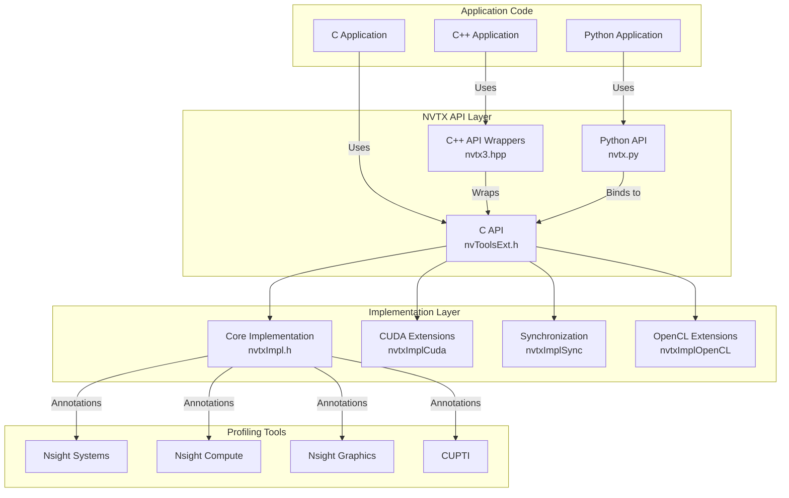
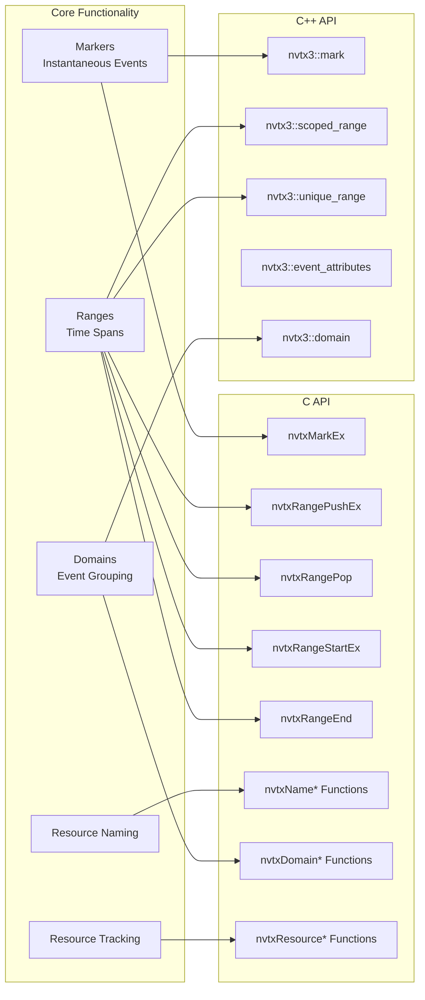
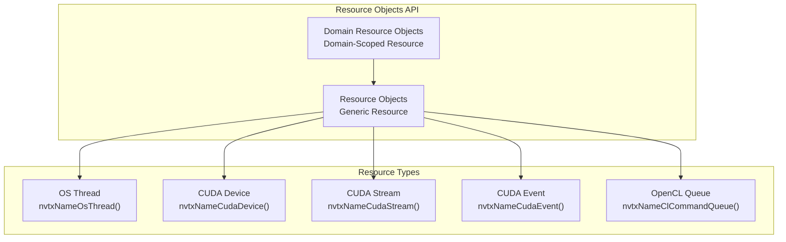
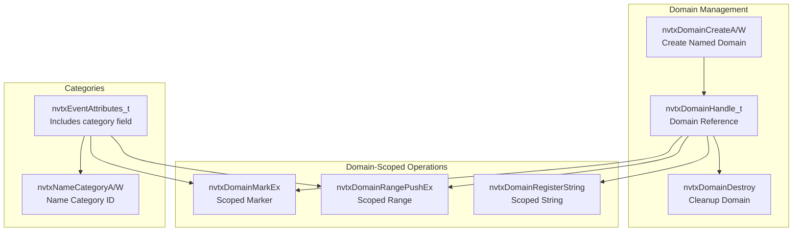
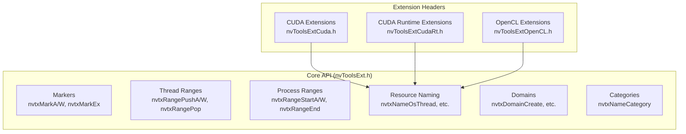
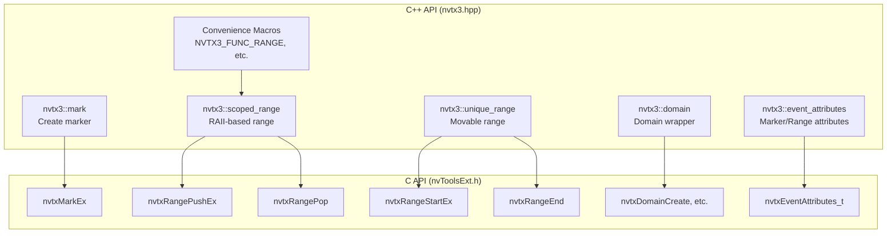
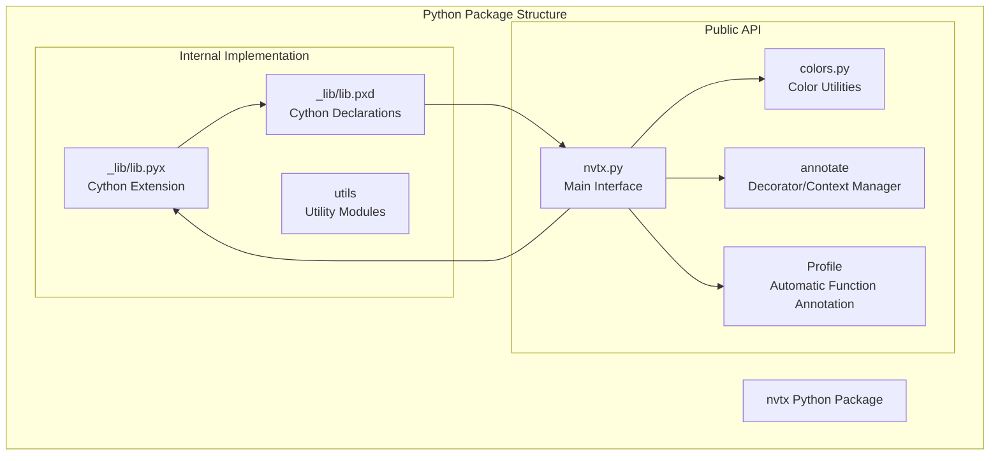
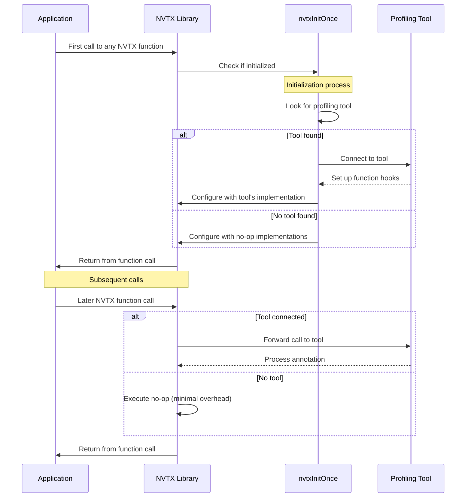

<!-- source: DeepWiki mcp.deepwiki.com · repo NVIDIA/NVTX · page 1 Overview · fetched 2026-10-26 -->

# Overview

<details>
<summary>Relevant source files</summary>

The following files were used as context for generating this wiki page:

- [.gitignore](.gitignore)
- [README.md](README.md)
- [c/include/nvtx3/nvToolsExt.h](c/include/nvtx3/nvToolsExt.h)
- [c/include/nvtx3/nvToolsExtCuda.h](c/include/nvtx3/nvToolsExtCuda.h)
- [c/include/nvtx3/nvToolsExtCudaRt.h](c/include/nvtx3/nvToolsExtCudaRt.h)
- [c/include/nvtx3/nvToolsExtOpenCL.h](c/include/nvtx3/nvToolsExtOpenCL.h)
- [c/include/nvtx3/nvtxDetail/nvtxInit.h](c/include/nvtx3/nvtxDetail/nvtxInit.h)
- [c/include/nvtx3/nvtxDetail/nvtxLinkOnce.h](c/include/nvtx3/nvtxDetail/nvtxLinkOnce.h)
- [docs/index.html](docs/index.html)
- [python/.flake8.cython](python/.flake8.cython)
- [tools/docs/generate-readme.py](tools/docs/generate-readme.py)
- [tools/docs/github-markdown-css/github-markdown.css](tools/docs/github-markdown-css/github-markdown.css)
- [tools/docs/github-markdown-css/license](tools/docs/github-markdown-css/license)

</details>


NVTX (NVIDIA Tools Extension Library) is a cross-platform API for annotating source code with contextual information for developer tools. It allows developers to mark specific points or ranges in their code, name resources, and organize annotations, which are then visualized and analyzed by NVIDIA profiling tools. By default, NVTX adds minimal overhead when no tool is attached, making it suitable for use in production code.

## Architecture

NVTX follows a layered architecture with the C API forming the foundation, while C++ and Python wrappers provide more idiomatic interfaces for those languages.



Sources: [c/include/nvtx3/nvToolsExt.h:21-162](), [c/include/nvtx3/nvtxDetail/nvtxInit.h:415-454](), [README.md:1-24]()

## Key Concepts

NVTX provides several key mechanisms for annotating code:

### Markers and Ranges

NVTX supports two primary annotation types:

- **Markers**: Instantaneous events at specific points in execution
- **Ranges**: Time spans between two points in execution



Sources: [c/include/nvtx3/nvToolsExt.h:672-897](), [README.md:51-62]()

| Annotation Type | Description | C API | C++ API |
|-----------------|-------------|-------|---------|
| Markers | Instantaneous events | `nvtxMarkA/W()`, `nvtxMarkEx()` | `nvtx3::mark()` |
| Thread Ranges | Stack-based nested ranges | `nvtxRangePushA/W()`, `nvtxRangePop()` | `nvtx3::scoped_range` |
| Process Ranges | Independent ranges | `nvtxRangeStartA/W()`, `nvtxRangeEnd()` | `nvtx3::unique_range` |

### Resource Naming and Tracking

NVTX allows associating user-provided names with resources like threads, CUDA streams, and OpenCL objects:



Sources: [c/include/nvtx3/nvToolsExtCuda.h:64-126](), [c/include/nvtx3/nvToolsExtCudaRt.h:64-104](), [c/include/nvtx3/nvToolsExtOpenCL.h:64-170](), [README.md:64-67]()

### Domains and Categories

Domains provide namespacing for annotations to prevent conflicts between libraries, while categories allow logical grouping:



Sources: [c/include/nvtx3/nvToolsExt.h:94-120](), [README.md:427-434]()

## API Layers

### C API

The core C API is defined in `nvToolsExt.h` and provides the foundation for all NVTX functionality:



Sources: [c/include/nvtx3/nvToolsExt.h:672-897](), [c/include/nvtx3/nvToolsExtCuda.h:64-126](), [c/include/nvtx3/nvToolsExtCudaRt.h:64-104](), [c/include/nvtx3/nvToolsExtOpenCL.h:64-170]()

### C++ API

The C++ API provides idiomatic C++ wrappers around the C API with RAII-based classes:



Sources: [README.md:88-96]()

### Python API

The Python API provides Pythonic interfaces with decorators and context managers:



Sources: [README.md:258-262]()

## Initialization and Tool Integration

NVTX uses a lazy initialization model that looks for profiling tools only on first use:



The initialization process:
1. First NVTX call triggers `nvtxInitOnce()`
2. `nvtxInitializeInjectionLibrary()` searches for a profiling tool
   - Checks environment variables (NVTX_INJECTION64_PATH/NVTX_INJECTION32_PATH)
   - Looks for platform-specific injection methods
3. If a tool is found, NVTX configures function pointers to call into the tool
4. If no tool is found, NVTX sets all functions to no-ops

Sources: [c/include/nvtx3/nvtxDetail/nvtxInit.h:215-454](), [README.md:393-401]()

## Integration Options

### C/C++ Integration

NVTX for C/C++ is a header-only library with no dependencies except for `-ldl` on POSIX platforms:

```cpp
// C API
#include <nvtx3/nvToolsExt.h>

void example() {
    nvtxMarkA("Hello world!");
}

// C++ API
#include <nvtx3/nvtx3.hpp>

void example() {
    nvtx3::mark("Hello world!");
}
```

CMake targets are provided for easy integration:

```cmake
# C program
add_executable(my_c_program main.c)
target_link_libraries(my_c_program PRIVATE nvtx3-c)

# C++ program
add_executable(my_cpp_program main.cpp)
target_link_libraries(my_cpp_program PRIVATE nvtx3-cpp)
```

Sources: [README.md:72-101](), [README.md:106-120]()

### Python Integration

Install NVTX for Python using pip or conda:

```python
import nvtx

# Create a marker
nvtx.mark(message="Hello world!")

# Annotate a function
@nvtx.annotate("Function Range")
def my_function():
    # Function body
    pass

# Annotate a code block
with nvtx.annotate("Block Range"):
    # Code block
    pass
```

Installation methods:
- `pip install nvtx`
- `conda install -c conda-forge nvtx`

Sources: [README.md:258-262](), [README.md:312-315]()

## Supported Tools

NVTX annotations are recognized by several NVIDIA developer tools:

| Tool | NVTX Usage |
|------|------------|
| Nsight Systems | Shows NVTX markers and ranges on timeline |
| Nsight Compute | Uses NVTX ranges to focus kernel analysis |
| Nsight Graphics | Uses NVTX ranges to set bounds for profiling |
| CUPTI | Records NVTX calls in profiling API |

Sources: [README.md:323-331]()

## Platform Support

NVTX works on:
- Windows
- Linux and other POSIX-like platforms (including Cygwin)
- Android

Both 64-bit and 32-bit processes are supported without CPU architecture restrictions.

Sources: [README.md:334-341]()

---

