<!-- source: DeepWiki mcp.deepwiki.com · repo NVIDIA/NVTX · page 1.1 Architecture · fetched 2026-10-26 -->

# Architecture

<details>
<summary>Relevant source files</summary>

The following files were used as context for generating this wiki page:

- [.gitignore](.gitignore)
- [README.md](README.md)
- [c/include/nvtx3/nvToolsExt.h](c/include/nvtx3/nvToolsExt.h)
- [c/include/nvtx3/nvToolsExtCuda.h](c/include/nvtx3/nvToolsExtCuda.h)
- [c/include/nvtx3/nvToolsExtCudaRt.h](c/include/nvtx3/nvToolsExtCudaRt.h)
- [c/include/nvtx3/nvToolsExtOpenCL.h](c/include/nvtx3/nvToolsExtOpenCL.h)
- [c/include/nvtx3/nvToolsExtSync.h](c/include/nvtx3/nvToolsExtSync.h)
- [c/include/nvtx3/nvtx3.hpp](c/include/nvtx3/nvtx3.hpp)
- [c/include/nvtx3/nvtxDetail/nvtxInit.h](c/include/nvtx3/nvtxDetail/nvtxInit.h)
- [c/include/nvtx3/nvtxDetail/nvtxLinkOnce.h](c/include/nvtx3/nvtxDetail/nvtxLinkOnce.h)
- [docs/index.html](docs/index.html)
- [python/.flake8.cython](python/.flake8.cython)
- [python/src/nvtx/__init__.py](python/src/nvtx/__init__.py)
- [python/src/nvtx/_lib/lib.pyx](python/src/nvtx/_lib/lib.pyx)
- [python/src/nvtx/nvtx.py](python/src/nvtx/nvtx.py)
- [tools/docs/generate-readme.py](tools/docs/generate-readme.py)
- [tools/docs/github-markdown-css/github-markdown.css](tools/docs/github-markdown-css/github-markdown.css)
- [tools/docs/github-markdown-css/license](tools/docs/github-markdown-css/license)

</details>


This document provides a comprehensive overview of the NVTX (NVIDIA Tools Extension) library architecture. It describes the core components, layers, and interactions that make up the NVTX system. For specific details about key concepts such as markers, ranges, and domains, see [Key Concepts](#1.2).

## Layered Architecture

NVTX is designed as a layered architecture that allows multiple language bindings to share a common implementation while providing language-specific interfaces.

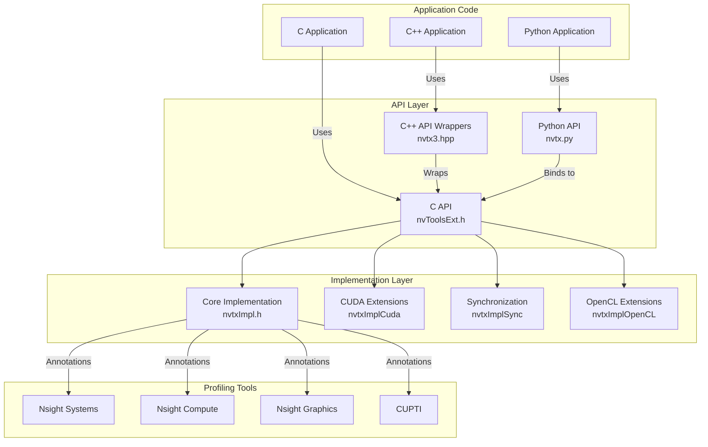

The architecture consists of four main layers:

1. **Application Code**: User applications written in C, C++, or Python that use NVTX for code annotation.
2. **API Layer**: Language-specific interfaces that provide a convenient way to use NVTX.
3. **Implementation Layer**: Core functionality and extensions for specific technologies.
4. **Profiling Tools**: NVIDIA's developer tools that consume NVTX annotations.

Sources: `c/include/nvtx3/nvtx3.hpp`, `c/include/nvtx3/nvToolsExt.h`, `python/src/nvtx/nvtx.py`

## Core Design Philosophy

NVTX is designed with several key principles in mind:

1. **Low Overhead**: When no profiling tool is attached, NVTX has near-zero runtime overhead.
2. **Header-Only**: C and C++ implementations are header-only with no dependencies, making them easy to integrate.
3. **Cross-Platform**: Works across Windows, Linux, and other POSIX-like platforms.
4. **Language Agnostic**: Core functionality available in C with idiomatic wrappers for C++ and Python.

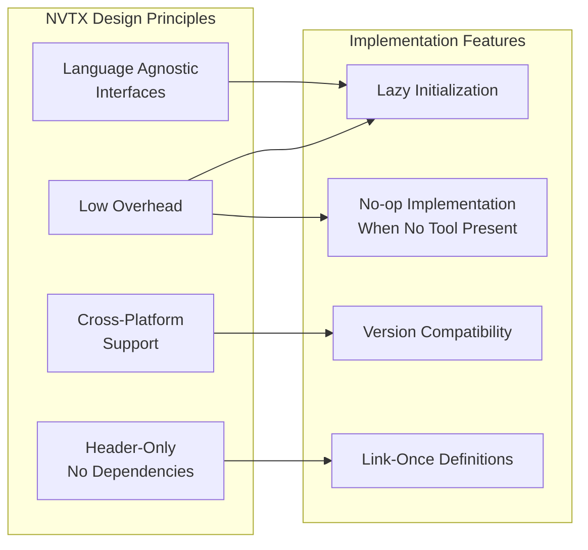

Sources: `README.md`, `c/include/nvtx3/nvToolsExt.h`

## Core Components

### Initialization System

NVTX uses lazy initialization, meaning it only initializes when the first NVTX API function is called. This approach minimizes startup overhead.

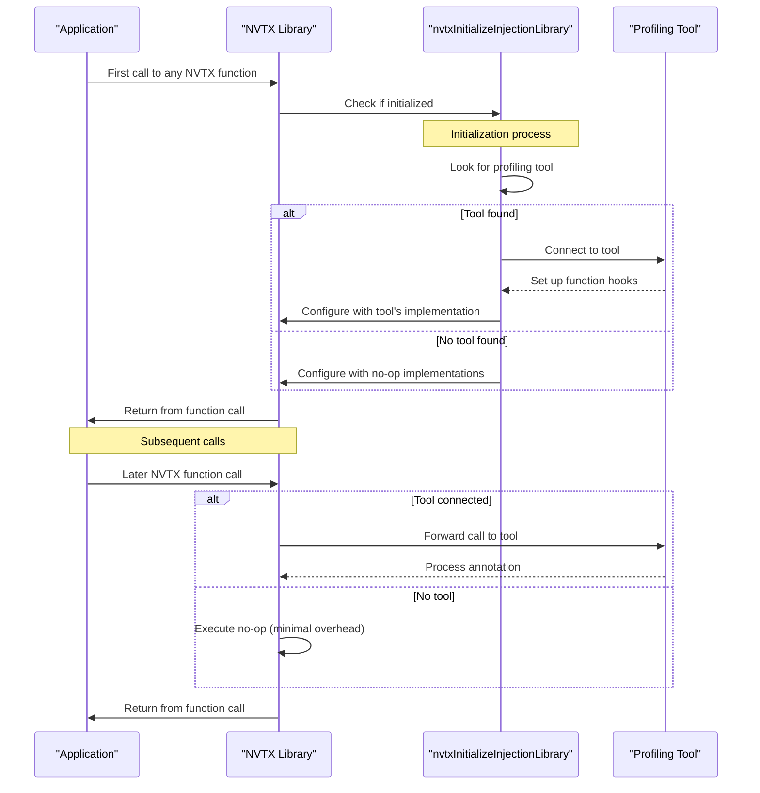

The initialization process is handled by `nvtxInitializeInjectionLibrary()` function which:

1. Looks for a profiling tool to connect with
2. If a tool is found, configures NVTX to forward calls to the tool
3. If no tool is found, configures NVTX to use no-op implementations for minimal overhead

Sources: `c/include/nvtx3/nvtxDetail/nvtxInit.h`, `c/include/nvtx3/nvToolsExt.h:442-466`

### Domain Management

Domains provide a way to scope annotations, allowing libraries and applications to avoid conflicts. The `domain` class manages NVTX domains:

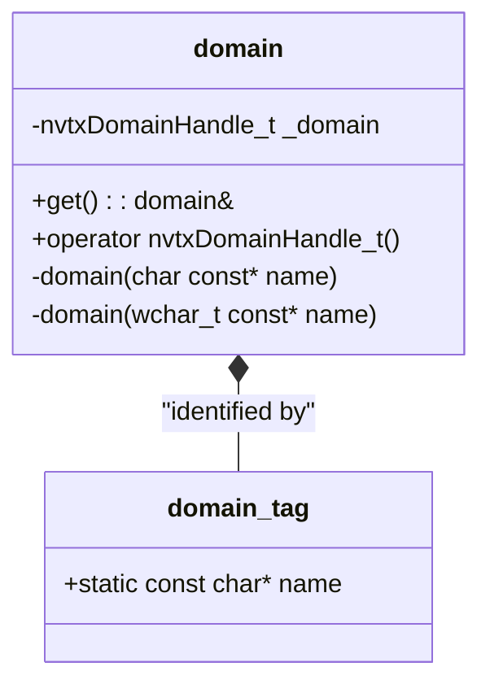

Domains use a "construct on first use" pattern through the static `domain::get<D>()` method, which creates a domain the first time it's requested and returns a reference to it for all future calls.

Sources: `c/include/nvtx3/nvtx3.hpp:756-946`, `c/include/nvtx3/nvToolsExt.h:93-111`

### Event System

The event system provides the core functionality for annotating code with markers and ranges.

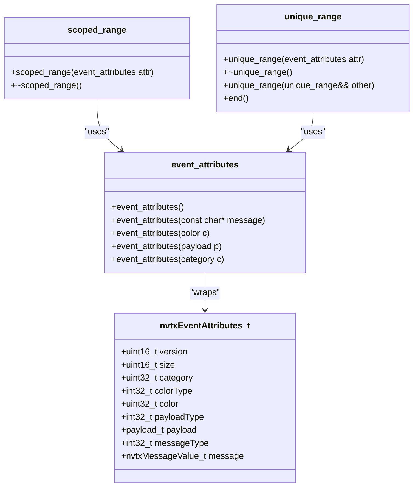

The event system includes:

1. **Event Attributes**: Configuration for markers and ranges (message, color, payload, category)
2. **Markers**: Instantaneous events marked in code
3. **Ranges**: Time spans with beginning and end points

The C++ API provides RAII wrappers like `scoped_range` that automatically manage range lifetimes, ensuring proper beginning and ending of ranges even with exceptions.

Sources: `c/include/nvtx3/nvToolsExt.h:474-662`, `c/include/nvtx3/nvtx3.hpp:226-290`

## Language-Specific APIs

NVTX provides APIs for multiple languages, all built on top of the core C implementation.

### C API

The C API is the foundation for all NVTX functionality and is defined in `nvToolsExt.h`. It provides functions for:

- Creating markers with `nvtxMarkEx()`
- Managing push/pop ranges with `nvtxRangePushEx()` and `nvtxRangePop()`
- Managing start/end ranges with `nvtxRangeStartEx()` and `nvtxRangeEnd()`
- Creating and managing domains with `nvtxDomainCreateA()`
- Naming resources with `nvtxNameCategory()` and other naming functions

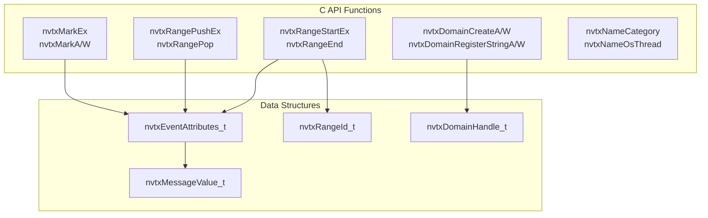

Sources: `c/include/nvtx3/nvToolsExt.h:93-754`

### C++ API

The C++ API is a set of wrappers over the C API that provides a more convenient and type-safe interface. It is defined in `nvtx3.hpp`.

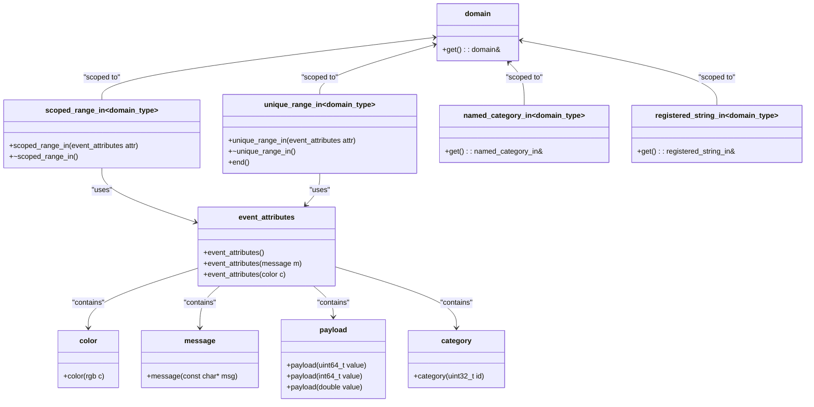

Key features of the C++ API include:

1. **Template-based domain scoping**: Using template parameters to associate objects with domains
2. **RAII-based range management**: `scoped_range` and `unique_range` classes that automatically manage range lifetimes
3. **Compile-time type safety**: Type-based domain identification and error checking
4. **Convenience wrappers**: Easier-to-use wrappers around C API functionality

Sources: `c/include/nvtx3/nvtx3.hpp:98-594`

### Python API

The Python API is built using Cython to bind to the C API and provides a Pythonic interface to NVTX functionality.

```mermaid
graph TD
    subgraph "Python API Components"
        NvtxPy["nvtx.py<br>High-level Interface"]
        Init["__init__.py<br>Public API Exports"]
        LibPyx["_lib/lib.pyx<br>Cython Bindings"]
        Colors["colors.py<br>Color Utilities"]
        Profiler["_lib/profiler.py<br>Automatic Profiling"]
    end
    
    subgraph "Public Functions"
        Annotate["annotate()<br>Decorator & Context Manager"]
        Mark["mark()<br>Instantaneous Event"]
        PushPop["push_range()<br>pop_range()<br>Nested Ranges"]
        StartEnd["start_range()<br>end_range()<br>Overlapping Ranges"]
        Profile["Profile<br>Automatic Instrumentation"]
    end
    
    NvtxPy --> Annotate
    NvtxPy --> Mark
    NvtxPy --> PushPop
    NvtxPy --> StartEnd
    
    Init --> NvtxPy
    Init --> Profiler
    
    Profiler --> Profile
    
    LibPyx -->|"Binds to"| "C API"
    NvtxPy -->|"Uses"| LibPyx
    NvtxPy -->|"Uses"| Colors
```

The Python API features:

1. **Decorator & Context Manager**: The `@nvtx.annotate` decorator and context manager for easy range annotation
2. **Automatic Profiling**: The `Profile` class for automatic function profiling
3. **Color Support**: Integration with matplotlib colors if available
4. **Domain Management**: Python-friendly domain creation and management

Sources: `python/src/nvtx/nvtx.py`, `python/src/nvtx/__init__.py`, `python/src/nvtx/_lib/lib.pyx`

## Extension Mechanisms

NVTX includes several extension mechanisms for specific technologies.

### CUDA Extensions

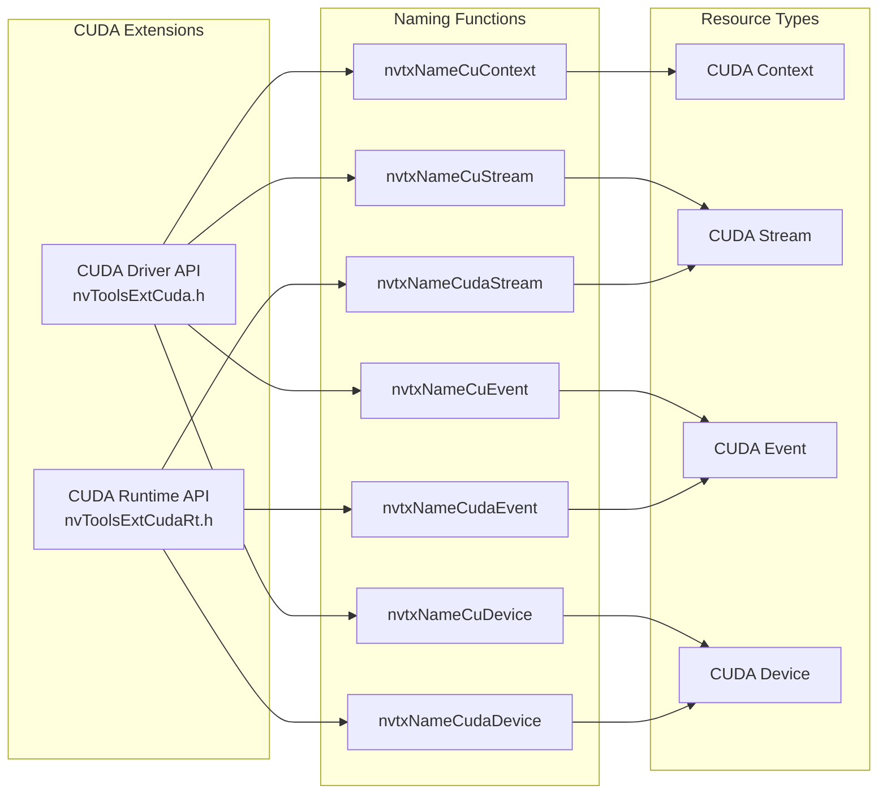

CUDA extensions provide NVTX integration with CUDA resources, allowing users to name CUDA contexts, streams, events, and devices.

Sources: `c/include/nvtx3/nvToolsExtCuda.h`, `c/include/nvtx3/nvToolsExtCudaRt.h`

### OpenCL Extensions

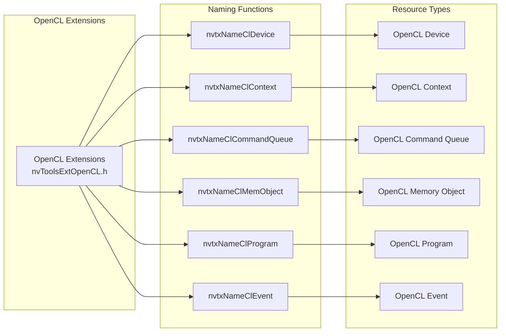

OpenCL extensions provide NVTX integration with OpenCL resources, allowing users to name OpenCL devices, contexts, command queues, memory objects, programs, and events.

Sources: `c/include/nvtx3/nvToolsExtOpenCL.h`

### Synchronization Extensions

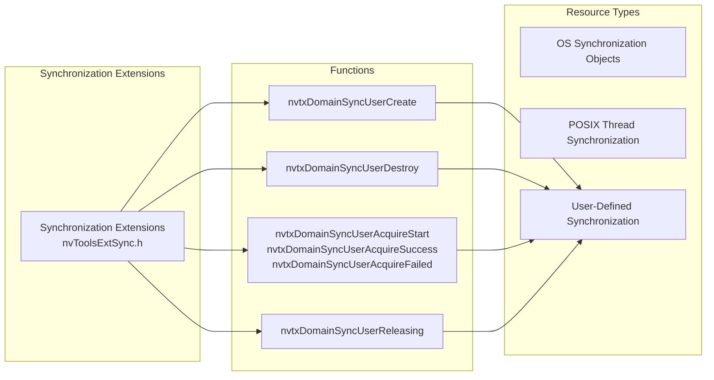

Synchronization extensions allow tracking synchronization primitives, including OS-specific objects, POSIX thread synchronization, and user-defined synchronization mechanisms.

Sources: `c/include/nvtx3/nvToolsExtSync.h`

## Cross-Platform Implementation Details

NVTX is designed to work across multiple platforms with a consistent API. The implementation uses various platform-specific techniques to ensure proper functioning.

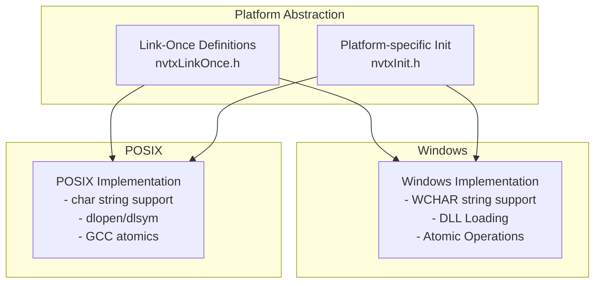

Key cross-platform implementation details include:

1. **Link-Once Definitions**: Macros for creating global variables and functions that work across different compilers and platforms
2. **Platform Detection**: Preprocessor directives to detect and adapt to different platforms
3. **Dynamic Library Loading**: Platform-specific code for loading tools dynamically
4. **Atomic Operations**: Platform-specific implementations of atomic operations

Sources: `c/include/nvtx3/nvtxDetail/nvtxLinkOnce.h`, `c/include/nvtx3/nvtxDetail/nvtxInit.h`

## Further Reading

For more detailed information about using NVTX in your applications, refer to:

- [Key Concepts](#1.2) for detailed explanations of markers, ranges, and resource naming/tracking
- [C API](#2) for documentation on the NVTX C API
- [C++ API](#3) for documentation on the NVTX C++ API
- [Python API](#4) for documentation on the NVTX Python API
- [Integration](#5) for guides on integrating NVTX into your projects

---

