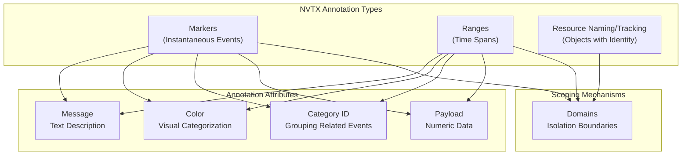
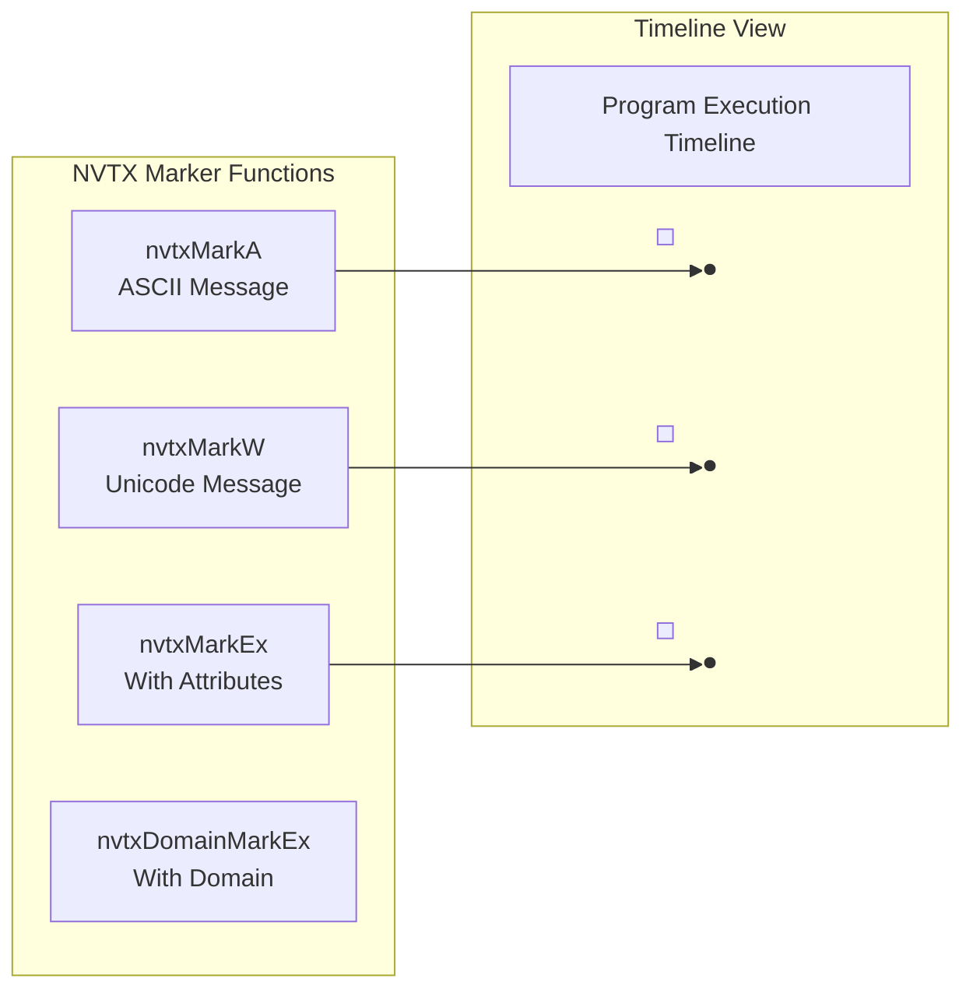
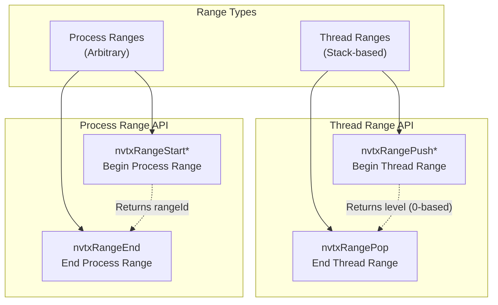
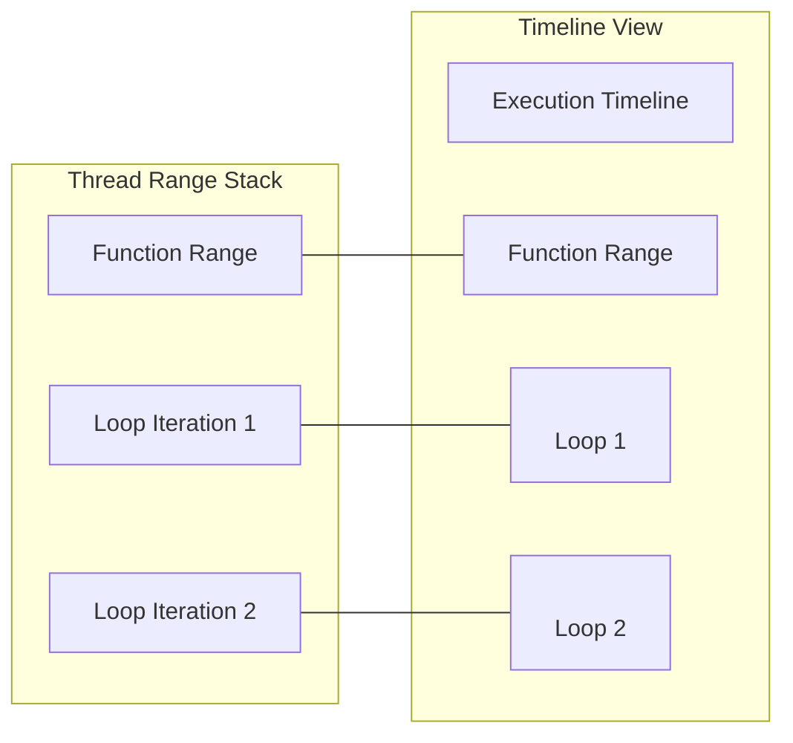
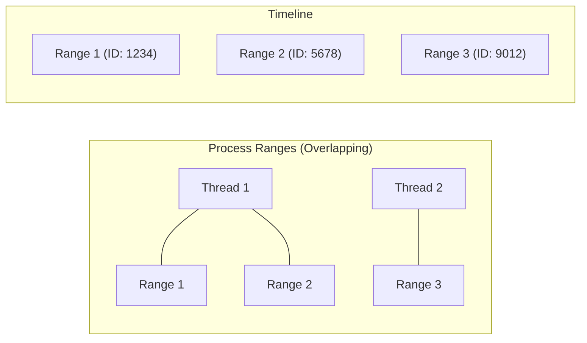
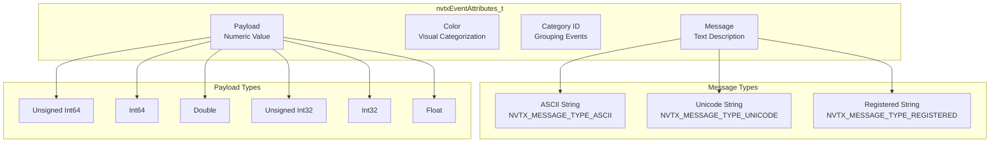
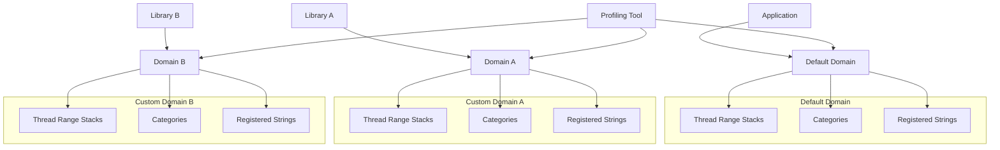
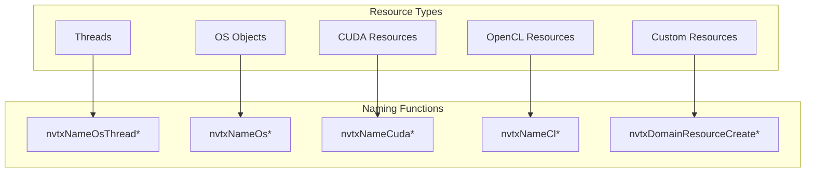
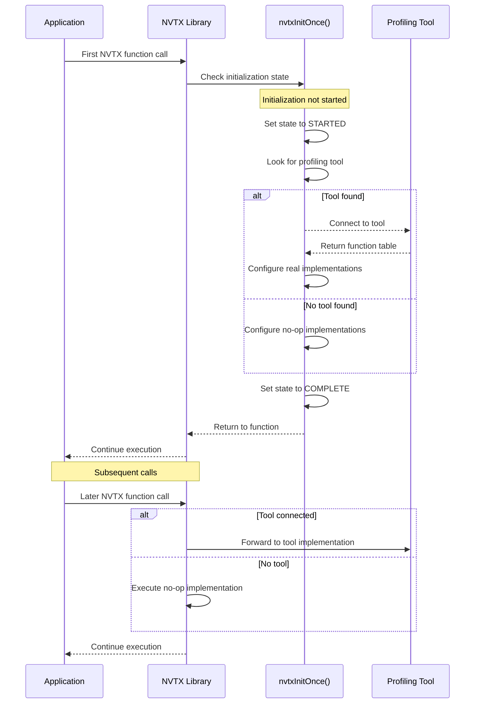
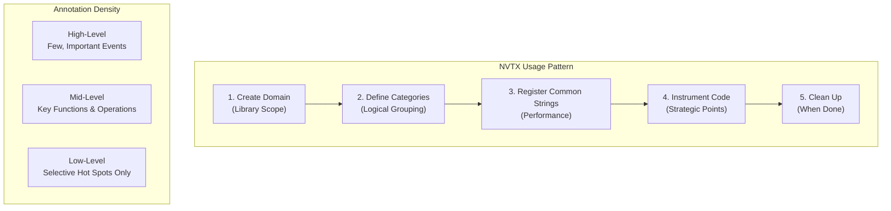

<!-- source: DeepWiki mcp.deepwiki.com · repo NVIDIA/NVTX · page 1.2 Key Concepts · fetched 2026-10-26 -->

# Key Concepts

<details>
<summary>Relevant source files</summary>

The following files were used as context for generating this wiki page:

- [.gitignore](.gitignore)
- [README.md](README.md)
- [c/include/nvtx3/nvToolsExt.h](c/include/nvtx3/nvToolsExt.h)
- [c/include/nvtx3/nvToolsExtCuda.h](c/include/nvtx3/nvToolsExtCuda.h)
- [c/include/nvtx3/nvToolsExtCudaRt.h](c/include/nvtx3/nvToolsExtCudaRt.h)
- [c/include/nvtx3/nvToolsExtOpenCL.h](c/include/nvtx3/nvToolsExtOpenCL.h)
- [c/include/nvtx3/nvtxDetail/nvtxInit.h](c/include/nvtx3/nvtxDetail/nvtxInit.h)
- [c/include/nvtx3/nvtxDetail/nvtxLinkOnce.h](c/include/nvtx3/nvtxDetail/nvtxLinkOnce.h)
- [docs/index.html](docs/index.html)
- [python/.flake8.cython](python/.flake8.cython)
- [tools/docs/generate-readme.py](tools/docs/generate-readme.py)
- [tools/docs/github-markdown-css/github-markdown.css](tools/docs/github-markdown-css/github-markdown.css)
- [tools/docs/github-markdown-css/license](tools/docs/github-markdown-css/license)

</details>


This page explains the core concepts in NVTX (NVIDIA Tools Extension Library), focusing on the fundamental building blocks used for code annotation. Understanding these concepts is essential for effectively using NVTX to provide contextual information to developer tools. For information about specific APIs, see the language-specific API sections ([C API](#2), [C++ API](#3), [Python API](#4)).

## Overview of NVTX Annotations

NVTX is fundamentally a system for annotating code execution to help developer tools understand what your application is doing. By default, NVTX calls do nothing until a developer tool is attached, ensuring minimal overhead during normal operation.



Sources: [c/include/nvtx3/nvToolsExt.h:48-112](), [README.md:47-67]()

## Markers

**Markers** annotate a specific moment in time during program execution. They are used to mark important events without a time duration.



A marker includes a message and optionally color, category, and payload values. When captured by a tool, markers typically appear as points on a timeline with associated information.

**Example:** Marking when a file operation completes:
```c
nvtxMarkA("File download complete");
```

Sources: [c/include/nvtx3/nvToolsExt.h:53-57](), [c/include/nvtx3/nvToolsExt.h:729-754]()

## Ranges

**Ranges** annotate a span of time between two points in program execution. NVTX supports two types of ranges:

1. **Thread Ranges** (Push/Pop): Form a stack of nested ranges on a single thread
2. **Process Ranges** (Start/End): Allow arbitrary overlapping ranges, possibly across threads



### Thread Ranges (Push/Pop)

Thread ranges use a stack model, where ranges can be nested and each `nvtxRangePop` automatically closes the most recently pushed range on that thread.



**Example:** Using thread ranges to profile a function with nested loop iterations:
```c
nvtxRangePushA("Function execution");
// Function code
for (int i = 0; i < 3; i++) {
    nvtxRangePushA("Loop iteration");
    // Loop code
    nvtxRangePop(); // End loop iteration range
}
nvtxRangePop(); // End function range
```

### Process Ranges (Start/End)

Process ranges are identified by a unique ID returned from the start function, which must be passed to the end function. They can overlap arbitrarily and can start and end on different threads.



**Example:** Using process ranges for operations that span threads:
```c
// Thread 1
nvtxRangeId_t id = nvtxRangeStartA("Async operation");
// Pass id to Thread 2
// ...
// Thread 2
nvtxRangeEnd(id); // End the range on a different thread
```

Sources: [c/include/nvtx3/nvToolsExt.h:62-78](), [c/include/nvtx3/nvToolsExt.h:788-897](), [c/include/nvtx3/nvToolsExt.h:937-1014](), [README.md:54-62]()

## Event Attributes

Event attributes provide additional context for markers and ranges beyond simple text messages. They make annotations more informative and visually distinguishable in profiling tools.



To use event attributes, create and initialize an `nvtxEventAttributes_t` structure with the desired values, then pass it to functions like `nvtxMarkEx`, `nvtxRangePushEx`, or `nvtxRangeStartEx`.

**Example:** Creating a range with attributes:
```c
nvtxEventAttributes_t eventAttrib = {0};
eventAttrib.version = NVTX_VERSION;
eventAttrib.size = NVTX_EVENT_ATTRIB_STRUCT_SIZE;
eventAttrib.colorType = NVTX_COLOR_ARGB;
eventAttrib.color = 0xFF0000FF;  // Red
eventAttrib.messageType = NVTX_MESSAGE_TYPE_ASCII;
eventAttrib.message.ascii = "Important operation";
eventAttrib.category = 3;  // Custom category ID
eventAttrib.payloadType = NVTX_PAYLOAD_TYPE_INT32;
eventAttrib.payload.iValue = 42;

nvtxRangePushEx(&eventAttrib);
// Code to profile
nvtxRangePop();
```

The event attributes provide:
- **Message**: Human-readable description of the event
- **Color**: Visual identifier for the event in timeline views
- **Category**: Numeric grouping to organize related events
- **Payload**: Numeric data associated with the event (e.g., size, count, ID)

Sources: [c/include/nvtx3/nvToolsExt.h:85-92](), [c/include/nvtx3/nvToolsExt.h:471-661]()

## Domains

Domains provide isolation for NVTX annotations, allowing different libraries to use NVTX independently without conflicts. Each domain maintains its own categories, registered strings, and thread range stacks.



Domains are particularly important when multiple libraries in the same application use NVTX. Each library should create its own domain to prevent naming conflicts and ensure proper range nesting.

**Example:** Creating and using a domain:
```c
// In a library
nvtxDomainHandle_t domain = nvtxDomainCreateA("MyLibrary");

// Use domain-specific versions of functions
nvtxDomainMarkEx(domain, &eventAttrib);
nvtxDomainRangePushEx(domain, &eventAttrib);
// ...
nvtxDomainRangePop(domain);
```

When your library or component is done using NVTX, you can destroy the domain:
```c
nvtxDomainDestroy(domain);
```

Sources: [c/include/nvtx3/nvToolsExt.h:93-112](), [README.md:425-438]()

## Resource Naming

Resource naming associates human-readable names with objects in your application, such as threads, mutexes, or other resources. This helps profiling tools display meaningful labels instead of numeric IDs.



Common resources that can be named include:

1. **OS Resources**:
   - Threads (`nvtxNameOsThread`)
   - Processes (`nvtxNameOsProcess`)

2. **CUDA Resources**:
   - Devices (`nvtxNameCudaDevice`)
   - Streams (`nvtxNameCudaStream`)
   - Events (`nvtxNameCudaEvent`)

3. **OpenCL Resources**:
   - Devices (`nvtxNameClDevice`)
   - Command Queues (`nvtxNameClCommandQueue`)
   - Events (`nvtxNameClEvent`)

4. **Generic Resources**:
   - Custom resource objects with type and identifier

**Example:** Naming a thread for better profiling output:
```c
// Get current thread ID
#ifdef _WIN32
DWORD threadId = GetCurrentThreadId();
#else
pthread_t threadId = pthread_self();
#endif

// Name the thread
nvtxNameOsThreadA(threadId, "Worker Thread #1");
```

Sources: [c/include/nvtx3/nvToolsExt.h:112-143](), [c/include/nvtx3/nvToolsExtCuda.h:33-145](), [c/include/nvtx3/nvToolsExtCudaRt.h:33-128](), [c/include/nvtx3/nvToolsExtOpenCL.h:34-202](), [README.md:64-67]()

## Initialization and Tool Integration

NVTX is designed to have negligible overhead when no profiling tool is attached. The first call to any NVTX function triggers the initialization process, which checks for an available profiling tool.



The initialization process includes:

1. Checking if a profiling tool is specified via environment variables
2. Loading the appropriate injection library if found
3. Connecting to the tool and configuring function implementations
4. If no tool is found, setting all functions to no-ops for minimal overhead

This approach ensures that NVTX annotations have virtually no impact on application performance when not being profiled.

**Example:** Forcing initialization early in your application:
```c
// Optional: Force initialization at a convenient time
nvtxInitialize(NULL);

// Later NVTX calls will be faster on their first invocation
```

Sources: [c/include/nvtx3/nvtxDetail/nvtxInit.h:231-454](), [c/include/nvtx3/nvToolsExt.h:38-46](), [c/include/nvtx3/nvToolsExt.h:443-465](), [README.md:394-402]()

## Best Practices for Using NVTX

To get the most out of NVTX, follow these guidelines:

1. **Use Domains for Libraries**: If you're writing a library that uses NVTX, create a domain to avoid conflicts with other NVTX users.

2. **Prefer Thread Ranges for Simple Profiling**: Thread ranges (push/pop) are easier to use for nested function calls and loops within a thread.

3. **Use Process Ranges for Cross-Thread Operations**: When operations span multiple threads, use process ranges (start/end) to track their lifetime.

4. **Register Strings for Repeated Messages**: If the same string is used frequently, register it once and reuse it to reduce overhead.

5. **Avoid String Formatting in Performance-Critical Paths**: String formatting can add overhead. Use payloads for variable data instead.

6. **Use Categories to Group Related Events**: Assign category IDs to group related events, making it easier to filter and analyze them.

7. **Be Strategic with Annotations**: Focus on annotating the most important parts of your code rather than instrumenting everything.

8. **Keep Message Strings Brief and Meaningful**: Short, descriptive messages are more readable in timeline views.



Sources: [README.md:411-442]()

## Summary

NVTX provides a powerful, low-overhead mechanism for annotating code to provide context to profiling tools. The key concepts include:

1. **Markers**: Instantaneous events for specific points in execution
2. **Ranges**: Time spans using either push/pop (thread ranges) or start/end (process ranges)
3. **Event Attributes**: Additional context including messages, colors, categories, and payloads
4. **Domains**: Isolation boundaries to prevent conflicts between libraries
5. **Resource Naming**: Associating human-readable names with application objects
6. **Initialization**: Dynamic discovery and connection to profiling tools

By understanding and applying these concepts, you can effectively use NVTX to make your application more analyzable by performance profiling tools like NVIDIA Nsight Systems, Nsight Compute, and others.

---

