<!-- source: DeepWiki mcp.deepwiki.com · repo NVIDIA/NVTX · page 2 C API · fetched 2026-10-26 -->

# C API

<details>
<summary>Relevant source files</summary>

The following files were used as context for generating this wiki page:

- [c/include/nvtx3/nvToolsExt.h](c/include/nvtx3/nvToolsExt.h)
- [c/include/nvtx3/nvToolsExtCuda.h](c/include/nvtx3/nvToolsExtCuda.h)
- [c/include/nvtx3/nvToolsExtCudaRt.h](c/include/nvtx3/nvToolsExtCudaRt.h)
- [c/include/nvtx3/nvToolsExtOpenCL.h](c/include/nvtx3/nvToolsExtOpenCL.h)
- [c/include/nvtx3/nvtxDetail/nvtxImpl.h](c/include/nvtx3/nvtxDetail/nvtxImpl.h)
- [c/include/nvtx3/nvtxDetail/nvtxInit.h](c/include/nvtx3/nvtxDetail/nvtxInit.h)
- [c/include/nvtx3/nvtxDetail/nvtxInitDecls.h](c/include/nvtx3/nvtxDetail/nvtxInitDecls.h)
- [c/include/nvtx3/nvtxDetail/nvtxInitDefs.h](c/include/nvtx3/nvtxDetail/nvtxInitDefs.h)
- [c/include/nvtx3/nvtxDetail/nvtxLinkOnce.h](c/include/nvtx3/nvtxDetail/nvtxLinkOnce.h)
- [c/include/nvtx3/nvtxDetail/nvtxTypes.h](c/include/nvtx3/nvtxDetail/nvtxTypes.h)

</details>


The NVTX C API forms the foundation of the NVIDIA Tools Extension library. This page documents the core C API functions and types that enable developers to annotate their code with markers, ranges, and resource names for performance analysis in NVIDIA profiling tools. For language-specific wrappers built on top of this API, see [C++ API](#3) and [Python API](#4).

## Overview and Design

The NVTX C API is designed with several key principles:

- **Low Overhead**: The API has near-zero overhead when no profiling tool is attached
- **Header-Only**: The implementation is provided in headers with inline functions
- **Cross-Platform**: Supports Windows, Linux, and other platforms
- **Extensible**: Organized with modules for different domains (Core, CUDA, OpenCL)

The C API serves as the foundation layer for higher-level language bindings while maintaining binary compatibility across different versions.

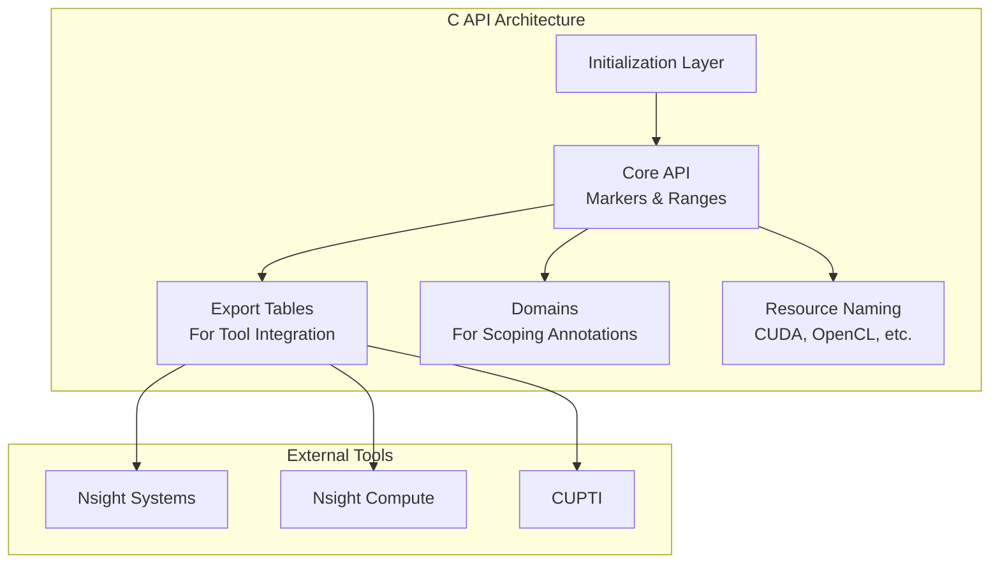

Sources: [c/include/nvtx3/nvToolsExt.h:25-156](), [c/include/nvtx3/nvtxDetail/nvtxImpl.h:21-79]()

## Core Components

### Initialization

NVTX automatically initializes on the first API call. The initialization process looks for available profiling tools and connects to them dynamically. If you need to force initialization before any performance-critical sections, you can use `nvtxInitialize()`.

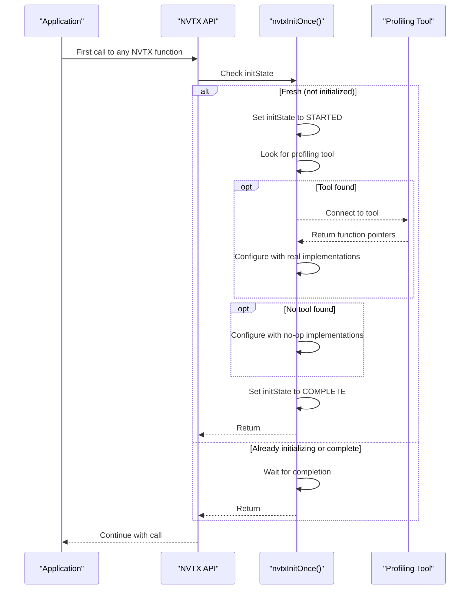

Sources: [c/include/nvtx3/nvtxDetail/nvtxInit.h:26-454](), [c/include/nvtx3/nvToolsExt.h:437-465]()

### Event Attributes

Event attributes provide additional information for markers and ranges. They include:

- **Message**: Text description (ASCII, Unicode, or registered string)
- **Color**: ARGB color for visualization
- **Category**: User-defined ID for grouping
- **Payload**: Numerical value (various types supported)

The `nvtxEventAttributes_t` structure must be initialized with version and size information before use.

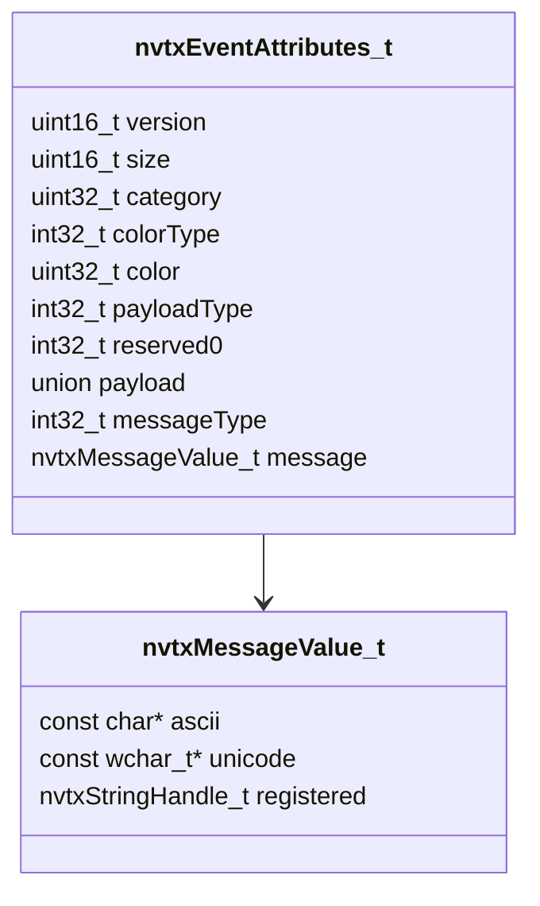

Sources: [c/include/nvtx3/nvToolsExt.h:470-661]()

### Domains

Domains allow developers to scope annotations to avoid conflicts when different libraries or components use NVTX. Each domain maintains its own:

- Categories
- Thread range stacks
- Registered strings

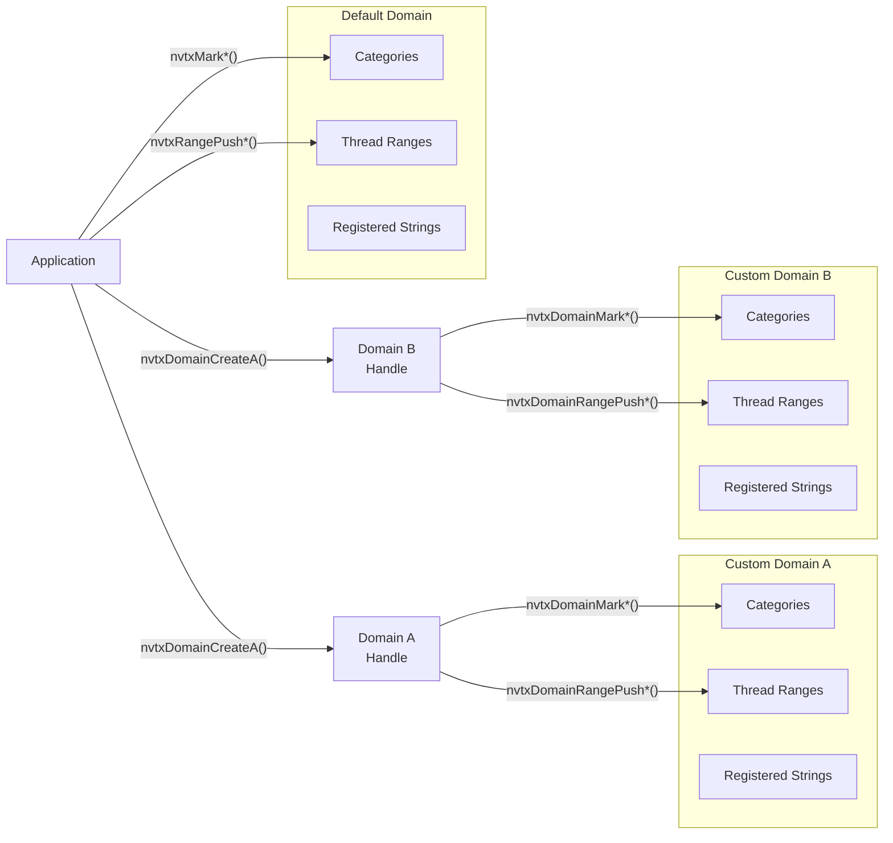

Sources: [c/include/nvtx3/nvToolsExt.h:93-128]()

## Markers and Ranges

### Markers

Markers represent instantaneous events at a specific point in time. They can include a message and additional attributes.

```c
// Simple marker with message
nvtxMarkA("Simple marker");

// Marker with attributes
nvtxEventAttributes_t eventAttrib = {0};
eventAttrib.version = NVTX_VERSION;
eventAttrib.size = NVTX_EVENT_ATTRIB_STRUCT_SIZE;
eventAttrib.colorType = NVTX_COLOR_ARGB;
eventAttrib.color = 0xFF0000FF;  // Blue
eventAttrib.messageType = NVTX_MESSAGE_TYPE_ASCII;
eventAttrib.message.ascii = "Marker with attributes";
nvtxMarkEx(&eventAttrib);
```

Sources: [c/include/nvtx3/nvToolsExt.h:672-754]()

### Thread Ranges

Thread ranges denote nested time spans within a thread. They use a stack-based model with push and pop operations.

```c
// Simple thread range
nvtxRangePushA("Outer range");
// ... operations ...
nvtxRangePushA("Inner range");
// ... nested operations ...
nvtxRangePop();  // End inner range
// ... more operations ...
nvtxRangePop();  // End outer range
```

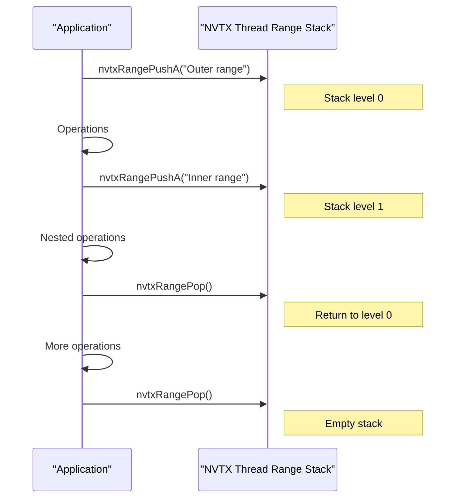

Sources: [c/include/nvtx3/nvToolsExt.h:898-1002]()

### Process Ranges

Process ranges represent time spans that can overlap and span across threads. They use explicit start and end operations with correlation IDs.

```c
// Process range with attributes
nvtxEventAttributes_t eventAttrib = {0};
eventAttrib.version = NVTX_VERSION;
eventAttrib.size = NVTX_EVENT_ATTRIB_STRUCT_SIZE;
eventAttrib.messageType = NVTX_MESSAGE_TYPE_ASCII;
eventAttrib.message.ascii = "Process range";
nvtxRangeId_t rangeId = nvtxRangeStartEx(&eventAttrib);
// ... operations (can span threads) ...
nvtxRangeEnd(rangeId);
```

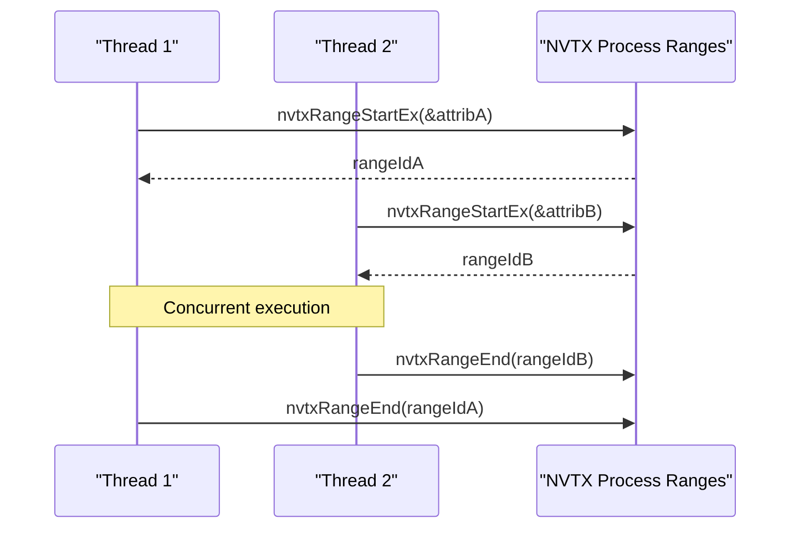

Sources: [c/include/nvtx3/nvToolsExt.h:756-897]()

## Resource Naming

The C API provides functions to name various resources for better identification in profiling tools.

### Generic Resource Naming

- `nvtxNameCategoryA/W`: Name a category
- `nvtxNameOsThreadA/W`: Name an OS thread

### Domain Resource Objects

In NVTX version 2 and later, a more general resource naming mechanism is available:

```c
// Create a domain
nvtxDomainHandle_t domain = nvtxDomainCreateA("MyDomain");

// Create resource attributes
nvtxResourceAttributes_t resAttrib = {0};
resAttrib.version = NVTX_VERSION;
resAttrib.size = NVTX_RESOURCE_ATTRIB_STRUCT_SIZE;
resAttrib.identifierType = NVTX_RESOURCE_TYPE_GENERIC_POINTER;
resAttrib.identifier.pValue = myObject;
resAttrib.messageType = NVTX_MESSAGE_TYPE_ASCII;
resAttrib.message.ascii = "My Resource";

// Create the resource
nvtxResourceHandle_t resource = nvtxDomainResourceCreate(domain, &resAttrib);

// Later destroy the resource when no longer needed
nvtxDomainResourceDestroy(resource);
```

Sources: [c/include/nvtx3/nvToolsExt.h:112-143]()

### Platform-Specific Resource Naming

NVTX provides specialized functions for naming resources from different platforms:

#### CUDA Driver API Resources

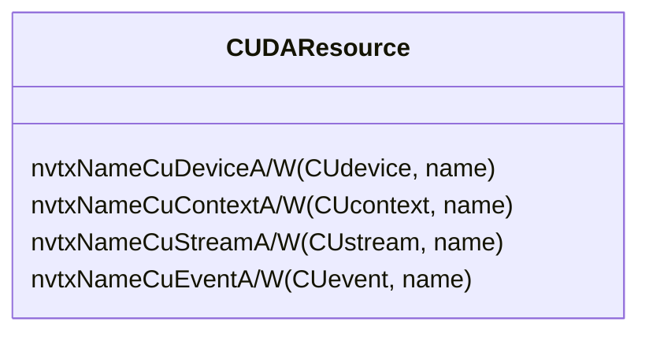

Sources: [c/include/nvtx3/nvToolsExtCuda.h:20-154]()

#### CUDA Runtime API Resources

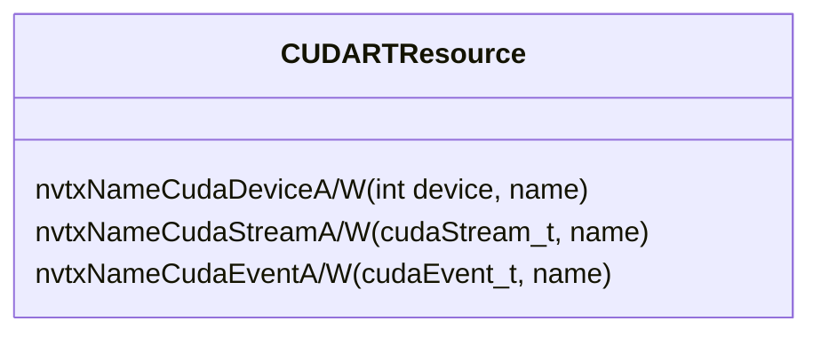

Sources: [c/include/nvtx3/nvToolsExtCudaRt.h:20-129]()

#### OpenCL Resources

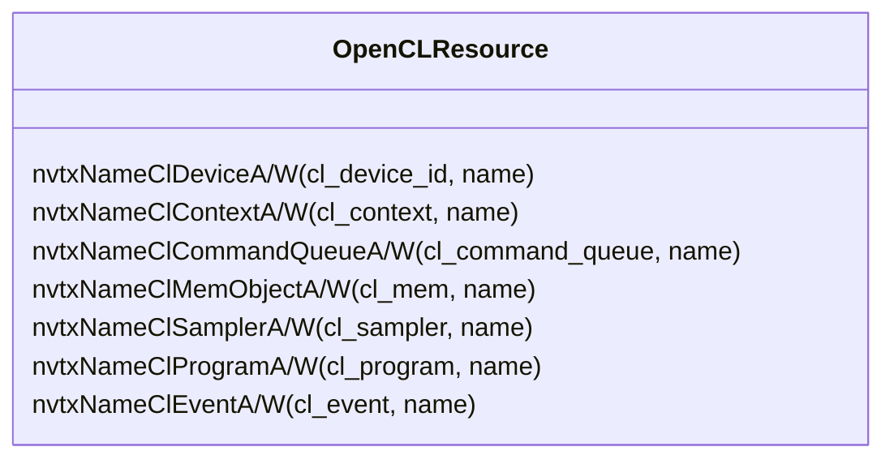

Sources: [c/include/nvtx3/nvToolsExtOpenCL.h:20-204]()

## API Reference

### Function Naming Conventions

The NVTX C API follows a consistent naming pattern:

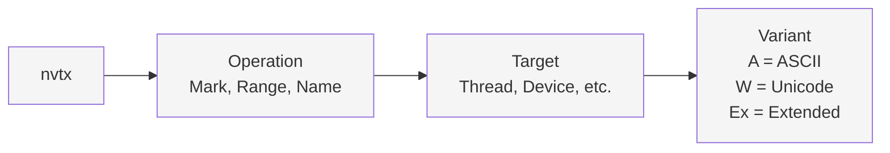

Examples:
- `nvtxMarkA`: Creates a marker with ASCII text
- `nvtxRangePushEx`: Starts a thread range with extended attributes
- `nvtxNameCudaDeviceW`: Names a CUDA device with Unicode text

### Core API Functions

| Function Group | Key Functions | Description |
|----------------|---------------|-------------|
| Initialization | `nvtxInitialize` | Force initialization of NVTX |
| Markers | `nvtxMarkA/W`, `nvtxMarkEx` | Create instantaneous events |
| Thread Ranges | `nvtxRangePushA/W`, `nvtxRangePushEx`, `nvtxRangePop` | Manage nested ranges within a thread |
| Process Ranges | `nvtxRangeStartA/W`, `nvtxRangeStartEx`, `nvtxRangeEnd` | Manage arbitrary ranges that can span threads |
| Domain Management | `nvtxDomainCreateA/W`, `nvtxDomainDestroy` | Create and manage annotation domains |
| Resource Naming | `nvtxNameCategoryA/W`, `nvtxNameOsThreadA/W` | Associate names with resources |

Sources: [c/include/nvtx3/nvToolsExt.h:464-1010]()

## Implementation Details

### Header-Only Design

The NVTX C API is implemented as a header-only library, which offers several advantages:

- No need to link against a separate library
- Easy to include in existing projects
- Avoids symbol conflicts across different versions

When including `nvToolsExt.h`, the implementation is automatically included unless `NVTX_NO_IMPL` is defined.

### Initialization Process

The initialization process is designed to be lazy and thread-safe:

1. All functions initially point to initialization wrappers (`*_impl_init`)
2. On first call, `nvtxInitOnce()` is invoked
3. NVTX looks for profiling tools using a predefined search sequence
4. If a tool is found, function pointers are redirected to the tool's implementations
5. If no tool is found, function pointers are set to no-op implementations

This design ensures minimal overhead when no profiling tool is attached to the application.

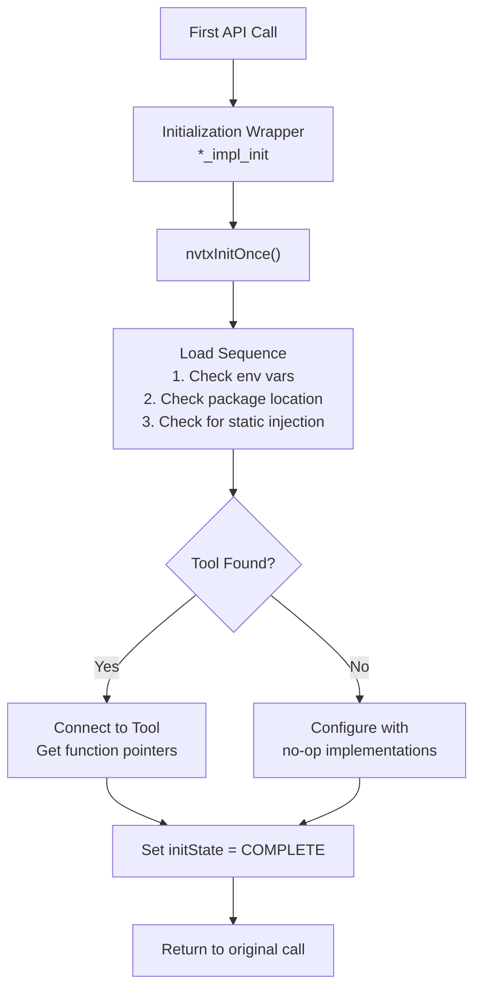

Sources: [c/include/nvtx3/nvtxDetail/nvtxInit.h:66-454](), [c/include/nvtx3/nvtxDetail/nvtxInitDefs.h:25-447]()

### Export Tables

NVTX uses export tables to expose its functionality to profiling tools. These tables provide a stable interface that tools can use to access NVTX functions:

- `NVTX_ETID_CALLBACKS`: Functions for accessing module function tables
- `NVTX_ETID_VERSIONINFO`: Version information and compatibility features

When a profiling tool connects to NVTX, it uses these export tables to replace the default implementations with its own, enabling detailed profiling data collection.

Sources: [c/include/nvtx3/nvtxDetail/nvtxTypes.h:264-308](), [c/include/nvtx3/nvtxDetail/nvtxImpl.h:370-431]()

## Platform Compatibility

The NVTX C API is designed to work across multiple platforms with conditional compilation for platform-specific features:

- Windows: Uses `__stdcall` calling convention and Windows-specific headers
- Linux/POSIX: Uses platform-appropriate synchronization primitives
- Android: Includes special handling for package directories

The API also handles different compiler environments with appropriate inline function declarations and visibility attributes.

Sources: [c/include/nvtx3/nvToolsExt.h:166-228](), [c/include/nvtx3/nvtxDetail/nvtxLinkOnce.h:20-78]()

---

