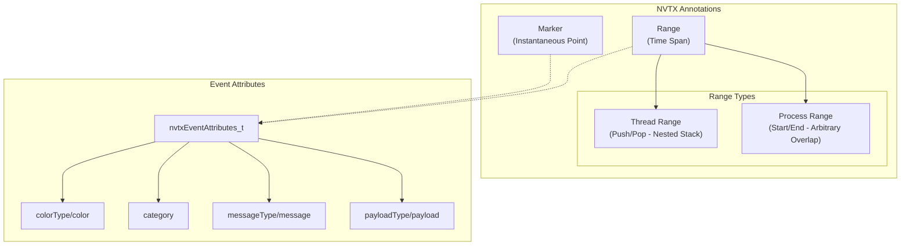
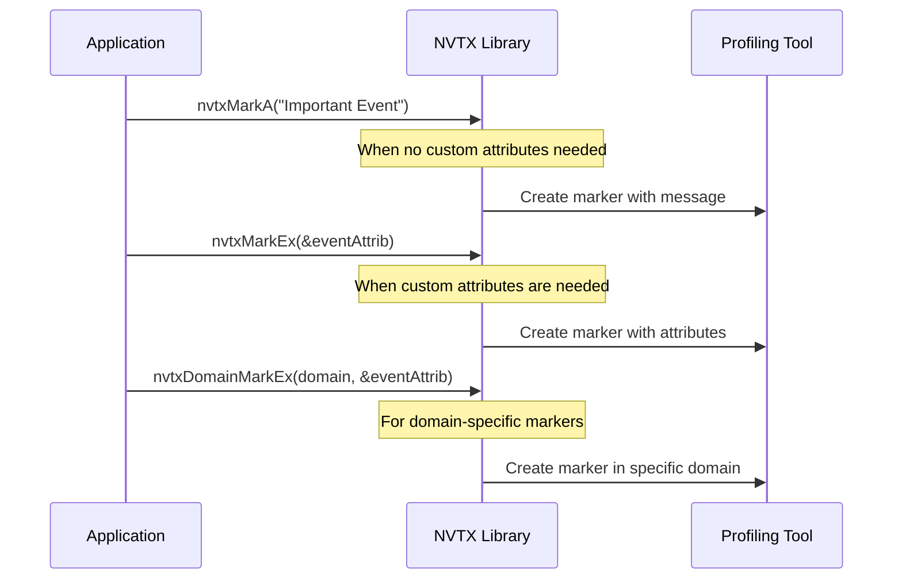
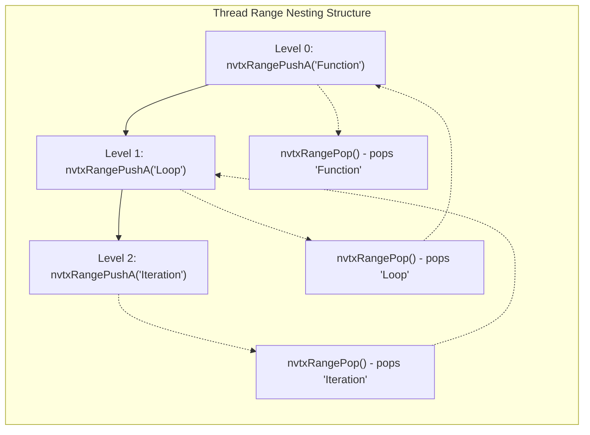
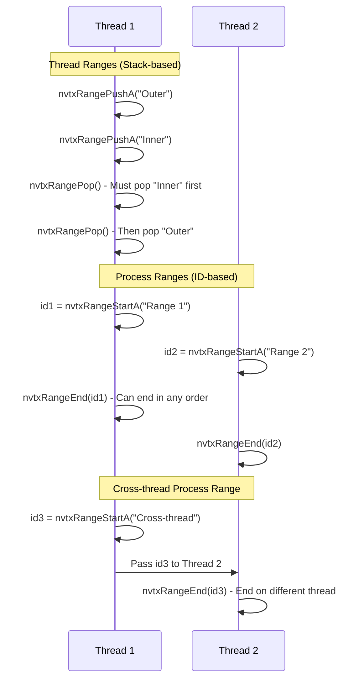
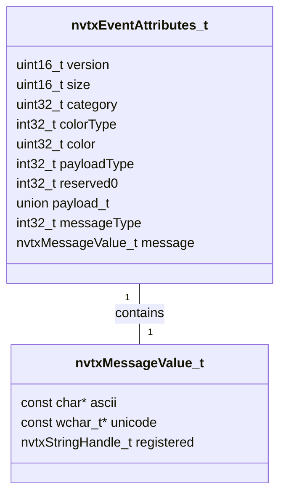

<!-- source: DeepWiki mcp.deepwiki.com · repo NVIDIA/NVTX · page 2.1 Markers and Ranges · fetched 2026-10-26 -->

# Markers and Ranges

<details>
<summary>Relevant source files</summary>

The following files were used as context for generating this wiki page:

- [.gitignore](.gitignore)
- [README.md](README.md)
- [c/include/nvtx3/nvToolsExt.h](c/include/nvtx3/nvToolsExt.h)
- [c/include/nvtx3/nvToolsExtCuda.h](c/include/nvtx3/nvToolsExtCuda.h)
- [c/include/nvtx3/nvToolsExtCudaRt.h](c/include/nvtx3/nvToolsExtCudaRt.h)
- [c/include/nvtx3/nvToolsExtOpenCL.h](c/include/nvtx3/nvToolsExtOpenCL.h)
- [c/include/nvtx3/nvtxDetail/nvtxInit.h](c/include/nvtx3/nvtxDetail/nvtxInit.h)
- [c/include/nvtx3/nvtxDetail/nvtxLinkOnce.h](c/include/nvtx3/nvtxDetail/nvtxLinkOnce.h)
- [docs/index.html](docs/index.html)
- [python/.flake8.cython](python/.flake8.cython)
- [tools/docs/generate-readme.py](tools/docs/generate-readme.py)
- [tools/docs/github-markdown-css/github-markdown.css](tools/docs/github-markdown-css/github-markdown.css)
- [tools/docs/github-markdown-css/license](tools/docs/github-markdown-css/license)

</details>


## Purpose and Scope

This page details the C API functions for creating markers and ranges to annotate code execution in NVTX. Markers denote specific points (instantaneous events) in a program's execution, while ranges denote spans of time between two points. These annotations provide context for developer tools, enhancing visualization and analysis of application behavior. For information about using these features with the C++ API, see [Ranges and Scopes](#3.1). For the Python implementation, see [Basic Usage](#4.2).

## Overview of Markers and Ranges



Sources: [c/include/nvtx3/nvToolsExt.h:48-79](), [README.md:51-62]()

## Markers

Markers annotate a specific moment in time during program execution. They are useful for highlighting important events like the start of an algorithm, a significant state change, or when specific conditions are met.

### Marker API Functions

| Function | Description |
|----------|-------------|
| `nvtxMarkA(const char* message)` | Creates a marker with an ASCII message |
| `nvtxMarkW(const wchar_t* message)` | Creates a marker with a wide character message |
| `nvtxMarkEx(const nvtxEventAttributes_t* eventAttrib)` | Creates a marker with custom attributes |
| `nvtxDomainMarkEx(nvtxDomainHandle_t domain, const nvtxEventAttributes_t* eventAttrib)` | Creates a marker in a specific domain |

Sources: [c/include/nvtx3/nvToolsExt.h:674-754]()

### Marker Creation Flow



Sources: [c/include/nvtx3/nvToolsExt.h:691-729]()

### Example Usage

The following example demonstrates how to create a simple marker and a marker with custom attributes:

```c
// Simple marker with text message
nvtxMarkA("Simple marker");

// Marker with custom attributes
nvtxEventAttributes_t eventAttrib = {0};
eventAttrib.version = NVTX_VERSION;
eventAttrib.size = NVTX_EVENT_ATTRIB_STRUCT_SIZE;
eventAttrib.colorType = NVTX_COLOR_ARGB;
eventAttrib.color = 0xFF880000;  // Red color
eventAttrib.messageType = NVTX_MESSAGE_TYPE_ASCII;
eventAttrib.message.ascii = "Customized marker";
nvtxMarkEx(&eventAttrib);
```

Sources: [c/include/nvtx3/nvToolsExt.h:709-722]()

## Ranges

Ranges annotate spans of time in program execution. NVTX provides two types of ranges:

1. **Thread Ranges**: Push/pop ranges that follow a stack-like nesting structure within a thread
2. **Process Ranges**: Start/end ranges that can arbitrarily overlap and span across threads

### Thread Ranges

Thread ranges use a push/pop mechanism and follow a stack-based model. The most recently pushed range must be popped first. They are ideal for tracking nested function calls or loop iterations within a single thread.

#### Thread Range API Functions

| Function | Description |
|----------|-------------|
| `nvtxRangePushA(const char* message)` | Starts a thread range with an ASCII message |
| `nvtxRangePushW(const wchar_t* message)` | Starts a thread range with a wide character message |
| `nvtxRangePushEx(const nvtxEventAttributes_t* eventAttrib)` | Starts a thread range with custom attributes |
| `nvtxRangePop()` | Ends the most recently started thread range |
| `nvtxDomainRangePushEx(nvtxDomainHandle_t domain, const nvtxEventAttributes_t* eventAttrib)` | Starts a thread range in a specific domain |
| `nvtxDomainRangePop(nvtxDomainHandle_t domain)` | Ends the most recently started thread range in a domain |

Sources: [c/include/nvtx3/nvToolsExt.h:900-1002]()

#### Thread Range Nesting



Sources: [c/include/nvtx3/nvToolsExt.h:950-966](), [README.md:55-57]()

### Process Ranges

Process ranges use a start/end mechanism with correlation IDs. The range start function returns an ID that must be passed to the corresponding end function. This allows for arbitrary overlapping of ranges and for ranges to start and end on different threads.

#### Process Range API Functions

| Function | Description |
|----------|-------------|
| `nvtxRangeStartA(const char* message)` | Starts a process range with an ASCII message |
| `nvtxRangeStartW(const wchar_t* message)` | Starts a process range with a wide character message |
| `nvtxRangeStartEx(const nvtxEventAttributes_t* eventAttrib)` | Starts a process range with custom attributes |
| `nvtxRangeEnd(nvtxRangeId_t id)` | Ends a specific process range using its ID |
| `nvtxDomainRangeStartEx(nvtxDomainHandle_t domain, const nvtxEventAttributes_t* eventAttrib)` | Starts a process range in a specific domain |
| `nvtxDomainRangeEnd(nvtxDomainHandle_t domain, nvtxRangeId_t id)` | Ends a specific process range in a domain |

Sources: [c/include/nvtx3/nvToolsExt.h:757-896]()

#### Process Range vs Thread Range Behavior



Sources: [c/include/nvtx3/nvToolsExt.h:79-80](), [README.md:58-61]()

### Example Usage

```c
// Thread range example
nvtxRangePushA("Outer function");
// ... code ...
nvtxRangePushA("Inner function");
// ... code ...
nvtxRangePop();  // Pops "Inner function"
// ... code ...
nvtxRangePop();  // Pops "Outer function"

// Process range example
nvtxRangeId_t id1 = nvtxRangeStartA("Process Range 1");
// ... code ...
nvtxRangeId_t id2 = nvtxRangeStartA("Process Range 2");
// ... code ...
nvtxRangeEnd(id1);  // Can end ranges in any order
// ... code ...
nvtxRangeEnd(id2);
```

Sources: [c/include/nvtx3/nvToolsExt.h:836-840](), [c/include/nvtx3/nvToolsExt.h:987-991]()

## Event Attributes

Both markers and ranges can be annotated with additional attributes using the `nvtxEventAttributes_t` structure. These attributes provide more context and can guide the visualization of events in profiling tools.

### Event Attributes Structure



Sources: [c/include/nvtx3/nvToolsExt.h:567-659]()

### Attribute Types

| Attribute | Description | Fields |
|-----------|-------------|--------|
| Color | Visual color for displaying in tools | `colorType`, `color` |
| Category | Grouping events by user-defined categories | `category` |
| Message | Descriptive text for the event | `messageType`, `message` |
| Payload | Numerical value associated with the event | `payloadType`, `payload` |

Sources: [c/include/nvtx3/nvToolsExt.h:84-91]()

### Initializing Event Attributes

The event attributes structure must be properly initialized before use:

```c
// Method 1: Initialize for future compatibility
nvtxEventAttributes_t eventAttrib = {0};  // Zero all fields
eventAttrib.version = NVTX_VERSION;
eventAttrib.size = NVTX_EVENT_ATTRIB_STRUCT_SIZE;

// Method 2: Initialize for a specific version
nvtxEventAttributes_t eventAttrib = {0};  // Zero all fields
eventAttrib.version = 1;
eventAttrib.size = (uint16_t)(sizeof(nvtxEventAttributes_v1));
```

Sources: [c/include/nvtx3/nvToolsExt.h:498-539]()

### Example With All Attributes

```c
nvtxEventAttributes_t eventAttrib = {0};
eventAttrib.version = NVTX_VERSION;
eventAttrib.size = NVTX_EVENT_ATTRIB_STRUCT_SIZE;

// Set color (red)
eventAttrib.colorType = NVTX_COLOR_ARGB;
eventAttrib.color = 0xFF0000FF;

// Set category
eventAttrib.category = 3;  // User-defined category ID

// Set message
eventAttrib.messageType = NVTX_MESSAGE_TYPE_ASCII;
eventAttrib.message.ascii = "Event with attributes";

// Set payload (double value)
eventAttrib.payloadType = NVTX_PAYLOAD_TYPE_DOUBLE;
eventAttrib.payload.dValue = 42.0;

// Use the attributes for a marker or range
nvtxMarkEx(&eventAttrib);
```

Sources: [c/include/nvtx3/nvToolsExt.h:544-556]()

## Visualization in Tools

When NVTX markers and ranges are used in an application being profiled by a tool like NVIDIA Nsight Systems, they appear on a timeline:

```mermaid
gantt
    title Timeline Visualization in a Profiling Tool
    dateFormat s
    axisFormat %S
    
    section "Thread 1"
    Function Range            :a1, 0, 6
    Marker "Important Event"  :milestone, m1, 1, 0
    Loop Iteration 1          :a2, 1, 2
    Loop Iteration 2          :a3, 2, 3
    Loop Iteration 3          :a4, 3, 4
    Loop Iteration 4          :a5, 4, 5
    Loop Iteration 5          :a6, 5, 6
    
    section "Thread 2"
    Process Range A           :b1, 1, 4
    Marker "Thread 2 Event"   :milestone, m2, 2, 0
    Process Range B           :b2, 3, 5
```



Sources: [README.md:44-47]()

## Using Domains

Domains allow for scoping of markers and ranges to avoid conflicts when multiple libraries or components use NVTX. Each domain maintains its own stack of thread ranges and other resources.

```c
// Create a domain
nvtxDomainHandle_t domain = nvtxDomainCreateA("MyLibrary");

// Use domain-specific marker and range functions
nvtxEventAttributes_t eventAttrib = {0};
eventAttrib.version = NVTX_VERSION;
eventAttrib.size = NVTX_EVENT_ATTRIB_STRUCT_SIZE;
eventAttrib.messageType = NVTX_MESSAGE_TYPE_ASCII;
eventAttrib.message.ascii = "Domain-specific event";

nvtxDomainMarkEx(domain, &eventAttrib);
nvtxDomainRangePushEx(domain, &eventAttrib);
// ... code ...
nvtxDomainRangePop(domain);

// Clean up when done with the domain
nvtxDomainDestroy(domain);
```

For more information about domains, see [Domains and Categories](#3.2).

Sources: [c/include/nvtx3/nvToolsExt.h:94-110]()

## Best Practices

1. **Initialization Performance**: The first call to any NVTX function causes initialization which may be slow. If this is a concern in performance-critical code, call `nvtxInitialize(0)` during program startup.

2. **Avoid Expensive Message Construction**: Rather than generating dynamic strings for each marker or range, use static strings and use the payload field for dynamic values.

3. **Register Frequently Used Strings**: For strings used many times, use the string registration functions to improve performance when tools process the strings.

4. **Use Domains for Libraries**: When creating a library that uses NVTX, create a domain to isolate your annotations from other code that may use NVTX.

5. **Match Push/Pop Calls**: Ensure each thread range push has a corresponding pop call, ideally using scoped constructs in C++ or Python to handle this automatically.

Sources: [c/include/nvtx3/nvToolsExt.h:39-47](), [README.md:435-441]()

## Related Pages

- For information about the event attributes structure, see [Event Attributes](#6)
- For information about domains, see [Domains and Categories](#3.2)
- For information about resource naming, see [Resource Naming](#2.2)
- For information about the C++ wrapper for ranges, see [Ranges and Scopes](#3.1)
- For information about the Python API for markers and ranges, see [Basic Usage](#4.2)

---

