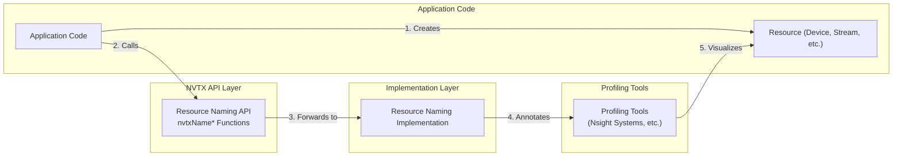
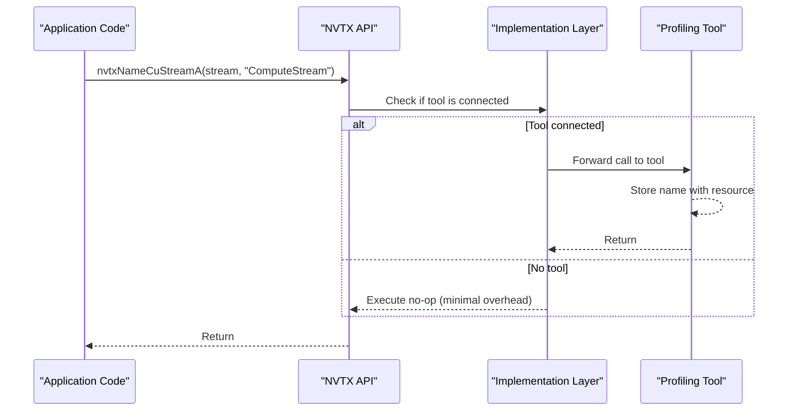
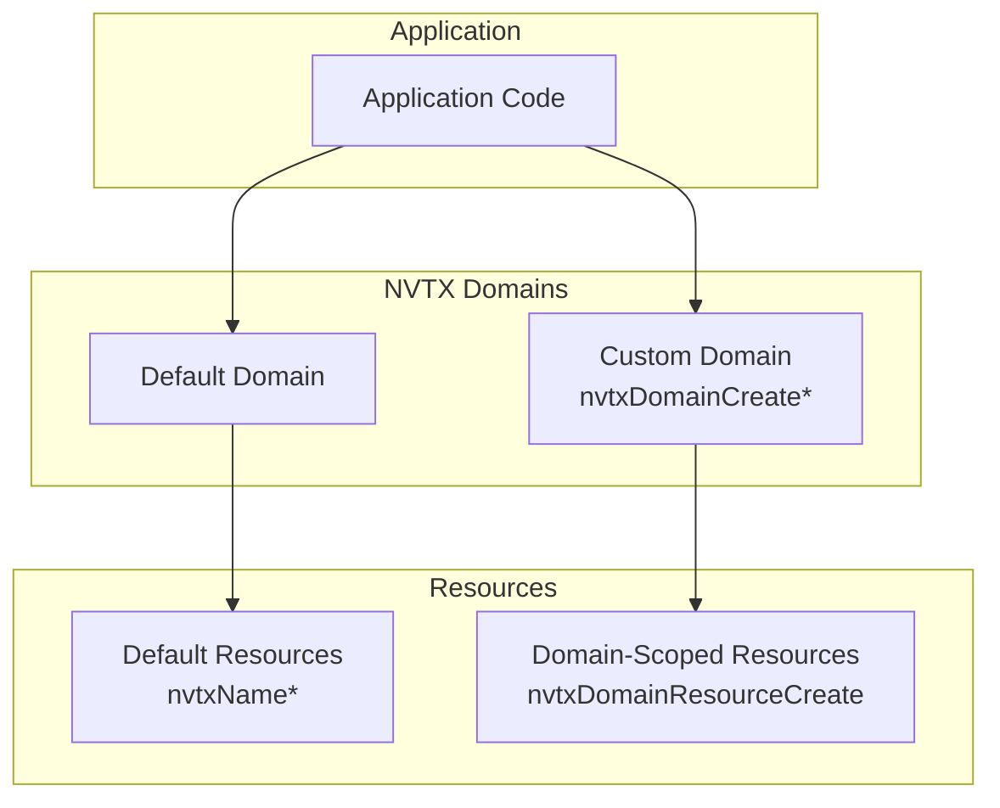
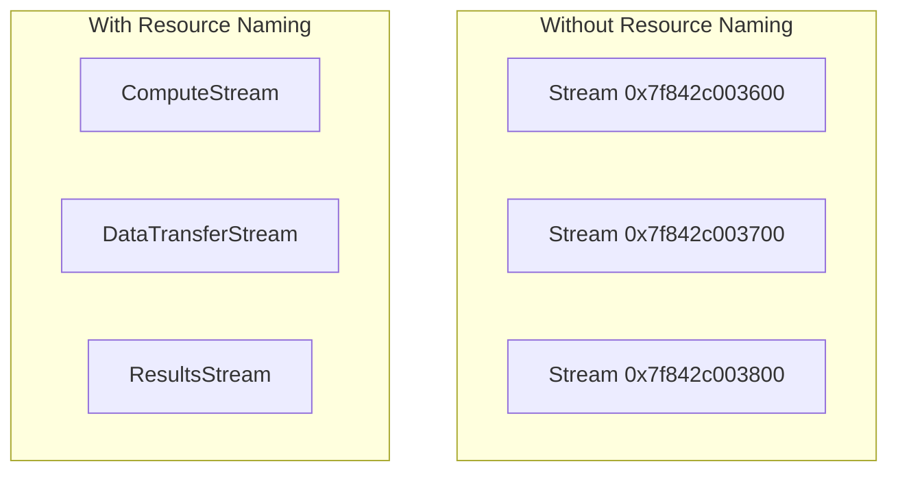

<!-- source: DeepWiki mcp.deepwiki.com · repo NVIDIA/NVTX · page 2.2 Resource Naming · fetched 2026-10-26 -->

# Resource Naming

<details>
<summary>Relevant source files</summary>

The following files were used as context for generating this wiki page:

- [c/include/nvtx3/nvToolsExt.h](c/include/nvtx3/nvToolsExt.h)
- [c/include/nvtx3/nvToolsExtCuda.h](c/include/nvtx3/nvToolsExtCuda.h)
- [c/include/nvtx3/nvToolsExtCudaRt.h](c/include/nvtx3/nvToolsExtCudaRt.h)
- [c/include/nvtx3/nvToolsExtOpenCL.h](c/include/nvtx3/nvToolsExtOpenCL.h)
- [c/include/nvtx3/nvtxDetail/nvtxImplCore.h](c/include/nvtx3/nvtxDetail/nvtxImplCore.h)
- [c/include/nvtx3/nvtxDetail/nvtxImplCudaRt_v3.h](c/include/nvtx3/nvtxDetail/nvtxImplCudaRt_v3.h)
- [c/include/nvtx3/nvtxDetail/nvtxImplCuda_v3.h](c/include/nvtx3/nvtxDetail/nvtxImplCuda_v3.h)
- [c/include/nvtx3/nvtxDetail/nvtxImplOpenCL_v3.h](c/include/nvtx3/nvtxDetail/nvtxImplOpenCL_v3.h)
- [c/include/nvtx3/nvtxDetail/nvtxImplSync_v3.h](c/include/nvtx3/nvtxDetail/nvtxImplSync_v3.h)
- [c/include/nvtx3/nvtxDetail/nvtxInit.h](c/include/nvtx3/nvtxDetail/nvtxInit.h)
- [c/include/nvtx3/nvtxDetail/nvtxLinkOnce.h](c/include/nvtx3/nvtxDetail/nvtxLinkOnce.h)

</details>


Resource Naming in NVTX allows developers to associate human-readable names with system resources such as threads, CUDA streams, OpenCL devices, and other API objects. These names help profiling tools like NVIDIA Nsight Systems display meaningful labels instead of cryptic memory addresses or numeric IDs, making performance analysis more intuitive and efficient.

For information about general event annotation through markers and ranges, see [Markers and Ranges](#2.1). For information about synchronization objects, see [Synchronization API](#2.3).

## Overview of Resource Naming

Resource naming provides a way to identify and track resources throughout their lifecycle in profiling tools. The NVTX library supports naming various types of resources across different APIs, with each resource type having dedicated naming functions.

### Resource Naming Flow

The diagram below shows how resource naming works within the NVTX system:



Sources: [c/include/nvtx3/nvToolsExt.h:112-128]()

## Supported Resource Types

NVTX provides naming functions for various types of resources across different APIs. The diagram below shows the resource types that can be named:

```mermaid
graph TD
    subgraph "NVTX Resource Types"
        RNames["Resource Naming"]
    end
    
    RNames --> General["General Resources"]
    RNames --> CUDA["CUDA Driver API Resources"]
    RNames --> CUDARt["CUDA Runtime API Resources"]
    RNames --> OpenCL["OpenCL Resources"]
    
    General --> Thread["OS Thread<br>nvtxNameOsThread*"]
    
    CUDA --> CUDADevice["CUDA Device<br>nvtxNameCuDevice*"]
    CUDA --> CUDAContext["CUDA Context<br>nvtxNameCuContext*"]
    CUDA --> CUDAStream["CUDA Stream<br>nvtxNameCuStream*"]
    CUDA --> CUDAEvent["CUDA Event<br>nvtxNameCuEvent*"]
    
    CUDARt --> CUDARtDevice["CUDA Runtime Device<br>nvtxNameCudaDevice*"]
    CUDARt --> CUDARtStream["CUDA Runtime Stream<br>nvtxNameCudaStream*"]
    CUDARt --> CUDARtEvent["CUDA Runtime Event<br>nvtxNameCudaEvent*"]
    
    OpenCL --> CLDevice["OpenCL Device<br>nvtxNameClDevice*"]
    OpenCL --> CLContext["OpenCL Context<br>nvtxNameClContext*"]
    OpenCL --> CLQueue["OpenCL Command Queue<br>nvtxNameClCommandQueue*"]
    OpenCL --> CLMemObj["OpenCL Memory Object<br>nvtxNameClMemObject*"]
    OpenCL --> CLSampler["OpenCL Sampler<br>nvtxNameClSampler*"]
    OpenCL --> CLProgram["OpenCL Program<br>nvtxNameClProgram*"]
    OpenCL --> CLEvent["OpenCL Event<br>nvtxNameClEvent*"]
```



Sources: 
- [c/include/nvtx3/nvToolsExt.h:112-128]()
- [c/include/nvtx3/nvToolsExtCuda.h:34-42]()
- [c/include/nvtx3/nvToolsExtCudaRt.h:34-42]()
- [c/include/nvtx3/nvToolsExtOpenCL.h:35-42]()

## Resource Naming Functions

All resource naming functions follow a consistent naming pattern:

```
nvtxName{ResourceType}[A|W](resourceHandle, name)
```

Where:
- `ResourceType`: Specifies the type of resource (e.g., CuDevice, CudaStream, ClContext)
- `A` or `W` suffix: Indicates ASCII or wide character (Unicode) string support
- `resourceHandle`: The handle or ID of the resource to name
- `name`: The string to associate with the resource

### General Resource Naming

For naming OS threads:

```c
void nvtxNameOsThreadA(uint32_t threadId, const char* name);
void nvtxNameOsThreadW(uint32_t threadId, const wchar_t* name);
```

Sources: [c/include/nvtx3/nvtxDetail/nvtxImplCore.h:165-183]()

### CUDA Driver API Resource Naming

For naming CUDA resources:

```c
void nvtxNameCuDeviceA(CUdevice device, const char* name);
void nvtxNameCuDeviceW(CUdevice device, const wchar_t* name);
void nvtxNameCuContextA(CUcontext context, const char* name);
void nvtxNameCuContextW(CUcontext context, const wchar_t* name);
void nvtxNameCuStreamA(CUstream stream, const char* name);
void nvtxNameCuStreamW(CUstream stream, const wchar_t* name);
void nvtxNameCuEventA(CUevent event, const char* name);
void nvtxNameCuEventW(CUevent event, const wchar_t* name);
```

Sources: [c/include/nvtx3/nvToolsExtCuda.h:74-126]()

### CUDA Runtime API Resource Naming

For naming CUDA Runtime resources:

```c
void nvtxNameCudaDeviceA(int device, const char* name);
void nvtxNameCudaDeviceW(int device, const wchar_t* name);
void nvtxNameCudaStreamA(cudaStream_t stream, const char* name);
void nvtxNameCudaStreamW(cudaStream_t stream, const wchar_t* name);
void nvtxNameCudaEventA(cudaEvent_t event, const char* name);
void nvtxNameCudaEventW(cudaEvent_t event, const wchar_t* name);
```

Sources: [c/include/nvtx3/nvToolsExtCudaRt.h:74-104]()

### OpenCL Resource Naming

For naming OpenCL resources:

```c
void nvtxNameClDeviceA(cl_device_id device, const char* name);
void nvtxNameClDeviceW(cl_device_id device, const wchar_t* name);
void nvtxNameClContextA(cl_context context, const char* name);
void nvtxNameClContextW(cl_context context, const wchar_t* name);
void nvtxNameClCommandQueueA(cl_command_queue command_queue, const char* name);
void nvtxNameClCommandQueueW(cl_command_queue command_queue, const wchar_t* name);
void nvtxNameClMemObjectA(cl_mem memobj, const char* name);
void nvtxNameClMemObjectW(cl_mem memobj, const wchar_t* name);
void nvtxNameClSamplerA(cl_sampler sampler, const char* name);
void nvtxNameClSamplerW(cl_sampler sampler, const wchar_t* name);
void nvtxNameClProgramA(cl_program program, const char* name);
void nvtxNameClProgramW(cl_program program, const wchar_t* name);
void nvtxNameClEventA(cl_event evnt, const char* name);
void nvtxNameClEventW(cl_event evnt, const wchar_t* name);
```

Sources: [c/include/nvtx3/nvToolsExtOpenCL.h:77-170]()

## Function Call Flow

The diagram below shows the internal process of how resource naming functions work:



Sources: 
- [c/include/nvtx3/nvtxDetail/nvtxImplCuda_v3.h:39-117]()
- [c/include/nvtx3/nvtxDetail/nvtxInit.h:231-413]()

## Resource Objects

In addition to the specific naming functions, NVTX provides a more generic mechanism for attaching data to application resources through resource objects. This approach allows for more flexibility and enables associating resources with domains.

Resource objects were introduced in NVTX_VERSION_2 to supersede the existing naming functions and allow resources to be associated with specific domains. The older naming functions are still supported for backward compatibility but are associated only with the default domain.

```c
nvtxResourceHandle_t nvtxDomainResourceCreate(nvtxDomainHandle_t domain, nvtxResourceAttributes_t* attribs);
void nvtxDomainResourceDestroy(nvtxResourceHandle_t resource);
```

Sources: [c/include/nvtx3/nvToolsExt.h:130-142]()

## Resource Type Identifiers

NVTX defines unique identifiers for different resource types to avoid collisions when working with resources from different APIs:

### CUDA Resource Types

```c
typedef enum nvtxResourceCUDAType_t {
    NVTX_RESOURCE_TYPE_CUDA_DEVICE = NVTX_RESOURCE_MAKE_TYPE(CUDA, 1),
    NVTX_RESOURCE_TYPE_CUDA_CONTEXT = NVTX_RESOURCE_MAKE_TYPE(CUDA, 2),
    NVTX_RESOURCE_TYPE_CUDA_STREAM = NVTX_RESOURCE_MAKE_TYPE(CUDA, 3),
    NVTX_RESOURCE_TYPE_CUDA_EVENT = NVTX_RESOURCE_MAKE_TYPE(CUDA, 4)
} nvtxResourceCUDAType_t;
```

Sources: [c/include/nvtx3/nvToolsExtCuda.h:55-61]()

### CUDA Runtime Resource Types

```c
typedef enum nvtxResourceCUDARTType_t {
    NVTX_RESOURCE_TYPE_CUDART_DEVICE = NVTX_RESOURCE_MAKE_TYPE(CUDART, 0),
    NVTX_RESOURCE_TYPE_CUDART_STREAM = NVTX_RESOURCE_MAKE_TYPE(CUDART, 1),
    NVTX_RESOURCE_TYPE_CUDART_EVENT = NVTX_RESOURCE_MAKE_TYPE(CUDART, 2)
} nvtxResourceCUDARTType_t;
```

Sources: [c/include/nvtx3/nvToolsExtCudaRt.h:56-61]()

### OpenCL Resource Types

```c
typedef enum nvtxResourceOpenCLType_t {
    NVTX_RESOURCE_TYPE_OPENCL_DEVICE = NVTX_RESOURCE_MAKE_TYPE(OPENCL, 1),
    NVTX_RESOURCE_TYPE_OPENCL_CONTEXT = NVTX_RESOURCE_MAKE_TYPE(OPENCL, 2),
    NVTX_RESOURCE_TYPE_OPENCL_COMMANDQUEUE = NVTX_RESOURCE_MAKE_TYPE(OPENCL, 3),
    NVTX_RESOURCE_TYPE_OPENCL_MEMOBJECT = NVTX_RESOURCE_MAKE_TYPE(OPENCL, 4),
    NVTX_RESOURCE_TYPE_OPENCL_SAMPLER = NVTX_RESOURCE_MAKE_TYPE(OPENCL, 5),
    NVTX_RESOURCE_TYPE_OPENCL_PROGRAM = NVTX_RESOURCE_MAKE_TYPE(OPENCL, 6),
    NVTX_RESOURCE_TYPE_OPENCL_EVENT = NVTX_RESOURCE_MAKE_TYPE(OPENCL, 7)
} nvtxResourceOpenCLType_t;
```

Sources: [c/include/nvtx3/nvToolsExtOpenCL.h:55-64]()

## Domain-Scoped Resource Naming

The diagram below shows how resources can be scoped to domains:



Sources: [c/include/nvtx3/nvToolsExt.h:93-111]()

## Usage Examples

### Naming a CUDA Context

```c
// Create a CUDA context
CUresult status = cuCtxCreate(&cuContext, 0, cuDevice);
if (CUDA_SUCCESS != status)
    goto Error;

// Name the context
nvtxNameCuContextA(cuContext, "MainContext");
```

Sources: [c/include/nvtx3/nvToolsExtCuda.h:86-92]()

### Naming an OpenCL Program

```c
// Create an OpenCL program
cpProgram = clCreateProgramWithSource(cxGPUContext, 1,
    (const char **) &cSourceCL, &program_length, &ciErrNum);
shrCheckErrorEX(ciErrNum, CL_SUCCESS, pCleanup);

// Name the program
nvtxNameClProgramW(cpProgram, L"MainProgram");
```

Sources: [c/include/nvtx3/nvToolsExtOpenCL.h:145-152]()

### Naming a CUDA Runtime Stream

```c
// Create a CUDA stream
cudaStream_t stream;
cudaStreamCreate(&stream);

// Name the stream
nvtxNameCudaStreamA(stream, "ComputeStream");
```

## Benefits of Resource Naming

The diagram below illustrates the benefit of resource naming for profiling visualization:



Resource naming significantly improves the readability and usability of profiling data by replacing cryptic memory addresses or numeric IDs with meaningful names. This makes it easier to identify and track resources during performance analysis.

## Implementation Details

Resource naming functions in NVTX have near-zero overhead when no profiling tool is attached. When a tool is attached, the overhead is specific to the tool. The implementation uses function pointers that are set during initialization when a profiling tool is detected.

### Initialization Process

The first call to any NVTX function triggers initialization, which looks for a profiling tool. If a tool is found, function pointers are set to point to the tool's implementation. If no tool is found, function pointers are set to no-op implementations.

Sources: [c/include/nvtx3/nvtxDetail/nvtxInit.h:414-454]()

---

