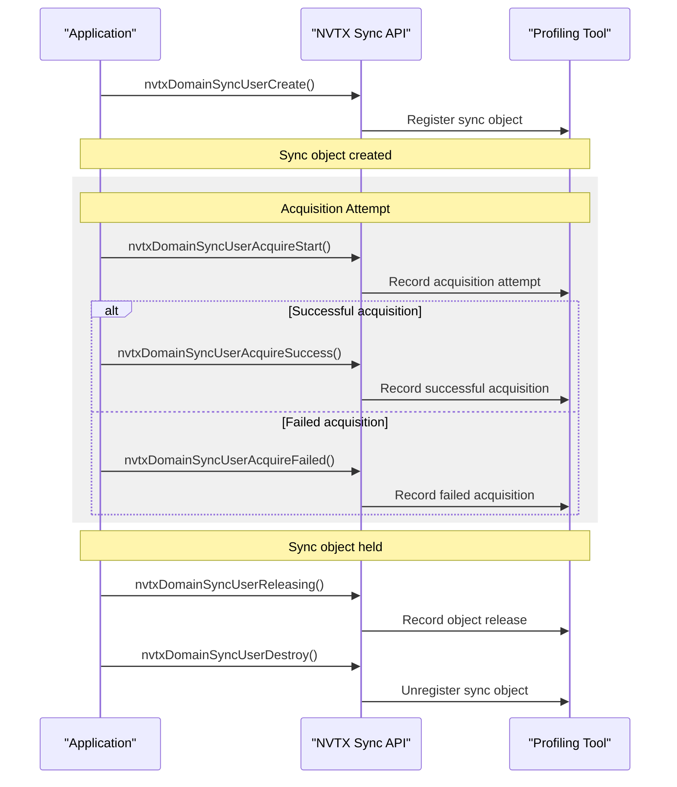
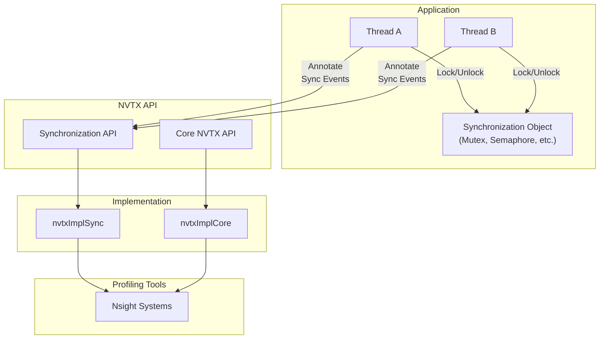
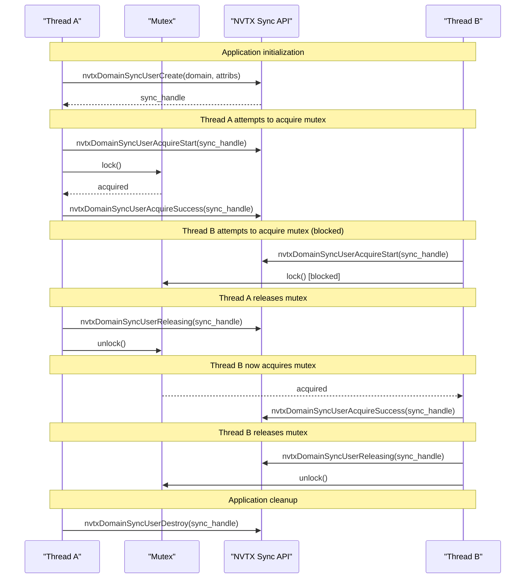

<!-- source: DeepWiki mcp.deepwiki.com · repo NVIDIA/NVTX · page 2.3 Synchronization API · fetched 2026-10-26 -->

# Synchronization API

<details>
<summary>Relevant source files</summary>

The following files were used as context for generating this wiki page:

- [c/include/nvtx3/nvtxDetail/nvtxImplCore.h](c/include/nvtx3/nvtxDetail/nvtxImplCore.h)
- [c/include/nvtx3/nvtxDetail/nvtxImplCudaRt_v3.h](c/include/nvtx3/nvtxDetail/nvtxImplCudaRt_v3.h)
- [c/include/nvtx3/nvtxDetail/nvtxImplCuda_v3.h](c/include/nvtx3/nvtxDetail/nvtxImplCuda_v3.h)
- [c/include/nvtx3/nvtxDetail/nvtxImplOpenCL_v3.h](c/include/nvtx3/nvtxDetail/nvtxImplOpenCL_v3.h)
- [c/include/nvtx3/nvtxDetail/nvtxImplSync_v3.h](c/include/nvtx3/nvtxDetail/nvtxImplSync_v3.h)

</details>


## Overview

The NVTX Synchronization API provides functionality for tracking synchronization objects in applications. This API enables developers to annotate synchronization events such as mutex acquisitions, locks, and other thread synchronization mechanisms in their code. These annotations can then be visualized and analyzed in NVIDIA profiling tools, helping to identify synchronization bottlenecks and understand thread interactions.

The Synchronization API is part of the NVTX C API and is specifically designed to track user-defined synchronization primitives, complementing the core NVTX functionality for markers and ranges discussed in [Markers and Ranges](#2.1).

Sources: [c/include/nvtx3/nvtxDetail/nvtxImplSync_v3.h:30-97]()

## Synchronization Primitives

### Concept and Purpose

Synchronization primitives are objects used to coordinate execution between multiple threads, such as mutexes, semaphores, and condition variables. The NVTX Synchronization API allows applications to track these objects and their state transitions during program execution.

The API is particularly useful for:

- Identifying contention points in multi-threaded applications
- Visualizing lock acquisition patterns
- Measuring wait times for synchronization objects
- Correlating synchronization events with other performance metrics

## Synchronization Object Lifecycle

The following diagram illustrates the lifecycle of a synchronization object and the corresponding API calls:



Sources: [c/include/nvtx3/nvtxDetail/nvtxImplSync_v3.h:30-97]()

## API Functions

The Synchronization API consists of the following functions:

### Object Creation and Destruction

| Function | Description |
|----------|-------------|
| `nvtxDomainSyncUserCreate` | Creates a new synchronization user object within the specified domain |
| `nvtxDomainSyncUserDestroy` | Destroys a previously created synchronization user object |

### Acquisition and Release Tracking

| Function | Description |
|----------|-------------|
| `nvtxDomainSyncUserAcquireStart` | Marks the beginning of an attempt to acquire the synchronization object |
| `nvtxDomainSyncUserAcquireSuccess` | Indicates that the synchronization object was successfully acquired |
| `nvtxDomainSyncUserAcquireFailed` | Indicates that the attempt to acquire the synchronization object failed |
| `nvtxDomainSyncUserReleasing` | Indicates that the synchronization object is being released |

Sources: [c/include/nvtx3/nvtxDetail/nvtxImplSync_v3.h:30-97]()

## Function Signatures

Below are the detailed function signatures for the Synchronization API:

```c
nvtxSyncUser_t nvtxDomainSyncUserCreate(nvtxDomainHandle_t domain, const nvtxSyncUserAttributes_t* attribs);
void nvtxDomainSyncUserDestroy(nvtxSyncUser_t handle);
void nvtxDomainSyncUserAcquireStart(nvtxSyncUser_t handle);
void nvtxDomainSyncUserAcquireFailed(nvtxSyncUser_t handle);
void nvtxDomainSyncUserAcquireSuccess(nvtxSyncUser_t handle);
void nvtxDomainSyncUserReleasing(nvtxSyncUser_t handle);
```

Sources: [c/include/nvtx3/nvtxDetail/nvtxImplSync_v3.h:37-97]()

## Synchronization API in NVTX Architecture

The following diagram shows how the Synchronization API fits into the overall NVTX architecture:



Sources: [c/include/nvtx3/nvtxDetail/nvtxImplSync_v3.h:30-97]()

## Typical Usage Pattern

This section demonstrates a typical usage pattern for the Synchronization API to track a mutex in a multi-threaded application.



Sources: [c/include/nvtx3/nvtxDetail/nvtxImplSync_v3.h:30-97]()

## Sample Code Structure

Below is a simplified example showing how to use the Synchronization API to track a mutex:

1. Create a synchronization user object:
   ```c
   nvtxDomainHandle_t domain = nvtxDomainCreateA("MyDomain");
   nvtxSyncUserAttributes_t attribs = {0}; // Initialize attributes
   nvtxSyncUser_t sync_handle = nvtxDomainSyncUserCreate(domain, &attribs);
   ```

2. Track mutex acquisition:
   ```c
   // Before attempting to acquire the mutex
   nvtxDomainSyncUserAcquireStart(sync_handle);
   
   // Attempt to acquire the mutex
   bool acquired = try_acquire_mutex(&my_mutex);
   
   if (acquired) {
       nvtxDomainSyncUserAcquireSuccess(sync_handle);
   } else {
       nvtxDomainSyncUserAcquireFailed(sync_handle);
   }
   ```

3. Track mutex release:
   ```c
   // Before releasing the mutex
   nvtxDomainSyncUserReleasing(sync_handle);
   
   // Release the mutex
   release_mutex(&my_mutex);
   ```

4. Clean up:
   ```c
   nvtxDomainSyncUserDestroy(sync_handle);
   nvtxDomainDestroy(domain);
   ```

## Implementation Details

The Synchronization API functions are implemented in the `nvtxImplSync_v3.h` file. Each function checks for the availability of an implementation function pointer and calls it if available. This allows the API to be a no-op when no profiling tool is attached, minimizing overhead.

For example, the implementation of `nvtxDomainSyncUserCreate` is:

```c
NVTX_DECLSPEC nvtxSyncUser_t NVTX_API nvtxDomainSyncUserCreate(nvtxDomainHandle_t domain, const nvtxSyncUserAttributes_t* attribs)
{
    NVTX_SET_NAME_MANGLING_OPTIONS
#ifndef NVTX_DISABLE
    nvtxDomainSyncUserCreate_impl_fntype local = (nvtxDomainSyncUserCreate_impl_fntype)NVTX_VERSIONED_IDENTIFIER(nvtxGlobals).nvtxDomainSyncUserCreate_impl_fnptr;
    if(local!=0)
        return (*local)(domain, attribs);
    else
#endif  /*NVTX_DISABLE*/
        return (nvtxSyncUser_t)0;
}
```

When a profiling tool like NVIDIA Nsight Systems is attached, it provides implementations for these functions, allowing it to collect data about synchronization events.

Sources: [c/include/nvtx3/nvtxDetail/nvtxImplSync_v3.h:37-47]()

## Best Practices

When using the Synchronization API, consider the following best practices:

1. **Create sync objects early**: Create synchronization user objects during initialization to minimize overhead during critical sections.

2. **Track all state transitions**: Ensure you track all state transitions (start, success/fail, releasing) for accurate profiling data.

3. **Use domains for organization**: Use domains to organize synchronization objects, especially in large applications with many synchronization primitives.

4. **Be consistent**: Apply synchronization tracking consistently across similar synchronization objects to get a complete picture of your application's synchronization behavior.

5. **Clean up resources**: Always destroy synchronization user objects when they're no longer needed to prevent resource leaks.

## Conclusion

The NVTX Synchronization API provides a powerful way to track synchronization primitives in multi-threaded applications. By annotating synchronization events, developers can gain insights into contention points, lock acquisition patterns, and potential bottlenecks. This information can be invaluable when optimizing the performance of multi-threaded applications, especially those running on NVIDIA hardware.

---

