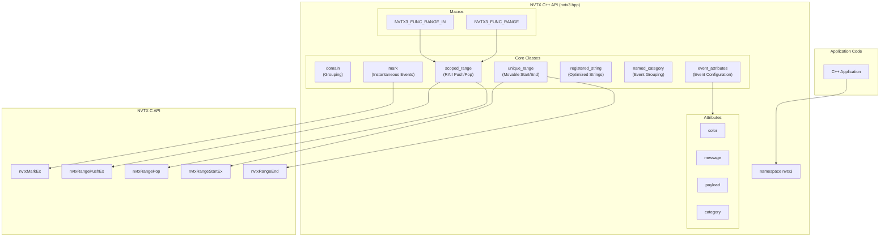
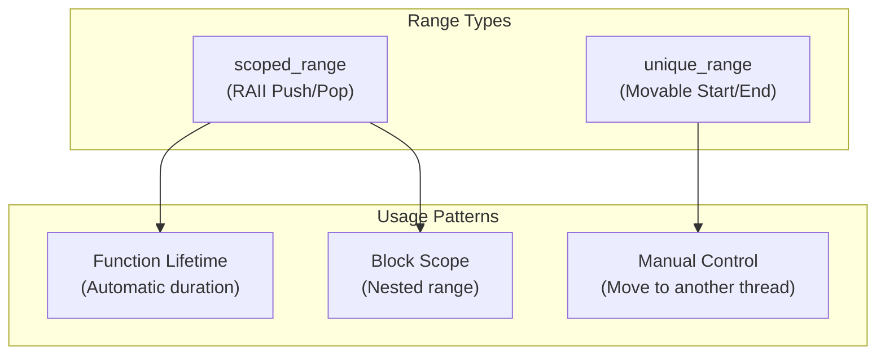
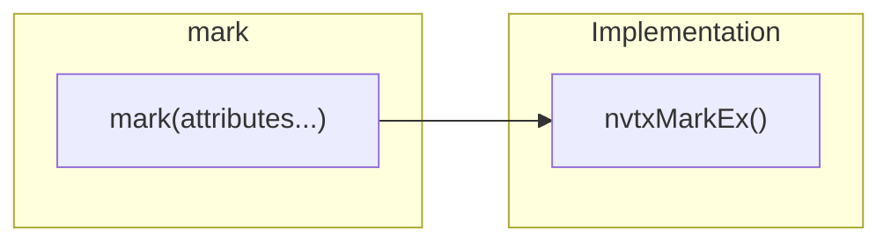
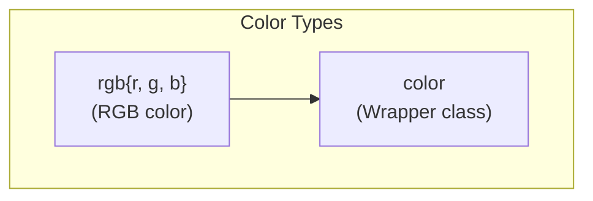
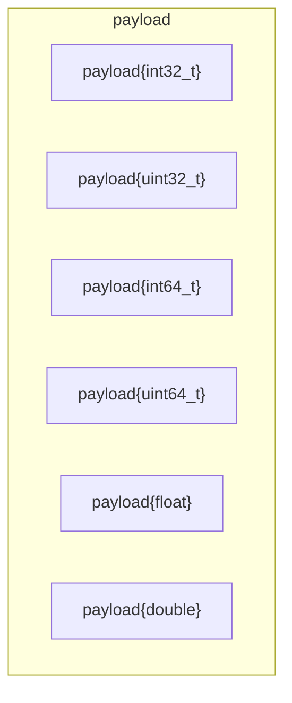

<!-- source: DeepWiki mcp.deepwiki.com · repo NVIDIA/NVTX · page 3 C++ API · fetched 2026-10-26 -->

# C++ API

<details>
<summary>Relevant source files</summary>

The following files were used as context for generating this wiki page:

- [.gitignore](.gitignore)
- [README.md](README.md)
- [c/include/nvtx3/nvToolsExtSync.h](c/include/nvtx3/nvToolsExtSync.h)
- [c/include/nvtx3/nvtx3.hpp](c/include/nvtx3/nvtx3.hpp)
- [docs/index.html](docs/index.html)
- [python/.flake8.cython](python/.flake8.cython)
- [tools/docs/generate-readme.py](tools/docs/generate-readme.py)
- [tools/docs/github-markdown-css/github-markdown.css](tools/docs/github-markdown-css/github-markdown.css)
- [tools/docs/github-markdown-css/license](tools/docs/github-markdown-css/license)

</details>


## Overview

The NVTX C++ API provides a modern C++ wrapper around the NVTX C API, offering safer and more idiomatic interfaces for source code annotation. This page covers the design, usage, and key components of the C++ API found in the `nvtx3.hpp` header file. For information about the underlying C API, see [C API](#2).

The C++ API is header-only, requires C++11, and uses RAII (Resource Acquisition Is Initialization) techniques to make code annotation more robust, especially in the presence of exceptions or multiple return paths. It adds no runtime overhead compared to the C API while providing additional compile-time safety.

Sources: [c/include/nvtx3/nvtx3.hpp:98-103]()

## Architecture

The C++ API is designed as a set of wrappers around the C API, providing additional abstractions that leverage C++ features like templates, RAII, and overloading.



Sources: [c/include/nvtx3/nvtx3.hpp:97-564](), [README.md:82-96]()

## Key Concepts

### Domains

Domains allow for scoping NVTX events, similar to C++ namespaces. They help differentiate events from different libraries or components of an application.

```mermaid
graph LR
    subgraph "Domain Definition"
        MyDomainDef["struct my_domain { 
            static constexpr char const* name{\"my_domain\"}; 
        }"]
    end
    
    subgraph "Domain Usage"
        domain_get["domain::get<my_domain>()"]
        scoped_range["scoped_range_in<my_domain>"]
        alias["using my_scoped_range = scoped_range_in<my_domain>"]
    end
    
    MyDomainDef --> domain_get
    domain_get --> scoped_range
    scoped_range --> alias
```

Domains are created via tag types - structs or classes with a static `name` member. The `domain::get<D>()` method uses the "construct on first use" pattern to safely create and reuse domain objects.

Sources: [c/include/nvtx3/nvtx3.hpp:702-933]()

### Ranges

Ranges mark spans of time in your application, like function calls or loop iterations.



The C++ API provides two main types of ranges:

1. **`scoped_range`**: RAII-based ranges that start when constructed and end when destroyed. These must be destroyed in the exact reverse order of creation.

2. **`unique_range`**: More flexible ranges that can be moved, created as heap objects, and start/end on different threads.

Sources: [c/include/nvtx3/nvtx3.hpp:238-278]()

### Event Attributes

Event attributes customize the appearance and behavior of NVTX events, providing additional information to profiling tools.

```mermaid
graph TB
    subgraph "event_attributes"
        direction LR
        constructor["event_attributes()"]
        
        subgraph "Attribute Types"
            color["color/rgb<br>(Visualization color)"]
            message["message<br>(Text description)"]
            payload["payload<br>(Numerical value)"]
            category["category<br>(Event grouping)"]
        end
    end
    
    color --> constructor
    message --> constructor
    payload --> constructor
    category --> constructor
```

The `event_attributes` class can be constructed from any combination of attribute objects in any order:

```cpp
// Different ways to create event attributes
nvtx3::event_attributes attr1{"message"};  // Just message
nvtx3::event_attributes attr2{"message", nvtx3::rgb{127, 255, 0}};  // Message and color
nvtx3::event_attributes attr3{nvtx3::payload{42}, "message"};  // Order doesn't matter
```

Sources: [c/include/nvtx3/nvtx3.hpp:339-384]()

## Common Usage Patterns

### Basic Range Annotation

The most common usage pattern is adding a range around a function or code block:

```cpp
void some_function() {
    nvtx3::scoped_range r{"some_function"};  // Begins a range
    
    // Function body...
    
}  // Range automatically ends when r is destroyed
```

### Function Range Using Macros

For convenience, macros are provided to create ranges with the current function name:

```cpp
void some_function() {
    NVTX3_FUNC_RANGE();  // Creates a range with the name "some_function"
    
    // Function body...
}
```

### Nested Ranges

Ranges can be nested to create a hierarchy of timing information:

```cpp
void some_function() {
    nvtx3::scoped_range r{"some_function"};
    
    for (int i = 0; i < 100; ++i) {
        nvtx3::scoped_range loop{"loop iteration"};
        // Loop body...
    }
}
```

### Using Custom Domains

To isolate library events from other code using NVTX:

```cpp
// Define a domain tag type
struct my_library_domain { static constexpr char const* name{"my_library"}; };

// Create an alias for convenience
using my_range = nvtx3::scoped_range_in<my_library_domain>;

void library_function() {
    my_range r{"library_function"};
    // Function body...
}
```

Sources: [c/include/nvtx3/nvtx3.hpp:107-147](), [README.md:20-47]()

## API Reference

### Core Classes

#### domain

The `domain` class represents a grouping scope for NVTX events, allowing different libraries or components to have separate annotations.

```mermaid
graph TB
    subgraph "domain Class"
        get["static domain::get<DomainTag>()"]
        global["domain::global (Tag Type)"]
        handle["operator nvtxDomainHandle_t()"]
    end
    
    subgraph "Usage"
        custom_domain["struct my_domain { 
            static constexpr char const* name{\"my domain\"}; 
        }"]
        get_domain["domain::get<my_domain>()"]
        global_domain["domain::get<domain::global>()"]
    end
    
    custom_domain --> get
    get --> get_domain
    get --> global_domain
    global --> global_domain
```

Sources: [c/include/nvtx3/nvtx3.hpp:702-933]()

#### event_attributes

The `event_attributes` class allows customizing NVTX events with various attributes:

```mermaid
graph LR
    subgraph "event_attributes"
        constructor["event_attributes()"]
    end
    
    subgraph "Supported Attributes"
        message["message<br>\"Description text\""]
        rgb["rgb<br>{red, green, blue}"]
        payload["payload<br>{numerical_value}"]
        category["category<br>{category_id}"]
    end
    
    message --> constructor
    rgb --> constructor
    payload --> constructor
    category --> constructor
```

Sources: [c/include/nvtx3/nvtx3.hpp:339-384]()

#### scoped_range and scoped_range_in

RAII classes that create NVTX ranges that automatically end when the object is destroyed:

```mermaid
graph TB
    subgraph "scoped_range Classes"
        scoped_range["scoped_range<br>(global domain)"]
        scoped_range_in["scoped_range_in<DomainTag><br>(custom domain)"]
        
        constructor["constructor(attributes...)"]
        destructor["~destructor()"]
    end
    
    subgraph "Implementation"
        nvtxRangePushEx["nvtxRangePushEx()"]
        nvtxRangePop["nvtxRangePop()"]
    end
    
    constructor --> nvtxRangePushEx
    destructor --> nvtxRangePop
    
    scoped_range --> constructor
    scoped_range_in --> constructor
    scoped_range --> destructor
    scoped_range_in --> destructor
```

Sources: [c/include/nvtx3/nvtx3.hpp:238-266]()

#### unique_range

A more flexible range class that can be moved and can start/end on different threads:

```mermaid
graph TB
    subgraph "unique_range"
        constructor["constructor(attributes...)"]
        destructor["~destructor()"]
        move["move constructor/assignment"]
        end["end()"]
    end
    
    subgraph "Implementation"
        nvtxRangeStartEx["nvtxRangeStartEx()"]
        nvtxRangeEnd["nvtxRangeEnd()"]
    end
    
    constructor --> nvtxRangeStartEx
    destructor --> nvtxRangeEnd
    end --> nvtxRangeEnd
```

Sources: [c/include/nvtx3/nvtx3.hpp:267-278]()

#### mark

Function to create instantaneous events (markers) in the profiling timeline:



Sources: [c/include/nvtx3/nvtx3.hpp:279-286]()

### Attribute Classes

#### message and registered_string

For attaching text descriptions to events:

```mermaid
graph TB
    subgraph "Message Types"
        message["message<br>(String copied each time)"]
        registered_string["registered_string<br>(String registered once)"]
        registered_string_in["registered_string_in<DomainTag><br>(Domain-specific registration)"]
    end
    
    subgraph "Usage"
        reg_msg_tag["struct my_message { 
            static constexpr char const* message{\"my message\"}; 
        }"]
        get_reg["registered_string_in<my_domain>::get<my_message>()"]
    end
    
    reg_msg_tag --> get_reg
```

Sources: [c/include/nvtx3/nvtx3.hpp:386-432]()

#### color and rgb

For customizing the visualization color of events:



Sources: [c/include/nvtx3/nvtx3.hpp:433-446]()

#### category and named_category

For grouping events within a domain:

```mermaid
graph TB
    subgraph "Category Types"
        category["category{id}<br>(Integer ID)"]
        named_category["named_category<br>(Named category)"]
        named_category_in["named_category_in<DomainTag><br>(Domain-specific category)"]
    end
    
    subgraph "Usage"
        cat_tag["struct my_category { 
            static constexpr char const* name{\"my category\"}; 
            static constexpr uint32_t id{42}; 
        }"]
        get_cat["named_category_in<my_domain>::get<my_category>()"]
    end
    
    cat_tag --> get_cat
```

Sources: [c/include/nvtx3/nvtx3.hpp:458-485]()

#### payload

For attaching numerical values to events:



Sources: [c/include/nvtx3/nvtx3.hpp:486-499]()

### Convenience Macros

The C++ API provides several macros to simplify common usage patterns:

| Macro | Description |
|-------|-------------|
| `NVTX3_FUNC_RANGE()` | Creates a range with the current function name in the global domain |
| `NVTX3_FUNC_RANGE_IN(domain)` | Creates a range with the current function name in the specified domain |
| `NVTX3_FUNC_RANGE_WITH_ATTRS(...)` | Creates a range with the current function name and specified attributes |
| `NVTX3_FUNC_RANGE_IN_WITH_ATTRS(domain, ...)` | Creates a range with the current function name in the specified domain with attributes |

Sources: [c/include/nvtx3/nvtx3.hpp:546-555]()

## Performance Considerations

The NVTX C++ API is designed to have zero overhead compared to the C API. However, there are some performance implications to be aware of:

1. **String Registration**: Using `registered_string` instead of plain string messages reduces overhead for repetitive messages.

2. **Event Initialization**: The first call to any NVTX function will trigger library initialization. Use `nvtxInitialize()` from the C API if you want to control when this happens.

3. **`scoped_range` vs `unique_range`**: `scoped_range` has less overhead than `unique_range` and should be preferred when possible.

4. **Compile-Time Disabling**: Define `NVTX_DISABLE` before including NVTX headers to disable all NVTX calls at compile time.

Sources: [c/include/nvtx3/nvtx3.hpp:4-19](), [README.md:392-410]()

## Integration

### Including in Your Project

Since the C++ API is header-only, simply include the header in your source file:

```cpp
#include <nvtx3/nvtx3.hpp>
```

### CMake Integration

For CMake-based projects, NVTX provides a target `nvtx3-cpp` that sets up the include paths:

```cmake
target_link_libraries(your_target PRIVATE nvtx3-cpp)
```

Sources: [README.md:106-125]()

## Version Control

The NVTX C++ API implements versioning to allow multiple versions to coexist in the same codebase:

- Unversioned symbols in the `nvtx3` namespace (e.g., `nvtx3::scoped_range`)
- Versioned symbols in the `nvtx3::vX` namespace (e.g., `nvtx3::v1::scoped_range`)

By default, the library defines unversioned symbols. For libraries that need to avoid potential version conflicts, use `NVTX3_CPP_REQUIRE_EXPLICIT_VERSION` to require explicit version specification.

Sources: [c/include/nvtx3/nvtx3.hpp:21-96]()

## Example

Here's a complete example showing various features of the C++ API:

```cpp
// Define a custom domain
struct my_domain { static constexpr char const* name{"my domain"}; };

// Define a named category
struct my_category {
    static constexpr char const* name{"my category"};
    static constexpr uint32_t id{42};
};

// Define a registered string
struct my_message { static constexpr char const* message{"my message"}; };

// For convenience, use aliases for domain scoped objects
using my_scoped_range = nvtx3::scoped_range_in<my_domain>;
using my_registered_string = nvtx3::registered_string_in<my_domain>;
using my_named_category = nvtx3::named_category_in<my_domain>;

void example_function() {
    // Use registered string and named category with a custom payload
    auto& msg = my_registered_string::get<my_message>();
    auto& cat = my_named_category::get<my_category>();
    
    my_scoped_range r{msg, cat, nvtx3::payload{42}, nvtx3::rgb{127, 255, 0}};
    
    // Function body...
}
```

Sources: [c/include/nvtx3/nvtx3.hpp:500-545]()

---

