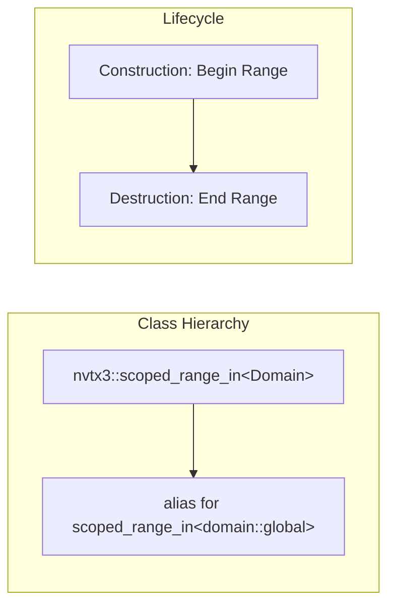
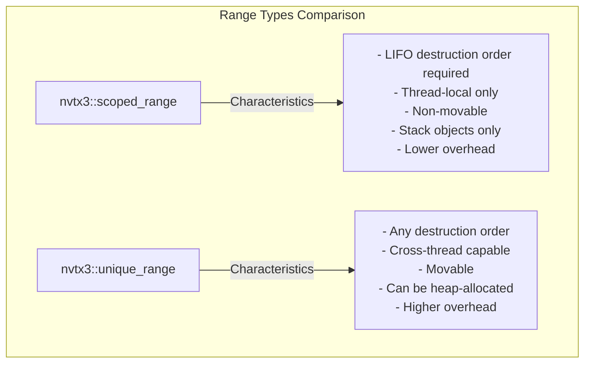
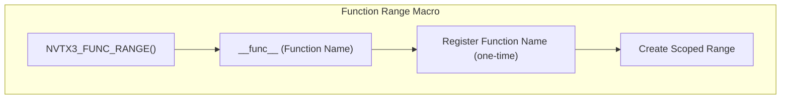
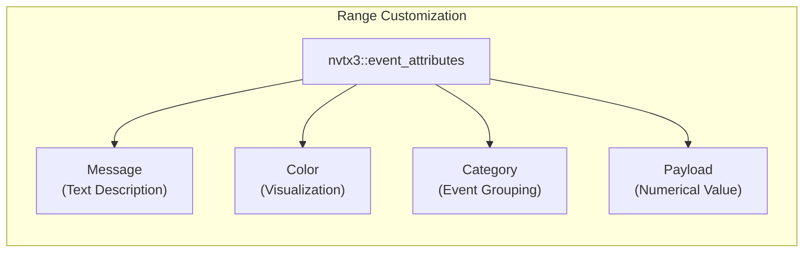

<!-- source: DeepWiki mcp.deepwiki.com · repo NVIDIA/NVTX · page 3.1 Ranges and Scopes · fetched 2026-10-26 -->

# Ranges and Scopes

<details>
<summary>Relevant source files</summary>

The following files were used as context for generating this wiki page:

- [.gitignore](.gitignore)
- [README.md](README.md)
- [c/include/nvtx3/nvToolsExtSync.h](c/include/nvtx3/nvToolsExtSync.h)
- [c/include/nvtx3/nvtx3.hpp](c/include/nvtx3/nvtx3.hpp)
- [docs/index.html](docs/index.html)
- [python/.flake8.cython](python/.flake8.cython)
- [tools/docs/generate-readme.py](tools/docs/generate-readme.py)
- [tools/docs/github-markdown-css/github-markdown.css](tools/docs/github-markdown-css/github-markdown.css)
- [tools/docs/github-markdown-css/license](tools/docs/github-markdown-css/license)

</details>


This page details the C++ API for creating scoped ranges in NVTX using RAII (Resource Acquisition Is Initialization) principles. NVTX ranges allow you to annotate spans of time in your application, which are then visualized in profiling tools like Nsight Systems. The RAII-based approach in the C++ API ensures that ranges are properly terminated even when exceptions are thrown, making your instrumentation more robust and less error-prone.

For information about the C API for ranges, see [Markers and Ranges](#2.1).

## What are NVTX Ranges?

Ranges in NVTX annotate a span of time between two points in a program's execution. They appear as colored bars on a timeline in tools like Nsight Systems, making it easy to visualize how time is spent in different parts of your application.

There are two primary types of ranges in the NVTX C++ API:
- **Scoped Ranges**: Tied to the lifetime of an object using RAII principles
- **Unique Ranges**: Similar to scoped ranges but with additional capabilities

```mermaid
graph TD
    subgraph "NVTX Range Visualization"
        Timeline["Timeline"]
        R1["Range 1"]
        R2["Range 2"]
        R3["Range 3"]
        
        Timeline --- R1
        R1 --- R2
        R1 --- R3
    end
    
    subgraph "Corresponding Code"
        Code1["{
            nvtx3::scoped_range r1{\"Range 1\"};
            // Code for Range 1
            {
                nvtx3::scoped_range r2{\"Range 2\"};
                // Code for Range 2
            }
            {
                nvtx3::scoped_range r3{\"Range 3\"};
                // Code for Range 3
            }
        }"]
    end
```

Sources: [c/include/nvtx3/nvtx3.hpp:227-246](), [README.md:55-62]()

## Scoped Ranges

Scoped ranges are implemented using the RAII idiom - they begin when the object is constructed and automatically end when the object is destroyed (goes out of scope). This approach ensures that ranges are properly terminated even when exceptions are thrown or when there are multiple return points from a function.

### `nvtx3::scoped_range_in` Class

The primary class for creating scoped ranges is `nvtx3::scoped_range_in<Domain>`, which is templated on a domain. The domain allows separating NVTX events into different groups. 



For convenience, `nvtx3::scoped_range` is an alias for `nvtx3::scoped_range_in<domain::global>`, where `domain::global` represents the global NVTX domain.

Sources: [c/include/nvtx3/nvtx3.hpp:238-246](), [c/include/nvtx3/nvtx3.hpp:754-934]()

### Usage Examples

Basic usage of a scoped range:

```cpp
void some_function() {
    // Creates a range for the duration of the function
    nvtx3::scoped_range r{"some_function"};
    
    // Do work...
    
    // Range automatically ends when r is destroyed at function return
}
```

Nested ranges:

```cpp
void process_data() {
    nvtx3::scoped_range outer{"process_data"};
    
    {
        nvtx3::scoped_range inner{"initialization"};
        // Initialization code...
    } // inner range ends here
    
    for(int i = 0; i < count; ++i) {
        nvtx3::scoped_range loop{"process_item"};
        // Process each item...
    } // loop range ends on each iteration
    
} // outer range ends here
```

Sources: [c/include/nvtx3/nvtx3.hpp:115-127](), [README.md:23-39]()

### Important Characteristics

1. **Strict LIFO Order**: Scoped ranges must be destroyed in the exact reverse order of creation (Last In, First Out).
2. **Thread-Local**: A scoped range is bound to the thread where it was created.
3. **Non-movable**: Scoped range objects cannot be moved or transferred.
4. **Stack-only**: They must be created on the stack, not as heap objects.

Sources: [c/include/nvtx3/nvtx3.hpp:267-277]()

## Unique Ranges

`nvtx3::unique_range` provides a more flexible alternative to scoped ranges with different constraints and capabilities.



### Key Differences from Scoped Ranges

1. **Flexible Destruction Order**: Unique ranges can be destroyed in any order, not just LIFO.
2. **Cross-thread Capability**: Can start on one thread and end on another.
3. **Movable**: Objects can be moved (transfer of ownership).
4. **Heap Allocation**: Can be created as heap objects.
5. **Overhead**: Has additional overhead compared to scoped ranges.

When possible, `nvtx3::scoped_range_in` should be preferred due to its lower overhead.

Sources: [c/include/nvtx3/nvtx3.hpp:267-277]()

## Automatic Function Ranges with Macros

NVTX provides convenience macros for automatically creating ranges around functions using the function name as the range message.

### NVTX3_FUNC_RANGE Macro

The `NVTX3_FUNC_RANGE()` macro creates a scoped range that spans the entire function, automatically using the enclosing function's name as the range's message.



Example usage:

```cpp
void process_image(Image* img) {
    NVTX3_FUNC_RANGE(); // Creates a range with message "process_image"
    
    // Function implementation...
}
```

The macro is especially useful because it registers the function name string once and reuses it on subsequent calls, which is more efficient than creating a new string for each range.

Sources: [c/include/nvtx3/nvtx3.hpp:139-147](), [c/include/nvtx3/nvtx3.hpp:546-562]()

### Domain-specific Function Ranges

For functions within a custom domain, use the `NVTX3_FUNC_RANGE_IN(domain)` macro:

```cpp
struct my_domain { static constexpr char const* name{"my_domain"}; };

void analyze_data() {
    NVTX3_FUNC_RANGE_IN(my_domain); // Creates a range in "my_domain"
    
    // Function implementation...
}
```

Sources: [c/include/nvtx3/nvtx3.hpp:303-342]()

## Customizing Ranges with Attributes

Ranges can be customized with various attributes to provide additional information or to control visualization.

### Event Attributes

The `nvtx3::event_attributes` class allows specifying four different types of attributes:

1. **Message**: Custom text description of the range
2. **Color**: Controls visualization color in profiling tools
3. **Category**: Grouping of related events
4. **Payload**: User-defined numerical value



Example with custom attributes:

```cpp
void complex_operation() {
    // RGB color, message, category, and payload
    nvtx3::event_attributes attr{
        nvtx3::rgb{127, 255, 0},  // Green color
        "Database Query",         // Message
        nvtx3::category{2},       // Category ID 2
        nvtx3::payload{42}        // Payload value 42
    };
    
    nvtx3::scoped_range r{attr};
    
    // Operation implementation...
}
```

The order of attributes is flexible, and you can provide any combination of them.

Sources: [c/include/nvtx3/nvtx3.hpp:346-384](), [c/include/nvtx3/nvtx3.hpp:386-399]()

### Convenience Constructors

For simpler cases, you can directly pass a message string to the range constructor:

```cpp
nvtx3::scoped_range r{"Processing Data"}; // Implicit conversion to event_attributes
```

Sources: [c/include/nvtx3/nvtx3.hpp:253-265]()

## Domain-specific Ranges

NVTX domains allow for scoping events into separate groups, which is useful for distinguishing events from different libraries or components.

### Creating Domain-specific Ranges

To create a range in a custom domain:

1. Define a domain tag type with a `name` member:
```cpp
struct my_domain { static constexpr char const* name{"my_domain"}; };
```

2. Use the `nvtx3::scoped_range_in<Domain>` template:
```cpp
nvtx3::scoped_range_in<my_domain> r{"Custom domain range"};
```

For convenience, you can create an alias:
```cpp
using my_scoped_range = nvtx3::scoped_range_in<my_domain>;
my_scoped_range r{"Makes code cleaner"};
```

Sources: [c/include/nvtx3/nvtx3.hpp:303-342](), [c/include/nvtx3/nvtx3.hpp:702-934]()

## Complete Example

Here's a more complete example showing the various range concepts working together:

```cpp
// Define a custom domain
struct my_domain { static constexpr char const* name{"my_domain"}; };

// Define a message tag type for registration
struct query_message { static constexpr char const* message{"Database Query"}; };

// Create an alias for convenience
using my_scoped_range = nvtx3::scoped_range_in<my_domain>;

void database_operation() {
    // Function-level range in global domain
    NVTX3_FUNC_RANGE();
    
    // Get registered string (happens only once)
    auto& msg = nvtx3::registered_string_in<my_domain>::get<query_message>();
    
    {
        // Create custom range with attributes in custom domain
        nvtx3::event_attributes attr{
            msg,                   // Registered message
            nvtx3::category{1},    // Category ID
            nvtx3::payload{42}     // Payload value
        };
        
        my_scoped_range db_query{attr};
        
        // Database operation implementation...
        
        for (int i = 0; i < 10; i++) {
            // Simple range with just a message
            my_scoped_range iteration{std::string("Iteration ") + std::to_string(i)};
            
            // Iteration implementation...
        }
    }
    
    // Ranges end automatically as objects go out of scope
}
```

Sources: [c/include/nvtx3/nvtx3.hpp:500-545]()

## Best Practices

1. **Prefer `scoped_range` over `unique_range`** when possible for lower overhead.
2. **Use registered strings** for messages used frequently to reduce overhead.
3. **Use macros for function ranges** to leverage automatic name registration.
4. **Create domain-specific aliases** for cleaner code in libraries.
5. **Add meaningful attributes** like categories to help organize events.
6. **Keep ranges reasonably sized** - too short ranges may add more overhead than value, while too large ranges may not provide enough detail.

Sources: [c/include/nvtx3/nvtx3.hpp:236-265](), [README.md:410-441]()

---

