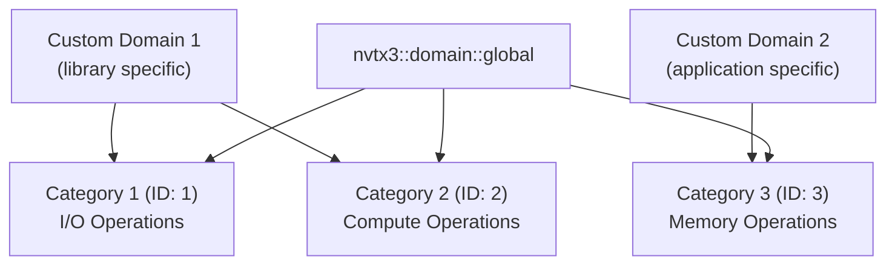
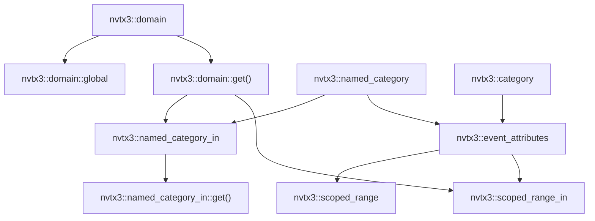
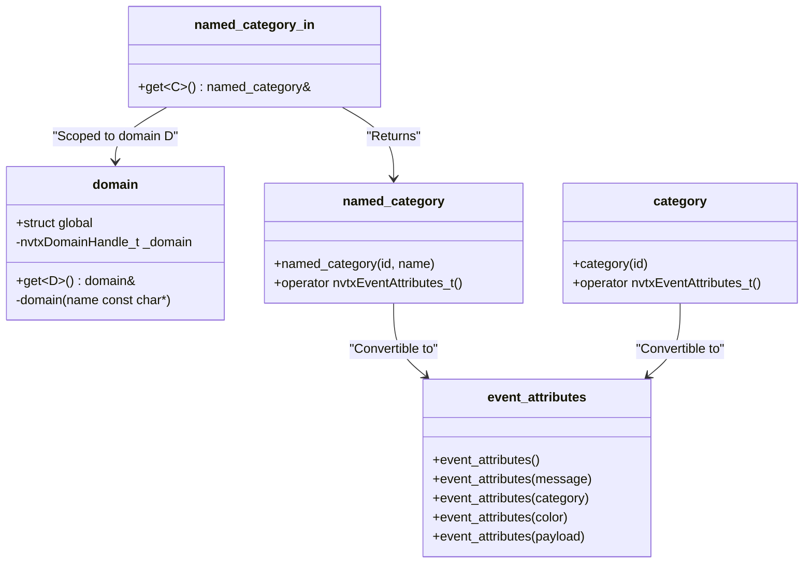

<!-- source: DeepWiki mcp.deepwiki.com · repo NVIDIA/NVTX · page 3.2 Domains and Categories · fetched 2026-10-26 -->

# Domains and Categories

<details>
<summary>Relevant source files</summary>

The following files were used as context for generating this wiki page:

- [.gitignore](.gitignore)
- [README.md](README.md)
- [c/include/nvtx3/nvToolsExtSync.h](c/include/nvtx3/nvToolsExtSync.h)
- [c/include/nvtx3/nvtx3.hpp](c/include/nvtx3/nvtx3.hpp)
- [docs/index.html](docs/index.html)
- [python/.flake8.cython](python/.flake8.cython)
- [tools/docs/generate-readme.py](tools/docs/generate-readme.py)
- [tools/docs/github-markdown-css/github-markdown.css](tools/docs/github-markdown-css/github-markdown.css)
- [tools/docs/github-markdown-css/license](tools/docs/github-markdown-css/license)

</details>


This page explains how domains and categories are used in the NVTX C++ API to organize and group event annotations. Domains allow for separating events from different libraries or components, while categories provide finer-grained organization within a domain.

## Domains

Domains in NVTX are similar to C++ namespaces, providing a way to scope NVTX events. By default, all NVTX events belong to the "global" domain, but libraries and applications should use custom domains to differentiate where events originate from.

### Domain Concept

In the NVTX C++ API, domains are represented by tag types. To define a custom domain, create a new type with a static `name` member:

```cpp
// Define a custom domain
struct my_domain { static constexpr char const* name{"my domain"}; };
```

To use this domain with NVTX constructs, pass it as a template parameter:

```cpp
// Use the custom domain for a scoped range
nvtx3::scoped_range_in<my_domain> r{};
```

Sources: [c/include/nvtx3/nvtx3.hpp:295-315](), [c/include/nvtx3/nvtx3.hpp:702-754]()

### The Global Domain

The global domain is represented by the tag type `nvtx3::domain::global`. The `nvtx3::scoped_range` is an alias for a `scoped_range_in` in the global domain:

```cpp
// These are equivalent:
nvtx3::scoped_range_in<nvtx3::domain::global> r0{};
nvtx3::scoped_range r1{};
```

For convenience, you can define aliases for NVTX constructs in your custom domain:

```cpp
using my_scoped_range = nvtx3::scoped_range_in<my_domain>;
using my_registered_string = nvtx3::registered_string_in<my_domain>;
using my_named_category = nvtx3::named_category_in<my_domain>;
```

Sources: [c/include/nvtx3/nvtx3.hpp:773-776](), [c/include/nvtx3/nvtx3.hpp:332-335]()

### Domain Implementation

Domains use the "construct on first use" pattern, where a function-local static object is created the first time it's needed. This avoids the need for explicit initialization:

```cpp
// The first call to domain::get for my_domain constructs a domain object
auto& domain = nvtx3::domain::get<my_domain>();
```

This pattern ensures that:
1. The domain object is initialized exactly once upon first use
2. All subsequent calls return a reference to the previously constructed object
3. Initialization is thread-safe (as of C++11)

Sources: [c/include/nvtx3/nvtx3.hpp:778-850]()

## Categories

Categories allow for fine-grain grouping of NVTX events within a domain. For example, separate categories could be used for I/O, memory allocation, computation, etc.

### Basic Categories

The simplest way to use categories is with an integer ID:

```cpp
// Create event attributes with category ID 42
nvtx3::event_attributes attr{nvtx3::category{42}};
nvtx3::scoped_range r{attr};
```

Categories are part of an event's attributes, along with other properties like message, color, and payload.

Sources: [c/include/nvtx3/nvtx3.hpp:446-458]()

### Named Categories

To make category IDs more meaningful, NVTX supports associating a name with each category ID through `named_category`:

```cpp
// Create a named category with ID 42 and name "my category"
nvtx3::named_category cat{42, "my category"};

// Use the named category in an event
nvtx3::event_attributes attr{cat};
nvtx3::scoped_range r{attr};
```

For any given category ID, a named category should only be created once and reused throughout the application.

Sources: [c/include/nvtx3/nvtx3.hpp:459-466]()

### Named Categories with Tag Types

Similar to domains, named categories can use tag types for a more convenient construct-on-first-use pattern:

```cpp
// Define a tag type for a named category
struct my_category {
    static constexpr char const* name{"my category"};
    static constexpr uint32_t id{42};
};

// Get a reference to the named category
auto& cat = nvtx3::named_category_in<my_domain>::get<my_category>();

// Use it in an event
nvtx3::event_attributes attr{cat};
nvtx3::scoped_range r{attr};
```

This approach ensures the named category is created exactly once on first use and reused thereafter.

Sources: [c/include/nvtx3/nvtx3.hpp:467-488]()

## Combining Domains and Categories

Domains and categories can be used together to organize NVTX events hierarchically. Domains create a high-level separation, while categories provide finer grouping within each domain.

```cpp
// Define a domain and categories
struct app_domain{ static constexpr char const* name{"my application"}; };

struct io_category { 
    static constexpr char const* name{"I/O"}; 
    static constexpr uint32_t id{1}; 
};

struct compute_category { 
    static constexpr char const* name{"Compute"}; 
    static constexpr uint32_t id{2}; 
};

// Get references to the categories
auto& io_cat = nvtx3::named_category_in<app_domain>::get<io_category>();
auto& compute_cat = nvtx3::named_category_in<app_domain>::get<compute_category>();

// Use them for different events
{
    nvtx3::scoped_range_in<app_domain> r{io_cat, "Reading input"};
    // I/O operations...
}

{
    nvtx3::scoped_range_in<app_domain> r{compute_cat, "Processing data"};
    // Computation...
}
```

Sources: [c/include/nvtx3/nvtx3.hpp:500-544]()

## Diagram: Domains and Categories Hierarchical Organization



Sources: [c/include/nvtx3/nvtx3.hpp:702-754](), [c/include/nvtx3/nvtx3.hpp:446-488]()

## Diagram: Code Entity Mapping



Sources: [c/include/nvtx3/nvtx3.hpp:756-933](), [c/include/nvtx3/nvtx3.hpp:2067-2222]()

## Diagram: Domain and Category Class Structure



Sources: [c/include/nvtx3/nvtx3.hpp:756-933](), [c/include/nvtx3/nvtx3.hpp:2067-2222](), [c/include/nvtx3/nvtx3.hpp:1531-1796]()

## Example: Complete Usage Pattern

Here's a complete example showing how to organize a library with domains and categories:

```cpp
// Define your library's domain
struct my_library_domain { static constexpr char const* name{"MyLibrary"}; };

// Define categories for different operations in your library
struct io_category {
    static constexpr char const* name{"I/O"};
    static constexpr uint32_t id{1};
};

struct compute_category {
    static constexpr char const* name{"Compute"};
    static constexpr uint32_t id{2};
};

struct memory_category {
    static constexpr char const* name{"Memory"};
    static constexpr uint32_t id{3};
};

// Create aliases for convenience
using my_range = nvtx3::scoped_range_in<my_library_domain>;
using my_named_category = nvtx3::named_category_in<my_library_domain>;

// Function that performs I/O operations
void read_data() {
    // Get reference to the I/O category
    auto& io_cat = my_named_category::get<io_category>();
    
    // Create a range with the I/O category
    my_range r{io_cat, "Reading data"};
    
    // Do I/O operations...
}

// Function that performs computation
void process_data() {
    // Get reference to the Compute category
    auto& compute_cat = my_named_category::get<compute_category>();
    
    // Create a range with the Compute category
    my_range r{compute_cat, "Processing data"};
    
    // Do computation...
}
```

Sources: [c/include/nvtx3/nvtx3.hpp:500-544](), [README.md:414-429]()

## Key Benefits of Domains and Categories

1. **Isolation**: Domains ensure that annotations from different libraries don't conflict
2. **Organization**: Categories allow logical grouping of related events within a domain
3. **Filtering**: Profiling tools can filter events based on domains and categories
4. **Visualization**: Different domains and categories can be visualized differently in tools like Nsight Systems
5. **Performance**: Using registered strings and construct-on-first-use ensures minimal overhead

Sources: [README.md:427-429](), [c/include/nvtx3/nvtx3.hpp:432-488]()

## Best Practices

1. Create a single domain for your library or application
2. Use a hierarchical naming scheme for categories when appropriate (e.g., "IO/Network" and "IO/Disk")
3. Create categories for major operation types (I/O, compute, memory, etc.)
4. Reuse domains and categories rather than recreating them
5. Use the construct-on-first-use pattern (`domain::get<D>()` and `named_category_in<D>::get<C>()`)
6. Define type aliases to make code more readable

Sources: [README.md:414-429](), [c/include/nvtx3/nvtx3.hpp:778-850](), [c/include/nvtx3/nvtx3.hpp:2067-2222]()

---

