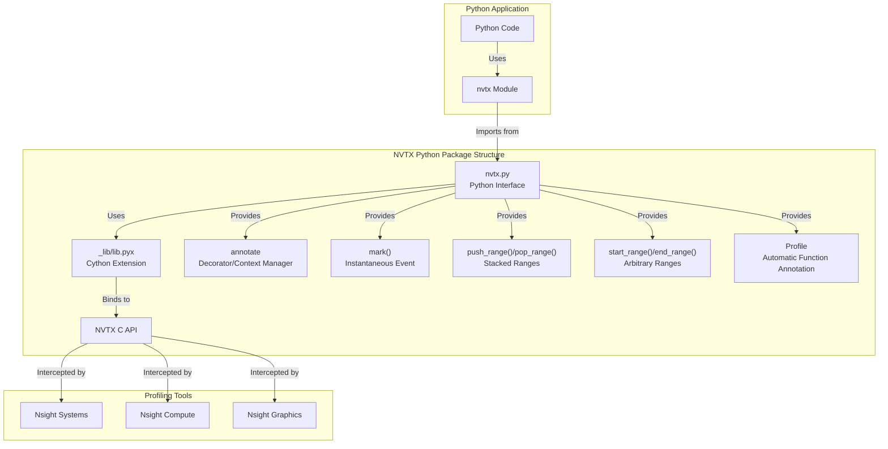
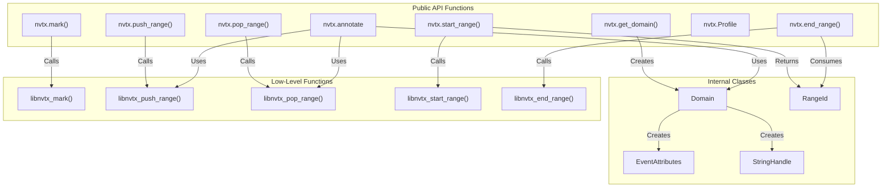

<!-- source: DeepWiki mcp.deepwiki.com · repo NVIDIA/NVTX · page 4 Python API · fetched 2026-10-26 -->

# Python API

<details>
<summary>Relevant source files</summary>

The following files were used as context for generating this wiki page:

- [.gitignore](.gitignore)
- [README.md](README.md)
- [docs/index.html](docs/index.html)
- [python/.flake8.cython](python/.flake8.cython)
- [python/docs/annotate.rst](python/docs/annotate.rst)
- [python/docs/auto.rst](python/docs/auto.rst)
- [python/docs/index.rst](python/docs/index.rst)
- [python/docs/install.rst](python/docs/install.rst)
- [python/docs/toctree.rst](python/docs/toctree.rst)
- [python/src/nvtx/__init__.py](python/src/nvtx/__init__.py)
- [python/src/nvtx/_lib/lib.pyx](python/src/nvtx/_lib/lib.pyx)
- [python/src/nvtx/nvtx.py](python/src/nvtx/nvtx.py)
- [tools/docs/generate-readme.py](tools/docs/generate-readme.py)
- [tools/docs/github-markdown-css/github-markdown.css](tools/docs/github-markdown-css/github-markdown.css)
- [tools/docs/github-markdown-css/license](tools/docs/github-markdown-css/license)

</details>


The Python API for NVTX provides a Pythonic interface to the NVIDIA Tools Extension Library, enabling Python applications to be annotated with markers and ranges for performance analysis and visualization. This page documents the installation, architecture, core functionality, and usage patterns of the NVTX Python API.

## Architecture

The Python NVTX package is structured as a Python module with Cython bindings to the underlying C API. This architecture allows Python code to use NVTX functionality with minimal overhead.



Sources: [python/src/nvtx/nvtx.py:19-31](). [python/src/nvtx/_lib/lib.pyx:21-24]().

The NVTX Python package exposes several key components:

1. **Core annotation functions**: `mark()`, `push_range()`/`pop_range()`, and `start_range()`/`end_range()`
2. **The `annotate` class**: A versatile decorator/context manager for code ranges
3. **The `Profile` class**: For automatic function annotation
4. **Domain and category support**: For organizing annotations

## Installation

NVTX Python requires Python 3.6 or newer (up to Python 3.9) and is primarily tested on Linux systems.

### Using pip

```
python -m pip install nvtx
```

### Using conda

```
conda install -c conda-forge nvtx
```

### From Source

```
NVTX_PREFIX=/path/to/nvtx/prefix/ python -m pip install nvtx --no-binary nvtx
```

When building from source, you need:
- Cython installed
- `NVTX_PREFIX` environment variable pointing to the directory containing the NVTX C headers

Sources: [python/docs/install.rst:1-29]().

## Core Functionality

The Python API provides multiple ways to annotate code, each suitable for different use cases.

### Class and Function Relationships



Sources: [python/src/nvtx/nvtx.py:36-129](). [python/src/nvtx/_lib/lib.pyx:32-198]().

### Markers

Markers annotate a specific point in program execution.

```python
import nvtx

nvtx.mark(message="Checkpoint reached")
nvtx.mark(message="Error detected", color="red", category="Errors")
```

Sources: [python/src/nvtx/nvtx.py:129-154]().

### Ranges

Ranges annotate a span of execution time. There are two types of ranges:

#### Push/Pop Ranges

These create a stack of nested ranges. Each `pop_range()` is associated with the most recent `push_range()` on the same thread.

```python
import nvtx

nvtx.push_range(message="Data processing")
# ... code to profile ...
nvtx.pop_range()
```

Sources: [python/src/nvtx/nvtx.py:157-205]().

#### Start/End Ranges

These create ranges that can overlap arbitrarily. The `start_range()` function returns a handle that must be passed to `end_range()`.

```python
import nvtx

range_id = nvtx.start_range(message="Asynchronous operation")
# ... code to profile ...
nvtx.end_range(range_id)
```

Sources: [python/src/nvtx/nvtx.py:208-259]().

### The `annotate` Class

The `annotate` class provides both a context manager and a decorator for creating ranges.

#### As a Context Manager

```python
import nvtx

with nvtx.annotate(message="Critical section", color="blue"):
    # ... code to profile ...
```

#### As a Decorator

```python
import nvtx

@nvtx.annotate(color="green")  # Message defaults to function name
def process_data():
    # ... code to profile ...
```

Sources: [python/src/nvtx/nvtx.py:41-126]().

### Parameter Options

All annotation functions support the following parameters:

| Parameter | Type | Description |
|-----------|------|-------------|
| message | str | Text associated with the annotation |
| color | str | Color for visual distinction in tools |
| domain | str | Domain for grouping annotations |
| category | str/int | Category within a domain |
| payload | int/float | Numeric value associated with the event |

Sources: [python/src/nvtx/nvtx.py:46-73](). [python/src/nvtx/nvtx.py:134-151]().

### Domains and Categories

Domains isolate annotations from different libraries, while categories group related annotations within a domain.

```python
import nvtx

# Using a custom domain
nvtx.push_range(message="Query execution", domain="database")
# ... database code ...
nvtx.pop_range(domain="database")

# Using categories
nvtx.push_range(message="Read operation", domain="io", category="Input")
# ... input code ...
nvtx.pop_range(domain="io")
```

Sources: [python/src/nvtx/_lib/lib.pyx:93-145](). [python/src/nvtx/nvtx.py:36-38]().

## Automatic Function Annotation

The NVTX Python API provides capabilities for automatically annotating function calls.

### The `Profile` Class

The `Profile` class enables automatic annotation of all function calls within its scope.

```python
import nvtx

# Start automatic profiling
prof = nvtx.Profile()
prof.enable()

# ... code with multiple function calls ...

# Stop automatic profiling
prof.disable()
```

### Command-line Interface

The `nvtx` module can be used as a command-line script to profile an entire Python program.

```
python -m nvtx script.py
```

Sources: [python/docs/auto.rst:1-46](). [python/src/nvtx/__init__.py:30]().

## Usage Examples

Here are some examples of using the NVTX Python API in different scenarios:

### Basic Annotation Example

```python
import nvtx
import time

# Mark a specific point
nvtx.mark(message="Application started")

# Annotate a code block
with nvtx.annotate(message="Initialization phase"):
    time.sleep(1)  # Simulation of work

# Annotate a function
@nvtx.annotate()  # Message will be the function name "process_data"
def process_data():
    time.sleep(0.5)  # Simulation of work

process_data()

# Mark the end
nvtx.mark(message="Application completed")
```

### Domain and Category Example

```python
import nvtx
import time

# Annotate with domains and categories
with nvtx.annotate(message="Data loading", domain="io", category="Input"):
    time.sleep(0.5)  # Simulation of work

with nvtx.annotate(message="Data processing", domain="compute", category="Transform"):
    time.sleep(1)  # Simulation of work

with nvtx.annotate(message="Results saving", domain="io", category="Output"):
    time.sleep(0.5)  # Simulation of work
```

### Visualization in Nsight Systems

When a Python program annotated with NVTX is profiled using NVIDIA Nsight Systems, the annotations appear on a timeline, providing insights into the program's execution flow.

To profile a Python program with Nsight Systems:

```
nsys profile python annotated_script.py
```

The resulting timeline will show markers as vertical lines and ranges as horizontal bars, with messages, colors, and other attributes visible in the UI.

## Implementation Details

The Python API is implemented using Cython to bind to the NVTX C API. This provides a Pythonic interface while maintaining efficiency.

### Key Classes

The internal implementation includes several key classes:

1. **Domain**: Represents an NVTX domain that isolates annotations
2. **EventAttributes**: Holds the attributes for a marker or range event
3. **StringHandle**: Manages registered strings for efficient reuse
4. **RangeId**: Represents the handle returned by `start_range()`

Sources: [python/src/nvtx/_lib/lib.pyx:32-176]().

### Caching and Optimization

The implementation uses caching to optimize performance:

- `lru_cache` is used to cache domain objects and registered strings
- Strings are registered once and reused, reducing overhead
- The package optimizes for the case when NVTX is disabled

Sources: [python/src/nvtx/nvtx.py:33-36](). [python/src/nvtx/_lib/lib.pyx:126-151]().

## Disabling NVTX

The NVTX Python API can be disabled by setting the `NVTX_DISABLE` environment variable, which causes all NVTX calls to become no-ops.

```
NVTX_DISABLE=1 python script.py
```

When disabled, the API functions are replaced with empty implementations to minimize overhead.

Sources: [python/src/nvtx/nvtx.py:33](). [python/src/nvtx/nvtx.py:269-293]().

## Integration with Tools

NVTX annotations are consumed by several NVIDIA developer tools:

- **Nsight Systems**: Shows annotations on a timeline alongside other system events
- **Nsight Compute**: Uses NVTX ranges to focus GPU kernel analysis
- **Nsight Graphics**: Uses NVTX ranges to set bounds for range profiling

These tools provide various ways to visualize and analyze the annotated program, offering insights into performance characteristics and potential optimizations.

---

