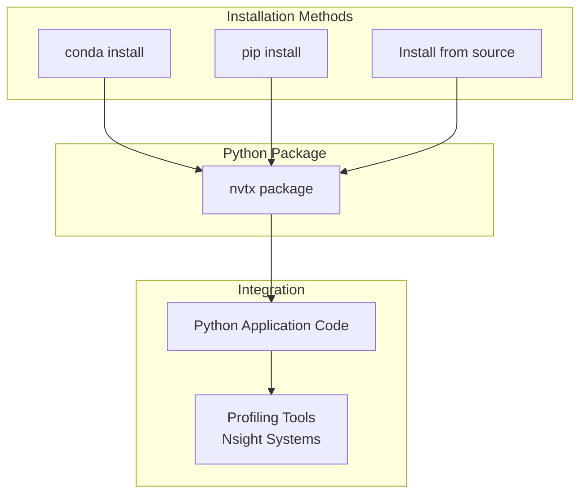
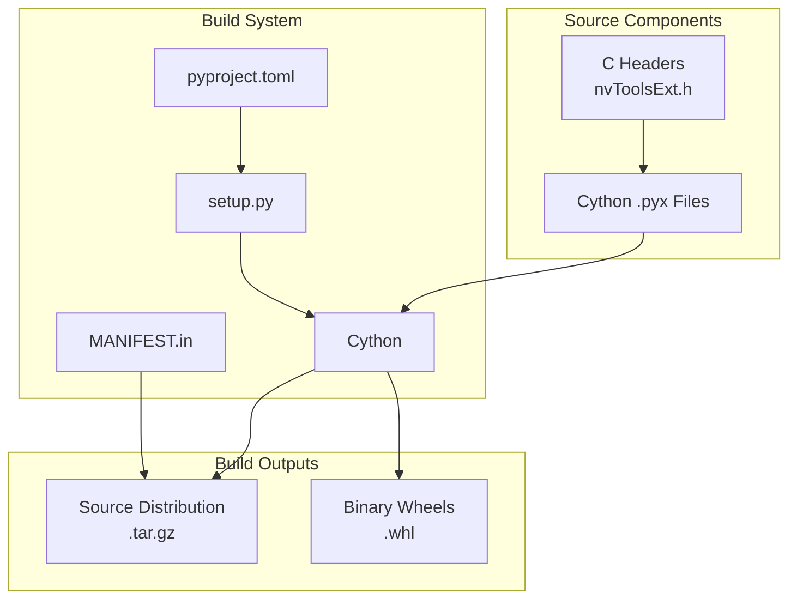
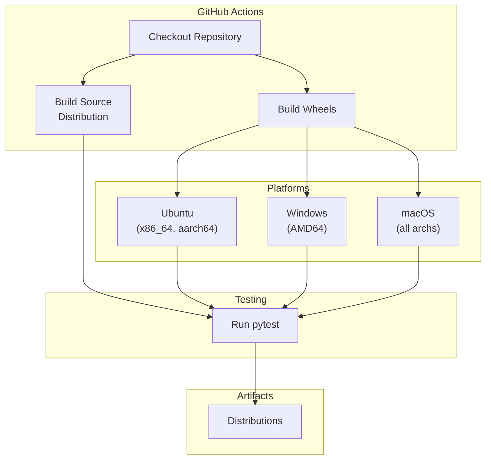

<!-- source: DeepWiki mcp.deepwiki.com · repo NVIDIA/NVTX · page 4.1 Installation · fetched 2026-10-26 -->

# Installation

<details>
<summary>Relevant source files</summary>

The following files were used as context for generating this wiki page:

- [.github/workflows/cibw.yml](.github/workflows/cibw.yml)
- [python/MANIFEST.in](python/MANIFEST.in)
- [python/README.md](python/README.md)
- [python/docs/annotate.rst](python/docs/annotate.rst)
- [python/docs/auto.rst](python/docs/auto.rst)
- [python/docs/conf.py](python/docs/conf.py)
- [python/docs/index.rst](python/docs/index.rst)
- [python/docs/install.rst](python/docs/install.rst)
- [python/docs/toctree.rst](python/docs/toctree.rst)
- [python/pyproject.toml](python/pyproject.toml)
- [python/setup.py](python/setup.py)

</details>


This page provides detailed instructions for installing the NVTX Python package, which allows you to add profiling annotations to your Python code. For information about using the package after installation, see [Basic Usage](#4.2).

## Overview

The NVTX Python package provides Python bindings to the NVIDIA Tools Extension Library (NVTX), enabling profiling and performance analysis of Python code through tools such as NVIDIA Nsight Systems. 



Sources: [python/docs/install.rst:1-29](), [python/README.md:1-14]()

## System Requirements

- **Python versions**: 3.6 or newer (tested through Python 3.12)
- **Platforms**: 
  - Linux (primary support)
  - Windows
  - macOS
- **Architecture support**:
  - x86_64 (all platforms)
  - aarch64/ARM64 (Linux, macOS)

Sources: [python/pyproject.toml:35-43](), [python/pyproject.toml:70-77]()

## Installation Methods

### Using Conda (Recommended)

The recommended installation method is using conda from the conda-forge channel:

```bash
conda install -c conda-forge nvtx
```

This is the preferred method because it includes all necessary dependencies and provides pre-built binaries for most common platforms.

### Using Pip

You can install using pip:

```bash
python -m pip install nvtx
```

Pre-built wheels are available for:
- Linux (x86_64, aarch64)
- Windows (AMD64)
- macOS (all supported architectures)

Sources: [python/docs/install.rst:1-20](), [python/README.md:5-13]()

## Build System Architecture

The NVTX Python package uses Cython to bind to the C API. Understanding the build architecture can be helpful for troubleshooting installation issues.



Sources: [python/setup.py:1-50](), [python/pyproject.toml:21-23](), [python/MANIFEST.in:1-4]()

## Installing from Source

For platforms without pre-built packages, or if you need to customize the installation, you can install from source:

### Prerequisites for Source Installation

1. Cython (version 3.0.11 recommended)
2. C compiler compatible with your Python installation
3. NVTX C headers (typically included with CUDA or can be found in this repository)

### Source Installation

If you have the NVTX headers already installed in your system (e.g., as part of CUDA), set the `NVTX_PREFIX` environment variable to their location:

```bash
NVTX_PREFIX=/path/to/nvtx/prefix/ python -m pip install nvtx --no-binary nvtx
```

Where the prefix is typically the CUDA include directory (e.g., `/usr/local/cuda/include`).

If you're installing from a cloned repository:

```bash
git clone https://github.com/NVIDIA/NVTX.git
cd NVTX/python
pip install -e .
```

Sources: [python/docs/install.rst:22-29](), [python/setup.py:28-33]()

## CI/CD Build Process

The NVTX Python package is built and tested using GitHub Actions workflows, which ensure compatibility across multiple platforms and Python versions.



Sources: [.github/workflows/cibw.yml:1-72](), [python/pyproject.toml:64-77]()

## Verifying Installation

To verify that NVTX is correctly installed, you can run a simple Python script:

```python
import nvtx
print(f"NVTX version: {nvtx.__version__}")

# Try a simple annotation
with nvtx.annotate("test_annotation"):
    print("NVTX is working!")
```

The script should run without errors. Note that for full functionality, you'll need to use a tool like NVIDIA Nsight Systems to capture and visualize the annotations.

## Troubleshooting

### Common Issues

1. **Missing Cython**: If you see an error about Cython not being found during installation, install it first:
   ```bash
   pip install Cython==3.0.11
   ```

2. **Missing NVTX Headers**: When installing from source, if you get an error about missing headers, ensure the `NVTX_PREFIX` environment variable is correctly set.

3. **Platform Support**: If pre-built wheels aren't available for your platform, try installing from source.

### Getting Help

If you encounter issues not covered here, you can:
- Check the GitHub repository issues: https://github.com/NVIDIA/NVTX/issues
- File a new issue if needed

Sources: [python/pyproject.toml:46-51]()

---

