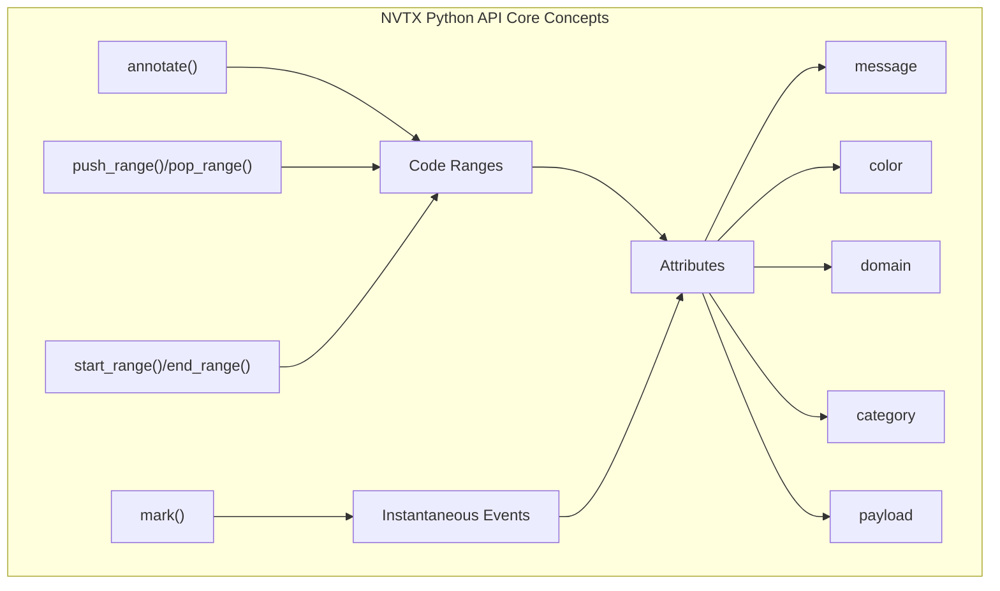
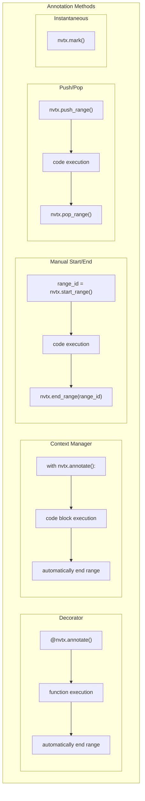
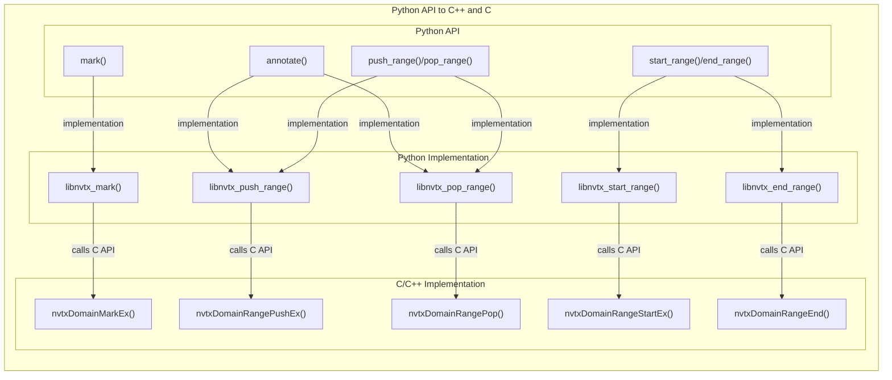

<!-- source: DeepWiki mcp.deepwiki.com · repo NVIDIA/NVTX · page 4.2 Basic Usage · fetched 2026-10-26 -->

# Basic Usage

<details>
<summary>Relevant source files</summary>

The following files were used as context for generating this wiki page:

- [python/docs/annotate.rst](python/docs/annotate.rst)
- [python/docs/auto.rst](python/docs/auto.rst)
- [python/docs/images/domains.png](python/docs/images/domains.png)
- [python/docs/index.rst](python/docs/index.rst)
- [python/docs/install.rst](python/docs/install.rst)
- [python/docs/toctree.rst](python/docs/toctree.rst)
- [python/src/nvtx/__init__.py](python/src/nvtx/__init__.py)
- [python/src/nvtx/_lib/lib.pyx](python/src/nvtx/_lib/lib.pyx)
- [python/src/nvtx/nvtx.py](python/src/nvtx/nvtx.py)

</details>


This page provides an introduction to the basic usage of the NVTX Python API, covering how to annotate your code with NVTX markers and ranges. For information about installing the package, see [Installation](#4.1). For details on automatic profiling capabilities, see [Automatic Profiling](#4.3).

NVTX (NVIDIA Tools Extension) annotations allow your Python code to be profiled and visualized in NVIDIA profiling tools like Nsight Systems. By adding these annotations to your code, you gain greater visibility into its execution behavior.

## Core Concepts

The NVTX Python API provides several ways to annotate your code:



Sources: [python/src/nvtx/nvtx.py:41-126](), [python/docs/annotate.rst:4-26]()

## Using `annotate()`

The `annotate()` function is the most common way to annotate your code. It can be used as a decorator or as a context manager.

### As a Decorator

```python
import nvtx

@nvtx.annotate(message="my_function", color="blue")
def my_function():
    # Function code here
    pass
```

If you omit the message parameter, the function name will be used by default:

```python
@nvtx.annotate()  # Will use "my_function" as the message
def my_function():
    # Function code here
    pass
```

### As a Context Manager

```python
import nvtx

with nvtx.annotate(message="important_section", color="green"):
    # Code block here
    pass
```

Sources: [python/src/nvtx/nvtx.py:41-126](), [python/docs/annotate.rst:4-26]()

## Flow of Annotation Methods



Sources: [python/src/nvtx/nvtx.py:41-126](), [python/src/nvtx/nvtx.py:129-154](), [python/src/nvtx/nvtx.py:157-189](), [python/src/nvtx/nvtx.py:195-205](), [python/src/nvtx/nvtx.py:208-244](), [python/src/nvtx/nvtx.py:250-259]()

## Marking Instantaneous Events with `mark()`

Use `mark()` to annotate a specific point in your code:

```python
import nvtx

# Some code...
nvtx.mark(message="checkpoint reached", color="red")
# More code...
```

This is useful for marking significant events that don't have a duration, such as when a threshold is reached or an error occurs.

Sources: [python/src/nvtx/nvtx.py:129-154](), [python/docs/annotate.rst:55-67]()

## Explicit Range Marking

There are two ways to explicitly mark the beginning and end of code ranges.

### Using `push_range()` and `pop_range()`

```python
import nvtx

nvtx.push_range(message="computation", color="blue")
# Code to profile
nvtx.pop_range()  # End the range
```

### Using `start_range()` and `end_range()`

This approach is useful for asynchronous code or when ranges span multiple functions:

```python
import nvtx

range_id = nvtx.start_range(message="async_operation", color="green")
# Code to profile, possibly spanning multiple functions or callbacks
nvtx.end_range(range_id)  # End the range using the range_id
```

Sources: [python/src/nvtx/nvtx.py:157-189](), [python/src/nvtx/nvtx.py:195-205](), [python/src/nvtx/nvtx.py:208-244](), [python/src/nvtx/nvtx.py:250-259](), [python/docs/annotate.rst:36-53]()

## API to Implementation Relationship



Sources: [python/src/nvtx/__init__.py:19-28](), [python/src/nvtx/nvtx.py:24-31](), [python/src/nvtx/_lib/lib.pyx:179-198]()

## Working with Domains and Categories

NVTX allows you to organize your annotations using domains and categories.

### Domains

Domains allow you to group annotations, which is useful when instrumenting multiple libraries:

```python
import nvtx

@nvtx.annotate(domain="math_library", color="blue")
def compute_function():
    # Code here
    pass
```

**Note**: Domains are expensive to create, so use them sparingly - typically one per library.

### Categories

Categories provide a way to group related annotations within a domain:

```python
import nvtx

@nvtx.annotate(domain="my_library", category="io_operations", color="green")
def read_file():
    # Code here
    pass

@nvtx.annotate(domain="my_library", category="computation", color="blue")
def process_data():
    # Code here
    pass
```

Categories can be specified either as strings or integers.

Sources: [python/docs/annotate.rst:69-157](), [python/src/nvtx/nvtx.py:36-38](), [python/src/nvtx/_lib/lib.pyx:93-113](), [python/src/nvtx/_lib/lib.pyx:120-156]()

## Adding Payload Information

You can attach numeric payload data to your annotations, which can be useful for tracking additional metrics:

```python
import nvtx

# Mark with a payload
nvtx.mark(message="data_size", payload=1024)

# Annotate with a payload
with nvtx.annotate(message="processing_batch", payload=32):
    # Process a batch of 32 items
    pass
```

Payloads must be either integers or floating-point values.

Sources: [python/src/nvtx/_lib/lib.pyx:74-90]()

## Event Attributes Table

| Attribute | Description                              | Type                    | Examples                        |
|-----------|------------------------------------------|-------------------------|--------------------------------|
| message   | Description of the event or range        | String                  | "initialization", "data_loading" |
| color     | Visual color for the event or range      | String                  | "blue", "green", "red"          |
| domain    | Group for organizing related annotations | String                  | "my_library", "math_functions"   |
| category  | Subgroup within a domain                 | String or Integer       | "io", "computation", 1, 2        |
| payload   | Numeric data associated with the event   | Integer or Float        | 1024, 3.14                      |

Sources: [python/src/nvtx/_lib/lib.pyx:32-90](), [python/src/nvtx/nvtx.py:47-57]()

## Disabling NVTX

NVTX can be disabled by setting the `NVTX_DISABLE` environment variable:

```bash
NVTX_DISABLE=1 python your_script.py
```

When disabled, NVTX annotation functions become no-ops, which means they do almost nothing and add minimal overhead to your code.

Sources: [python/src/nvtx/nvtx.py:33](), [python/src/nvtx/nvtx.py:269-293]()

## Performance Considerations

- NVTX annotations add some overhead, but it is minimal when no profiling tool is attached
- Domains are expensive to create, so reuse them when possible
- Messages are cached internally to reduce overhead
- Using string categories creates a small overhead for name registration
- For extremely performance-sensitive code, consider using categories as integers instead of strings

Sources: [python/src/nvtx/_lib/lib.pyx:93-113](), [python/src/nvtx/_lib/lib.pyx:126-128](), [python/src/nvtx/nvtx.py:36-38]()

---

