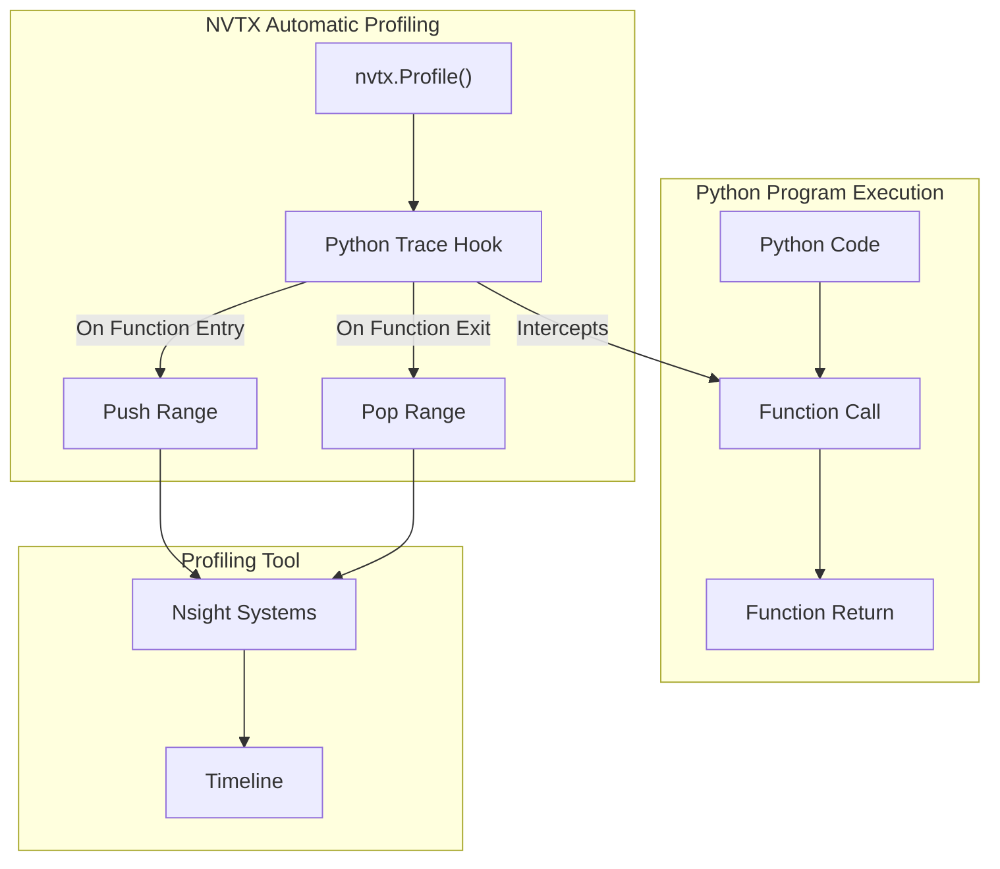
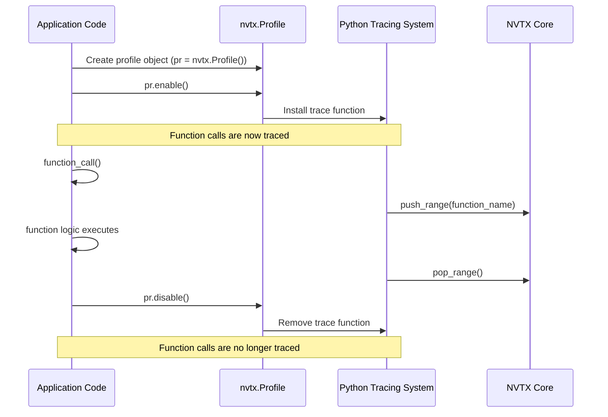
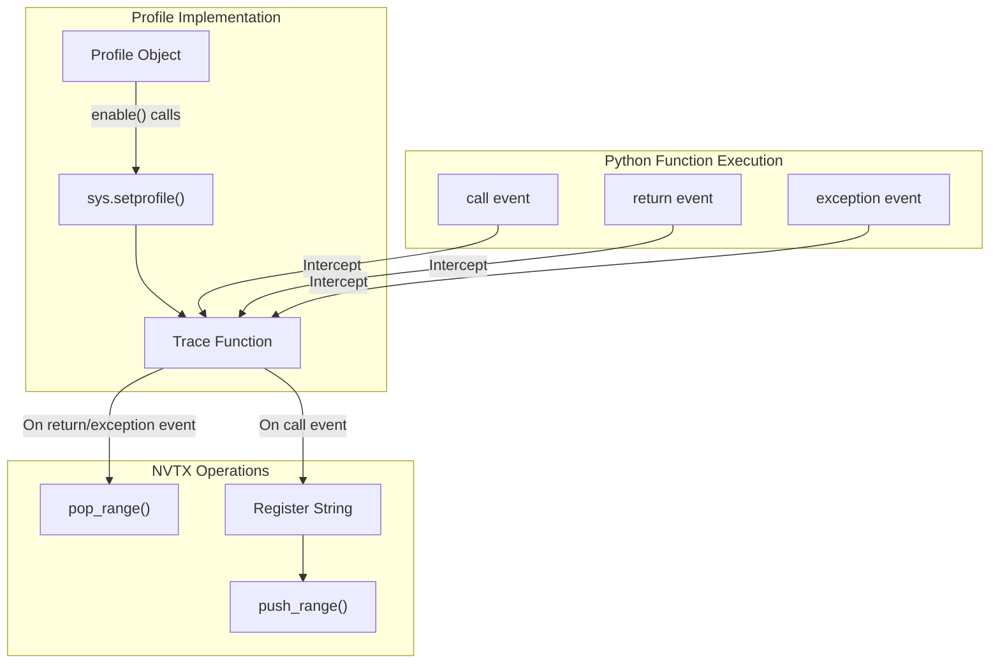
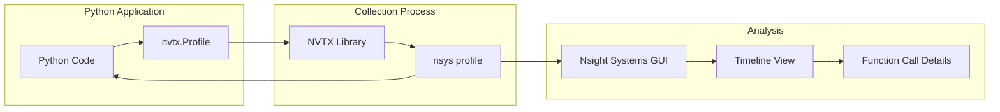

<!-- source: DeepWiki mcp.deepwiki.com · repo NVIDIA/NVTX · page 4.3 Automatic Profiling · fetched 2026-10-26 -->

# Automatic Profiling

<details>
<summary>Relevant source files</summary>

The following files were used as context for generating this wiki page:

- [python/docs/annotate.rst](python/docs/annotate.rst)
- [python/docs/auto.rst](python/docs/auto.rst)
- [python/docs/index.rst](python/docs/index.rst)
- [python/docs/install.rst](python/docs/install.rst)
- [python/docs/toctree.rst](python/docs/toctree.rst)
- [python/src/nvtx/__init__.py](python/src/nvtx/__init__.py)
- [python/src/nvtx/_lib/lib.pyx](python/src/nvtx/_lib/lib.pyx)
- [python/src/nvtx/nvtx.py](python/src/nvtx/nvtx.py)
- [python/tests/__init__.py](python/tests/__init__.py)
- [python/tests/conftest.py](python/tests/conftest.py)
- [python/tests/cython/test_profiler.pyx](python/tests/cython/test_profiler.pyx)
- [python/tests/test_basic.py](python/tests/test_basic.py)
- [python/tests/test_profiler.py](python/tests/test_profiler.py)

</details>


The NVTX Python package provides capabilities for automatically annotating function calls in Python code without requiring manual annotation. This feature is particularly useful for obtaining detailed insights into the execution flow of complex applications or when you need to profile third-party code that you cannot modify. This page documents the automatic profiling capabilities of the NVTX Python API, explaining how to use them and their impact on performance.

For information about manually annotating your code using decorators and context managers, see [Basic Usage](#4.2).

## Overview of Automatic Profiling

Automatic profiling in NVTX intercepts Python function calls and automatically creates NVTX range annotations for each function. This provides detailed timeline information when using profiling tools like NVIDIA Nsight Systems.



Sources: [python/docs/auto.rst:8-14](), [python/src/nvtx/__init__.py:30]()

## Usage Methods

There are two primary ways to leverage automatic profiling in NVTX:

### Command-line Interface

The simplest way is to use the command-line interface, which automatically profiles your entire Python script:

```
python -m nvtx script.py
```

This approach requires no code changes and will annotate every function call in your script and in any libraries it uses.

Sources: [python/docs/auto.rst:23-29]()

### Programmatic Interface with Profile Class

For more granular control, you can use the `Profile` class to enable and disable automatic profiling during specific portions of your code execution:



Basic usage example:

```python
import nvtx

# Create a Profile object
pr = nvtx.Profile()

# Enable automatic profiling
pr.enable()

# Code executed here will be automatically profiled
function_call()

# Disable automatic profiling
pr.disable()
```

Sources: [python/docs/auto.rst:32-46](), [python/tests/cython/test_profiler.pyx:38-50]()

## How Automatic Profiling Works

The `Profile` class leverages Python's built-in tracing capabilities to intercept function calls and automatically create NVTX range annotations:



When a function is called, the profiler:
1. Captures function metadata (name, module, line number)
2. Creates an NVTX range annotation with this information
3. When the function returns, it ends the range

Sources: [python/tests/cython/test_profiler.pyx:28-50]()

## Profile Information Captured

The automatic profiler captures several key pieces of information about each function call:

| Information | Description |
|-------------|-------------|
| Function name | The name of the called function |
| Module name | The module in which the function is defined |
| File name | The source file containing the function |
| Line number | The line number where the function is defined |

This information is formatted into a message string that appears in the NVTX timeline, typically in the format: `filename:line(function_name)`.

Sources: [python/tests/cython/test_profiler.pyx:40-46]()

## Performance Considerations

Automatic profiling adds overhead to every function call in your application, which can significantly impact performance:

- According to the documentation, this overhead can slow down your application by more than 10x in some cases
- The overhead is applied to every function call being traced
- For high-performance applications, selective manual annotation may be more appropriate

Sources: [python/docs/auto.rst:9-11]()

## Integration with Profiling Tools

The automatic profiling feature works seamlessly with profiling tools like NVIDIA Nsight Systems:



To collect and view profiling data:

1. Run your Python script with automatic profiling enabled
2. Collect the data using Nsight Systems: `nsys profile python -m nvtx script.py`
3. Open the resulting .nsys-rep file in Nsight Systems GUI to view the timeline

Sources: [python/docs/auto.rst:13-17](), [python/docs/index.rst:50-62]()

## Example Timeline

When using automatic profiling, the resulting timeline in Nsight Systems will show detailed function call information with nested ranges representing the call stack:

```mermaid
gantt
    title "Function Call Timeline"
    dateFormat X
    axisFormat %s
    
    section Main Program
    main()                    :a1, 0, 10s
    
    section Function Calls
    function_a()             :a2, 1s, 3s
    function_b()             :a3, 4s, 6s
    nested_function()        :a4, 5s, 5.5s
    function_c()             :a5, 7s, 9s
```

Sources: [python/docs/auto.rst:16-17]()

## Best Practices

- **Selective Profiling**: Due to the performance overhead, enable automatic profiling only for the specific parts of your code you're investigating
- **Combine with Manual Annotation**: Use automatic profiling for broad analysis, then add manual annotations for production-critical code
- **Performance Testing**: Always benchmark your application with and without automatic profiling to understand the overhead
- **Memory Consideration**: Profiling very large applications with many function calls may increase memory usage due to the caching of strings

Sources: [python/docs/auto.rst:9-11](), [python/nvtx.py:129-126]()

## Availability

The automatic profiling feature is bundled with the NVTX Python package, which can be installed via pip or conda:

```
pip install nvtx
```

or

```
conda install -c conda-forge nvtx
```

Sources: [python/docs/install.rst:6-19]()

---

