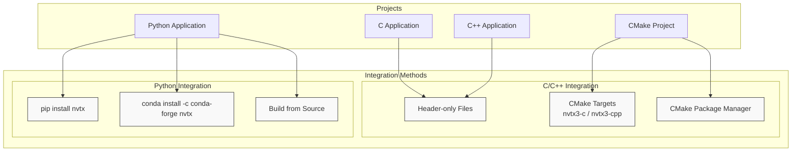
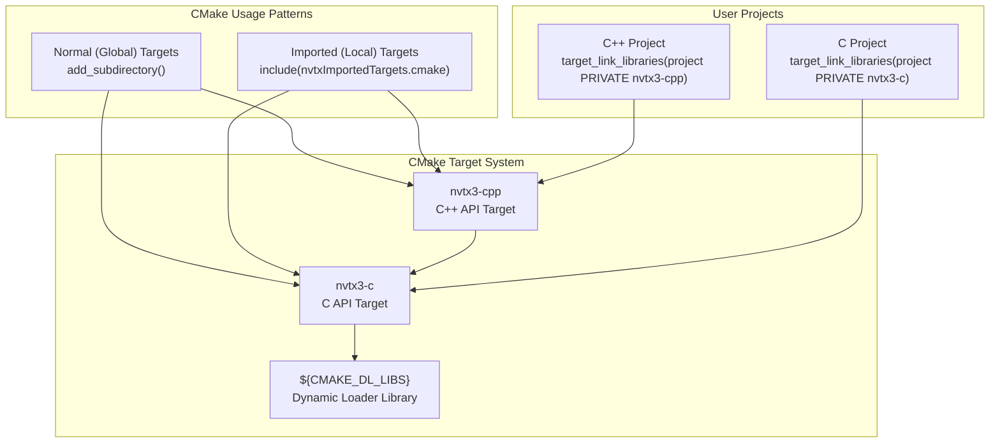
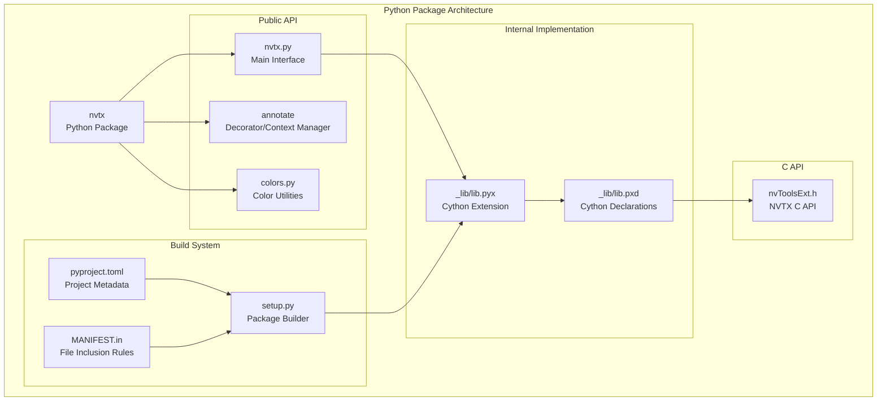
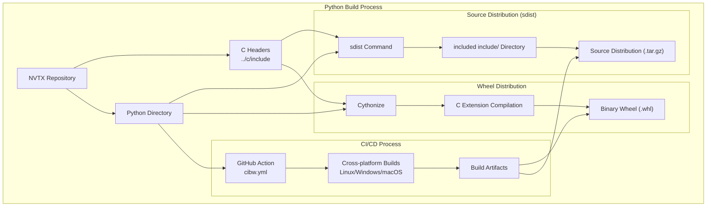

<!-- source: DeepWiki mcp.deepwiki.com · repo NVIDIA/NVTX · page 5 Integration · fetched 2026-10-26 -->

# Integration

<details>
<summary>Relevant source files</summary>

The following files were used as context for generating this wiki page:

- [.github/workflows/cibw.yml](.github/workflows/cibw.yml)
- [.gitignore](.gitignore)
- [README.md](README.md)
- [c/CMakeLists.txt](c/CMakeLists.txt)
- [c/nvtxImportedTargets.cmake](c/nvtxImportedTargets.cmake)
- [docs/index.html](docs/index.html)
- [python/.flake8.cython](python/.flake8.cython)
- [python/MANIFEST.in](python/MANIFEST.in)
- [python/README.md](python/README.md)
- [python/docs/conf.py](python/docs/conf.py)
- [python/pyproject.toml](python/pyproject.toml)
- [python/setup.py](python/setup.py)
- [tools/docs/generate-readme.py](tools/docs/generate-readme.py)
- [tools/docs/github-markdown-css/github-markdown.css](tools/docs/github-markdown-css/github-markdown.css)
- [tools/docs/github-markdown-css/license](tools/docs/github-markdown-css/license)

</details>


This page provides a comprehensive overview of how to integrate NVTX (NVIDIA Tools Extension Library) into various projects. It covers integration methods for both C/C++ projects and Python applications, including build system configurations and distribution mechanisms.

## NVTX Integration Overview

NVTX is designed to be simple to integrate, supporting multiple languages and integration methods with minimal dependencies. The following diagram illustrates the primary integration paths:



Sources: [README.md:69-106](), [README.md:311-321]()

## C/C++ Integration

### Header-Only Integration

NVTX for C and C++ is implemented as a header-only library, requiring no additional dependencies for compilation. Simply include the appropriate headers:

- For C: `#include <nvtx3/nvToolsExt.h>`
- For C++: `#include <nvtx3/nvtx3.hpp>`

On POSIX platforms, you may need to add the `-ldl` linker option for dynamic library loading.

Sources: [README.md:72-76](), [README.md:89-108]()

### CMake Integration

NVTX provides CMake targets to simplify integration into CMake-based projects. The targets handle include path configuration and necessary linker options automatically.



Sources: [c/nvtxImportedTargets.cmake:55-70](), [README.md:108-116]()

#### Normal (Global) Targets

When using NVTX as a component of a larger project via `add_subdirectory()`, the library defines global CMake targets accessible throughout the entire build:

```cmake
# In your main CMakeLists.txt
add_subdirectory(path/to/NVTX/c)

# Link with the targets
target_link_libraries(your_target PRIVATE nvtx3-cpp)
```

This approach allows referencing the NVTX targets from any part of your build tree.

Sources: [README.md:124-177](), [c/CMakeLists.txt:20-37]()

#### Imported (Local) Targets

For libraries that need to isolate their dependencies or use specific versions of NVTX, the library provides an alternative approach using `IMPORTED` targets:

```cmake
# In your library's CMakeLists.txt
include(path/to/NVTX/c/nvtxImportedTargets.cmake)
target_link_libraries(your_library PRIVATE nvtx3-cpp)
```

This creates targets scoped to the current directory, preventing version conflicts when multiple parts of a project use different NVTX versions.

Sources: [README.md:210-253](), [c/nvtxImportedTargets.cmake:22-41]()

### CMake Package Manager (CPM)

For projects that want to automatically fetch NVTX during the CMake configuration phase:

```cmake
include(path/to/CPM.cmake)

CPMAddPackage(
    NAME NVTX
    GITHUB_REPOSITORY NVIDIA/NVTX
    GIT_TAG v3.1.1-c-cpp
    GIT_SHALLOW TRUE)

target_link_libraries(your_target PRIVATE nvtx3-cpp)
```

This automatically downloads NVTX and makes its targets available.

Sources: [README.md:285-310]()

## Python Package Integration

### Python Package Structure

The NVTX Python package provides a Pythonic interface to NVTX functionality through Cython bindings to the C API.



Sources: [python/setup.py:18-50](), [python/pyproject.toml:20-78](), [python/MANIFEST.in:1-4]()

### Installation Methods

#### Using pip

The simplest way to install NVTX for Python:

```bash
python -m pip install nvtx
```

Sources: [python/README.md:10-13](), [README.md:347-352]()

#### Using conda

Alternative installation via conda:

```bash
conda install -c conda-forge nvtx
```

Sources: [python/README.md:5-8](), [README.md:346-349]()

#### Building from Source

For development or customization:

1. Clone the NVTX repository
2. Navigate to the python directory
3. Install with pip in development mode:
   ```bash
   pip install -e .[test]
   ```

Sources: [python/README.md:1-47]()

## Build Systems and Distribution

### Python Package Build Process

The Python package is built using a combination of setuptools and Cython, with the C header files included directly in the package:



Sources: [.github/workflows/cibw.yml:1-72](), [python/setup.py:18-50]()

### Custom Sdist Command

The Python package uses a custom `sdist` command to copy the NVTX C headers into the source distribution, ensuring that the package can be built without access to the full repository:

```python
class NvtxSdist(sdist):
    def run(self):
        try:
            shutil.copytree(c_include_path, 'include')
            super().run()
        finally:
            shutil.rmtree('include', ignore_errors=True)
```

Sources: [python/setup.py:36-42]()

### GitHub Actions Workflow

The CI/CD pipeline uses GitHub Actions to build Python wheels and source distributions for multiple platforms:

| Platform | Architectures | Python Versions |
|----------|---------------|-----------------|
| Linux    | x86_64, aarch64 | 3.8+ |
| Windows  | AMD64 | 3.8+ |
| macOS    | Universal | 3.8+ |

The workflow is triggered manually with optional branch or tag selection.

Sources: [.github/workflows/cibw.yml:1-72](), [python/pyproject.toml:64-77]()

## Best Practices for Integration

1. **C/C++ Integration**:
   - Use the CMake targets when possible for simplicity
   - Prefer IMPORTED targets for libraries to avoid version conflicts
   - Use header-only inclusion for simple applications or non-CMake projects

2. **Python Integration**:
   - Use pip or conda for regular usage
   - Build from source only for development or custom modifications
   - Include nvtx as an optional dependency in your package requirements

3. **Version Management**:
   - When using CMake, ensure the newest NVTX version is added first if using multiple versions
   - For Python, specify a minimum version constraint in your requirements

Sources: [README.md:124-177](), [README.md:210-253](), [README.md:346-352]()

---

