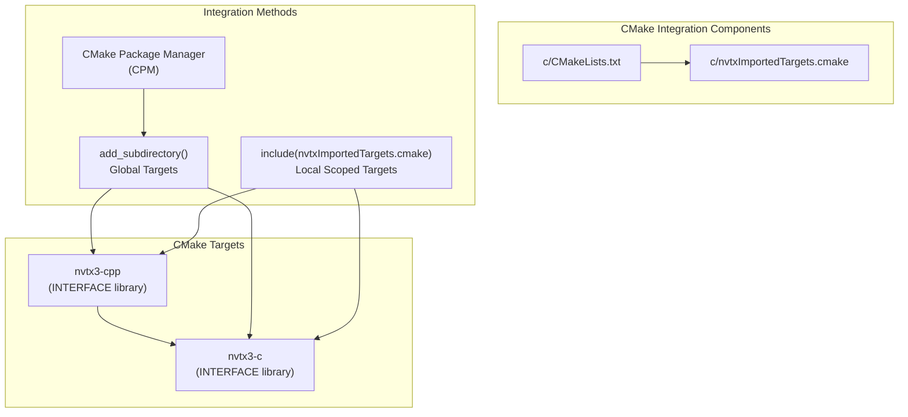
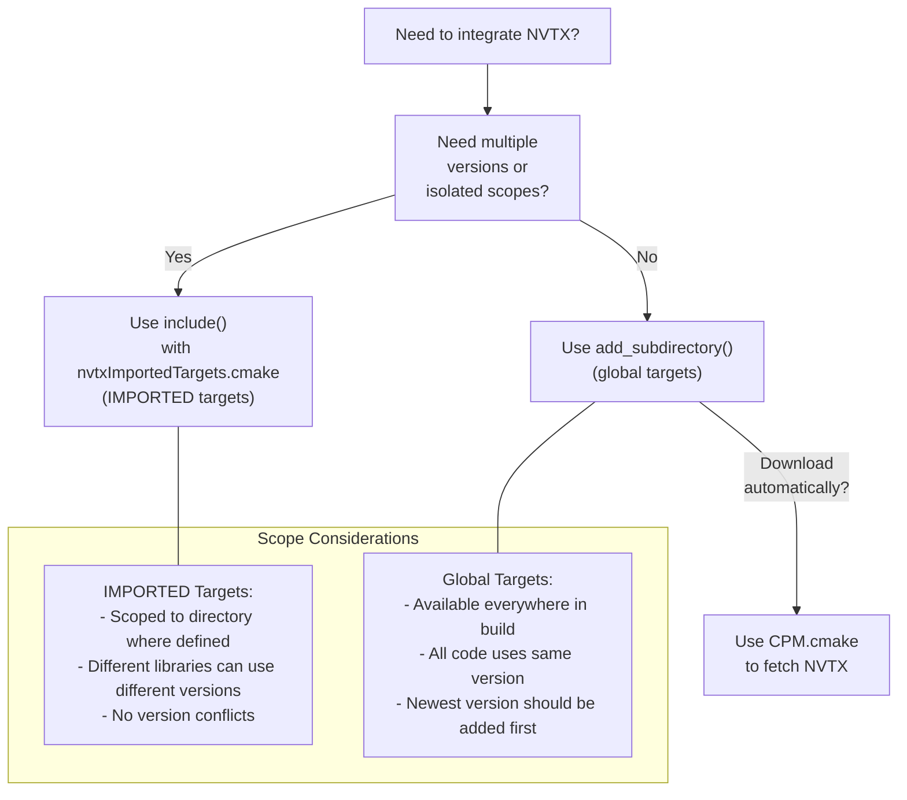
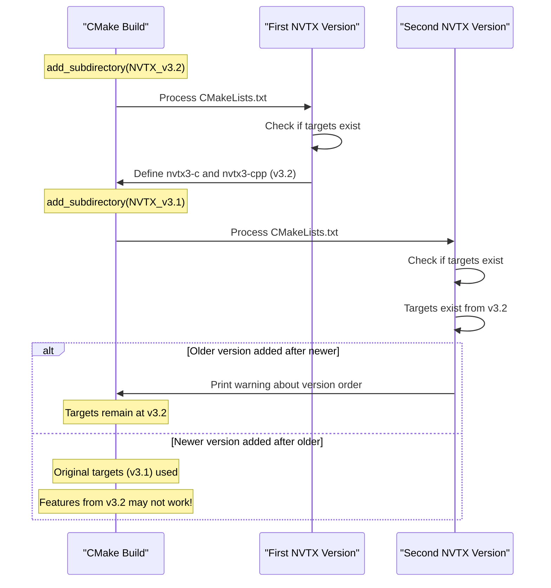
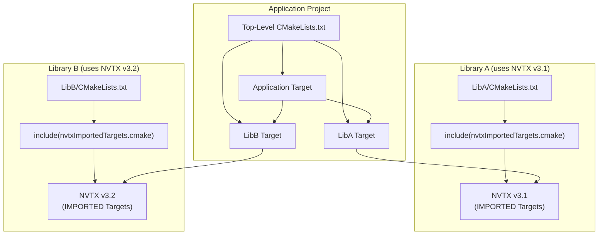

<!-- source: DeepWiki mcp.deepwiki.com · repo NVIDIA/NVTX · page 5.1 CMake Integration · fetched 2026-10-26 -->

# CMake Integration

<details>
<summary>Relevant source files</summary>

The following files were used as context for generating this wiki page:

- [.gitignore](.gitignore)
- [README.md](README.md)
- [c/CMakeLists.txt](c/CMakeLists.txt)
- [c/nvtxImportedTargets.cmake](c/nvtxImportedTargets.cmake)
- [docs/index.html](docs/index.html)
- [python/.flake8.cython](python/.flake8.cython)
- [tools/docs/generate-readme.py](tools/docs/generate-readme.py)
- [tools/docs/github-markdown-css/github-markdown.css](tools/docs/github-markdown-css/github-markdown.css)
- [tools/docs/github-markdown-css/license](tools/docs/github-markdown-css/license)

</details>


This page explains how to integrate NVTX (NVIDIA Tools Extension Library) into CMake-based projects. NVTX provides CMake targets to simplify inclusion of the header-only library in C and C++ projects. For information about Python integration, see [Python Package](#5.2).

## Overview of CMake Support

NVTX is primarily a header-only library requiring no direct linking with compiled code. The CMake integration simplifies including the correct headers and adding any necessary platform-specific linker flags to your projects.



Sources: [c/CMakeLists.txt:1-38](), [c/nvtxImportedTargets.cmake:1-74](), [README.md:106-253]()

## Available CMake Targets

NVTX provides two primary CMake targets:

| Target Name | API Access | Purpose |
|-------------|------------|---------|
| `nvtx3-c`   | C API only | Provides access to the NVTX C API |
| `nvtx3-cpp` | C & C++ APIs | Provides access to both NVTX C and C++ APIs |

Both targets are defined as `INTERFACE` libraries, which means they don't produce any built artifacts but only propagate include directories and dependencies to targets that link against them.

```cmake
# Example C program
add_executable(my_c_program main.c)
target_link_libraries(my_c_program PRIVATE nvtx3-c)
# main.c can now use #include <nvtx3/nvToolsExt.h>

# Example C++ program
add_executable(my_cpp_program main.cpp)
target_link_libraries(my_cpp_program PRIVATE nvtx3-cpp)
# main.cpp can now use #include <nvtx3/nvtx3.hpp>
```

Sources: [c/nvtxImportedTargets.cmake:55-70](), [README.md:117-125]()

## Integration Methods

NVTX offers two primary methods for integrating the library into your CMake project, each with different scoping behavior.



Sources: [c/CMakeLists.txt:22-34](), [c/nvtxImportedTargets.cmake:24-34](), [README.md:126-253]()

### Method 1: Using include() with nvtxImportedTargets.cmake (IMPORTED Targets)

This method defines the NVTX targets as `IMPORTED` targets, which are scoped locally to the directory where they are defined. This approach is useful when:

- Multiple libraries in the same build need to use different versions of NVTX
- You want to isolate your library's dependencies from the rest of the project
- You need to avoid conflicts with other libraries that might use NVTX

```cmake
# In your library's CMakeLists.txt
include(path/to/NVTX/c/nvtxImportedTargets.cmake)
add_library(my_library STATIC my_source.cpp)
target_link_libraries(my_library PRIVATE nvtx3-cpp)
```

Sources: [c/nvtxImportedTargets.cmake:24-40](), [README.md:252-309]()

### Method 2: Using add_subdirectory() (Non-IMPORTED Targets)

This method defines the NVTX targets as normal (non-IMPORTED) targets, which are global to the entire build. This approach is simpler when:

- Your entire project uses a single version of NVTX
- You want the NVTX targets to be available to all parts of your build
- You're adding NVTX as a direct subdirectory or with CPM

```cmake
# In your project's top-level CMakeLists.txt
add_subdirectory(path/to/NVTX/c)

# Now nvtx3-c and nvtx3-cpp are available globally
add_executable(my_program main.cpp)
target_link_libraries(my_program PRIVATE nvtx3-cpp)
```

If the NVTX directory is not a direct subdirectory, you need to provide a unique binary directory name:

```cmake
# Adding NVTX from a relative path outside the source tree
add_subdirectory("${CMAKE_CURRENT_LIST_DIR}/../external/NVTX/c" "nvtx_build")
```

Sources: [c/CMakeLists.txt:22-36](), [README.md:126-207]()

## Version Considerations

When using the non-IMPORTED targets (via `add_subdirectory()`), there are some important version considerations:

1. If multiple versions of NVTX are added, the **newest version should be added first**
2. The CMake scripts check if targets already exist before defining them
3. If an older version is added after a newer one, a warning is printed



Sources: [c/nvtxImportedTargets.cmake:42-53](), [README.md:208-228]()

## Using CMake Package Manager (CPM)

For projects that prefer to automatically download dependencies, CMake Package Manager (CPM) offers a convenient way to integrate NVTX:

```cmake
include(path/to/CPM.cmake)

CPMAddPackage(
    NAME NVTX
    GITHUB_REPOSITORY NVIDIA/NVTX
    GIT_TAG v3.1.1-c-cpp
    GIT_SHALLOW TRUE)

# Now nvtx3-c and nvtx3-cpp are available
add_executable(my_program main.cpp)
target_link_libraries(my_program PRIVATE nvtx3-cpp)
```

Notes:
- Use the `-c-cpp` suffix on the version tag to get only the C/C++ components
- The `GIT_SHALLOW TRUE` option avoids downloading the full repository history
- CPM caches downloads, enabling offline builds once populated

Sources: [README.md:229-309]()

## Real-World Integration Example

Here's a diagram showing a more complex example with multiple libraries using different NVTX versions:



Sources: [README.md:252-309]()

## Implementation Details

The NVTX CMake integration consists of two main files:

1. **c/CMakeLists.txt** - Sets up non-IMPORTED targets when using `add_subdirectory()`
2. **c/nvtxImportedTargets.cmake** - Defines the actual target configurations

The `nvtxImportedTargets.cmake` file handles:

- Version checking and compatibility warnings
- Conditional IMPORTED/non-IMPORTED target setup based on `NVTX3_TARGETS_NOT_USING_IMPORTED`
- Target definition including include paths and dependencies

This modular approach allows for flexibility in how NVTX is integrated while maintaining consistency in the actual target definitions.

Sources: [c/CMakeLists.txt:1-38](), [c/nvtxImportedTargets.cmake:1-74]()

---

