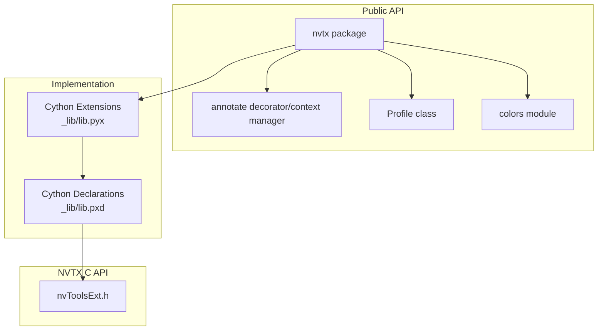
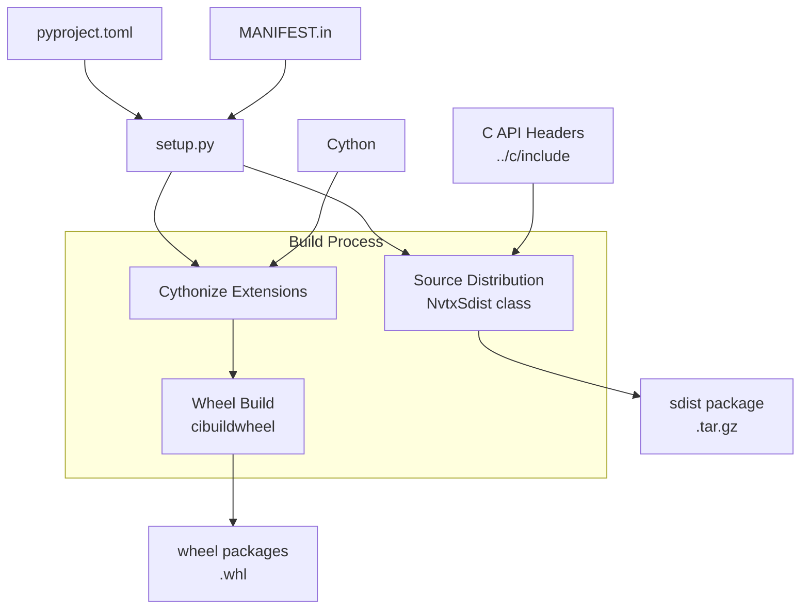
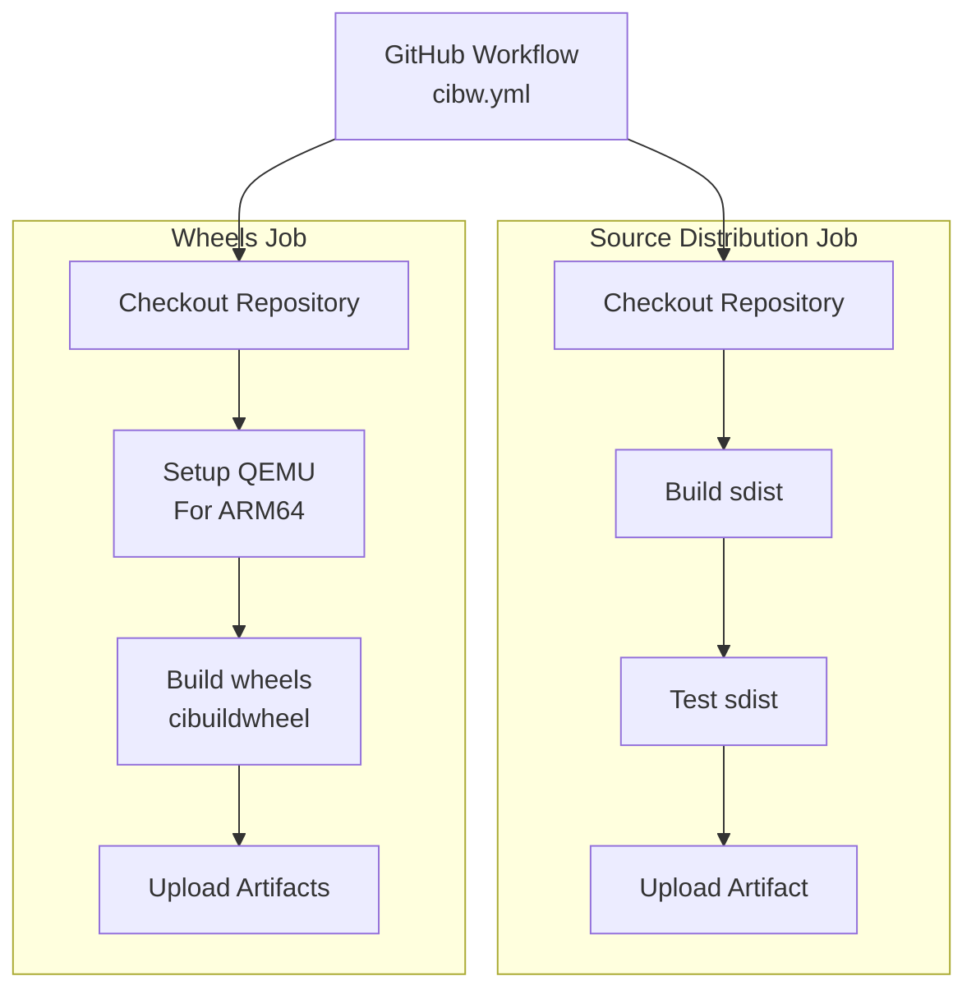

<!-- source: DeepWiki mcp.deepwiki.com · repo NVIDIA/NVTX · page 5.2 Python Package · fetched 2026-10-26 -->

# Python Package

<details>
<summary>Relevant source files</summary>

The following files were used as context for generating this wiki page:

- [.github/workflows/cibw.yml](.github/workflows/cibw.yml)
- [python/MANIFEST.in](python/MANIFEST.in)
- [python/README.md](python/README.md)
- [python/docs/conf.py](python/docs/conf.py)
- [python/pyproject.toml](python/pyproject.toml)
- [python/setup.py](python/setup.py)
- [python/src/nvtx/_lib/__init__.py](python/src/nvtx/_lib/__init__.py)
- [python/src/nvtx/_lib/lib.pxd](python/src/nvtx/_lib/lib.pxd)
- [python/src/nvtx/colors.py](python/src/nvtx/colors.py)

</details>


This page details the build system and distribution mechanisms of the NVTX Python package. It covers the package structure, build process, and distribution methods. For information on how to use the Python API, see [Python API](#4) and its subpages.

## 1. Package Overview

The NVTX Python package (`nvtx`) provides Python bindings to the NVIDIA Tools Extension Library (NVTX), enabling Python developers to annotate their code for profiling with NVIDIA tools such as Nsight Systems. The package is designed to be lightweight, easy to install, and compatible with a wide range of Python versions and platforms.

## 2. Package Architecture

The NVTX Python package follows a modular architecture that separates the public API from its implementation details.



Sources: [python/src/nvtx/_lib/lib.pxd](), [python/src/nvtx/_lib/__init__.py](), [python/src/nvtx/colors.py]()

### 2.1. Public API Components

The main components of the public API include:

- **Decorators and Context Managers**: Allow annotating Python functions and code blocks.
- **Profile Class**: Provides automatic profiling capabilities.
- **Colors Module**: Defines color utilities for visually distinguishing annotations in profilers.

### 2.2. Implementation Layer

The implementation uses Cython to interface with the NVTX C API:

- **Cython Extension (`lib.pyx`)**: Implements the NVTX functionality in Cython.
- **Cython Declarations (`lib.pxd`)**: Declares the C functions and structures from the NVTX C API.

## 3. Build System

The NVTX Python package employs a sophisticated build system to manage the compilation of Cython extensions and ensure proper inclusion of the required C header files.



Sources: [python/setup.py](), [python/pyproject.toml](), [python/MANIFEST.in]()

### 3.1. Key Build System Components

- **pyproject.toml**: Defines build system requirements and project metadata, including version, description, and dependencies.
  ```
  build-system:
  requires = ["setuptools", "wheel", "Cython==3.0.11"]
  ```

- **setup.py**: Configures the build process, including:
  - Extension module definition
  - Include path management
  - Custom `sdist` command to handle C header files

- **MANIFEST.in**: Controls which files are included in the source distribution:
  ```
  global-include *.pyx
  global-exclude *.c
  recursive-include include *
  ```

### 3.2. Special Build Handling

The package includes special handling for C header files needed by the Cython extension:

1. For source builds, the headers are referenced from the parent C directory.
2. For source distribution builds, a custom `NvtxSdist` class in `setup.py` copies the C headers to an `include` directory that is included in the distribution.

## 4. Continuous Integration and Distribution

The NVTX Python package uses GitHub Actions to automate the build and testing of the package across multiple platforms.



Sources: [.github/workflows/cibw.yml]()

### 4.1. CI/CD Workflow Features

- **Multi-platform support**: Builds wheels for Linux, Windows, and macOS
- **Architecture support**: Builds for multiple architectures including x86_64 and ARM64 (via QEMU)
- **Python version compatibility**: Supports Python 3.8 and newer (as configured in the CI)
- **Automated testing**: Runs tests against the built packages to verify functionality

### 4.2. cibuildwheel Configuration

The package uses `cibuildwheel` to build wheels for different platforms and Python versions, with configuration in `pyproject.toml`:

- Skip specific platform/Python version combinations
- Specify architectures for each platform
- Define test commands to run against built wheels

## 5. Installation Options

The NVTX Python package can be installed through various methods:

1. **From PyPI** (Python Package Index):
   ```
   pip install nvtx
   ```

2. **From Conda-Forge**:
   ```
   conda install -c conda-forge nvtx
   ```

3. **From Source**:
   ```
   python -m pip install git+https://github.com/NVIDIA/NVTX.git#subdirectory=python
   ```

Sources: [python/README.md]()

## 6. Package Versioning and Release Process

The NVTX Python package follows semantic versioning, with the version defined in the `pyproject.toml` file. As of the latest documentation, the package version is 0.2.11.

The release process includes:

1. Updating the version in `pyproject.toml` and `docs/conf.py`
2. Triggering the CI/CD workflow to build distribution packages
3. Publishing the packages to PyPI and Conda-Forge

Sources: [python/pyproject.toml:26-26](), [python/docs/conf.py:25-25]()

## 7. Package Documentation

Documentation for the NVTX Python package is built using Sphinx, with configuration in `docs/conf.py`. The documentation includes:

- API reference
- Usage examples
- Installation instructions

The documentation is available on GitHub and referenced in the package metadata.

Sources: [python/docs/conf.py](), [python/pyproject.toml:47-49]()

---

