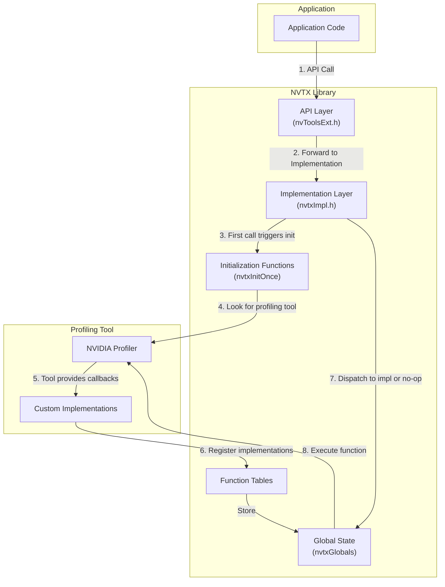
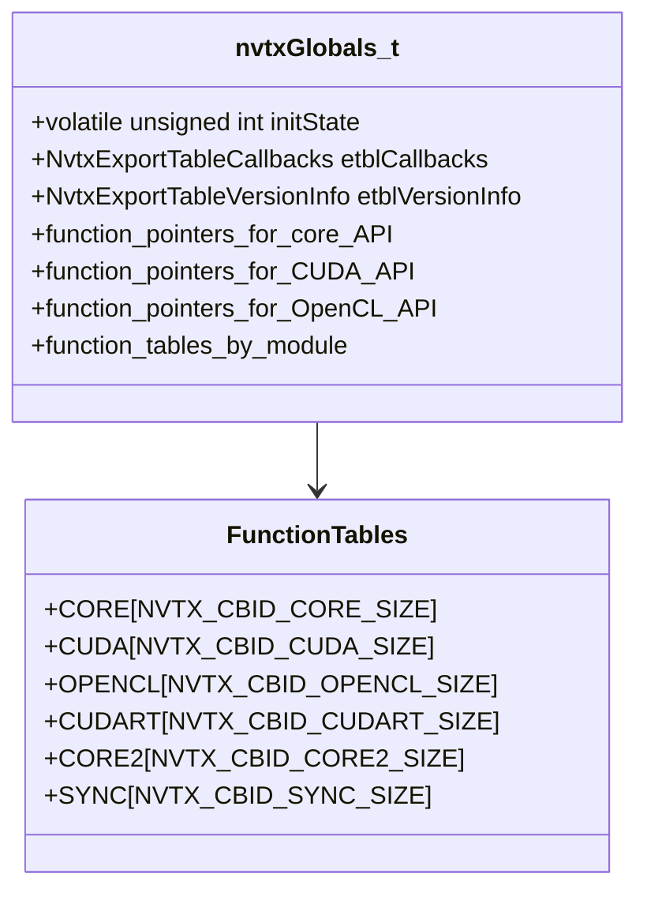
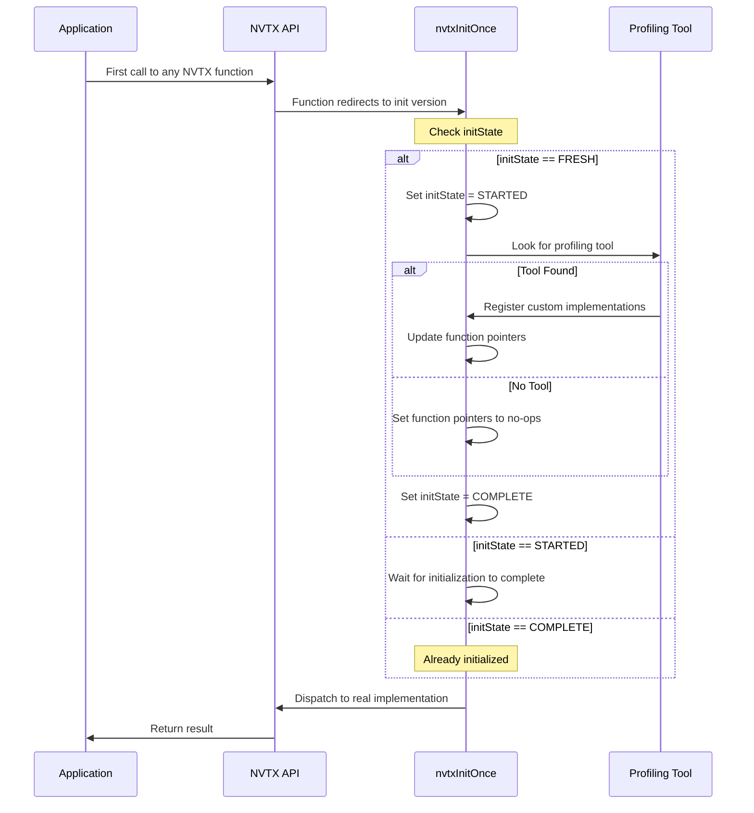
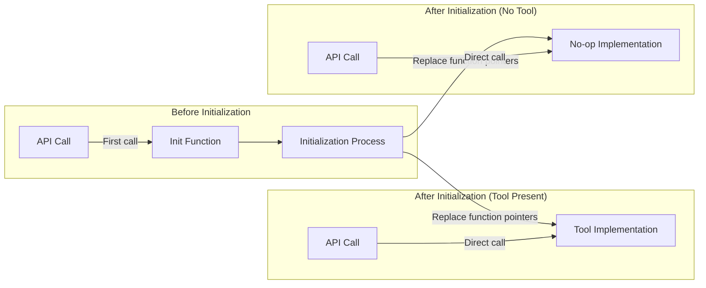
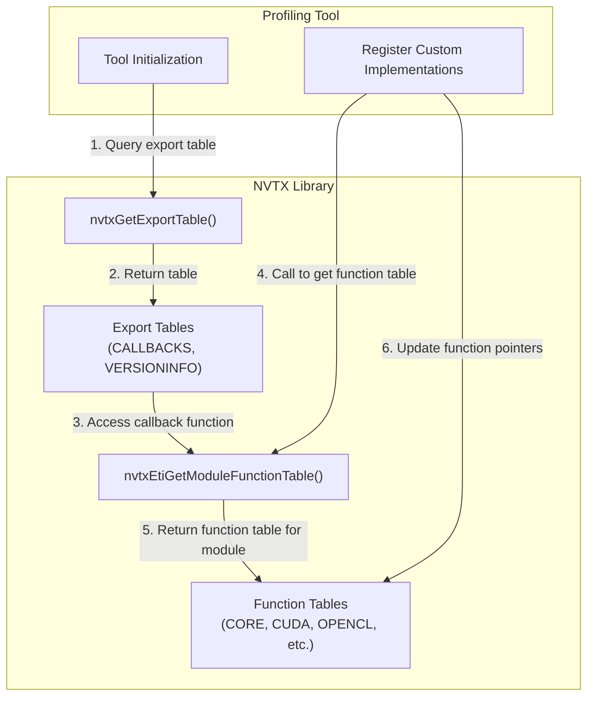
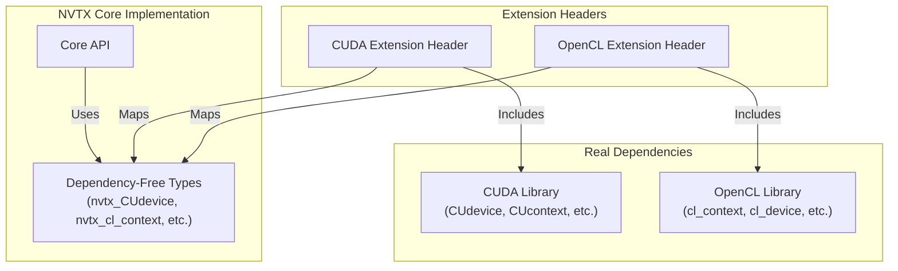
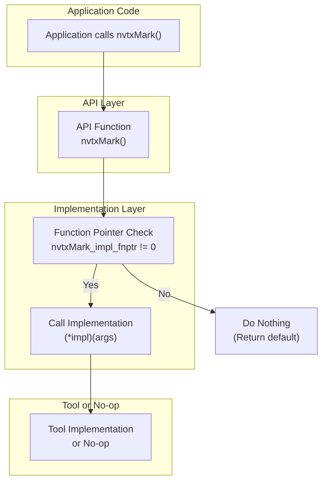
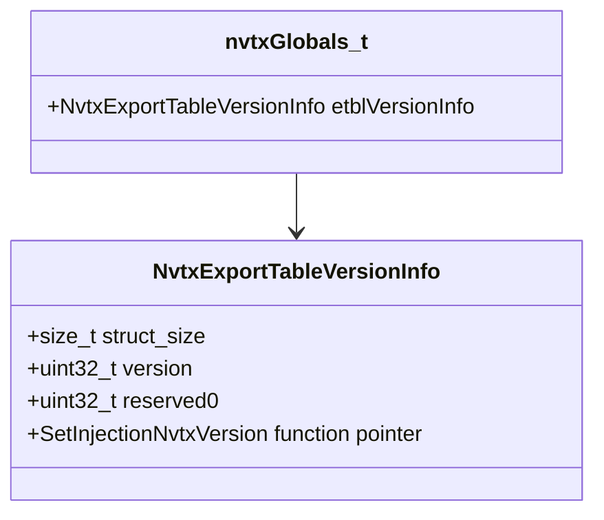

<!-- source: DeepWiki mcp.deepwiki.com · repo NVIDIA/NVTX · page 6 Implementation Details · fetched 2026-10-26 -->

# Implementation Details

<details>
<summary>Relevant source files</summary>

The following files were used as context for generating this wiki page:

- [c/include/nvtx3/nvtxDetail/nvtxImpl.h](c/include/nvtx3/nvtxDetail/nvtxImpl.h)
- [c/include/nvtx3/nvtxDetail/nvtxImplCore.h](c/include/nvtx3/nvtxDetail/nvtxImplCore.h)
- [c/include/nvtx3/nvtxDetail/nvtxImplCudaRt_v3.h](c/include/nvtx3/nvtxDetail/nvtxImplCudaRt_v3.h)
- [c/include/nvtx3/nvtxDetail/nvtxImplCuda_v3.h](c/include/nvtx3/nvtxDetail/nvtxImplCuda_v3.h)
- [c/include/nvtx3/nvtxDetail/nvtxImplOpenCL_v3.h](c/include/nvtx3/nvtxDetail/nvtxImplOpenCL_v3.h)
- [c/include/nvtx3/nvtxDetail/nvtxImplSync_v3.h](c/include/nvtx3/nvtxDetail/nvtxImplSync_v3.h)
- [c/include/nvtx3/nvtxDetail/nvtxInitDecls.h](c/include/nvtx3/nvtxDetail/nvtxInitDecls.h)
- [c/include/nvtx3/nvtxDetail/nvtxInitDefs.h](c/include/nvtx3/nvtxDetail/nvtxInitDefs.h)
- [c/include/nvtx3/nvtxDetail/nvtxTypes.h](c/include/nvtx3/nvtxDetail/nvtxTypes.h)

</details>


This page documents the internal implementation details of the NVTX library, covering the core mechanisms that power the API, including initialization, function dispatch, and tool integration. For information about using the NVTX API, see [C API](#2), [C++ API](#3), or [Python API](#4). For integration instructions, see [Integration](#5).

## Core Architecture

The NVIDIA Tools Extension (NVTX) library is implemented as a lightweight header-only library that connects application code with NVIDIA profiling tools. Its architecture is specifically designed to provide minimal overhead when profiling tools are not attached, while allowing seamless integration when tools are present.



Sources: [c/include/nvtx3/nvtxDetail/nvtxImpl.h:101-186](), [c/include/nvtx3/nvtxDetail/nvtxImpl.h:180-186]()

## Global State Management

All global state for NVTX is managed through a single global structure defined in `nvtxImpl.h`. This structure contains:

1. Initialization state tracking
2. Function pointers for all API functions
3. Export table information for tool integration
4. Function tables organized by API module



The `nvtxGlobals` structure is initialized with function pointers pointing to initialization versions of all functions. These initialization functions trigger the one-time initialization process on first call.

Sources: [c/include/nvtx3/nvtxDetail/nvtxImpl.h:101-186](), [c/include/nvtx3/nvtxDetail/nvtxImpl.h:188-363]()

## Initialization Mechanism

NVTX employs a lazy initialization strategy, where initialization only occurs on the first call to any NVTX function. This approach minimizes startup overhead and ensures that NVTX is only initialized if actually used by the application.



The initialization process follows these steps:

1. Check if initialization has already occurred or is in progress
2. If not yet started, mark initialization as started
3. Look for and connect to any available profiling tools
4. Register tool-provided implementations or use no-ops
5. Update function pointers to real implementations
6. Mark initialization as complete

Sources: [c/include/nvtx3/nvtxDetail/nvtxInitDefs.h:25-48](), [c/include/nvtx3/nvtxDetail/nvtxImpl.h:58-60]()

## Function Dispatch System

NVTX uses a function pointer system to dispatch API calls to the appropriate implementation. After initialization, all function pointers in the global state are updated to point to either:

1. Tool-provided implementations when a profiling tool is attached
2. No-op implementations when no tool is present

This two-step dispatch mechanism allows for nearly zero overhead when no tools are attached:



All API functions follow the same pattern, checking if the implementation function pointer is non-null before calling it:

```
void NVTX_API nvtxMarkEx(const nvtxEventAttributes_t* eventAttrib)
{
    #ifndef NVTX_DISABLE
    nvtxMarkEx_impl_fntype local = NVTX_VERSIONED_IDENTIFIER(nvtxGlobals).nvtxMarkEx_impl_fnptr;
    if(local!=0)
        (*local)(eventAttrib);
    #endif /*NVTX_DISABLE*/
}
```

This pattern is repeated for all API functions, allowing for compile-time disabling of NVTX with the `NVTX_DISABLE` macro as well.

Sources: [c/include/nvtx3/nvtxDetail/nvtxImplCore.h:21-29](), [c/include/nvtx3/nvtxDetail/nvtxImpl.h:107-169]()

## Tool Integration Mechanism

NVTX integrates with profiling tools through an export table mechanism. Tools can query and register implementations for different API modules:



This integration follows these steps:

1. The profiling tool queries NVTX for its export tables
2. NVTX provides the callback tables and version information
3. The tool uses these tables to register its custom implementations
4. NVTX dispatches API calls to these registered implementations

The system supports different modules (Core, CUDA, OpenCL, etc.) that can be individually implemented by tools.

Sources: [c/include/nvtx3/nvtxDetail/nvtxImpl.h:371-431](), [c/include/nvtx3/nvtxDetail/nvtxTypes.h:279-308]()

## Extension Modules

NVTX implements several extension modules that provide specific functionality:

| Module | Purpose | Key Functions | Source File |
|--------|---------|---------------|-------------|
| Core | Basic markers and ranges | `nvtxMark*`, `nvtxRange*` | nvtxImplCore.h |
| CUDA | CUDA resource naming | `nvtxNameCuDevice*`, `nvtxNameCuContext*` | nvtxImplCuda_v3.h |
| CUDART | CUDA Runtime resource naming | `nvtxNameCudaDevice*`, `nvtxNameCudaStream*` | nvtxImplCudaRt_v3.h |
| OpenCL | OpenCL resource naming | `nvtxNameClDevice*`, `nvtxNameClContext*` | nvtxImplOpenCL_v3.h |
| Sync | Synchronization tracking | `nvtxDomainSyncUser*` | nvtxImplSync_v3.h |

Each extension module follows the same implementation pattern, providing specialized functions for naming and tracking resources specific to that technology.

Sources: [c/include/nvtx3/nvtxDetail/nvtxImplCuda_v3.h:30-37](), [c/include/nvtx3/nvtxDetail/nvtxImplCudaRt_v3.h:29-34](), [c/include/nvtx3/nvtxDetail/nvtxImplOpenCL_v3.h:30-43](), [c/include/nvtx3/nvtxDetail/nvtxImplSync_v3.h:30-35]()

## Dependency Management

NVTX is designed to minimize dependencies on other libraries, even those that it interacts with (like CUDA or OpenCL). This is achieved through dependency-free compatible types:



This architecture allows:
- The core NVTX implementation to compile without any external dependencies
- Extensions to be optionally included based on the application's needs
- Clean separation between core functionality and technology-specific extensions

Sources: [c/include/nvtx3/nvtxDetail/nvtxTypes.h:30-57](), [c/include/nvtx3/nvtxDetail/nvtxTypes.h:77-108]()

## Function Call Flow

When an application calls an NVTX function, the call passes through several layers before reaching its final implementation:



This design ensures that:
1. The application code can call NVTX functions directly without checking if a tool is present
2. The implementation layer checks if a function pointer is valid before calling it
3. When no tool is present, NVTX functions become very lightweight no-ops
4. When a tool is present, calls are dispatched to the tool's implementation

Sources: [c/include/nvtx3/nvtxDetail/nvtxImplCore.h:21-349]()

## Versioning and Compatibility

NVTX manages versioning through the export table mechanism, allowing tools to identify the NVTX version and adapt accordingly:



The version information provides:
- The NVTX API version (from the library linked to the application)
- A mechanism for tools to set their own version for emergency compatibility issues

This allows both the application and tools to make informed decisions about compatibility.

Sources: [c/include/nvtx3/nvtxDetail/nvtxTypes.h:290-308](), [c/include/nvtx3/nvtxDetail/nvtxImpl.h:192-201]()

## Name Mangling Considerations

NVTX handles potential C++ name mangling issues through preprocessor macros. The `NVTX_VERSIONED_IDENTIFIER` macro is used to create unique identifiers that work across different compilation units and linking scenarios.

This ensures that NVTX functions and globals can be used in both C and C++ code without name collision or mangling problems.

Sources: [c/include/nvtx3/nvtxDetail/nvtxImpl.h:87-95](), [c/include/nvtx3/nvtxDetail/nvtxImpl.h:188]()

---

