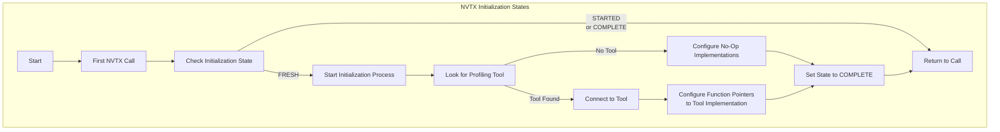
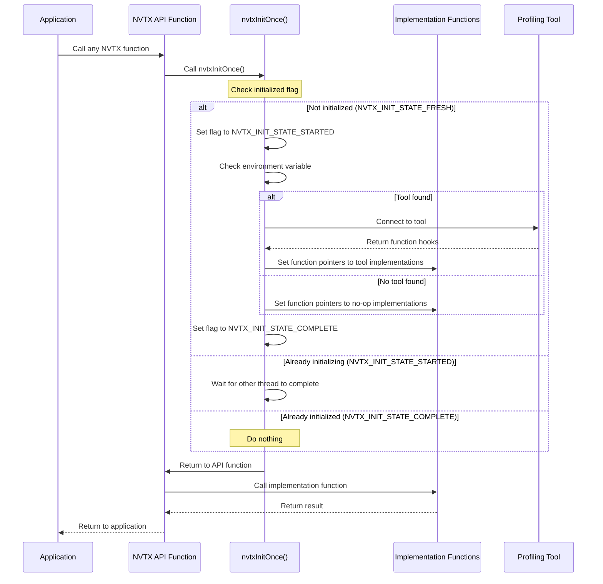
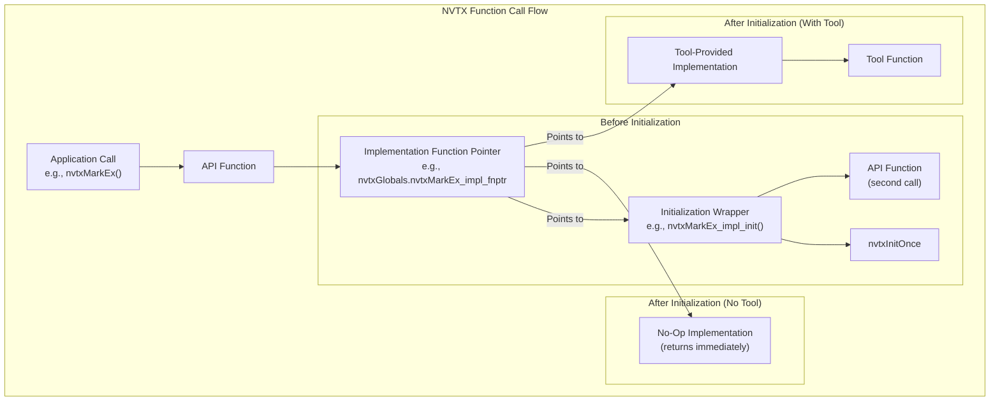
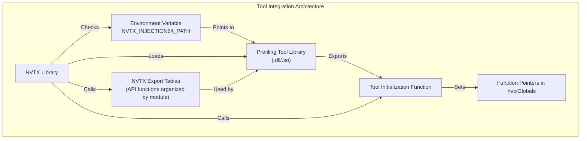

<!-- source: DeepWiki mcp.deepwiki.com · repo NVIDIA/NVTX · page 6.1 Initialization · fetched 2026-10-26 -->

# Initialization

<details>
<summary>Relevant source files</summary>

The following files were used as context for generating this wiki page:

- [.gitignore](.gitignore)
- [README.md](README.md)
- [c/include/nvtx3/nvtxDetail/nvtxImpl.h](c/include/nvtx3/nvtxDetail/nvtxImpl.h)
- [c/include/nvtx3/nvtxDetail/nvtxInitDecls.h](c/include/nvtx3/nvtxDetail/nvtxInitDecls.h)
- [c/include/nvtx3/nvtxDetail/nvtxInitDefs.h](c/include/nvtx3/nvtxDetail/nvtxInitDefs.h)
- [c/include/nvtx3/nvtxDetail/nvtxTypes.h](c/include/nvtx3/nvtxDetail/nvtxTypes.h)
- [docs/index.html](docs/index.html)
- [python/.flake8.cython](python/.flake8.cython)
- [tools/docs/generate-readme.py](tools/docs/generate-readme.py)
- [tools/docs/github-markdown-css/github-markdown.css](tools/docs/github-markdown-css/github-markdown.css)
- [tools/docs/github-markdown-css/license](tools/docs/github-markdown-css/license)

</details>


This page describes how NVTX library initializes itself, detects and connects with profiling tools. NVTX uses a lazy initialization mechanism that only activates when needed and automatically configures itself based on the presence of compatible profiling tools in the environment.

## Overview of NVTX Initialization

NVTX is designed to have minimal overhead when no profiling tool is present. To achieve this, NVTX initializes itself automatically on the first call to any NVTX function, checks for the presence of a profiling tool, and configures its behavior accordingly. This approach avoids unnecessary setup costs and ensures that applications run efficiently whether they're being profiled or not.



Sources: [c/include/nvtx3/nvtxDetail/nvtxImpl.h:58-60](), [README.md:395-401]()

## Initialization Process in Detail

The initialization process follows a specific sequence to ensure thread safety and consistency. NVTX manages its initialization state through a global variable and protects against concurrent initialization attempts.



Sources: [c/include/nvtx3/nvtxDetail/nvtxImpl.h:101-186](), [c/include/nvtx3/nvtxDetail/nvtxInitDefs.h:450-447]()

### State Management

NVTX maintains a global initialization state that can be in one of three states:

| State | Value | Description |
|-------|-------|-------------|
| NVTX_INIT_STATE_FRESH | 0 | Initial state, not yet initialized |
| NVTX_INIT_STATE_STARTED | 1 | Initialization in progress |
| NVTX_INIT_STATE_COMPLETE | 2 | Initialization complete |

The state transitions from FRESH to STARTED when initialization begins, and then to COMPLETE when initialization finishes. This helps prevent concurrent initialization attempts and ensures that initialization happens only once.

Sources: [c/include/nvtx3/nvtxDetail/nvtxImpl.h:58-60](), [c/include/nvtx3/nvtxDetail/nvtxImpl.h:101-103](), [c/include/nvtx3/nvtxDetail/nvtxImpl.h:188-190]()

## Function Redirection Mechanism

At the core of NVTX's initialization is a function redirection mechanism that allows NVTX to dynamically switch between different implementations of its functions.



Sources: [c/include/nvtx3/nvtxDetail/nvtxInitDefs.h:25-173](), [c/include/nvtx3/nvtxDetail/nvtxImpl.h:107-169]()

### Initial Function Setup

When NVTX is first loaded, all API functions are configured to call initialization wrappers. For example, `nvtxMarkEx()` initially calls `nvtxMarkEx_impl_init()`, which:

1. Calls `nvtxInitOnce()` to ensure initialization has happened
2. Calls the actual `nvtxMarkEx()` function again

This ensures that initialization happens automatically on the first call to any NVTX function.

Sources: [c/include/nvtx3/nvtxDetail/nvtxInitDefs.h:25-447](), [c/include/nvtx3/nvtxDetail/nvtxImpl.h:203-265]()

### No-Op Implementation

If no profiling tool is detected during initialization, NVTX sets all function pointers to NULL or minimal no-op implementations. This minimizes overhead when no tool is present.

Sources: [README.md:396-397](), [c/include/nvtx3/nvtxDetail/nvtxInitDefs.h:450-447]()

## Tool Detection and Integration

NVTX detects the presence of profiling tools and integrates with them using a standardized mechanism based on function tables and callbacks.



Sources: [c/include/nvtx3/nvtxDetail/nvtxTypes.h:134-308](), [c/include/nvtx3/nvtxDetail/nvtxImpl.h:180-186](), [c/include/nvtx3/nvtxDetail/nvtxImpl.h:370-415]()

### Export Tables

NVTX provides export tables that organize its API functions into logical modules, making it easier for tools to hook into specific functionality:

| Module | Description | Defined in |
|--------|-------------|------------|
| CORE | Basic functionality (markers, ranges, naming) | NVTX_CBID_CORE_* |
| CUDA | CUDA-specific resource naming | NVTX_CBID_CUDA_* |
| OPENCL | OpenCL-specific resource naming | NVTX_CBID_OPENCL_* |
| CUDART | CUDA Runtime API naming | NVTX_CBID_CUDART_* |
| CORE2 | Domain-based functionality | NVTX_CBID_CORE2_* |
| SYNC | Synchronization tracking | NVTX_CBID_SYNC_* |

These export tables are populated with function pointers that tools can retrieve and override.

Sources: [c/include/nvtx3/nvtxDetail/nvtxTypes.h:138-262](), [c/include/nvtx3/nvtxDetail/nvtxImpl.h:180-186](), [c/include/nvtx3/nvtxDetail/nvtxImpl.h:274-363]()

## Explicit Initialization

While NVTX automatically initializes on the first API call, it also provides a function for explicit initialization:

```c
void nvtxInitialize(const void* reserved);
```

This function allows applications to control when initialization happens, which can be useful in latency-sensitive scenarios. By calling this function during application startup, you can avoid potential delays during critical operations.

Sources: [README.md:398-401](), [c/include/nvtx3/nvtxDetail/nvtxInitDefs.h:170-173]()

## Performance Considerations

NVTX's initialization design considers performance in both profiled and non-profiled scenarios:

| Scenario | Behavior | Performance Impact |
|----------|----------|-------------------|
| No profiling tool | NVTX functions become no-ops | Minimal overhead (a few instructions) |
| With profiling tool | NVTX calls are forwarded to the tool | Depends on tool implementation |
| First NVTX call | Triggers initialization | May have noticeable latency, especially if loading a tool |

The first call to any NVTX function can incur significant overhead if a tool is present, as it needs to load and initialize the tool. In latency-sensitive applications, it's recommended to call `nvtxInitialize()` at a convenient time (e.g., during application startup) to avoid this overhead during critical operations.

Sources: [README.md:395-401]()

## Summary

NVTX initialization is designed to be automatic, efficient, and adaptable to the presence of profiling tools. The lazy initialization approach ensures that NVTX has minimal impact on application performance when no tool is present, while still providing the full power of its annotation capabilities when needed for profiling.

By using function pointer redirection and export tables, NVTX creates a flexible architecture that allows profiling tools to hook into its functionality without requiring changes to the application code. This design makes NVTX a powerful and efficient way to annotate code for profiling and performance analysis.

---

