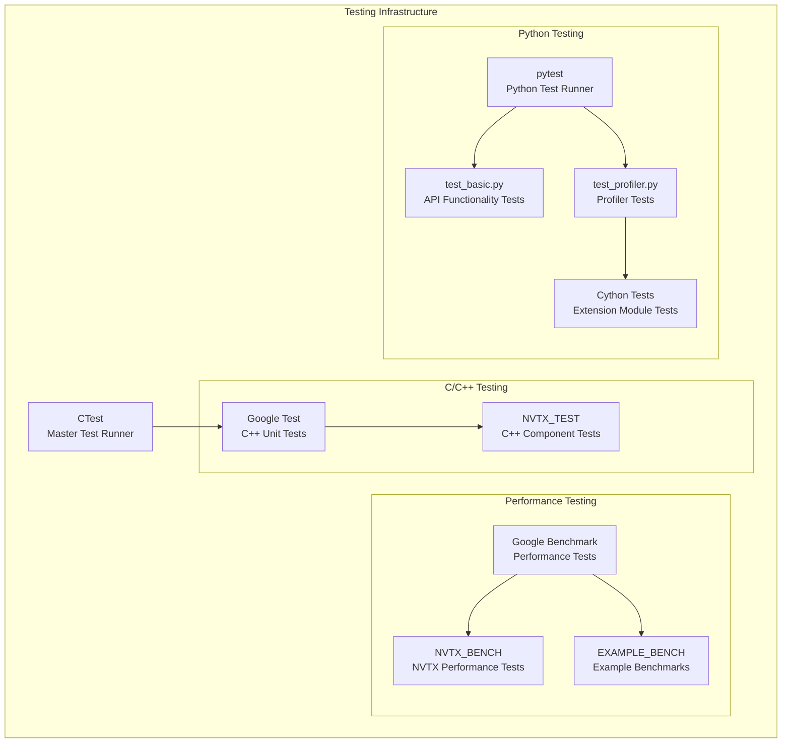
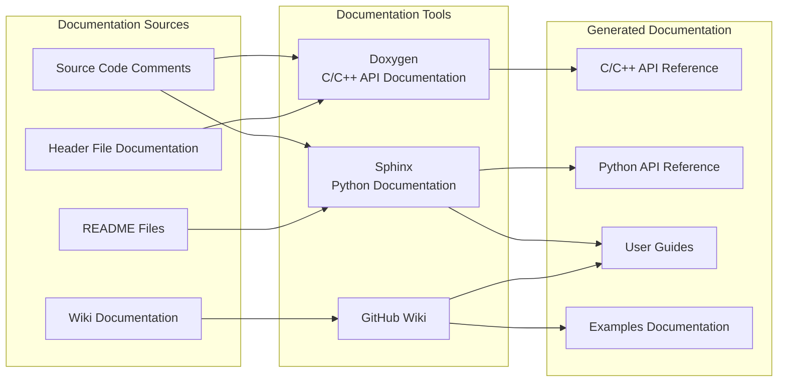
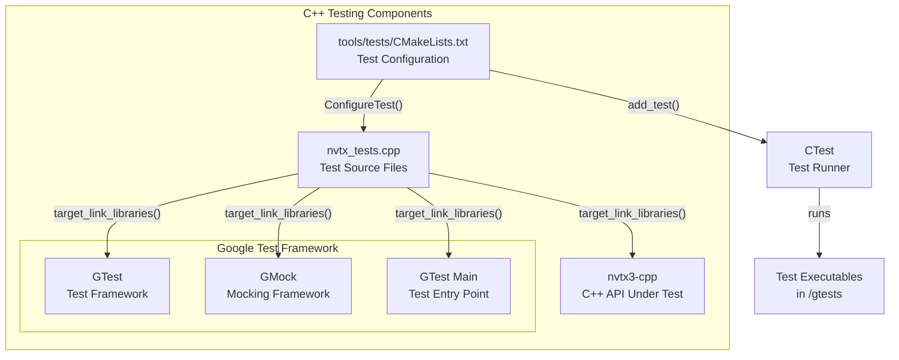
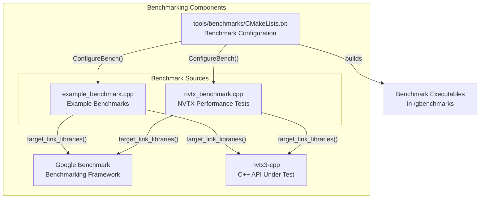
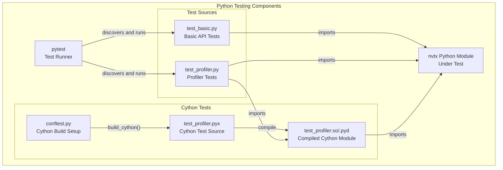

<!-- source: DeepWiki mcp.deepwiki.com · repo NVIDIA/NVTX · page 7 Documentation and Testing · fetched 2026-10-26 -->

# Documentation and Testing

<details>
<summary>Relevant source files</summary>

The following files were used as context for generating this wiki page:

- [python/tests/__init__.py](python/tests/__init__.py)
- [python/tests/conftest.py](python/tests/conftest.py)
- [python/tests/cython/test_profiler.pyx](python/tests/cython/test_profiler.pyx)
- [python/tests/test_basic.py](python/tests/test_basic.py)
- [python/tests/test_profiler.py](python/tests/test_profiler.py)
- [tools/CMakeLists.txt](tools/CMakeLists.txt)
- [tools/benchmarks/CMakeLists.txt](tools/benchmarks/CMakeLists.txt)
- [tools/tests/CMakeLists.txt](tools/tests/CMakeLists.txt)
- [tools/tests/nvtx_tests.cpp](tools/tests/nvtx_tests.cpp)

</details>


This page provides an overview of the documentation generation and testing infrastructure within the NVTX project. It covers how the project is documented and the testing frameworks used to ensure code quality across the C++, C, and Python components of NVTX.

For information about implementation details of NVTX itself, see [Implementation Details](#6).

## Testing Architecture Overview

The NVTX project employs a comprehensive testing infrastructure that spans multiple language interfaces and includes both unit tests and performance benchmarks.



Sources: [tools/tests/CMakeLists.txt:21-63](), [tools/benchmarks/CMakeLists.txt:21-69](), [python/tests/conftest.py:7-22]()

## Documentation Infrastructure

NVTX provides documentation through code comments, README files, and documentation generation tools. While specific documentation generation files weren't included in the provided source files, the project likely follows standard documentation practices for C++ and Python codebases.



## C++ Testing Framework

The C++ components of NVTX are tested using Google Test, a popular C++ testing framework. The test infrastructure is configured using CMake, which allows for easy integration with the build system.



Sources: [tools/tests/CMakeLists.txt:21-63](), [tools/tests/nvtx_tests.cpp:21-31]()

### Test Configuration

The C++ tests are configured in the `tools/tests/CMakeLists.txt` file, which:

1. Includes the CTest module for test integration
2. Adds Google Test using CPM (CMake Package Manager)
3. Defines a `ConfigureTest` function to standardize test configuration
4. Creates test targets that link against NVTX and Google Test

The CMake configuration leverages the `ConfigureTest` function, which:
- Creates an executable from the test source files
- Links it with Google Test and NVTX
- Sets output directory to `/gtests`
- Registers the test with CTest

Sources: [tools/tests/CMakeLists.txt:36-44]()

## Performance Benchmarking

NVTX includes a benchmarking infrastructure using Google Benchmark to measure the performance of various components.



Sources: [tools/benchmarks/CMakeLists.txt:21-69]()

### Benchmark Configuration

The benchmarking infrastructure is configured in `tools/benchmarks/CMakeLists.txt`, which:

1. Adds Google Benchmark using CPM
2. Defines a `ConfigureBench` function for standardized benchmark setup
3. Creates benchmark targets for example and NVTX benchmarks

The `ConfigureBench` function:
- Creates an executable from benchmark source files
- Links it with Google Benchmark and NVTX
- Sets output directory to `/gbenchmarks`

Sources: [tools/benchmarks/CMakeLists.txt:43-50]()

## Python Testing Framework

The Python components of NVTX are tested using pytest, a powerful Python testing framework. The tests cover various aspects of the Python API, including basic functionality, the profiler, and Cython extensions.



Sources: [python/tests/conftest.py:7-22](), [python/tests/test_basic.py:19-323](), [python/tests/test_profiler.py:1-5](), [python/tests/cython/test_profiler.pyx:19-51]()

### Python Test Structure

The Python tests are organized as follows:

1. `test_basic.py`: Contains parameterized pytest tests that verify the basic functionality of the NVTX Python API, including:
   - Annotations (context managers and decorators)
   - Domain handling
   - Categories
   - Range tracking (start/end and push/pop)
   - Markers
   - Payload support

2. `test_profiler.py`: Tests the profiler functionality by importing and running a Cython test

3. Cython tests:
   - `test_profiler.pyx`: Tests the Cython-specific aspects of the profiler
   - Compiled using the setup in `conftest.py`

Sources: [python/tests/test_basic.py:19-323](), [python/tests/test_profiler.py:1-5](), [python/tests/cython/test_profiler.pyx:19-51]()

### Cython Test Setup

The Cython tests are compiled during pytest configuration using the following process:

1. `conftest.py` defines a `build_cython()` function that:
   - Locates the Cython source files
   - Sets up include paths to NVTX C headers
   - Compiles Cython files using `cythonize`

2. The `pytest_configure` hook runs `build_cython()` before tests are executed

This approach ensures that Cython tests are always up-to-date with the latest source code.

Sources: [python/tests/conftest.py:7-22]()

## Test Coverage

The current testing infrastructure covers various aspects of NVTX functionality:

| Component | Test Type | Test Coverage |
|-----------|-----------|---------------|
| C++ API | Unit Tests | Core API functionality |
| C++ API | Benchmarks | Performance characteristics |
| Python API | Unit Tests | Core API functionality, annotations, domains, ranges |
| Python API | Cython Tests | Profiler functionality |

## Running Tests

### Running C++ Tests

To run the C++ tests:

1. Configure the project with CMake:
   ```
   mkdir build && cd build
   cmake ..
   ```

2. Build and run the tests:
   ```
   make
   ctest
   ```

Alternatively, you can run the test executables directly from the `build/gtests` directory.

### Running Benchmarks

To run the benchmarks:

1. Configure the project with CMake as above
2. Build and run the benchmarks:
   ```
   make
   ./gbenchmarks/NVTX_BENCH
   ./gbenchmarks/EXAMPLE_BENCH
   ```

### Running Python Tests

To run the Python tests:

1. Install the required development dependencies:
   ```
   pip install pytest cython
   ```

2. Run the tests from the repository root:
   ```
   pytest -xvs python/tests
   ```

## Writing Tests

### Writing C++ Tests

New C++ tests should be added to existing test files or created as new files in the `tools/tests` directory. Tests should:

1. Include the Google Test header: `#include <gtest/gtest.h>`
2. Include the NVTX header: `#include <nvtx3/nvtx3.hpp>`
3. Define test fixtures as needed
4. Implement tests using the `TEST_F` or `TEST` macros

Example:
```cpp
#include <gtest/gtest.h>
#include <nvtx3/nvtx3.hpp>

struct NVTX_TestFixture : public ::testing::Test {
    // Setup and teardown as needed
};

TEST_F(NVTX_TestFixture, TestName) {
    // Test implementation
    EXPECT_TRUE(/* condition */);
}
```

### Writing Python Tests

New Python tests should be added to `python/tests` directory, following these guidelines:

1. Use pytest fixtures and parameterization for comprehensive testing
2. For each new feature, add parameterized tests that verify functionality with various inputs
3. For Cython functionality, add tests to the `cython` subdirectory

Example:
```python
import pytest
import nvtx

@pytest.mark.parametrize(
    "message", [None, "test_message"]
)
@pytest.mark.parametrize(
    "color", [None, "red", "blue"]
)
def test_nvtx_feature(message, color):
    # Test implementation
    assert True  # Replace with actual assertion
```

Sources: [python/tests/test_basic.py:26-62]()

---

