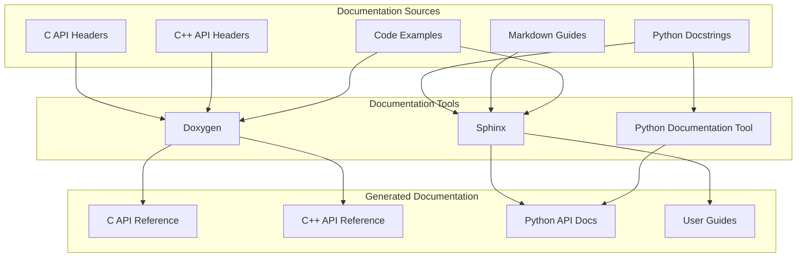
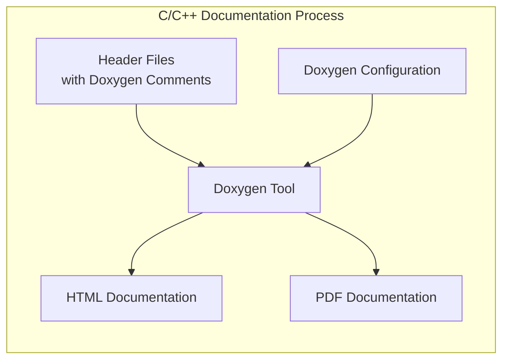
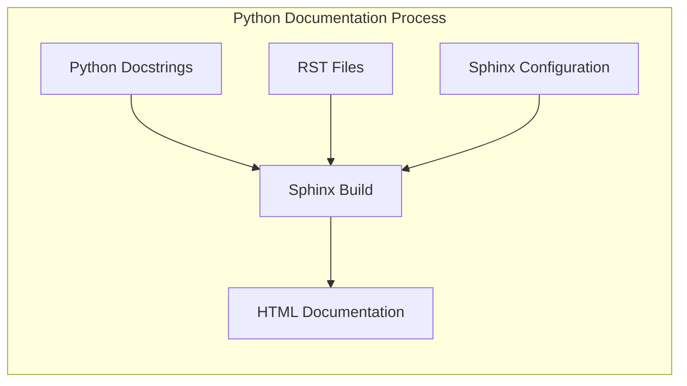
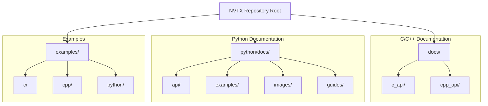
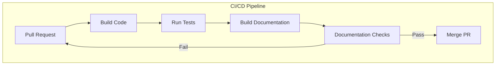

<!-- source: DeepWiki mcp.deepwiki.com · repo NVIDIA/NVTX · page 7.1 Documentation Generation · fetched 2026-10-26 -->

# Documentation Generation

<details>
<summary>Relevant source files</summary>

The following files were used as context for generating this wiki page:

- [python/docs/images/timeline_auto.png](python/docs/images/timeline_auto.png)
- [python/docs/images/timeline_lib.png](python/docs/images/timeline_lib.png)

</details>


This page explains how to generate documentation for the NVTX (NVIDIA Tools Extension) library. It covers the documentation tools and processes used across the different API components of NVTX. For information about testing infrastructure, see [Testing](#7.2).

## Overview

NVTX documentation spans multiple languages and components, including the C API, C++ API, and Python bindings. The documentation generation system is designed to produce comprehensive API references, examples, and integration guides that help developers effectively use NVTX for profiling and performance analysis.

The documentation generation workflow integrates with the build systems to ensure documentation stays in sync with the codebase.



## Documentation Tools

NVTX uses different documentation tools depending on the API language:

| API Component | Documentation Tool | Input Format | Output Format |
|---------------|-------------------|--------------|---------------|
| C API | Doxygen | Header comments | HTML, PDF |
| C++ API | Doxygen | Header comments | HTML, PDF |
| Python API | Sphinx | Docstrings, RST | HTML |

### C/C++ Documentation with Doxygen

The C and C++ APIs are documented using Doxygen, which processes specially formatted comments in header files to generate API reference documentation.



### Python Documentation with Sphinx

The Python API documentation uses Sphinx, which processes Python docstrings and reStructuredText (RST) files to generate comprehensive documentation. The documentation includes API references, examples, and user guides.



Sources: python/docs/images/timeline_lib.png

## Documentation Directory Structure

The NVTX documentation is organized into several directories depending on the API component:



The Python documentation directory structure includes:
- `api/`: API reference documentation
- `examples/`: Example code and explanations
- `images/`: Diagrams and screenshots used in documentation
- `guides/`: User guides for different use cases

Sources: python/docs/images/timeline_lib.png

## Generating Documentation

### Building C/C++ Documentation

To build the C and C++ API documentation, you'll use CMake targets that invoke Doxygen with the appropriate configuration:

1. Configure the project with CMake
2. Build the documentation target

```bash
cmake -B build -S .
cmake --build build --target docs
```

The generated documentation will typically be placed in the `build/docs/` directory.

### Building Python Documentation

To build the Python API documentation:

1. Navigate to the Python documentation directory
2. Run the Sphinx build command

```bash
cd python/docs
python -m sphinx -b html . _build/html
```

Alternatively, you can use the provided setuptools command:

```bash
python setup.py build_sphinx
```

The generated documentation will be placed in the `python/docs/_build/html/` directory.

## Documentation Best Practices

When contributing to NVTX documentation, follow these best practices:

1. **Document API Functions**: Every public API function should have comprehensive documentation that includes:
   - Function purpose
   - Parameter descriptions
   - Return value description
   - Usage examples
   - Thread safety information

2. **Use Consistent Style**: Follow the established documentation style for each language:
   - Use Doxygen-specific tags for C/C++ (`@param`, `@return`, etc.)
   - Use Google-style docstrings for Python

3. **Include Examples**: Provide concrete usage examples for non-obvious functions.

4. **Keep Documentation Updated**: Update documentation when changing API behavior.

5. **Cross-reference Related Functions**: Link to related functions and concepts.

## Custom Documentation Elements

### Timeline Visualization

The NVTX documentation includes timeline visualizations to help users understand how NVTX markers and ranges appear in profiling tools:


These timeline visualizations help users understand the relationship between their NVTX annotations and what they'll see in NVIDIA's profiling tools like Nsight Systems.

### Adding Custom Documentation Elements

To add custom images like timeline visualizations to the documentation:

1. Place image files in the appropriate directory:
   - For Python documentation: `python/docs/images/`
   - For C/C++ documentation: `docs/images/`

2. Reference the images in your documentation using relative paths:
   - In Sphinx (RST): `.. image:: images/timeline_lib.png`
   - In Markdown: ``

Sources: python/docs/images/timeline_lib.png

## Integration with CI/CD

Documentation building is integrated with the CI/CD pipeline to ensure documentation stays current with code changes. Documentation is automatically built and checked during pull requests to catch documentation issues early.



## Viewing Documentation

After building the documentation, you can view it:

1. **C/C++ Documentation**: Open `build/docs/html/index.html` in a web browser
2. **Python Documentation**: Open `python/docs/_build/html/index.html` in a web browser

For convenience, you can use Python's built-in HTTP server to view the documentation:

```bash
# For C/C++ documentation
cd build/docs/html
python -m http.server

# For Python documentation
cd python/docs/_build/html
python -m http.server
```

Then open your web browser and navigate to `http://localhost:8000`.

## Troubleshooting

If you encounter issues with documentation generation:

1. **Missing Dependencies**: Ensure all required tools are installed:
   - Doxygen for C/C++ documentation
   - Sphinx and required extensions for Python documentation

2. **Build Errors**: Check that all documentation comments use the correct syntax

3. **Broken Links**: Verify that all references and links point to valid targets

4. **Image Issues**: Ensure image paths are correct and images are in the expected formats (PNG, JPG)

---

