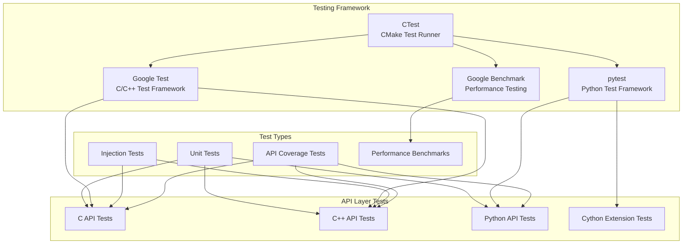
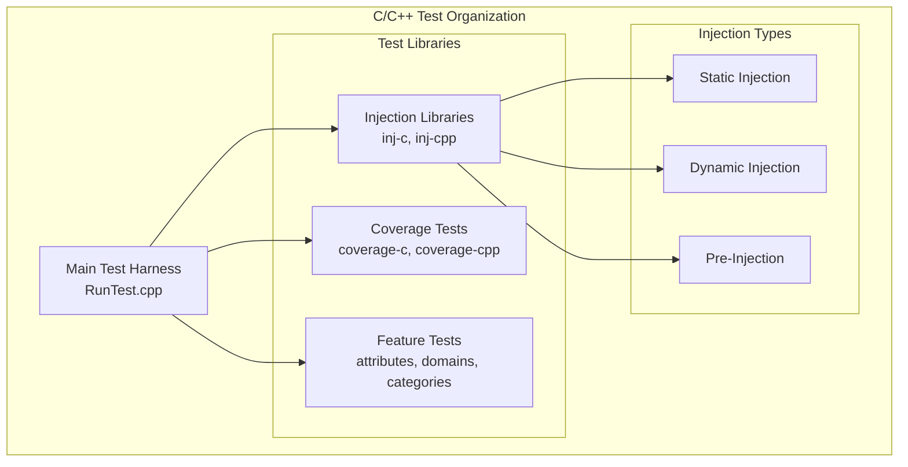
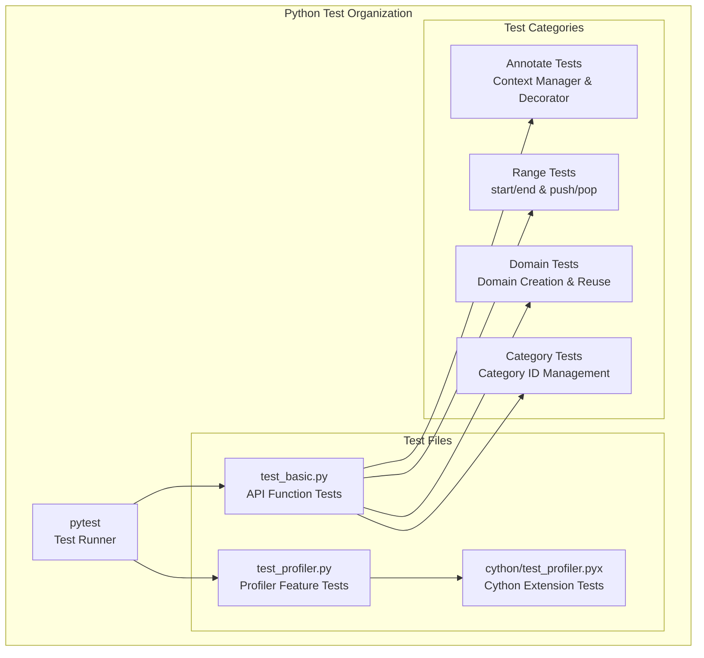
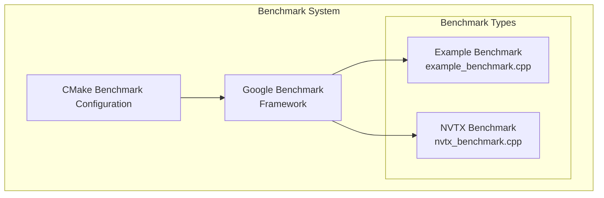

<!-- source: DeepWiki mcp.deepwiki.com · repo NVIDIA/NVTX · page 7.2 Testing · fetched 2026-10-26 -->

# Testing

<details>
<summary>Relevant source files</summary>

The following files were used as context for generating this wiki page:

- [python/tests/__init__.py](python/tests/__init__.py)
- [python/tests/conftest.py](python/tests/conftest.py)
- [python/tests/cython/test_profiler.pyx](python/tests/cython/test_profiler.pyx)
- [python/tests/test_basic.py](python/tests/test_basic.py)
- [python/tests/test_profiler.py](python/tests/test_profiler.py)
- [tests/CMakeLists.txt](tests/CMakeLists.txt)
- [tools/CMakeLists.txt](tools/CMakeLists.txt)
- [tools/benchmarks/CMakeLists.txt](tools/benchmarks/CMakeLists.txt)
- [tools/tests/CMakeLists.txt](tools/tests/CMakeLists.txt)
- [tools/tests/nvtx_tests.cpp](tools/tests/nvtx_tests.cpp)

</details>


## Purpose and Scope

This document describes the testing infrastructure used in the NVTX repository. It covers the testing frameworks and methodologies employed across the codebase, including:

- C/C++ unit testing with Google Test
- Python unit testing with pytest
- Custom test injection mechanisms
- Performance benchmarking

The focus is on how the test suites are structured, built, and executed to ensure the reliability and functionality of NVTX across all supported languages and platforms.

## Testing Architecture Overview

The NVTX project implements a multi-faceted testing approach that aligns with its multi-language API design. Tests are organized by language API and extend across all core features of the library.



Sources: [tools/tests/CMakeLists.txt:21-44](), [tools/CMakeLists.txt:30-39](), [python/tests/conftest.py:1-22]()

## C/C++ Testing

The C/C++ components of NVTX are tested using Google Test, a widely-used C++ testing framework. Tests are organized by feature areas and integrated through CMake.

### Test Structure Organization



Sources: [tests/CMakeLists.txt:103-362](), [tools/tests/nvtx_tests.cpp:21-31]()

### Injection Testing

NVTX employs a custom injection testing mechanism to verify the behavior of the library when different injection methods are used. This is critical for verifying the library's behavior when profiling tools intercept NVTX calls.

The injection testing framework supports:

1. **Static Injection**: Testing with statically linked injection libraries
2. **Dynamic Injection**: Testing with dynamically loaded injection libraries
3. **Pre-Injection**: Testing with environment-based preloading of injection libraries

These approaches validate NVTX's design principle of minimal overhead when no profiling tool is active, and proper forwarding of calls when a tool is present.

Sources: [tests/CMakeLists.txt:113-137](), [tests/CMakeLists.txt:335-362]()

### Running C/C++ Tests

The C/C++ tests are configured to run through CTest, CMake's testing driver. Tests are registered with descriptive names that indicate the component being tested and the injection method used.

```bash
# Build and run all tests
cmake -B build -S .
cmake --build build
cd build && ctest
```

To run specific test categories:

```bash
# Run only injection tests
ctest -R "with PrintInjection"

# Run only Python tests
ctest -R "python"
```

Sources: [tests/CMakeLists.txt:273-334]()

## Python Testing

The Python components of NVTX are tested using pytest, a mature and powerful Python testing framework.

### Test Structure and Organization

Python tests are organized into three main categories:

1. **Basic API tests**: Test the core functionality of the Python API
2. **Cython Extension tests**: Test the Cython extensions that interface with the C API
3. **Profiler tests**: Specifically test the profiling capabilities



Sources: [python/tests/test_basic.py:19-324](), [python/tests/test_profiler.py:1-6](), [python/tests/cython/test_profiler.pyx:19-51]()

### Python Test Features

The Python tests use pytest's parameterization feature extensively to test API functions with various combinations of inputs. This ensures comprehensive coverage across different parameter values.

For example, the `test_annotate_context_manager` function tests the `nvtx.annotate` context manager with different combinations of:
- Message strings (None, "", "x", "abc", "abc def")
- Colors (None, "red", "green", "blue")
- Domains (None, "", "x", "abc", "abc def")
- Payloads (None, 1, 1.0)

This approach ensures thorough testing of all API combinations without code duplication.

Sources: [python/tests/test_basic.py:26-65]()

### Cython Testing Integration

A unique aspect of NVTX testing is the integration of Cython tests, which verify the proper functioning of the C/Python bridge. The pytest configuration includes automatic compilation of Cython test modules during test setup.

This integration is handled by `conftest.py`, which configures pytest to:
1. Detect Cython test files
2. Compile them using the Cython compiler
3. Make them available to the test runner

Sources: [python/tests/conftest.py:1-22](), [python/tests/test_profiler.py:1-6]()

## Performance Benchmarking

NVTX includes performance benchmarks to measure the overhead of NVTX instrumentation, which is critical for a profiling library designed to have minimal impact on application performance.

### Benchmark Architecture



Sources: [tools/benchmarks/CMakeLists.txt:21-72]()

### Benchmark Functionality

The benchmarks are designed to measure:

1. The overhead of NVTX API calls when no profiling tool is attached
2. Performance characteristics of different NVTX features
3. Comparison between different API approaches (C vs C++ vs Python)

This information is valuable for users who need to understand the performance implications of instrumenting their code with NVTX.

| Benchmark Type | Purpose | Measurement |
|----------------|---------|-------------|
| NVTX mark | Measure overhead of marker events | Execution time |
| NVTX range | Measure overhead of range events | Execution time |
| Domain creation | Measure overhead of domain creation | Execution time |
| String registration | Measure overhead of string registration | Execution time |

Sources: [tools/benchmarks/CMakeLists.txt:58-72]()

## Testing Coverage

The test suite aims to provide comprehensive coverage of all NVTX features across different language bindings. The following table summarizes the coverage areas:

| Feature | C API Tests | C++ API Tests | Python API Tests |
|---------|------------|---------------|------------------|
| Markers | ✓ | ✓ | ✓ |
| Ranges (push/pop) | ✓ | ✓ | ✓ |
| Ranges (start/end) | ✓ | ✓ | ✓ |
| Domains | ✓ | ✓ | ✓ |
| Categories | ✓ | ✓ | ✓ |
| Resource Naming | ✓ | ✓ | ✓ |
| Registered Strings | ✓ | ✓ | ✓ |
| Attributes | ✓ | ✓ | ✓ |
| Initialization | ✓ | ✓ | - |
| Injection Mechanisms | ✓ | ✓ | - |

Sources: [python/tests/test_basic.py:19-324](), [tests/CMakeLists.txt:273-334]()

## Running Tests

### Running All Tests

The entire test suite can be run using CMake's test driver:

```bash
# Configure and build
cmake -B build -S .
cmake --build build

# Run all tests
cd build
ctest
```

### Running Python Tests

Python tests can be run directly using pytest:

```bash
cd python
pytest tests/
```

### Running Benchmarks

Benchmarks are built as part of the standard build process and can be executed directly:

```bash
cd build/gbenchmarks
./NVTX_BENCH
```

Sources: [tools/CMakeLists.txt:30-39](), [tools/benchmarks/CMakeLists.txt:43-50]()