# Page: Overview

# Overview

<details>
<summary>Relevant source files</summary>

The following files were used as context for generating this wiki page:

- [.gitignore](.gitignore)
- [README.md](README.md)
- [c/include/nvtx3/nvToolsExt.h](c/include/nvtx3/nvToolsExt.h)
- [c/include/nvtx3/nvToolsExtCuda.h](c/include/nvtx3/nvToolsExtCuda.h)
- [c/include/nvtx3/nvToolsExtCudaRt.h](c/include/nvtx3/nvToolsExtCudaRt.h)
- [c/include/nvtx3/nvToolsExtOpenCL.h](c/include/nvtx3/nvToolsExtOpenCL.h)
- [c/include/nvtx3/nvtxDetail/nvtxInit.h](c/include/nvtx3/nvtxDetail/nvtxInit.h)
- [c/include/nvtx3/nvtxDetail/nvtxLinkOnce.h](c/include/nvtx3/nvtxDetail/nvtxLinkOnce.h)
- [docs/index.html](docs/index.html)
- [python/.flake8.cython](python/.flake8.cython)
- [tools/docs/generate-readme.py](tools/docs/generate-readme.py)
- [tools/docs/github-markdown-css/github-markdown.css](tools/docs/github-markdown-css/github-markdown.css)
- [tools/docs/github-markdown-css/license](tools/docs/github-markdown-css/license)

</details>


NVTX (NVIDIA Tools Extension Library) is a cross-platform API for annotating source code with contextual information for developer tools. It allows developers to mark specific points or ranges in their code, name resources, and organize annotations, which are then visualized and analyzed by NVIDIA profiling tools. By default, NVTX adds minimal overhead when no tool is attached, making it suitable for use in production code.

## Architecture

NVTX follows a layered architecture with the C API forming the foundation, while C++ and Python wrappers provide more idiomatic interfaces for those languages.

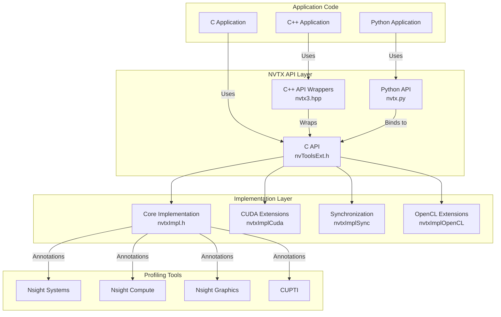

Sources: [c/include/nvtx3/nvToolsExt.h:21-162](), [c/include/nvtx3/nvtxDetail/nvtxInit.h:415-454](), [README.md:1-24]()

## Key Concepts

NVTX provides several key mechanisms for annotating code:

### Markers and Ranges

NVTX supports two primary annotation types:

- **Markers**: Instantaneous events at specific points in execution
- **Ranges**: Time spans between two points in execution

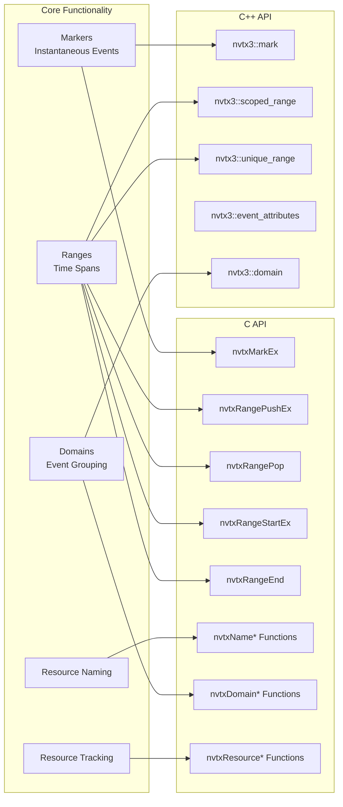

Sources: [c/include/nvtx3/nvToolsExt.h:672-897](), [README.md:51-62]()

| Annotation Type | Description | C API | C++ API |
|-----------------|-------------|-------|---------|
| Markers | Instantaneous events | `nvtxMarkA/W()`, `nvtxMarkEx()` | `nvtx3::mark()` |
| Thread Ranges | Stack-based nested ranges | `nvtxRangePushA/W()`, `nvtxRangePop()` | `nvtx3::scoped_range` |
| Process Ranges | Independent ranges | `nvtxRangeStartA/W()`, `nvtxRangeEnd()` | `nvtx3::unique_range` |

### Resource Naming and Tracking

NVTX allows associating user-provided names with resources like threads, CUDA streams, and OpenCL objects:

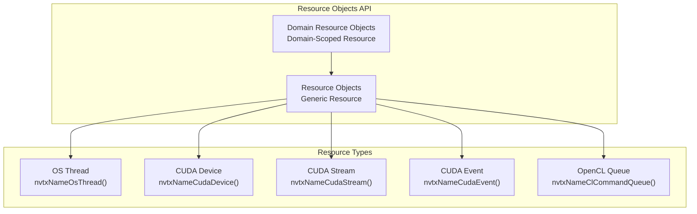

Sources: [c/include/nvtx3/nvToolsExtCuda.h:64-126](), [c/include/nvtx3/nvToolsExtCudaRt.h:64-104](), [c/include/nvtx3/nvToolsExtOpenCL.h:64-170](), [README.md:64-67]()

### Domains and Categories

Domains provide namespacing for annotations to prevent conflicts between libraries, while categories allow logical grouping:

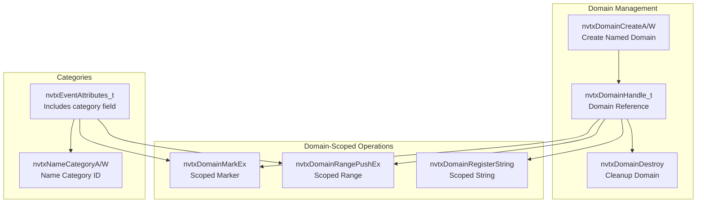

Sources: [c/include/nvtx3/nvToolsExt.h:94-120](), [README.md:427-434]()

## API Layers

### C API

The core C API is defined in `nvToolsExt.h` and provides the foundation for all NVTX functionality:

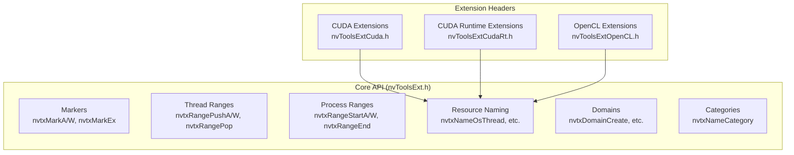

Sources: [c/include/nvtx3/nvToolsExt.h:672-897](), [c/include/nvtx3/nvToolsExtCuda.h:64-126](), [c/include/nvtx3/nvToolsExtCudaRt.h:64-104](), [c/include/nvtx3/nvToolsExtOpenCL.h:64-170]()

### C++ API

The C++ API provides idiomatic C++ wrappers around the C API with RAII-based classes:

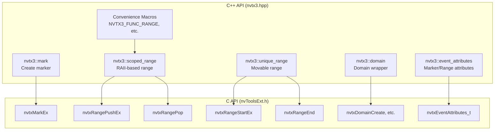

Sources: [README.md:88-96]()

### Python API

The Python API provides Pythonic interfaces with decorators and context managers:

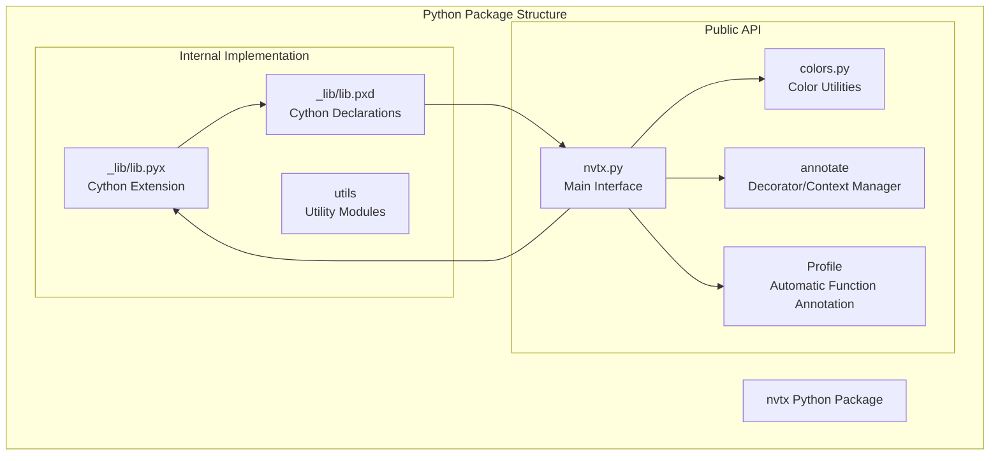

Sources: [README.md:258-262]()

## Initialization and Tool Integration

NVTX uses a lazy initialization model that looks for profiling tools only on first use:

```mermaid
sequenceDiagram
    participant App as Application
    participant NVTX as NVTX Library
    participant Init as nvtxInitOnce
    participant Tool as Profiling Tool
    
    App->>NVTX: First call to any NVTX function
    NVTX->>Init: Check if initialized
    
    Note over Init: Initialization process
    Init->>Init: Look for profiling tool
    
    alt Tool found
        Init->>Tool: Connect to tool
        Tool-->>Init: Set up function hooks
        Init->>NVTX: Configure with tool's implementation
    else No tool found
        Init->>NVTX: Configure with no-op implementations
    end
    
    NVTX->>App: Return from function call
    
    Note over App,NVTX: Subsequent calls
    App->>NVTX: Later NVTX function call
    
    alt Tool connected
        NVTX->>Tool: Forward call to tool
        Tool-->>NVTX: Process annotation
    else No tool
        NVTX->>NVTX: Execute no-op (minimal overhead)
    end
    
    NVTX->>App: Return from function call
```

The initialization process:
1. First NVTX call triggers `nvtxInitOnce()`
2. `nvtxInitializeInjectionLibrary()` searches for a profiling tool
   - Checks environment variables (NVTX_INJECTION64_PATH/NVTX_INJECTION32_PATH)
   - Looks for platform-specific injection methods
3. If a tool is found, NVTX configures function pointers to call into the tool
4. If no tool is found, NVTX sets all functions to no-ops

Sources: [c/include/nvtx3/nvtxDetail/nvtxInit.h:215-454](), [README.md:393-401]()

## Integration Options

### C/C++ Integration

NVTX for C/C++ is a header-only library with no dependencies except for `-ldl` on POSIX platforms:

```cpp
// C API
#include <nvtx3/nvToolsExt.h>

void example() {
    nvtxMarkA("Hello world!");
}

// C++ API
#include <nvtx3/nvtx3.hpp>

void example() {
    nvtx3::mark("Hello world!");
}
```

CMake targets are provided for easy integration:

```cmake
# C program
add_executable(my_c_program main.c)
target_link_libraries(my_c_program PRIVATE nvtx3-c)

# C++ program
add_executable(my_cpp_program main.cpp)
target_link_libraries(my_cpp_program PRIVATE nvtx3-cpp)
```

Sources: [README.md:72-101](), [README.md:106-120]()

### Python Integration

Install NVTX for Python using pip or conda:

```python
import nvtx

# Create a marker
nvtx.mark(message="Hello world!")

# Annotate a function
@nvtx.annotate("Function Range")
def my_function():
    # Function body
    pass

# Annotate a code block
with nvtx.annotate("Block Range"):
    # Code block
    pass
```

Installation methods:
- `pip install nvtx`
- `conda install -c conda-forge nvtx`

Sources: [README.md:258-262](), [README.md:312-315]()

## Supported Tools

NVTX annotations are recognized by several NVIDIA developer tools:

| Tool | NVTX Usage |
|------|------------|
| Nsight Systems | Shows NVTX markers and ranges on timeline |
| Nsight Compute | Uses NVTX ranges to focus kernel analysis |
| Nsight Graphics | Uses NVTX ranges to set bounds for profiling |
| CUPTI | Records NVTX calls in profiling API |

Sources: [README.md:323-331]()

## Platform Support

NVTX works on:
- Windows
- Linux and other POSIX-like platforms (including Cygwin)
- Android

Both 64-bit and 32-bit processes are supported without CPU architecture restrictions.

Sources: [README.md:334-341]()

---

# Page: Architecture

# Architecture

<details>
<summary>Relevant source files</summary>

The following files were used as context for generating this wiki page:

- [.gitignore](.gitignore)
- [README.md](README.md)
- [c/include/nvtx3/nvToolsExt.h](c/include/nvtx3/nvToolsExt.h)
- [c/include/nvtx3/nvToolsExtCuda.h](c/include/nvtx3/nvToolsExtCuda.h)
- [c/include/nvtx3/nvToolsExtCudaRt.h](c/include/nvtx3/nvToolsExtCudaRt.h)
- [c/include/nvtx3/nvToolsExtOpenCL.h](c/include/nvtx3/nvToolsExtOpenCL.h)
- [c/include/nvtx3/nvToolsExtSync.h](c/include/nvtx3/nvToolsExtSync.h)
- [c/include/nvtx3/nvtx3.hpp](c/include/nvtx3/nvtx3.hpp)
- [c/include/nvtx3/nvtxDetail/nvtxInit.h](c/include/nvtx3/nvtxDetail/nvtxInit.h)
- [c/include/nvtx3/nvtxDetail/nvtxLinkOnce.h](c/include/nvtx3/nvtxDetail/nvtxLinkOnce.h)
- [docs/index.html](docs/index.html)
- [python/.flake8.cython](python/.flake8.cython)
- [python/src/nvtx/__init__.py](python/src/nvtx/__init__.py)
- [python/src/nvtx/_lib/lib.pyx](python/src/nvtx/_lib/lib.pyx)
- [python/src/nvtx/nvtx.py](python/src/nvtx/nvtx.py)
- [tools/docs/generate-readme.py](tools/docs/generate-readme.py)
- [tools/docs/github-markdown-css/github-markdown.css](tools/docs/github-markdown-css/github-markdown.css)
- [tools/docs/github-markdown-css/license](tools/docs/github-markdown-css/license)

</details>


This document provides a comprehensive overview of the NVTX (NVIDIA Tools Extension) library architecture. It describes the core components, layers, and interactions that make up the NVTX system. For specific details about key concepts such as markers, ranges, and domains, see [Key Concepts](#1.2).

## Layered Architecture

NVTX is designed as a layered architecture that allows multiple language bindings to share a common implementation while providing language-specific interfaces.

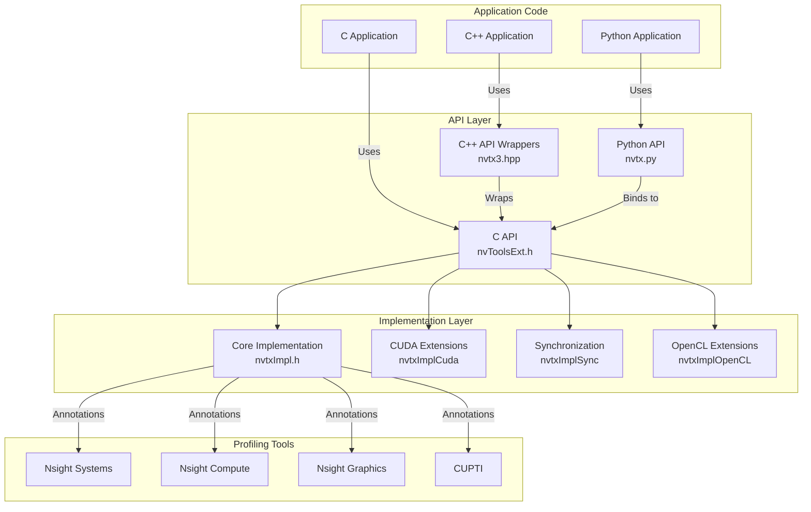

The architecture consists of four main layers:

1. **Application Code**: User applications written in C, C++, or Python that use NVTX for code annotation.
2. **API Layer**: Language-specific interfaces that provide a convenient way to use NVTX.
3. **Implementation Layer**: Core functionality and extensions for specific technologies.
4. **Profiling Tools**: NVIDIA's developer tools that consume NVTX annotations.

Sources: `c/include/nvtx3/nvtx3.hpp`, `c/include/nvtx3/nvToolsExt.h`, `python/src/nvtx/nvtx.py`

## Core Design Philosophy

NVTX is designed with several key principles in mind:

1. **Low Overhead**: When no profiling tool is attached, NVTX has near-zero runtime overhead.
2. **Header-Only**: C and C++ implementations are header-only with no dependencies, making them easy to integrate.
3. **Cross-Platform**: Works across Windows, Linux, and other POSIX-like platforms.
4. **Language Agnostic**: Core functionality available in C with idiomatic wrappers for C++ and Python.

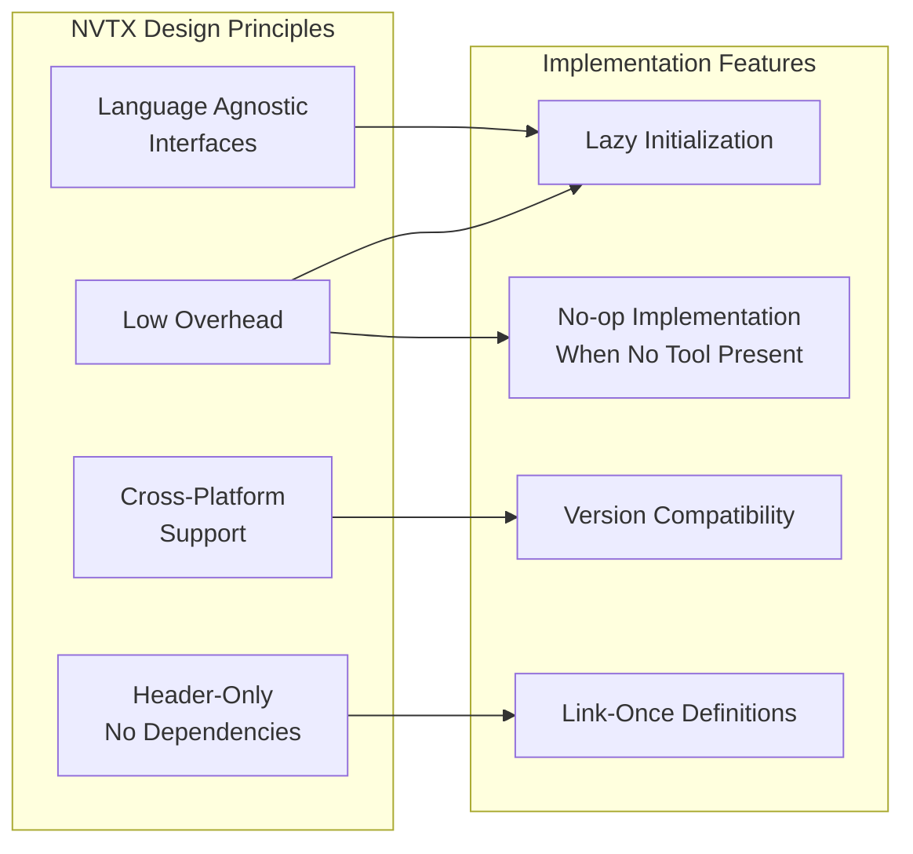

Sources: `README.md`, `c/include/nvtx3/nvToolsExt.h`

## Core Components

### Initialization System

NVTX uses lazy initialization, meaning it only initializes when the first NVTX API function is called. This approach minimizes startup overhead.

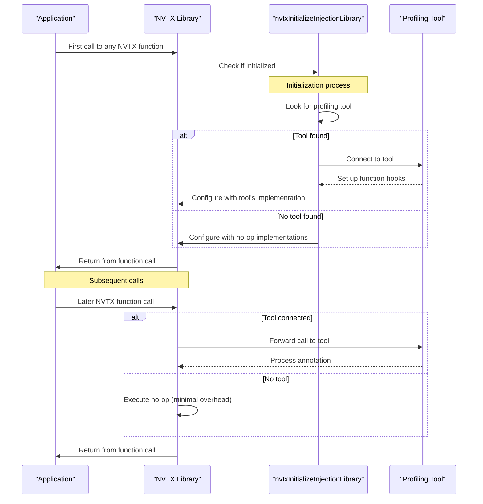

The initialization process is handled by `nvtxInitializeInjectionLibrary()` function which:

1. Looks for a profiling tool to connect with
2. If a tool is found, configures NVTX to forward calls to the tool
3. If no tool is found, configures NVTX to use no-op implementations for minimal overhead

Sources: `c/include/nvtx3/nvtxDetail/nvtxInit.h`, `c/include/nvtx3/nvToolsExt.h:442-466`

### Domain Management

Domains provide a way to scope annotations, allowing libraries and applications to avoid conflicts. The `domain` class manages NVTX domains:

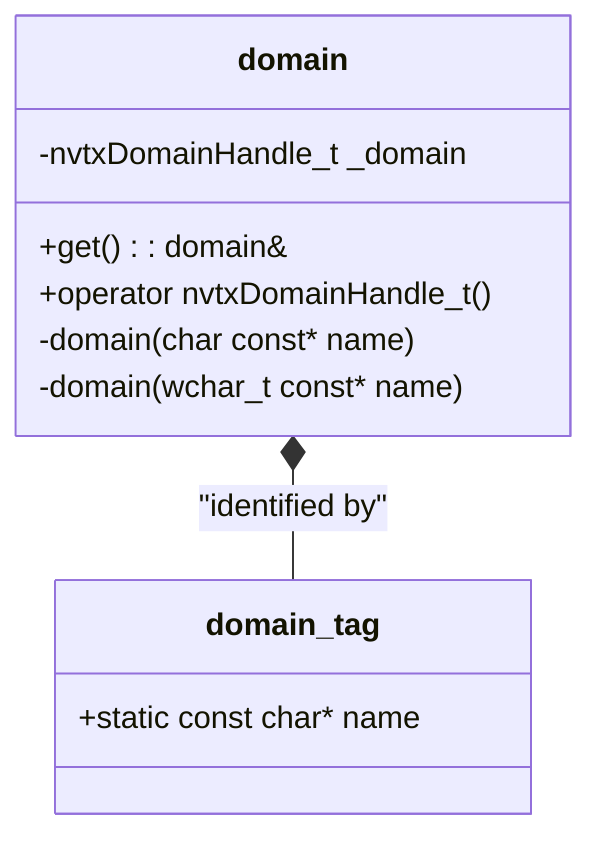

Domains use a "construct on first use" pattern through the static `domain::get<D>()` method, which creates a domain the first time it's requested and returns a reference to it for all future calls.

Sources: `c/include/nvtx3/nvtx3.hpp:756-946`, `c/include/nvtx3/nvToolsExt.h:93-111`

### Event System

The event system provides the core functionality for annotating code with markers and ranges.

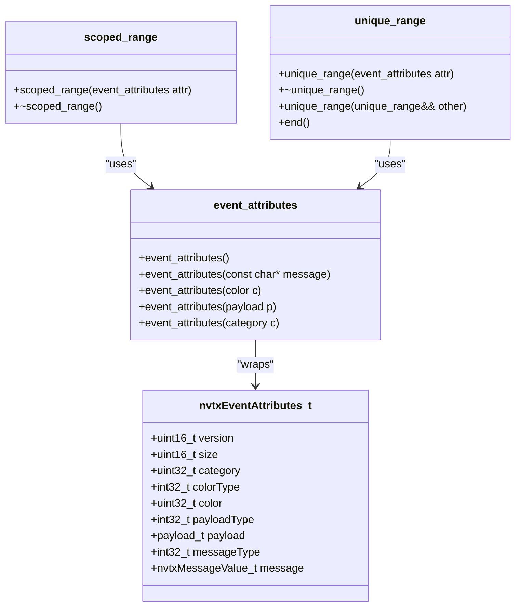

The event system includes:

1. **Event Attributes**: Configuration for markers and ranges (message, color, payload, category)
2. **Markers**: Instantaneous events marked in code
3. **Ranges**: Time spans with beginning and end points

The C++ API provides RAII wrappers like `scoped_range` that automatically manage range lifetimes, ensuring proper beginning and ending of ranges even with exceptions.

Sources: `c/include/nvtx3/nvToolsExt.h:474-662`, `c/include/nvtx3/nvtx3.hpp:226-290`

## Language-Specific APIs

NVTX provides APIs for multiple languages, all built on top of the core C implementation.

### C API

The C API is the foundation for all NVTX functionality and is defined in `nvToolsExt.h`. It provides functions for:

- Creating markers with `nvtxMarkEx()`
- Managing push/pop ranges with `nvtxRangePushEx()` and `nvtxRangePop()`
- Managing start/end ranges with `nvtxRangeStartEx()` and `nvtxRangeEnd()`
- Creating and managing domains with `nvtxDomainCreateA()`
- Naming resources with `nvtxNameCategory()` and other naming functions

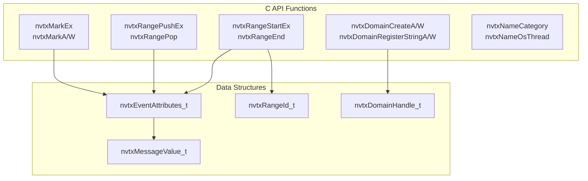

Sources: `c/include/nvtx3/nvToolsExt.h:93-754`

### C++ API

The C++ API is a set of wrappers over the C API that provides a more convenient and type-safe interface. It is defined in `nvtx3.hpp`.

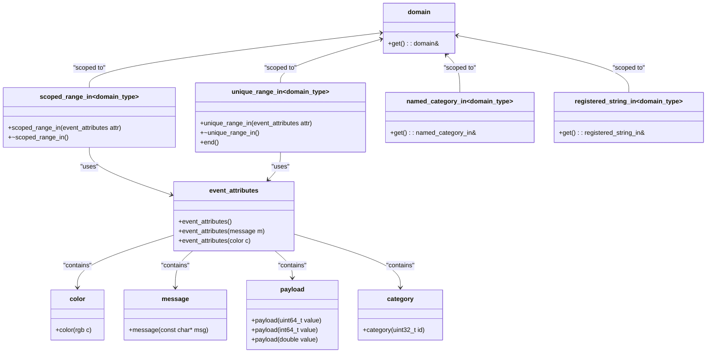

Key features of the C++ API include:

1. **Template-based domain scoping**: Using template parameters to associate objects with domains
2. **RAII-based range management**: `scoped_range` and `unique_range` classes that automatically manage range lifetimes
3. **Compile-time type safety**: Type-based domain identification and error checking
4. **Convenience wrappers**: Easier-to-use wrappers around C API functionality

Sources: `c/include/nvtx3/nvtx3.hpp:98-594`

### Python API

The Python API is built using Cython to bind to the C API and provides a Pythonic interface to NVTX functionality.

```mermaid
graph TD
    subgraph "Python API Components"
        NvtxPy["nvtx.py<br>High-level Interface"]
        Init["__init__.py<br>Public API Exports"]
        LibPyx["_lib/lib.pyx<br>Cython Bindings"]
        Colors["colors.py<br>Color Utilities"]
        Profiler["_lib/profiler.py<br>Automatic Profiling"]
    end
    
    subgraph "Public Functions"
        Annotate["annotate()<br>Decorator & Context Manager"]
        Mark["mark()<br>Instantaneous Event"]
        PushPop["push_range()<br>pop_range()<br>Nested Ranges"]
        StartEnd["start_range()<br>end_range()<br>Overlapping Ranges"]
        Profile["Profile<br>Automatic Instrumentation"]
    end
    
    NvtxPy --> Annotate
    NvtxPy --> Mark
    NvtxPy --> PushPop
    NvtxPy --> StartEnd
    
    Init --> NvtxPy
    Init --> Profiler
    
    Profiler --> Profile
    
    LibPyx -->|"Binds to"| "C API"
    NvtxPy -->|"Uses"| LibPyx
    NvtxPy -->|"Uses"| Colors
```

The Python API features:

1. **Decorator & Context Manager**: The `@nvtx.annotate` decorator and context manager for easy range annotation
2. **Automatic Profiling**: The `Profile` class for automatic function profiling
3. **Color Support**: Integration with matplotlib colors if available
4. **Domain Management**: Python-friendly domain creation and management

Sources: `python/src/nvtx/nvtx.py`, `python/src/nvtx/__init__.py`, `python/src/nvtx/_lib/lib.pyx`

## Extension Mechanisms

NVTX includes several extension mechanisms for specific technologies.

### CUDA Extensions

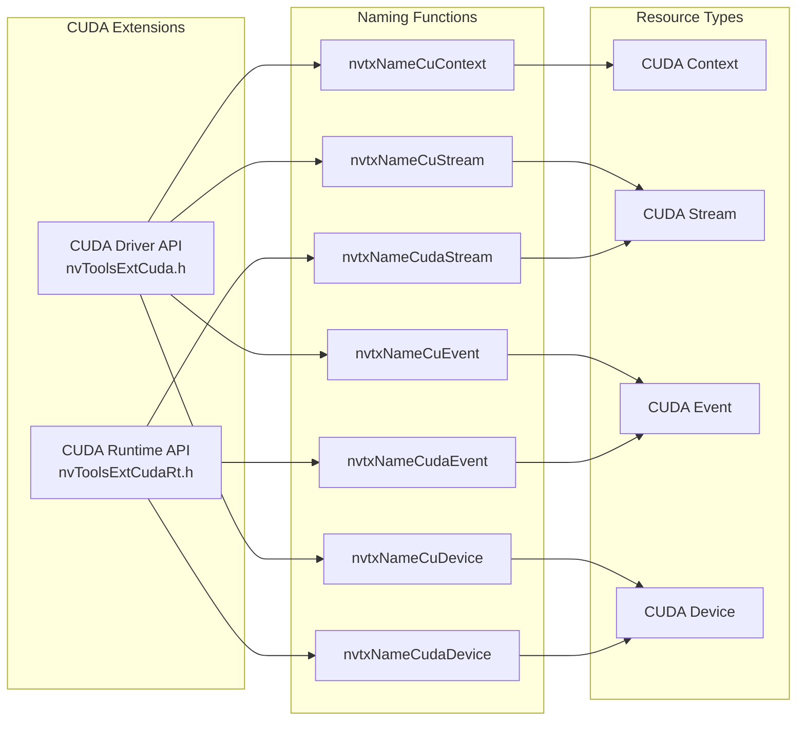

CUDA extensions provide NVTX integration with CUDA resources, allowing users to name CUDA contexts, streams, events, and devices.

Sources: `c/include/nvtx3/nvToolsExtCuda.h`, `c/include/nvtx3/nvToolsExtCudaRt.h`

### OpenCL Extensions

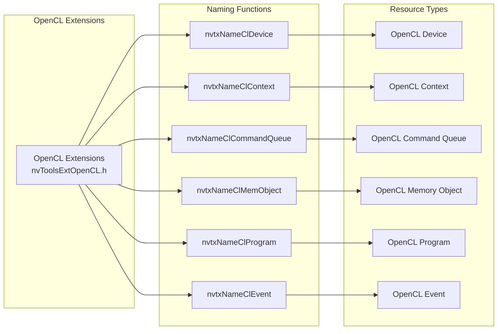

OpenCL extensions provide NVTX integration with OpenCL resources, allowing users to name OpenCL devices, contexts, command queues, memory objects, programs, and events.

Sources: `c/include/nvtx3/nvToolsExtOpenCL.h`

### Synchronization Extensions

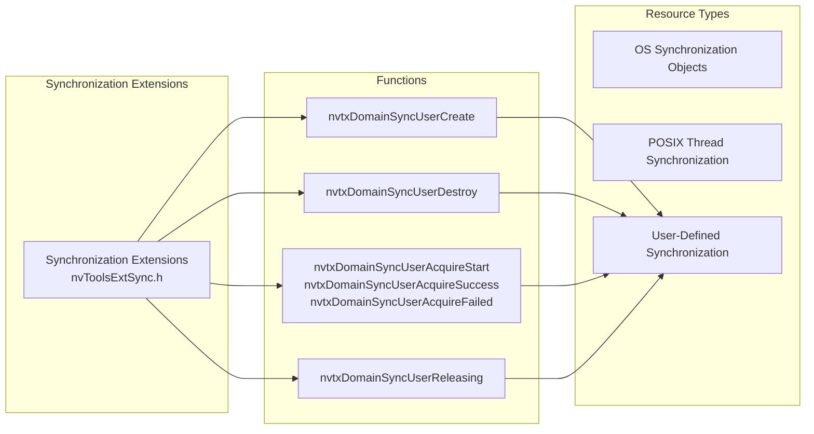

Synchronization extensions allow tracking synchronization primitives, including OS-specific objects, POSIX thread synchronization, and user-defined synchronization mechanisms.

Sources: `c/include/nvtx3/nvToolsExtSync.h`

## Cross-Platform Implementation Details

NVTX is designed to work across multiple platforms with a consistent API. The implementation uses various platform-specific techniques to ensure proper functioning.

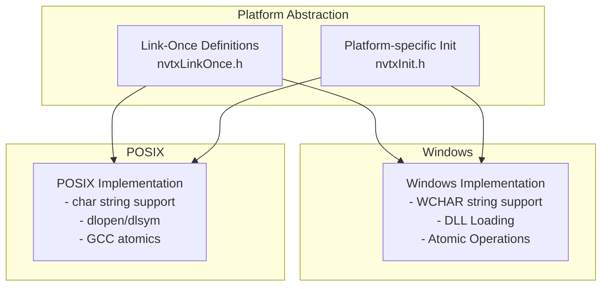

Key cross-platform implementation details include:

1. **Link-Once Definitions**: Macros for creating global variables and functions that work across different compilers and platforms
2. **Platform Detection**: Preprocessor directives to detect and adapt to different platforms
3. **Dynamic Library Loading**: Platform-specific code for loading tools dynamically
4. **Atomic Operations**: Platform-specific implementations of atomic operations

Sources: `c/include/nvtx3/nvtxDetail/nvtxLinkOnce.h`, `c/include/nvtx3/nvtxDetail/nvtxInit.h`

## Further Reading

For more detailed information about using NVTX in your applications, refer to:

- [Key Concepts](#1.2) for detailed explanations of markers, ranges, and resource naming/tracking
- [C API](#2) for documentation on the NVTX C API
- [C++ API](#3) for documentation on the NVTX C++ API
- [Python API](#4) for documentation on the NVTX Python API
- [Integration](#5) for guides on integrating NVTX into your projects

---

# Page: Key Concepts

# Key Concepts

<details>
<summary>Relevant source files</summary>

The following files were used as context for generating this wiki page:

- [.gitignore](.gitignore)
- [README.md](README.md)
- [c/include/nvtx3/nvToolsExt.h](c/include/nvtx3/nvToolsExt.h)
- [c/include/nvtx3/nvToolsExtCuda.h](c/include/nvtx3/nvToolsExtCuda.h)
- [c/include/nvtx3/nvToolsExtCudaRt.h](c/include/nvtx3/nvToolsExtCudaRt.h)
- [c/include/nvtx3/nvToolsExtOpenCL.h](c/include/nvtx3/nvToolsExtOpenCL.h)
- [c/include/nvtx3/nvtxDetail/nvtxInit.h](c/include/nvtx3/nvtxDetail/nvtxInit.h)
- [c/include/nvtx3/nvtxDetail/nvtxLinkOnce.h](c/include/nvtx3/nvtxDetail/nvtxLinkOnce.h)
- [docs/index.html](docs/index.html)
- [python/.flake8.cython](python/.flake8.cython)
- [tools/docs/generate-readme.py](tools/docs/generate-readme.py)
- [tools/docs/github-markdown-css/github-markdown.css](tools/docs/github-markdown-css/github-markdown.css)
- [tools/docs/github-markdown-css/license](tools/docs/github-markdown-css/license)

</details>


This page explains the core concepts in NVTX (NVIDIA Tools Extension Library), focusing on the fundamental building blocks used for code annotation. Understanding these concepts is essential for effectively using NVTX to provide contextual information to developer tools. For information about specific APIs, see the language-specific API sections ([C API](#2), [C++ API](#3), [Python API](#4)).

## Overview of NVTX Annotations

NVTX is fundamentally a system for annotating code execution to help developer tools understand what your application is doing. By default, NVTX calls do nothing until a developer tool is attached, ensuring minimal overhead during normal operation.

```mermaid
graph TD
    subgraph "NVTX Annotation Types"
        Markers["Markers<br>(Instantaneous Events)"]
        Ranges["Ranges<br>(Time Spans)"]
        Resources["Resource Naming/Tracking<br>(Objects with Identity)"]
    end
    
    subgraph "Annotation Attributes"
        Message["Message<br>Text Description"]
        Color["Color<br>Visual Categorization"]
        Category["Category ID<br>Grouping Related Events"]
        Payload["Payload<br>Numeric Data"]
    end
    
    subgraph "Scoping Mechanisms"
        Domains["Domains<br>Isolation Boundaries"]
    end
    
    Markers --> Message
    Markers --> Color
    Markers --> Category
    Markers --> Payload
    
    Ranges --> Message
    Ranges --> Color
    Ranges --> Category
    Ranges --> Payload
    
    Markers --> Domains
    Ranges --> Domains
    Resources --> Domains
```

Sources: [c/include/nvtx3/nvToolsExt.h:48-112](), [README.md:47-67]()

## Markers

**Markers** annotate a specific moment in time during program execution. They are used to mark important events without a time duration.

```mermaid
graph LR
    subgraph "NVTX Marker Functions"
        nvtxMarkA["nvtxMarkA<br>ASCII Message"]
        nvtxMarkW["nvtxMarkW<br>Unicode Message"]
        nvtxMarkEx["nvtxMarkEx<br>With Attributes"]
        nvtxDomainMarkEx["nvtxDomainMarkEx<br>With Domain"]
    end
    
    subgraph "Timeline View"
        Timeline["Program Execution Timeline"]
        Point1["⏺"]
        Point2["⏺"]
        Point3["⏺"]
    end
    
    nvtxMarkA --> Point1
    nvtxMarkW --> Point2
    nvtxMarkEx --> Point3
    
    class Point1,Point2,Point3 marker;
    classDef marker height:10px,width:10px;
```

A marker includes a message and optionally color, category, and payload values. When captured by a tool, markers typically appear as points on a timeline with associated information.

**Example:** Marking when a file operation completes:
```c
nvtxMarkA("File download complete");
```

Sources: [c/include/nvtx3/nvToolsExt.h:53-57](), [c/include/nvtx3/nvToolsExt.h:729-754]()

## Ranges

**Ranges** annotate a span of time between two points in program execution. NVTX supports two types of ranges:

1. **Thread Ranges** (Push/Pop): Form a stack of nested ranges on a single thread
2. **Process Ranges** (Start/End): Allow arbitrary overlapping ranges, possibly across threads

```mermaid
graph TD
    subgraph "Range Types"
        TR["Thread Ranges<br>(Stack-based)"]
        PR["Process Ranges<br>(Arbitrary)"]
    end
    
    subgraph "Thread Range API"
        Push["nvtxRangePush*<br>Begin Thread Range"]
        Pop["nvtxRangePop<br>End Thread Range"]
    end
    
    subgraph "Process Range API"
        Start["nvtxRangeStart*<br>Begin Process Range"]
        End["nvtxRangeEnd<br>End Process Range"]
    end
    
    TR --> Push
    TR --> Pop
    
    PR --> Start
    PR --> End
    
    Push -.-> |"Returns level (0-based)"| Pop
    Start -.-> |"Returns rangeId"| End
```

### Thread Ranges (Push/Pop)

Thread ranges use a stack model, where ranges can be nested and each `nvtxRangePop` automatically closes the most recently pushed range on that thread.

```mermaid
graph LR
    subgraph "Thread Range Stack"
        F["Function Range"]
        L1["Loop Iteration 1"]
        L2["Loop Iteration 2"]
    end
    
    subgraph "Timeline View"
        Timeline["Execution Timeline"]
        FunctionRange["Function Range"]
        Loop1["Loop 1"]
        Loop2["Loop 2"]
    end
    
    F --- FunctionRange
    L1 --- Loop1
    L2 --- Loop2
    
    class Loop1,Loop2 nested;
    classDef nested margin-left:30px;
```

**Example:** Using thread ranges to profile a function with nested loop iterations:
```c
nvtxRangePushA("Function execution");
// Function code
for (int i = 0; i < 3; i++) {
    nvtxRangePushA("Loop iteration");
    // Loop code
    nvtxRangePop(); // End loop iteration range
}
nvtxRangePop(); // End function range
```

### Process Ranges (Start/End)

Process ranges are identified by a unique ID returned from the start function, which must be passed to the end function. They can overlap arbitrarily and can start and end on different threads.

```mermaid
graph LR
    subgraph "Process Ranges (Overlapping)"
        T1["Thread 1"]
        T2["Thread 2"]
        R1["Range 1"]
        R2["Range 2"]
        R3["Range 3"]
    end
    
    T1 --- R1
    T1 --- R2
    T2 --- R3
    
    subgraph "Timeline"
        TR1["Range 1 (ID: 1234)"]
        TR2["Range 2 (ID: 5678)"]
        TR3["Range 3 (ID: 9012)"]
    end
```

**Example:** Using process ranges for operations that span threads:
```c
// Thread 1
nvtxRangeId_t id = nvtxRangeStartA("Async operation");
// Pass id to Thread 2
// ...
// Thread 2
nvtxRangeEnd(id); // End the range on a different thread
```

Sources: [c/include/nvtx3/nvToolsExt.h:62-78](), [c/include/nvtx3/nvToolsExt.h:788-897](), [c/include/nvtx3/nvToolsExt.h:937-1014](), [README.md:54-62]()

## Event Attributes

Event attributes provide additional context for markers and ranges beyond simple text messages. They make annotations more informative and visually distinguishable in profiling tools.

```mermaid
graph TD
    subgraph "nvtxEventAttributes_t"
        Message["Message<br>Text Description"]
        Color["Color<br>Visual Categorization"]
        Category["Category ID<br>Grouping Events"]
        Payload["Payload<br>Numeric Value"]
    end
    
    subgraph "Message Types"
        ASCII["ASCII String<br>NVTX_MESSAGE_TYPE_ASCII"]
        Unicode["Unicode String<br>NVTX_MESSAGE_TYPE_UNICODE"]
        Registered["Registered String<br>NVTX_MESSAGE_TYPE_REGISTERED"]
    end
    
    subgraph "Payload Types"
        UI64["Unsigned Int64"]
        I64["Int64"]
        F64["Double"]
        UI32["Unsigned Int32"]
        I32["Int32"]
        F32["Float"]
    end
    
    Message --> ASCII
    Message --> Unicode
    Message --> Registered
    
    Payload --> UI64
    Payload --> I64
    Payload --> F64
    Payload --> UI32
    Payload --> I32
    Payload --> F32
```

To use event attributes, create and initialize an `nvtxEventAttributes_t` structure with the desired values, then pass it to functions like `nvtxMarkEx`, `nvtxRangePushEx`, or `nvtxRangeStartEx`.

**Example:** Creating a range with attributes:
```c
nvtxEventAttributes_t eventAttrib = {0};
eventAttrib.version = NVTX_VERSION;
eventAttrib.size = NVTX_EVENT_ATTRIB_STRUCT_SIZE;
eventAttrib.colorType = NVTX_COLOR_ARGB;
eventAttrib.color = 0xFF0000FF;  // Red
eventAttrib.messageType = NVTX_MESSAGE_TYPE_ASCII;
eventAttrib.message.ascii = "Important operation";
eventAttrib.category = 3;  // Custom category ID
eventAttrib.payloadType = NVTX_PAYLOAD_TYPE_INT32;
eventAttrib.payload.iValue = 42;

nvtxRangePushEx(&eventAttrib);
// Code to profile
nvtxRangePop();
```

The event attributes provide:
- **Message**: Human-readable description of the event
- **Color**: Visual identifier for the event in timeline views
- **Category**: Numeric grouping to organize related events
- **Payload**: Numeric data associated with the event (e.g., size, count, ID)

Sources: [c/include/nvtx3/nvToolsExt.h:85-92](), [c/include/nvtx3/nvToolsExt.h:471-661]()

## Domains

Domains provide isolation for NVTX annotations, allowing different libraries to use NVTX independently without conflicts. Each domain maintains its own categories, registered strings, and thread range stacks.

```mermaid
graph TD
    subgraph "Default Domain"
        DefaultRanges["Thread Range Stacks"]
        DefaultCategories["Categories"]
        DefaultStrings["Registered Strings"]
    end
    
    subgraph "Custom Domain A"
        DomainARanges["Thread Range Stacks"]
        DomainACategories["Categories"]
        DomainAStrings["Registered Strings"]
    end
    
    subgraph "Custom Domain B"
        DomainBRanges["Thread Range Stacks"]
        DomainBCategories["Categories"]
        DomainBStrings["Registered Strings"]
    end
    
    App["Application"] --> DefaultDomain["Default Domain"]
    LibA["Library A"] --> DomainA["Domain A"]
    LibB["Library B"] --> DomainB["Domain B"]
    
    DefaultDomain --> DefaultRanges
    DefaultDomain --> DefaultCategories
    DefaultDomain --> DefaultStrings
    
    DomainA --> DomainARanges
    DomainA --> DomainACategories
    DomainA --> DomainAStrings
    
    DomainB --> DomainBRanges
    DomainB --> DomainBCategories
    DomainB --> DomainBStrings
    
    Tool["Profiling Tool"] --> DefaultDomain
    Tool --> DomainA
    Tool --> DomainB
```

Domains are particularly important when multiple libraries in the same application use NVTX. Each library should create its own domain to prevent naming conflicts and ensure proper range nesting.

**Example:** Creating and using a domain:
```c
// In a library
nvtxDomainHandle_t domain = nvtxDomainCreateA("MyLibrary");

// Use domain-specific versions of functions
nvtxDomainMarkEx(domain, &eventAttrib);
nvtxDomainRangePushEx(domain, &eventAttrib);
// ...
nvtxDomainRangePop(domain);
```

When your library or component is done using NVTX, you can destroy the domain:
```c
nvtxDomainDestroy(domain);
```

Sources: [c/include/nvtx3/nvToolsExt.h:93-112](), [README.md:425-438]()

## Resource Naming

Resource naming associates human-readable names with objects in your application, such as threads, mutexes, or other resources. This helps profiling tools display meaningful labels instead of numeric IDs.

```mermaid
graph TD
    subgraph "Resource Types"
        Threads["Threads"]
        OS_Objects["OS Objects"]
        CUDA_Resources["CUDA Resources"]
        OpenCL_Resources["OpenCL Resources"]
        Custom_Resources["Custom Resources"]
    end
    
    subgraph "Naming Functions"
        ThreadName["nvtxNameOsThread*"]
        ObjectName["nvtxNameOs*"]
        CudaName["nvtxNameCuda*"]
        OpenCLName["nvtxNameCl*"]
        ResourceObject["nvtxDomainResourceCreate*"]
    end
    
    Threads --> ThreadName
    OS_Objects --> ObjectName
    CUDA_Resources --> CudaName
    OpenCL_Resources --> OpenCLName
    Custom_Resources --> ResourceObject
```

Common resources that can be named include:

1. **OS Resources**:
   - Threads (`nvtxNameOsThread`)
   - Processes (`nvtxNameOsProcess`)

2. **CUDA Resources**:
   - Devices (`nvtxNameCudaDevice`)
   - Streams (`nvtxNameCudaStream`)
   - Events (`nvtxNameCudaEvent`)

3. **OpenCL Resources**:
   - Devices (`nvtxNameClDevice`)
   - Command Queues (`nvtxNameClCommandQueue`)
   - Events (`nvtxNameClEvent`)

4. **Generic Resources**:
   - Custom resource objects with type and identifier

**Example:** Naming a thread for better profiling output:
```c
// Get current thread ID
#ifdef _WIN32
DWORD threadId = GetCurrentThreadId();
#else
pthread_t threadId = pthread_self();
#endif

// Name the thread
nvtxNameOsThreadA(threadId, "Worker Thread #1");
```

Sources: [c/include/nvtx3/nvToolsExt.h:112-143](), [c/include/nvtx3/nvToolsExtCuda.h:33-145](), [c/include/nvtx3/nvToolsExtCudaRt.h:33-128](), [c/include/nvtx3/nvToolsExtOpenCL.h:34-202](), [README.md:64-67]()

## Initialization and Tool Integration

NVTX is designed to have negligible overhead when no profiling tool is attached. The first call to any NVTX function triggers the initialization process, which checks for an available profiling tool.

```mermaid
sequenceDiagram
    participant App as Application
    participant NVTX as NVTX Library
    participant Init as nvtxInitOnce()
    participant Tool as Profiling Tool
    
    App->>NVTX: First NVTX function call
    NVTX->>Init: Check initialization state
    
    Note over Init: Initialization not started
    Init->>Init: Set state to STARTED
    
    Init->>Init: Look for profiling tool
    
    alt Tool found
        Init-->>Tool: Connect to tool
        Tool-->>Init: Return function table
        Init->>Init: Configure real implementations
    else No tool found
        Init->>Init: Configure no-op implementations
    end
    
    Init->>Init: Set state to COMPLETE
    Init-->>NVTX: Return to function
    NVTX-->>App: Continue execution
    
    Note over App,NVTX: Subsequent calls
    App->>NVTX: Later NVTX function call
    
    alt Tool connected
        NVTX->>Tool: Forward to tool implementation
    else No tool
        NVTX->>NVTX: Execute no-op implementation
    end
    
    NVTX-->>App: Continue execution
```

The initialization process includes:

1. Checking if a profiling tool is specified via environment variables
2. Loading the appropriate injection library if found
3. Connecting to the tool and configuring function implementations
4. If no tool is found, setting all functions to no-ops for minimal overhead

This approach ensures that NVTX annotations have virtually no impact on application performance when not being profiled.

**Example:** Forcing initialization early in your application:
```c
// Optional: Force initialization at a convenient time
nvtxInitialize(NULL);

// Later NVTX calls will be faster on their first invocation
```

Sources: [c/include/nvtx3/nvtxDetail/nvtxInit.h:231-454](), [c/include/nvtx3/nvToolsExt.h:38-46](), [c/include/nvtx3/nvToolsExt.h:443-465](), [README.md:394-402]()

## Best Practices for Using NVTX

To get the most out of NVTX, follow these guidelines:

1. **Use Domains for Libraries**: If you're writing a library that uses NVTX, create a domain to avoid conflicts with other NVTX users.

2. **Prefer Thread Ranges for Simple Profiling**: Thread ranges (push/pop) are easier to use for nested function calls and loops within a thread.

3. **Use Process Ranges for Cross-Thread Operations**: When operations span multiple threads, use process ranges (start/end) to track their lifetime.

4. **Register Strings for Repeated Messages**: If the same string is used frequently, register it once and reuse it to reduce overhead.

5. **Avoid String Formatting in Performance-Critical Paths**: String formatting can add overhead. Use payloads for variable data instead.

6. **Use Categories to Group Related Events**: Assign category IDs to group related events, making it easier to filter and analyze them.

7. **Be Strategic with Annotations**: Focus on annotating the most important parts of your code rather than instrumenting everything.

8. **Keep Message Strings Brief and Meaningful**: Short, descriptive messages are more readable in timeline views.

```mermaid
graph TD
    subgraph "NVTX Usage Pattern"
        Domain["1. Create Domain<br>(Library Scope)"]
        Categories["2. Define Categories<br>(Logical Grouping)"]
        RegStrings["3. Register Common Strings<br>(Performance)"]
        Instrument["4. Instrument Code<br>(Strategic Points)"]
        Clean["5. Clean Up<br>(When Done)"]
    end
    
    Domain --> Categories
    Categories --> RegStrings
    RegStrings --> Instrument
    Instrument --> Clean
    
    subgraph "Annotation Density"
        HighLevel["High-Level<br>Few, Important Events"]
        MidLevel["Mid-Level<br>Key Functions & Operations"]
        LowLevel["Low-Level<br>Selective Hot Spots Only"]
    end
```

Sources: [README.md:411-442]()

## Summary

NVTX provides a powerful, low-overhead mechanism for annotating code to provide context to profiling tools. The key concepts include:

1. **Markers**: Instantaneous events for specific points in execution
2. **Ranges**: Time spans using either push/pop (thread ranges) or start/end (process ranges)
3. **Event Attributes**: Additional context including messages, colors, categories, and payloads
4. **Domains**: Isolation boundaries to prevent conflicts between libraries
5. **Resource Naming**: Associating human-readable names with application objects
6. **Initialization**: Dynamic discovery and connection to profiling tools

By understanding and applying these concepts, you can effectively use NVTX to make your application more analyzable by performance profiling tools like NVIDIA Nsight Systems, Nsight Compute, and others.

---

# Page: C API

# C API

<details>
<summary>Relevant source files</summary>

The following files were used as context for generating this wiki page:

- [c/include/nvtx3/nvToolsExt.h](c/include/nvtx3/nvToolsExt.h)
- [c/include/nvtx3/nvToolsExtCuda.h](c/include/nvtx3/nvToolsExtCuda.h)
- [c/include/nvtx3/nvToolsExtCudaRt.h](c/include/nvtx3/nvToolsExtCudaRt.h)
- [c/include/nvtx3/nvToolsExtOpenCL.h](c/include/nvtx3/nvToolsExtOpenCL.h)
- [c/include/nvtx3/nvtxDetail/nvtxImpl.h](c/include/nvtx3/nvtxDetail/nvtxImpl.h)
- [c/include/nvtx3/nvtxDetail/nvtxInit.h](c/include/nvtx3/nvtxDetail/nvtxInit.h)
- [c/include/nvtx3/nvtxDetail/nvtxInitDecls.h](c/include/nvtx3/nvtxDetail/nvtxInitDecls.h)
- [c/include/nvtx3/nvtxDetail/nvtxInitDefs.h](c/include/nvtx3/nvtxDetail/nvtxInitDefs.h)
- [c/include/nvtx3/nvtxDetail/nvtxLinkOnce.h](c/include/nvtx3/nvtxDetail/nvtxLinkOnce.h)
- [c/include/nvtx3/nvtxDetail/nvtxTypes.h](c/include/nvtx3/nvtxDetail/nvtxTypes.h)

</details>


The NVTX C API forms the foundation of the NVIDIA Tools Extension library. This page documents the core C API functions and types that enable developers to annotate their code with markers, ranges, and resource names for performance analysis in NVIDIA profiling tools. For language-specific wrappers built on top of this API, see [C++ API](#3) and [Python API](#4).

## Overview and Design

The NVTX C API is designed with several key principles:

- **Low Overhead**: The API has near-zero overhead when no profiling tool is attached
- **Header-Only**: The implementation is provided in headers with inline functions
- **Cross-Platform**: Supports Windows, Linux, and other platforms
- **Extensible**: Organized with modules for different domains (Core, CUDA, OpenCL)

The C API serves as the foundation layer for higher-level language bindings while maintaining binary compatibility across different versions.

```mermaid
flowchart TB
    subgraph "C API Architecture"
        Core["Core API<br>Markers & Ranges"]
        Init["Initialization Layer"]
        ExportTables["Export Tables<br>For Tool Integration"]
        Domains["Domains<br>For Scoping Annotations"]
        ResourceNaming["Resource Naming<br>CUDA, OpenCL, etc."]
        
        Init --> Core
        Core --> ExportTables
        Core --> Domains
        Core --> ResourceNaming
    end
    
    subgraph "External Tools"
        NsightSystems["Nsight Systems"]
        NsightCompute["Nsight Compute"]
        CUPTI["CUPTI"]
    end
    
    ExportTables --> NsightSystems
    ExportTables --> NsightCompute
    ExportTables --> CUPTI
```

Sources: [c/include/nvtx3/nvToolsExt.h:25-156](), [c/include/nvtx3/nvtxDetail/nvtxImpl.h:21-79]()

## Core Components

### Initialization

NVTX automatically initializes on the first API call. The initialization process looks for available profiling tools and connects to them dynamically. If you need to force initialization before any performance-critical sections, you can use `nvtxInitialize()`.

```mermaid
sequenceDiagram
    participant App as "Application"
    participant NVTX as "NVTX API"
    participant Init as "nvtxInitOnce()"
    participant Tool as "Profiling Tool"
    
    App->>NVTX: First call to any NVTX function
    NVTX->>Init: Check initState
    
    alt Fresh (not initialized)
        Init->>Init: Set initState to STARTED
        Init->>Init: Look for profiling tool
        opt Tool found
            Init-->>Tool: Connect to tool
            Tool-->>Init: Return function pointers
            Init->>Init: Configure with real implementations
        end
        opt No tool found
            Init->>Init: Configure with no-op implementations
        end
        Init->>Init: Set initState to COMPLETE
        Init-->>NVTX: Return
    else Already initializing or complete
        Init->>Init: Wait for completion
        Init-->>NVTX: Return
    end
    
    NVTX-->>App: Continue with call
```

Sources: [c/include/nvtx3/nvtxDetail/nvtxInit.h:26-454](), [c/include/nvtx3/nvToolsExt.h:437-465]()

### Event Attributes

Event attributes provide additional information for markers and ranges. They include:

- **Message**: Text description (ASCII, Unicode, or registered string)
- **Color**: ARGB color for visualization
- **Category**: User-defined ID for grouping
- **Payload**: Numerical value (various types supported)

The `nvtxEventAttributes_t` structure must be initialized with version and size information before use.

```mermaid
classDiagram
    class nvtxEventAttributes_t {
        uint16_t version
        uint16_t size
        uint32_t category
        int32_t colorType
        uint32_t color
        int32_t payloadType
        int32_t reserved0
        union payload
        int32_t messageType
        nvtxMessageValue_t message
    }
    
    class nvtxMessageValue_t {
        const char* ascii
        const wchar_t* unicode
        nvtxStringHandle_t registered
    }
    
    nvtxEventAttributes_t --> nvtxMessageValue_t
```

Sources: [c/include/nvtx3/nvToolsExt.h:470-661]()

### Domains

Domains allow developers to scope annotations to avoid conflicts when different libraries or components use NVTX. Each domain maintains its own:

- Categories
- Thread range stacks
- Registered strings

```mermaid
flowchart LR
    App["Application"]
    
    subgraph "Default Domain"
        DefaultCat["Categories"]
        DefaultRanges["Thread Ranges"]
        DefaultStrings["Registered Strings"]
    end
    
    subgraph "Custom Domain A"
        DomainACat["Categories"]
        DomainARanges["Thread Ranges"]
        DomainAStrings["Registered Strings"]
    end
    
    subgraph "Custom Domain B"
        DomainBCat["Categories"]
        DomainBRanges["Thread Ranges"]
        DomainBStrings["Registered Strings"]
    end
    
    App -- "nvtxMark*()" --> DefaultCat
    App -- "nvtxRangePush*()" --> DefaultRanges
    
    App -- "nvtxDomainCreateA()" --> DomainA["Domain A<br>Handle"]
    App -- "nvtxDomainCreateA()" --> DomainB["Domain B<br>Handle"]
    
    DomainA -- "nvtxDomainMark*()" --> DomainACat
    DomainA -- "nvtxDomainRangePush*()" --> DomainARanges
    
    DomainB -- "nvtxDomainMark*()" --> DomainBCat
    DomainB -- "nvtxDomainRangePush*()" --> DomainBRanges
```

Sources: [c/include/nvtx3/nvToolsExt.h:93-128]()

## Markers and Ranges

### Markers

Markers represent instantaneous events at a specific point in time. They can include a message and additional attributes.

```c
// Simple marker with message
nvtxMarkA("Simple marker");

// Marker with attributes
nvtxEventAttributes_t eventAttrib = {0};
eventAttrib.version = NVTX_VERSION;
eventAttrib.size = NVTX_EVENT_ATTRIB_STRUCT_SIZE;
eventAttrib.colorType = NVTX_COLOR_ARGB;
eventAttrib.color = 0xFF0000FF;  // Blue
eventAttrib.messageType = NVTX_MESSAGE_TYPE_ASCII;
eventAttrib.message.ascii = "Marker with attributes";
nvtxMarkEx(&eventAttrib);
```

Sources: [c/include/nvtx3/nvToolsExt.h:672-754]()

### Thread Ranges

Thread ranges denote nested time spans within a thread. They use a stack-based model with push and pop operations.

```c
// Simple thread range
nvtxRangePushA("Outer range");
// ... operations ...
nvtxRangePushA("Inner range");
// ... nested operations ...
nvtxRangePop();  // End inner range
// ... more operations ...
nvtxRangePop();  // End outer range
```

```mermaid
sequenceDiagram
    participant App as "Application"
    participant NVTX as "NVTX Thread Range Stack"
    
    App->>NVTX: nvtxRangePushA("Outer range")
    Note right of NVTX: Stack level 0
    
    App->>App: Operations
    
    App->>NVTX: nvtxRangePushA("Inner range")
    Note right of NVTX: Stack level 1
    
    App->>App: Nested operations
    
    App->>NVTX: nvtxRangePop()
    Note right of NVTX: Return to level 0
    
    App->>App: More operations
    
    App->>NVTX: nvtxRangePop()
    Note right of NVTX: Empty stack
```

Sources: [c/include/nvtx3/nvToolsExt.h:898-1002]()

### Process Ranges

Process ranges represent time spans that can overlap and span across threads. They use explicit start and end operations with correlation IDs.

```c
// Process range with attributes
nvtxEventAttributes_t eventAttrib = {0};
eventAttrib.version = NVTX_VERSION;
eventAttrib.size = NVTX_EVENT_ATTRIB_STRUCT_SIZE;
eventAttrib.messageType = NVTX_MESSAGE_TYPE_ASCII;
eventAttrib.message.ascii = "Process range";
nvtxRangeId_t rangeId = nvtxRangeStartEx(&eventAttrib);
// ... operations (can span threads) ...
nvtxRangeEnd(rangeId);
```

```mermaid
sequenceDiagram
    participant Thread1 as "Thread 1"
    participant Thread2 as "Thread 2"
    participant NVTX as "NVTX Process Ranges"
    
    Thread1->>NVTX: nvtxRangeStartEx(&attribA)
    NVTX-->>Thread1: rangeIdA
    
    Thread2->>NVTX: nvtxRangeStartEx(&attribB)
    NVTX-->>Thread2: rangeIdB
    
    Note over Thread1,Thread2: Concurrent execution
    
    Thread2->>NVTX: nvtxRangeEnd(rangeIdB)
    Thread1->>NVTX: nvtxRangeEnd(rangeIdA)
```

Sources: [c/include/nvtx3/nvToolsExt.h:756-897]()

## Resource Naming

The C API provides functions to name various resources for better identification in profiling tools.

### Generic Resource Naming

- `nvtxNameCategoryA/W`: Name a category
- `nvtxNameOsThreadA/W`: Name an OS thread

### Domain Resource Objects

In NVTX version 2 and later, a more general resource naming mechanism is available:

```c
// Create a domain
nvtxDomainHandle_t domain = nvtxDomainCreateA("MyDomain");

// Create resource attributes
nvtxResourceAttributes_t resAttrib = {0};
resAttrib.version = NVTX_VERSION;
resAttrib.size = NVTX_RESOURCE_ATTRIB_STRUCT_SIZE;
resAttrib.identifierType = NVTX_RESOURCE_TYPE_GENERIC_POINTER;
resAttrib.identifier.pValue = myObject;
resAttrib.messageType = NVTX_MESSAGE_TYPE_ASCII;
resAttrib.message.ascii = "My Resource";

// Create the resource
nvtxResourceHandle_t resource = nvtxDomainResourceCreate(domain, &resAttrib);

// Later destroy the resource when no longer needed
nvtxDomainResourceDestroy(resource);
```

Sources: [c/include/nvtx3/nvToolsExt.h:112-143]()

### Platform-Specific Resource Naming

NVTX provides specialized functions for naming resources from different platforms:

#### CUDA Driver API Resources

```mermaid
classDiagram
    class CUDAResource {
        nvtxNameCuDeviceA/W(CUdevice, name)
        nvtxNameCuContextA/W(CUcontext, name)
        nvtxNameCuStreamA/W(CUstream, name)
        nvtxNameCuEventA/W(CUevent, name)
    }
```

Sources: [c/include/nvtx3/nvToolsExtCuda.h:20-154]()

#### CUDA Runtime API Resources

```mermaid
classDiagram
    class CUDARTResource {
        nvtxNameCudaDeviceA/W(int device, name)
        nvtxNameCudaStreamA/W(cudaStream_t, name)
        nvtxNameCudaEventA/W(cudaEvent_t, name)
    }
```

Sources: [c/include/nvtx3/nvToolsExtCudaRt.h:20-129]()

#### OpenCL Resources

```mermaid
classDiagram
    class OpenCLResource {
        nvtxNameClDeviceA/W(cl_device_id, name)
        nvtxNameClContextA/W(cl_context, name)
        nvtxNameClCommandQueueA/W(cl_command_queue, name)
        nvtxNameClMemObjectA/W(cl_mem, name)
        nvtxNameClSamplerA/W(cl_sampler, name)
        nvtxNameClProgramA/W(cl_program, name)
        nvtxNameClEventA/W(cl_event, name)
    }
```

Sources: [c/include/nvtx3/nvToolsExtOpenCL.h:20-204]()

## API Reference

### Function Naming Conventions

The NVTX C API follows a consistent naming pattern:

```mermaid
flowchart LR
    Prefix["nvtx"] --> Operation["Operation<br>Mark, Range, Name"]
    Operation --> Target["Target<br>Thread, Device, etc."]
    Target --> Variant["Variant<br>A = ASCII<br>W = Unicode<br>Ex = Extended"]
    
    style Prefix fill:#f5f5f5
    style Operation fill:#f5f5f5
    style Target fill:#f5f5f5
    style Variant fill:#f5f5f5
```

Examples:
- `nvtxMarkA`: Creates a marker with ASCII text
- `nvtxRangePushEx`: Starts a thread range with extended attributes
- `nvtxNameCudaDeviceW`: Names a CUDA device with Unicode text

### Core API Functions

| Function Group | Key Functions | Description |
|----------------|---------------|-------------|
| Initialization | `nvtxInitialize` | Force initialization of NVTX |
| Markers | `nvtxMarkA/W`, `nvtxMarkEx` | Create instantaneous events |
| Thread Ranges | `nvtxRangePushA/W`, `nvtxRangePushEx`, `nvtxRangePop` | Manage nested ranges within a thread |
| Process Ranges | `nvtxRangeStartA/W`, `nvtxRangeStartEx`, `nvtxRangeEnd` | Manage arbitrary ranges that can span threads |
| Domain Management | `nvtxDomainCreateA/W`, `nvtxDomainDestroy` | Create and manage annotation domains |
| Resource Naming | `nvtxNameCategoryA/W`, `nvtxNameOsThreadA/W` | Associate names with resources |

Sources: [c/include/nvtx3/nvToolsExt.h:464-1010]()

## Implementation Details

### Header-Only Design

The NVTX C API is implemented as a header-only library, which offers several advantages:

- No need to link against a separate library
- Easy to include in existing projects
- Avoids symbol conflicts across different versions

When including `nvToolsExt.h`, the implementation is automatically included unless `NVTX_NO_IMPL` is defined.

### Initialization Process

The initialization process is designed to be lazy and thread-safe:

1. All functions initially point to initialization wrappers (`*_impl_init`)
2. On first call, `nvtxInitOnce()` is invoked
3. NVTX looks for profiling tools using a predefined search sequence
4. If a tool is found, function pointers are redirected to the tool's implementations
5. If no tool is found, function pointers are set to no-op implementations

This design ensures minimal overhead when no profiling tool is attached to the application.

```mermaid
flowchart TB
    FirstCall["First API Call"] --> InitWrapper["Initialization Wrapper<br>*_impl_init"]
    InitWrapper --> nvtxInitOnce["nvtxInitOnce()"]
    
    nvtxInitOnce --> LoadSequence["Load Sequence<br>1. Check env vars<br>2. Check package location<br>3. Check for static injection"]
    
    LoadSequence --> ToolCheck{"Tool Found?"}
    
    ToolCheck -- "Yes" --> ConnectTool["Connect to Tool<br>Get function pointers"]
    ToolCheck -- "No" --> ConfigureNoops["Configure with<br>no-op implementations"]
    
    ConnectTool --> SetState["Set initState = COMPLETE"]
    ConfigureNoops --> SetState
    
    SetState --> ReturnToCall["Return to original call"]
```

Sources: [c/include/nvtx3/nvtxDetail/nvtxInit.h:66-454](), [c/include/nvtx3/nvtxDetail/nvtxInitDefs.h:25-447]()

### Export Tables

NVTX uses export tables to expose its functionality to profiling tools. These tables provide a stable interface that tools can use to access NVTX functions:

- `NVTX_ETID_CALLBACKS`: Functions for accessing module function tables
- `NVTX_ETID_VERSIONINFO`: Version information and compatibility features

When a profiling tool connects to NVTX, it uses these export tables to replace the default implementations with its own, enabling detailed profiling data collection.

Sources: [c/include/nvtx3/nvtxDetail/nvtxTypes.h:264-308](), [c/include/nvtx3/nvtxDetail/nvtxImpl.h:370-431]()

## Platform Compatibility

The NVTX C API is designed to work across multiple platforms with conditional compilation for platform-specific features:

- Windows: Uses `__stdcall` calling convention and Windows-specific headers
- Linux/POSIX: Uses platform-appropriate synchronization primitives
- Android: Includes special handling for package directories

The API also handles different compiler environments with appropriate inline function declarations and visibility attributes.

Sources: [c/include/nvtx3/nvToolsExt.h:166-228](), [c/include/nvtx3/nvtxDetail/nvtxLinkOnce.h:20-78]()

---

# Page: Markers and Ranges

# Markers and Ranges

<details>
<summary>Relevant source files</summary>

The following files were used as context for generating this wiki page:

- [.gitignore](.gitignore)
- [README.md](README.md)
- [c/include/nvtx3/nvToolsExt.h](c/include/nvtx3/nvToolsExt.h)
- [c/include/nvtx3/nvToolsExtCuda.h](c/include/nvtx3/nvToolsExtCuda.h)
- [c/include/nvtx3/nvToolsExtCudaRt.h](c/include/nvtx3/nvToolsExtCudaRt.h)
- [c/include/nvtx3/nvToolsExtOpenCL.h](c/include/nvtx3/nvToolsExtOpenCL.h)
- [c/include/nvtx3/nvtxDetail/nvtxInit.h](c/include/nvtx3/nvtxDetail/nvtxInit.h)
- [c/include/nvtx3/nvtxDetail/nvtxLinkOnce.h](c/include/nvtx3/nvtxDetail/nvtxLinkOnce.h)
- [docs/index.html](docs/index.html)
- [python/.flake8.cython](python/.flake8.cython)
- [tools/docs/generate-readme.py](tools/docs/generate-readme.py)
- [tools/docs/github-markdown-css/github-markdown.css](tools/docs/github-markdown-css/github-markdown.css)
- [tools/docs/github-markdown-css/license](tools/docs/github-markdown-css/license)

</details>


## Purpose and Scope

This page details the C API functions for creating markers and ranges to annotate code execution in NVTX. Markers denote specific points (instantaneous events) in a program's execution, while ranges denote spans of time between two points. These annotations provide context for developer tools, enhancing visualization and analysis of application behavior. For information about using these features with the C++ API, see [Ranges and Scopes](#3.1). For the Python implementation, see [Basic Usage](#4.2).

## Overview of Markers and Ranges

```mermaid
graph TB
    subgraph "NVTX Annotations"
        Marker["Marker<br>(Instantaneous Point)"]
        Range["Range<br>(Time Span)"]
        
        subgraph "Range Types"
            ThreadRange["Thread Range<br>(Push/Pop - Nested Stack)"]
            ProcessRange["Process Range<br>(Start/End - Arbitrary Overlap)"]
        end
        
        Range --> ThreadRange
        Range --> ProcessRange
    end
    
    subgraph "Event Attributes"
        Attrs["nvtxEventAttributes_t"]
        Color["colorType/color"]
        Category["category"]
        Message["messageType/message"]
        Payload["payloadType/payload"]
        
        Attrs --> Color
        Attrs --> Category
        Attrs --> Message
        Attrs --> Payload
    end
    
    Marker -.-> Attrs
    Range -.-> Attrs
```

Sources: [c/include/nvtx3/nvToolsExt.h:48-79](), [README.md:51-62]()

## Markers

Markers annotate a specific moment in time during program execution. They are useful for highlighting important events like the start of an algorithm, a significant state change, or when specific conditions are met.

### Marker API Functions

| Function | Description |
|----------|-------------|
| `nvtxMarkA(const char* message)` | Creates a marker with an ASCII message |
| `nvtxMarkW(const wchar_t* message)` | Creates a marker with a wide character message |
| `nvtxMarkEx(const nvtxEventAttributes_t* eventAttrib)` | Creates a marker with custom attributes |
| `nvtxDomainMarkEx(nvtxDomainHandle_t domain, const nvtxEventAttributes_t* eventAttrib)` | Creates a marker in a specific domain |

Sources: [c/include/nvtx3/nvToolsExt.h:674-754]()

### Marker Creation Flow

```mermaid
sequenceDiagram
    participant App as Application
    participant NVTX as NVTX Library
    participant Tool as Profiling Tool
    
    App->>NVTX: nvtxMarkA("Important Event")
    Note over NVTX: When no custom attributes needed
    NVTX->>Tool: Create marker with message
    
    App->>NVTX: nvtxMarkEx(&eventAttrib)
    Note over NVTX: When custom attributes are needed
    NVTX->>Tool: Create marker with attributes
    
    App->>NVTX: nvtxDomainMarkEx(domain, &eventAttrib)
    Note over NVTX: For domain-specific markers
    NVTX->>Tool: Create marker in specific domain
```

Sources: [c/include/nvtx3/nvToolsExt.h:691-729]()

### Example Usage

The following example demonstrates how to create a simple marker and a marker with custom attributes:

```c
// Simple marker with text message
nvtxMarkA("Simple marker");

// Marker with custom attributes
nvtxEventAttributes_t eventAttrib = {0};
eventAttrib.version = NVTX_VERSION;
eventAttrib.size = NVTX_EVENT_ATTRIB_STRUCT_SIZE;
eventAttrib.colorType = NVTX_COLOR_ARGB;
eventAttrib.color = 0xFF880000;  // Red color
eventAttrib.messageType = NVTX_MESSAGE_TYPE_ASCII;
eventAttrib.message.ascii = "Customized marker";
nvtxMarkEx(&eventAttrib);
```

Sources: [c/include/nvtx3/nvToolsExt.h:709-722]()

## Ranges

Ranges annotate spans of time in program execution. NVTX provides two types of ranges:

1. **Thread Ranges**: Push/pop ranges that follow a stack-like nesting structure within a thread
2. **Process Ranges**: Start/end ranges that can arbitrarily overlap and span across threads

### Thread Ranges

Thread ranges use a push/pop mechanism and follow a stack-based model. The most recently pushed range must be popped first. They are ideal for tracking nested function calls or loop iterations within a single thread.

#### Thread Range API Functions

| Function | Description |
|----------|-------------|
| `nvtxRangePushA(const char* message)` | Starts a thread range with an ASCII message |
| `nvtxRangePushW(const wchar_t* message)` | Starts a thread range with a wide character message |
| `nvtxRangePushEx(const nvtxEventAttributes_t* eventAttrib)` | Starts a thread range with custom attributes |
| `nvtxRangePop()` | Ends the most recently started thread range |
| `nvtxDomainRangePushEx(nvtxDomainHandle_t domain, const nvtxEventAttributes_t* eventAttrib)` | Starts a thread range in a specific domain |
| `nvtxDomainRangePop(nvtxDomainHandle_t domain)` | Ends the most recently started thread range in a domain |

Sources: [c/include/nvtx3/nvToolsExt.h:900-1002]()

#### Thread Range Nesting

```mermaid
graph TB
    subgraph "Thread Range Nesting Structure"
        direction TB
        Level0["Level 0: nvtxRangePushA('Function')"]
        Level1["Level 1: nvtxRangePushA('Loop')"]
        Level2["Level 2: nvtxRangePushA('Iteration')"]
        
        Level0 --> Level1
        Level1 --> Level2
        
        Pop2["nvtxRangePop() - pops 'Iteration'"]
        Pop1["nvtxRangePop() - pops 'Loop'"]
        Pop0["nvtxRangePop() - pops 'Function'"]
        
        Level2 -.-> Pop2
        Pop2 -.-> Level1
        Level1 -.-> Pop1
        Pop1 -.-> Level0
        Level0 -.-> Pop0
    end
```

Sources: [c/include/nvtx3/nvToolsExt.h:950-966](), [README.md:55-57]()

### Process Ranges

Process ranges use a start/end mechanism with correlation IDs. The range start function returns an ID that must be passed to the corresponding end function. This allows for arbitrary overlapping of ranges and for ranges to start and end on different threads.

#### Process Range API Functions

| Function | Description |
|----------|-------------|
| `nvtxRangeStartA(const char* message)` | Starts a process range with an ASCII message |
| `nvtxRangeStartW(const wchar_t* message)` | Starts a process range with a wide character message |
| `nvtxRangeStartEx(const nvtxEventAttributes_t* eventAttrib)` | Starts a process range with custom attributes |
| `nvtxRangeEnd(nvtxRangeId_t id)` | Ends a specific process range using its ID |
| `nvtxDomainRangeStartEx(nvtxDomainHandle_t domain, const nvtxEventAttributes_t* eventAttrib)` | Starts a process range in a specific domain |
| `nvtxDomainRangeEnd(nvtxDomainHandle_t domain, nvtxRangeId_t id)` | Ends a specific process range in a domain |

Sources: [c/include/nvtx3/nvToolsExt.h:757-896]()

#### Process Range vs Thread Range Behavior

```mermaid
sequenceDiagram
    participant T1 as Thread 1
    participant T2 as Thread 2
    
    Note over T1: Thread Ranges (Stack-based)
    T1->>T1: nvtxRangePushA("Outer")
    T1->>T1: nvtxRangePushA("Inner")
    T1->>T1: nvtxRangePop() - Must pop "Inner" first
    T1->>T1: nvtxRangePop() - Then pop "Outer"
    
    Note over T1, T2: Process Ranges (ID-based)
    T1->>T1: id1 = nvtxRangeStartA("Range 1")
    T2->>T2: id2 = nvtxRangeStartA("Range 2")
    T1->>T1: nvtxRangeEnd(id1) - Can end in any order
    T2->>T2: nvtxRangeEnd(id2)
    
    Note over T1, T2: Cross-thread Process Range
    T1->>T1: id3 = nvtxRangeStartA("Cross-thread")
    T1->>T2: Pass id3 to Thread 2
    T2->>T2: nvtxRangeEnd(id3) - End on different thread
```

Sources: [c/include/nvtx3/nvToolsExt.h:79-80](), [README.md:58-61]()

### Example Usage

```c
// Thread range example
nvtxRangePushA("Outer function");
// ... code ...
nvtxRangePushA("Inner function");
// ... code ...
nvtxRangePop();  // Pops "Inner function"
// ... code ...
nvtxRangePop();  // Pops "Outer function"

// Process range example
nvtxRangeId_t id1 = nvtxRangeStartA("Process Range 1");
// ... code ...
nvtxRangeId_t id2 = nvtxRangeStartA("Process Range 2");
// ... code ...
nvtxRangeEnd(id1);  // Can end ranges in any order
// ... code ...
nvtxRangeEnd(id2);
```

Sources: [c/include/nvtx3/nvToolsExt.h:836-840](), [c/include/nvtx3/nvToolsExt.h:987-991]()

## Event Attributes

Both markers and ranges can be annotated with additional attributes using the `nvtxEventAttributes_t` structure. These attributes provide more context and can guide the visualization of events in profiling tools.

### Event Attributes Structure

```mermaid
classDiagram
    class nvtxEventAttributes_t {
        uint16_t version
        uint16_t size
        uint32_t category
        int32_t colorType
        uint32_t color
        int32_t payloadType
        int32_t reserved0
        union payload_t
        int32_t messageType
        nvtxMessageValue_t message
    }
    
    class nvtxMessageValue_t {
        const char* ascii
        const wchar_t* unicode
        nvtxStringHandle_t registered
    }
    
    nvtxEventAttributes_t "1" -- "1" nvtxMessageValue_t : contains
```

Sources: [c/include/nvtx3/nvToolsExt.h:567-659]()

### Attribute Types

| Attribute | Description | Fields |
|-----------|-------------|--------|
| Color | Visual color for displaying in tools | `colorType`, `color` |
| Category | Grouping events by user-defined categories | `category` |
| Message | Descriptive text for the event | `messageType`, `message` |
| Payload | Numerical value associated with the event | `payloadType`, `payload` |

Sources: [c/include/nvtx3/nvToolsExt.h:84-91]()

### Initializing Event Attributes

The event attributes structure must be properly initialized before use:

```c
// Method 1: Initialize for future compatibility
nvtxEventAttributes_t eventAttrib = {0};  // Zero all fields
eventAttrib.version = NVTX_VERSION;
eventAttrib.size = NVTX_EVENT_ATTRIB_STRUCT_SIZE;

// Method 2: Initialize for a specific version
nvtxEventAttributes_t eventAttrib = {0};  // Zero all fields
eventAttrib.version = 1;
eventAttrib.size = (uint16_t)(sizeof(nvtxEventAttributes_v1));
```

Sources: [c/include/nvtx3/nvToolsExt.h:498-539]()

### Example With All Attributes

```c
nvtxEventAttributes_t eventAttrib = {0};
eventAttrib.version = NVTX_VERSION;
eventAttrib.size = NVTX_EVENT_ATTRIB_STRUCT_SIZE;

// Set color (red)
eventAttrib.colorType = NVTX_COLOR_ARGB;
eventAttrib.color = 0xFF0000FF;

// Set category
eventAttrib.category = 3;  // User-defined category ID

// Set message
eventAttrib.messageType = NVTX_MESSAGE_TYPE_ASCII;
eventAttrib.message.ascii = "Event with attributes";

// Set payload (double value)
eventAttrib.payloadType = NVTX_PAYLOAD_TYPE_DOUBLE;
eventAttrib.payload.dValue = 42.0;

// Use the attributes for a marker or range
nvtxMarkEx(&eventAttrib);
```

Sources: [c/include/nvtx3/nvToolsExt.h:544-556]()

## Visualization in Tools

When NVTX markers and ranges are used in an application being profiled by a tool like NVIDIA Nsight Systems, they appear on a timeline:

```mermaid
gantt
    title Timeline Visualization in a Profiling Tool
    dateFormat s
    axisFormat %S
    
    section "Thread 1"
    Function Range            :a1, 0, 6
    Marker "Important Event"  :milestone, m1, 1, 0
    Loop Iteration 1          :a2, 1, 2
    Loop Iteration 2          :a3, 2, 3
    Loop Iteration 3          :a4, 3, 4
    Loop Iteration 4          :a5, 4, 5
    Loop Iteration 5          :a6, 5, 6
    
    section "Thread 2"
    Process Range A           :b1, 1, 4
    Marker "Thread 2 Event"   :milestone, m2, 2, 0
    Process Range B           :b2, 3, 5
```

Sources: [README.md:44-47]()

## Using Domains

Domains allow for scoping of markers and ranges to avoid conflicts when multiple libraries or components use NVTX. Each domain maintains its own stack of thread ranges and other resources.

```c
// Create a domain
nvtxDomainHandle_t domain = nvtxDomainCreateA("MyLibrary");

// Use domain-specific marker and range functions
nvtxEventAttributes_t eventAttrib = {0};
eventAttrib.version = NVTX_VERSION;
eventAttrib.size = NVTX_EVENT_ATTRIB_STRUCT_SIZE;
eventAttrib.messageType = NVTX_MESSAGE_TYPE_ASCII;
eventAttrib.message.ascii = "Domain-specific event";

nvtxDomainMarkEx(domain, &eventAttrib);
nvtxDomainRangePushEx(domain, &eventAttrib);
// ... code ...
nvtxDomainRangePop(domain);

// Clean up when done with the domain
nvtxDomainDestroy(domain);
```

For more information about domains, see [Domains and Categories](#3.2).

Sources: [c/include/nvtx3/nvToolsExt.h:94-110]()

## Best Practices

1. **Initialization Performance**: The first call to any NVTX function causes initialization which may be slow. If this is a concern in performance-critical code, call `nvtxInitialize(0)` during program startup.

2. **Avoid Expensive Message Construction**: Rather than generating dynamic strings for each marker or range, use static strings and use the payload field for dynamic values.

3. **Register Frequently Used Strings**: For strings used many times, use the string registration functions to improve performance when tools process the strings.

4. **Use Domains for Libraries**: When creating a library that uses NVTX, create a domain to isolate your annotations from other code that may use NVTX.

5. **Match Push/Pop Calls**: Ensure each thread range push has a corresponding pop call, ideally using scoped constructs in C++ or Python to handle this automatically.

Sources: [c/include/nvtx3/nvToolsExt.h:39-47](), [README.md:435-441]()

## Related Pages

- For information about the event attributes structure, see [Event Attributes](#6)
- For information about domains, see [Domains and Categories](#3.2)
- For information about resource naming, see [Resource Naming](#2.2)
- For information about the C++ wrapper for ranges, see [Ranges and Scopes](#3.1)
- For information about the Python API for markers and ranges, see [Basic Usage](#4.2)

---

# Page: Resource Naming

# Resource Naming

<details>
<summary>Relevant source files</summary>

The following files were used as context for generating this wiki page:

- [c/include/nvtx3/nvToolsExt.h](c/include/nvtx3/nvToolsExt.h)
- [c/include/nvtx3/nvToolsExtCuda.h](c/include/nvtx3/nvToolsExtCuda.h)
- [c/include/nvtx3/nvToolsExtCudaRt.h](c/include/nvtx3/nvToolsExtCudaRt.h)
- [c/include/nvtx3/nvToolsExtOpenCL.h](c/include/nvtx3/nvToolsExtOpenCL.h)
- [c/include/nvtx3/nvtxDetail/nvtxImplCore.h](c/include/nvtx3/nvtxDetail/nvtxImplCore.h)
- [c/include/nvtx3/nvtxDetail/nvtxImplCudaRt_v3.h](c/include/nvtx3/nvtxDetail/nvtxImplCudaRt_v3.h)
- [c/include/nvtx3/nvtxDetail/nvtxImplCuda_v3.h](c/include/nvtx3/nvtxDetail/nvtxImplCuda_v3.h)
- [c/include/nvtx3/nvtxDetail/nvtxImplOpenCL_v3.h](c/include/nvtx3/nvtxDetail/nvtxImplOpenCL_v3.h)
- [c/include/nvtx3/nvtxDetail/nvtxImplSync_v3.h](c/include/nvtx3/nvtxDetail/nvtxImplSync_v3.h)
- [c/include/nvtx3/nvtxDetail/nvtxInit.h](c/include/nvtx3/nvtxDetail/nvtxInit.h)
- [c/include/nvtx3/nvtxDetail/nvtxLinkOnce.h](c/include/nvtx3/nvtxDetail/nvtxLinkOnce.h)

</details>


Resource Naming in NVTX allows developers to associate human-readable names with system resources such as threads, CUDA streams, OpenCL devices, and other API objects. These names help profiling tools like NVIDIA Nsight Systems display meaningful labels instead of cryptic memory addresses or numeric IDs, making performance analysis more intuitive and efficient.

For information about general event annotation through markers and ranges, see [Markers and Ranges](#2.1). For information about synchronization objects, see [Synchronization API](#2.3).

## Overview of Resource Naming

Resource naming provides a way to identify and track resources throughout their lifecycle in profiling tools. The NVTX library supports naming various types of resources across different APIs, with each resource type having dedicated naming functions.

### Resource Naming Flow

The diagram below shows how resource naming works within the NVTX system:

```mermaid
graph LR
    subgraph "Application Code"
        AppCode["Application Code"]
        Resource["Resource (Device, Stream, etc.)"]
    end
    
    subgraph "NVTX API Layer"
        NamingAPI["Resource Naming API<br>nvtxName* Functions"]
    end
    
    subgraph "Implementation Layer"
        NamingImpl["Resource Naming Implementation"]
    end
    
    subgraph "Profiling Tools"
        Tool["Profiling Tools<br>(Nsight Systems, etc.)"]
    end
    
    AppCode -- "1. Creates" --> Resource
    AppCode -- "2. Calls" --> NamingAPI
    NamingAPI -- "3. Forwards to" --> NamingImpl
    NamingImpl -- "4. Annotates" --> Tool
    Tool -- "5. Visualizes" --> Resource
```

Sources: [c/include/nvtx3/nvToolsExt.h:112-128]()

## Supported Resource Types

NVTX provides naming functions for various types of resources across different APIs. The diagram below shows the resource types that can be named:

```mermaid
graph TD
    subgraph "NVTX Resource Types"
        RNames["Resource Naming"]
    end
    
    RNames --> General["General Resources"]
    RNames --> CUDA["CUDA Driver API Resources"]
    RNames --> CUDARt["CUDA Runtime API Resources"]
    RNames --> OpenCL["OpenCL Resources"]
    
    General --> Thread["OS Thread<br>nvtxNameOsThread*"]
    
    CUDA --> CUDADevice["CUDA Device<br>nvtxNameCuDevice*"]
    CUDA --> CUDAContext["CUDA Context<br>nvtxNameCuContext*"]
    CUDA --> CUDAStream["CUDA Stream<br>nvtxNameCuStream*"]
    CUDA --> CUDAEvent["CUDA Event<br>nvtxNameCuEvent*"]
    
    CUDARt --> CUDARtDevice["CUDA Runtime Device<br>nvtxNameCudaDevice*"]
    CUDARt --> CUDARtStream["CUDA Runtime Stream<br>nvtxNameCudaStream*"]
    CUDARt --> CUDARtEvent["CUDA Runtime Event<br>nvtxNameCudaEvent*"]
    
    OpenCL --> CLDevice["OpenCL Device<br>nvtxNameClDevice*"]
    OpenCL --> CLContext["OpenCL Context<br>nvtxNameClContext*"]
    OpenCL --> CLQueue["OpenCL Command Queue<br>nvtxNameClCommandQueue*"]
    OpenCL --> CLMemObj["OpenCL Memory Object<br>nvtxNameClMemObject*"]
    OpenCL --> CLSampler["OpenCL Sampler<br>nvtxNameClSampler*"]
    OpenCL --> CLProgram["OpenCL Program<br>nvtxNameClProgram*"]
    OpenCL --> CLEvent["OpenCL Event<br>nvtxNameClEvent*"]
```

Sources: 
- [c/include/nvtx3/nvToolsExt.h:112-128]()
- [c/include/nvtx3/nvToolsExtCuda.h:34-42]()
- [c/include/nvtx3/nvToolsExtCudaRt.h:34-42]()
- [c/include/nvtx3/nvToolsExtOpenCL.h:35-42]()

## Resource Naming Functions

All resource naming functions follow a consistent naming pattern:

```
nvtxName{ResourceType}[A|W](resourceHandle, name)
```

Where:
- `ResourceType`: Specifies the type of resource (e.g., CuDevice, CudaStream, ClContext)
- `A` or `W` suffix: Indicates ASCII or wide character (Unicode) string support
- `resourceHandle`: The handle or ID of the resource to name
- `name`: The string to associate with the resource

### General Resource Naming

For naming OS threads:

```c
void nvtxNameOsThreadA(uint32_t threadId, const char* name);
void nvtxNameOsThreadW(uint32_t threadId, const wchar_t* name);
```

Sources: [c/include/nvtx3/nvtxDetail/nvtxImplCore.h:165-183]()

### CUDA Driver API Resource Naming

For naming CUDA resources:

```c
void nvtxNameCuDeviceA(CUdevice device, const char* name);
void nvtxNameCuDeviceW(CUdevice device, const wchar_t* name);
void nvtxNameCuContextA(CUcontext context, const char* name);
void nvtxNameCuContextW(CUcontext context, const wchar_t* name);
void nvtxNameCuStreamA(CUstream stream, const char* name);
void nvtxNameCuStreamW(CUstream stream, const wchar_t* name);
void nvtxNameCuEventA(CUevent event, const char* name);
void nvtxNameCuEventW(CUevent event, const wchar_t* name);
```

Sources: [c/include/nvtx3/nvToolsExtCuda.h:74-126]()

### CUDA Runtime API Resource Naming

For naming CUDA Runtime resources:

```c
void nvtxNameCudaDeviceA(int device, const char* name);
void nvtxNameCudaDeviceW(int device, const wchar_t* name);
void nvtxNameCudaStreamA(cudaStream_t stream, const char* name);
void nvtxNameCudaStreamW(cudaStream_t stream, const wchar_t* name);
void nvtxNameCudaEventA(cudaEvent_t event, const char* name);
void nvtxNameCudaEventW(cudaEvent_t event, const wchar_t* name);
```

Sources: [c/include/nvtx3/nvToolsExtCudaRt.h:74-104]()

### OpenCL Resource Naming

For naming OpenCL resources:

```c
void nvtxNameClDeviceA(cl_device_id device, const char* name);
void nvtxNameClDeviceW(cl_device_id device, const wchar_t* name);
void nvtxNameClContextA(cl_context context, const char* name);
void nvtxNameClContextW(cl_context context, const wchar_t* name);
void nvtxNameClCommandQueueA(cl_command_queue command_queue, const char* name);
void nvtxNameClCommandQueueW(cl_command_queue command_queue, const wchar_t* name);
void nvtxNameClMemObjectA(cl_mem memobj, const char* name);
void nvtxNameClMemObjectW(cl_mem memobj, const wchar_t* name);
void nvtxNameClSamplerA(cl_sampler sampler, const char* name);
void nvtxNameClSamplerW(cl_sampler sampler, const wchar_t* name);
void nvtxNameClProgramA(cl_program program, const char* name);
void nvtxNameClProgramW(cl_program program, const wchar_t* name);
void nvtxNameClEventA(cl_event evnt, const char* name);
void nvtxNameClEventW(cl_event evnt, const wchar_t* name);
```

Sources: [c/include/nvtx3/nvToolsExtOpenCL.h:77-170]()

## Function Call Flow

The diagram below shows the internal process of how resource naming functions work:

```mermaid
sequenceDiagram
    participant App as "Application Code"
    participant API as "NVTX API"
    participant Impl as "Implementation Layer"
    participant Tool as "Profiling Tool"
    
    App->>API: nvtxNameCuStreamA(stream, "ComputeStream")
    API->>Impl: Check if tool is connected
    
    alt Tool connected
        Impl->>Tool: Forward call to tool
        Tool-->>Tool: Store name with resource
        Tool-->>Impl: Return
    else No tool
        Impl-->>API: Execute no-op (minimal overhead)
    end
    
    API-->>App: Return
```

Sources: 
- [c/include/nvtx3/nvtxDetail/nvtxImplCuda_v3.h:39-117]()
- [c/include/nvtx3/nvtxDetail/nvtxInit.h:231-413]()

## Resource Objects

In addition to the specific naming functions, NVTX provides a more generic mechanism for attaching data to application resources through resource objects. This approach allows for more flexibility and enables associating resources with domains.

Resource objects were introduced in NVTX_VERSION_2 to supersede the existing naming functions and allow resources to be associated with specific domains. The older naming functions are still supported for backward compatibility but are associated only with the default domain.

```c
nvtxResourceHandle_t nvtxDomainResourceCreate(nvtxDomainHandle_t domain, nvtxResourceAttributes_t* attribs);
void nvtxDomainResourceDestroy(nvtxResourceHandle_t resource);
```

Sources: [c/include/nvtx3/nvToolsExt.h:130-142]()

## Resource Type Identifiers

NVTX defines unique identifiers for different resource types to avoid collisions when working with resources from different APIs:

### CUDA Resource Types

```c
typedef enum nvtxResourceCUDAType_t {
    NVTX_RESOURCE_TYPE_CUDA_DEVICE = NVTX_RESOURCE_MAKE_TYPE(CUDA, 1),
    NVTX_RESOURCE_TYPE_CUDA_CONTEXT = NVTX_RESOURCE_MAKE_TYPE(CUDA, 2),
    NVTX_RESOURCE_TYPE_CUDA_STREAM = NVTX_RESOURCE_MAKE_TYPE(CUDA, 3),
    NVTX_RESOURCE_TYPE_CUDA_EVENT = NVTX_RESOURCE_MAKE_TYPE(CUDA, 4)
} nvtxResourceCUDAType_t;
```

Sources: [c/include/nvtx3/nvToolsExtCuda.h:55-61]()

### CUDA Runtime Resource Types

```c
typedef enum nvtxResourceCUDARTType_t {
    NVTX_RESOURCE_TYPE_CUDART_DEVICE = NVTX_RESOURCE_MAKE_TYPE(CUDART, 0),
    NVTX_RESOURCE_TYPE_CUDART_STREAM = NVTX_RESOURCE_MAKE_TYPE(CUDART, 1),
    NVTX_RESOURCE_TYPE_CUDART_EVENT = NVTX_RESOURCE_MAKE_TYPE(CUDART, 2)
} nvtxResourceCUDARTType_t;
```

Sources: [c/include/nvtx3/nvToolsExtCudaRt.h:56-61]()

### OpenCL Resource Types

```c
typedef enum nvtxResourceOpenCLType_t {
    NVTX_RESOURCE_TYPE_OPENCL_DEVICE = NVTX_RESOURCE_MAKE_TYPE(OPENCL, 1),
    NVTX_RESOURCE_TYPE_OPENCL_CONTEXT = NVTX_RESOURCE_MAKE_TYPE(OPENCL, 2),
    NVTX_RESOURCE_TYPE_OPENCL_COMMANDQUEUE = NVTX_RESOURCE_MAKE_TYPE(OPENCL, 3),
    NVTX_RESOURCE_TYPE_OPENCL_MEMOBJECT = NVTX_RESOURCE_MAKE_TYPE(OPENCL, 4),
    NVTX_RESOURCE_TYPE_OPENCL_SAMPLER = NVTX_RESOURCE_MAKE_TYPE(OPENCL, 5),
    NVTX_RESOURCE_TYPE_OPENCL_PROGRAM = NVTX_RESOURCE_MAKE_TYPE(OPENCL, 6),
    NVTX_RESOURCE_TYPE_OPENCL_EVENT = NVTX_RESOURCE_MAKE_TYPE(OPENCL, 7)
} nvtxResourceOpenCLType_t;
```

Sources: [c/include/nvtx3/nvToolsExtOpenCL.h:55-64]()

## Domain-Scoped Resource Naming

The diagram below shows how resources can be scoped to domains:

```mermaid
graph TD
    subgraph "Application"
        App["Application Code"]
    end
    
    subgraph "NVTX Domains"
        DefaultDomain["Default Domain"]
        CustomDomain["Custom Domain<br>nvtxDomainCreate*"]
    end
    
    subgraph "Resources"
        DefaultRes["Default Resources<br>nvtxName*"]
        CustomRes["Domain-Scoped Resources<br>nvtxDomainResourceCreate"]
    end
    
    App --> DefaultDomain
    App --> CustomDomain
    
    DefaultDomain --> DefaultRes
    CustomDomain --> CustomRes
```

Sources: [c/include/nvtx3/nvToolsExt.h:93-111]()

## Usage Examples

### Naming a CUDA Context

```c
// Create a CUDA context
CUresult status = cuCtxCreate(&cuContext, 0, cuDevice);
if (CUDA_SUCCESS != status)
    goto Error;

// Name the context
nvtxNameCuContextA(cuContext, "MainContext");
```

Sources: [c/include/nvtx3/nvToolsExtCuda.h:86-92]()

### Naming an OpenCL Program

```c
// Create an OpenCL program
cpProgram = clCreateProgramWithSource(cxGPUContext, 1,
    (const char **) &cSourceCL, &program_length, &ciErrNum);
shrCheckErrorEX(ciErrNum, CL_SUCCESS, pCleanup);

// Name the program
nvtxNameClProgramW(cpProgram, L"MainProgram");
```

Sources: [c/include/nvtx3/nvToolsExtOpenCL.h:145-152]()

### Naming a CUDA Runtime Stream

```c
// Create a CUDA stream
cudaStream_t stream;
cudaStreamCreate(&stream);

// Name the stream
nvtxNameCudaStreamA(stream, "ComputeStream");
```

## Benefits of Resource Naming

The diagram below illustrates the benefit of resource naming for profiling visualization:

```mermaid
graph TB
    subgraph "Without Resource Naming"
        Unnamed1["Stream 0x7f842c003600"]
        Unnamed2["Stream 0x7f842c003700"]
        Unnamed3["Stream 0x7f842c003800"]
    end
    
    subgraph "With Resource Naming"
        Named1["ComputeStream"]
        Named2["DataTransferStream"]
        Named3["ResultsStream"]
    end
```

Resource naming significantly improves the readability and usability of profiling data by replacing cryptic memory addresses or numeric IDs with meaningful names. This makes it easier to identify and track resources during performance analysis.

## Implementation Details

Resource naming functions in NVTX have near-zero overhead when no profiling tool is attached. When a tool is attached, the overhead is specific to the tool. The implementation uses function pointers that are set during initialization when a profiling tool is detected.

### Initialization Process

The first call to any NVTX function triggers initialization, which looks for a profiling tool. If a tool is found, function pointers are set to point to the tool's implementation. If no tool is found, function pointers are set to no-op implementations.

Sources: [c/include/nvtx3/nvtxDetail/nvtxInit.h:414-454]()

---

# Page: Synchronization API

# Synchronization API

<details>
<summary>Relevant source files</summary>

The following files were used as context for generating this wiki page:

- [c/include/nvtx3/nvtxDetail/nvtxImplCore.h](c/include/nvtx3/nvtxDetail/nvtxImplCore.h)
- [c/include/nvtx3/nvtxDetail/nvtxImplCudaRt_v3.h](c/include/nvtx3/nvtxDetail/nvtxImplCudaRt_v3.h)
- [c/include/nvtx3/nvtxDetail/nvtxImplCuda_v3.h](c/include/nvtx3/nvtxDetail/nvtxImplCuda_v3.h)
- [c/include/nvtx3/nvtxDetail/nvtxImplOpenCL_v3.h](c/include/nvtx3/nvtxDetail/nvtxImplOpenCL_v3.h)
- [c/include/nvtx3/nvtxDetail/nvtxImplSync_v3.h](c/include/nvtx3/nvtxDetail/nvtxImplSync_v3.h)

</details>


## Overview

The NVTX Synchronization API provides functionality for tracking synchronization objects in applications. This API enables developers to annotate synchronization events such as mutex acquisitions, locks, and other thread synchronization mechanisms in their code. These annotations can then be visualized and analyzed in NVIDIA profiling tools, helping to identify synchronization bottlenecks and understand thread interactions.

The Synchronization API is part of the NVTX C API and is specifically designed to track user-defined synchronization primitives, complementing the core NVTX functionality for markers and ranges discussed in [Markers and Ranges](#2.1).

Sources: [c/include/nvtx3/nvtxDetail/nvtxImplSync_v3.h:30-97]()

## Synchronization Primitives

### Concept and Purpose

Synchronization primitives are objects used to coordinate execution between multiple threads, such as mutexes, semaphores, and condition variables. The NVTX Synchronization API allows applications to track these objects and their state transitions during program execution.

The API is particularly useful for:

- Identifying contention points in multi-threaded applications
- Visualizing lock acquisition patterns
- Measuring wait times for synchronization objects
- Correlating synchronization events with other performance metrics

## Synchronization Object Lifecycle

The following diagram illustrates the lifecycle of a synchronization object and the corresponding API calls:

```mermaid
sequenceDiagram
    participant App as "Application"
    participant API as "NVTX Sync API"
    participant Tool as "Profiling Tool"
    
    App->>API: nvtxDomainSyncUserCreate()
    API->>Tool: Register sync object
    Note over App,Tool: Sync object created
    
    rect rgb(240, 240, 240)
        Note over App,Tool: Acquisition Attempt
        App->>API: nvtxDomainSyncUserAcquireStart()
        API->>Tool: Record acquisition attempt
        
        alt Successful acquisition
            App->>API: nvtxDomainSyncUserAcquireSuccess()
            API->>Tool: Record successful acquisition
        else Failed acquisition
            App->>API: nvtxDomainSyncUserAcquireFailed()
            API->>Tool: Record failed acquisition
        end
    end
    
    Note over App,Tool: Sync object held
    
    App->>API: nvtxDomainSyncUserReleasing()
    API->>Tool: Record object release
    
    App->>API: nvtxDomainSyncUserDestroy()
    API->>Tool: Unregister sync object
```

Sources: [c/include/nvtx3/nvtxDetail/nvtxImplSync_v3.h:30-97]()

## API Functions

The Synchronization API consists of the following functions:

### Object Creation and Destruction

| Function | Description |
|----------|-------------|
| `nvtxDomainSyncUserCreate` | Creates a new synchronization user object within the specified domain |
| `nvtxDomainSyncUserDestroy` | Destroys a previously created synchronization user object |

### Acquisition and Release Tracking

| Function | Description |
|----------|-------------|
| `nvtxDomainSyncUserAcquireStart` | Marks the beginning of an attempt to acquire the synchronization object |
| `nvtxDomainSyncUserAcquireSuccess` | Indicates that the synchronization object was successfully acquired |
| `nvtxDomainSyncUserAcquireFailed` | Indicates that the attempt to acquire the synchronization object failed |
| `nvtxDomainSyncUserReleasing` | Indicates that the synchronization object is being released |

Sources: [c/include/nvtx3/nvtxDetail/nvtxImplSync_v3.h:30-97]()

## Function Signatures

Below are the detailed function signatures for the Synchronization API:

```c
nvtxSyncUser_t nvtxDomainSyncUserCreate(nvtxDomainHandle_t domain, const nvtxSyncUserAttributes_t* attribs);
void nvtxDomainSyncUserDestroy(nvtxSyncUser_t handle);
void nvtxDomainSyncUserAcquireStart(nvtxSyncUser_t handle);
void nvtxDomainSyncUserAcquireFailed(nvtxSyncUser_t handle);
void nvtxDomainSyncUserAcquireSuccess(nvtxSyncUser_t handle);
void nvtxDomainSyncUserReleasing(nvtxSyncUser_t handle);
```

Sources: [c/include/nvtx3/nvtxDetail/nvtxImplSync_v3.h:37-97]()

## Synchronization API in NVTX Architecture

The following diagram shows how the Synchronization API fits into the overall NVTX architecture:

```mermaid
graph TB
    subgraph "Application"
        ThreadA["Thread A"]
        ThreadB["Thread B"]
        SyncObj["Synchronization Object<br>(Mutex, Semaphore, etc.)"]
    end
    
    subgraph "NVTX API"
        SyncAPI["Synchronization API"]
        CoreAPI["Core NVTX API"]
    end
    
    subgraph "Implementation"
        SyncImpl["nvtxImplSync"]
        CoreImpl["nvtxImplCore"]
    end
    
    subgraph "Profiling Tools"
        NsightSys["Nsight Systems"]
    end
    
    ThreadA -- "Lock/Unlock" --> SyncObj
    ThreadB -- "Lock/Unlock" --> SyncObj
    
    ThreadA -- "Annotate<br>Sync Events" --> SyncAPI
    ThreadB -- "Annotate<br>Sync Events" --> SyncAPI
    
    SyncAPI --> SyncImpl
    CoreAPI --> CoreImpl
    
    SyncImpl --> NsightSys
    CoreImpl --> NsightSys
```

Sources: [c/include/nvtx3/nvtxDetail/nvtxImplSync_v3.h:30-97]()

## Typical Usage Pattern

This section demonstrates a typical usage pattern for the Synchronization API to track a mutex in a multi-threaded application.

```mermaid
sequenceDiagram
    participant ThreadA as "Thread A"
    participant Mutex as "Mutex"
    participant NVTX as "NVTX Sync API"
    participant ThreadB as "Thread B"
    
    Note over ThreadA,ThreadB: Application initialization
    ThreadA->>NVTX: nvtxDomainSyncUserCreate(domain, attribs)
    NVTX-->>ThreadA: sync_handle
    
    Note over ThreadA,ThreadB: Thread A attempts to acquire mutex
    ThreadA->>NVTX: nvtxDomainSyncUserAcquireStart(sync_handle)
    ThreadA->>Mutex: lock()
    Mutex-->>ThreadA: acquired
    ThreadA->>NVTX: nvtxDomainSyncUserAcquireSuccess(sync_handle)
    
    Note over ThreadA,ThreadB: Thread B attempts to acquire mutex (blocked)
    ThreadB->>NVTX: nvtxDomainSyncUserAcquireStart(sync_handle)
    ThreadB->>Mutex: lock() [blocked]
    
    Note over ThreadA,ThreadB: Thread A releases mutex
    ThreadA->>NVTX: nvtxDomainSyncUserReleasing(sync_handle)
    ThreadA->>Mutex: unlock()
    
    Note over ThreadA,ThreadB: Thread B now acquires mutex
    Mutex-->>ThreadB: acquired
    ThreadB->>NVTX: nvtxDomainSyncUserAcquireSuccess(sync_handle)
    
    Note over ThreadA,ThreadB: Thread B releases mutex
    ThreadB->>NVTX: nvtxDomainSyncUserReleasing(sync_handle)
    ThreadB->>Mutex: unlock()
    
    Note over ThreadA,ThreadB: Application cleanup
    ThreadA->>NVTX: nvtxDomainSyncUserDestroy(sync_handle)
```

Sources: [c/include/nvtx3/nvtxDetail/nvtxImplSync_v3.h:30-97]()

## Sample Code Structure

Below is a simplified example showing how to use the Synchronization API to track a mutex:

1. Create a synchronization user object:
   ```c
   nvtxDomainHandle_t domain = nvtxDomainCreateA("MyDomain");
   nvtxSyncUserAttributes_t attribs = {0}; // Initialize attributes
   nvtxSyncUser_t sync_handle = nvtxDomainSyncUserCreate(domain, &attribs);
   ```

2. Track mutex acquisition:
   ```c
   // Before attempting to acquire the mutex
   nvtxDomainSyncUserAcquireStart(sync_handle);
   
   // Attempt to acquire the mutex
   bool acquired = try_acquire_mutex(&my_mutex);
   
   if (acquired) {
       nvtxDomainSyncUserAcquireSuccess(sync_handle);
   } else {
       nvtxDomainSyncUserAcquireFailed(sync_handle);
   }
   ```

3. Track mutex release:
   ```c
   // Before releasing the mutex
   nvtxDomainSyncUserReleasing(sync_handle);
   
   // Release the mutex
   release_mutex(&my_mutex);
   ```

4. Clean up:
   ```c
   nvtxDomainSyncUserDestroy(sync_handle);
   nvtxDomainDestroy(domain);
   ```

## Implementation Details

The Synchronization API functions are implemented in the `nvtxImplSync_v3.h` file. Each function checks for the availability of an implementation function pointer and calls it if available. This allows the API to be a no-op when no profiling tool is attached, minimizing overhead.

For example, the implementation of `nvtxDomainSyncUserCreate` is:

```c
NVTX_DECLSPEC nvtxSyncUser_t NVTX_API nvtxDomainSyncUserCreate(nvtxDomainHandle_t domain, const nvtxSyncUserAttributes_t* attribs)
{
    NVTX_SET_NAME_MANGLING_OPTIONS
#ifndef NVTX_DISABLE
    nvtxDomainSyncUserCreate_impl_fntype local = (nvtxDomainSyncUserCreate_impl_fntype)NVTX_VERSIONED_IDENTIFIER(nvtxGlobals).nvtxDomainSyncUserCreate_impl_fnptr;
    if(local!=0)
        return (*local)(domain, attribs);
    else
#endif  /*NVTX_DISABLE*/
        return (nvtxSyncUser_t)0;
}
```

When a profiling tool like NVIDIA Nsight Systems is attached, it provides implementations for these functions, allowing it to collect data about synchronization events.

Sources: [c/include/nvtx3/nvtxDetail/nvtxImplSync_v3.h:37-47]()

## Best Practices

When using the Synchronization API, consider the following best practices:

1. **Create sync objects early**: Create synchronization user objects during initialization to minimize overhead during critical sections.

2. **Track all state transitions**: Ensure you track all state transitions (start, success/fail, releasing) for accurate profiling data.

3. **Use domains for organization**: Use domains to organize synchronization objects, especially in large applications with many synchronization primitives.

4. **Be consistent**: Apply synchronization tracking consistently across similar synchronization objects to get a complete picture of your application's synchronization behavior.

5. **Clean up resources**: Always destroy synchronization user objects when they're no longer needed to prevent resource leaks.

## Conclusion

The NVTX Synchronization API provides a powerful way to track synchronization primitives in multi-threaded applications. By annotating synchronization events, developers can gain insights into contention points, lock acquisition patterns, and potential bottlenecks. This information can be invaluable when optimizing the performance of multi-threaded applications, especially those running on NVIDIA hardware.

---

# Page: C++ API

# C++ API

<details>
<summary>Relevant source files</summary>

The following files were used as context for generating this wiki page:

- [.gitignore](.gitignore)
- [README.md](README.md)
- [c/include/nvtx3/nvToolsExtSync.h](c/include/nvtx3/nvToolsExtSync.h)
- [c/include/nvtx3/nvtx3.hpp](c/include/nvtx3/nvtx3.hpp)
- [docs/index.html](docs/index.html)
- [python/.flake8.cython](python/.flake8.cython)
- [tools/docs/generate-readme.py](tools/docs/generate-readme.py)
- [tools/docs/github-markdown-css/github-markdown.css](tools/docs/github-markdown-css/github-markdown.css)
- [tools/docs/github-markdown-css/license](tools/docs/github-markdown-css/license)

</details>


## Overview

The NVTX C++ API provides a modern C++ wrapper around the NVTX C API, offering safer and more idiomatic interfaces for source code annotation. This page covers the design, usage, and key components of the C++ API found in the `nvtx3.hpp` header file. For information about the underlying C API, see [C API](#2).

The C++ API is header-only, requires C++11, and uses RAII (Resource Acquisition Is Initialization) techniques to make code annotation more robust, especially in the presence of exceptions or multiple return paths. It adds no runtime overhead compared to the C API while providing additional compile-time safety.

Sources: [c/include/nvtx3/nvtx3.hpp:98-103]()

## Architecture

The C++ API is designed as a set of wrappers around the C API, providing additional abstractions that leverage C++ features like templates, RAII, and overloading.

```mermaid
graph TB
    subgraph "Application Code"
        CppApp["C++ Application"]
    end

    subgraph "NVTX C++ API (nvtx3.hpp)"
        direction LR
        CppNS["namespace nvtx3"]
        
        subgraph "Core Classes"
            domain["domain<br>(Grouping)"]
            scoped_range["scoped_range<br>(RAII Push/Pop)"]
            unique_range["unique_range<br>(Movable Start/End)"]
            event_attributes["event_attributes<br>(Event Configuration)"]
            registered_string["registered_string<br>(Optimized Strings)"]
            named_category["named_category<br>(Event Grouping)"]
            mark["mark<br>(Instantaneous Events)"]
        end
        
        subgraph "Attributes"
            color["color"]
            message["message"]
            payload["payload"]
            category["category"]
        end
        
        subgraph "Macros"
            FUNC_RANGE["NVTX3_FUNC_RANGE"]
            FUNC_RANGE_IN["NVTX3_FUNC_RANGE_IN"]
        end
    end
    
    subgraph "NVTX C API"
        nvtxMark["nvtxMarkEx"]
        nvtxRangePush["nvtxRangePushEx"]
        nvtxRangePop["nvtxRangePop"]
        nvtxRangeStart["nvtxRangeStartEx"]
        nvtxRangeEnd["nvtxRangeEnd"]
    end
    
    CppApp --> CppNS
    
    scoped_range --> nvtxRangePush & nvtxRangePop
    unique_range --> nvtxRangeStart & nvtxRangeEnd
    mark --> nvtxMark
    
    FUNC_RANGE --> scoped_range
    FUNC_RANGE_IN --> scoped_range
    
    event_attributes --> Attributes
```

Sources: [c/include/nvtx3/nvtx3.hpp:97-564](), [README.md:82-96]()

## Key Concepts

### Domains

Domains allow for scoping NVTX events, similar to C++ namespaces. They help differentiate events from different libraries or components of an application.

```mermaid
graph LR
    subgraph "Domain Definition"
        MyDomainDef["struct my_domain { 
            static constexpr char const* name{\"my_domain\"}; 
        }"]
    end
    
    subgraph "Domain Usage"
        domain_get["domain::get<my_domain>()"]
        scoped_range["scoped_range_in<my_domain>"]
        alias["using my_scoped_range = scoped_range_in<my_domain>"]
    end
    
    MyDomainDef --> domain_get
    domain_get --> scoped_range
    scoped_range --> alias
```

Domains are created via tag types - structs or classes with a static `name` member. The `domain::get<D>()` method uses the "construct on first use" pattern to safely create and reuse domain objects.

Sources: [c/include/nvtx3/nvtx3.hpp:702-933]()

### Ranges

Ranges mark spans of time in your application, like function calls or loop iterations.

```mermaid
graph TB
    subgraph "Range Types"
        scoped_range["scoped_range<br>(RAII Push/Pop)"]
        unique_range["unique_range<br>(Movable Start/End)"]
    end
    
    subgraph "Usage Patterns"
        function["Function Lifetime<br>(Automatic duration)"]
        scope["Block Scope<br>(Nested range)"]
        manual["Manual Control<br>(Move to another thread)"]
    end
    
    scoped_range --> function
    scoped_range --> scope
    unique_range --> manual
```

The C++ API provides two main types of ranges:

1. **`scoped_range`**: RAII-based ranges that start when constructed and end when destroyed. These must be destroyed in the exact reverse order of creation.

2. **`unique_range`**: More flexible ranges that can be moved, created as heap objects, and start/end on different threads.

Sources: [c/include/nvtx3/nvtx3.hpp:238-278]()

### Event Attributes

Event attributes customize the appearance and behavior of NVTX events, providing additional information to profiling tools.

```mermaid
graph TB
    subgraph "event_attributes"
        direction LR
        constructor["event_attributes()"]
        
        subgraph "Attribute Types"
            color["color/rgb<br>(Visualization color)"]
            message["message<br>(Text description)"]
            payload["payload<br>(Numerical value)"]
            category["category<br>(Event grouping)"]
        end
    end
    
    color --> constructor
    message --> constructor
    payload --> constructor
    category --> constructor
```

The `event_attributes` class can be constructed from any combination of attribute objects in any order:

```cpp
// Different ways to create event attributes
nvtx3::event_attributes attr1{"message"};  // Just message
nvtx3::event_attributes attr2{"message", nvtx3::rgb{127, 255, 0}};  // Message and color
nvtx3::event_attributes attr3{nvtx3::payload{42}, "message"};  // Order doesn't matter
```

Sources: [c/include/nvtx3/nvtx3.hpp:339-384]()

## Common Usage Patterns

### Basic Range Annotation

The most common usage pattern is adding a range around a function or code block:

```cpp
void some_function() {
    nvtx3::scoped_range r{"some_function"};  // Begins a range
    
    // Function body...
    
}  // Range automatically ends when r is destroyed
```

### Function Range Using Macros

For convenience, macros are provided to create ranges with the current function name:

```cpp
void some_function() {
    NVTX3_FUNC_RANGE();  // Creates a range with the name "some_function"
    
    // Function body...
}
```

### Nested Ranges

Ranges can be nested to create a hierarchy of timing information:

```cpp
void some_function() {
    nvtx3::scoped_range r{"some_function"};
    
    for (int i = 0; i < 100; ++i) {
        nvtx3::scoped_range loop{"loop iteration"};
        // Loop body...
    }
}
```

### Using Custom Domains

To isolate library events from other code using NVTX:

```cpp
// Define a domain tag type
struct my_library_domain { static constexpr char const* name{"my_library"}; };

// Create an alias for convenience
using my_range = nvtx3::scoped_range_in<my_library_domain>;

void library_function() {
    my_range r{"library_function"};
    // Function body...
}
```

Sources: [c/include/nvtx3/nvtx3.hpp:107-147](), [README.md:20-47]()

## API Reference

### Core Classes

#### domain

The `domain` class represents a grouping scope for NVTX events, allowing different libraries or components to have separate annotations.

```mermaid
graph TB
    subgraph "domain Class"
        get["static domain::get<DomainTag>()"]
        global["domain::global (Tag Type)"]
        handle["operator nvtxDomainHandle_t()"]
    end
    
    subgraph "Usage"
        custom_domain["struct my_domain { 
            static constexpr char const* name{\"my domain\"}; 
        }"]
        get_domain["domain::get<my_domain>()"]
        global_domain["domain::get<domain::global>()"]
    end
    
    custom_domain --> get
    get --> get_domain
    get --> global_domain
    global --> global_domain
```

Sources: [c/include/nvtx3/nvtx3.hpp:702-933]()

#### event_attributes

The `event_attributes` class allows customizing NVTX events with various attributes:

```mermaid
graph LR
    subgraph "event_attributes"
        constructor["event_attributes()"]
    end
    
    subgraph "Supported Attributes"
        message["message<br>\"Description text\""]
        rgb["rgb<br>{red, green, blue}"]
        payload["payload<br>{numerical_value}"]
        category["category<br>{category_id}"]
    end
    
    message --> constructor
    rgb --> constructor
    payload --> constructor
    category --> constructor
```

Sources: [c/include/nvtx3/nvtx3.hpp:339-384]()

#### scoped_range and scoped_range_in

RAII classes that create NVTX ranges that automatically end when the object is destroyed:

```mermaid
graph TB
    subgraph "scoped_range Classes"
        scoped_range["scoped_range<br>(global domain)"]
        scoped_range_in["scoped_range_in<DomainTag><br>(custom domain)"]
        
        constructor["constructor(attributes...)"]
        destructor["~destructor()"]
    end
    
    subgraph "Implementation"
        nvtxRangePushEx["nvtxRangePushEx()"]
        nvtxRangePop["nvtxRangePop()"]
    end
    
    constructor --> nvtxRangePushEx
    destructor --> nvtxRangePop
    
    scoped_range --> constructor
    scoped_range_in --> constructor
    scoped_range --> destructor
    scoped_range_in --> destructor
```

Sources: [c/include/nvtx3/nvtx3.hpp:238-266]()

#### unique_range

A more flexible range class that can be moved and can start/end on different threads:

```mermaid
graph TB
    subgraph "unique_range"
        constructor["constructor(attributes...)"]
        destructor["~destructor()"]
        move["move constructor/assignment"]
        end["end()"]
    end
    
    subgraph "Implementation"
        nvtxRangeStartEx["nvtxRangeStartEx()"]
        nvtxRangeEnd["nvtxRangeEnd()"]
    end
    
    constructor --> nvtxRangeStartEx
    destructor --> nvtxRangeEnd
    end --> nvtxRangeEnd
```

Sources: [c/include/nvtx3/nvtx3.hpp:267-278]()

#### mark

Function to create instantaneous events (markers) in the profiling timeline:

```mermaid
graph LR
    subgraph "mark"
        mark_func["mark(attributes...)"]
    end
    
    subgraph "Implementation"
        nvtxMarkEx["nvtxMarkEx()"]
    end
    
    mark_func --> nvtxMarkEx
```

Sources: [c/include/nvtx3/nvtx3.hpp:279-286]()

### Attribute Classes

#### message and registered_string

For attaching text descriptions to events:

```mermaid
graph TB
    subgraph "Message Types"
        message["message<br>(String copied each time)"]
        registered_string["registered_string<br>(String registered once)"]
        registered_string_in["registered_string_in<DomainTag><br>(Domain-specific registration)"]
    end
    
    subgraph "Usage"
        reg_msg_tag["struct my_message { 
            static constexpr char const* message{\"my message\"}; 
        }"]
        get_reg["registered_string_in<my_domain>::get<my_message>()"]
    end
    
    reg_msg_tag --> get_reg
```

Sources: [c/include/nvtx3/nvtx3.hpp:386-432]()

#### color and rgb

For customizing the visualization color of events:

```mermaid
graph TB
    subgraph "Color Types"
        color["color<br>(Wrapper class)"]
        rgb["rgb{r, g, b}<br>(RGB color)"]
    end
    
    rgb --> color
```

Sources: [c/include/nvtx3/nvtx3.hpp:433-446]()

#### category and named_category

For grouping events within a domain:

```mermaid
graph TB
    subgraph "Category Types"
        category["category{id}<br>(Integer ID)"]
        named_category["named_category<br>(Named category)"]
        named_category_in["named_category_in<DomainTag><br>(Domain-specific category)"]
    end
    
    subgraph "Usage"
        cat_tag["struct my_category { 
            static constexpr char const* name{\"my category\"}; 
            static constexpr uint32_t id{42}; 
        }"]
        get_cat["named_category_in<my_domain>::get<my_category>()"]
    end
    
    cat_tag --> get_cat
```

Sources: [c/include/nvtx3/nvtx3.hpp:458-485]()

#### payload

For attaching numerical values to events:

```mermaid
graph TB
    subgraph "payload"
        int32["payload{int32_t}"]
        uint32["payload{uint32_t}"]
        int64["payload{int64_t}"]
        uint64["payload{uint64_t}"]
        float["payload{float}"]
        double["payload{double}"]
    end
```

Sources: [c/include/nvtx3/nvtx3.hpp:486-499]()

### Convenience Macros

The C++ API provides several macros to simplify common usage patterns:

| Macro | Description |
|-------|-------------|
| `NVTX3_FUNC_RANGE()` | Creates a range with the current function name in the global domain |
| `NVTX3_FUNC_RANGE_IN(domain)` | Creates a range with the current function name in the specified domain |
| `NVTX3_FUNC_RANGE_WITH_ATTRS(...)` | Creates a range with the current function name and specified attributes |
| `NVTX3_FUNC_RANGE_IN_WITH_ATTRS(domain, ...)` | Creates a range with the current function name in the specified domain with attributes |

Sources: [c/include/nvtx3/nvtx3.hpp:546-555]()

## Performance Considerations

The NVTX C++ API is designed to have zero overhead compared to the C API. However, there are some performance implications to be aware of:

1. **String Registration**: Using `registered_string` instead of plain string messages reduces overhead for repetitive messages.

2. **Event Initialization**: The first call to any NVTX function will trigger library initialization. Use `nvtxInitialize()` from the C API if you want to control when this happens.

3. **`scoped_range` vs `unique_range`**: `scoped_range` has less overhead than `unique_range` and should be preferred when possible.

4. **Compile-Time Disabling**: Define `NVTX_DISABLE` before including NVTX headers to disable all NVTX calls at compile time.

Sources: [c/include/nvtx3/nvtx3.hpp:4-19](), [README.md:392-410]()

## Integration

### Including in Your Project

Since the C++ API is header-only, simply include the header in your source file:

```cpp
#include <nvtx3/nvtx3.hpp>
```

### CMake Integration

For CMake-based projects, NVTX provides a target `nvtx3-cpp` that sets up the include paths:

```cmake
target_link_libraries(your_target PRIVATE nvtx3-cpp)
```

Sources: [README.md:106-125]()

## Version Control

The NVTX C++ API implements versioning to allow multiple versions to coexist in the same codebase:

- Unversioned symbols in the `nvtx3` namespace (e.g., `nvtx3::scoped_range`)
- Versioned symbols in the `nvtx3::vX` namespace (e.g., `nvtx3::v1::scoped_range`)

By default, the library defines unversioned symbols. For libraries that need to avoid potential version conflicts, use `NVTX3_CPP_REQUIRE_EXPLICIT_VERSION` to require explicit version specification.

Sources: [c/include/nvtx3/nvtx3.hpp:21-96]()

## Example

Here's a complete example showing various features of the C++ API:

```cpp
// Define a custom domain
struct my_domain { static constexpr char const* name{"my domain"}; };

// Define a named category
struct my_category {
    static constexpr char const* name{"my category"};
    static constexpr uint32_t id{42};
};

// Define a registered string
struct my_message { static constexpr char const* message{"my message"}; };

// For convenience, use aliases for domain scoped objects
using my_scoped_range = nvtx3::scoped_range_in<my_domain>;
using my_registered_string = nvtx3::registered_string_in<my_domain>;
using my_named_category = nvtx3::named_category_in<my_domain>;

void example_function() {
    // Use registered string and named category with a custom payload
    auto& msg = my_registered_string::get<my_message>();
    auto& cat = my_named_category::get<my_category>();
    
    my_scoped_range r{msg, cat, nvtx3::payload{42}, nvtx3::rgb{127, 255, 0}};
    
    // Function body...
}
```

Sources: [c/include/nvtx3/nvtx3.hpp:500-545]()

---

# Page: Ranges and Scopes

# Ranges and Scopes

<details>
<summary>Relevant source files</summary>

The following files were used as context for generating this wiki page:

- [.gitignore](.gitignore)
- [README.md](README.md)
- [c/include/nvtx3/nvToolsExtSync.h](c/include/nvtx3/nvToolsExtSync.h)
- [c/include/nvtx3/nvtx3.hpp](c/include/nvtx3/nvtx3.hpp)
- [docs/index.html](docs/index.html)
- [python/.flake8.cython](python/.flake8.cython)
- [tools/docs/generate-readme.py](tools/docs/generate-readme.py)
- [tools/docs/github-markdown-css/github-markdown.css](tools/docs/github-markdown-css/github-markdown.css)
- [tools/docs/github-markdown-css/license](tools/docs/github-markdown-css/license)

</details>


This page details the C++ API for creating scoped ranges in NVTX using RAII (Resource Acquisition Is Initialization) principles. NVTX ranges allow you to annotate spans of time in your application, which are then visualized in profiling tools like Nsight Systems. The RAII-based approach in the C++ API ensures that ranges are properly terminated even when exceptions are thrown, making your instrumentation more robust and less error-prone.

For information about the C API for ranges, see [Markers and Ranges](#2.1).

## What are NVTX Ranges?

Ranges in NVTX annotate a span of time between two points in a program's execution. They appear as colored bars on a timeline in tools like Nsight Systems, making it easy to visualize how time is spent in different parts of your application.

There are two primary types of ranges in the NVTX C++ API:
- **Scoped Ranges**: Tied to the lifetime of an object using RAII principles
- **Unique Ranges**: Similar to scoped ranges but with additional capabilities

```mermaid
graph TD
    subgraph "NVTX Range Visualization"
        Timeline["Timeline"]
        R1["Range 1"]
        R2["Range 2"]
        R3["Range 3"]
        
        Timeline --- R1
        R1 --- R2
        R1 --- R3
    end
    
    subgraph "Corresponding Code"
        Code1["{
            nvtx3::scoped_range r1{\"Range 1\"};
            // Code for Range 1
            {
                nvtx3::scoped_range r2{\"Range 2\"};
                // Code for Range 2
            }
            {
                nvtx3::scoped_range r3{\"Range 3\"};
                // Code for Range 3
            }
        }"]
    end
```

Sources: [c/include/nvtx3/nvtx3.hpp:227-246](), [README.md:55-62]()

## Scoped Ranges

Scoped ranges are implemented using the RAII idiom - they begin when the object is constructed and automatically end when the object is destroyed (goes out of scope). This approach ensures that ranges are properly terminated even when exceptions are thrown or when there are multiple return points from a function.

### `nvtx3::scoped_range_in` Class

The primary class for creating scoped ranges is `nvtx3::scoped_range_in<Domain>`, which is templated on a domain. The domain allows separating NVTX events into different groups. 

```mermaid
graph LR
    subgraph "Class Hierarchy"
        ScopedRangeIn["nvtx3::scoped_range_in&lt;Domain&gt;"]
        ScopedRange["nvtx3::scoped_range"]
        ScopedRangeIn --> ScopedRange["alias for scoped_range_in&lt;domain::global&gt;"]
    end
    
    subgraph "Lifecycle"
        Construction["Construction: Begin Range"]
        Destruction["Destruction: End Range"]
        Construction --> Destruction
    end
```

For convenience, `nvtx3::scoped_range` is an alias for `nvtx3::scoped_range_in<domain::global>`, where `domain::global` represents the global NVTX domain.

Sources: [c/include/nvtx3/nvtx3.hpp:238-246](), [c/include/nvtx3/nvtx3.hpp:754-934]()

### Usage Examples

Basic usage of a scoped range:

```cpp
void some_function() {
    // Creates a range for the duration of the function
    nvtx3::scoped_range r{"some_function"};
    
    // Do work...
    
    // Range automatically ends when r is destroyed at function return
}
```

Nested ranges:

```cpp
void process_data() {
    nvtx3::scoped_range outer{"process_data"};
    
    {
        nvtx3::scoped_range inner{"initialization"};
        // Initialization code...
    } // inner range ends here
    
    for(int i = 0; i < count; ++i) {
        nvtx3::scoped_range loop{"process_item"};
        // Process each item...
    } // loop range ends on each iteration
    
} // outer range ends here
```

Sources: [c/include/nvtx3/nvtx3.hpp:115-127](), [README.md:23-39]()

### Important Characteristics

1. **Strict LIFO Order**: Scoped ranges must be destroyed in the exact reverse order of creation (Last In, First Out).
2. **Thread-Local**: A scoped range is bound to the thread where it was created.
3. **Non-movable**: Scoped range objects cannot be moved or transferred.
4. **Stack-only**: They must be created on the stack, not as heap objects.

Sources: [c/include/nvtx3/nvtx3.hpp:267-277]()

## Unique Ranges

`nvtx3::unique_range` provides a more flexible alternative to scoped ranges with different constraints and capabilities.

```mermaid
graph TB
    subgraph "Range Types Comparison"
        SR["nvtx3::scoped_range"]
        UR["nvtx3::unique_range"]
        
        SR --> |"Characteristics"| SRC["- LIFO destruction order required
- Thread-local only
- Non-movable
- Stack objects only
- Lower overhead"]
        
        UR --> |"Characteristics"| URC["- Any destruction order
- Cross-thread capable
- Movable
- Can be heap-allocated
- Higher overhead"]
    end
```

### Key Differences from Scoped Ranges

1. **Flexible Destruction Order**: Unique ranges can be destroyed in any order, not just LIFO.
2. **Cross-thread Capability**: Can start on one thread and end on another.
3. **Movable**: Objects can be moved (transfer of ownership).
4. **Heap Allocation**: Can be created as heap objects.
5. **Overhead**: Has additional overhead compared to scoped ranges.

When possible, `nvtx3::scoped_range_in` should be preferred due to its lower overhead.

Sources: [c/include/nvtx3/nvtx3.hpp:267-277]()

## Automatic Function Ranges with Macros

NVTX provides convenience macros for automatically creating ranges around functions using the function name as the range message.

### NVTX3_FUNC_RANGE Macro

The `NVTX3_FUNC_RANGE()` macro creates a scoped range that spans the entire function, automatically using the enclosing function's name as the range's message.

```mermaid
graph TD
    subgraph "Function Range Macro"
        Macro["NVTX3_FUNC_RANGE()"]
        FunctionName["__func__ (Function Name)"]
        Registration["Register Function Name (one-time)"]
        ScopedRangeCreation["Create Scoped Range"]
        
        Macro --> FunctionName
        FunctionName --> Registration
        Registration --> ScopedRangeCreation
    end
```

Example usage:

```cpp
void process_image(Image* img) {
    NVTX3_FUNC_RANGE(); // Creates a range with message "process_image"
    
    // Function implementation...
}
```

The macro is especially useful because it registers the function name string once and reuses it on subsequent calls, which is more efficient than creating a new string for each range.

Sources: [c/include/nvtx3/nvtx3.hpp:139-147](), [c/include/nvtx3/nvtx3.hpp:546-562]()

### Domain-specific Function Ranges

For functions within a custom domain, use the `NVTX3_FUNC_RANGE_IN(domain)` macro:

```cpp
struct my_domain { static constexpr char const* name{"my_domain"}; };

void analyze_data() {
    NVTX3_FUNC_RANGE_IN(my_domain); // Creates a range in "my_domain"
    
    // Function implementation...
}
```

Sources: [c/include/nvtx3/nvtx3.hpp:303-342]()

## Customizing Ranges with Attributes

Ranges can be customized with various attributes to provide additional information or to control visualization.

### Event Attributes

The `nvtx3::event_attributes` class allows specifying four different types of attributes:

1. **Message**: Custom text description of the range
2. **Color**: Controls visualization color in profiling tools
3. **Category**: Grouping of related events
4. **Payload**: User-defined numerical value

```mermaid
graph LR
    subgraph "Range Customization"
        EA["nvtx3::event_attributes"]
        
        EA --> Message["Message
(Text Description)"]
        
        EA --> Color["Color
(Visualization)"]
        
        EA --> Category["Category
(Event Grouping)"]
        
        EA --> Payload["Payload
(Numerical Value)"]
    end
```

Example with custom attributes:

```cpp
void complex_operation() {
    // RGB color, message, category, and payload
    nvtx3::event_attributes attr{
        nvtx3::rgb{127, 255, 0},  // Green color
        "Database Query",         // Message
        nvtx3::category{2},       // Category ID 2
        nvtx3::payload{42}        // Payload value 42
    };
    
    nvtx3::scoped_range r{attr};
    
    // Operation implementation...
}
```

The order of attributes is flexible, and you can provide any combination of them.

Sources: [c/include/nvtx3/nvtx3.hpp:346-384](), [c/include/nvtx3/nvtx3.hpp:386-399]()

### Convenience Constructors

For simpler cases, you can directly pass a message string to the range constructor:

```cpp
nvtx3::scoped_range r{"Processing Data"}; // Implicit conversion to event_attributes
```

Sources: [c/include/nvtx3/nvtx3.hpp:253-265]()

## Domain-specific Ranges

NVTX domains allow for scoping events into separate groups, which is useful for distinguishing events from different libraries or components.

### Creating Domain-specific Ranges

To create a range in a custom domain:

1. Define a domain tag type with a `name` member:
```cpp
struct my_domain { static constexpr char const* name{"my_domain"}; };
```

2. Use the `nvtx3::scoped_range_in<Domain>` template:
```cpp
nvtx3::scoped_range_in<my_domain> r{"Custom domain range"};
```

For convenience, you can create an alias:
```cpp
using my_scoped_range = nvtx3::scoped_range_in<my_domain>;
my_scoped_range r{"Makes code cleaner"};
```

Sources: [c/include/nvtx3/nvtx3.hpp:303-342](), [c/include/nvtx3/nvtx3.hpp:702-934]()

## Complete Example

Here's a more complete example showing the various range concepts working together:

```cpp
// Define a custom domain
struct my_domain { static constexpr char const* name{"my_domain"}; };

// Define a message tag type for registration
struct query_message { static constexpr char const* message{"Database Query"}; };

// Create an alias for convenience
using my_scoped_range = nvtx3::scoped_range_in<my_domain>;

void database_operation() {
    // Function-level range in global domain
    NVTX3_FUNC_RANGE();
    
    // Get registered string (happens only once)
    auto& msg = nvtx3::registered_string_in<my_domain>::get<query_message>();
    
    {
        // Create custom range with attributes in custom domain
        nvtx3::event_attributes attr{
            msg,                   // Registered message
            nvtx3::category{1},    // Category ID
            nvtx3::payload{42}     // Payload value
        };
        
        my_scoped_range db_query{attr};
        
        // Database operation implementation...
        
        for (int i = 0; i < 10; i++) {
            // Simple range with just a message
            my_scoped_range iteration{std::string("Iteration ") + std::to_string(i)};
            
            // Iteration implementation...
        }
    }
    
    // Ranges end automatically as objects go out of scope
}
```

Sources: [c/include/nvtx3/nvtx3.hpp:500-545]()

## Best Practices

1. **Prefer `scoped_range` over `unique_range`** when possible for lower overhead.
2. **Use registered strings** for messages used frequently to reduce overhead.
3. **Use macros for function ranges** to leverage automatic name registration.
4. **Create domain-specific aliases** for cleaner code in libraries.
5. **Add meaningful attributes** like categories to help organize events.
6. **Keep ranges reasonably sized** - too short ranges may add more overhead than value, while too large ranges may not provide enough detail.

Sources: [c/include/nvtx3/nvtx3.hpp:236-265](), [README.md:410-441]()

---

# Page: Domains and Categories

# Domains and Categories

<details>
<summary>Relevant source files</summary>

The following files were used as context for generating this wiki page:

- [.gitignore](.gitignore)
- [README.md](README.md)
- [c/include/nvtx3/nvToolsExtSync.h](c/include/nvtx3/nvToolsExtSync.h)
- [c/include/nvtx3/nvtx3.hpp](c/include/nvtx3/nvtx3.hpp)
- [docs/index.html](docs/index.html)
- [python/.flake8.cython](python/.flake8.cython)
- [tools/docs/generate-readme.py](tools/docs/generate-readme.py)
- [tools/docs/github-markdown-css/github-markdown.css](tools/docs/github-markdown-css/github-markdown.css)
- [tools/docs/github-markdown-css/license](tools/docs/github-markdown-css/license)

</details>


This page explains how domains and categories are used in the NVTX C++ API to organize and group event annotations. Domains allow for separating events from different libraries or components, while categories provide finer-grained organization within a domain.

## Domains

Domains in NVTX are similar to C++ namespaces, providing a way to scope NVTX events. By default, all NVTX events belong to the "global" domain, but libraries and applications should use custom domains to differentiate where events originate from.

### Domain Concept

In the NVTX C++ API, domains are represented by tag types. To define a custom domain, create a new type with a static `name` member:

```cpp
// Define a custom domain
struct my_domain { static constexpr char const* name{"my domain"}; };
```

To use this domain with NVTX constructs, pass it as a template parameter:

```cpp
// Use the custom domain for a scoped range
nvtx3::scoped_range_in<my_domain> r{};
```

Sources: [c/include/nvtx3/nvtx3.hpp:295-315](), [c/include/nvtx3/nvtx3.hpp:702-754]()

### The Global Domain

The global domain is represented by the tag type `nvtx3::domain::global`. The `nvtx3::scoped_range` is an alias for a `scoped_range_in` in the global domain:

```cpp
// These are equivalent:
nvtx3::scoped_range_in<nvtx3::domain::global> r0{};
nvtx3::scoped_range r1{};
```

For convenience, you can define aliases for NVTX constructs in your custom domain:

```cpp
using my_scoped_range = nvtx3::scoped_range_in<my_domain>;
using my_registered_string = nvtx3::registered_string_in<my_domain>;
using my_named_category = nvtx3::named_category_in<my_domain>;
```

Sources: [c/include/nvtx3/nvtx3.hpp:773-776](), [c/include/nvtx3/nvtx3.hpp:332-335]()

### Domain Implementation

Domains use the "construct on first use" pattern, where a function-local static object is created the first time it's needed. This avoids the need for explicit initialization:

```cpp
// The first call to domain::get for my_domain constructs a domain object
auto& domain = nvtx3::domain::get<my_domain>();
```

This pattern ensures that:
1. The domain object is initialized exactly once upon first use
2. All subsequent calls return a reference to the previously constructed object
3. Initialization is thread-safe (as of C++11)

Sources: [c/include/nvtx3/nvtx3.hpp:778-850]()

## Categories

Categories allow for fine-grain grouping of NVTX events within a domain. For example, separate categories could be used for I/O, memory allocation, computation, etc.

### Basic Categories

The simplest way to use categories is with an integer ID:

```cpp
// Create event attributes with category ID 42
nvtx3::event_attributes attr{nvtx3::category{42}};
nvtx3::scoped_range r{attr};
```

Categories are part of an event's attributes, along with other properties like message, color, and payload.

Sources: [c/include/nvtx3/nvtx3.hpp:446-458]()

### Named Categories

To make category IDs more meaningful, NVTX supports associating a name with each category ID through `named_category`:

```cpp
// Create a named category with ID 42 and name "my category"
nvtx3::named_category cat{42, "my category"};

// Use the named category in an event
nvtx3::event_attributes attr{cat};
nvtx3::scoped_range r{attr};
```

For any given category ID, a named category should only be created once and reused throughout the application.

Sources: [c/include/nvtx3/nvtx3.hpp:459-466]()

### Named Categories with Tag Types

Similar to domains, named categories can use tag types for a more convenient construct-on-first-use pattern:

```cpp
// Define a tag type for a named category
struct my_category {
    static constexpr char const* name{"my category"};
    static constexpr uint32_t id{42};
};

// Get a reference to the named category
auto& cat = nvtx3::named_category_in<my_domain>::get<my_category>();

// Use it in an event
nvtx3::event_attributes attr{cat};
nvtx3::scoped_range r{attr};
```

This approach ensures the named category is created exactly once on first use and reused thereafter.

Sources: [c/include/nvtx3/nvtx3.hpp:467-488]()

## Combining Domains and Categories

Domains and categories can be used together to organize NVTX events hierarchically. Domains create a high-level separation, while categories provide finer grouping within each domain.

```cpp
// Define a domain and categories
struct app_domain{ static constexpr char const* name{"my application"}; };

struct io_category { 
    static constexpr char const* name{"I/O"}; 
    static constexpr uint32_t id{1}; 
};

struct compute_category { 
    static constexpr char const* name{"Compute"}; 
    static constexpr uint32_t id{2}; 
};

// Get references to the categories
auto& io_cat = nvtx3::named_category_in<app_domain>::get<io_category>();
auto& compute_cat = nvtx3::named_category_in<app_domain>::get<compute_category>();

// Use them for different events
{
    nvtx3::scoped_range_in<app_domain> r{io_cat, "Reading input"};
    // I/O operations...
}

{
    nvtx3::scoped_range_in<app_domain> r{compute_cat, "Processing data"};
    // Computation...
}
```

Sources: [c/include/nvtx3/nvtx3.hpp:500-544]()

## Diagram: Domains and Categories Hierarchical Organization

```mermaid
graph TD
    GlobalDomain["nvtx3::domain::global"]
    CustomDomain1["Custom Domain 1<br>(library specific)"]
    CustomDomain2["Custom Domain 2<br>(application specific)"]
    
    Cat1["Category 1 (ID: 1)<br>I/O Operations"]
    Cat2["Category 2 (ID: 2)<br>Compute Operations"]
    Cat3["Category 3 (ID: 3)<br>Memory Operations"]
    
    GlobalDomain --> Cat1
    GlobalDomain --> Cat2
    GlobalDomain --> Cat3
    
    CustomDomain1 --> Cat1
    CustomDomain1 --> Cat2
    
    CustomDomain2 --> Cat3
```

Sources: [c/include/nvtx3/nvtx3.hpp:702-754](), [c/include/nvtx3/nvtx3.hpp:446-488]()

## Diagram: Code Entity Mapping

```mermaid
graph TD
    Domain["nvtx3::domain"]
    DomainGlobal["nvtx3::domain::global"]
    DomainGet["nvtx3::domain::get<D>()"]
    
    NamedCategory["nvtx3::named_category"]
    NamedCategoryIn["nvtx3::named_category_in<D>"]
    NamedCategoryGet["nvtx3::named_category_in<D>::get<C>()"]
    
    Category["nvtx3::category"]
    ScopedRange["nvtx3::scoped_range"]
    ScopedRangeIn["nvtx3::scoped_range_in<D>"]
    
    EventAttrs["nvtx3::event_attributes"]
    
    Domain --> DomainGlobal
    Domain --> DomainGet
    
    NamedCategory --> NamedCategoryIn
    NamedCategoryIn --> NamedCategoryGet
    
    Category --> EventAttrs
    NamedCategory --> EventAttrs
    
    EventAttrs --> ScopedRange
    EventAttrs --> ScopedRangeIn
    
    DomainGet --> NamedCategoryIn
    DomainGet --> ScopedRangeIn
```

Sources: [c/include/nvtx3/nvtx3.hpp:756-933](), [c/include/nvtx3/nvtx3.hpp:2067-2222]()

## Diagram: Domain and Category Class Structure

```mermaid
classDiagram
    class domain {
        +struct global
        +get~D~() domain&
        -domain(name const char*)
        -nvtxDomainHandle_t _domain
    }
    
    class named_category_in {
        +get~C~() named_category&
    }
    
    class named_category {
        +named_category(id, name)
        +operator nvtxEventAttributes_t()
    }
    
    class category {
        +category(id)
        +operator nvtxEventAttributes_t()
    }
    
    class event_attributes {
        +event_attributes()
        +event_attributes(message)
        +event_attributes(category)
        +event_attributes(color)
        +event_attributes(payload)
    }
    
    named_category_in --> domain : "Scoped to domain D"
    named_category_in --> named_category : "Returns"
    named_category --> event_attributes : "Convertible to"
    category --> event_attributes : "Convertible to"
```

Sources: [c/include/nvtx3/nvtx3.hpp:756-933](), [c/include/nvtx3/nvtx3.hpp:2067-2222](), [c/include/nvtx3/nvtx3.hpp:1531-1796]()

## Example: Complete Usage Pattern

Here's a complete example showing how to organize a library with domains and categories:

```cpp
// Define your library's domain
struct my_library_domain { static constexpr char const* name{"MyLibrary"}; };

// Define categories for different operations in your library
struct io_category {
    static constexpr char const* name{"I/O"};
    static constexpr uint32_t id{1};
};

struct compute_category {
    static constexpr char const* name{"Compute"};
    static constexpr uint32_t id{2};
};

struct memory_category {
    static constexpr char const* name{"Memory"};
    static constexpr uint32_t id{3};
};

// Create aliases for convenience
using my_range = nvtx3::scoped_range_in<my_library_domain>;
using my_named_category = nvtx3::named_category_in<my_library_domain>;

// Function that performs I/O operations
void read_data() {
    // Get reference to the I/O category
    auto& io_cat = my_named_category::get<io_category>();
    
    // Create a range with the I/O category
    my_range r{io_cat, "Reading data"};
    
    // Do I/O operations...
}

// Function that performs computation
void process_data() {
    // Get reference to the Compute category
    auto& compute_cat = my_named_category::get<compute_category>();
    
    // Create a range with the Compute category
    my_range r{compute_cat, "Processing data"};
    
    // Do computation...
}
```

Sources: [c/include/nvtx3/nvtx3.hpp:500-544](), [README.md:414-429]()

## Key Benefits of Domains and Categories

1. **Isolation**: Domains ensure that annotations from different libraries don't conflict
2. **Organization**: Categories allow logical grouping of related events within a domain
3. **Filtering**: Profiling tools can filter events based on domains and categories
4. **Visualization**: Different domains and categories can be visualized differently in tools like Nsight Systems
5. **Performance**: Using registered strings and construct-on-first-use ensures minimal overhead

Sources: [README.md:427-429](), [c/include/nvtx3/nvtx3.hpp:432-488]()

## Best Practices

1. Create a single domain for your library or application
2. Use a hierarchical naming scheme for categories when appropriate (e.g., "IO/Network" and "IO/Disk")
3. Create categories for major operation types (I/O, compute, memory, etc.)
4. Reuse domains and categories rather than recreating them
5. Use the construct-on-first-use pattern (`domain::get<D>()` and `named_category_in<D>::get<C>()`)
6. Define type aliases to make code more readable

Sources: [README.md:414-429](), [c/include/nvtx3/nvtx3.hpp:778-850](), [c/include/nvtx3/nvtx3.hpp:2067-2222]()

---

# Page: Python API

# Python API

<details>
<summary>Relevant source files</summary>

The following files were used as context for generating this wiki page:

- [.gitignore](.gitignore)
- [README.md](README.md)
- [docs/index.html](docs/index.html)
- [python/.flake8.cython](python/.flake8.cython)
- [python/docs/annotate.rst](python/docs/annotate.rst)
- [python/docs/auto.rst](python/docs/auto.rst)
- [python/docs/index.rst](python/docs/index.rst)
- [python/docs/install.rst](python/docs/install.rst)
- [python/docs/toctree.rst](python/docs/toctree.rst)
- [python/src/nvtx/__init__.py](python/src/nvtx/__init__.py)
- [python/src/nvtx/_lib/lib.pyx](python/src/nvtx/_lib/lib.pyx)
- [python/src/nvtx/nvtx.py](python/src/nvtx/nvtx.py)
- [tools/docs/generate-readme.py](tools/docs/generate-readme.py)
- [tools/docs/github-markdown-css/github-markdown.css](tools/docs/github-markdown-css/github-markdown.css)
- [tools/docs/github-markdown-css/license](tools/docs/github-markdown-css/license)

</details>


The Python API for NVTX provides a Pythonic interface to the NVIDIA Tools Extension Library, enabling Python applications to be annotated with markers and ranges for performance analysis and visualization. This page documents the installation, architecture, core functionality, and usage patterns of the NVTX Python API.

## Architecture

The Python NVTX package is structured as a Python module with Cython bindings to the underlying C API. This architecture allows Python code to use NVTX functionality with minimal overhead.

```mermaid
graph TB
    subgraph "Python Application"
        PyCode["Python Code"]
        PyCode -->|Uses| nvtx_module["nvtx Module"]
    end
    
    subgraph "NVTX Python Package Structure"
        nvtx_module -->|Imports from| nvtx_py["nvtx.py\nPython Interface"]
        nvtx_py -->|Uses| lib_pyx["_lib/lib.pyx\nCython Extension"]
        nvtx_py -->|Provides| annotate["annotate\nDecorator/Context Manager"]
        nvtx_py -->|Provides| mark["mark()\nInstantaneous Event"]
        nvtx_py -->|Provides| push_pop["push_range()/pop_range()\nStacked Ranges"]
        nvtx_py -->|Provides| start_end["start_range()/end_range()\nArbitrary Ranges"]
        nvtx_py -->|Provides| profile["Profile\nAutomatic Function Annotation"]
        
        lib_pyx -->|Binds to| c_api["NVTX C API"]
    end
    
    subgraph "Profiling Tools"
        c_api -->|Intercepted by| nsight_sys["Nsight Systems"]
        c_api -->|Intercepted by| nsight_comp["Nsight Compute"]
        c_api -->|Intercepted by| nsight_gfx["Nsight Graphics"]
    end
```

Sources: [python/src/nvtx/nvtx.py:19-31](). [python/src/nvtx/_lib/lib.pyx:21-24]().

The NVTX Python package exposes several key components:

1. **Core annotation functions**: `mark()`, `push_range()`/`pop_range()`, and `start_range()`/`end_range()`
2. **The `annotate` class**: A versatile decorator/context manager for code ranges
3. **The `Profile` class**: For automatic function annotation
4. **Domain and category support**: For organizing annotations

## Installation

NVTX Python requires Python 3.6 or newer (up to Python 3.9) and is primarily tested on Linux systems.

### Using pip

```
python -m pip install nvtx
```

### Using conda

```
conda install -c conda-forge nvtx
```

### From Source

```
NVTX_PREFIX=/path/to/nvtx/prefix/ python -m pip install nvtx --no-binary nvtx
```

When building from source, you need:
- Cython installed
- `NVTX_PREFIX` environment variable pointing to the directory containing the NVTX C headers

Sources: [python/docs/install.rst:1-29]().

## Core Functionality

The Python API provides multiple ways to annotate code, each suitable for different use cases.

### Class and Function Relationships

```mermaid
graph TB
    subgraph "Public API Functions"
        mark["nvtx.mark()"]
        push_range["nvtx.push_range()"]
        pop_range["nvtx.pop_range()"]
        start_range["nvtx.start_range()"]
        end_range["nvtx.end_range()"]
        annotate["nvtx.annotate"]
        profile["nvtx.Profile"]
        get_domain["nvtx.get_domain()"]
    end
    
    subgraph "Internal Classes"
        domain["Domain"]
        range_id["RangeId"]
        event_attr["EventAttributes"]
        string_handle["StringHandle"]
    end
    
    subgraph "Low-Level Functions"
        lib_mark["libnvtx_mark()"]
        lib_push["libnvtx_push_range()"]
        lib_pop["libnvtx_pop_range()"]
        lib_start["libnvtx_start_range()"]
        lib_end["libnvtx_end_range()"]
    end
    
    mark -->|Calls| lib_mark
    push_range -->|Calls| lib_push
    pop_range -->|Calls| lib_pop
    start_range -->|Calls| lib_start
    end_range -->|Calls| lib_end
    
    get_domain -->|Creates| domain
    annotate -->|Uses| domain
    annotate -->|Uses| lib_push
    annotate -->|Uses| lib_pop
    
    start_range -->|Returns| range_id
    end_range -->|Consumes| range_id
    
    domain -->|Creates| event_attr
    domain -->|Creates| string_handle
```

Sources: [python/src/nvtx/nvtx.py:36-129](). [python/src/nvtx/_lib/lib.pyx:32-198]().

### Markers

Markers annotate a specific point in program execution.

```python
import nvtx

nvtx.mark(message="Checkpoint reached")
nvtx.mark(message="Error detected", color="red", category="Errors")
```

Sources: [python/src/nvtx/nvtx.py:129-154]().

### Ranges

Ranges annotate a span of execution time. There are two types of ranges:

#### Push/Pop Ranges

These create a stack of nested ranges. Each `pop_range()` is associated with the most recent `push_range()` on the same thread.

```python
import nvtx

nvtx.push_range(message="Data processing")
# ... code to profile ...
nvtx.pop_range()
```

Sources: [python/src/nvtx/nvtx.py:157-205]().

#### Start/End Ranges

These create ranges that can overlap arbitrarily. The `start_range()` function returns a handle that must be passed to `end_range()`.

```python
import nvtx

range_id = nvtx.start_range(message="Asynchronous operation")
# ... code to profile ...
nvtx.end_range(range_id)
```

Sources: [python/src/nvtx/nvtx.py:208-259]().

### The `annotate` Class

The `annotate` class provides both a context manager and a decorator for creating ranges.

#### As a Context Manager

```python
import nvtx

with nvtx.annotate(message="Critical section", color="blue"):
    # ... code to profile ...
```

#### As a Decorator

```python
import nvtx

@nvtx.annotate(color="green")  # Message defaults to function name
def process_data():
    # ... code to profile ...
```

Sources: [python/src/nvtx/nvtx.py:41-126]().

### Parameter Options

All annotation functions support the following parameters:

| Parameter | Type | Description |
|-----------|------|-------------|
| message | str | Text associated with the annotation |
| color | str | Color for visual distinction in tools |
| domain | str | Domain for grouping annotations |
| category | str/int | Category within a domain |
| payload | int/float | Numeric value associated with the event |

Sources: [python/src/nvtx/nvtx.py:46-73](). [python/src/nvtx/nvtx.py:134-151]().

### Domains and Categories

Domains isolate annotations from different libraries, while categories group related annotations within a domain.

```python
import nvtx

# Using a custom domain
nvtx.push_range(message="Query execution", domain="database")
# ... database code ...
nvtx.pop_range(domain="database")

# Using categories
nvtx.push_range(message="Read operation", domain="io", category="Input")
# ... input code ...
nvtx.pop_range(domain="io")
```

Sources: [python/src/nvtx/_lib/lib.pyx:93-145](). [python/src/nvtx/nvtx.py:36-38]().

## Automatic Function Annotation

The NVTX Python API provides capabilities for automatically annotating function calls.

### The `Profile` Class

The `Profile` class enables automatic annotation of all function calls within its scope.

```python
import nvtx

# Start automatic profiling
prof = nvtx.Profile()
prof.enable()

# ... code with multiple function calls ...

# Stop automatic profiling
prof.disable()
```

### Command-line Interface

The `nvtx` module can be used as a command-line script to profile an entire Python program.

```
python -m nvtx script.py
```

Sources: [python/docs/auto.rst:1-46](). [python/src/nvtx/__init__.py:30]().

## Usage Examples

Here are some examples of using the NVTX Python API in different scenarios:

### Basic Annotation Example

```python
import nvtx
import time

# Mark a specific point
nvtx.mark(message="Application started")

# Annotate a code block
with nvtx.annotate(message="Initialization phase"):
    time.sleep(1)  # Simulation of work

# Annotate a function
@nvtx.annotate()  # Message will be the function name "process_data"
def process_data():
    time.sleep(0.5)  # Simulation of work

process_data()

# Mark the end
nvtx.mark(message="Application completed")
```

### Domain and Category Example

```python
import nvtx
import time

# Annotate with domains and categories
with nvtx.annotate(message="Data loading", domain="io", category="Input"):
    time.sleep(0.5)  # Simulation of work

with nvtx.annotate(message="Data processing", domain="compute", category="Transform"):
    time.sleep(1)  # Simulation of work

with nvtx.annotate(message="Results saving", domain="io", category="Output"):
    time.sleep(0.5)  # Simulation of work
```

### Visualization in Nsight Systems

When a Python program annotated with NVTX is profiled using NVIDIA Nsight Systems, the annotations appear on a timeline, providing insights into the program's execution flow.

To profile a Python program with Nsight Systems:

```
nsys profile python annotated_script.py
```

The resulting timeline will show markers as vertical lines and ranges as horizontal bars, with messages, colors, and other attributes visible in the UI.

## Implementation Details

The Python API is implemented using Cython to bind to the NVTX C API. This provides a Pythonic interface while maintaining efficiency.

### Key Classes

The internal implementation includes several key classes:

1. **Domain**: Represents an NVTX domain that isolates annotations
2. **EventAttributes**: Holds the attributes for a marker or range event
3. **StringHandle**: Manages registered strings for efficient reuse
4. **RangeId**: Represents the handle returned by `start_range()`

Sources: [python/src/nvtx/_lib/lib.pyx:32-176]().

### Caching and Optimization

The implementation uses caching to optimize performance:

- `lru_cache` is used to cache domain objects and registered strings
- Strings are registered once and reused, reducing overhead
- The package optimizes for the case when NVTX is disabled

Sources: [python/src/nvtx/nvtx.py:33-36](). [python/src/nvtx/_lib/lib.pyx:126-151]().

## Disabling NVTX

The NVTX Python API can be disabled by setting the `NVTX_DISABLE` environment variable, which causes all NVTX calls to become no-ops.

```
NVTX_DISABLE=1 python script.py
```

When disabled, the API functions are replaced with empty implementations to minimize overhead.

Sources: [python/src/nvtx/nvtx.py:33](). [python/src/nvtx/nvtx.py:269-293]().

## Integration with Tools

NVTX annotations are consumed by several NVIDIA developer tools:

- **Nsight Systems**: Shows annotations on a timeline alongside other system events
- **Nsight Compute**: Uses NVTX ranges to focus GPU kernel analysis
- **Nsight Graphics**: Uses NVTX ranges to set bounds for range profiling

These tools provide various ways to visualize and analyze the annotated program, offering insights into performance characteristics and potential optimizations.

---

# Page: Installation

# Installation

<details>
<summary>Relevant source files</summary>

The following files were used as context for generating this wiki page:

- [.github/workflows/cibw.yml](.github/workflows/cibw.yml)
- [python/MANIFEST.in](python/MANIFEST.in)
- [python/README.md](python/README.md)
- [python/docs/annotate.rst](python/docs/annotate.rst)
- [python/docs/auto.rst](python/docs/auto.rst)
- [python/docs/conf.py](python/docs/conf.py)
- [python/docs/index.rst](python/docs/index.rst)
- [python/docs/install.rst](python/docs/install.rst)
- [python/docs/toctree.rst](python/docs/toctree.rst)
- [python/pyproject.toml](python/pyproject.toml)
- [python/setup.py](python/setup.py)

</details>


This page provides detailed instructions for installing the NVTX Python package, which allows you to add profiling annotations to your Python code. For information about using the package after installation, see [Basic Usage](#4.2).

## Overview

The NVTX Python package provides Python bindings to the NVIDIA Tools Extension Library (NVTX), enabling profiling and performance analysis of Python code through tools such as NVIDIA Nsight Systems. 

```mermaid
flowchart TB
    subgraph "Installation Methods"
        conda["conda install"]
        pip["pip install"]
        source["Install from source"]
    end
    
    subgraph "Python Package"
        nvtx["nvtx package"]
    end
    
    subgraph "Integration"
        code["Python Application Code"]
        tools["Profiling Tools<br>Nsight Systems"]
    end
    
    conda --> nvtx
    pip --> nvtx
    source --> nvtx
    
    nvtx --> code
    code --> tools
```

Sources: [python/docs/install.rst:1-29](), [python/README.md:1-14]()

## System Requirements

- **Python versions**: 3.6 or newer (tested through Python 3.12)
- **Platforms**: 
  - Linux (primary support)
  - Windows
  - macOS
- **Architecture support**:
  - x86_64 (all platforms)
  - aarch64/ARM64 (Linux, macOS)

Sources: [python/pyproject.toml:35-43](), [python/pyproject.toml:70-77]()

## Installation Methods

### Using Conda (Recommended)

The recommended installation method is using conda from the conda-forge channel:

```bash
conda install -c conda-forge nvtx
```

This is the preferred method because it includes all necessary dependencies and provides pre-built binaries for most common platforms.

### Using Pip

You can install using pip:

```bash
python -m pip install nvtx
```

Pre-built wheels are available for:
- Linux (x86_64, aarch64)
- Windows (AMD64)
- macOS (all supported architectures)

Sources: [python/docs/install.rst:1-20](), [python/README.md:5-13]()

## Build System Architecture

The NVTX Python package uses Cython to bind to the C API. Understanding the build architecture can be helpful for troubleshooting installation issues.

```mermaid
flowchart TD
    subgraph "Build System"
        setuppy["setup.py"]
        pyprojecttoml["pyproject.toml"]
        cython["Cython"]
        manifest["MANIFEST.in"]
    end
    
    subgraph "Source Components"
        pyxfiles["Cython .pyx Files"]
        cheaders["C Headers<br>nvToolsExt.h"]
    end
    
    subgraph "Build Outputs"
        sdist["Source Distribution<br>.tar.gz"]
        wheels["Binary Wheels<br>.whl"]
    end
    
    setuppy --> cython
    pyprojecttoml --> setuppy
    manifest --> sdist
    
    cheaders --> pyxfiles
    pyxfiles --> cython
    
    cython --> sdist
    cython --> wheels
```

Sources: [python/setup.py:1-50](), [python/pyproject.toml:21-23](), [python/MANIFEST.in:1-4]()

## Installing from Source

For platforms without pre-built packages, or if you need to customize the installation, you can install from source:

### Prerequisites for Source Installation

1. Cython (version 3.0.11 recommended)
2. C compiler compatible with your Python installation
3. NVTX C headers (typically included with CUDA or can be found in this repository)

### Source Installation

If you have the NVTX headers already installed in your system (e.g., as part of CUDA), set the `NVTX_PREFIX` environment variable to their location:

```bash
NVTX_PREFIX=/path/to/nvtx/prefix/ python -m pip install nvtx --no-binary nvtx
```

Where the prefix is typically the CUDA include directory (e.g., `/usr/local/cuda/include`).

If you're installing from a cloned repository:

```bash
git clone https://github.com/NVIDIA/NVTX.git
cd NVTX/python
pip install -e .
```

Sources: [python/docs/install.rst:22-29](), [python/setup.py:28-33]()

## CI/CD Build Process

The NVTX Python package is built and tested using GitHub Actions workflows, which ensure compatibility across multiple platforms and Python versions.

```mermaid
flowchart TD
    subgraph "GitHub Actions"
        checkout["Checkout Repository"]
        sdistbuild["Build Source<br>Distribution"]
        wheelbuild["Build Wheels"]
    end
    
    subgraph "Platforms"
        linux["Ubuntu<br>(x86_64, aarch64)"]
        windows["Windows<br>(AMD64)"]
        macos["macOS<br>(all archs)"]
    end
    
    subgraph "Testing"
        pytest["Run pytest"]
    end
    
    subgraph "Artifacts"
        dist["Distributions"]
    end
    
    checkout --> sdistbuild
    checkout --> wheelbuild
    
    wheelbuild --> linux
    wheelbuild --> windows
    wheelbuild --> macos
    
    sdistbuild --> pytest
    linux --> pytest
    windows --> pytest
    macos --> pytest
    
    pytest --> dist
```

Sources: [.github/workflows/cibw.yml:1-72](), [python/pyproject.toml:64-77]()

## Verifying Installation

To verify that NVTX is correctly installed, you can run a simple Python script:

```python
import nvtx
print(f"NVTX version: {nvtx.__version__}")

# Try a simple annotation
with nvtx.annotate("test_annotation"):
    print("NVTX is working!")
```

The script should run without errors. Note that for full functionality, you'll need to use a tool like NVIDIA Nsight Systems to capture and visualize the annotations.

## Troubleshooting

### Common Issues

1. **Missing Cython**: If you see an error about Cython not being found during installation, install it first:
   ```bash
   pip install Cython==3.0.11
   ```

2. **Missing NVTX Headers**: When installing from source, if you get an error about missing headers, ensure the `NVTX_PREFIX` environment variable is correctly set.

3. **Platform Support**: If pre-built wheels aren't available for your platform, try installing from source.

### Getting Help

If you encounter issues not covered here, you can:
- Check the GitHub repository issues: https://github.com/NVIDIA/NVTX/issues
- File a new issue if needed

Sources: [python/pyproject.toml:46-51]()

---

# Page: Basic Usage

# Basic Usage

<details>
<summary>Relevant source files</summary>

The following files were used as context for generating this wiki page:

- [python/docs/annotate.rst](python/docs/annotate.rst)
- [python/docs/auto.rst](python/docs/auto.rst)
- [python/docs/images/domains.png](python/docs/images/domains.png)
- [python/docs/index.rst](python/docs/index.rst)
- [python/docs/install.rst](python/docs/install.rst)
- [python/docs/toctree.rst](python/docs/toctree.rst)
- [python/src/nvtx/__init__.py](python/src/nvtx/__init__.py)
- [python/src/nvtx/_lib/lib.pyx](python/src/nvtx/_lib/lib.pyx)
- [python/src/nvtx/nvtx.py](python/src/nvtx/nvtx.py)

</details>


This page provides an introduction to the basic usage of the NVTX Python API, covering how to annotate your code with NVTX markers and ranges. For information about installing the package, see [Installation](#4.1). For details on automatic profiling capabilities, see [Automatic Profiling](#4.3).

NVTX (NVIDIA Tools Extension) annotations allow your Python code to be profiled and visualized in NVIDIA profiling tools like Nsight Systems. By adding these annotations to your code, you gain greater visibility into its execution behavior.

## Core Concepts

The NVTX Python API provides several ways to annotate your code:

```mermaid
graph TD
    subgraph "NVTX Python API Core Concepts"
        A["annotate()"] --> R["Code Ranges"]
        P["push_range()/pop_range()"] --> R
        S["start_range()/end_range()"] --> R
        M["mark()"] --> E["Instantaneous Events"]
        
        R --> AT["Attributes"]
        E --> AT
        
        AT --> MS["message"]
        AT --> CL["color"]
        AT --> DM["domain"]
        AT --> CT["category"]
        AT --> PL["payload"]
    end
```

Sources: [python/src/nvtx/nvtx.py:41-126](), [python/docs/annotate.rst:4-26]()

## Using `annotate()`

The `annotate()` function is the most common way to annotate your code. It can be used as a decorator or as a context manager.

### As a Decorator

```python
import nvtx

@nvtx.annotate(message="my_function", color="blue")
def my_function():
    # Function code here
    pass
```

If you omit the message parameter, the function name will be used by default:

```python
@nvtx.annotate()  # Will use "my_function" as the message
def my_function():
    # Function code here
    pass
```

### As a Context Manager

```python
import nvtx

with nvtx.annotate(message="important_section", color="green"):
    # Code block here
    pass
```

Sources: [python/src/nvtx/nvtx.py:41-126](), [python/docs/annotate.rst:4-26]()

## Flow of Annotation Methods

```mermaid
flowchart TD
    subgraph "Annotation Methods"
        direction LR
        
        subgraph "Decorator"
            D1["@nvtx.annotate()"] --> D2["function execution"]
            D2 --> D3["automatically end range"]
        end
        
        subgraph "Context Manager"
            C1["with nvtx.annotate():"] --> C2["code block execution"]
            C2 --> C3["automatically end range"]
        end
        
        subgraph "Manual Start/End"
            M1["range_id = nvtx.start_range()"] --> M2["code execution"]
            M2 --> M3["nvtx.end_range(range_id)"]
        end
        
        subgraph "Push/Pop"
            P1["nvtx.push_range()"] --> P2["code execution"]
            P2 --> P3["nvtx.pop_range()"]
        end
        
        subgraph "Instantaneous"
            I1["nvtx.mark()"]
        end
    end
```

Sources: [python/src/nvtx/nvtx.py:41-126](), [python/src/nvtx/nvtx.py:129-154](), [python/src/nvtx/nvtx.py:157-189](), [python/src/nvtx/nvtx.py:195-205](), [python/src/nvtx/nvtx.py:208-244](), [python/src/nvtx/nvtx.py:250-259]()

## Marking Instantaneous Events with `mark()`

Use `mark()` to annotate a specific point in your code:

```python
import nvtx

# Some code...
nvtx.mark(message="checkpoint reached", color="red")
# More code...
```

This is useful for marking significant events that don't have a duration, such as when a threshold is reached or an error occurs.

Sources: [python/src/nvtx/nvtx.py:129-154](), [python/docs/annotate.rst:55-67]()

## Explicit Range Marking

There are two ways to explicitly mark the beginning and end of code ranges.

### Using `push_range()` and `pop_range()`

```python
import nvtx

nvtx.push_range(message="computation", color="blue")
# Code to profile
nvtx.pop_range()  # End the range
```

### Using `start_range()` and `end_range()`

This approach is useful for asynchronous code or when ranges span multiple functions:

```python
import nvtx

range_id = nvtx.start_range(message="async_operation", color="green")
# Code to profile, possibly spanning multiple functions or callbacks
nvtx.end_range(range_id)  # End the range using the range_id
```

Sources: [python/src/nvtx/nvtx.py:157-189](), [python/src/nvtx/nvtx.py:195-205](), [python/src/nvtx/nvtx.py:208-244](), [python/src/nvtx/nvtx.py:250-259](), [python/docs/annotate.rst:36-53]()

## API to Implementation Relationship

```mermaid
flowchart TD
    subgraph "Python API to C++ and C"
        direction TB
        
        subgraph "Python API"
            A["annotate()"]
            M["mark()"]
            PR["push_range()/pop_range()"]
            SR["start_range()/end_range()"]
        end
        
        subgraph "Python Implementation"
            LM["libnvtx_mark()"]
            LPR["libnvtx_push_range()"]
            LPP["libnvtx_pop_range()"]
            LSR["libnvtx_start_range()"]
            LER["libnvtx_end_range()"]
        end
        
        subgraph "C/C++ Implementation"
            CM["nvtxDomainMarkEx()"]
            CPR["nvtxDomainRangePushEx()"]
            CPP["nvtxDomainRangePop()"]
            CSR["nvtxDomainRangeStartEx()"]
            CER["nvtxDomainRangeEnd()"]
        end
        
        A --> |implementation| LPR
        A --> |implementation| LPP
        M --> |implementation| LM
        PR --> |implementation| LPR
        PR --> |implementation| LPP
        SR --> |implementation| LSR
        SR --> |implementation| LER
        
        LM --> |calls C API| CM
        LPR --> |calls C API| CPR
        LPP --> |calls C API| CPP
        LSR --> |calls C API| CSR
        LER --> |calls C API| CER
    end
```

Sources: [python/src/nvtx/__init__.py:19-28](), [python/src/nvtx/nvtx.py:24-31](), [python/src/nvtx/_lib/lib.pyx:179-198]()

## Working with Domains and Categories

NVTX allows you to organize your annotations using domains and categories.

### Domains

Domains allow you to group annotations, which is useful when instrumenting multiple libraries:

```python
import nvtx

@nvtx.annotate(domain="math_library", color="blue")
def compute_function():
    # Code here
    pass
```

**Note**: Domains are expensive to create, so use them sparingly - typically one per library.

### Categories

Categories provide a way to group related annotations within a domain:

```python
import nvtx

@nvtx.annotate(domain="my_library", category="io_operations", color="green")
def read_file():
    # Code here
    pass

@nvtx.annotate(domain="my_library", category="computation", color="blue")
def process_data():
    # Code here
    pass
```

Categories can be specified either as strings or integers.

Sources: [python/docs/annotate.rst:69-157](), [python/src/nvtx/nvtx.py:36-38](), [python/src/nvtx/_lib/lib.pyx:93-113](), [python/src/nvtx/_lib/lib.pyx:120-156]()

## Adding Payload Information

You can attach numeric payload data to your annotations, which can be useful for tracking additional metrics:

```python
import nvtx

# Mark with a payload
nvtx.mark(message="data_size", payload=1024)

# Annotate with a payload
with nvtx.annotate(message="processing_batch", payload=32):
    # Process a batch of 32 items
    pass
```

Payloads must be either integers or floating-point values.

Sources: [python/src/nvtx/_lib/lib.pyx:74-90]()

## Event Attributes Table

| Attribute | Description                              | Type                    | Examples                        |
|-----------|------------------------------------------|-------------------------|--------------------------------|
| message   | Description of the event or range        | String                  | "initialization", "data_loading" |
| color     | Visual color for the event or range      | String                  | "blue", "green", "red"          |
| domain    | Group for organizing related annotations | String                  | "my_library", "math_functions"   |
| category  | Subgroup within a domain                 | String or Integer       | "io", "computation", 1, 2        |
| payload   | Numeric data associated with the event   | Integer or Float        | 1024, 3.14                      |

Sources: [python/src/nvtx/_lib/lib.pyx:32-90](), [python/src/nvtx/nvtx.py:47-57]()

## Disabling NVTX

NVTX can be disabled by setting the `NVTX_DISABLE` environment variable:

```bash
NVTX_DISABLE=1 python your_script.py
```

When disabled, NVTX annotation functions become no-ops, which means they do almost nothing and add minimal overhead to your code.

Sources: [python/src/nvtx/nvtx.py:33](), [python/src/nvtx/nvtx.py:269-293]()

## Performance Considerations

- NVTX annotations add some overhead, but it is minimal when no profiling tool is attached
- Domains are expensive to create, so reuse them when possible
- Messages are cached internally to reduce overhead
- Using string categories creates a small overhead for name registration
- For extremely performance-sensitive code, consider using categories as integers instead of strings

Sources: [python/src/nvtx/_lib/lib.pyx:93-113](), [python/src/nvtx/_lib/lib.pyx:126-128](), [python/src/nvtx/nvtx.py:36-38]()

---

# Page: Automatic Profiling

# Automatic Profiling

<details>
<summary>Relevant source files</summary>

The following files were used as context for generating this wiki page:

- [python/docs/annotate.rst](python/docs/annotate.rst)
- [python/docs/auto.rst](python/docs/auto.rst)
- [python/docs/index.rst](python/docs/index.rst)
- [python/docs/install.rst](python/docs/install.rst)
- [python/docs/toctree.rst](python/docs/toctree.rst)
- [python/src/nvtx/__init__.py](python/src/nvtx/__init__.py)
- [python/src/nvtx/_lib/lib.pyx](python/src/nvtx/_lib/lib.pyx)
- [python/src/nvtx/nvtx.py](python/src/nvtx/nvtx.py)
- [python/tests/__init__.py](python/tests/__init__.py)
- [python/tests/conftest.py](python/tests/conftest.py)
- [python/tests/cython/test_profiler.pyx](python/tests/cython/test_profiler.pyx)
- [python/tests/test_basic.py](python/tests/test_basic.py)
- [python/tests/test_profiler.py](python/tests/test_profiler.py)

</details>


The NVTX Python package provides capabilities for automatically annotating function calls in Python code without requiring manual annotation. This feature is particularly useful for obtaining detailed insights into the execution flow of complex applications or when you need to profile third-party code that you cannot modify. This page documents the automatic profiling capabilities of the NVTX Python API, explaining how to use them and their impact on performance.

For information about manually annotating your code using decorators and context managers, see [Basic Usage](#4.2).

## Overview of Automatic Profiling

Automatic profiling in NVTX intercepts Python function calls and automatically creates NVTX range annotations for each function. This provides detailed timeline information when using profiling tools like NVIDIA Nsight Systems.

```mermaid
flowchart TB
    subgraph "Python Program Execution"
        PythonCode["Python Code"]
        FunctionCall["Function Call"]
        FunctionReturn["Function Return"]
    end
    
    subgraph "NVTX Automatic Profiling"
        Profile["nvtx.Profile()"]
        TraceHook["Python Trace Hook"]
        PushRange["Push Range"]
        PopRange["Pop Range"]
    end
    
    subgraph "Profiling Tool"
        NsightSystems["Nsight Systems"]
        Timeline["Timeline"]
    end
    
    PythonCode --> FunctionCall
    FunctionCall --> FunctionReturn
    
    Profile --> TraceHook
    TraceHook --"Intercepts"--> FunctionCall
    TraceHook --"On Function Entry"--> PushRange
    TraceHook --"On Function Exit"--> PopRange
    
    PushRange --> NsightSystems
    PopRange --> NsightSystems
    NsightSystems --> Timeline
```

Sources: [python/docs/auto.rst:8-14](), [python/src/nvtx/__init__.py:30]()

## Usage Methods

There are two primary ways to leverage automatic profiling in NVTX:

### Command-line Interface

The simplest way is to use the command-line interface, which automatically profiles your entire Python script:

```
python -m nvtx script.py
```

This approach requires no code changes and will annotate every function call in your script and in any libraries it uses.

Sources: [python/docs/auto.rst:23-29]()

### Programmatic Interface with Profile Class

For more granular control, you can use the `Profile` class to enable and disable automatic profiling during specific portions of your code execution:

```mermaid
sequenceDiagram
    participant App as Application Code
    participant Profile as nvtx.Profile
    participant TraceSystem as Python Tracing System
    participant NVTX as NVTX Core

    App->>Profile: Create profile object (pr = nvtx.Profile())
    App->>Profile: pr.enable()
    Profile->>TraceSystem: Install trace function
    Note over App,TraceSystem: Function calls are now traced
    App->>App: function_call()
    TraceSystem->>NVTX: push_range(function_name)
    App->>App: function logic executes
    TraceSystem->>NVTX: pop_range()
    App->>Profile: pr.disable()
    Profile->>TraceSystem: Remove trace function
    Note over App,TraceSystem: Function calls are no longer traced
```

Basic usage example:

```python
import nvtx

# Create a Profile object
pr = nvtx.Profile()

# Enable automatic profiling
pr.enable()

# Code executed here will be automatically profiled
function_call()

# Disable automatic profiling
pr.disable()
```

Sources: [python/docs/auto.rst:32-46](), [python/tests/cython/test_profiler.pyx:38-50]()

## How Automatic Profiling Works

The `Profile` class leverages Python's built-in tracing capabilities to intercept function calls and automatically create NVTX range annotations:

```mermaid
flowchart TD
    subgraph "Profile Implementation"
        ProfileObj["Profile Object"]
        SetTrace["sys.setprofile()"]
        TraceFunc["Trace Function"]
    end
    
    subgraph "Python Function Execution"
        Call["call event"]
        Return["return event"]
        Exception["exception event"]
    end
    
    subgraph "NVTX Operations"
        PushRange["push_range()"]
        PopRange["pop_range()"]
        RegisterStr["Register String"]
    end
    
    ProfileObj --"enable() calls"--> SetTrace
    SetTrace --> TraceFunc
    
    Call --"Intercept"--> TraceFunc
    TraceFunc --"On call event"--> RegisterStr
    RegisterStr --> PushRange
    
    Return --"Intercept"--> TraceFunc
    Exception --"Intercept"--> TraceFunc
    TraceFunc --"On return/exception event"--> PopRange
```

When a function is called, the profiler:
1. Captures function metadata (name, module, line number)
2. Creates an NVTX range annotation with this information
3. When the function returns, it ends the range

Sources: [python/tests/cython/test_profiler.pyx:28-50]()

## Profile Information Captured

The automatic profiler captures several key pieces of information about each function call:

| Information | Description |
|-------------|-------------|
| Function name | The name of the called function |
| Module name | The module in which the function is defined |
| File name | The source file containing the function |
| Line number | The line number where the function is defined |

This information is formatted into a message string that appears in the NVTX timeline, typically in the format: `filename:line(function_name)`.

Sources: [python/tests/cython/test_profiler.pyx:40-46]()

## Performance Considerations

Automatic profiling adds overhead to every function call in your application, which can significantly impact performance:

- According to the documentation, this overhead can slow down your application by more than 10x in some cases
- The overhead is applied to every function call being traced
- For high-performance applications, selective manual annotation may be more appropriate

Sources: [python/docs/auto.rst:9-11]()

## Integration with Profiling Tools

The automatic profiling feature works seamlessly with profiling tools like NVIDIA Nsight Systems:

```mermaid
flowchart LR
    subgraph "Python Application"
        PythonCode["Python Code"]
        NVTXProfile["nvtx.Profile"]
    end
    
    subgraph "Collection Process"
        NsysCLI["nsys profile"]
        NVTXLib["NVTX Library"]
    end
    
    subgraph "Analysis"
        NsysGUI["Nsight Systems GUI"]
        Timeline["Timeline View"]
        Details["Function Call Details"]
    end
    
    PythonCode --> NVTXProfile
    NVTXProfile --> NVTXLib
    NsysCLI --> PythonCode
    NVTXLib --> NsysCLI
    NsysCLI --> NsysGUI
    NsysGUI --> Timeline
    Timeline --> Details
```

To collect and view profiling data:

1. Run your Python script with automatic profiling enabled
2. Collect the data using Nsight Systems: `nsys profile python -m nvtx script.py`
3. Open the resulting .nsys-rep file in Nsight Systems GUI to view the timeline

Sources: [python/docs/auto.rst:13-17](), [python/docs/index.rst:50-62]()

## Example Timeline

When using automatic profiling, the resulting timeline in Nsight Systems will show detailed function call information with nested ranges representing the call stack:

```mermaid
gantt
    title "Function Call Timeline"
    dateFormat X
    axisFormat %s
    
    section Main Program
    main()                    :a1, 0, 10s
    
    section Function Calls
    function_a()             :a2, 1s, 3s
    function_b()             :a3, 4s, 6s
    nested_function()        :a4, 5s, 5.5s
    function_c()             :a5, 7s, 9s
```

Sources: [python/docs/auto.rst:16-17]()

## Best Practices

- **Selective Profiling**: Due to the performance overhead, enable automatic profiling only for the specific parts of your code you're investigating
- **Combine with Manual Annotation**: Use automatic profiling for broad analysis, then add manual annotations for production-critical code
- **Performance Testing**: Always benchmark your application with and without automatic profiling to understand the overhead
- **Memory Consideration**: Profiling very large applications with many function calls may increase memory usage due to the caching of strings

Sources: [python/docs/auto.rst:9-11](), [python/nvtx.py:129-126]()

## Availability

The automatic profiling feature is bundled with the NVTX Python package, which can be installed via pip or conda:

```
pip install nvtx
```

or

```
conda install -c conda-forge nvtx
```

Sources: [python/docs/install.rst:6-19]()

---

# Page: Integration

# Integration

<details>
<summary>Relevant source files</summary>

The following files were used as context for generating this wiki page:

- [.github/workflows/cibw.yml](.github/workflows/cibw.yml)
- [.gitignore](.gitignore)
- [README.md](README.md)
- [c/CMakeLists.txt](c/CMakeLists.txt)
- [c/nvtxImportedTargets.cmake](c/nvtxImportedTargets.cmake)
- [docs/index.html](docs/index.html)
- [python/.flake8.cython](python/.flake8.cython)
- [python/MANIFEST.in](python/MANIFEST.in)
- [python/README.md](python/README.md)
- [python/docs/conf.py](python/docs/conf.py)
- [python/pyproject.toml](python/pyproject.toml)
- [python/setup.py](python/setup.py)
- [tools/docs/generate-readme.py](tools/docs/generate-readme.py)
- [tools/docs/github-markdown-css/github-markdown.css](tools/docs/github-markdown-css/github-markdown.css)
- [tools/docs/github-markdown-css/license](tools/docs/github-markdown-css/license)

</details>


This page provides a comprehensive overview of how to integrate NVTX (NVIDIA Tools Extension Library) into various projects. It covers integration methods for both C/C++ projects and Python applications, including build system configurations and distribution mechanisms.

## NVTX Integration Overview

NVTX is designed to be simple to integrate, supporting multiple languages and integration methods with minimal dependencies. The following diagram illustrates the primary integration paths:

```mermaid
flowchart TB
    subgraph "Integration Methods"
        direction TB
        
        subgraph "C/C++ Integration"
            HeaderOnly["Header-only Files"]
            CMakeTargets["CMake Targets<br>nvtx3-c / nvtx3-cpp"]
            CPM["CMake Package Manager"]
        end
        
        subgraph "Python Integration"
            PipInstall["pip install nvtx"]
            CondaInstall["conda install -c conda-forge nvtx"]
            BuildFromSource["Build from Source"]
        end
    end
    
    subgraph "Projects"
        CApp["C Application"]
        CppApp["C++ Application"]
        PythonApp["Python Application"]
        CMakeProject["CMake Project"]
    end
    
    CApp --> HeaderOnly
    CppApp --> HeaderOnly
    CMakeProject --> CMakeTargets
    CMakeProject --> CPM
    PythonApp --> PipInstall
    PythonApp --> CondaInstall
    PythonApp --> BuildFromSource
    
    classDef integration fill:#f9f9f9,stroke:#333,stroke-width:1px;
    class HeaderOnly,CMakeTargets,CPM,PipInstall,CondaInstall,BuildFromSource integration;
```

Sources: [README.md:69-106](), [README.md:311-321]()

## C/C++ Integration

### Header-Only Integration

NVTX for C and C++ is implemented as a header-only library, requiring no additional dependencies for compilation. Simply include the appropriate headers:

- For C: `#include <nvtx3/nvToolsExt.h>`
- For C++: `#include <nvtx3/nvtx3.hpp>`

On POSIX platforms, you may need to add the `-ldl` linker option for dynamic library loading.

Sources: [README.md:72-76](), [README.md:89-108]()

### CMake Integration

NVTX provides CMake targets to simplify integration into CMake-based projects. The targets handle include path configuration and necessary linker options automatically.

```mermaid
graph TD
    subgraph "CMake Target System"
        nvtx3c["nvtx3-c<br>C API Target"]
        nvtx3cpp["nvtx3-cpp<br>C++ API Target"]
        CMAKE_DL_LIBS["${CMAKE_DL_LIBS}<br>Dynamic Loader Library"]
    end
    
    subgraph "CMake Usage Patterns"
        NormalTargets["Normal (Global) Targets<br>add_subdirectory()"]
        ImportedTargets["Imported (Local) Targets<br>include(nvtxImportedTargets.cmake)"]
    end
    
    subgraph "User Projects"
        CProject["C Project<br>target_link_libraries(project PRIVATE nvtx3-c)"]
        CppProject["C++ Project<br>target_link_libraries(project PRIVATE nvtx3-cpp)"]
    end
    
    NormalTargets --> nvtx3c
    NormalTargets --> nvtx3cpp
    ImportedTargets --> nvtx3c
    ImportedTargets --> nvtx3cpp
    
    nvtx3cpp --> nvtx3c
    nvtx3c --> CMAKE_DL_LIBS
    
    CProject --> nvtx3c
    CppProject --> nvtx3cpp
```

Sources: [c/nvtxImportedTargets.cmake:55-70](), [README.md:108-116]()

#### Normal (Global) Targets

When using NVTX as a component of a larger project via `add_subdirectory()`, the library defines global CMake targets accessible throughout the entire build:

```cmake
# In your main CMakeLists.txt
add_subdirectory(path/to/NVTX/c)

# Link with the targets
target_link_libraries(your_target PRIVATE nvtx3-cpp)
```

This approach allows referencing the NVTX targets from any part of your build tree.

Sources: [README.md:124-177](), [c/CMakeLists.txt:20-37]()

#### Imported (Local) Targets

For libraries that need to isolate their dependencies or use specific versions of NVTX, the library provides an alternative approach using `IMPORTED` targets:

```cmake
# In your library's CMakeLists.txt
include(path/to/NVTX/c/nvtxImportedTargets.cmake)
target_link_libraries(your_library PRIVATE nvtx3-cpp)
```

This creates targets scoped to the current directory, preventing version conflicts when multiple parts of a project use different NVTX versions.

Sources: [README.md:210-253](), [c/nvtxImportedTargets.cmake:22-41]()

### CMake Package Manager (CPM)

For projects that want to automatically fetch NVTX during the CMake configuration phase:

```cmake
include(path/to/CPM.cmake)

CPMAddPackage(
    NAME NVTX
    GITHUB_REPOSITORY NVIDIA/NVTX
    GIT_TAG v3.1.1-c-cpp
    GIT_SHALLOW TRUE)

target_link_libraries(your_target PRIVATE nvtx3-cpp)
```

This automatically downloads NVTX and makes its targets available.

Sources: [README.md:285-310]()

## Python Package Integration

### Python Package Structure

The NVTX Python package provides a Pythonic interface to NVTX functionality through Cython bindings to the C API.

```mermaid
graph TB
    subgraph "Python Package Architecture"
        nvtx_package["nvtx<br>Python Package"]
        
        subgraph "Public API"
            nvtx_py["nvtx.py<br>Main Interface"]
            annotate["annotate<br>Decorator/Context Manager"]
            colors["colors.py<br>Color Utilities"]
        end
        
        subgraph "Internal Implementation"
            lib_pyx["_lib/lib.pyx<br>Cython Extension"]
            lib_pxd["_lib/lib.pxd<br>Cython Declarations"]
        end
        
        subgraph "C API"
            nvToolsExt["nvToolsExt.h<br>NVTX C API"]
        end
        
        subgraph "Build System"
            setup_py["setup.py<br>Package Builder"]
            pyproject["pyproject.toml<br>Project Metadata"]
            manifest["MANIFEST.in<br>File Inclusion Rules"]
        end
    end
    
    nvtx_package --> nvtx_py
    nvtx_package --> annotate
    nvtx_package --> colors
    
    nvtx_py --> lib_pyx
    lib_pyx --> lib_pxd
    lib_pxd --> nvToolsExt
    
    setup_py --> lib_pyx
    pyproject --> setup_py
    manifest --> setup_py
```

Sources: [python/setup.py:18-50](), [python/pyproject.toml:20-78](), [python/MANIFEST.in:1-4]()

### Installation Methods

#### Using pip

The simplest way to install NVTX for Python:

```bash
python -m pip install nvtx
```

Sources: [python/README.md:10-13](), [README.md:347-352]()

#### Using conda

Alternative installation via conda:

```bash
conda install -c conda-forge nvtx
```

Sources: [python/README.md:5-8](), [README.md:346-349]()

#### Building from Source

For development or customization:

1. Clone the NVTX repository
2. Navigate to the python directory
3. Install with pip in development mode:
   ```bash
   pip install -e .[test]
   ```

Sources: [python/README.md:1-47]()

## Build Systems and Distribution

### Python Package Build Process

The Python package is built using a combination of setuptools and Cython, with the C header files included directly in the package:

```mermaid
flowchart TD
    subgraph "Python Build Process"
        repo["NVTX Repository"]
        c_headers["C Headers<br>../c/include"]
        python_dir["Python Directory"]
        
        subgraph "Source Distribution (sdist)"
            sdist["sdist Command"]
            tarball["Source Distribution (.tar.gz)"]
            include_dir["included include/ Directory"]
        end
        
        subgraph "Wheel Distribution"
            cython["Cythonize"]
            extension["C Extension Compilation"]
            wheel["Binary Wheel (.whl)"]
        end
        
        subgraph "CI/CD Process"
            github_action["GitHub Action<br>cibw.yml"]
            platforms["Cross-platform Builds<br>Linux/Windows/macOS"]
            artifacts["Build Artifacts"]
        end
    end
    
    repo --> c_headers
    repo --> python_dir
    
    python_dir --> sdist
    c_headers --> sdist
    sdist --> include_dir
    include_dir --> tarball
    
    python_dir --> cython
    c_headers --> cython
    cython --> extension
    extension --> wheel
    
    python_dir --> github_action
    github_action --> platforms
    platforms --> artifacts
    artifacts --> wheel
    artifacts --> tarball
```

Sources: [.github/workflows/cibw.yml:1-72](), [python/setup.py:18-50]()

### Custom Sdist Command

The Python package uses a custom `sdist` command to copy the NVTX C headers into the source distribution, ensuring that the package can be built without access to the full repository:

```python
class NvtxSdist(sdist):
    def run(self):
        try:
            shutil.copytree(c_include_path, 'include')
            super().run()
        finally:
            shutil.rmtree('include', ignore_errors=True)
```

Sources: [python/setup.py:36-42]()

### GitHub Actions Workflow

The CI/CD pipeline uses GitHub Actions to build Python wheels and source distributions for multiple platforms:

| Platform | Architectures | Python Versions |
|----------|---------------|-----------------|
| Linux    | x86_64, aarch64 | 3.8+ |
| Windows  | AMD64 | 3.8+ |
| macOS    | Universal | 3.8+ |

The workflow is triggered manually with optional branch or tag selection.

Sources: [.github/workflows/cibw.yml:1-72](), [python/pyproject.toml:64-77]()

## Best Practices for Integration

1. **C/C++ Integration**:
   - Use the CMake targets when possible for simplicity
   - Prefer IMPORTED targets for libraries to avoid version conflicts
   - Use header-only inclusion for simple applications or non-CMake projects

2. **Python Integration**:
   - Use pip or conda for regular usage
   - Build from source only for development or custom modifications
   - Include nvtx as an optional dependency in your package requirements

3. **Version Management**:
   - When using CMake, ensure the newest NVTX version is added first if using multiple versions
   - For Python, specify a minimum version constraint in your requirements

Sources: [README.md:124-177](), [README.md:210-253](), [README.md:346-352]()

---

# Page: CMake Integration

# CMake Integration

<details>
<summary>Relevant source files</summary>

The following files were used as context for generating this wiki page:

- [.gitignore](.gitignore)
- [README.md](README.md)
- [c/CMakeLists.txt](c/CMakeLists.txt)
- [c/nvtxImportedTargets.cmake](c/nvtxImportedTargets.cmake)
- [docs/index.html](docs/index.html)
- [python/.flake8.cython](python/.flake8.cython)
- [tools/docs/generate-readme.py](tools/docs/generate-readme.py)
- [tools/docs/github-markdown-css/github-markdown.css](tools/docs/github-markdown-css/github-markdown.css)
- [tools/docs/github-markdown-css/license](tools/docs/github-markdown-css/license)

</details>


This page explains how to integrate NVTX (NVIDIA Tools Extension Library) into CMake-based projects. NVTX provides CMake targets to simplify inclusion of the header-only library in C and C++ projects. For information about Python integration, see [Python Package](#5.2).

## Overview of CMake Support

NVTX is primarily a header-only library requiring no direct linking with compiled code. The CMake integration simplifies including the correct headers and adding any necessary platform-specific linker flags to your projects.

```mermaid
graph TB
    subgraph "CMake Integration Components"
        CMakeLists["c/CMakeLists.txt"]
        ImportedTargets["c/nvtxImportedTargets.cmake"]
        
        CMakeLists --> ImportedTargets
    end
    
    subgraph "CMake Targets"
        nvtx3-c["nvtx3-c<br>(INTERFACE library)"]
        nvtx3-cpp["nvtx3-cpp<br>(INTERFACE library)"]
        
        nvtx3-cpp --> nvtx3-c
    end
    
    subgraph "Integration Methods"
        AddSubdir["add_subdirectory()<br>Global Targets"]
        ImportTargets["include(nvtxImportedTargets.cmake)<br>Local Scoped Targets"]
        CPM["CMake Package Manager<br>(CPM)"]
        
        AddSubdir --> nvtx3-c
        AddSubdir --> nvtx3-cpp
        ImportTargets --> nvtx3-c
        ImportTargets --> nvtx3-cpp
        CPM --> AddSubdir
    end
```

Sources: [c/CMakeLists.txt:1-38](), [c/nvtxImportedTargets.cmake:1-74](), [README.md:106-253]()

## Available CMake Targets

NVTX provides two primary CMake targets:

| Target Name | API Access | Purpose |
|-------------|------------|---------|
| `nvtx3-c`   | C API only | Provides access to the NVTX C API |
| `nvtx3-cpp` | C & C++ APIs | Provides access to both NVTX C and C++ APIs |

Both targets are defined as `INTERFACE` libraries, which means they don't produce any built artifacts but only propagate include directories and dependencies to targets that link against them.

```cmake
# Example C program
add_executable(my_c_program main.c)
target_link_libraries(my_c_program PRIVATE nvtx3-c)
# main.c can now use #include <nvtx3/nvToolsExt.h>

# Example C++ program
add_executable(my_cpp_program main.cpp)
target_link_libraries(my_cpp_program PRIVATE nvtx3-cpp)
# main.cpp can now use #include <nvtx3/nvtx3.hpp>
```

Sources: [c/nvtxImportedTargets.cmake:55-70](), [README.md:117-125]()

## Integration Methods

NVTX offers two primary methods for integrating the library into your CMake project, each with different scoping behavior.

```mermaid
flowchart TD
    Start["Need to integrate NVTX?"]
    
    Need["Need multiple<br>versions or<br>isolated scopes?"]
    Method1["Use include()<br>with nvtxImportedTargets.cmake<br>(IMPORTED targets)"]
    Method2["Use add_subdirectory()<br>(global targets)"]
    CPM["Use CPM.cmake<br>to fetch NVTX"]
    
    Start --> Need
    Need -->|"Yes"| Method1
    Need -->|"No"| Method2
    Method2 -->|"Download<br>automatically?"| CPM
    
    subgraph "Scope Considerations"
        Imported["IMPORTED Targets:<br>- Scoped to directory where defined<br>- Different libraries can use different versions<br>- No version conflicts"]
        Global["Global Targets:<br>- Available everywhere in build<br>- All code uses same version<br>- Newest version should be added first"]
    end
    
    Method1 --- Imported
    Method2 --- Global
```

Sources: [c/CMakeLists.txt:22-34](), [c/nvtxImportedTargets.cmake:24-34](), [README.md:126-253]()

### Method 1: Using include() with nvtxImportedTargets.cmake (IMPORTED Targets)

This method defines the NVTX targets as `IMPORTED` targets, which are scoped locally to the directory where they are defined. This approach is useful when:

- Multiple libraries in the same build need to use different versions of NVTX
- You want to isolate your library's dependencies from the rest of the project
- You need to avoid conflicts with other libraries that might use NVTX

```cmake
# In your library's CMakeLists.txt
include(path/to/NVTX/c/nvtxImportedTargets.cmake)
add_library(my_library STATIC my_source.cpp)
target_link_libraries(my_library PRIVATE nvtx3-cpp)
```

Sources: [c/nvtxImportedTargets.cmake:24-40](), [README.md:252-309]()

### Method 2: Using add_subdirectory() (Non-IMPORTED Targets)

This method defines the NVTX targets as normal (non-IMPORTED) targets, which are global to the entire build. This approach is simpler when:

- Your entire project uses a single version of NVTX
- You want the NVTX targets to be available to all parts of your build
- You're adding NVTX as a direct subdirectory or with CPM

```cmake
# In your project's top-level CMakeLists.txt
add_subdirectory(path/to/NVTX/c)

# Now nvtx3-c and nvtx3-cpp are available globally
add_executable(my_program main.cpp)
target_link_libraries(my_program PRIVATE nvtx3-cpp)
```

If the NVTX directory is not a direct subdirectory, you need to provide a unique binary directory name:

```cmake
# Adding NVTX from a relative path outside the source tree
add_subdirectory("${CMAKE_CURRENT_LIST_DIR}/../external/NVTX/c" "nvtx_build")
```

Sources: [c/CMakeLists.txt:22-36](), [README.md:126-207]()

## Version Considerations

When using the non-IMPORTED targets (via `add_subdirectory()`), there are some important version considerations:

1. If multiple versions of NVTX are added, the **newest version should be added first**
2. The CMake scripts check if targets already exist before defining them
3. If an older version is added after a newer one, a warning is printed

```mermaid
sequenceDiagram
    participant CMake as "CMake Build"
    participant FirstNVTX as "First NVTX Version"
    participant SecondNVTX as "Second NVTX Version"
    
    Note over CMake: add_subdirectory(NVTX_v3.2)
    CMake->>FirstNVTX: Process CMakeLists.txt
    FirstNVTX->>FirstNVTX: Check if targets exist
    FirstNVTX->>CMake: Define nvtx3-c and nvtx3-cpp (v3.2)
    
    Note over CMake: add_subdirectory(NVTX_v3.1)
    CMake->>SecondNVTX: Process CMakeLists.txt
    SecondNVTX->>SecondNVTX: Check if targets exist
    SecondNVTX->>SecondNVTX: Targets exist from v3.2
    
    alt Older version added after newer
        SecondNVTX->>CMake: Print warning about version order
        Note over CMake: Targets remain at v3.2
    else Newer version added after older
        Note over CMake: Original targets (v3.1) used
        Note over CMake: Features from v3.2 may not work!
    end
```

Sources: [c/nvtxImportedTargets.cmake:42-53](), [README.md:208-228]()

## Using CMake Package Manager (CPM)

For projects that prefer to automatically download dependencies, CMake Package Manager (CPM) offers a convenient way to integrate NVTX:

```cmake
include(path/to/CPM.cmake)

CPMAddPackage(
    NAME NVTX
    GITHUB_REPOSITORY NVIDIA/NVTX
    GIT_TAG v3.1.1-c-cpp
    GIT_SHALLOW TRUE)

# Now nvtx3-c and nvtx3-cpp are available
add_executable(my_program main.cpp)
target_link_libraries(my_program PRIVATE nvtx3-cpp)
```

Notes:
- Use the `-c-cpp` suffix on the version tag to get only the C/C++ components
- The `GIT_SHALLOW TRUE` option avoids downloading the full repository history
- CPM caches downloads, enabling offline builds once populated

Sources: [README.md:229-309]()

## Real-World Integration Example

Here's a diagram showing a more complex example with multiple libraries using different NVTX versions:

```mermaid
graph TD
    subgraph "Application Project"
        TopLevel["Top-Level CMakeLists.txt"]
        App["Application Target"]
        
        TopLevel --> App
        TopLevel --> LibA
        TopLevel --> LibB
    end
    
    subgraph "Library A (uses NVTX v3.1)"
        LibA["LibA Target"]
        LibAcmake["LibA/CMakeLists.txt"]
        ImportA["include(nvtxImportedTargets.cmake)"]
        NvtxA["NVTX v3.1<br>(IMPORTED Targets)"]
        
        LibAcmake --> ImportA
        ImportA --> NvtxA
        LibA --> NvtxA
    end
    
    subgraph "Library B (uses NVTX v3.2)"
        LibB["LibB Target"]
        LibBcmake["LibB/CMakeLists.txt"]
        ImportB["include(nvtxImportedTargets.cmake)"]
        NvtxB["NVTX v3.2<br>(IMPORTED Targets)"]
        
        LibBcmake --> ImportB
        ImportB --> NvtxB
        LibB --> NvtxB
    end
    
    App --> LibA
    App --> LibB
```

Sources: [README.md:252-309]()

## Implementation Details

The NVTX CMake integration consists of two main files:

1. **c/CMakeLists.txt** - Sets up non-IMPORTED targets when using `add_subdirectory()`
2. **c/nvtxImportedTargets.cmake** - Defines the actual target configurations

The `nvtxImportedTargets.cmake` file handles:

- Version checking and compatibility warnings
- Conditional IMPORTED/non-IMPORTED target setup based on `NVTX3_TARGETS_NOT_USING_IMPORTED`
- Target definition including include paths and dependencies

This modular approach allows for flexibility in how NVTX is integrated while maintaining consistency in the actual target definitions.

Sources: [c/CMakeLists.txt:1-38](), [c/nvtxImportedTargets.cmake:1-74]()

---

# Page: Python Package

# Python Package

<details>
<summary>Relevant source files</summary>

The following files were used as context for generating this wiki page:

- [.github/workflows/cibw.yml](.github/workflows/cibw.yml)
- [python/MANIFEST.in](python/MANIFEST.in)
- [python/README.md](python/README.md)
- [python/docs/conf.py](python/docs/conf.py)
- [python/pyproject.toml](python/pyproject.toml)
- [python/setup.py](python/setup.py)
- [python/src/nvtx/_lib/__init__.py](python/src/nvtx/_lib/__init__.py)
- [python/src/nvtx/_lib/lib.pxd](python/src/nvtx/_lib/lib.pxd)
- [python/src/nvtx/colors.py](python/src/nvtx/colors.py)

</details>


This page details the build system and distribution mechanisms of the NVTX Python package. It covers the package structure, build process, and distribution methods. For information on how to use the Python API, see [Python API](#4) and its subpages.

## 1. Package Overview

The NVTX Python package (`nvtx`) provides Python bindings to the NVIDIA Tools Extension Library (NVTX), enabling Python developers to annotate their code for profiling with NVIDIA tools such as Nsight Systems. The package is designed to be lightweight, easy to install, and compatible with a wide range of Python versions and platforms.

## 2. Package Architecture

The NVTX Python package follows a modular architecture that separates the public API from its implementation details.

```mermaid
graph TB
    subgraph "Public API"
        nvtx["nvtx package"]
        annotate["annotate decorator/context manager"]
        profile["Profile class"]
        colors["colors module"]
    end

    subgraph "Implementation"
        cython["Cython Extensions<br>_lib/lib.pyx"]
        cython_decl["Cython Declarations<br>_lib/lib.pxd"]
    end

    subgraph "NVTX C API"
        c_api["nvToolsExt.h"]
    end

    nvtx --> annotate
    nvtx --> profile
    nvtx --> colors
    nvtx --> cython
    cython --> cython_decl
    cython_decl --> c_api

    classDef default stroke-width:1px
```

Sources: [python/src/nvtx/_lib/lib.pxd](), [python/src/nvtx/_lib/__init__.py](), [python/src/nvtx/colors.py]()

### 2.1. Public API Components

The main components of the public API include:

- **Decorators and Context Managers**: Allow annotating Python functions and code blocks.
- **Profile Class**: Provides automatic profiling capabilities.
- **Colors Module**: Defines color utilities for visually distinguishing annotations in profilers.

### 2.2. Implementation Layer

The implementation uses Cython to interface with the NVTX C API:

- **Cython Extension (`lib.pyx`)**: Implements the NVTX functionality in Cython.
- **Cython Declarations (`lib.pxd`)**: Declares the C functions and structures from the NVTX C API.

## 3. Build System

The NVTX Python package employs a sophisticated build system to manage the compilation of Cython extensions and ensure proper inclusion of the required C header files.

```mermaid
graph TD
    setup["setup.py"]
    pyproject["pyproject.toml"]
    manifest["MANIFEST.in"]
    cython["Cython"]
    c_headers["C API Headers<br>../c/include"]
    
    subgraph "Build Process"
        sdist["Source Distribution<br>NvtxSdist class"]
        cythonize["Cythonize Extensions"]
        wheels["Wheel Build<br>cibuildwheel"]
    end
    
    pyproject --> setup
    manifest --> setup
    setup --> sdist
    setup --> cythonize
    c_headers --> sdist
    cython --> cythonize
    
    sdist --> dist_sdist["sdist package<br>.tar.gz"]
    cythonize --> wheels
    wheels --> dist_wheels["wheel packages<br>.whl"]

    classDef default stroke-width:1px
```

Sources: [python/setup.py](), [python/pyproject.toml](), [python/MANIFEST.in]()

### 3.1. Key Build System Components

- **pyproject.toml**: Defines build system requirements and project metadata, including version, description, and dependencies.
  ```
  build-system:
  requires = ["setuptools", "wheel", "Cython==3.0.11"]
  ```

- **setup.py**: Configures the build process, including:
  - Extension module definition
  - Include path management
  - Custom `sdist` command to handle C header files

- **MANIFEST.in**: Controls which files are included in the source distribution:
  ```
  global-include *.pyx
  global-exclude *.c
  recursive-include include *
  ```

### 3.2. Special Build Handling

The package includes special handling for C header files needed by the Cython extension:

1. For source builds, the headers are referenced from the parent C directory.
2. For source distribution builds, a custom `NvtxSdist` class in `setup.py` copies the C headers to an `include` directory that is included in the distribution.

## 4. Continuous Integration and Distribution

The NVTX Python package uses GitHub Actions to automate the build and testing of the package across multiple platforms.

```mermaid
graph TB
    workflow["GitHub Workflow<br>cibw.yml"]
    
    subgraph "Source Distribution Job"
        checkout_sdist["Checkout Repository"]
        build_sdist["Build sdist"]
        test_sdist["Test sdist"]
        upload_sdist["Upload Artifact"]
    end
    
    subgraph "Wheels Job"
        checkout_wheels["Checkout Repository"]
        setup_qemu["Setup QEMU<br>For ARM64"]
        build_wheels["Build wheels<br>cibuildwheel"]
        upload_wheels["Upload Artifacts"]
    end
    
    workflow --> checkout_sdist
    checkout_sdist --> build_sdist
    build_sdist --> test_sdist
    test_sdist --> upload_sdist
    
    workflow --> checkout_wheels
    checkout_wheels --> setup_qemu
    setup_qemu --> build_wheels
    build_wheels --> upload_wheels

    classDef default stroke-width:1px
```

Sources: [.github/workflows/cibw.yml]()

### 4.1. CI/CD Workflow Features

- **Multi-platform support**: Builds wheels for Linux, Windows, and macOS
- **Architecture support**: Builds for multiple architectures including x86_64 and ARM64 (via QEMU)
- **Python version compatibility**: Supports Python 3.8 and newer (as configured in the CI)
- **Automated testing**: Runs tests against the built packages to verify functionality

### 4.2. cibuildwheel Configuration

The package uses `cibuildwheel` to build wheels for different platforms and Python versions, with configuration in `pyproject.toml`:

- Skip specific platform/Python version combinations
- Specify architectures for each platform
- Define test commands to run against built wheels

## 5. Installation Options

The NVTX Python package can be installed through various methods:

1. **From PyPI** (Python Package Index):
   ```
   pip install nvtx
   ```

2. **From Conda-Forge**:
   ```
   conda install -c conda-forge nvtx
   ```

3. **From Source**:
   ```
   python -m pip install git+https://github.com/NVIDIA/NVTX.git#subdirectory=python
   ```

Sources: [python/README.md]()

## 6. Package Versioning and Release Process

The NVTX Python package follows semantic versioning, with the version defined in the `pyproject.toml` file. As of the latest documentation, the package version is 0.2.11.

The release process includes:

1. Updating the version in `pyproject.toml` and `docs/conf.py`
2. Triggering the CI/CD workflow to build distribution packages
3. Publishing the packages to PyPI and Conda-Forge

Sources: [python/pyproject.toml:26-26](), [python/docs/conf.py:25-25]()

## 7. Package Documentation

Documentation for the NVTX Python package is built using Sphinx, with configuration in `docs/conf.py`. The documentation includes:

- API reference
- Usage examples
- Installation instructions

The documentation is available on GitHub and referenced in the package metadata.

Sources: [python/docs/conf.py](), [python/pyproject.toml:47-49]()

---

# Page: Implementation Details

# Implementation Details

<details>
<summary>Relevant source files</summary>

The following files were used as context for generating this wiki page:

- [c/include/nvtx3/nvtxDetail/nvtxImpl.h](c/include/nvtx3/nvtxDetail/nvtxImpl.h)
- [c/include/nvtx3/nvtxDetail/nvtxImplCore.h](c/include/nvtx3/nvtxDetail/nvtxImplCore.h)
- [c/include/nvtx3/nvtxDetail/nvtxImplCudaRt_v3.h](c/include/nvtx3/nvtxDetail/nvtxImplCudaRt_v3.h)
- [c/include/nvtx3/nvtxDetail/nvtxImplCuda_v3.h](c/include/nvtx3/nvtxDetail/nvtxImplCuda_v3.h)
- [c/include/nvtx3/nvtxDetail/nvtxImplOpenCL_v3.h](c/include/nvtx3/nvtxDetail/nvtxImplOpenCL_v3.h)
- [c/include/nvtx3/nvtxDetail/nvtxImplSync_v3.h](c/include/nvtx3/nvtxDetail/nvtxImplSync_v3.h)
- [c/include/nvtx3/nvtxDetail/nvtxInitDecls.h](c/include/nvtx3/nvtxDetail/nvtxInitDecls.h)
- [c/include/nvtx3/nvtxDetail/nvtxInitDefs.h](c/include/nvtx3/nvtxDetail/nvtxInitDefs.h)
- [c/include/nvtx3/nvtxDetail/nvtxTypes.h](c/include/nvtx3/nvtxDetail/nvtxTypes.h)

</details>


This page documents the internal implementation details of the NVTX library, covering the core mechanisms that power the API, including initialization, function dispatch, and tool integration. For information about using the NVTX API, see [C API](#2), [C++ API](#3), or [Python API](#4). For integration instructions, see [Integration](#5).

## Core Architecture

The NVIDIA Tools Extension (NVTX) library is implemented as a lightweight header-only library that connects application code with NVIDIA profiling tools. Its architecture is specifically designed to provide minimal overhead when profiling tools are not attached, while allowing seamless integration when tools are present.

```mermaid
graph TB
    subgraph "Application"
        AppCode["Application Code"]
    end

    subgraph "NVTX Library"
        API["API Layer<br>(nvToolsExt.h)"]
        Impl["Implementation Layer<br>(nvtxImpl.h)"]
        InitFunc["Initialization Functions<br>(nvtxInitOnce)"]
        FuncTable["Function Tables"]
        Globals["Global State<br>(nvtxGlobals)"]
    end

    subgraph "Profiling Tool"
        Tool["NVIDIA Profiler"]
        Callbacks["Custom Implementations"]
    end

    AppCode -->|"1. API Call"| API
    API -->|"2. Forward to Implementation"| Impl
    Impl -->|"3. First call triggers init"| InitFunc
    InitFunc -->|"4. Look for profiling tool"| Tool
    Tool -->|"5. Tool provides callbacks"| Callbacks
    Callbacks -->|"6. Register implementations"| FuncTable
    FuncTable -->|"Store"| Globals
    Impl -->|"7. Dispatch to impl or no-op"| Globals
    Globals -->|"8. Execute function"| Tool
```

Sources: [c/include/nvtx3/nvtxDetail/nvtxImpl.h:101-186](), [c/include/nvtx3/nvtxDetail/nvtxImpl.h:180-186]()

## Global State Management

All global state for NVTX is managed through a single global structure defined in `nvtxImpl.h`. This structure contains:

1. Initialization state tracking
2. Function pointers for all API functions
3. Export table information for tool integration
4. Function tables organized by API module

```mermaid
classDiagram
    class nvtxGlobals_t {
        +volatile unsigned int initState
        +NvtxExportTableCallbacks etblCallbacks
        +NvtxExportTableVersionInfo etblVersionInfo
        +function_pointers_for_core_API
        +function_pointers_for_CUDA_API
        +function_pointers_for_OpenCL_API
        +function_tables_by_module
    }

    class FunctionTables {
        +CORE[NVTX_CBID_CORE_SIZE]
        +CUDA[NVTX_CBID_CUDA_SIZE]
        +OPENCL[NVTX_CBID_OPENCL_SIZE]
        +CUDART[NVTX_CBID_CUDART_SIZE]
        +CORE2[NVTX_CBID_CORE2_SIZE]
        +SYNC[NVTX_CBID_SYNC_SIZE]
    }

    nvtxGlobals_t --> FunctionTables
```

The `nvtxGlobals` structure is initialized with function pointers pointing to initialization versions of all functions. These initialization functions trigger the one-time initialization process on first call.

Sources: [c/include/nvtx3/nvtxDetail/nvtxImpl.h:101-186](), [c/include/nvtx3/nvtxDetail/nvtxImpl.h:188-363]()

## Initialization Mechanism

NVTX employs a lazy initialization strategy, where initialization only occurs on the first call to any NVTX function. This approach minimizes startup overhead and ensures that NVTX is only initialized if actually used by the application.

```mermaid
sequenceDiagram
    participant App as Application
    participant API as NVTX API
    participant Init as nvtxInitOnce
    participant Tool as Profiling Tool
    
    App->>API: First call to any NVTX function
    API->>Init: Function redirects to init version
    
    Note over Init: Check initState
    
    alt initState == FRESH
        Init->>Init: Set initState = STARTED
        Init->>Tool: Look for profiling tool
        
        alt Tool Found
            Tool->>Init: Register custom implementations
            Init->>Init: Update function pointers
        else No Tool
            Init->>Init: Set function pointers to no-ops
        end
        
        Init->>Init: Set initState = COMPLETE
    else initState == STARTED
        Init->>Init: Wait for initialization to complete
    else initState == COMPLETE
        Note over Init: Already initialized
    end
    
    Init->>API: Dispatch to real implementation
    API->>App: Return result
```

The initialization process follows these steps:

1. Check if initialization has already occurred or is in progress
2. If not yet started, mark initialization as started
3. Look for and connect to any available profiling tools
4. Register tool-provided implementations or use no-ops
5. Update function pointers to real implementations
6. Mark initialization as complete

Sources: [c/include/nvtx3/nvtxDetail/nvtxInitDefs.h:25-48](), [c/include/nvtx3/nvtxDetail/nvtxImpl.h:58-60]()

## Function Dispatch System

NVTX uses a function pointer system to dispatch API calls to the appropriate implementation. After initialization, all function pointers in the global state are updated to point to either:

1. Tool-provided implementations when a profiling tool is attached
2. No-op implementations when no tool is present

This two-step dispatch mechanism allows for nearly zero overhead when no tools are attached:

```mermaid
graph LR
    subgraph "Before Initialization"
        APICall1["API Call"]
        InitFunc["Init Function"]
        InitProcess["Initialization Process"]
    end
    
    subgraph "After Initialization (Tool Present)"
        APICall2["API Call"]
        RealImpl["Tool Implementation"]
    end
    
    subgraph "After Initialization (No Tool)"
        APICall3["API Call"]
        NoopImpl["No-op Implementation"]
    end
    
    APICall1 -->|"First call"| InitFunc
    InitFunc --> InitProcess
    InitProcess -->|"Replace function pointers"| RealImpl
    InitProcess -->|"Replace function pointers"| NoopImpl
    
    APICall2 -->|"Direct call"| RealImpl
    APICall3 -->|"Direct call"| NoopImpl
```

All API functions follow the same pattern, checking if the implementation function pointer is non-null before calling it:

```
void NVTX_API nvtxMarkEx(const nvtxEventAttributes_t* eventAttrib)
{
    #ifndef NVTX_DISABLE
    nvtxMarkEx_impl_fntype local = NVTX_VERSIONED_IDENTIFIER(nvtxGlobals).nvtxMarkEx_impl_fnptr;
    if(local!=0)
        (*local)(eventAttrib);
    #endif /*NVTX_DISABLE*/
}
```

This pattern is repeated for all API functions, allowing for compile-time disabling of NVTX with the `NVTX_DISABLE` macro as well.

Sources: [c/include/nvtx3/nvtxDetail/nvtxImplCore.h:21-29](), [c/include/nvtx3/nvtxDetail/nvtxImpl.h:107-169]()

## Tool Integration Mechanism

NVTX integrates with profiling tools through an export table mechanism. Tools can query and register implementations for different API modules:

```mermaid
graph TB
    subgraph "NVTX Library"
        ExportTable["Export Tables<br>(CALLBACKS, VERSIONINFO)"]
        FunctionTables["Function Tables<br>(CORE, CUDA, OPENCL, etc.)"]
        GetExportTable["nvtxGetExportTable()"]
        GetModuleFunctionTable["nvtxEtiGetModuleFunctionTable()"]
    end
    
    subgraph "Profiling Tool"
        ToolInit["Tool Initialization"]
        RegisterCallbacks["Register Custom Implementations"]
    end
    
    ToolInit -->|"1. Query export table"| GetExportTable
    GetExportTable -->|"2. Return table"| ExportTable
    ExportTable -->|"3. Access callback function"| GetModuleFunctionTable
    RegisterCallbacks -->|"4. Call to get function table"| GetModuleFunctionTable
    GetModuleFunctionTable -->|"5. Return function table for module"| FunctionTables
    RegisterCallbacks -->|"6. Update function pointers"| FunctionTables
```

This integration follows these steps:

1. The profiling tool queries NVTX for its export tables
2. NVTX provides the callback tables and version information
3. The tool uses these tables to register its custom implementations
4. NVTX dispatches API calls to these registered implementations

The system supports different modules (Core, CUDA, OpenCL, etc.) that can be individually implemented by tools.

Sources: [c/include/nvtx3/nvtxDetail/nvtxImpl.h:371-431](), [c/include/nvtx3/nvtxDetail/nvtxTypes.h:279-308]()

## Extension Modules

NVTX implements several extension modules that provide specific functionality:

| Module | Purpose | Key Functions | Source File |
|--------|---------|---------------|-------------|
| Core | Basic markers and ranges | `nvtxMark*`, `nvtxRange*` | nvtxImplCore.h |
| CUDA | CUDA resource naming | `nvtxNameCuDevice*`, `nvtxNameCuContext*` | nvtxImplCuda_v3.h |
| CUDART | CUDA Runtime resource naming | `nvtxNameCudaDevice*`, `nvtxNameCudaStream*` | nvtxImplCudaRt_v3.h |
| OpenCL | OpenCL resource naming | `nvtxNameClDevice*`, `nvtxNameClContext*` | nvtxImplOpenCL_v3.h |
| Sync | Synchronization tracking | `nvtxDomainSyncUser*` | nvtxImplSync_v3.h |

Each extension module follows the same implementation pattern, providing specialized functions for naming and tracking resources specific to that technology.

Sources: [c/include/nvtx3/nvtxDetail/nvtxImplCuda_v3.h:30-37](), [c/include/nvtx3/nvtxDetail/nvtxImplCudaRt_v3.h:29-34](), [c/include/nvtx3/nvtxDetail/nvtxImplOpenCL_v3.h:30-43](), [c/include/nvtx3/nvtxDetail/nvtxImplSync_v3.h:30-35]()

## Dependency Management

NVTX is designed to minimize dependencies on other libraries, even those that it interacts with (like CUDA or OpenCL). This is achieved through dependency-free compatible types:

```mermaid
graph TB
    subgraph "NVTX Core Implementation"
        CoreAPI["Core API"]
        FakeTypes["Dependency-Free Types<br>(nvtx_CUdevice, nvtx_cl_context, etc.)"]
    end
    
    subgraph "Extension Headers"
        CUDAHeader["CUDA Extension Header"]
        OpenCLHeader["OpenCL Extension Header"]
    end
    
    subgraph "Real Dependencies"
        CUDALib["CUDA Library<br>(CUdevice, CUcontext, etc.)"]
        OpenCLLib["OpenCL Library<br>(cl_context, cl_device, etc.)"]
    end
    
    CoreAPI -->|"Uses"| FakeTypes
    CUDAHeader -->|"Maps"| FakeTypes
    OpenCLHeader -->|"Maps"| FakeTypes
    CUDAHeader -->|"Includes"| CUDALib
    OpenCLHeader -->|"Includes"| OpenCLLib
```

This architecture allows:
- The core NVTX implementation to compile without any external dependencies
- Extensions to be optionally included based on the application's needs
- Clean separation between core functionality and technology-specific extensions

Sources: [c/include/nvtx3/nvtxDetail/nvtxTypes.h:30-57](), [c/include/nvtx3/nvtxDetail/nvtxTypes.h:77-108]()

## Function Call Flow

When an application calls an NVTX function, the call passes through several layers before reaching its final implementation:

```mermaid
flowchart TB
    subgraph "Application Code"
        AppCall["Application calls nvtxMark()"]
    end
    
    subgraph "API Layer"
        APIFunc["API Function<br>nvtxMark()"]
    end
    
    subgraph "Implementation Layer"
        FuncPtr["Function Pointer Check<br>nvtxMark_impl_fnptr != 0"]
        FuncImpl["Call Implementation<br>(*impl)(args)"]
    end
    
    subgraph "Tool or No-op"
        ToolImpl["Tool Implementation<br>or No-op"]
    end
    
    AppCall --> APIFunc
    APIFunc --> FuncPtr
    
    FuncPtr -->|"Yes"| FuncImpl
    FuncPtr -->|"No"| NoImpl["Do Nothing<br>(Return default)"]
    
    FuncImpl --> ToolImpl
```

This design ensures that:
1. The application code can call NVTX functions directly without checking if a tool is present
2. The implementation layer checks if a function pointer is valid before calling it
3. When no tool is present, NVTX functions become very lightweight no-ops
4. When a tool is present, calls are dispatched to the tool's implementation

Sources: [c/include/nvtx3/nvtxDetail/nvtxImplCore.h:21-349]()

## Versioning and Compatibility

NVTX manages versioning through the export table mechanism, allowing tools to identify the NVTX version and adapt accordingly:

```mermaid
classDiagram
    class NvtxExportTableVersionInfo {
        +size_t struct_size
        +uint32_t version
        +uint32_t reserved0
        +SetInjectionNvtxVersion function pointer
    }
    
    class nvtxGlobals_t {
        +NvtxExportTableVersionInfo etblVersionInfo
    }
    
    nvtxGlobals_t --> NvtxExportTableVersionInfo
```

The version information provides:
- The NVTX API version (from the library linked to the application)
- A mechanism for tools to set their own version for emergency compatibility issues

This allows both the application and tools to make informed decisions about compatibility.

Sources: [c/include/nvtx3/nvtxDetail/nvtxTypes.h:290-308](), [c/include/nvtx3/nvtxDetail/nvtxImpl.h:192-201]()

## Name Mangling Considerations

NVTX handles potential C++ name mangling issues through preprocessor macros. The `NVTX_VERSIONED_IDENTIFIER` macro is used to create unique identifiers that work across different compilation units and linking scenarios.

This ensures that NVTX functions and globals can be used in both C and C++ code without name collision or mangling problems.

Sources: [c/include/nvtx3/nvtxDetail/nvtxImpl.h:87-95](), [c/include/nvtx3/nvtxDetail/nvtxImpl.h:188]()

---

# Page: Initialization

# Initialization

<details>
<summary>Relevant source files</summary>

The following files were used as context for generating this wiki page:

- [.gitignore](.gitignore)
- [README.md](README.md)
- [c/include/nvtx3/nvtxDetail/nvtxImpl.h](c/include/nvtx3/nvtxDetail/nvtxImpl.h)
- [c/include/nvtx3/nvtxDetail/nvtxInitDecls.h](c/include/nvtx3/nvtxDetail/nvtxInitDecls.h)
- [c/include/nvtx3/nvtxDetail/nvtxInitDefs.h](c/include/nvtx3/nvtxDetail/nvtxInitDefs.h)
- [c/include/nvtx3/nvtxDetail/nvtxTypes.h](c/include/nvtx3/nvtxDetail/nvtxTypes.h)
- [docs/index.html](docs/index.html)
- [python/.flake8.cython](python/.flake8.cython)
- [tools/docs/generate-readme.py](tools/docs/generate-readme.py)
- [tools/docs/github-markdown-css/github-markdown.css](tools/docs/github-markdown-css/github-markdown.css)
- [tools/docs/github-markdown-css/license](tools/docs/github-markdown-css/license)

</details>


This page describes how NVTX library initializes itself, detects and connects with profiling tools. NVTX uses a lazy initialization mechanism that only activates when needed and automatically configures itself based on the presence of compatible profiling tools in the environment.

## Overview of NVTX Initialization

NVTX is designed to have minimal overhead when no profiling tool is present. To achieve this, NVTX initializes itself automatically on the first call to any NVTX function, checks for the presence of a profiling tool, and configures its behavior accordingly. This approach avoids unnecessary setup costs and ensures that applications run efficiently whether they're being profiled or not.

```mermaid
graph TB
    subgraph "NVTX Initialization States"
        Start[Start] --> FirstCall["First NVTX Call"]
        FirstCall --> CheckInit["Check Initialization State"]
        CheckInit --> |"FRESH"| InitProcess["Start Initialization Process"]
        CheckInit --> |"STARTED\nor COMPLETE"| ReturnToCall["Return to Call"]
        
        InitProcess --> LookForTool["Look for Profiling Tool"]
        LookForTool --> |"Tool Found"| ConnectTool["Connect to Tool"]
        LookForTool --> |"No Tool"| ConfigNoOps["Configure No-Op Implementations"]
        
        ConnectTool --> ConfigFnPtrs["Configure Function Pointers\nto Tool Implementation"]
        ConfigNoOps --> SetComplete["Set State to COMPLETE"]
        ConfigFnPtrs --> SetComplete
        
        SetComplete --> ReturnToCall
    end
```

Sources: [c/include/nvtx3/nvtxDetail/nvtxImpl.h:58-60](), [README.md:395-401]()

## Initialization Process in Detail

The initialization process follows a specific sequence to ensure thread safety and consistency. NVTX manages its initialization state through a global variable and protects against concurrent initialization attempts.

```mermaid
sequenceDiagram
    participant App as Application
    participant API as NVTX API Function
    participant Init as nvtxInitOnce()
    participant Impl as Implementation Functions
    participant Tool as Profiling Tool
    
    App->>API: Call any NVTX function
    API->>Init: Call nvtxInitOnce()
    
    Note over Init: Check initialized flag
    
    alt Not initialized (NVTX_INIT_STATE_FRESH)
        Init->>Init: Set flag to NVTX_INIT_STATE_STARTED
        
        Init->>Init: Check environment variable
        
        alt Tool found
            Init->>Tool: Connect to tool
            Tool-->>Init: Return function hooks
            Init->>Impl: Set function pointers to tool implementations
        else No tool found
            Init->>Impl: Set function pointers to no-op implementations
        end
        
        Init->>Init: Set flag to NVTX_INIT_STATE_COMPLETE
    else Already initializing (NVTX_INIT_STATE_STARTED)
        Init->>Init: Wait for other thread to complete
    else Already initialized (NVTX_INIT_STATE_COMPLETE)
        Note over Init: Do nothing
    end
    
    Init->>API: Return to API function
    API->>Impl: Call implementation function
    Impl-->>API: Return result
    API-->>App: Return to application
```

Sources: [c/include/nvtx3/nvtxDetail/nvtxImpl.h:101-186](), [c/include/nvtx3/nvtxDetail/nvtxInitDefs.h:450-447]()

### State Management

NVTX maintains a global initialization state that can be in one of three states:

| State | Value | Description |
|-------|-------|-------------|
| NVTX_INIT_STATE_FRESH | 0 | Initial state, not yet initialized |
| NVTX_INIT_STATE_STARTED | 1 | Initialization in progress |
| NVTX_INIT_STATE_COMPLETE | 2 | Initialization complete |

The state transitions from FRESH to STARTED when initialization begins, and then to COMPLETE when initialization finishes. This helps prevent concurrent initialization attempts and ensures that initialization happens only once.

Sources: [c/include/nvtx3/nvtxDetail/nvtxImpl.h:58-60](), [c/include/nvtx3/nvtxDetail/nvtxImpl.h:101-103](), [c/include/nvtx3/nvtxDetail/nvtxImpl.h:188-190]()

## Function Redirection Mechanism

At the core of NVTX's initialization is a function redirection mechanism that allows NVTX to dynamically switch between different implementations of its functions.

```mermaid
graph TB
    subgraph "NVTX Function Call Flow"
        AppCall["Application Call\ne.g., nvtxMarkEx()"] --> ApiFunc["API Function"]
        
        ApiFunc --> ImplFnPtr["Implementation Function Pointer\ne.g., nvtxGlobals.nvtxMarkEx_impl_fnptr"]
        
        subgraph "Before Initialization"
            ImplFnPtr --> |"Points to"| InitImpl["Initialization Wrapper\ne.g., nvtxMarkEx_impl_init()"]
            InitImpl --> nvtxInitOnce
            InitImpl --> ApiFunc2["API Function\n(second call)"]
        end
        
        subgraph "After Initialization (No Tool)"
            ImplFnPtr --> |"Points to"| NoOpImpl["No-Op Implementation\n(returns immediately)"]
        end
        
        subgraph "After Initialization (With Tool)"
            ImplFnPtr --> |"Points to"| ToolImpl["Tool-Provided Implementation"]
            ToolImpl --> ToolFn["Tool Function"]
        end
    end
```

Sources: [c/include/nvtx3/nvtxDetail/nvtxInitDefs.h:25-173](), [c/include/nvtx3/nvtxDetail/nvtxImpl.h:107-169]()

### Initial Function Setup

When NVTX is first loaded, all API functions are configured to call initialization wrappers. For example, `nvtxMarkEx()` initially calls `nvtxMarkEx_impl_init()`, which:

1. Calls `nvtxInitOnce()` to ensure initialization has happened
2. Calls the actual `nvtxMarkEx()` function again

This ensures that initialization happens automatically on the first call to any NVTX function.

Sources: [c/include/nvtx3/nvtxDetail/nvtxInitDefs.h:25-447](), [c/include/nvtx3/nvtxDetail/nvtxImpl.h:203-265]()

### No-Op Implementation

If no profiling tool is detected during initialization, NVTX sets all function pointers to NULL or minimal no-op implementations. This minimizes overhead when no tool is present.

Sources: [README.md:396-397](), [c/include/nvtx3/nvtxDetail/nvtxInitDefs.h:450-447]()

## Tool Detection and Integration

NVTX detects the presence of profiling tools and integrates with them using a standardized mechanism based on function tables and callbacks.

```mermaid
graph TB
    subgraph "Tool Integration Architecture"
        NVTX["NVTX Library"] --> |"Checks"| EnvVar["Environment Variable\nNVTX_INJECTION64_PATH"]
        
        EnvVar --> |"Points to"| ToolLib["Profiling Tool Library\n(.dll/.so)"]
        
        NVTX --> |"Loads"| ToolLib
        
        ToolLib --> |"Exports"| InitFunc["Tool Initialization Function"]
        
        NVTX --> |"Calls"| InitFunc
        
        InitFunc --> |"Sets"| FuncPtrs["Function Pointers in nvtxGlobals"]
        
        NVTX --> |"Calls"| ExportTable["NVTX Export Tables\n(API functions organized by module)"]
        
        ExportTable --> |"Used by"| ToolLib
    end
```

Sources: [c/include/nvtx3/nvtxDetail/nvtxTypes.h:134-308](), [c/include/nvtx3/nvtxDetail/nvtxImpl.h:180-186](), [c/include/nvtx3/nvtxDetail/nvtxImpl.h:370-415]()

### Export Tables

NVTX provides export tables that organize its API functions into logical modules, making it easier for tools to hook into specific functionality:

| Module | Description | Defined in |
|--------|-------------|------------|
| CORE | Basic functionality (markers, ranges, naming) | NVTX_CBID_CORE_* |
| CUDA | CUDA-specific resource naming | NVTX_CBID_CUDA_* |
| OPENCL | OpenCL-specific resource naming | NVTX_CBID_OPENCL_* |
| CUDART | CUDA Runtime API naming | NVTX_CBID_CUDART_* |
| CORE2 | Domain-based functionality | NVTX_CBID_CORE2_* |
| SYNC | Synchronization tracking | NVTX_CBID_SYNC_* |

These export tables are populated with function pointers that tools can retrieve and override.

Sources: [c/include/nvtx3/nvtxDetail/nvtxTypes.h:138-262](), [c/include/nvtx3/nvtxDetail/nvtxImpl.h:180-186](), [c/include/nvtx3/nvtxDetail/nvtxImpl.h:274-363]()

## Explicit Initialization

While NVTX automatically initializes on the first API call, it also provides a function for explicit initialization:

```c
void nvtxInitialize(const void* reserved);
```

This function allows applications to control when initialization happens, which can be useful in latency-sensitive scenarios. By calling this function during application startup, you can avoid potential delays during critical operations.

Sources: [README.md:398-401](), [c/include/nvtx3/nvtxDetail/nvtxInitDefs.h:170-173]()

## Performance Considerations

NVTX's initialization design considers performance in both profiled and non-profiled scenarios:

| Scenario | Behavior | Performance Impact |
|----------|----------|-------------------|
| No profiling tool | NVTX functions become no-ops | Minimal overhead (a few instructions) |
| With profiling tool | NVTX calls are forwarded to the tool | Depends on tool implementation |
| First NVTX call | Triggers initialization | May have noticeable latency, especially if loading a tool |

The first call to any NVTX function can incur significant overhead if a tool is present, as it needs to load and initialize the tool. In latency-sensitive applications, it's recommended to call `nvtxInitialize()` at a convenient time (e.g., during application startup) to avoid this overhead during critical operations.

Sources: [README.md:395-401]()

## Summary

NVTX initialization is designed to be automatic, efficient, and adaptable to the presence of profiling tools. The lazy initialization approach ensures that NVTX has minimal impact on application performance when no tool is present, while still providing the full power of its annotation capabilities when needed for profiling.

By using function pointer redirection and export tables, NVTX creates a flexible architecture that allows profiling tools to hook into its functionality without requiring changes to the application code. This design makes NVTX a powerful and efficient way to annotate code for profiling and performance analysis.

---

# Page: Documentation and Testing

# Documentation and Testing

<details>
<summary>Relevant source files</summary>

The following files were used as context for generating this wiki page:

- [python/tests/__init__.py](python/tests/__init__.py)
- [python/tests/conftest.py](python/tests/conftest.py)
- [python/tests/cython/test_profiler.pyx](python/tests/cython/test_profiler.pyx)
- [python/tests/test_basic.py](python/tests/test_basic.py)
- [python/tests/test_profiler.py](python/tests/test_profiler.py)
- [tools/CMakeLists.txt](tools/CMakeLists.txt)
- [tools/benchmarks/CMakeLists.txt](tools/benchmarks/CMakeLists.txt)
- [tools/tests/CMakeLists.txt](tools/tests/CMakeLists.txt)
- [tools/tests/nvtx_tests.cpp](tools/tests/nvtx_tests.cpp)

</details>


This page provides an overview of the documentation generation and testing infrastructure within the NVTX project. It covers how the project is documented and the testing frameworks used to ensure code quality across the C++, C, and Python components of NVTX.

For information about implementation details of NVTX itself, see [Implementation Details](#6).

## Testing Architecture Overview

The NVTX project employs a comprehensive testing infrastructure that spans multiple language interfaces and includes both unit tests and performance benchmarks.

```mermaid
graph TD
    subgraph "Testing Infrastructure"
        ctest["CTest<br>Master Test Runner"]
        
        subgraph "C/C++ Testing"
            gtest["Google Test<br>C++ Unit Tests"]
            nvtx_test["NVTX_TEST<br>C++ Component Tests"]
        end
        
        subgraph "Performance Testing"
            gbench["Google Benchmark<br>Performance Tests"]
            nvtx_bench["NVTX_BENCH<br>NVTX Performance Tests"]
            example_bench["EXAMPLE_BENCH<br>Example Benchmarks"]
        end
        
        subgraph "Python Testing"
            pytest["pytest<br>Python Test Runner"]
            test_basic["test_basic.py<br>API Functionality Tests"]
            test_profiler["test_profiler.py<br>Profiler Tests"]
            cy_tests["Cython Tests<br>Extension Module Tests"]
        end
    end
    
    ctest --> gtest
    gtest --> nvtx_test
    
    gbench --> nvtx_bench
    gbench --> example_bench
    
    pytest --> test_basic
    pytest --> test_profiler
    test_profiler --> cy_tests
```

Sources: [tools/tests/CMakeLists.txt:21-63](), [tools/benchmarks/CMakeLists.txt:21-69](), [python/tests/conftest.py:7-22]()

## Documentation Infrastructure

NVTX provides documentation through code comments, README files, and documentation generation tools. While specific documentation generation files weren't included in the provided source files, the project likely follows standard documentation practices for C++ and Python codebases.

```mermaid
graph LR
    subgraph "Documentation Sources"
        code_comments["Source Code Comments"]
        readme_files["README Files"]
        wiki_docs["Wiki Documentation"]
        header_docs["Header File Documentation"]
    end
    
    subgraph "Documentation Tools"
        doxygen["Doxygen<br>C/C++ API Documentation"]
        sphinx["Sphinx<br>Python Documentation"]
        gh_wiki["GitHub Wiki"]
    end
    
    subgraph "Generated Documentation"
        cpp_api_docs["C/C++ API Reference"]
        python_api_docs["Python API Reference"]
        user_guides["User Guides"]
        examples_docs["Examples Documentation"]
    end
    
    code_comments --> doxygen
    header_docs --> doxygen
    doxygen --> cpp_api_docs
    
    code_comments --> sphinx
    readme_files --> sphinx
    sphinx --> python_api_docs
    sphinx --> user_guides
    
    wiki_docs --> gh_wiki
    gh_wiki --> user_guides
    gh_wiki --> examples_docs
```

## C++ Testing Framework

The C++ components of NVTX are tested using Google Test, a popular C++ testing framework. The test infrastructure is configured using CMake, which allows for easy integration with the build system.

```mermaid
graph TD
    subgraph "C++ Testing Components"
        cmake_test["tools/tests/CMakeLists.txt<br>Test Configuration"]
        test_src["nvtx_tests.cpp<br>Test Source Files"]
        nvtx_cpp["nvtx3-cpp<br>C++ API Under Test"]
        
        subgraph "Google Test Framework"
            gtest["GTest<br>Test Framework"]
            gmock["GMock<br>Mocking Framework"]
            gtest_main["GTest Main<br>Test Entry Point"]
        end
    end
    
    cmake_test -- "ConfigureTest()" --> test_src
    test_src -- "target_link_libraries()" --> nvtx_cpp
    test_src -- "target_link_libraries()" --> gtest
    test_src -- "target_link_libraries()" --> gmock
    test_src -- "target_link_libraries()" --> gtest_main
    
    cmake_test -- "add_test()" --> ctest["CTest<br>Test Runner"]
    ctest -- "runs" --> test_executables["Test Executables<br>in /gtests"]
```

Sources: [tools/tests/CMakeLists.txt:21-63](), [tools/tests/nvtx_tests.cpp:21-31]()

### Test Configuration

The C++ tests are configured in the `tools/tests/CMakeLists.txt` file, which:

1. Includes the CTest module for test integration
2. Adds Google Test using CPM (CMake Package Manager)
3. Defines a `ConfigureTest` function to standardize test configuration
4. Creates test targets that link against NVTX and Google Test

The CMake configuration leverages the `ConfigureTest` function, which:
- Creates an executable from the test source files
- Links it with Google Test and NVTX
- Sets output directory to `/gtests`
- Registers the test with CTest

Sources: [tools/tests/CMakeLists.txt:36-44]()

## Performance Benchmarking

NVTX includes a benchmarking infrastructure using Google Benchmark to measure the performance of various components.

```mermaid
graph TD
    subgraph "Benchmarking Components"
        cmake_bench["tools/benchmarks/CMakeLists.txt<br>Benchmark Configuration"]
        
        subgraph "Benchmark Sources"
            example_src["example_benchmark.cpp<br>Example Benchmarks"]
            nvtx_src["nvtx_benchmark.cpp<br>NVTX Performance Tests"]
        end
        
        gbench["Google Benchmark<br>Benchmarking Framework"]
        
        nvtx_cpp["nvtx3-cpp<br>C++ API Under Test"]
    end
    
    cmake_bench -- "ConfigureBench()" --> example_src
    cmake_bench -- "ConfigureBench()" --> nvtx_src
    
    example_src -- "target_link_libraries()" --> gbench
    nvtx_src -- "target_link_libraries()" --> gbench
    
    example_src -- "target_link_libraries()" --> nvtx_cpp
    nvtx_src -- "target_link_libraries()" --> nvtx_cpp
    
    cmake_bench -- "builds" --> benchmark_executables["Benchmark Executables<br>in /gbenchmarks"]
```

Sources: [tools/benchmarks/CMakeLists.txt:21-69]()

### Benchmark Configuration

The benchmarking infrastructure is configured in `tools/benchmarks/CMakeLists.txt`, which:

1. Adds Google Benchmark using CPM
2. Defines a `ConfigureBench` function for standardized benchmark setup
3. Creates benchmark targets for example and NVTX benchmarks

The `ConfigureBench` function:
- Creates an executable from benchmark source files
- Links it with Google Benchmark and NVTX
- Sets output directory to `/gbenchmarks`

Sources: [tools/benchmarks/CMakeLists.txt:43-50]()

## Python Testing Framework

The Python components of NVTX are tested using pytest, a powerful Python testing framework. The tests cover various aspects of the Python API, including basic functionality, the profiler, and Cython extensions.

```mermaid
graph TD
    subgraph "Python Testing Components"
        pytest["pytest<br>Test Runner"]
        
        subgraph "Test Sources"
            test_basic["test_basic.py<br>Basic API Tests"]
            test_profiler_py["test_profiler.py<br>Profiler Tests"]
        end
        
        subgraph "Cython Tests"
            conftest["conftest.py<br>Cython Build Setup"]
            cy_source["test_profiler.pyx<br>Cython Test Source"]
            cy_compiled["test_profiler.so/.pyd<br>Compiled Cython Module"]
        end
        
        nvtx_py["nvtx Python Module<br>Under Test"]
    end
    
    conftest -- "build_cython()" --> cy_source
    cy_source -- "compile" --> cy_compiled
    
    pytest -- "discovers and runs" --> test_basic
    pytest -- "discovers and runs" --> test_profiler_py
    
    test_profiler_py -- "imports" --> cy_compiled
    
    test_basic -- "imports" --> nvtx_py
    test_profiler_py -- "imports" --> nvtx_py
    cy_compiled -- "imports" --> nvtx_py
```

Sources: [python/tests/conftest.py:7-22](), [python/tests/test_basic.py:19-323](), [python/tests/test_profiler.py:1-5](), [python/tests/cython/test_profiler.pyx:19-51]()

### Python Test Structure

The Python tests are organized as follows:

1. `test_basic.py`: Contains parameterized pytest tests that verify the basic functionality of the NVTX Python API, including:
   - Annotations (context managers and decorators)
   - Domain handling
   - Categories
   - Range tracking (start/end and push/pop)
   - Markers
   - Payload support

2. `test_profiler.py`: Tests the profiler functionality by importing and running a Cython test

3. Cython tests:
   - `test_profiler.pyx`: Tests the Cython-specific aspects of the profiler
   - Compiled using the setup in `conftest.py`

Sources: [python/tests/test_basic.py:19-323](), [python/tests/test_profiler.py:1-5](), [python/tests/cython/test_profiler.pyx:19-51]()

### Cython Test Setup

The Cython tests are compiled during pytest configuration using the following process:

1. `conftest.py` defines a `build_cython()` function that:
   - Locates the Cython source files
   - Sets up include paths to NVTX C headers
   - Compiles Cython files using `cythonize`

2. The `pytest_configure` hook runs `build_cython()` before tests are executed

This approach ensures that Cython tests are always up-to-date with the latest source code.

Sources: [python/tests/conftest.py:7-22]()

## Test Coverage

The current testing infrastructure covers various aspects of NVTX functionality:

| Component | Test Type | Test Coverage |
|-----------|-----------|---------------|
| C++ API | Unit Tests | Core API functionality |
| C++ API | Benchmarks | Performance characteristics |
| Python API | Unit Tests | Core API functionality, annotations, domains, ranges |
| Python API | Cython Tests | Profiler functionality |

## Running Tests

### Running C++ Tests

To run the C++ tests:

1. Configure the project with CMake:
   ```
   mkdir build && cd build
   cmake ..
   ```

2. Build and run the tests:
   ```
   make
   ctest
   ```

Alternatively, you can run the test executables directly from the `build/gtests` directory.

### Running Benchmarks

To run the benchmarks:

1. Configure the project with CMake as above
2. Build and run the benchmarks:
   ```
   make
   ./gbenchmarks/NVTX_BENCH
   ./gbenchmarks/EXAMPLE_BENCH
   ```

### Running Python Tests

To run the Python tests:

1. Install the required development dependencies:
   ```
   pip install pytest cython
   ```

2. Run the tests from the repository root:
   ```
   pytest -xvs python/tests
   ```

## Writing Tests

### Writing C++ Tests

New C++ tests should be added to existing test files or created as new files in the `tools/tests` directory. Tests should:

1. Include the Google Test header: `#include <gtest/gtest.h>`
2. Include the NVTX header: `#include <nvtx3/nvtx3.hpp>`
3. Define test fixtures as needed
4. Implement tests using the `TEST_F` or `TEST` macros

Example:
```cpp
#include <gtest/gtest.h>
#include <nvtx3/nvtx3.hpp>

struct NVTX_TestFixture : public ::testing::Test {
    // Setup and teardown as needed
};

TEST_F(NVTX_TestFixture, TestName) {
    // Test implementation
    EXPECT_TRUE(/* condition */);
}
```

### Writing Python Tests

New Python tests should be added to `python/tests` directory, following these guidelines:

1. Use pytest fixtures and parameterization for comprehensive testing
2. For each new feature, add parameterized tests that verify functionality with various inputs
3. For Cython functionality, add tests to the `cython` subdirectory

Example:
```python
import pytest
import nvtx

@pytest.mark.parametrize(
    "message", [None, "test_message"]
)
@pytest.mark.parametrize(
    "color", [None, "red", "blue"]
)
def test_nvtx_feature(message, color):
    # Test implementation
    assert True  # Replace with actual assertion
```

Sources: [python/tests/test_basic.py:26-62]()

---

# Page: Documentation Generation

# Documentation Generation

<details>
<summary>Relevant source files</summary>

The following files were used as context for generating this wiki page:

- [python/docs/images/timeline_auto.png](python/docs/images/timeline_auto.png)
- [python/docs/images/timeline_lib.png](python/docs/images/timeline_lib.png)

</details>


This page explains how to generate documentation for the NVTX (NVIDIA Tools Extension) library. It covers the documentation tools and processes used across the different API components of NVTX. For information about testing infrastructure, see [Testing](#7.2).

## Overview

NVTX documentation spans multiple languages and components, including the C API, C++ API, and Python bindings. The documentation generation system is designed to produce comprehensive API references, examples, and integration guides that help developers effectively use NVTX for profiling and performance analysis.

The documentation generation workflow integrates with the build systems to ensure documentation stays in sync with the codebase.

```mermaid
flowchart TD
    subgraph "Documentation Sources"
        CHeaders["C API Headers"]
        CPPHeaders["C++ API Headers"]
        PyDocs["Python Docstrings"]
        Markdown["Markdown Guides"]
        Examples["Code Examples"]
    end

    subgraph "Documentation Tools"
        Doxygen["Doxygen"]
        Sphinx["Sphinx"]
        PyDoc["Python Documentation Tool"]
    end

    subgraph "Generated Documentation"
        CAPI_Docs["C API Reference"]
        CPP_Docs["C++ API Reference"]
        Python_Docs["Python API Docs"]
        Guides["User Guides"]
    end

    CHeaders --> Doxygen
    CPPHeaders --> Doxygen
    PyDocs --> Sphinx
    PyDocs --> PyDoc
    Markdown --> Sphinx
    Examples --> Sphinx
    Examples --> Doxygen

    Doxygen --> CAPI_Docs
    Doxygen --> CPP_Docs
    Sphinx --> Python_Docs
    Sphinx --> Guides
    PyDoc --> Python_Docs
```

## Documentation Tools

NVTX uses different documentation tools depending on the API language:

| API Component | Documentation Tool | Input Format | Output Format |
|---------------|-------------------|--------------|---------------|
| C API | Doxygen | Header comments | HTML, PDF |
| C++ API | Doxygen | Header comments | HTML, PDF |
| Python API | Sphinx | Docstrings, RST | HTML |

### C/C++ Documentation with Doxygen

The C and C++ APIs are documented using Doxygen, which processes specially formatted comments in header files to generate API reference documentation.

```mermaid
flowchart LR
    subgraph "C/C++ Documentation Process"
        HeaderFiles["Header Files\nwith Doxygen Comments"]
        DoxygenConfig["Doxygen Configuration"]
        DoxygenTool["Doxygen Tool"]
        HTMLOutput["HTML Documentation"]
        PDFOutput["PDF Documentation"]
    end

    HeaderFiles --> DoxygenTool
    DoxygenConfig --> DoxygenTool
    DoxygenTool --> HTMLOutput
    DoxygenTool --> PDFOutput
```

### Python Documentation with Sphinx

The Python API documentation uses Sphinx, which processes Python docstrings and reStructuredText (RST) files to generate comprehensive documentation. The documentation includes API references, examples, and user guides.

```mermaid
flowchart LR
    subgraph "Python Documentation Process"
        PyDocstrings["Python Docstrings"]
        RSTFiles["RST Files"]
        SphinxConfig["Sphinx Configuration"]
        SphinxBuild["Sphinx Build"]
        HTMLDocs["HTML Documentation"]
    end

    PyDocstrings --> SphinxBuild
    RSTFiles --> SphinxBuild
    SphinxConfig --> SphinxBuild
    SphinxBuild --> HTMLDocs
```

Sources: python/docs/images/timeline_lib.png

## Documentation Directory Structure

The NVTX documentation is organized into several directories depending on the API component:

```mermaid
flowchart TD
    root["NVTX Repository Root"]
    docs["docs/"]
    python_docs["python/docs/"]
    examples["examples/"]
    
    root --> docs
    root --> python_docs
    root --> examples
    
    subgraph "C/C++ Documentation"
        docs --> capi_docs["c_api/"]
        docs --> cpp_docs["cpp_api/"]
    end
    
    subgraph "Python Documentation"
        python_docs --> py_api["api/"]
        python_docs --> py_examples["examples/"]
        python_docs --> py_images["images/"]
        python_docs --> py_guides["guides/"]
    end
    
    subgraph "Examples"
        examples --> c_examples["c/"]
        examples --> cpp_examples["cpp/"]
        examples --> py_examples2["python/"]
    end
```

The Python documentation directory structure includes:
- `api/`: API reference documentation
- `examples/`: Example code and explanations
- `images/`: Diagrams and screenshots used in documentation
- `guides/`: User guides for different use cases

Sources: python/docs/images/timeline_lib.png

## Generating Documentation

### Building C/C++ Documentation

To build the C and C++ API documentation, you'll use CMake targets that invoke Doxygen with the appropriate configuration:

1. Configure the project with CMake
2. Build the documentation target

```bash
cmake -B build -S .
cmake --build build --target docs
```

The generated documentation will typically be placed in the `build/docs/` directory.

### Building Python Documentation

To build the Python API documentation:

1. Navigate to the Python documentation directory
2. Run the Sphinx build command

```bash
cd python/docs
python -m sphinx -b html . _build/html
```

Alternatively, you can use the provided setuptools command:

```bash
python setup.py build_sphinx
```

The generated documentation will be placed in the `python/docs/_build/html/` directory.

## Documentation Best Practices

When contributing to NVTX documentation, follow these best practices:

1. **Document API Functions**: Every public API function should have comprehensive documentation that includes:
   - Function purpose
   - Parameter descriptions
   - Return value description
   - Usage examples
   - Thread safety information

2. **Use Consistent Style**: Follow the established documentation style for each language:
   - Use Doxygen-specific tags for C/C++ (`@param`, `@return`, etc.)
   - Use Google-style docstrings for Python

3. **Include Examples**: Provide concrete usage examples for non-obvious functions.

4. **Keep Documentation Updated**: Update documentation when changing API behavior.

5. **Cross-reference Related Functions**: Link to related functions and concepts.

## Custom Documentation Elements

### Timeline Visualization

The NVTX documentation includes timeline visualizations to help users understand how NVTX markers and ranges appear in profiling tools:


These timeline visualizations help users understand the relationship between their NVTX annotations and what they'll see in NVIDIA's profiling tools like Nsight Systems.

### Adding Custom Documentation Elements

To add custom images like timeline visualizations to the documentation:

1. Place image files in the appropriate directory:
   - For Python documentation: `python/docs/images/`
   - For C/C++ documentation: `docs/images/`

2. Reference the images in your documentation using relative paths:
   - In Sphinx (RST): `.. image:: images/timeline_lib.png`
   - In Markdown: ``

Sources: python/docs/images/timeline_lib.png

## Integration with CI/CD

Documentation building is integrated with the CI/CD pipeline to ensure documentation stays current with code changes. Documentation is automatically built and checked during pull requests to catch documentation issues early.

```mermaid
flowchart TD
    subgraph "CI/CD Pipeline"
        PR["Pull Request"]
        BuildCode["Build Code"]
        RunTests["Run Tests"]
        BuildDocs["Build Documentation"]
        DocChecks["Documentation Checks"]
        Merge["Merge PR"]
    end

    PR --> BuildCode
    BuildCode --> RunTests
    RunTests --> BuildDocs
    BuildDocs --> DocChecks
    DocChecks -->|"Pass"| Merge
    DocChecks -->|"Fail"| PR
```

## Viewing Documentation

After building the documentation, you can view it:

1. **C/C++ Documentation**: Open `build/docs/html/index.html` in a web browser
2. **Python Documentation**: Open `python/docs/_build/html/index.html` in a web browser

For convenience, you can use Python's built-in HTTP server to view the documentation:

```bash
# For C/C++ documentation
cd build/docs/html
python -m http.server

# For Python documentation
cd python/docs/_build/html
python -m http.server
```

Then open your web browser and navigate to `http://localhost:8000`.

## Troubleshooting

If you encounter issues with documentation generation:

1. **Missing Dependencies**: Ensure all required tools are installed:
   - Doxygen for C/C++ documentation
   - Sphinx and required extensions for Python documentation

2. **Build Errors**: Check that all documentation comments use the correct syntax

3. **Broken Links**: Verify that all references and links point to valid targets

4. **Image Issues**: Ensure image paths are correct and images are in the expected formats (PNG, JPG)

---

# Page: Testing

# Testing

<details>
<summary>Relevant source files</summary>

The following files were used as context for generating this wiki page:

- [python/tests/__init__.py](python/tests/__init__.py)
- [python/tests/conftest.py](python/tests/conftest.py)
- [python/tests/cython/test_profiler.pyx](python/tests/cython/test_profiler.pyx)
- [python/tests/test_basic.py](python/tests/test_basic.py)
- [python/tests/test_profiler.py](python/tests/test_profiler.py)
- [tests/CMakeLists.txt](tests/CMakeLists.txt)
- [tools/CMakeLists.txt](tools/CMakeLists.txt)
- [tools/benchmarks/CMakeLists.txt](tools/benchmarks/CMakeLists.txt)
- [tools/tests/CMakeLists.txt](tools/tests/CMakeLists.txt)
- [tools/tests/nvtx_tests.cpp](tools/tests/nvtx_tests.cpp)

</details>


## Purpose and Scope

This document describes the testing infrastructure used in the NVTX repository. It covers the testing frameworks and methodologies employed across the codebase, including:

- C/C++ unit testing with Google Test
- Python unit testing with pytest
- Custom test injection mechanisms
- Performance benchmarking

The focus is on how the test suites are structured, built, and executed to ensure the reliability and functionality of NVTX across all supported languages and platforms.

## Testing Architecture Overview

The NVTX project implements a multi-faceted testing approach that aligns with its multi-language API design. Tests are organized by language API and extend across all core features of the library.

```mermaid
graph TD
    subgraph "Testing Framework"
        CTest["CTest<br>CMake Test Runner"]
        GTest["Google Test<br>C/C++ Test Framework"]
        PyTest["pytest<br>Python Test Framework"]
        Benchmark["Google Benchmark<br>Performance Testing"]
    end
    
    subgraph "Test Types"
        UnitTests["Unit Tests"]
        InjectionTests["Injection Tests"]
        CoverageTests["API Coverage Tests"]
        PerformanceTests["Performance Benchmarks"]
    end
    
    subgraph "API Layer Tests"
        CAPI_Tests["C API Tests"]
        CPPAPI_Tests["C++ API Tests"]
        PythonAPI_Tests["Python API Tests"]
        CythonTests["Cython Extension Tests"]
    end
    
    UnitTests --> CAPI_Tests
    UnitTests --> CPPAPI_Tests
    UnitTests --> PythonAPI_Tests
    
    CTest --> GTest
    CTest --> PyTest
    CTest --> Benchmark
    
    GTest --> CAPI_Tests
    GTest --> CPPAPI_Tests
    PyTest --> PythonAPI_Tests
    PyTest --> CythonTests
    Benchmark --> PerformanceTests
    
    InjectionTests --> CAPI_Tests
    InjectionTests --> CPPAPI_Tests
    
    CoverageTests --> CAPI_Tests
    CoverageTests --> CPPAPI_Tests
    CoverageTests --> PythonAPI_Tests
```

Sources: [tools/tests/CMakeLists.txt:21-44](), [tools/CMakeLists.txt:30-39](), [python/tests/conftest.py:1-22]()

## C/C++ Testing

The C/C++ components of NVTX are tested using Google Test, a widely-used C++ testing framework. Tests are organized by feature areas and integrated through CMake.

### Test Structure Organization

```mermaid
flowchart TD
    subgraph "C/C++ Test Organization"
        MainTests["Main Test Harness<br>RunTest.cpp"]
        
        subgraph "Test Libraries"
            InjectionLibs["Injection Libraries<br>inj-c, inj-cpp"]
            CoverageTests["Coverage Tests<br>coverage-c, coverage-cpp"]
            FeatureTests["Feature Tests<br>attributes, domains, categories"]
        end
        
        subgraph "Injection Types"
            StaticInj["Static Injection"]
            DynamicInj["Dynamic Injection"]
            PreInj["Pre-Injection"]
        end
    end
    
    MainTests --> InjectionLibs
    MainTests --> CoverageTests
    MainTests --> FeatureTests
    
    InjectionLibs --> StaticInj
    InjectionLibs --> DynamicInj
    InjectionLibs --> PreInj
```

Sources: [tests/CMakeLists.txt:103-362](), [tools/tests/nvtx_tests.cpp:21-31]()

### Injection Testing

NVTX employs a custom injection testing mechanism to verify the behavior of the library when different injection methods are used. This is critical for verifying the library's behavior when profiling tools intercept NVTX calls.

The injection testing framework supports:

1. **Static Injection**: Testing with statically linked injection libraries
2. **Dynamic Injection**: Testing with dynamically loaded injection libraries
3. **Pre-Injection**: Testing with environment-based preloading of injection libraries

These approaches validate NVTX's design principle of minimal overhead when no profiling tool is active, and proper forwarding of calls when a tool is present.

Sources: [tests/CMakeLists.txt:113-137](), [tests/CMakeLists.txt:335-362]()

### Running C/C++ Tests

The C/C++ tests are configured to run through CTest, CMake's testing driver. Tests are registered with descriptive names that indicate the component being tested and the injection method used.

```bash
# Build and run all tests
cmake -B build -S .
cmake --build build
cd build && ctest
```

To run specific test categories:

```bash
# Run only injection tests
ctest -R "with PrintInjection"

# Run only Python tests
ctest -R "python"
```

Sources: [tests/CMakeLists.txt:273-334]()

## Python Testing

The Python components of NVTX are tested using pytest, a mature and powerful Python testing framework.

### Test Structure and Organization

Python tests are organized into three main categories:

1. **Basic API tests**: Test the core functionality of the Python API
2. **Cython Extension tests**: Test the Cython extensions that interface with the C API
3. **Profiler tests**: Specifically test the profiling capabilities

```mermaid
flowchart TD
    subgraph "Python Test Organization"
        PyTest["pytest<br>Test Runner"]
        
        subgraph "Test Files"
            BasicTests["test_basic.py<br>API Function Tests"]
            ProfilerTests["test_profiler.py<br>Profiler Feature Tests"]
            CythonTests["cython/test_profiler.pyx<br>Cython Extension Tests"]
        end
        
        subgraph "Test Categories"
            AnnotateTests["Annotate Tests<br>Context Manager & Decorator"]
            RangeTests["Range Tests<br>start/end & push/pop"]
            DomainTests["Domain Tests<br>Domain Creation & Reuse"]
            CategoryTests["Category Tests<br>Category ID Management"]
        end
    end
    
    PyTest --> BasicTests
    PyTest --> ProfilerTests
    ProfilerTests --> CythonTests
    
    BasicTests --> AnnotateTests
    BasicTests --> RangeTests
    BasicTests --> DomainTests
    BasicTests --> CategoryTests
```

Sources: [python/tests/test_basic.py:19-324](), [python/tests/test_profiler.py:1-6](), [python/tests/cython/test_profiler.pyx:19-51]()

### Python Test Features

The Python tests use pytest's parameterization feature extensively to test API functions with various combinations of inputs. This ensures comprehensive coverage across different parameter values.

For example, the `test_annotate_context_manager` function tests the `nvtx.annotate` context manager with different combinations of:
- Message strings (None, "", "x", "abc", "abc def")
- Colors (None, "red", "green", "blue")
- Domains (None, "", "x", "abc", "abc def")
- Payloads (None, 1, 1.0)

This approach ensures thorough testing of all API combinations without code duplication.

Sources: [python/tests/test_basic.py:26-65]()

### Cython Testing Integration

A unique aspect of NVTX testing is the integration of Cython tests, which verify the proper functioning of the C/Python bridge. The pytest configuration includes automatic compilation of Cython test modules during test setup.

This integration is handled by `conftest.py`, which configures pytest to:
1. Detect Cython test files
2. Compile them using the Cython compiler
3. Make them available to the test runner

Sources: [python/tests/conftest.py:1-22](), [python/tests/test_profiler.py:1-6]()

## Performance Benchmarking

NVTX includes performance benchmarks to measure the overhead of NVTX instrumentation, which is critical for a profiling library designed to have minimal impact on application performance.

### Benchmark Architecture

```mermaid
flowchart TD
    subgraph "Benchmark System"
        CMake["CMake Benchmark Configuration"]
        GBench["Google Benchmark<br>Framework"]
        
        subgraph "Benchmark Types"
            ExampleBench["Example Benchmark<br>example_benchmark.cpp"]
            NVTXBench["NVTX Benchmark<br>nvtx_benchmark.cpp"]
        end
    end
    
    CMake --> GBench
    GBench --> ExampleBench
    GBench --> NVTXBench
```

Sources: [tools/benchmarks/CMakeLists.txt:21-72]()

### Benchmark Functionality

The benchmarks are designed to measure:

1. The overhead of NVTX API calls when no profiling tool is attached
2. Performance characteristics of different NVTX features
3. Comparison between different API approaches (C vs C++ vs Python)

This information is valuable for users who need to understand the performance implications of instrumenting their code with NVTX.

| Benchmark Type | Purpose | Measurement |
|----------------|---------|-------------|
| NVTX mark | Measure overhead of marker events | Execution time |
| NVTX range | Measure overhead of range events | Execution time |
| Domain creation | Measure overhead of domain creation | Execution time |
| String registration | Measure overhead of string registration | Execution time |

Sources: [tools/benchmarks/CMakeLists.txt:58-72]()

## Testing Coverage

The test suite aims to provide comprehensive coverage of all NVTX features across different language bindings. The following table summarizes the coverage areas:

| Feature | C API Tests | C++ API Tests | Python API Tests |
|---------|------------|---------------|------------------|
| Markers | ✓ | ✓ | ✓ |
| Ranges (push/pop) | ✓ | ✓ | ✓ |
| Ranges (start/end) | ✓ | ✓ | ✓ |
| Domains | ✓ | ✓ | ✓ |
| Categories | ✓ | ✓ | ✓ |
| Resource Naming | ✓ | ✓ | ✓ |
| Registered Strings | ✓ | ✓ | ✓ |
| Attributes | ✓ | ✓ | ✓ |
| Initialization | ✓ | ✓ | - |
| Injection Mechanisms | ✓ | ✓ | - |

Sources: [python/tests/test_basic.py:19-324](), [tests/CMakeLists.txt:273-334]()

## Running Tests

### Running All Tests

The entire test suite can be run using CMake's test driver:

```bash
# Configure and build
cmake -B build -S .
cmake --build build

# Run all tests
cd build
ctest
```

### Running Python Tests

Python tests can be run directly using pytest:

```bash
cd python
pytest tests/
```

### Running Benchmarks

Benchmarks are built as part of the standard build process and can be executed directly:

```bash
cd build/gbenchmarks
./NVTX_BENCH
```

Sources: [tools/CMakeLists.txt:30-39](), [tools/benchmarks/CMakeLists.txt:43-50]()