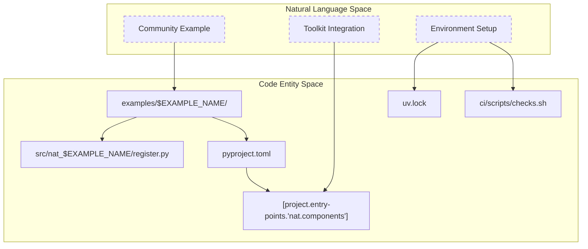
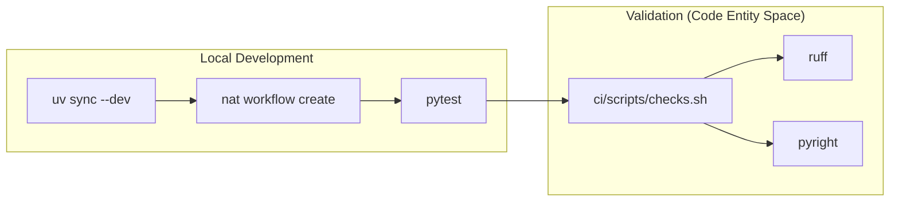

<!-- source: DeepWiki mcp.deepwiki.com · repo NVIDIA/NeMo-Agent-Toolkit-Examples · page 1 Repository Overview · fetched 2026-10-26 -->

# Repository Overview

Relevant source files

The following files were used as context for generating this wiki page:

- [.gitattributes](.gitattributes)
- [CONTRIBUTING.md](CONTRIBUTING.md)
- [README.md](README.md)
- [docs/source/_static/banner.png](docs/source/_static/banner.png)
- [pyproject.toml](pyproject.toml)

The **NeMo Agent Toolkit Examples** repository serves as a centralized hub for community-driven use cases and specialized scenarios built on top of the [NVIDIA NeMo Agent Toolkit (NAT)](https://github.com/NVIDIA/NeMo-Agent-Toolkit). While the core toolkit repository focuses on feature-specific demonstrations, this repository provides end-to-end applications, complex agentic workflows, and integrations with third-party protocols like the Model Context Protocol (MCP).

### Purpose and Relationship to NAT
The examples in this repository are designed to be self-contained and modular. They utilize the NAT plugin system to register tools and workflows, allowing users to run them via the `nat` CLI or integrate them into larger systems.

| Aspect | NeMo Agent Toolkit (Core) | NeMo Agent Toolkit Examples |
| :--- | :--- | :--- |
| **Focus** | Toolkit features and core capabilities [README.md:26-31]() | Community use cases and scenarios [README.md:26-31]() |
| **Update Cadence** | Syncs with every toolkit release [README.md:26-31]() | Updated as needed; bound to specific versions [README.md:26-31]() |
| **Complexity** | Atomic feature demonstrations | Multi-agent orchestration and complex integrations |

**Sources:** [README.md:20-32](), [CONTRIBUTING.md:19-21]()

---

### Repository Structure
The repository follows a strict organizational pattern to ensure compatibility with the NAT discovery mechanism. Every example is located under the `examples/` directory and must include a `pyproject.toml` that registers the example as a NAT component.

**Logical Component Mapping**
The following diagram illustrates how high-level repository concepts map to specific code entities and directory structures.

**Diagram: Repository Organization to Code Entity Mapping**

**Sources:** [CONTRIBUTING.md:56-74](), [pyproject.toml:1-6]()

---

### Key Examples
The repository hosts a variety of specialized agents, ranging from infrastructure monitors to financial tools:

*   **Sandbox Agent:** A general-purpose agent utilizing Docker or Daytona for isolated code execution.
*   **K8s Infrastructure Monitor:** A diagnostic system using LangGraph to monitor and troubleshoot Kubernetes clusters.
*   **MCP RAG Demo:** An agentic Retrieval-Augmented Generation system using Milvus and NVIDIA NIMs.
*   **x402 Payment Tool:** A specialized tool enabling agents to handle HTTP 402 payment negotiations autonomously.
*   **Profiler Agent:** A telemetry-focused agent that analyzes NAT performance traces using Phoenix.

---

### Developer Workflow
The repository utilizes `uv` for dependency management and `ruff` for linting to maintain high code quality across diverse community contributions.

**Diagram: Development and Validation Flow**

**Sources:** [README.md:58-63](), [CONTRIBUTING.md:56-58](), [CONTRIBUTING.md:93-101](), [pyproject.toml:25-41]()

---

### Navigation
To get started with using or contributing to this repository, refer to the following child pages:

*   **[Getting Started & Installation](#1.1)**: Detailed instructions on setting up `uv`, handling `git-lfs` for datasets, and initializing the Python environment.
*   **[Contributing a New Example](#1.2)**: Requirements for new submissions, including the mandatory `nat_` prefix for modules, registration patterns in `register.py`, and CI/CD validation steps.

**Sources:** [README.md:34-73](), [CONTRIBUTING.md:51-92]()

---

