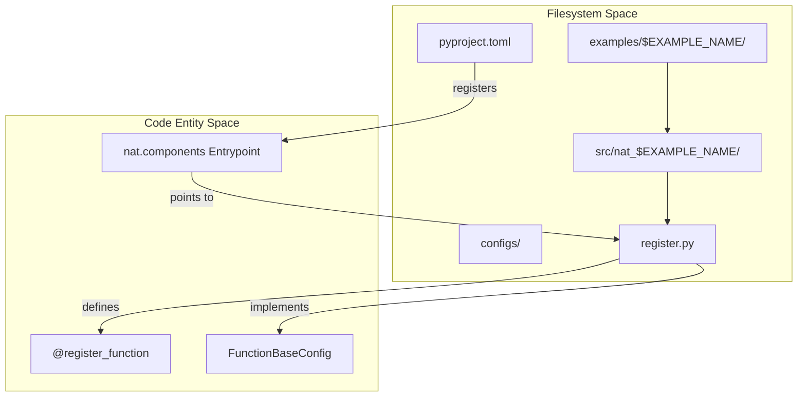
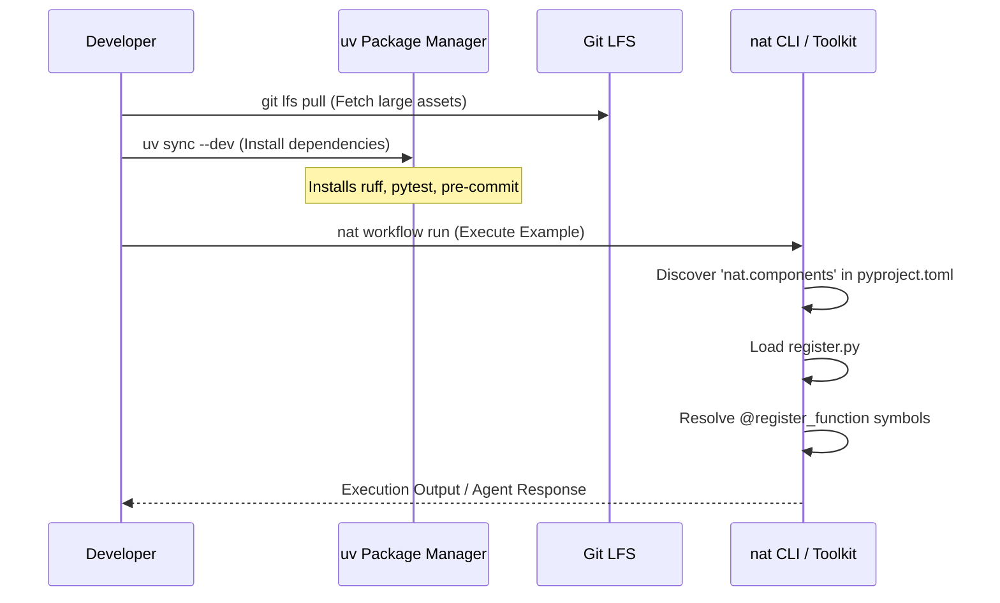

<!-- source: DeepWiki mcp.deepwiki.com · repo NVIDIA/NeMo-Agent-Toolkit-Examples · page 1.1 Getting Started & Installation · fetched 2026-10-26 -->

# Getting Started & Installation

<details>
<summary>Relevant source files</summary>

The following files were used as context for generating this wiki page:

- [.gitignore](.gitignore)
- [CONTRIBUTING.md](CONTRIBUTING.md)
- [README.md](README.md)
- [pyproject.toml](pyproject.toml)

</details>


This page provides a comprehensive technical guide for setting up the development environment for the NeMo Agent Toolkit (NAT) Examples repository. It covers system requirements, dependency management using `uv`, and the initial configuration required to run agentic workflows.

## Environment Prerequisites

The repository is designed for modern Python development, emphasizing reproducible environments and efficient dependency resolution.

### System Requirements
*   **Python Version**: `3.11`, `3.12`, or `3.13` is required [[pyproject.toml:4-4](), [README.md:38-38](), [README.md:65-66]()].
*   **Git LFS**: Required for fetching large datasets (e.g., GAIA benchmark data, vector database files) [[README.md:47-52]()].
*   **uv**: The repository uses `uv` for fast, disk-efficient package management and virtual environment handling [[README.md:54-54]()].

### Python Configuration
The global project configuration defines strict linting and type-checking rules to ensure code quality across all community examples.
*   **Line Length**: 120 characters [[pyproject.toml:27-27]()].
*   **Linting**: Uses `ruff` with `flake8` (E, F, W), `isort` (I), and `pylint` (PL) rules enabled [[pyproject.toml:32-41]()].
*   **Type Checking**: Configured via `pyright` [[pyproject.toml:85-88]()].

**Sources:** [pyproject.toml:4-88](), [README.md:38-66]()

---

## Installation Steps

### 1. Repository Setup
Clone the repository and initialize Git Large File Storage (LFS) to ensure all data assets are correctly downloaded.

```bash
git clone https://github.com/NVIDIA/NeMo-Agent-Toolkit-Examples.git
cd NeMo-Agent-Toolkit-Examples

# Initialize LFS and pull data
git lfs install
git lfs fetch
git lfs pull
```
**Sources:** [README.md:40-52]()

### 2. Virtual Environment Creation
Use `uv` to create a dedicated virtual environment. While the repository supports Python 3.11+, 3.13 is the recommended default for new setups.

```bash
# Create venv with specific python version
uv venv --python 3.13 --seed .venv
source .venv/bin/activate

# Synchronize dependencies including development tools
uv sync --dev
```
The `uv sync --dev` command installs the core `dependency-groups` defined in the root `pyproject.toml`, including `pytest`, `ruff`, and `pre-commit` [[pyproject.toml:8-23]()].

**Sources:** [README.md:58-66](), [pyproject.toml:8-23]()

---

## The `nat` CLI and Scaffolding

The toolkit provides a command-line interface, `nat`, which is the primary entry point for managing examples and workflows.

### Workflow Creation
New examples should be scaffolded using the `nat workflow create` command. This ensures the directory structure complies with the toolkit's discovery mechanism [[CONTRIBUTING.md:57-57]()].

### Example Structure Mapping
The following diagram bridges the "Natural Language" directory concepts to the specific "Code Entities" required by the toolkit for registration.

**Diagram: Example Directory to Code Entity Mapping**

**Sources:** [CONTRIBUTING.md:57-74]()

---

## Initial Execution & Verification

Each example is self-contained within the `examples/` directory. To verify the installation, navigate to a specific example and follow its local `README.md` or `README.ipynb` [[README.md:36-36](), [CONTRIBUTING.md:76-79]()].

### Running Local Checks
Before contributing or running complex workflows, verify the environment health using the provided CI scripts:

```bash
# Run linting, type checks, and formatting
./ci/scripts/checks.sh
```
This script orchestrates several tools defined in the development group, such as `ruff` for linting and `yapf` for formatting [[CONTRIBUTING.md:94-101](), [pyproject.toml:25-82]()].

### Data Flow: Installation to Execution
This diagram illustrates the flow from environment setup to the execution of a registered toolkit component.

**Diagram: Setup and Execution Data Flow**

**Sources:** [README.md:47-66](), [CONTRIBUTING.md:57-101](), [pyproject.toml:8-23]()

---

## Summary of Configuration Files

| File | Purpose | Key Entities |
| :--- | :--- | :--- |
| `pyproject.toml` (Root) | Global dev dependencies & lint rules | `[dependency-groups]`, `[tool.ruff]` |
| `pyproject.toml` (Example) | Example-specific metadata & NAT registration | `[project.entry-points."nat.components"]` |
| `register.py` | Tool and workflow registration | `@register_function`, `FunctionBaseConfig` |
| `.gitignore` | Prevents tracking of large/temp files | `.venv/`, `*.sqlite`, `data/` (partial) |

**Sources:** [pyproject.toml:1-88](), [CONTRIBUTING.md:57-74](), [.gitignore:1-219]()

---

