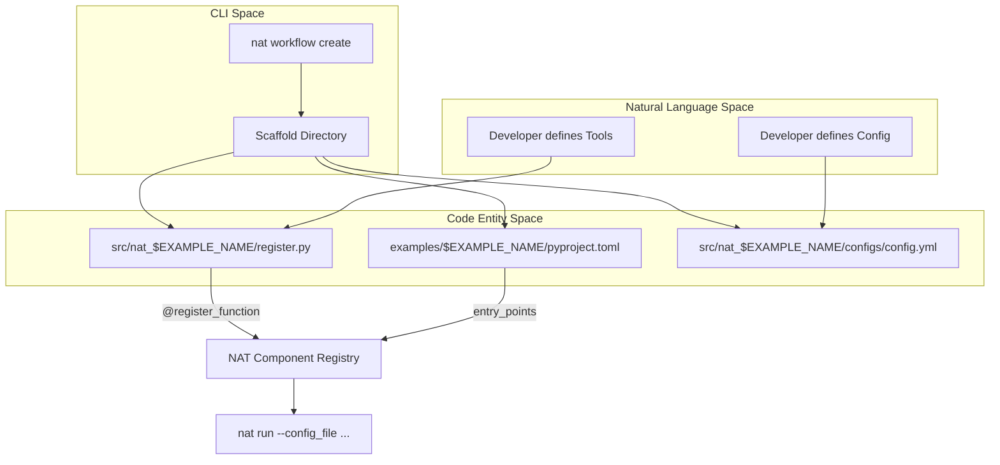
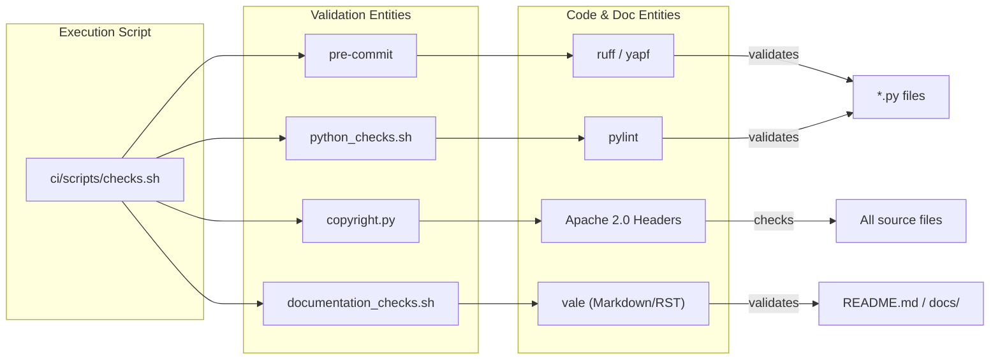

<!-- source: DeepWiki mcp.deepwiki.com · repo NVIDIA/NeMo-Agent-Toolkit-Examples · page 1.2 Contributing a New Example · fetched 2026-10-26 -->

# Contributing a New Example

<details>
<summary>Relevant source files</summary>

The following files were used as context for generating this wiki page:

- [.pre-commit-config.yaml](.pre-commit-config.yaml)
- [CODE-OF-CONDUCT.md](CODE-OF-CONDUCT.md)
- [CONTRIBUTING.md](CONTRIBUTING.md)
- [README.md](README.md)
- [ci/scripts/bootstrap_local_ci.sh](ci/scripts/bootstrap_local_ci.sh)
- [ci/scripts/checks.sh](ci/scripts/checks.sh)
- [ci/scripts/common.sh](ci/scripts/common.sh)
- [ci/scripts/copyright.py](ci/scripts/copyright.py)
- [ci/scripts/documentation_checks.sh](ci/scripts/documentation_checks.sh)
- [ci/scripts/github/common.sh](ci/scripts/github/common.sh)
- [ci/scripts/python_checks.sh](ci/scripts/python_checks.sh)
- [examples/.template/README.md](examples/.template/README.md)

</details>


This guide provides detailed technical instructions for contributing new examples to the NeMo Agent Toolkit (NAT) Examples repository. It covers the mandatory directory structure, the use of the `nat` CLI for scaffolding, configuration requirements, and the CI/CD pipeline that validates all contributions.

## Overview of the Contribution Workflow

Contributors are expected to follow a standardized workflow to ensure that examples are reproducible, well-documented, and compatible with the core NeMo Agent Toolkit.

### Scaffolding with `nat`

The repository requires a specific directory structure for all examples. To maintain consistency, contributors must use the `nat workflow create` command to generate the initial scaffolding `[CONTRIBUTING.md:57-57]()`. This ensures that the example is correctly registered as a plugin and follows the naming conventions required by the toolkit.

### Directory Structure Requirements

Each example is located within the `examples/` directory and must follow this specific layout:

```text
examples/
  $EXAMPLE_NAME/
    configs/             # Symlink to src/nat_$EXAMPLE_NAME/configs/
    data/                # [Optional] Symlink to src/nat_$EXAMPLE_NAME/data/
    scripts/             # [Optional] Setup or utility scripts
    src/
      nat_$EXAMPLE_NAME/ # Package name MUST start with 'nat_' prefix
        configs/
          config.yml     # Core YAML configuration
        data/            # [Optional] Data files
        __init__.py
        register.py      # Plugin registration logic
    README.md            # Documentation (or README.ipynb)
    pyproject.toml       # Build system and NAT entry points
```
*Source: `[CONTRIBUTING.md:58-74]()`*

## Technical Implementation Details

### Plugin Registration (`register.py`)
The `register.py` file is the entry point for the NAT plugin system. It typically involves:
1.  **Config Classes**: Defining a configuration class that inherits from `FunctionBaseConfig` `[examples/.template/README.md:138-138]()`.
2.  **Function Decoration**: Using the `@register_function` decorator to expose Python functions as tools to the agent `[examples/.template/README.md:139-139]()`.

### Dependency Management (`pyproject.toml`)
All dependencies must be specified in the example's local `pyproject.toml`.
-   **Version Constraints**: Dependencies (including `nvidia-nat`) must use at least two-digit versioning (e.g., `nvidia-nat~=1.2`) `[CONTRIBUTING.md:53-54]()`.
-   **Licensing**: All dependencies must have licenses compatible with Apache 2.0 `[CONTRIBUTING.md:54-54]()`.
-   **Registration**: The example must register itself with the `nat` system via entry points defined in this file `[CONTRIBUTING.md:73-73]()`.

### Documentation Standards
Every example requires a `README.md` or `README.ipynb`. A template is provided at `examples/.template/README.md` `[CONTRIBUTING.md:78-79]()`. Mandatory sections include:
-   **Description & Key Features**: What the example does and what NAT capabilities it highlights `[CONTRIBUTING.md:83-84]()`.
-   **Setup & Run Instructions**: Clear commands for `uv pip install` and `nat run` `[examples/.template/README.md:57-82]()`.
-   **Expected Results**: A sample output so users can verify their setup `[CONTRIBUTING.md:87-87]()`.

---

### Logic Flow: From Scaffolding to Execution

The following diagram illustrates the relationship between the `nat` CLI, the directory structure, and the runtime registration.

**Example Scaffolding and Registration Flow**

*Sources: `[CONTRIBUTING.md:57-74]()`, `[examples/.template/README.md:137-142]()`*

---

## Testing and Quality Assurance

### Testing Requirements
Examples must include unit tests using `pytest` `[CONTRIBUTING.md:91-91]()`. These tests should verify core functionality and ensure that updates to dependencies do not break the example `[CONTRIBUTING.md:91-92]()`.

### CI Checks Pipeline
The repository uses a centralized check script `ci/scripts/checks.sh` to enforce standards `[ci/scripts/checks.sh:1-53]()`.

| Check Type | Script / Tool | Description |
| :--- | :--- | :--- |
| **Linting** | `pre-commit` | Runs `ruff`, `yapf`, and `uv-lock` `[.pre-commit-config.yaml:18-35]()`. |
| **Python Style** | `pylint` | Enforced via `ci/scripts/python_checks.sh` `[ci/scripts/python_checks.sh:41-44]()`. |
| **Copyright** | `copyright.py` | Verifies Apache 2.0 headers and correct year ranges `[ci/scripts/copyright.py:133-143]()`. |
| **Documentation** | `vale` | Checks for spelling, style, and broken links in Markdown/RST files `[ci/scripts/documentation_checks.sh:20-22]()`. |

---

### Data Flow: CI Validation Pipeline

The following diagram maps the CI script execution to the specific entities they validate.

**CI Pipeline and Entity Association**

*Sources: `[ci/scripts/checks.sh:23-47]()`, `[ci/scripts/copyright.py:34-43]()`, `[ci/scripts/documentation_checks.sh:20-22]()`*

---

## How to Submit

1.  **Environment Setup**: Ensure `uv` is installed and the environment is synced with `--dev` dependencies `[README.md:54-63]()`.
2.  **Local Validation**: Before submitting a PR, run the local check suite:
    ```bash
    ./ci/scripts/checks.sh
    ```
    *Source: `[CONTRIBUTING.md:100-100]()`*
3.  **Copyright Headers**: Ensure all new files contain the NVIDIA copyright header. The `copyright.py` script will automatically check for the Apache 2.0 license string `[ci/scripts/copyright.py:57-57]()` and the correct year range `[ci/scripts/copyright.py:137-141]()`.
4.  **PR Template**: Follow the instructions in the Pull Request template (located in `.github/` or equivalent) to describe the changes.

*Sources:*
- `[README.md:54-63]()`
- `[CONTRIBUTING.md:91-102]()`
- `[ci/scripts/checks.sh:1-53]()`
- `[ci/scripts/copyright.py:1-206]()`
- `[ci/scripts/documentation_checks.sh:1-25]()`

---

