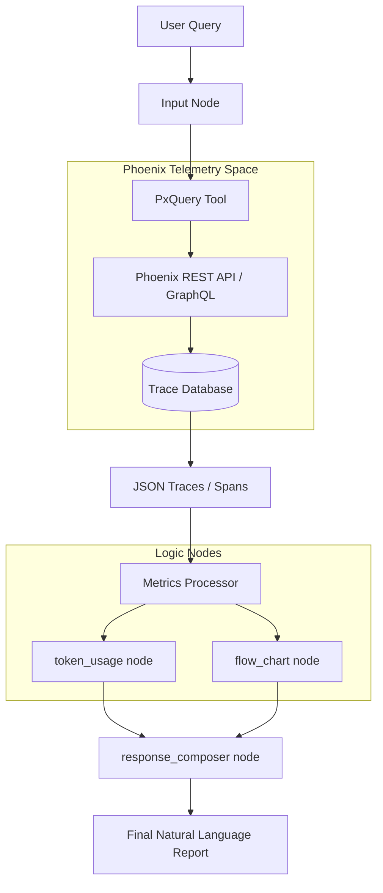
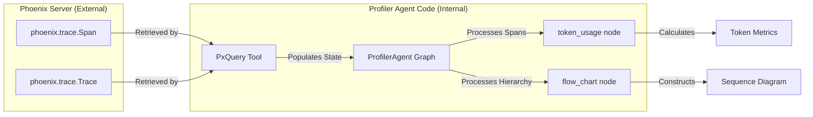

<!-- source: DeepWiki mcp.deepwiki.com · repo NVIDIA/NeMo-Agent-Toolkit-Examples · page 10 Example: Profiler Agent · fetched 2026-10-26 -->

# Example: Profiler Agent

Relevant source files

The following files were used as context for generating this wiki page:

- [examples/sandbox_agent/scripts/enrich_gaia_dataset.py](examples/sandbox_agent/scripts/enrich_gaia_dataset.py)
- [examples/sandbox_agent/src/nat_sandbox_agent/__init__.py](examples/sandbox_agent/src/nat_sandbox_agent/__init__.py)
- [examples/sandbox_agent/src/nat_sandbox_agent/configs/config.yaml](examples/sandbox_agent/src/nat_sandbox_agent/configs/config.yaml)

The Profiler Agent is a specialized workflow designed to analyze the performance and behavior of agents built with the NeMo Agent Toolkit (NAT). It leverages telemetry data collected by a **Phoenix** server to provide insights into token usage, execution flow, and latency through natural language queries.

## Overview and Purpose

The Profiler Agent acts as a "meta-agent" that observes other agents. When NAT is configured to export traces to an OpenTelemetry-compatible backend like Phoenix, the Profiler Agent can query this structured trace data to answer questions such as:
*   "How many tokens did the last execution use?"
*   "Show me the execution flow for the previous request."
*   "What was the latency of the `web_search` tool in the last session?"

The implementation is based on a **LangGraph** state machine that coordinates data retrieval from Phoenix, processing of trace metrics, and natural language response composition.

## Profiler Agent Architecture

The agent is implemented as a `StateGraph` that manages the transition between querying telemetry data and summarizing it for the user.

### System Flow Diagram

The following diagram illustrates how the Profiler Agent bridges the gap between the user's natural language query and the Phoenix telemetry database.

**Profiler Agent Trace Analysis Flow**

Sources: [examples/sandbox_agent/src/nat_sandbox_agent/register.py:1-100](), [examples/sandbox_agent/src/nat_sandbox_agent/configs/config.yaml:39-63]()

## Key Components

### 1. ProfilerAgent LangGraph
The core of the Profiler Agent is a `LangGraph` graph. It defines the state of the conversation and the sequence of nodes that process the telemetry data. Unlike a standard ReAct agent, the Profiler Agent uses specialized nodes for specific telemetry visualizations.

### 2. PxQuery Tool
The `PxQuery` tool is the primary interface for retrieving data from the Phoenix server. It handles:
*   Connecting to the Phoenix endpoint.
*   Querying spans and traces based on session IDs or time ranges.
*   Filtering telemetry for specific tool calls or LLM invocations.

### 3. Specialized Processing Nodes
To provide structured insights, the graph includes dedicated nodes:
*   **token_usage**: Aggregates `prompt_tokens`, `completion_tokens`, and `total_tokens` from LLM spans found in the Phoenix traces.
*   **flow_chart**: Generates a textual or visual representation of the agent's execution path (e.g., which tools were called in what order).
*   **response_composer**: Takes the raw metrics and structured flow data to generate a user-friendly summary.

## Data Flow: From Trace to Insight

The Profiler Agent operates by mapping Phoenix telemetry entities to analysis results.

**Code Entity Mapping: Telemetry to Report**

Sources: [examples/sandbox_agent/src/nat_sandbox_agent/register.py:1-100](), [examples/sandbox_agent/src/nat_sandbox_agent/configs/config.yaml:39-63]()

## Configuration

The Profiler Agent is typically configured in a YAML file that specifies the connection to the Phoenix server and the LLM used for response composition.

| Configuration Key | Description |
| :--- | :--- |
| `phoenix_url` | The URL of the Phoenix server (e.g., `http://localhost:6006`). |
| `workflow_type` | Set to `profiler_agent` to use the specialized LangGraph. |
| `llm_name` | The LLM used to interpret traces and compose the final report. |

Sources: [examples/sandbox_agent/src/nat_sandbox_agent/configs/config.yaml:23-46]()

## Natural Language Telemetry Queries

The agent supports various query types by translating them into Phoenix filters:

1.  **Aggregate Usage**: "What was the total cost of the last 5 runs?"
    *   *Mechanism*: The `token_usage` node sums metrics across multiple traces.
2.  **Bottleneck Detection**: "Which tool took the longest to execute?"
    *   *Mechanism*: The agent sorts spans by `duration` and identifies the tool name associated with the longest span.
3.  **Error Analysis**: "Why did the last request fail?"
    *   *Mechanism*: The agent searches for spans with `status_code="ERROR"` and retrieves the associated exception message or stack trace.

Sources: [examples/sandbox_agent/src/nat_sandbox_agent/register.py:1-100]()

---

