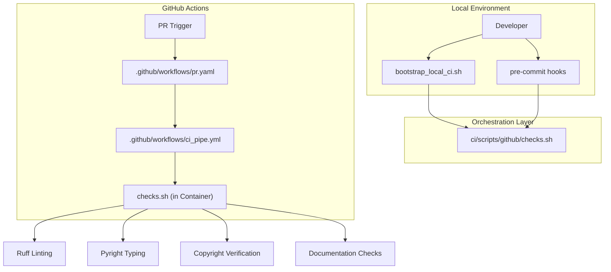
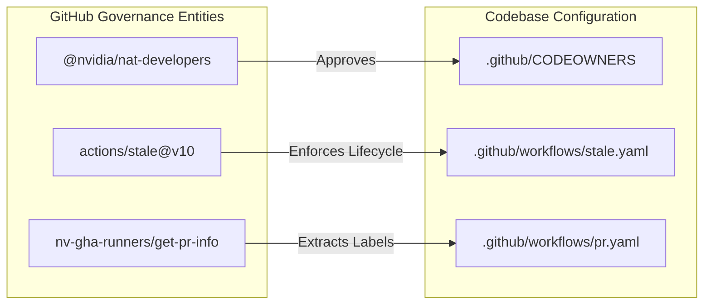

<!-- source: DeepWiki mcp.deepwiki.com · repo NVIDIA/NeMo-Agent-Toolkit-Examples · page 11 CI/CD & Repository Governance · fetched 2026-10-26 -->

# CI/CD & Repository Governance

Relevant source files

The following files were used as context for generating this wiki page:

- [.github/CODEOWNERS](.github/CODEOWNERS)
- [.github/workflows/ci_pipe.yml](.github/workflows/ci_pipe.yml)
- [.github/workflows/pr.yaml](.github/workflows/pr.yaml)
- [.github/workflows/stale.yaml](.github/workflows/stale.yaml)
- [examples/k8s_infra_monitor/src/nat_k8s_infra_monitor/data/eval_dataset.json](examples/k8s_infra_monitor/src/nat_k8s_infra_monitor/data/eval_dataset.json)
- [examples/k8s_infra_monitor/src/nat_k8s_infra_monitor/data/offline_scenarios.json](examples/k8s_infra_monitor/src/nat_k8s_infra_monitor/data/offline_scenarios.json)

This page provides a high-level overview of the automation, quality assurance, and community governance structures governing the NeMo Agent Toolkit Examples repository. The project utilizes a multi-layered CI/CD strategy that combines local developer tooling with robust GitHub Actions workflows to ensure code quality, license compliance, and stable integration across various agent examples.

## CI/CD Infrastructure Overview

The repository's CI/CD infrastructure is designed to validate every contribution against a suite of linting, type-checking, and documentation standards. The system is split between a local-first scripting layer and a cloud-based execution layer using GitHub Actions.

### Repository Automation Flow
The following diagram illustrates the relationship between the local developer environment, the script orchestration layer, and the GitHub Actions execution environment.

**CI/CD Execution Flow**

**Sources:**
- [.github/workflows/pr.yaml:16-24]()
- [.github/workflows/ci_pipe.yml:88-91]()

## Code Quality Tooling

Code quality is enforced through a standardized toolchain managed via `uv`. The primary entry point for these checks is `ci/scripts/github/checks.sh`, which orchestrates several specialized tools:

*   **Ruff**: Used for high-speed Python linting and formatting.
*   **Pyright**: Performs static type checking to ensure API consistency across the toolkit.
*   **Copyright Verification**: A custom script ensures all files contain the mandatory `SPDX-FileCopyrightText` and license headers.
*   **Documentation Validation**: Includes `Vale` for prose style and `markdown-link-check` for link integrity.

For a deep dive into the specific scripts and how to run them locally, see **[CI Scripts & Code Quality Checks](#11.1)**.

## GitHub Workflows & Pipeline

The repository utilizes GitHub Actions to automate the lifecycle of Pull Requests and issues. The main entry point for CI is the `pr.yaml` workflow, which triggers on pushes to `main`, `develop`, and `pull-request/**` branches.

### Pipeline Components
| Workflow | File Path | Purpose |
| :--- | :--- | :--- |
| **PR Builder** | `.github/workflows/pr.yaml` | Main entry point; handles concurrency and skips CI if labels are present. |
| **CI Pipeline** | `.github/workflows/ci_pipe.yml` | Executes the `check` job within a `uv` container. |
| **Stale Manager** | `.github/workflows/stale.yaml` | Automatically labels and closes inactive issues and PRs. |

The `ci_pipe.yml` workflow is parameterized to run across multiple Python versions, specifically targeting `python3.11-bookworm` and `python3.12-bookworm` containers.

**Sources:**
- [.github/workflows/pr.yaml:73-86]()
- [.github/workflows/ci_pipe.yml:26-33]()
- [.github/workflows/stale.yaml:16-19]()

For details on workflow configuration, PR templates, and automation bots, see **[GitHub Workflows & Community Templates](#11.2)**.

## Repository Governance

Governance is managed through GitHub-native features to ensure that contributions are reviewed by the appropriate subject matter experts.

### Ownership and Approvals
The `CODEOWNERS` file defines the default approval rules. Currently, the `@nvidia/nat-developers` team is responsible for all components within the repository.

**Governance Entity Mapping**

### Stale Lifecycle
To maintain repository health, issues and PRs are subject to an automated lifecycle:
*   **Issues**: Marked stale after 60 days of inactivity; closed after 7 additional days.
*   **Pull Requests**: Marked stale after 30 days of inactivity; closed after 14 additional days.

**Sources:**
- [.github/CODEOWNERS:1-2]()
- [.github/workflows/stale.yaml:31-38]()
- [.github/workflows/pr.yaml:60-63]()

---

