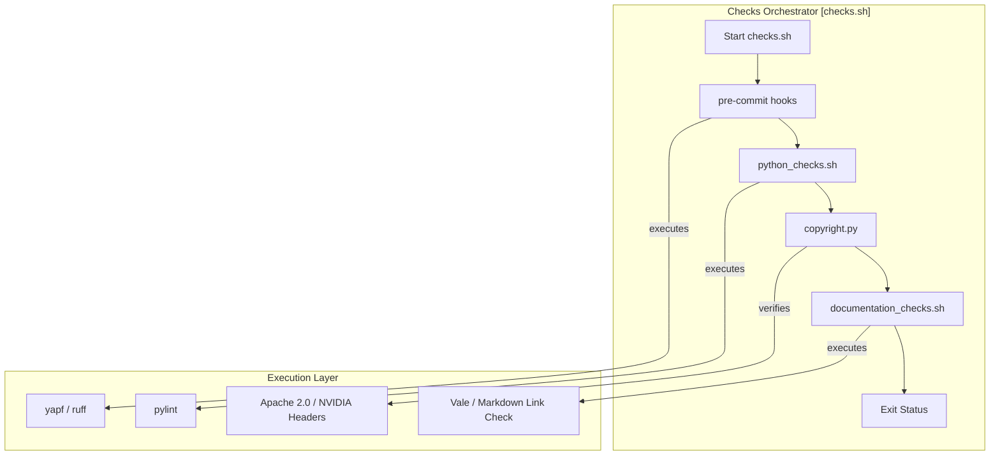
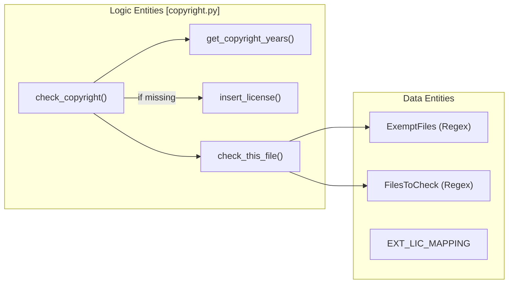

<!-- source: DeepWiki mcp.deepwiki.com · repo NVIDIA/NeMo-Agent-Toolkit-Examples · page 11.1 CI Scripts & Code Quality Checks · fetched 2026-10-26 -->

# CI Scripts & Code Quality Checks

Relevant source files

The following files were used as context for generating this wiki page:

- [.pre-commit-config.yaml](.pre-commit-config.yaml)
- [ci/scripts/bootstrap_local_ci.sh](ci/scripts/bootstrap_local_ci.sh)
- [ci/scripts/checks.sh](ci/scripts/checks.sh)
- [ci/scripts/common.sh](ci/scripts/common.sh)
- [ci/scripts/copyright.py](ci/scripts/copyright.py)
- [ci/scripts/documentation_checks.sh](ci/scripts/documentation_checks.sh)
- [ci/scripts/github/checks.sh](ci/scripts/github/checks.sh)
- [ci/scripts/github/common.sh](ci/scripts/github/common.sh)
- [ci/scripts/gitutils.py](ci/scripts/gitutils.py)
- [ci/scripts/python_checks.sh](ci/scripts/python_checks.sh)
- [uv.lock](uv.lock)

The NeMo Agent Toolkit Examples repository employs a comprehensive CI toolchain to maintain code quality, security, and documentation standards. This system is orchestrated through a set of bash and Python scripts located in the `ci/scripts/` directory, designed to run both in automated GitHub/GitLab environments and locally for developers.

### Orchestration & Workflow

The primary entry point for quality enforcement is `ci/scripts/checks.sh`. This script acts as a central coordinator, executing various specialized checks and aggregating their exit codes to determine the overall success of the pipeline.

#### CI Orchestration Flow
"Code Quality Orchestration"

Sources: [ci/scripts/checks.sh:18-53](), [ci/scripts/python_checks.sh:31-48]()

### Pre-commit Hooks & Formatting

The repository uses `pre-commit` to enforce standards before code is committed. These hooks are defined in `.pre-commit-config.yaml` and cover formatting, linting, and dependency locking.

| Tool | Purpose | Configuration |
| :--- | :--- | :--- |
| `yapf` | Python code formatting | Uses style defined in `pyproject.toml` |
| `ruff-check` | High-performance linting and auto-fixing | Configured for auto-fix (`--fix`) |
| `uv-lock` | Ensures `uv.lock` is synchronized with `pyproject.toml` | Standard `uv` behavior |
| `markdown-link-check` | Validates all hyperlinks in Markdown files | Uses `ci/markdown-link-check-config.json` |

Sources: [.pre-commit-config.yaml:16-45](), [ci/scripts/checks.sh:23-24]()

### Python Quality Checks

Python-specific verification is handled by `ci/scripts/python_checks.sh`, which leverages `ci/scripts/common.sh` to identify modified files in the current branch.

*   **Modified File Detection**: The `get_modified_files` function in `common.sh` uses `git merge-base` to compare the current `COMMIT_SHA` against the `BASE_SHA` (typically `main` or `develop`) [ci/scripts/common.sh:60-82]().
*   **Pylint Enforcement**: Modified files matching the `PYTHON_FILE_REGEX` (covering `.py`, `.pyx`, and `.pxd`) are passed to `pylint` for deep static analysis [ci/scripts/python_checks.sh:31-44]().

Sources: [ci/scripts/python_checks.sh:1-65](), [ci/scripts/common.sh:38-82]()

### Copyright & Header Verification

NVIDIA's compliance requirements for open-source software are enforced via `ci/scripts/copyright.py`. This script ensures every file contains the correct SPDX identifiers and Apache 2.0 license headers.

#### Copyright Logic Entity Map
"Copyright Verification Entities"

**Key Functions:**
*   `check_copyright`: The main loop that iterates through files, validates the presence of the Apache license string, and checks that the copyright year range includes the current year [ci/scripts/copyright.py:126-206]().
*   `get_copyright_years`: Uses regex `CheckSimple` and `CheckDouble` to extract years from the header [ci/scripts/copyright.py:79-86]().
*   `insert_license`: Automatically injects the license header into supported file types if missing, respecting shebang (`#!`) lines [ci/scripts/copyright.py:98-124]().

Sources: [ci/scripts/copyright.py:34-52](), [ci/scripts/copyright.py:126-206]()

### Documentation & Link Checks

The `ci/scripts/documentation_checks.sh` script focuses on the quality of Markdown and ReStructuredText files.

1.  **Vale**: A prose linter that checks for style, grammar, and NVIDIA-specific documentation standards [ci/scripts/documentation_checks.sh:22]().
2.  **Markdown Link Check**: Executed via pre-commit, this validates that all internal and external URLs in the documentation are reachable [.pre-commit-config.yaml:36-41]().
3.  **Exclusions**: Immutable files like `CHANGELOG.md` and `LICENSE.md` are excluded from these checks [ci/scripts/documentation_checks.sh:19-20]().

Sources: [ci/scripts/documentation_checks.sh:1-25](), [.pre-commit-config.yaml:36-41]()

### Local CI Bootstrapping

To allow developers to run the full CI suite locally in an environment identical to the remote runners, the toolkit provides `ci/scripts/bootstrap_local_ci.sh`.

*   **Environment Setup**: It configures `UV_CACHE_DIR` and `PRE_COMMIT_HOME` to persist across runs [ci/scripts/bootstrap_local_ci.sh:41-42]().
*   **Virtual Environment**: It uses `create_env` (defined in `ci/scripts/github/common.sh`) to build a isolated `uv` environment with the `dev` dependency group [ci/scripts/github/common.sh:29-67]().
*   **Stage Execution**: Developers can specify a `STAGE` (e.g., `checks`) to run specific parts of the pipeline locally [ci/scripts/bootstrap_local_ci.sh:49-54]().

Sources: [ci/scripts/bootstrap_local_ci.sh:1-55](), [ci/scripts/github/common.sh:29-67]()

---

