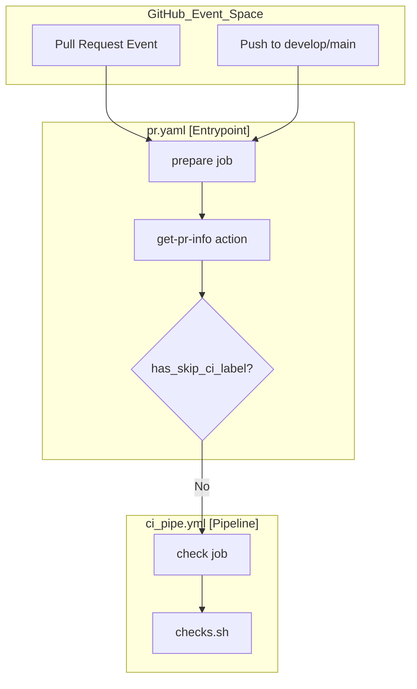
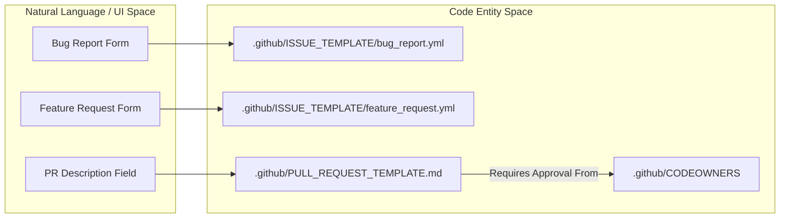

<!-- source: DeepWiki mcp.deepwiki.com · repo NVIDIA/NeMo-Agent-Toolkit-Examples · page 11.2 GitHub Workflows & Community Templates · fetched 2026-10-26 -->

# GitHub Workflows & Community Templates

Relevant source files

The following files were used as context for generating this wiki page:

- [.github/CODEOWNERS](.github/CODEOWNERS)
- [.github/ISSUE_TEMPLATE/bug_report.yml](.github/ISSUE_TEMPLATE/bug_report.yml)
- [.github/ISSUE_TEMPLATE/config.yml](.github/ISSUE_TEMPLATE/config.yml)
- [.github/ISSUE_TEMPLATE/feature_request.yml](.github/ISSUE_TEMPLATE/feature_request.yml)
- [.github/PULL_REQUEST_TEMPLATE.md](.github/PULL_REQUEST_TEMPLATE.md)
- [.github/copy-pr-bot.yaml](.github/copy-pr-bot.yaml)
- [.github/ops-bot.yaml](.github/ops-bot.yaml)
- [.github/workflows/ci_pipe.yml](.github/workflows/ci_pipe.yml)
- [.github/workflows/pr.yaml](.github/workflows/pr.yaml)
- [.github/workflows/stale.yaml](.github/workflows/stale.yaml)
- [examples/k8s_infra_monitor/src/nat_k8s_infra_monitor/data/eval_dataset.json](examples/k8s_infra_monitor/src/nat_k8s_infra_monitor/data/eval_dataset.json)
- [examples/k8s_infra_monitor/src/nat_k8s_infra_monitor/data/offline_scenarios.json](examples/k8s_infra_monitor/src/nat_k8s_infra_monitor/data/offline_scenarios.json)

This page details the automation and governance infrastructure of the NeMo Agent Toolkit (NAT) Examples repository. It covers the GitHub Actions workflows used for Continuous Integration (CI), the stale issue lifecycle, repository bots, and the standardized templates for issues and pull requests.

## GitHub Actions Workflows

The repository utilizes GitHub Actions to enforce code quality, manage issue lifecycles, and automate the build process for pull requests.

### Pull Request & CI Pipeline

The CI process is split into two primary layers: the entry-point workflow and a reusable pipeline.

1.  **`pr.yaml`**: This workflow acts as the orchestrator for pull requests. It determines if the CI should be skipped (via the `skip-ci` label) and sets up the environment using `uv`-based containers `[.github/workflows/pr.yaml:47-86]()`.
2.  **`ci_pipe.yml`**: A reusable workflow called by the PR builder. It defines the execution environment, including specific containers for Python 3.11 and 3.12 `[.github/workflows/ci_pipe.yml:26-33]()`.

#### CI Data Flow
The following diagram illustrates how a PR triggers the validation checks.

**CI Execution Flow**

Sources: `[.github/workflows/pr.yaml:16-86]()`, `[.github/workflows/ci_pipe.yml:72-91]()`

### Stale Issue & PR Management

The `stale.yaml` workflow runs on a daily schedule to maintain repository hygiene by identifying inactive issues and pull requests `[.github/workflows/stale.yaml:16-19]()`.

*   **Issues**: Marked as stale after 60 days of inactivity; closed after an additional 7 days `[.github/workflows/stale.yaml:35-36]()`.
*   **Pull Requests**: Marked as stale after 30 days of inactivity; closed after an additional 14 days `[.github/workflows/stale.yaml:37-38]()`.
*   **Exemptions**: Items with labels `Needs Triage` or `Under Review` are excluded from the stale logic `[.github/workflows/stale.yaml:39-40]()`.

Sources: `[.github/workflows/stale.yaml:1-42]()`

## Repository Governance & Bots

NVIDIA utilizes specialized bots to manage branch health and cross-repository synchronization.

### Ops-Bot Configuration
The `ops-bot.yaml` file configures features from the `rapidsai/ops-bot` repository to automate maintenance tasks `[.github/ops-bot.yaml:16-17]()`.

| Feature | Status | Description |
| :--- | :--- | :--- |
| `auto_merger` | Enabled | Automatically merges PRs that meet criteria `[.github/ops-bot.yaml:19]()` |
| `branch_checker` | Enabled | Validates branch naming conventions `[.github/ops-bot.yaml:20]()` |
| `label_checker` | Enabled | Ensures PRs have required labels `[.github/ops-bot.yaml:21]()` |
| `release_drafter`| Enabled | Drafts release notes based on merged PRs `[.github/ops-bot.yaml:22]()` |
| `forward_merger` | Disabled| Merges changes from older to newer branches `[.github/ops-bot.yaml:23]()` |

### Copy-PR-Bot
The `copy-pr-bot.yaml` enables the GitHub App used for duplicating pull requests across different branches or related repositories, typically used for backporting fixes `[.github/copy-pr-bot.yaml:16-20]()`.

### Code Ownership
The `CODEOWNERS` file defines the default approval authority for the repository. All changes require review from the `@nvidia/nat-developers` team `[.github/CODEOWNERS:1-2]()`.

Sources: `[.github/ops-bot.yaml:1-24]()`, `[.github/copy-pr-bot.yaml:1-20]()`, `[.github/CODEOWNERS:1-3]()`

## Community Templates

Standardized templates ensure that contributors provide necessary technical context for debugging and feature planning.

### Issue Templates
The repository uses YAML-based issue forms for a structured reporting experience.

*   **Bug Report (`bug_report.yml`)**: Requires NAT version, installation method (e.g., Source), a description of expected vs. actual behavior, and a "Minimum Reproducible Example" `[.github/ISSUE_TEMPLATE/bug_report.yml:27-60]()`.
*   **Feature Request (`feature_request.yml`)**: Requires classification (New Feature, Improvement, Change), criticality level, and a description of the problem and ideal solution `[.github/ISSUE_TEMPLATE/feature_request.yml:27-72]()`.

### Pull Request Template
The `PULL_REQUEST_TEMPLATE.md` enforces a "Sign-off" policy, certifying that the contribution is original work or appropriately licensed `[.github/PULL_REQUEST_TEMPLATE.md:7-10]()`. It also prompts the author to link a closing issue and confirm that documentation and tests are updated `[.github/PULL_REQUEST_TEMPLATE.md:4-12]()`.

**Community Structure Mapping**

Sources: `[.github/ISSUE_TEMPLATE/bug_report.yml:1-88]()`, `[.github/ISSUE_TEMPLATE/feature_request.yml:1-89]()`, `[.github/PULL_REQUEST_TEMPLATE.md:1-13]()`

## Summary Table of GitHub Configurations

| File Path | Purpose | Key Entities/Actions |
| :--- | :--- | :--- |
| `.github/workflows/pr.yaml` | PR Entrypoint | `pr-builder`, `get-pr-info` |
| `.github/workflows/ci_pipe.yml` | CI Execution | `check` job, `checks.sh` |
| `.github/workflows/stale.yaml` | Hygiene | `actions/stale@v10` |
| `.github/ops-bot.yaml` | Automation | `auto_merger`, `label_checker` |
| `.github/CODEOWNERS` | Access Control | `@nvidia/nat-developers` |

Sources: `[.github/workflows/pr.yaml:47-52]()`, `[.github/workflows/ci_pipe.yml:73-74]()`, `[.github/workflows/stale.yaml:29-30]()`, `[.github/ops-bot.yaml:19-21]()`, `[.github/CODEOWNERS:2-2]()`

---

