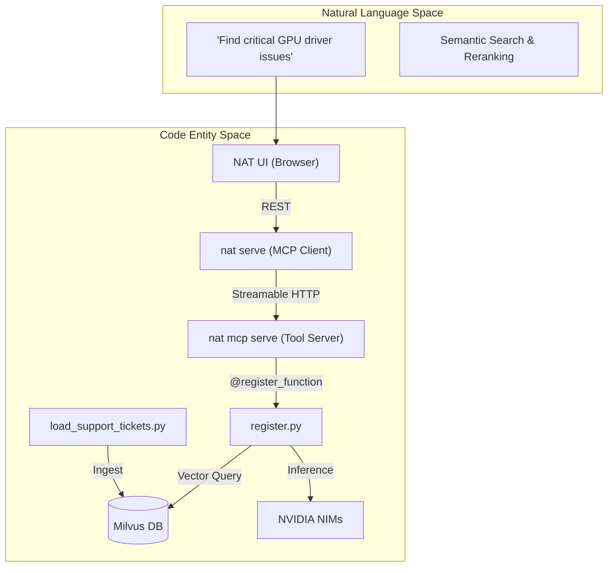
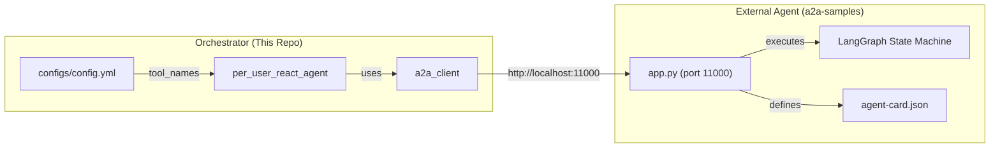

<!-- source: DeepWiki mcp.deepwiki.com · repo NVIDIA/NeMo-Agent-Toolkit-Examples · page 12 Glossary · fetched 2026-10-26 -->

# Glossary

Relevant source files

The following files were used as context for generating this wiki page:

- [CONTRIBUTING.md](CONTRIBUTING.md)
- [README.md](README.md)
- [ci/vale/styles/config/vocabularies/nemo-agent-toolkit-examples/accept.txt](ci/vale/styles/config/vocabularies/nemo-agent-toolkit-examples/accept.txt)
- [examples/agent_identity_tool/.gitignore](examples/agent_identity_tool/.gitignore)
- [examples/agent_identity_tool/src/nat_agent_identity/configs/identity-agent.example.yml](examples/agent_identity_tool/src/nat_agent_identity/configs/identity-agent.example.yml)
- [examples/agent_identity_tool/src/nat_agent_identity/register.py](examples/agent_identity_tool/src/nat_agent_identity/register.py)
- [examples/currency_agent_a2a/README.md](examples/currency_agent_a2a/README.md)
- [examples/currency_agent_a2a/configs/config.yml](examples/currency_agent_a2a/configs/config.yml)
- [examples/currency_agent_a2a/data/sample_queries.json](examples/currency_agent_a2a/data/sample_queries.json)
- [examples/currency_agent_a2a/pyproject.toml](examples/currency_agent_a2a/pyproject.toml)
- [examples/k8s_infra_monitor/src/nat_k8s_infra_monitor/register.py](examples/k8s_infra_monitor/src/nat_k8s_infra_monitor/register.py)
- [examples/kaggle_mcp/README.md](examples/kaggle_mcp/README.md)
- [examples/kaggle_mcp/configs/config-per-user.yml](examples/kaggle_mcp/configs/config-per-user.yml)
- [examples/kaggle_mcp/configs/config.yml](examples/kaggle_mcp/configs/config.yml)
- [examples/kaggle_mcp/pyproject.toml](examples/kaggle_mcp/pyproject.toml)
- [examples/kaggle_mcp/uv.lock](examples/kaggle_mcp/uv.lock)
- [examples/mcp_rag_demo/README.md](examples/mcp_rag_demo/README.md)
- [examples/mcp_rag_demo/scripts/load_support_tickets.py](examples/mcp_rag_demo/scripts/load_support_tickets.py)
- [examples/sandbox_agent/Dockerfile](examples/sandbox_agent/Dockerfile)
- [examples/sandbox_agent/README.md](examples/sandbox_agent/README.md)
- [examples/x402_payment_tool/src/nat_x402_payment/configs/payment-agent.example.yml](examples/x402_payment_tool/src/nat_x402_payment/configs/payment-agent.example.yml)
- [examples/x402_payment_tool/src/nat_x402_payment/register.py](examples/x402_payment_tool/src/nat_x402_payment/register.py)
- [examples/x402_payment_tool/src/nat_x402_payment/wallet.py](examples/x402_payment_tool/src/nat_x402_payment/wallet.py)
- [pyproject.toml](pyproject.toml)

This page provides definitions for codebase-specific terms, abbreviations, and architectural concepts used throughout the NeMo Agent Toolkit Examples. It serves as a technical reference for engineers to map domain language to specific code implementations.

## Protocol Definitions

### MCP (Model Context Protocol)
An open standard that enables AI applications to securely connect to external tools and data sources through a unified interface [examples/mcp_rag_demo/README.md:31-33](). In this repository, MCP is used to expose specialized tools (like RAG search or Kaggle dataset access) to agents.

*   **NAT MCP Server**: A process running `nat mcp serve` that exposes custom functions as MCP tools [examples/mcp_rag_demo/README.md:105-105]().
*   **NAT MCP Client**: An agent or service that consumes tools from an MCP server using transports like `streamable-http` or `stdio` [examples/mcp_rag_demo/README.md:106-106](), [examples/currency_agent_a2a/configs/config.yml:18-22]().

### A2A (Agent-to-Agent)
A protocol for inter-agent communication, allowing one agent to call another agent as if it were a tool.
*   **A2A Client**: A `function_group` type that connects to an external agent's URL to discover and invoke its capabilities [examples/currency_agent_a2a/configs/config.yml:30-32]().
*   **Agent Card**: A metadata file (usually at `/.well-known/agent-card.json`) used for service discovery in the A2A protocol [examples/currency_agent_a2a/README.md:162-166]().

## Architectural Components

### Function Group
A logical grouping of tools or capabilities defined in the YAML configuration. Function groups can be local (Python functions), MCP-based, or A2A-based.
*   **Code Pointer**: Defined under the `function_groups` key in `config.yml` [examples/kaggle_mcp/configs/config.yml:22-29]().

### ReAct Agent
An agent pattern that "Reasons" and then "Acts". It uses an LLM loop to select tools, observe results, and iterate until a final answer is produced [examples/mcp_rag_demo/README.md:39-43]().
*   **Code Pointer**: Configured via `_type: react_agent` or `_type: per_user_react_agent` [examples/kaggle_mcp/configs/config.yml:42-44](), [examples/currency_agent_a2a/configs/config.yml:41-42]().

### Per-User Workflow
A multi-tenant pattern where each unique user (identified by a session cookie) receives an isolated instance of the agent workflow and its associated tool clients [examples/kaggle_mcp/README.md:71-73]().
*   **Implementation**: Triggered by using `per_user_react_agent` and `per_user_mcp_client` in configuration [examples/kaggle_mcp/configs/config-per-user.yml:28-47]().

## Natural Language to Code Mapping

The following diagrams bridge the gap between high-level concepts and the actual entities found in the codebase.

### MCP RAG Data Flow
This diagram maps the "Agentic RAG" concept to specific script and configuration entities.

**Sources:** [examples/mcp_rag_demo/README.md:101-128](), [examples/mcp_rag_demo/README.md:171-174]()

### A2A Integration Mapping
This diagram shows how the "Currency Agent" example maps conceptual agent roles to configuration keys and external repositories.

**Sources:** [examples/currency_agent_a2a/configs/config.yml:30-45](), [examples/currency_agent_a2a/README.md:73-95]()

## Domain Concepts

| Term | Definition | Code/Config Reference |
| :--- | :--- | :--- |
| **NIM** | NVIDIA Inference Microservice; optimized containers for deploying AI models. | `_type: nim` in `llms` config [examples/kaggle_mcp/configs/config.yml:18-20]() |
| **Tool Override** | A configuration mechanism to provide better descriptions or aliases for tools discovered via MCP. | `tool_overrides` key in `function_groups` [examples/kaggle_mcp/configs/config.yml:29-35]() |
| **Sandbox** | An isolated environment (Docker or Daytona) where the agent executes untrusted code. | `examples/sandbox_agent/Dockerfile` [examples/sandbox_agent/Dockerfile:1-20]() |
| **X402** | A protocol for autonomous payments between agents using HTTP 402 Payment Required status. | `examples/x402_payment_tool/` [examples/x402_payment_tool/src/nat_x402_payment/register.py:1-20]() |
| **uv** | A fast Python package installer and resolver used for managing example environments. | `uv pip install` [examples/mcp_rag_demo/README.md:145-149](), [pyproject.toml:153-153]() |

## Technical Abbreviations

*   **GAIA**: General AI Assistants benchmark, used for evaluating the Sandbox Agent [examples/sandbox_agent/README.md:1-20]().
*   **LFS**: Git Large File Storage, used for fetching large datasets like K8s logs or support tickets [README.md:47-52]().
*   **NIM**: NVIDIA Inference Microservice [examples/mcp_rag_demo/README.md:126-127]().
*   **RAG**: Retrieval-Augmented Generation [examples/mcp_rag_demo/README.md:37-37]().

**Sources:** [examples/mcp_rag_demo/README.md:1-174](), [examples/kaggle_mcp/configs/config.yml:1-53](), [examples/currency_agent_a2a/configs/config.yml:1-50](), [README.md:1-73](), [ci/vale/styles/config/vocabularies/nemo-agent-toolkit-examples/accept.txt:1-160]()