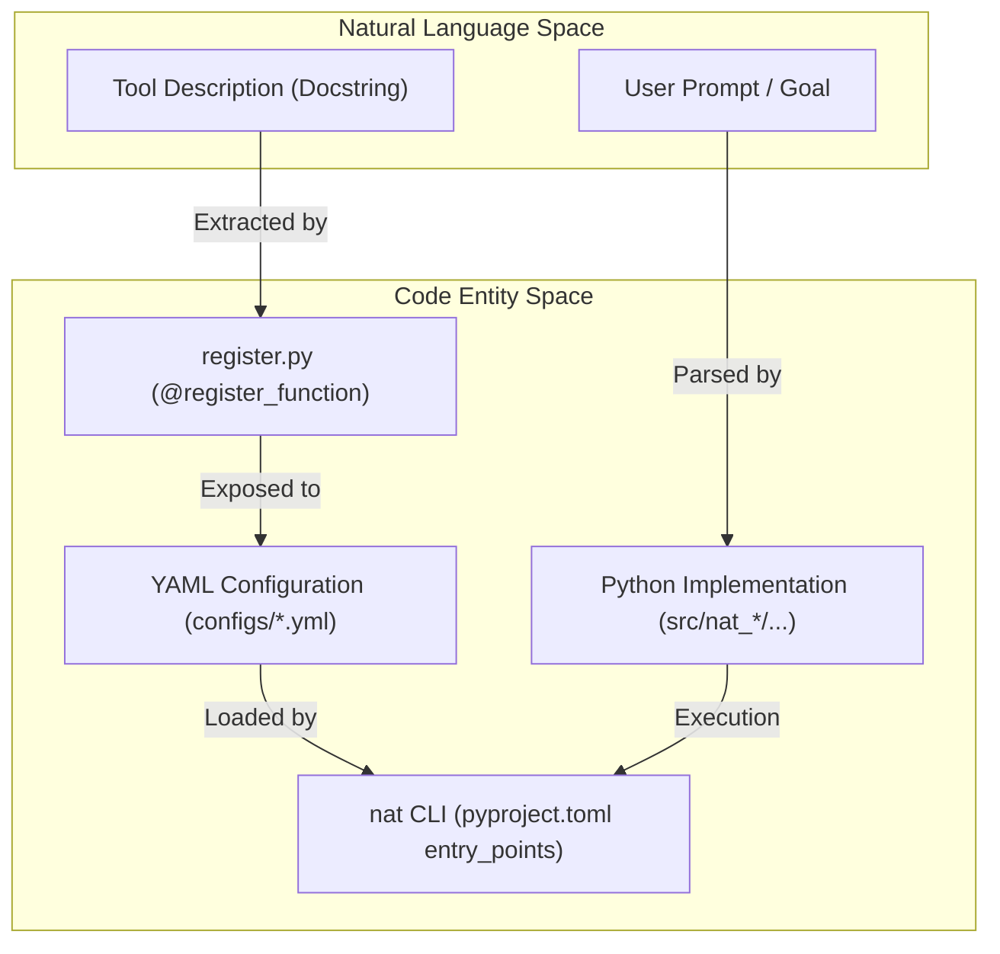
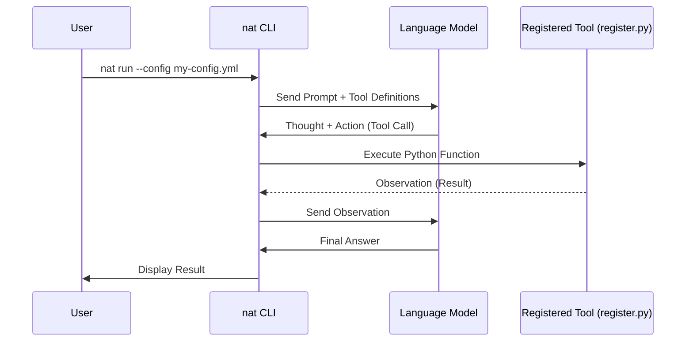

<!-- source: DeepWiki mcp.deepwiki.com · repo NVIDIA/NeMo-Agent-Toolkit-Examples · page 2 Core Concepts & Architecture · fetched 2026-10-26 -->

# Core Concepts & Architecture

Relevant source files

The following files were used as context for generating this wiki page:

- [CONTRIBUTING.md](CONTRIBUTING.md)
- [README.md](README.md)
- [ci/vale/styles/config/vocabularies/nemo-agent-toolkit-examples/accept.txt](ci/vale/styles/config/vocabularies/nemo-agent-toolkit-examples/accept.txt)
- [examples/agent_identity_tool/.gitignore](examples/agent_identity_tool/.gitignore)
- [pyproject.toml](pyproject.toml)

This page provides a high-level overview of the architectural patterns and shared components used across the NeMo Agent Toolkit (NAT) examples. The repository is designed around a modular, plugin-based architecture that leverages YAML for configuration and standardized protocols for agent communication.

## Architectural Overview

The NeMo Agent Toolkit Examples follow a consistent structural pattern to ensure composability and ease of use. Every example is a self-contained Python package that registers itself with the `nat` CLI via entry points. The architecture bridges the gap between high-level natural language instructions and low-level Python execution through a unified registration and configuration system.

### System Mapping: Logic to Code

The following diagram illustrates how conceptual agent components map to specific code entities within the repository.

**Agent Logic to Code Entity Mapping**

**Sources:** [CONTRIBUTING.md:58-74](), [pyproject.toml:63-63]()

---

## Plugin & Registration System

The foundation of the toolkit is the `register.py` system. Instead of hardcoding tools into an agent, developers use the `@register_function` decorator to expose Python functions or LangChain tools to the NAT ecosystem. This allows the `nat` CLI to discover and instantiate tools dynamically.

Key components include:
*   **`register.py`**: The central hub for each example where tools and workflows are declared [CONTRIBUTING.md:71-71]().
*   **`@register_function`**: A decorator used to wrap logic, making it available for selection in YAML configurations.
*   **Entry Points**: Examples register themselves in `pyproject.toml` under `[project.entry-points."nat.components"]`, allowing the toolkit to locate the `register.py` file [CONTRIBUTING.md:73-73]().

For details, see [Plugin & Registration System](#2.1).

---

## YAML Configuration System

All examples are driven by YAML files located in the `configs/` directory [CONTRIBUTING.md:61-61](). This system separates the implementation logic from the runtime behavior, allowing users to swap LLM providers, adjust tool parameters, or modify agent prompts without changing code.

The configuration typically defines:
*   **LLMs**: Which models (e.g., NVIDIA NIM, OpenAI) to use for different tasks.
*   **Function Groups**: Logical groupings of tools (e.g., "filesystem-tools", "k8s-diagnostic-tools").
*   **Workflow**: The execution pattern, such as a standard ReAct loop or a custom LangGraph state machine.

For details, see [YAML Configuration System](#2.2).

---

## The nat CLI and Execution Loop

The `nat` CLI serves as the primary interface for interacting with examples. It handles the orchestration of the **ReAct (Reasoning and Acting) agent loop**, which follows a specific execution flow:

**ReAct Loop Execution Flow**

**Sources:** [CONTRIBUTING.md:57-57](), [README.md:68-69]()

---

## Protocol Integrations: MCP and A2A

To support complex, distributed agentic workflows, the examples utilize two primary communication protocols:

1.  **Model Context Protocol (MCP)**: Used to expose tools and data sources to agents in a standardized way. This allows a NAT agent to act as either an MCP client (consuming tools) or an MCP server (providing tools).
2.  **Agent-to-Agent (A2A)**: Facilitates orchestration between multiple specialized agents, enabling "manager" agents to delegate tasks to "worker" agents across different environments.

For details, see [Protocol Integrations: MCP and A2A](#2.3).

---

## Repository Structure & Standards

To maintain consistency, all examples adhere to a strict directory layout and coding standard.

| Component | Requirement |
| :--- | :--- |
| **Naming** | All modules must start with the `nat_` prefix [CONTRIBUTING.md:65-65](). |
| **Dependencies** | Defined in `pyproject.toml` with version pinning [CONTRIBUTING.md:54-54](). |
| **Tooling** | Uses `uv` for environment management and `ruff` for linting [pyproject.toml:18-18](), [README.md:54-63](). |
| **Testing** | Mandatory `pytest` suites for core functionality [CONTRIBUTING.md:91-91](). |

**Sources:** [CONTRIBUTING.md:58-74](), [pyproject.toml:25-41](), [README.md:38-39]()

---

