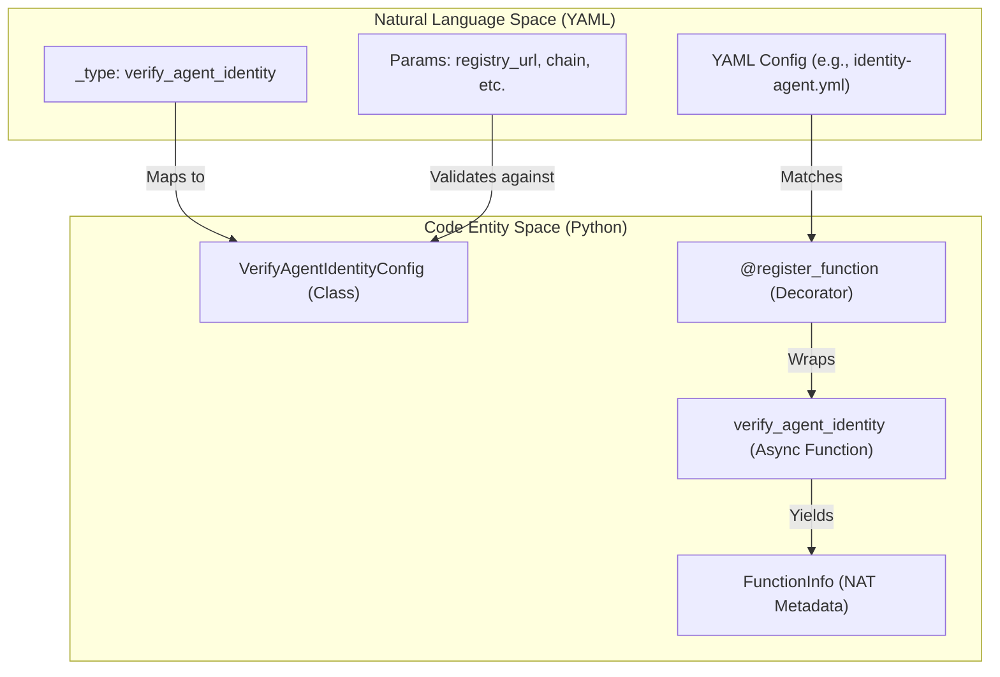
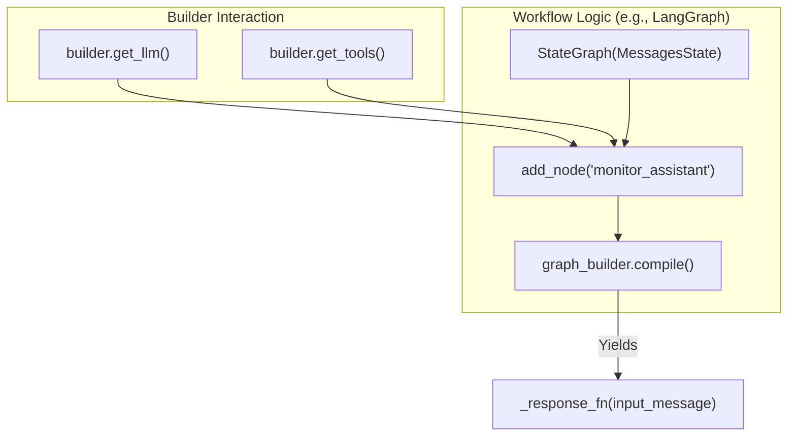

<!-- source: DeepWiki mcp.deepwiki.com · repo NVIDIA/NeMo-Agent-Toolkit-Examples · page 2.1 Plugin & Registration System · fetched 2026-10-26 -->

# Plugin & Registration System

<details>
<summary>Relevant source files</summary>

The following files were used as context for generating this wiki page:

- [examples/agent_identity_tool/src/nat_agent_identity/__init__.py](examples/agent_identity_tool/src/nat_agent_identity/__init__.py)
- [examples/agent_identity_tool/src/nat_agent_identity/configs/identity-agent.example.yml](examples/agent_identity_tool/src/nat_agent_identity/configs/identity-agent.example.yml)
- [examples/agent_identity_tool/src/nat_agent_identity/register.py](examples/agent_identity_tool/src/nat_agent_identity/register.py)
- [examples/k8s_infra_monitor/src/nat_k8s_infra_monitor/register.py](examples/k8s_infra_monitor/src/nat_k8s_infra_monitor/register.py)
- [examples/mcp_rag_demo/src/nat_mcp_rag_demo/register.py](examples/mcp_rag_demo/src/nat_mcp_rag_demo/register.py)
- [examples/sandbox_agent/src/nat_sandbox_agent/register.py](examples/sandbox_agent/src/nat_sandbox_agent/register.py)
- [examples/x402_payment_tool/src/nat_x402_payment/__init__.py](examples/x402_payment_tool/src/nat_x402_payment/__init__.py)

</details>


The NeMo Agent Toolkit (NAT) Examples repository utilizes a standardized plugin and registration system to expose tools and workflows to the NAT orchestrator. This system bridges high-level YAML configurations with Python implementations using a combination of decorators, Pydantic-based configuration schemas, and a Builder pattern for dependency injection.

## Core Registration Components

The registration system relies on three primary pillars:
1.  **Configuration Schemas**: Subclasses of `FunctionBaseConfig` that define the parameters available in YAML.
2.  **Registration Decorator**: The `@register_function` decorator that marks a Python function as a NAT-compatible component.
3.  **Entrypoints**: The `nat.components` entrypoint in `pyproject.toml` which allows the NAT CLI to discover external example packages.

### Function Registration Workflow

The following diagram illustrates the flow from a YAML configuration to a live tool or workflow instance within the toolkit.

**Diagram: Natural Language Config to Code Entity Mapping**

**Sources:** [examples/agent_identity_tool/src/nat_agent_identity/register.py:46-70](), [examples/agent_identity_tool/src/nat_agent_identity/configs/identity-agent.example.yml:19-27]()

---

## The `@register_function` Decorator

The `@register_function` decorator is the primary interface for adding new capabilities. It requires a `config_type` (a Pydantic model) and a list of supported `framework_wrappers` (e.g., `LLMFrameworkEnum.LANGCHAIN`).

### Implementation Details
When a function is decorated, it must follow a specific signature: `async def name(config: ConfigClass, builder: Builder)`.
*   **`config`**: An instance of the configuration class populated with values from the YAML file.
*   **`builder`**: An instance of the `Builder` class used to fetch LLMs, embedders, or other tools registered in the system.

**Sources:** [examples/mcp_rag_demo/src/nat_mcp_rag_demo/register.py:63-64](), [examples/agent_identity_tool/src/nat_agent_identity/register.py:145-149]()

---

## The Builder Pattern

The `Builder` class is a central utility provided by NAT to handle the instantiation of complex components. It ensures that LLMs and tools are created with the correct providers (e.g., NVIDIA NIM) and wrapped for the requested framework (e.g., LangChain).

### Key Builder Methods
| Method | Purpose | Example Usage |
| :--- | :--- | :--- |
| `get_llm` | Fetches an LLM instance based on a reference. | [examples/k8s_infra_monitor/src/nat_k8s_infra_monitor/register.py:79]() |
| `get_tool` | Fetches a single registered tool by name. | [examples/k8s_infra_monitor/src/nat_k8s_infra_monitor/register.py:83]() |
| `get_tools` | Fetches a list of tools simultaneously. | [examples/k8s_infra_monitor/src/nat_k8s_infra_monitor/register.py:97]() |
| `get_embedder`| Fetches an embedding model (e.g., for RAG). | [examples/mcp_rag_demo/src/nat_mcp_rag_demo/register.py:68]() |

**Sources:** [examples/k8s_infra_monitor/src/nat_k8s_infra_monitor/register.py:79-97](), [examples/mcp_rag_demo/src/nat_mcp_rag_demo/register.py:68-69]()

---

## Workflow vs. Tool Registration

While both use `@register_function`, their implementations differ in what they `yield` or `return`.

### 1. Tool Registration
Tools typically define an inner function that performs the actual work. The registration function then yields a `FunctionInfo` object created from that inner function.

```python
@register_function(config_type=SearchSupportTicketsConfig, ...)
async def search_support_tickets_tool(config, builder):
    async def _search(query: str):
        # Implementation
        ...
    yield FunctionInfo.from_fn(_search, ...)
```
**Sources:** [examples/mcp_rag_demo/src/nat_mcp_rag_demo/register.py:63-109]()

### 2. Workflow Registration
Workflows (like a LangGraph agent) orchestrate multiple tools. They use the `builder` to gather tools and LLMs, compile a graph or chain, and yield a response function that serves as the entry point for the agent.

**Diagram: Workflow Instantiation Logic**

**Sources:** [examples/k8s_infra_monitor/src/nat_k8s_infra_monitor/register.py:70-138]()

---

## Configuration Management with `FunctionBaseConfig`

Every registered component must have a configuration class inheriting from `FunctionBaseConfig`. This class defines the schema for the YAML configuration.

*   **`name` parameter**: The `name` argument in `FunctionBaseConfig(..., name="...")` must match the `_type` field in the YAML.
*   **Field Validation**: Uses Pydantic `Field` for descriptions and default values, which are also used to generate documentation for the NAT CLI.

**Sources:** [examples/agent_identity_tool/src/nat_agent_identity/register.py:46-68](), [examples/mcp_rag_demo/src/nat_mcp_rag_demo/register.py:31-37]()

## Example Entrypoint Discovery

For the NAT CLI to find these registrations, the example packages must define an entrypoint in their `pyproject.toml`. This allows the toolkit to dynamically load the `register.py` module of each example.

Example structure for discovery:
1.  **`pyproject.toml`**: Defines `[project.entry-points."nat.components"]`.
2.  **`register.py`**: Contains the `@register_function` calls.
3.  **`__init__.py`**: Often empty, but required for the package to be importable.

**Sources:** [examples/agent_identity_tool/src/nat_agent_identity/__init__.py:1-15](), [examples/agent_identity_tool/src/nat_agent_identity/register.py:1-43]()

---

