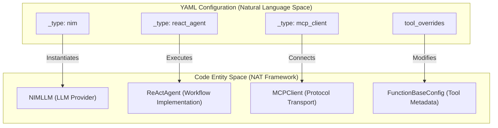
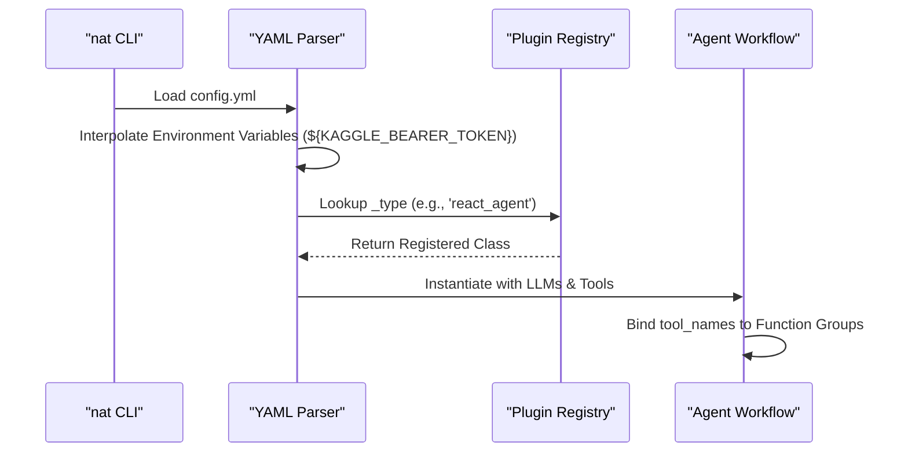

<!-- source: DeepWiki mcp.deepwiki.com · repo NVIDIA/NeMo-Agent-Toolkit-Examples · page 2.2 YAML Configuration System · fetched 2026-10-26 -->

# YAML Configuration System

<details>
<summary>Relevant source files</summary>

The following files were used as context for generating this wiki page:

- [examples/currency_agent_a2a/README.md](examples/currency_agent_a2a/README.md)
- [examples/currency_agent_a2a/configs/config.yml](examples/currency_agent_a2a/configs/config.yml)
- [examples/currency_agent_a2a/data/sample_queries.json](examples/currency_agent_a2a/data/sample_queries.json)
- [examples/currency_agent_a2a/pyproject.toml](examples/currency_agent_a2a/pyproject.toml)
- [examples/k8s_infra_monitor/src/nat_k8s_infra_monitor/configs/config_live_mode.yml](examples/k8s_infra_monitor/src/nat_k8s_infra_monitor/configs/config_live_mode.yml)
- [examples/k8s_infra_monitor/src/nat_k8s_infra_monitor/configs/config_offline_mode.yml](examples/k8s_infra_monitor/src/nat_k8s_infra_monitor/configs/config_offline_mode.yml)
- [examples/kaggle_mcp/README.md](examples/kaggle_mcp/README.md)
- [examples/kaggle_mcp/configs/config-per-user.yml](examples/kaggle_mcp/configs/config-per-user.yml)
- [examples/kaggle_mcp/configs/config.yml](examples/kaggle_mcp/configs/config.yml)
- [examples/kaggle_mcp/pyproject.toml](examples/kaggle_mcp/pyproject.toml)
- [examples/kaggle_mcp/uv.lock](examples/kaggle_mcp/uv.lock)
- [examples/mcp_rag_demo/src/nat_mcp_rag_demo/configs/mcp-client-for-ui.yml](examples/mcp_rag_demo/src/nat_mcp_rag_demo/configs/mcp-client-for-ui.yml)
- [examples/mcp_rag_demo/src/nat_mcp_rag_demo/configs/support-ui.yml](examples/mcp_rag_demo/src/nat_mcp_rag_demo/configs/support-ui.yml)

</details>


The NeMo Agent Toolkit (NAT) uses a standardized YAML configuration schema across all examples to define the behavior of LLMs, tools, workflows, and authentication providers. This system enables modular agent design, allowing developers to swap models or toolsets without modifying the underlying Python code.

## Configuration Schema Overview

The configuration is organized into top-level blocks that correspond to the core components of the NAT ecosystem.

| Section | Description |
| :--- | :--- |
| `llms` | Defines the Large Language Models (e.g., NVIDIA NIM, OpenAI) used by agents. |
| `functions` | Configures individual tools with specific parameters (e.g., Milvus URIs, thresholds). |
| `function_groups` | Aggregates tools from external protocols like **MCP** or **A2A**. |
| `workflow` | Defines the agent logic (e.g., `react_agent`) and its tool/LLM bindings. |
| `authentication` | Centralizes API keys and bearer tokens for external services. |
| `general` | System-level settings like timeouts and cleanup intervals. |

### Environment Variable Interpolation
The system supports dynamic value injection using the `${VAR_NAME}` syntax. This is primarily used for sensitive credentials to prevent them from being hardcoded in configuration files [examples/kaggle_mcp/configs/config.yml:39-39]().

Sources: [examples/kaggle_mcp/configs/config.yml:16-52](), [examples/currency_agent_a2a/configs/config.yml:16-49]()

## LLM Configuration

The `llms` block defines the model provider and inference parameters. The `_type` field determines which factory class is used to instantiate the LLM client.

```yaml
llms:
  nim_llm:
    _type: nim
    model_name: meta/llama-3.1-70b-instruct
    temperature: 0.0
    max_tokens: 1024
```
*   **nim**: Connects to NVIDIA NIM endpoints [examples/kaggle_mcp/configs/config.yml:18-21]().
*   **Parameters**: Standard parameters like `temperature` and `max_tokens` are passed directly to the model provider [examples/currency_agent_a2a/configs/config.yml:35-39]().

Sources: [examples/kaggle_mcp/configs/config.yml:16-21](), [examples/currency_agent_a2a/configs/config.yml:34-40]()

## Tooling: Functions and Function Groups

NAT distinguishes between local tools (`functions`) and protocol-based tool collections (`function_groups`).

### 1. Functions (Local Tools)
Used for tools implemented within the example's codebase. Each entry must specify a `_type` that matches a registered tool name.

```yaml
functions:
  node_status_check:
    _type: node_status_check
    offline_mode: false
```
*   **Source**: [examples/k8s_infra_monitor/src/nat_k8s_infra_monitor/configs/config_live_mode.yml:20-23]()

### 2. Function Groups (MCP & A2A)
Used to import tools from external servers via the **Model Context Protocol (MCP)** or **Agent-to-Agent (A2A)** protocol.

*   **mcp_client**: Connects to an MCP server (e.g., via `stdio` or `streamable-http`) [examples/kaggle_mcp/configs/config.yml:23-28]().
*   **a2a_client**: Connects to another NAT-compatible agent [examples/currency_agent_a2a/configs/config.yml:30-32]().
*   **tool_overrides**: Allows redefining tool descriptions or aliases to improve LLM steering [examples/kaggle_mcp/configs/config.yml:29-34]().

Sources: [examples/kaggle_mcp/configs/config.yml:22-35](), [examples/currency_agent_a2a/configs/config.yml:16-32]()

## Workflow Patterns

The `workflow` block dictates the agent's execution loop. NAT supports two primary patterns: Single-User and Multi-User (Per-User).

### Single-User Pattern
Commonly used for CLI-based agents or local scripts. The workflow is instantiated once at startup.

```yaml
workflow:
  _type: react_agent
  tool_names: [kaggle_mcp_tools]
  llm_name: nim_llm
```
*   **Source**: [examples/kaggle_mcp/configs/config.yml:42-48]()

### Multi-User (Per-User) Pattern
Used for `nat serve` deployments where multiple users interact with the same endpoint. It ensures that session state and tool clients (especially MCP/A2A) are isolated per user.

```yaml
workflow:
  _type: per_user_react_agent
  tool_names:
    - kaggle_mcp_tools
  llm_name: nim_llm
```
*   **Source**: [examples/kaggle_mcp/configs/config-per-user.yml:46-52]()

### Entity Mapping: Configuration to Code
The following diagram illustrates how YAML keys map to specific code entities and protocols.

**Natural Language Space to Code Entity Space**

Sources: [examples/kaggle_mcp/configs/config.yml:16-52](), [examples/currency_agent_a2a/configs/config.yml:16-49]()

## Implementation and Data Flow

When `nat run` or `nat serve` is executed, the configuration is parsed and used to build the agent's runtime environment.

**Data Flow: Configuration Loading**

Sources: [examples/kaggle_mcp/README.md:67-77](), [examples/kaggle_mcp/configs/config.yml:39-39]()

## Summary of Shared Keys

| Key | Example Value | Role |
| :--- | :--- | :--- |
| `_type` | `nim`, `react_agent`, `mcp_client` | The identifier used by the plugin system to find the Python class. |
| `tool_names` | `[tool_a, group_b]` | List of local functions or function groups the agent can access. |
| `llm_name` | `nim_llm` | References a specific entry in the `llms` block. |
| `auth_provider` | `kaggle` | References a specific entry in the `authentication` block. |
| `transport` | `stdio`, `streamable-http` | Defines the communication channel for MCP servers. |

Sources: [examples/kaggle_mcp/configs/config.yml:16-53](), [examples/currency_agent_a2a/configs/config.yml:16-50]()

---

