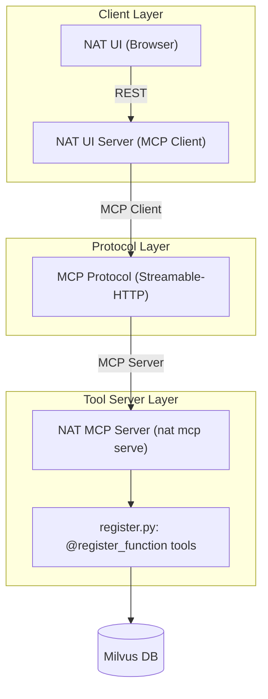
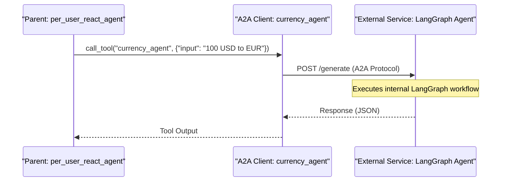

<!-- source: DeepWiki mcp.deepwiki.com · repo NVIDIA/NeMo-Agent-Toolkit-Examples · page 2.3 Protocol Integrations: MCP and A2A · fetched 2026-10-26 -->

# Protocol Integrations: MCP and A2A

Relevant source files

The following files were used as context for generating this wiki page:

- [examples/currency_agent_a2a/README.md](examples/currency_agent_a2a/README.md)
- [examples/currency_agent_a2a/configs/config.yml](examples/currency_agent_a2a/configs/config.yml)
- [examples/currency_agent_a2a/data/sample_queries.json](examples/currency_agent_a2a/data/sample_queries.json)
- [examples/currency_agent_a2a/pyproject.toml](examples/currency_agent_a2a/pyproject.toml)
- [examples/kaggle_mcp/README.md](examples/kaggle_mcp/README.md)
- [examples/kaggle_mcp/configs/config-per-user.yml](examples/kaggle_mcp/configs/config-per-user.yml)
- [examples/kaggle_mcp/configs/config.yml](examples/kaggle_mcp/configs/config.yml)
- [examples/kaggle_mcp/pyproject.toml](examples/kaggle_mcp/pyproject.toml)
- [examples/kaggle_mcp/uv.lock](examples/kaggle_mcp/uv.lock)
- [examples/mcp_rag_demo/README.md](examples/mcp_rag_demo/README.md)
- [examples/mcp_rag_demo/pyproject.toml](examples/mcp_rag_demo/pyproject.toml)
- [examples/mcp_rag_demo/scripts/load_support_tickets.py](examples/mcp_rag_demo/scripts/load_support_tickets.py)

This page describes the two primary inter-agent communication protocols integrated into the NeMo Agent Toolkit (NAT) examples: the **Model Context Protocol (MCP)** and the **Agent-to-Agent (A2A)** protocol. These protocols enable agents to consume tools from external servers and orchestrate complex tasks across multiple specialized agents.

## Model Context Protocol (MCP)

MCP is an open standard that allows AI applications to securely connect to external tools through a unified interface [examples/mcp_rag_demo/README.md:31-33](). NAT implements both MCP client and server capabilities, allowing examples to either expose local functions as tools or consume tools from third-party MCP servers.

### Transport Types and Discovery
NAT supports multiple transport layers for MCP, configured via the `function_groups` YAML section:

*   **`streamable-http`**: Used for remote tool servers (e.g., Kaggle, remote RAG servers). It is the recommended transport for HTTP-based MCP servers [examples/kaggle_mcp/README.md:104-105]().
*   **`stdio`**: Used for local process-based tool servers, where the agent starts a sub-process to communicate with the tool [examples/currency_agent_a2a/configs/config.yml:20-22]().

Tool discovery can be performed via the NAT CLI using `nat mcp client tool list` [examples/kaggle_mcp/README.md:113-119]().

### MCP Architecture: RAG Demo
The `mcp_rag_demo` illustrates a multi-tier MCP architecture where a UI server acts as an MCP client to a dedicated Tool Server.

**Data Flow: NAT MCP RAG**

*Sources: [examples/mcp_rag_demo/README.md:101-128](), [examples/mcp_rag_demo/pyproject.toml:37-38]()*

### Authentication and Tool Overrides
MCP integrations often require authentication and prompt engineering to guide the LLM's tool usage.

1.  **Authentication**: NAT provides an `api_key` provider supporting `Bearer` schemes, typically linked to environment variables like `KAGGLE_BEARER_TOKEN` [examples/kaggle_mcp/configs/config.yml:36-40]().
2.  **Tool Overrides**: When an MCP server provides generic descriptions, `tool_overrides` in the YAML config allow developers to redefine tool descriptions or aliases to help the LLM select the correct parameters (e.g., forcing the use of `search` instead of `query`) [examples/kaggle_mcp/README.md:172-182]().

## Agent-to-Agent (A2A) Protocol

The A2A protocol enables agent orchestration by allowing a "Parent" agent to call a "Child" agent as if it were a standard tool. This is implemented via the `a2a_client` function group type [examples/currency_agent_a2a/configs/config.yml:30-32]().

### A2A Implementation: Currency Agent
In the `currency_agent_a2a` example, a NAT ReAct agent acts as an A2A client to an external LangGraph-based service.

**Entity Mapping: A2A Communication**

*Sources: [examples/currency_agent_a2a/README.md:34-54](), [examples/currency_agent_a2a/configs/config.yml:30-46]()*

### Multi-User Isolation
For A2A and MCP integrations in production environments, NAT utilizes the `per_user_react_agent` workflow. This ensures that:
*   Each user (identified by a session cookie) receives an isolated instance of the workflow [examples/kaggle_mcp/README.md:71-98]().
*   A2A client connections are maintained per-user to prevent session leakage [examples/currency_agent_a2a/README.md:129-134]().
*   Timeouts and cleanup intervals are managed via `general` config settings [examples/kaggle_mcp/configs/config-per-user.yml:16-18]().

## Summary of Protocol Configurations

| Feature | MCP (`mcp_client`) | A2A (`a2a_client`) |
| :--- | :--- | :--- |
| **Primary Use** | Exposing granular functions/tools | Orchestrating complete agent workflows |
| **Transport** | `stdio`, `streamable-http` | `http/https` |
| **Discovery** | `.well-known/mcp` or NAT CLI | `.well-known/agent-card.json` |
| **Key Config** | `server.url`, `tool_overrides` | `url`, `task_timeout` |

*Sources: [examples/kaggle_mcp/configs/config.yml:22-34](), [examples/currency_agent_a2a/configs/config.yml:16-32](), [examples/currency_agent_a2a/README.md:160-166]()*

---

