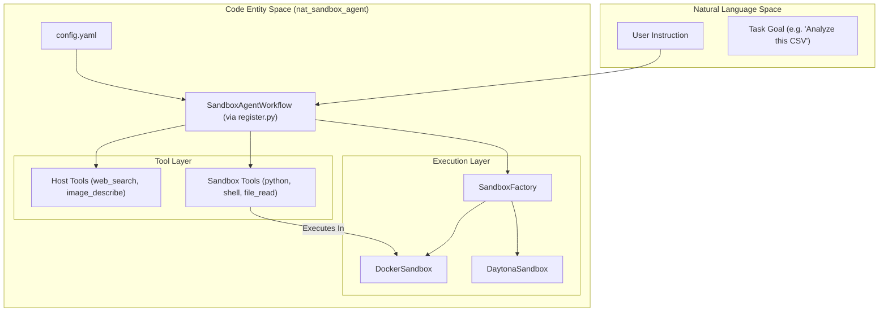

<!-- source: DeepWiki mcp.deepwiki.com · repo NVIDIA/NeMo-Agent-Toolkit-Examples · page 3 Example: Sandbox Agent · fetched 2026-10-26 -->

# Example: Sandbox Agent

<details>
<summary>Relevant source files</summary>

The following files were used as context for generating this wiki page:

- [examples/sandbox_agent/Dockerfile](examples/sandbox_agent/Dockerfile)
- [examples/sandbox_agent/README.md](examples/sandbox_agent/README.md)
- [examples/sandbox_agent/pyproject.toml](examples/sandbox_agent/pyproject.toml)
- [examples/sandbox_agent/scripts/enrich_gaia_dataset.py](examples/sandbox_agent/scripts/enrich_gaia_dataset.py)
- [examples/sandbox_agent/src/nat_sandbox_agent/__init__.py](examples/sandbox_agent/src/nat_sandbox_agent/__init__.py)
- [examples/sandbox_agent/src/nat_sandbox_agent/configs/config.yaml](examples/sandbox_agent/src/nat_sandbox_agent/configs/config.yaml)

</details>


The **Sandbox Agent** is a general-purpose AI agent designed for the NVIDIA NeMo Agent Toolkit (NAT) that specializes in executing tasks within secure, isolated environments. By utilizing a sandboxed execution model, the agent can safely run arbitrary code, perform complex data analysis, and interact with web resources without risking the host system's security [examples/sandbox_agent/README.md:18-24]().

## Overview

The Sandbox Agent follows a ReAct (Reasoning and Acting) pattern to solve multi-step problems. Its defining characteristic is the split between **Host Tools** (which run on the local machine to handle API keys and network searches) and **Sandbox Tools** (which run inside an isolated container to handle file operations and code execution) [examples/sandbox_agent/README.md:78-90]().

### Core Capabilities
*   **Isolated Code Execution:** Runs Python and Shell commands within Docker or Daytona sandboxes [examples/sandbox_agent/README.md:27-27]().
*   **Web Interaction:** Browses JS-heavy sites via Playwright (sandbox) or fetches static pages (host) [examples/sandbox_agent/README.md:28-29]().
*   **Document Processing:** Generates and manipulates PDFs, Word documents, and PowerPoints using pre-installed libraries like `reportlab` and `python-docx` [examples/sandbox_agent/Dockerfile:94-98]().
*   **Vision & Search:** Analyzes images via Vision LLMs and performs web searches via the Tavily API [examples/sandbox_agent/README.md:29-31]().

## System Architecture

The agent bridges the gap between natural language instructions and a controlled execution environment. The following diagram illustrates how the `nat_sandbox_agent` package organizes these components.

### Natural Language to Code Entity Space: Architecture

**Sources:** [examples/sandbox_agent/src/nat_sandbox_agent/register.py:1-50](), [examples/sandbox_agent/src/nat_sandbox_agent/configs/config.yaml:40-53](), [examples/sandbox_agent/README.md:78-90]()

---

## Sandbox Infrastructure

The infrastructure layer manages the lifecycle of the execution environment. The agent supports two primary providers:
1.  **Docker:** Local isolation using the `nat-sandbox:latest` image [examples/sandbox_agent/src/nat_sandbox_agent/configs/config.yaml:49-52]().
2.  **Daytona:** Cloud-based sandboxes for remote execution [examples/sandbox_agent/README.md:151-170]().

The sandbox environment provides a standardized workspace structure at `/workspace/` containing subdirectories for `input`, `output`, `temp`, and `downloads` [examples/sandbox_agent/Dockerfile:132-136]().

For a deep dive into the `BaseSandbox` abstract class, resource limits (CPU/Memory), and the `Dockerfile` configuration, see **[Sandbox Infrastructure (Docker & Daytona)](#3.1)**.

## Tool System & Evaluation

The agent employs a dual-layer tool system. **Sandbox tools** have direct access to the `/workspace` and are used for heavy lifting, while **Host tools** are used for external API interactions to keep sensitive keys outside the container [examples/sandbox_agent/README.md:89-90]().

### Natural Language to Code Entity Space: Tool Mapping
| User Intent | Code Entity (Tool Name) | Execution Environment |
| :--- | :--- | :--- |
| "Run this script" | `python` | Sandbox (Docker/Daytona) |
| "List files" | `shell` | Sandbox (Docker/Daytona) |
| "Search Google" | `web_search` | Host (Tavily API) |
| "Read this PDF" | `file_read` | Sandbox (poppler-utils) |
| "Describe image" | `image_describe` | Host (Vision LLM) |

**Sources:** [examples/sandbox_agent/README.md:78-87](), [examples/sandbox_agent/Dockerfile:66-70]()

### GAIA Evaluation
The Sandbox Agent is optimized for the **GAIA (General AI Assistants)** benchmark. It includes specialized scripts like `enrich_gaia_dataset.py` to help the agent identify UUID-named attachments within the sandbox `/workspace/input/` directory [examples/sandbox_agent/scripts/enrich_gaia_dataset.py:15-22]().

For details on the tool factory, individual tool implementations, and the GAIA evaluation pipeline, see **[Sandbox Agent Tools & GAIA Evaluation](#3.2)**.

## Quick Start Configuration

The agent is registered as a NAT component via the `nat_sandbox_agent.register` entry point [examples/sandbox_agent/pyproject.toml:78-79](). A typical configuration specifies the LLM and the sandbox provider:

```yaml
workflow:
  _type: sandbox_agent
  llm_name: agent_llm
  sandbox_config:
    type: docker
    image: "nat-sandbox:latest"
    memory_limit: "1g"
    cpu_limit: 2.0
```
**Sources:** [examples/sandbox_agent/src/nat_sandbox_agent/configs/config.yaml:40-53]()

---
**Sources:**
*   [examples/sandbox_agent/README.md:18-31]()
*   [examples/sandbox_agent/README.md:78-90]()
*   [examples/sandbox_agent/Dockerfile:132-136]()
*   [examples/sandbox_agent/src/nat_sandbox_agent/configs/config.yaml:40-53]()
*   [examples/sandbox_agent/pyproject.toml:78-79]()

---

