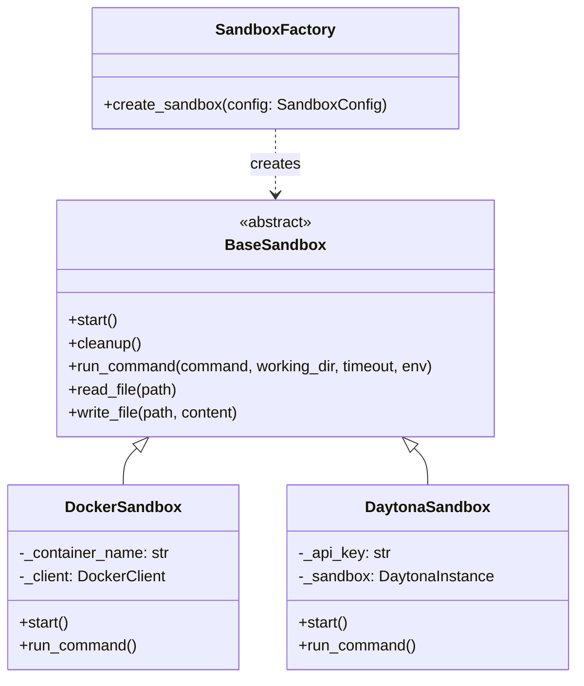
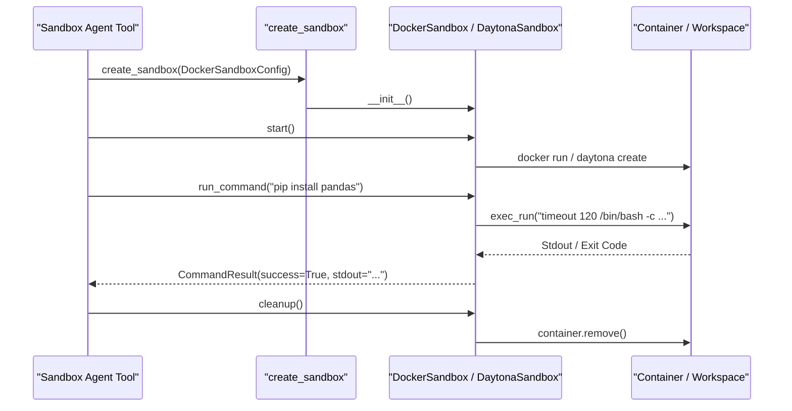

<!-- source: DeepWiki mcp.deepwiki.com · repo NVIDIA/NeMo-Agent-Toolkit-Examples · page 3.1 Sandbox Infrastructure (Docker & Daytona) · fetched 2026-10-26 -->

# Sandbox Infrastructure (Docker & Daytona)

Relevant source files

The following files were used as context for generating this wiki page:

- [examples/sandbox_agent/docker-compose.yaml](examples/sandbox_agent/docker-compose.yaml)
- [examples/sandbox_agent/src/nat_sandbox_agent/sandbox/__init__.py](examples/sandbox_agent/src/nat_sandbox_agent/sandbox/__init__.py)
- [examples/sandbox_agent/src/nat_sandbox_agent/sandbox/base.py](examples/sandbox_agent/src/nat_sandbox_agent/sandbox/base.py)
- [examples/sandbox_agent/src/nat_sandbox_agent/sandbox/daytona_sandbox.py](examples/sandbox_agent/src/nat_sandbox_agent/sandbox/daytona_sandbox.py)
- [examples/sandbox_agent/src/nat_sandbox_agent/sandbox/docker_sandbox.py](examples/sandbox_agent/src/nat_sandbox_agent/sandbox/docker_sandbox.py)
- [examples/sandbox_agent/src/nat_sandbox_agent/sandbox/factory.py](examples/sandbox_agent/src/nat_sandbox_agent/sandbox/factory.py)

The Sandbox Infrastructure provides a secure, isolated environment for the Sandbox Agent to execute arbitrary code (Python) and shell commands. It abstracts the underlying containerization technology through a unified interface, allowing the agent to operate consistently whether running in a local Docker container or a cloud-based Daytona workspace.

## Sandbox Architecture

The infrastructure is built on a provider-agnostic design using the `BaseSandbox` abstract class. This allows the toolkit to swap between local development environments and scalable cloud environments without modifying the tool logic.

### Core Sandbox Components

| Component | Role | File Reference |
| :--- | :--- | :--- |
| `BaseSandbox` | Abstract Base Class defining the sandbox lifecycle and I/O interface. | [examples/sandbox_agent/src/nat_sandbox_agent/sandbox/base.py:62-70]() |
| `DockerSandbox` | Implementation using local Docker containers via `docker-py`. | [examples/sandbox_agent/src/nat_sandbox_agent/sandbox/docker_sandbox.py:37-43]() |
| `DaytonaSandbox` | Implementation using Daytona cloud workspaces for remote execution. | [examples/sandbox_agent/src/nat_sandbox_agent/sandbox/daytona_sandbox.py:28-35]() |
| `create_sandbox` | Factory function that instantiates the correct sandbox based on `SandboxConfig`. | [examples/sandbox_agent/src/nat_sandbox_agent/sandbox/factory.py:140-151]() |
| `CommandResult` | Dataclass representing the output, exit code, and status of an execution. | [examples/sandbox_agent/src/nat_sandbox_agent/sandbox/base.py:40-60]() |

### Sandbox Class Hierarchy and Factory Flow

The following diagram illustrates how the `create_sandbox` factory bridges the configuration space to the concrete sandbox implementations.

**Diagram: Sandbox Entity Relationship**

**Sources:** [examples/sandbox_agent/src/nat_sandbox_agent/sandbox/base.py:62-148](), [examples/sandbox_agent/src/nat_sandbox_agent/sandbox/docker_sandbox.py:37-43](), [examples/sandbox_agent/src/nat_sandbox_agent/sandbox/daytona_sandbox.py:28-35](), [examples/sandbox_agent/src/nat_sandbox_agent/sandbox/factory.py:140-193]()

## Workspace Layout

Every sandbox implementation enforces a standardized directory structure within the environment to ensure predictable file operations for the agent.

*   **`WORKSPACE_ROOT`**: `/workspace` (The default working directory) [examples/sandbox_agent/src/nat_sandbox_agent/sandbox/base.py:26-26]()
*   **`WORKSPACE_INPUT`**: `/workspace/input` (For data provided to the agent) [examples/sandbox_agent/src/nat_sandbox_agent/sandbox/base.py:27-27]()
*   **`WORKSPACE_OUTPUT`**: `/workspace/output` (For artifacts generated by the agent) [examples/sandbox_agent/src/nat_sandbox_agent/sandbox/base.py:28-28]()
*   **`WORKSPACE_TEMP`**: `/workspace/temp` (For ephemeral scripts and temporary data) [examples/sandbox_agent/src/nat_sandbox_agent/sandbox/base.py:29-29]()

Upon startup, both `DockerSandbox` and `DaytonaSandbox` execute `WORKSPACE_INIT_COMMAND` (`mkdir -p ...`) to ensure these paths exist [examples/sandbox_agent/src/nat_sandbox_agent/sandbox/base.py:33-33](), [examples/sandbox_agent/src/nat_sandbox_agent/sandbox/docker_sandbox.py:128-128](), [examples/sandbox_agent/src/nat_sandbox_agent/sandbox/daytona_sandbox.py:113-113]().

## Implementation Details

### DockerSandbox
The `DockerSandbox` manages the lifecycle of a single Docker container.
*   **Isolation**: Uses a bridge network (configurable) and enforces `memory_limit` and `cpu_limit` [examples/sandbox_agent/src/nat_sandbox_agent/sandbox/docker_sandbox.py:108-110]().
*   **Command Execution**: Commands are wrapped in a Linux `timeout` utility to ensure that processes are terminated on the container side even if the client-side request times out [examples/sandbox_agent/src/nat_sandbox_agent/sandbox/docker_sandbox.py:175-175]().
*   **File Transfer**: Uses `tar` streams to move files in and out of the container via `put_archive` and `get_archive` [examples/sandbox_agent/src/nat_sandbox_agent/sandbox/docker_sandbox.py:246-260]().

### DaytonaSandbox
The `DaytonaSandbox` utilizes the `daytona-sdk` to provision remote workspaces.
*   **Provisioning**: Creates a workspace from a specified image (default: `daytonaio/workspace:latest`) with defined hardware resources [examples/sandbox_agent/src/nat_sandbox_agent/sandbox/daytona_sandbox.py:99-107]().
*   **Lifecycle**: Includes an `auto_stop_interval` to prevent runaway costs in cloud environments [examples/sandbox_agent/src/nat_sandbox_agent/sandbox/daytona_sandbox.py:69-69]().

### Execution Flow
The following diagram traces a command execution from the high-level tool call to the low-level container execution.

**Diagram: Execution Data Flow**

**Sources:** [examples/sandbox_agent/src/nat_sandbox_agent/sandbox/factory.py:140-193](), [examples/sandbox_agent/src/nat_sandbox_agent/sandbox/docker_sandbox.py:86-156](), [examples/sandbox_agent/src/nat_sandbox_agent/sandbox/docker_sandbox.py:158-209]()

## Resource Configuration

Sandbox resources are defined via Pydantic models in the factory, allowing for validation of limits before the environment is provisioned.

| Config Key | Default (Docker) | Default (Daytona) | Description |
| :--- | :--- | :--- | :--- |
| `image` | `python:3.12-slim` | `daytonaio/workspace:latest` | The base environment. |
| `memory` | `512m` | `4` (GB) | RAM allocation. |
| `cpu` | `1.0` | `2` (Cores) | Processing power. |
| `network_enabled`| `True` | N/A | Toggles internet access. |
| `pass_env_vars` | `["TAVILY_API_KEY"]` | N/A | Host env vars to inject. |

**Sources:** [examples/sandbox_agent/src/nat_sandbox_agent/sandbox/factory.py:37-77](), [examples/sandbox_agent/src/nat_sandbox_agent/sandbox/factory.py:79-114](), [examples/sandbox_agent/src/nat_sandbox_agent/sandbox/factory.py:27-27]()

---

