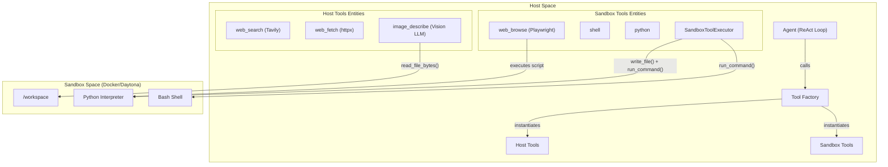
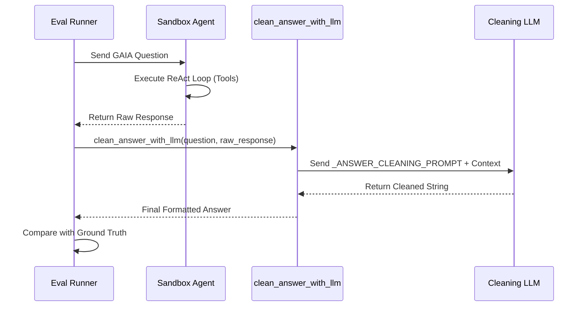

<!-- source: DeepWiki mcp.deepwiki.com · repo NVIDIA/NeMo-Agent-Toolkit-Examples · page 3.2 Sandbox Agent Tools & GAIA Evaluation · fetched 2026-10-26 -->

# Sandbox Agent Tools & GAIA Evaluation

Relevant source files

The following files were used as context for generating this wiki page:

- [examples/sandbox_agent/src/nat_sandbox_agent/prompts/system_prompt.py](examples/sandbox_agent/src/nat_sandbox_agent/prompts/system_prompt.py)
- [examples/sandbox_agent/src/nat_sandbox_agent/tools/__init__.py](examples/sandbox_agent/src/nat_sandbox_agent/tools/__init__.py)
- [examples/sandbox_agent/src/nat_sandbox_agent/tools/factory.py](examples/sandbox_agent/src/nat_sandbox_agent/tools/factory.py)
- [examples/sandbox_agent/src/nat_sandbox_agent/tools/host/image_describe.py](examples/sandbox_agent/src/nat_sandbox_agent/tools/host/image_describe.py)
- [examples/sandbox_agent/src/nat_sandbox_agent/tools/host/web_fetch.py](examples/sandbox_agent/src/nat_sandbox_agent/tools/host/web_fetch.py)
- [examples/sandbox_agent/src/nat_sandbox_agent/tools/host/web_search.py](examples/sandbox_agent/src/nat_sandbox_agent/tools/host/web_search.py)
- [examples/sandbox_agent/src/nat_sandbox_agent/tools/sandbox/browser.py](examples/sandbox_agent/src/nat_sandbox_agent/tools/sandbox/browser.py)
- [examples/sandbox_agent/src/nat_sandbox_agent/tools/sandbox/execution.py](examples/sandbox_agent/src/nat_sandbox_agent/tools/sandbox/execution.py)
- [examples/sandbox_agent/src/nat_sandbox_agent/tools/sandbox/file_ops.py](examples/sandbox_agent/src/nat_sandbox_agent/tools/sandbox/file_ops.py)
- [examples/sandbox_agent/src/nat_sandbox_agent/utils/answer_cleaning.py](examples/sandbox_agent/src/nat_sandbox_agent/utils/answer_cleaning.py)
- [examples/sandbox_agent/tests/test_sandbox.py](examples/sandbox_agent/tests/test_sandbox.py)
- [examples/sandbox_agent/tests/test_tools_sandbox.py](examples/sandbox_agent/tests/test_tools_sandbox.py)

The Sandbox Agent utilizes a dual-layer tool architecture to balance security and functionality. Tools are partitioned into **Sandbox Tools**, which execute within an isolated Docker or Daytona environment, and **Host Tools**, which execute on the host machine to protect sensitive credentials (like API keys) and improve performance for network-heavy tasks. This page details the tool implementations, the factory pattern for instantiation, and the evaluation pipeline used for the GAIA benchmark.

## Tool Architecture Overview

The system distinguishes between tools that require an isolated runtime and those that benefit from host-level execution.

| Category | Tools | Execution Environment | Rationale |
| :--- | :--- | :--- | :--- |
| **Sandbox Tools** | `shell`, `python`, `file_read`, `file_write`, `web_browse` | Inside Container | Prevents host compromise; provides clean runtime. |
| **Host Tools** | `web_search`, `web_fetch`, `image_describe` | Host Machine | Protects API keys; avoids container network overhead. |

### Tool Data Flow: Host vs. Sandbox
The `SandboxToolExecutor` acts as the bridge for sandbox tools, while host tools interact directly with external APIs or the sandbox filesystem via the `BaseSandbox` interface.

**Sources:** [examples/sandbox_agent/src/nat_sandbox_agent/tools/__init__.py:17-20](), [examples/sandbox_agent/src/nat_sandbox_agent/tools/factory.py:28-75]()

## Tool Factory & Implementation

The `create_all_tools` function in `factory.py` serves as the central assembly point for the agent's capabilities [examples/sandbox_agent/src/nat_sandbox_agent/tools/factory.py:28-34]().

### 1. Execution Tools (`shell`, `python`)
*   **`shell`**: Used for system operations like file management (`ls`, `cp`), package installation (`pip`), and process management [examples/sandbox_agent/src/nat_sandbox_agent/tools/sandbox/execution.py:134-143]().
*   **`python`**: Designed for data processing (pandas, numpy) and complex logic. Code is written to a temporary file in the sandbox and executed via `python3` [examples/sandbox_agent/src/nat_sandbox_agent/tools/sandbox/execution.py:97-112]().

### 2. File Operations (`file_read`, `file_write`)
These tools include path validation to prevent traversal attacks. Paths must be absolute and reside within `/workspace` [examples/sandbox_agent/src/nat_sandbox_agent/tools/sandbox/file_ops.py:34-59]().
*   **`read_file`**: Reads text content from the sandbox [examples/sandbox_agent/src/nat_sandbox_agent/tools/sandbox/file_ops.py:75-98]().
*   **`write_file`**: Writes content to a specified path, automatically creating parent directories [examples/sandbox_agent/src/nat_sandbox_agent/tools/sandbox/file_ops.py:116-141]().

### 3. Web Interaction Tools
*   **`web_search`**: A host-side tool using the Tavily API to find relevant URLs and snippets [examples/sandbox_agent/src/nat_sandbox_agent/tools/host/web_search.py:46-50]().
*   **`web_fetch`**: A lightweight host-side HTTP fetcher that converts HTML to Markdown using `markdownify`. It supports pagination via `start_index` [examples/sandbox_agent/src/nat_sandbox_agent/tools/host/web_fetch.py:72-87]().
*   **`web_browse`**: A sandbox-side tool that uses Playwright Chromium to handle JavaScript-heavy sites. It generates a Python script, writes it to the sandbox, and executes it to extract text or specific CSS selectors [examples/sandbox_agent/src/nat_sandbox_agent/tools/sandbox/browser.py:57-75]().

### 4. Vision Tool (`image_describe`)
This tool runs on the host to access Vision LLMs but interacts with the sandbox to retrieve image data.
1.  Reads image bytes from the sandbox via `sandbox.read_file_bytes` [examples/sandbox_agent/src/nat_sandbox_agent/tools/host/image_describe.py:98-99]().
2.  Encodes the image to Base64 and constructs a data URI [examples/sandbox_agent/src/nat_sandbox_agent/tools/host/image_describe.py:115-117]().
3.  Sends a multimodal `HumanMessage` to the configured `vision_llm` [examples/sandbox_agent/src/nat_sandbox_agent/tools/host/image_describe.py:120-133]().

**Sources:** [examples/sandbox_agent/src/nat_sandbox_agent/tools/factory.py:78-101](), [examples/sandbox_agent/src/nat_sandbox_agent/tools/sandbox/executor.py:33-54]()

## System Prompts & Agent Rules

The `SANDBOX_AGENT_SYSTEM_PROMPT` defines the operational boundaries and best practices for the agent [examples/sandbox_agent/src/nat_sandbox_agent/prompts/system_prompt.py:17-141]().

### Key Directives
*   **Tool Preference**: The agent is instructed to prefer tools over mental calculation or memory for any logic puzzle or multi-step reasoning [examples/sandbox_agent/src/nat_sandbox_agent/prompts/system_prompt.py:60-64]().
*   **Python Execution**: Explicit rules require the use of `print()` for outputs, as the sandbox does not automatically return expression values [examples/sandbox_agent/src/nat_sandbox_agent/prompts/system_prompt.py:66-81]().
*   **File Handling**: Guidance on tool selection based on file extensions (e.g., `.xlsx` -> `python` with pandas, `.pdf` -> `python` with pdfplumber) [examples/sandbox_agent/src/nat_sandbox_agent/prompts/system_prompt.py:83-95]().

**Sources:** [examples/sandbox_agent/src/nat_sandbox_agent/prompts/system_prompt.py:15-141]()

## GAIA Evaluation Pipeline

The agent is evaluated using the GAIA (General AI Assistants) benchmark, which requires complex multi-step reasoning and tool use.

### Answer Cleaning
To ensure compatibility with ground-truth answers, the toolkit includes an `answer_cleaning` utility. It uses an LLM to extract the core answer, normalize units, and match expected formats (e.g., "17000 hours" to "17" if the question asks for "thousand hours") [examples/sandbox_agent/src/nat_sandbox_agent/utils/answer_cleaning.py:25-63]().

### Evaluation Logic
The cleaning process includes:
*   **Preamble Removal**: Stripping phrases like "The answer is..." [examples/sandbox_agent/src/nat_sandbox_agent/utils/answer_cleaning.py:35-37]().
*   **Scale Adjustment**: Dividing by 1,000,000 if the question asks for "millions" [examples/sandbox_agent/src/nat_sandbox_agent/utils/answer_cleaning.py:51-53]().
*   **Type Matching**: Ensuring Yes/No or Directional answers use Title Case [examples/sandbox_agent/src/nat_sandbox_agent/utils/answer_cleaning.py:44-50]().

**Sources:** [examples/sandbox_agent/src/nat_sandbox_agent/utils/answer_cleaning.py:66-118]()

---

