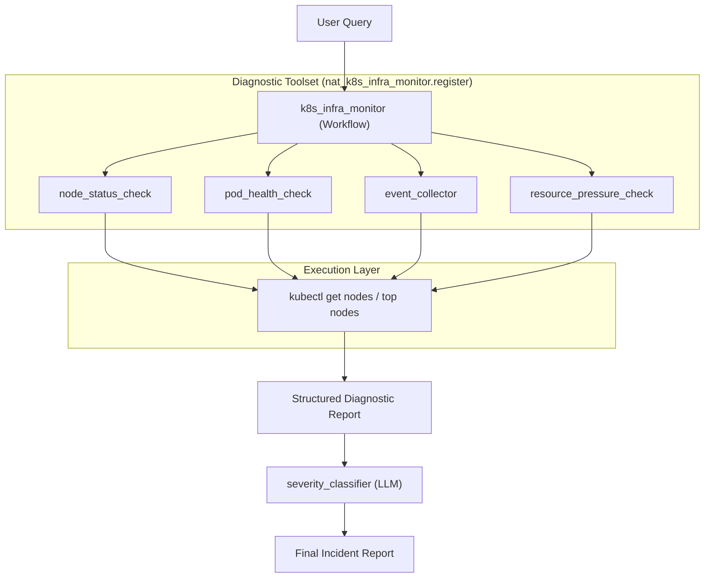
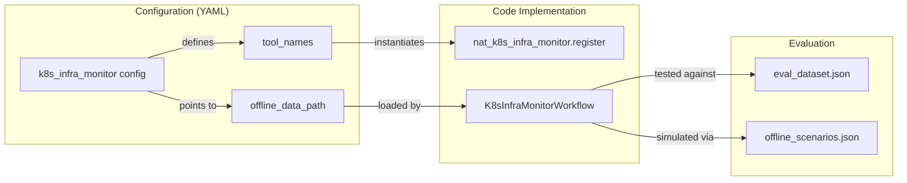

<!-- source: DeepWiki mcp.deepwiki.com · repo NVIDIA/NeMo-Agent-Toolkit-Examples · page 4 Example: Kubernetes Infrastructure Monitor · fetched 2026-10-26 -->

# Example: Kubernetes Infrastructure Monitor

Relevant source files

The following files were used as context for generating this wiki page:

- [examples/k8s_infra_monitor/README.md](examples/k8s_infra_monitor/README.md)
- [examples/k8s_infra_monitor/pyproject.toml](examples/k8s_infra_monitor/pyproject.toml)

The **Kubernetes Infrastructure Monitor** is an intermediate-complexity example demonstrating an agentic diagnostic system designed to analyze and report on the health of Kubernetes clusters [examples/k8s_infra_monitor/README.md:18-22](). Built using the NeMo Agent Toolkit (NAT) and LangGraph, the system correlates signals from nodes, pods, events, and resource metrics to generate structured incident reports with severity classifications [examples/k8s_infra_monitor/README.md:22-22](), [examples/k8s_infra_monitor/README.md:68-76]().

## System Overview

The monitor operates by receiving natural language queries about cluster health and autonomously selecting the appropriate diagnostic tools to investigate the issue [examples/k8s_infra_monitor/README.md:99-105](). It supports two primary execution environments:
*   **Live Mode**: Connects to a real cluster via `kubectl` to retrieve real-time data [examples/k8s_infra_monitor/README.md:42-42]().
*   **Offline Mode**: Uses synthetic scenarios from a JSON dataset for development, testing, and evaluation without requiring an active cluster [examples/k8s_infra_monitor/README.md:124-124](), [examples/k8s_infra_monitor/README.md:139-140]().

### Core Architecture: Natural Language to K8s Diagnostics

The following diagram illustrates how the system bridges natural language user queries to specific Kubernetes diagnostic entities defined in the codebase.

**K8s Monitor Logic Flow**

Sources: [examples/k8s_infra_monitor/README.md:88-105](), [examples/k8s_infra_monitor/README.md:131-138]().

## Diagnostic Tools

The system utilizes a specialized toolset to gather comprehensive cluster data. Each tool is registered as a NAT component and can be configured with specific thresholds (e.g., CPU/Memory percentages) [examples/k8s_infra_monitor/README.md:113-122]().

| Tool Name | Responsibility | Data Source (Live) |
| :--- | :--- | :--- |
| `node_status_check` | Checks node readiness and conditions (Memory/Disk/PID Pressure) | `kubectl get nodes` |
| `pod_health_check` | Scans for `CrashLoopBackOff`, `OOMKilled`, or `Pending` pods | `kubectl get pods` |
| `event_collector` | Correlates recent Warning events with affected resources | `kubectl get events` |
| `resource_pressure_check` | Analyzes utilization against configurable thresholds | `kubectl top` |
| `severity_classifier` | Classifies incidents as Critical, Warning, or Informational | LLM Inference |

For a deep dive into tool implementation, `kubectl` integration, and offline data injection, see **[K8s Monitor Diagnostic Tools](#4.1)**.

Sources: [examples/k8s_infra_monitor/README.md:88-95](), [examples/k8s_infra_monitor/README.md:113-122]().

## Workflow and Evaluation

The orchestration logic is managed via a LangGraph `StateGraph` registered under the `k8s_infra_monitor` workflow type [examples/k8s_infra_monitor/README.md:132-132](). This workflow manages the state between tool execution and final report generation.

**Code Entity Mapping**

Sources: [examples/k8s_infra_monitor/README.md:131-141](), [examples/k8s_infra_monitor/pyproject.toml:38-39]().

The monitor includes a robust evaluation framework that uses `offline_scenarios.json` to simulate cluster failures. This allows for reproducible testing of the agent's ability to identify root causes, such as correlating `OOMKilled` pods with `MemoryPressure` conditions on a node [examples/k8s_infra_monitor/README.md:81-82]().

For details on the LangGraph state machine, configuration schemas, and the evaluation suite, see **[K8s Monitor Workflow, Data & Evaluation](#4.2)**.

---

