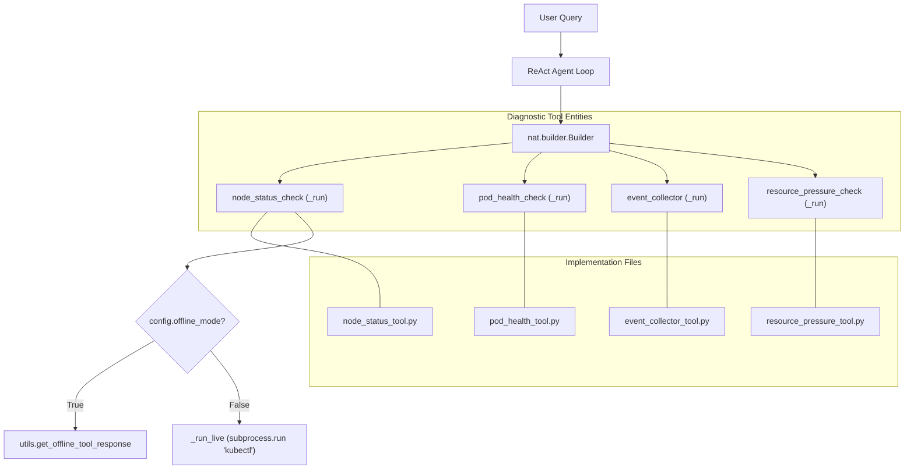
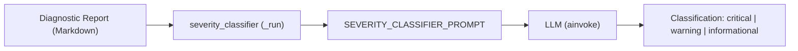

<!-- source: DeepWiki mcp.deepwiki.com · repo NVIDIA/NeMo-Agent-Toolkit-Examples · page 4.1 K8s Monitor Diagnostic Tools · fetched 2026-10-26 -->

# K8s Monitor Diagnostic Tools

Relevant source files

The following files were used as context for generating this wiki page:

- [examples/k8s_infra_monitor/src/nat_k8s_infra_monitor/event_collector_tool.py](examples/k8s_infra_monitor/src/nat_k8s_infra_monitor/event_collector_tool.py)
- [examples/k8s_infra_monitor/src/nat_k8s_infra_monitor/node_status_tool.py](examples/k8s_infra_monitor/src/nat_k8s_infra_monitor/node_status_tool.py)
- [examples/k8s_infra_monitor/src/nat_k8s_infra_monitor/pod_health_tool.py](examples/k8s_infra_monitor/src/nat_k8s_infra_monitor/pod_health_tool.py)
- [examples/k8s_infra_monitor/src/nat_k8s_infra_monitor/prompts.py](examples/k8s_infra_monitor/src/nat_k8s_infra_monitor/prompts.py)
- [examples/k8s_infra_monitor/src/nat_k8s_infra_monitor/resource_pressure_tool.py](examples/k8s_infra_monitor/src/nat_k8s_infra_monitor/resource_pressure_tool.py)
- [examples/k8s_infra_monitor/src/nat_k8s_infra_monitor/severity_classifier.py](examples/k8s_infra_monitor/src/nat_k8s_infra_monitor/severity_classifier.py)
- [examples/k8s_infra_monitor/src/nat_k8s_infra_monitor/utils.py](examples/k8s_infra_monitor/src/nat_k8s_infra_monitor/utils.py)

The Kubernetes Infrastructure Monitor example provides a suite of specialized diagnostic tools designed to inspect cluster health. These tools operate in two distinct modes: **Live Mode**, which executes `kubectl` commands against a real cluster, and **Offline Mode**, which injects synthetic data from pre-defined scenarios for testing and evaluation purposes.

## Architecture and Data Flow

The diagnostic tools are implemented as registered functions within the NeMo Agent Toolkit (NAT) framework. Each tool follows a standard pattern: a configuration class inheriting from `FunctionBaseConfig`, a registration using `@register_function`, and a dual-path execution logic (`_run_live` vs. offline injection).

### Natural Language to Tool Execution

The following diagram illustrates how a natural language query is routed through the NAT framework to specific code entities within the `k8s_infra_monitor` package.

**Query Routing and Tool Association**

Sources: [examples/k8s_infra_monitor/src/nat_k8s_infra_monitor/node_status_tool.py:38-64](), [examples/k8s_infra_monitor/src/nat_k8s_infra_monitor/pod_health_tool.py:39-67](), [examples/k8s_infra_monitor/src/nat_k8s_infra_monitor/event_collector_tool.py:38-66](), [examples/k8s_infra_monitor/src/nat_k8s_infra_monitor/resource_pressure_tool.py:45-77]()

## Core Diagnostic Tools

### Node Status Tool (`node_status_check`)
Retrieves the high-level status of cluster nodes, including conditions (Ready/NotReady) and basic resource allocation.
- **Key Function:** `_run_live` executes `kubectl get nodes -o wide` and `kubectl top nodes` [examples/k8s_infra_monitor/src/nat_k8s_infra_monitor/node_status_tool.py:76-118]().
- **Config:** `NodeStatusToolConfig` allows specifying a custom `kubeconfig_path` [examples/k8s_infra_monitor/src/nat_k8s_infra_monitor/node_status_tool.py:30-36]().

### Pod Health Tool (`pod_health_check`)
Identifies unhealthy workloads across namespaces, specifically targeting pods not in `Running` or `Succeeded` phases.
- **Live Execution:** Uses field selectors (`status.phase!=Running`) to filter for problematic pods [examples/k8s_infra_monitor/src/nat_k8s_infra_monitor/pod_health_tool.py:106-134]().
- **Restart Analysis:** Parses JSON output to identify pods with a `restartCount` greater than 5 [examples/k8s_infra_monitor/src/nat_k8s_infra_monitor/pod_health_tool.py:136-165]().

### Event Collector Tool (`event_collector`)
Gathers recent cluster events, prioritizing `Warning` and `Error` types to diagnose scheduling failures or OOM kills.
- **Warning Retrieval:** Runs `kubectl get events --field-selector=type=Warning` [examples/k8s_infra_monitor/src/nat_k8s_infra_monitor/event_collector_tool.py:87-115]().
- **Configurable Limits:** The `event_limit` parameter (default 50) restricts the volume of data returned to the LLM context [examples/k8s_infra_monitor/src/nat_k8s_infra_monitor/event_collector_tool.py:35-35]().

### Resource Pressure Tool (`resource_pressure_check`)
Analyzes CPU, memory, and storage utilization against configurable thresholds.
- **Thresholds:** Configurable via `cpu_threshold_percent` (default 80) and `memory_threshold_percent` (default 85) [examples/k8s_infra_monitor/src/nat_k8s_infra_monitor/resource_pressure_tool.py:35-42]().
- **Condition Monitoring:** Specifically checks for `MemoryPressure`, `DiskPressure`, and `PIDPressure` node conditions [examples/k8s_infra_monitor/src/nat_k8s_infra_monitor/resource_pressure_tool.py:102-135]().

Sources: [examples/k8s_infra_monitor/src/nat_k8s_infra_monitor/node_status_tool.py:1-130](), [examples/k8s_infra_monitor/src/nat_k8s_infra_monitor/pod_health_tool.py:1-176](), [examples/k8s_infra_monitor/src/nat_k8s_infra_monitor/event_collector_tool.py:1-158](), [examples/k8s_infra_monitor/src/nat_k8s_infra_monitor/resource_pressure_tool.py:1-177]()

## Severity Classifier

The `severity_classifier` is a specialized LLM-based tool used at the end of the diagnostic workflow to categorize the final incident report.

**Severity Classification Flow**

- **Implementation:** Uses LangChain's `BaseChatModel` to process the report text [examples/k8s_infra_monitor/src/nat_k8s_infra_monitor/severity_classifier.py:38-43]().
- **Prompt Logic:** Defined in `prompts.py`, it instructs the LLM to look for cluster-wide outages (critical) versus degraded performance (warning) [examples/k8s_infra_monitor/src/nat_k8s_infra_monitor/prompts.py:39-48]().

Sources: [examples/k8s_infra_monitor/src/nat_k8s_infra_monitor/severity_classifier.py:32-66](), [examples/k8s_infra_monitor/src/nat_k8s_infra_monitor/prompts.py:39-48]()

## Offline Mode and Data Injection

Offline mode allows the agent to be tested without a live Kubernetes cluster. This is managed by the `utils.py` module.

### Mechanism
1. **Preloading:** The `preload_offline_data` function reads a JSON file containing scenarios [examples/k8s_infra_monitor/src/nat_k8s_infra_monitor/utils.py:33-60]().
2. **Storage:** Data is stored in a global `_offline_data` dictionary, keyed by `scenario_id` [examples/k8s_infra_monitor/src/nat_k8s_infra_monitor/utils.py:23-23]().
3. **Extraction:** Tools extract the `scenario_id` from the input query (usually passed as a JSON string by the workflow) using `_extract_scenario_id` [examples/k8s_infra_monitor/src/nat_k8s_infra_monitor/node_status_tool.py:67-74]().
4. **Injection:** The `get_offline_tool_response` function retrieves the mock string for that specific tool and scenario [examples/k8s_infra_monitor/src/nat_k8s_infra_monitor/utils.py:63-69]().

### Default Healthy Responses
If a scenario is not found or if the cluster is healthy, tools provide hardcoded "healthy" responses to maintain agent flow [examples/k8s_infra_monitor/src/nat_k8s_infra_monitor/node_status_tool.py:121-129](), [examples/k8s_infra_monitor/src/nat_k8s_infra_monitor/pod_health_tool.py:170-175]().

Sources: [examples/k8s_infra_monitor/src/nat_k8s_infra_monitor/utils.py:1-69](), [examples/k8s_infra_monitor/src/nat_k8s_infra_monitor/node_status_tool.py:54-60]()

---

