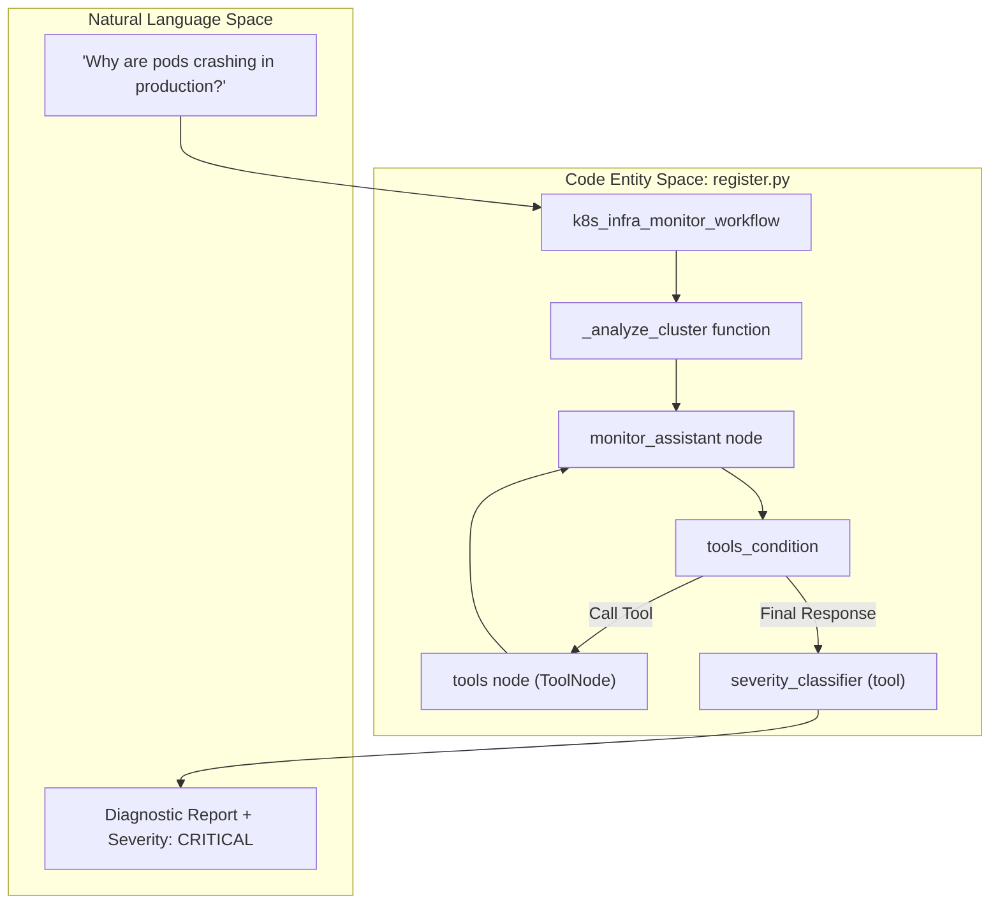
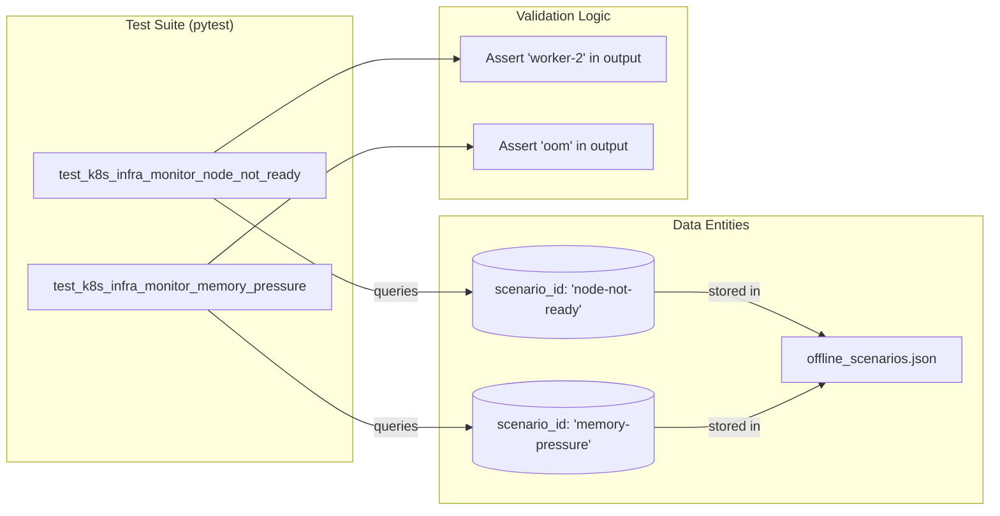

<!-- source: DeepWiki mcp.deepwiki.com · repo NVIDIA/NeMo-Agent-Toolkit-Examples · page 4.2 K8s Monitor Workflow, Data & Evaluation · fetched 2026-10-26 -->

# K8s Monitor Workflow, Data & Evaluation

Relevant source files

The following files were used as context for generating this wiki page:

- [.github/workflows/stale.yaml](.github/workflows/stale.yaml)
- [examples/k8s_infra_monitor/src/nat_k8s_infra_monitor/__init__.py](examples/k8s_infra_monitor/src/nat_k8s_infra_monitor/__init__.py)
- [examples/k8s_infra_monitor/src/nat_k8s_infra_monitor/configs/config_live_mode.yml](examples/k8s_infra_monitor/src/nat_k8s_infra_monitor/configs/config_live_mode.yml)
- [examples/k8s_infra_monitor/src/nat_k8s_infra_monitor/configs/config_offline_mode.yml](examples/k8s_infra_monitor/src/nat_k8s_infra_monitor/configs/config_offline_mode.yml)
- [examples/k8s_infra_monitor/src/nat_k8s_infra_monitor/data/eval_dataset.json](examples/k8s_infra_monitor/src/nat_k8s_infra_monitor/data/eval_dataset.json)
- [examples/k8s_infra_monitor/src/nat_k8s_infra_monitor/data/offline_scenarios.json](examples/k8s_infra_monitor/src/nat_k8s_infra_monitor/data/offline_scenarios.json)
- [examples/k8s_infra_monitor/src/nat_k8s_infra_monitor/register.py](examples/k8s_infra_monitor/src/nat_k8s_infra_monitor/register.py)
- [examples/k8s_infra_monitor/tests/test_k8s_infra_monitor.py](examples/k8s_infra_monitor/tests/test_k8s_infra_monitor.py)

The Kubernetes Infrastructure Monitor example utilizes a state-machine based workflow to orchestrate diagnostic tools. It supports both live cluster interaction and high-fidelity offline simulations for evaluation purposes. This page details the LangGraph implementation, the configuration schema, and the datasets used for testing and RAG-based evaluation.

## Workflow Architecture

The workflow is implemented using `langgraph` and registered as a NAT function. It follows a cyclic pattern where a central assistant decides which diagnostic tools to invoke based on the user's query and the current cluster state.

### LangGraph State Machine
The core logic resides in `k8s_infra_monitor_workflow` [examples/k8s_infra_monitor/src/nat_k8s_infra_monitor/register.py:70-150](). It uses a `StateGraph` with `MessagesState` to manage the conversation history and tool outputs.

**Workflow Logic Flow:**
1.  **Monitor Assistant**: A node that wraps the LLM (bound with diagnostic tools) and the system prompt [examples/k8s_infra_monitor/src/nat_k8s_infra_monitor/register.py:90-92]().
2.  **Tools Node**: A standard LangGraph `ToolNode` containing the registered diagnostic tools (e.g., `node_status_check`, `pod_health_check`) [examples/k8s_infra_monitor/src/nat_k8s_infra_monitor/register.py:100]().
3.  **Conditional Edges**: Uses `tools_condition` to determine if the LLM has requested a tool call or is ready to provide a final response [examples/k8s_infra_monitor/src/nat_k8s_infra_monitor/register.py:103]().
4.  **Post-Processing**: After the graph completes, the workflow executes a `severity_classifier` tool on the generated report to append a final severity assessment [examples/k8s_infra_monitor/src/nat_k8s_infra_monitor/register.py:129-130]().

### Code-to-System Mapping: Workflow Components
The following diagram maps the LangGraph code entities to the logical diagnostic process.

**K8s Monitor Logic Mapping**

Sources: [examples/k8s_infra_monitor/src/nat_k8s_infra_monitor/register.py:70-130]()

## Configuration and Modes

The monitor operates in two modes: **Live** (interacting with real `kubectl` contexts) and **Offline** (using pre-recorded JSON scenarios).

### K8sInfraMonitorWorkflowConfig
The configuration class `K8sInfraMonitorWorkflowConfig` [examples/k8s_infra_monitor/src/nat_k8s_infra_monitor/register.py:44-66]() defines the following parameters:
*   `tool_names`: List of diagnostic tools to load.
*   `llm_name`: Reference to the primary LLM (typically a NIM model).
*   `offline_mode`: Boolean flag to toggle data source.
*   `offline_data_path`: Path to the scenario file (defaults to `offline_scenarios.json`).
*   `agent_prompt`: The system instructions defined in `K8S_INFRA_MONITOR_PROMPT`.

### Mode Comparison
| Feature | Live Mode (`config_live_mode.yml`) | Offline Mode (`config_offline_mode.yml`) |
| :--- | :--- | :--- |
| **Data Source** | Real Kubernetes Cluster | `offline_scenarios.json` |
| **Requirement** | `KUBECONFIG` or local `kubectl` | None (JSON file) |
| **Speed** | Network/API dependent | Instantaneous |
| **Use Case** | Production diagnostics | CI/CD, Testing, Evaluation |

Sources: [examples/k8s_infra_monitor/src/nat_k8s_infra_monitor/configs/config_live_mode.yml:19-52](), [examples/k8s_infra_monitor/src/nat_k8s_infra_monitor/configs/config_offline_mode.yml:17-46](), [examples/k8s_infra_monitor/src/nat_k8s_infra_monitor/register.py:140-145]()

## Data and Evaluation

The example includes specialized datasets for simulating failures and evaluating the accuracy of the agent's diagnostics.

### Offline Scenarios (`offline_scenarios.json`)
This dataset contains mock responses for every diagnostic tool, keyed by `scenario_id`. When `offline_mode` is `true`, the tools look up data in this file instead of querying a cluster.
*   **Location**: `examples/k8s_infra_monitor/src/nat_k8s_infra_monitor/data/offline_scenarios.json` [examples/k8s_infra_monitor/src/nat_k8s_infra_monitor/data/offline_scenarios.json:1-4]()
*   **Common Scenarios**: `node-not-ready`, `memory-pressure`, `healthy-cluster`.

### Evaluation Dataset (`eval_dataset.json`)
Used by the NAT evaluation pipeline to run automated benchmarks against the agent.
*   **Location**: `examples/k8s_infra_monitor/src/nat_k8s_infra_monitor/data/eval_dataset.json` [examples/k8s_infra_monitor/src/nat_k8s_infra_monitor/data/eval_dataset.json:1-4]()
*   **Metrics**: The `config_offline_mode.yml` configures RAGAS-based metrics:
    *   `AnswerAccuracy`: Compares agent output to the ground truth in the eval dataset [examples/k8s_infra_monitor/src/nat_k8s_infra_monitor/configs/config_offline_mode.yml:73-76]().
    *   `ResponseGroundedness`: Ensures the agent's claims are supported by the (mocked) cluster data [examples/k8s_infra_monitor/src/nat_k8s_infra_monitor/configs/config_offline_mode.yml:77-80]().

### Test Suite
The integration tests verify the agent's diagnostic logic using the offline mode.

**Code-to-Data Mapping: Test Scenarios**

**Key Test Cases:**
*   **Node Failure**: `test_k8s_infra_monitor_node_not_ready` checks if the agent identifies `worker-2` as `NotReady` [examples/k8s_infra_monitor/tests/test_k8s_infra_monitor.py:24-42]().
*   **Memory Pressure**: `test_k8s_infra_monitor_memory_pressure` ensures the agent detects `OOMKilled` pods and assigns a `critical` severity [examples/k8s_infra_monitor/tests/test_k8s_infra_monitor.py:47-65]().
*   **Healthy Cluster**: `test_k8s_infra_monitor_healthy_cluster` verifies that the agent correctly reports a normal state with `informational` severity [examples/k8s_infra_monitor/tests/test_k8s_infra_monitor.py:70-87]().

Sources: [examples/k8s_infra_monitor/tests/test_k8s_infra_monitor.py:22-88](), [examples/k8s_infra_monitor/src/nat_k8s_infra_monitor/configs/config_offline_mode.yml:66-81]()

---

