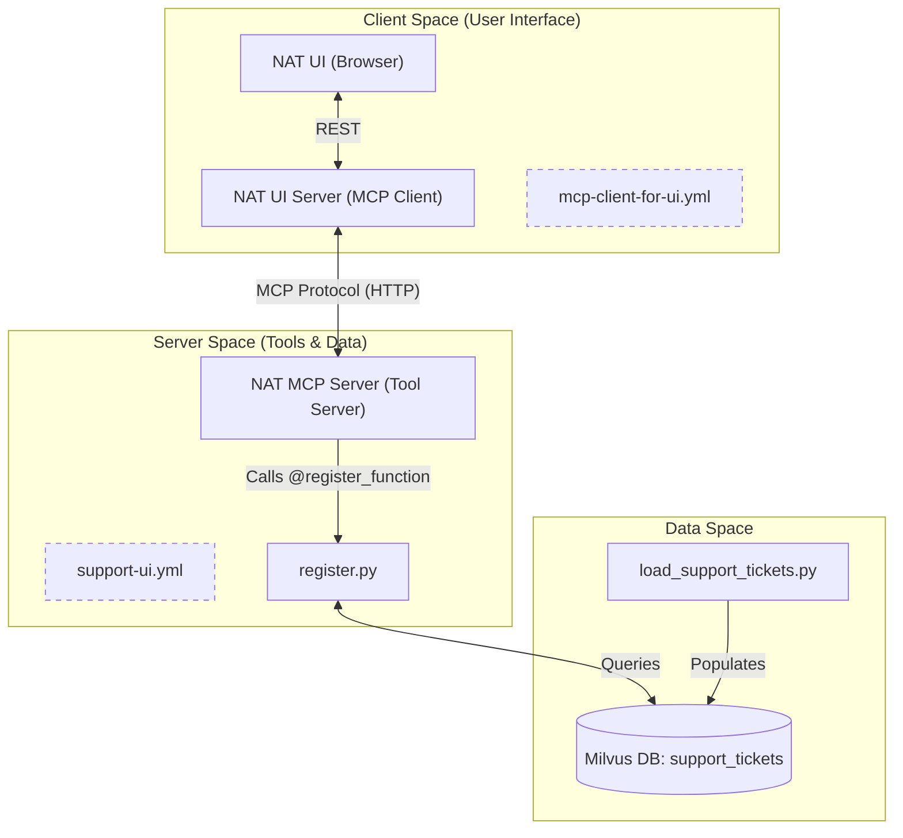
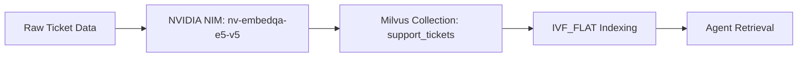

<!-- source: DeepWiki mcp.deepwiki.com · repo NVIDIA/NeMo-Agent-Toolkit-Examples · page 5 Example: MCP RAG Demo · fetched 2026-10-26 -->

# Example: MCP RAG Demo

Relevant source files

The following files were used as context for generating this wiki page:

- [examples/mcp_rag_demo/README.md](examples/mcp_rag_demo/README.md)
- [examples/mcp_rag_demo/pyproject.toml](examples/mcp_rag_demo/pyproject.toml)
- [examples/mcp_rag_demo/scripts/load_support_tickets.py](examples/mcp_rag_demo/scripts/load_support_tickets.py)

The **MCP RAG Demo** is a technical showcase of an agentic Retrieval-Augmented Generation (RAG) system designed to manage and query technical support tickets. It leverages the **Model Context Protocol (MCP)** to decouple tool logic from the agentic reasoning loop, allowing for a standardized interface between the agent and its data sources.

This example utilizes **NVIDIA NIMs** for high-performance embeddings, language modeling, and reranking, with **Milvus** serving as the GPU-accelerated vector database [examples/mcp_rag_demo/README.md:45-55]().

## System Overview

The demo addresses the challenges of fragmented tool ecosystems and maintenance burdens by using a unified interface for tool exposure [examples/mcp_rag_demo/README.md:20-33](). A ReAct agent coordinates multiple specialized tools to answer complex user queries, such as "Find critical GPU driver issues" [examples/mcp_rag_demo/README.md:37-43]().

### Core Technology Stack

| Component | Technology | Role |
| :--- | :--- | :--- |
| **Protocol** | MCP (Streamable HTTP) | Standardized tool communication [examples/mcp_rag_demo/README.md:49]() |
| **Agent Framework** | NeMo Agent Toolkit (NAT) | ReAct agent orchestration and MCP hosting [examples/mcp_rag_demo/README.md:50]() |
| **Vector Database** | Milvus | Storage and semantic search of support tickets [examples/mcp_rag_demo/README.md:51]() |
| **Embeddings** | `nv-embedqa-e5-v5` | Generating 1024-dim vectors for tickets [examples/mcp_rag_demo/README.md:52]() |
| **LLM** | `llama-3.1-70b-instruct` | Reasoning and response synthesis [examples/mcp_rag_demo/README.md:53]() |
| **Reranker** | `llama-3.2-nv-rerankqa-1b-v2` | Precision refinement of retrieved results [examples/mcp_rag_demo/README.md:54]() |

**Sources:** [examples/mcp_rag_demo/README.md:45-55]()

## Architecture: Three-Terminal Model

The system is deployed across three distinct processes to demonstrate a real-world client-server separation using MCP.

### Conceptual to Code Entity Mapping
The following diagram maps the high-level architecture to the specific configuration files and command-line entry points used in the codebase.

**Sources:** [examples/mcp_rag_demo/README.md:101-128](), [examples/mcp_rag_demo/pyproject.toml:37-38]()

## Key Components

### 1. MCP Server & Tool Registration
The system registers four specific tools for the agent to use: `search_support_tickets`, `query_by_category`, `query_by_priority`, and `rerank_support_tickets`. These are exposed via the `nat mcp serve` command using the `support-ui.yml` configuration.

For a deep dive into tool implementation and MCP configuration, see **[MCP RAG Server & Tool Registration](#5.1)**.

### 2. Data Pipeline & Milvus Integration
Before the agent can answer queries, a data ingestion pipeline processes synthetic support tickets. The `load_support_tickets.py` script defines a `CollectionSchema` including fields for `ticket_id`, `content`, `category`, `priority`, and a 1024-dimensional `embedding` vector.

For details on the schema and embedding process, see **[MCP RAG Data Pipeline & Milvus Integration](#5.2)**.

**Sources:** [examples/mcp_rag_demo/scripts/load_support_tickets.py:71-83](), [examples/mcp_rag_demo/README.md:90-98]()

## Quick Start Summary

1.  **Install Dependencies**: Use `uv pip install -e examples/mcp_rag_demo` [examples/mcp_rag_demo/README.md:148-149]().
2.  **Infrastructure**: Start Milvus via Docker [examples/mcp_rag_demo/README.md:157-168]().
3.  **Ingestion**: Run `load_support_tickets.py` to populate the vector store [examples/mcp_rag_demo/scripts/load_support_tickets.py:58-92]().
4.  **Execution**: Launch the MCP Server, UI Server, and Frontend in separate terminals [examples/mcp_rag_demo/README.md:75-78]().

**Sources:** [examples/mcp_rag_demo/README.md:141-174]()

---

