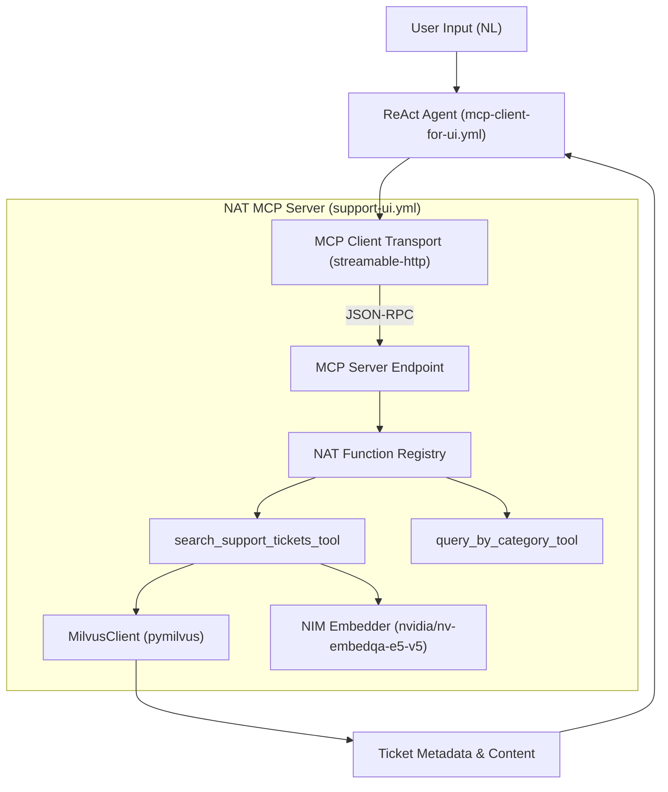
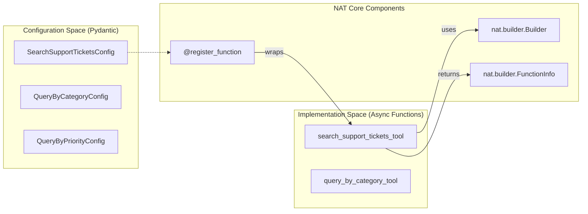

<!-- source: DeepWiki mcp.deepwiki.com · repo NVIDIA/NeMo-Agent-Toolkit-Examples · page 5.1 MCP RAG Server & Tool Registration · fetched 2026-10-26 -->

# MCP RAG Server & Tool Registration

Relevant source files

The following files were used as context for generating this wiki page:

- [examples/mcp_rag_demo/src/nat_mcp_rag_demo/__init__.py](examples/mcp_rag_demo/src/nat_mcp_rag_demo/__init__.py)
- [examples/mcp_rag_demo/src/nat_mcp_rag_demo/configs/mcp-client-for-ui.yml](examples/mcp_rag_demo/src/nat_mcp_rag_demo/configs/mcp-client-for-ui.yml)
- [examples/mcp_rag_demo/src/nat_mcp_rag_demo/configs/support-ui.yml](examples/mcp_rag_demo/src/nat_mcp_rag_demo/configs/support-ui.yml)
- [examples/mcp_rag_demo/src/nat_mcp_rag_demo/register.py](examples/mcp_rag_demo/src/nat_mcp_rag_demo/register.py)

This page details the configuration and implementation of the Model Context Protocol (MCP) server within the MCP RAG Demo. It explains how specialized support ticket retrieval tools are registered using the NeMo Agent Toolkit (NAT) plugin system and how they are exposed to clients via the MCP standard.

## Server Configuration (`support-ui.yml`)

The MCP server is defined by a YAML configuration that specifies the available tools (functions), embedders, and the LLM used for the agentic loop. This configuration is used to launch the NAT MCP server, which exposes the tools via a `streamable-http` transport.

| Component | Description | Configuration Key |
| :--- | :--- | :--- |
| **Search Tool** | Semantic similarity search using Milvus and NIM embeddings. | `search_tickets` [examples/mcp_rag_demo/src/nat_mcp_rag_demo/configs/support-ui.yml:19-24]() |
| **Category Tool** | Metadata filtering for specific ticket categories. | `query_category` [examples/mcp_rag_demo/src/nat_mcp_rag_demo/configs/support-ui.yml:26-30]() |
| **Priority Tool** | Metadata filtering for ticket priority levels. | `query_priority` [examples/mcp_rag_demo/src/nat_mcp_rag_demo/configs/support-ui.yml:32-36]() |
| **Rerank Tool** | Refinement of search results using NVIDIA Reranking NIM. | `rerank_tickets` [examples/mcp_rag_demo/src/nat_mcp_rag_demo/configs/support-ui.yml:38-41]() |

**Sources:**
- [examples/mcp_rag_demo/src/nat_mcp_rag_demo/configs/support-ui.yml:16-66]()

## Tool Registration Pattern

The demo utilizes the NAT `@register_function` decorator to transform Python functions into discoverable tools. Each tool follows a consistent pattern:
1.  **Configuration Class**: Inherits from `FunctionBaseConfig` to define parameters like `milvus_uri` and `top_k` [examples/mcp_rag_demo/src/nat_mcp_rag_demo/register.py:31-61]().
2.  **Registration Decorator**: Uses `@register_function` to link the configuration to the implementation and specify the `LLMFrameworkEnum.LANGCHAIN` wrapper [examples/mcp_rag_demo/src/nat_mcp_rag_demo/register.py:63]().
3.  **Internal Implementation**: An inner `async def` (e.g., `_search`) handles the logic, which is then yielded as a `FunctionInfo` object [examples/mcp_rag_demo/src/nat_mcp_rag_demo/register.py:74-108]().

### Registered Tools Detail

#### 1. `search_support_tickets`
Performs a vector search in Milvus. It retrieves the embedder from the `Builder` [examples/mcp_rag_demo/src/nat_mcp_rag_demo/register.py:68]() and uses it to convert natural language queries into embeddings for `milvus_client.search` [examples/mcp_rag_demo/src/nat_mcp_rag_demo/register.py:80-84]().

#### 2. `query_by_category`
Provides structured filtering based on a whitelist of categories: `bug_report`, `feature_request`, `question`, and `incident` [examples/mcp_rag_demo/src/nat_mcp_rag_demo/register.py:116](). It uses the Milvus `filter` expression `category == "{category}"` [examples/mcp_rag_demo/src/nat_mcp_rag_demo/register.py:132]().

#### 3. `query_by_priority`
Similar to the category tool, it filters tickets based on priority levels (e.g., `P0`, `P1`) using the Milvus query interface.

#### 4. `rerank_support_tickets`
Takes a list of search results and a query, then uses the `nvidia/llama-3.2-nv-rerankqa-1b-v2` model [examples/mcp_rag_demo/src/nat_mcp_rag_demo/configs/support-ui.yml:40]() to re-order them by relevance, improving the precision of the RAG context.

**Sources:**
- [examples/mcp_rag_demo/src/nat_mcp_rag_demo/register.py:31-152]()

## Data Flow: Client to Tool Execution

The following diagram illustrates how a natural language request from a user is routed through the MCP client to the registered tool implementations on the server.

### System Flow: NL Space to Code Entities
"MCP RAG Request Routing"

**Sources:**
- [examples/mcp_rag_demo/src/nat_mcp_rag_demo/configs/mcp-client-for-ui.yml:19-24]()
- [examples/mcp_rag_demo/src/nat_mcp_rag_demo/register.py:63-108]()
- [examples/mcp_rag_demo/src/nat_mcp_rag_demo/register.py:111-152]()

## MCP Client Configuration (`mcp-client-for-ui.yml`)

The client configuration allows a NAT-based agent to connect to the MCP server. It treats the remote server as a `function_group` of type `mcp_client` [examples/mcp_rag_demo/src/nat_mcp_rag_demo/configs/mcp-client-for-ui.yml:21]().

### Key Client Parameters
*   **Transport**: `streamable-http` [examples/mcp_rag_demo/src/nat_mcp_rag_demo/configs/mcp-client-for-ui.yml:23]().
*   **URL**: `http://localhost:9904/mcp` [examples/mcp_rag_demo/src/nat_mcp_rag_demo/configs/mcp-client-for-ui.yml:24]().
*   **Workflow**: A `react_agent` that includes the `support_mcp_tools` in its `tool_names` list [examples/mcp_rag_demo/src/nat_mcp_rag_demo/configs/mcp-client-for-ui.yml:33-37]().

### Registration Logic & Classes
The relationship between the configuration classes and the registration logic is depicted below.

### Code Entity Mapping
"NAT Registration Architecture"

**Sources:**
- [examples/mcp_rag_demo/src/nat_mcp_rag_demo/register.py:24-31]()
- [examples/mcp_rag_demo/src/nat_mcp_rag_demo/register.py:63-64]()
- [examples/mcp_rag_demo/src/nat_mcp_rag_demo/configs/mcp-client-for-ui.yml:19-40]()

---

