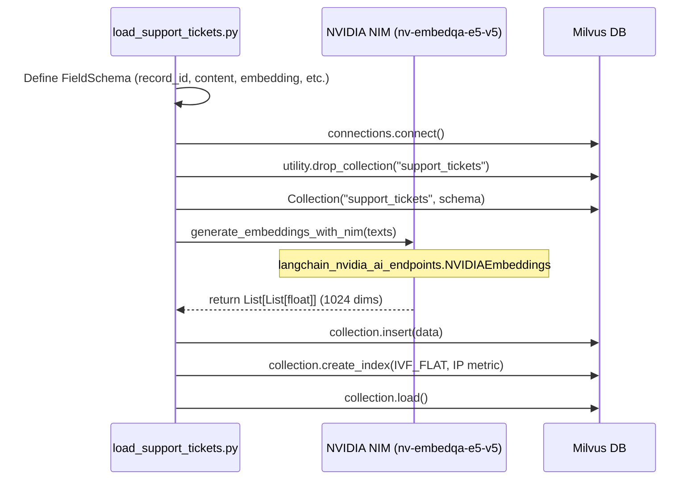
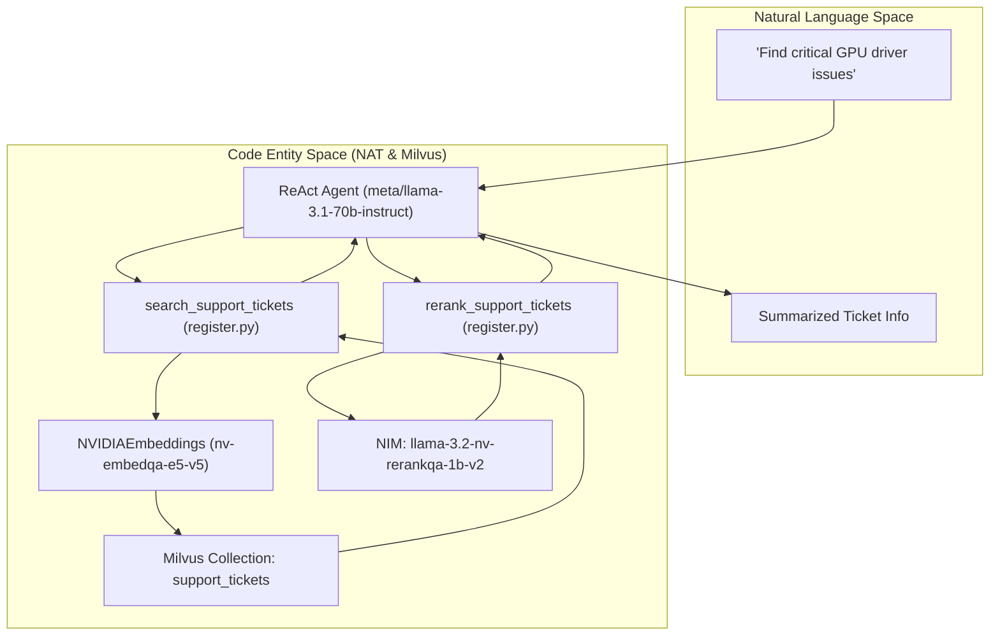

<!-- source: DeepWiki mcp.deepwiki.com · repo NVIDIA/NeMo-Agent-Toolkit-Examples · page 5.2 MCP RAG Data Pipeline & Milvus Integration · fetched 2026-10-26 -->

# MCP RAG Data Pipeline & Milvus Integration

Relevant source files

The following files were used as context for generating this wiki page:

- [examples/mcp_rag_demo/README.md](examples/mcp_rag_demo/README.md)
- [examples/mcp_rag_demo/scripts/load_support_tickets.py](examples/mcp_rag_demo/scripts/load_support_tickets.py)

This page details the data ingestion infrastructure and vector database integration for the MCP RAG Demo. The pipeline transforms raw support ticket data into a searchable knowledge base using NVIDIA NIM embedding models and the Milvus vector database, enabling the agent to perform high-precision retrieval during the RAG cycle.

## Data Ingestion Pipeline

The ingestion process is managed by a standalone script that handles schema definition, embedding generation, and data persistence.

### Ingestion Flow: `load_support_tickets.py`

The script `load_support_tickets.py` performs a sequential pipeline to prepare the environment for the MCP server:

1.  **Connection**: Establishes a session with the Milvus standalone instance via `pymilvus.connections.connect` [examples/mcp_rag_demo/scripts/load_support_tickets.py:68-69]().
2.  **Schema Definition**: Defines the `support_tickets` collection structure, including metadata fields (category, priority, status) and a 1024-dimension vector field [examples/mcp_rag_demo/scripts/load_support_tickets.py:71-83]().
3.  **Embedding Generation**: Utilizes the `nvidia/nv-embedqa-e5-v5` model via the `NVIDIAEmbeddings` class to convert ticket content into vectors [examples/mcp_rag_demo/scripts/load_support_tickets.py:43-51]().
4.  **Indexing**: Configures an `IVF_FLAT` index on the embedding field to optimize search performance [examples/mcp_rag_demo/scripts/load_support_tickets.py:228-235]().

### Support Ticket Data Flow
The following diagram illustrates the transformation of raw text into indexed vectors.

**Diagram: Data Ingestion Sequence**

**Sources:** [examples/mcp_rag_demo/scripts/load_support_tickets.py:20-244]()

---

## Milvus Integration & Schema

The system uses Milvus as the primary vector store, leveraging its ability to handle both semantic vector search and scalar filtering (e.g., filtering by priority).

### Collection Schema
The collection is defined with the following fields in `load_support_tickets.py`:

| Field Name | Data Type | Description |
| :--- | :--- | :--- |
| `record_id` | `INT64` | Primary key (auto-id) [examples/mcp_rag_demo/scripts/load_support_tickets.py:73]() |
| `ticket_id` | `VARCHAR` | External ticket identifier [examples/mcp_rag_demo/scripts/load_support_tickets.py:74]() |
| `content` | `VARCHAR` | The raw text of the support ticket [examples/mcp_rag_demo/scripts/load_support_tickets.py:75]() |
| `category` | `VARCHAR` | Ticket type (e.g., bug_report, question) [examples/mcp_rag_demo/scripts/load_support_tickets.py:76]() |
| `priority` | `VARCHAR` | Urgency level (critical, high, medium, low) [examples/mcp_rag_demo/scripts/load_support_tickets.py:77]() |
| `status` | `VARCHAR` | Ticket state (open, resolved) [examples/mcp_rag_demo/scripts/load_support_tickets.py:78]() |
| `embedding` | `FLOAT_VECTOR` | 1024-dim vector from `nv-embedqa-e5-v5` [examples/mcp_rag_demo/scripts/load_support_tickets.py:80]() |

### Indexing Strategy
The pipeline applies an `IVF_FLAT` (Inverted File Flat) index using the `IP` (Inner Product) metric [examples/mcp_rag_demo/scripts/load_support_tickets.py:228-232](). This is optimized for high-dimensional embedding similarity search while maintaining low latency.

**Sources:** [examples/mcp_rag_demo/scripts/load_support_tickets.py:71-83](), [examples/mcp_rag_demo/scripts/load_support_tickets.py:228-235]()

---

## End-to-End Agentic Query Flow

When a user interacts with the system, the agent orchestrates retrieval and refinement through the registered MCP tools.

### Query Execution Logic
1.  **User Input**: A natural language query is received by the NAT UI Server.
2.  **Reasoning**: The ReAct agent (Llama-3.1-70B) decides to call `search_support_tickets` or specialized filtering tools.
3.  **Retrieval**: The tool executes a search against Milvus using the `NVIDIAEmbeddings` pipeline to embed the user's query [examples/mcp_rag_demo/scripts/load_support_tickets.py:32-55]().
4.  **Reranking**: The agent may call `rerank_support_tickets`, which uses the `nvidia/llama-3.2-nv-rerankqa-1b-v2` NIM to re-order the Milvus results based on semantic relevance to the original question [examples/mcp_rag_demo/README.md:54]().

**Diagram: Natural Language to Code Entity Space**
This diagram maps user-facing concepts to the underlying Python functions and classes in the codebase.

**Sources:** [examples/mcp_rag_demo/README.md:37-43](), [examples/mcp_rag_demo/README.md:47-55](), [examples/mcp_rag_demo/scripts/load_support_tickets.py:32-55]()

---

