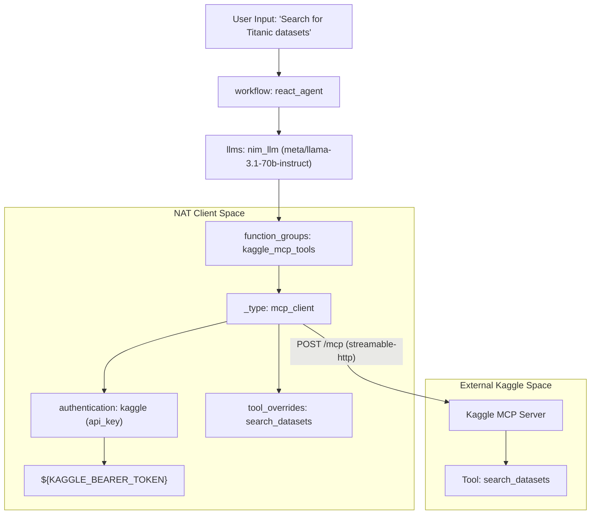
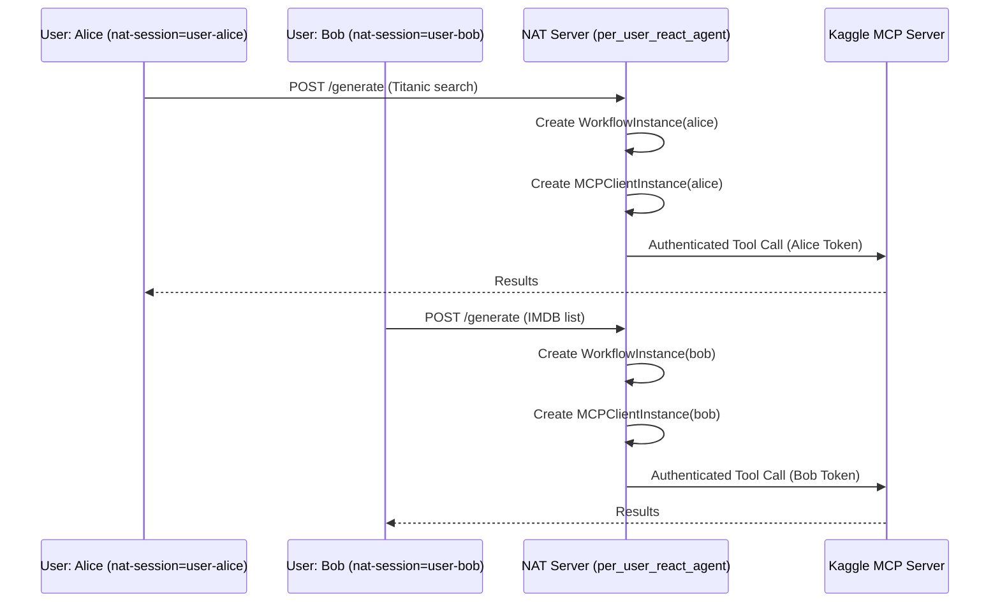

<!-- source: DeepWiki mcp.deepwiki.com · repo NVIDIA/NeMo-Agent-Toolkit-Examples · page 6 Example: Kaggle MCP Integration · fetched 2026-10-26 -->

# Example: Kaggle MCP Integration

<details>
<summary>Relevant source files</summary>

The following files were used as context for generating this wiki page:

- [examples/kaggle_mcp/README.md](examples/kaggle_mcp/README.md)
- [examples/kaggle_mcp/configs/config-per-user.yml](examples/kaggle_mcp/configs/config-per-user.yml)
- [examples/kaggle_mcp/configs/config.yml](examples/kaggle_mcp/configs/config.yml)
- [examples/kaggle_mcp/pyproject.toml](examples/kaggle_mcp/pyproject.toml)
- [examples/kaggle_mcp/uv.lock](examples/kaggle_mcp/uv.lock)

</details>


The Kaggle MCP example demonstrates how to integrate the NeMo Agent Toolkit (NAT) as a **Model Context Protocol (MCP) client** to interact with the external Kaggle MCP server. This integration allows agents to perform dataset discovery, notebook interaction, and competition management through standardized MCP tools.

## Overview

This example serves as a reference for connecting NAT to third-party HTTP-based MCP servers. Unlike self-contained examples, this relies on Kaggle's infrastructure and requires external authentication via bearer tokens [examples/kaggle_mcp/README.md:22-24]().

### Key Features
*   **MCP Client Implementation**: Uses the `streamable-http` transport to connect to `https://www.kaggle.com/mcp` [examples/kaggle_mcp/configs/config.yml:24-27]().
*   **Authentication**: Implements Bearer token authentication using the `api_key` provider [examples/kaggle_mcp/configs/config.yml:36-40]().
*   **Tool Overrides**: Demonstrates how to refine tool descriptions to improve LLM parameter accuracy (e.g., forcing the use of `search` instead of `query`) [examples/kaggle_mcp/configs/config.yml:29-34]().
*   **Multi-User Support**: Provides a configuration for `per_user_react_agent` where each session maintains its own MCP client instance [examples/kaggle_mcp/configs/config-per-user.yml:46-47]().

---

## System Architecture

The integration follows a client-server model where NAT acts as the orchestrator (client) and Kaggle provides the tool execution environment (server).

### Data Flow: Natural Language to MCP Tool Call

The following diagram maps the flow from a user's natural language request to the specific code entities responsible for executing the MCP tool call.

**Natural Language to Code Entity Mapping**

**Sources:** [examples/kaggle_mcp/configs/config.yml:16-53](), [examples/kaggle_mcp/README.md:100-108]()

---

## Configuration & Implementation

### Single-User Configuration
The standard configuration uses a global `react_agent` and a shared `mcp_client`. It interpolates the `KAGGLE_BEARER_TOKEN` environment variable into the `api_key` authentication provider.

| Component | Setting | Description |
| :--- | :--- | :--- |
| **LLM** | `meta/llama-3.1-70b-instruct` | High-capacity model for tool parameter inference [examples/kaggle_mcp/configs/config.yml:20](). |
| **Transport** | `streamable-http` | Protocol for communication with Kaggle's web-based MCP endpoint [examples/kaggle_mcp/configs/config.yml:26](). |
| **Auth Scheme** | `Bearer` | Standard HTTP authentication header format [examples/kaggle_mcp/configs/config.yml:40](). |
| **Tool Override** | `search_datasets` | Custom description to ensure the LLM uses the `search` key in JSON arguments [examples/kaggle_mcp/configs/config.yml:30-34](). |

**Sources:** [examples/kaggle_mcp/configs/config.yml:1-53]()

### Per-User (Multi-User) Configuration
For deployments requiring isolation, the `config-per-user.yml` uses the `per_user_react_agent` workflow. This ensures that every unique `nat-session` (identified via cookies) receives a dedicated instance of the MCP client [examples/kaggle_mcp/configs/config-per-user.yml:26-47]().

**Multi-User Interaction Flow**

**Sources:** [examples/kaggle_mcp/configs/config-per-user.yml:16-53](), [examples/kaggle_mcp/README.md:80-98]()

---

## Tool Overrides and Prompt Engineering

A common failure mode in MCP integrations is the LLM generating incorrect parameter names if the server-provided schema is ambiguous. This example highlights the use of `tool_overrides` to provide explicit guidance.

For the `search_datasets` tool, the toolkit overrides the default description to mandate the `search` parameter:
```yaml
tool_overrides:
  search_datasets:
    description: >
      Search for datasets on Kaggle. Use the 'search' parameter to search by keywords.
      Returns a list of datasets with metadata including
      title, owner, download count, and URL. Example: {"request": {"search": "titanic"}}
```
**Sources:** [examples/kaggle_mcp/configs/config.yml:29-34](), [examples/kaggle_mcp/README.md:160-182]()

---

## Usage and Debugging

### CLI Prototyping
The NAT CLI allows for direct interaction with the MCP server without running a full agent workflow. This is useful for verifying authentication and schema [examples/kaggle_mcp/README.md:109-112]().

*   **List Tools**: `nat mcp client tool list --url https://www.kaggle.com/mcp` [examples/kaggle_mcp/README.md:118]()
*   **Authenticated Call**:
    ```bash
    nat mcp client tool call search_datasets \
      --url https://www.kaggle.com/mcp \
      --bearer-token-env KAGGLE_BEARER_TOKEN \
      --json-args '{"request": {"search": "titanic"}}'
    ```
    [examples/kaggle_mcp/README.md:140-144]()

### Dependencies
The project defines its dependencies in `pyproject.toml`, specifically requiring `nvidia-nat` with `mcp` extras [examples/kaggle_mcp/pyproject.toml:35-37]().

**Sources:** [examples/kaggle_mcp/pyproject.toml:1-42](), [examples/kaggle_mcp/README.md:56-69]()

---

