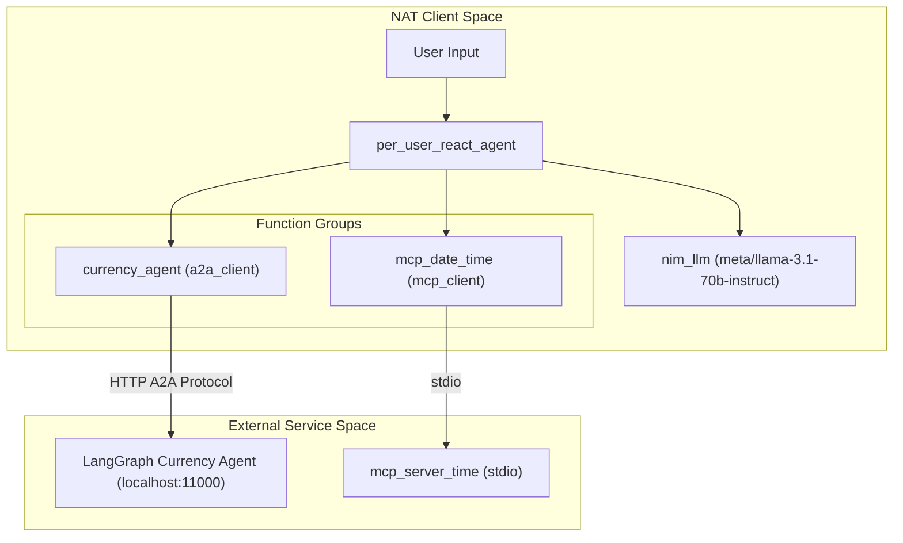
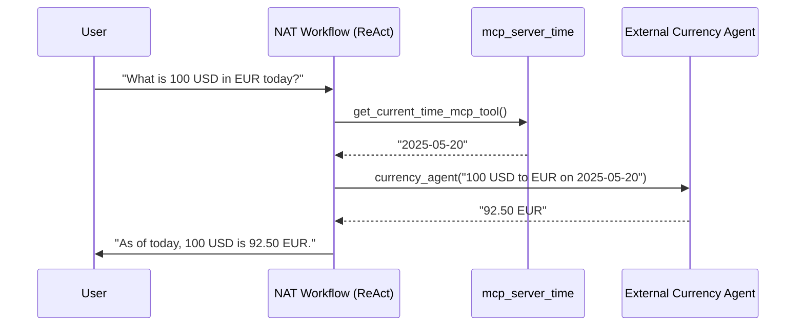

<!-- source: DeepWiki mcp.deepwiki.com · repo NVIDIA/NeMo-Agent-Toolkit-Examples · page 7 Example: Currency Agent A2A · fetched 2026-10-26 -->

# Example: Currency Agent A2A

Relevant source files

The following files were used as context for generating this wiki page:

- [examples/currency_agent_a2a/README.md](examples/currency_agent_a2a/README.md)
- [examples/currency_agent_a2a/configs/config.yml](examples/currency_agent_a2a/configs/config.yml)
- [examples/currency_agent_a2a/data/sample_queries.json](examples/currency_agent_a2a/data/sample_queries.json)
- [examples/currency_agent_a2a/pyproject.toml](examples/currency_agent_a2a/pyproject.toml)

The **Currency Agent A2A** example demonstrates the integration of the NeMo Agent Toolkit (NAT) with external agentic services using the **Agent-to-Agent (A2A)** protocol. It showcases a hybrid tool architecture where a primary NAT agent orchestrates a specialized third-party LangGraph-based currency agent while simultaneously utilizing a local **Model Context Protocol (MCP)** time server for temporal context [examples/currency_agent_a2a/README.md:22-32]().

This example is specifically designed to illustrate per-user session isolation and the discovery of external agent capabilities [examples/currency_agent_a2a/README.md:129-135]().

## Architecture & Data Flow

The system operates by bridging the NAT workflow with an external A2A server. The NAT agent acts as the orchestrator, determining when to call the remote currency agent or the local time server based on the user's query [examples/currency_agent_a2a/README.md:36-54]().

### System Component Mapping
The following diagram maps high-level concepts to specific configuration entities and external services.

**Title: A2A Integration Component Map**

**Sources:** [examples/currency_agent_a2a/configs/config.yml:16-50](), [examples/currency_agent_a2a/README.md:36-54]()

## Implementation Details

### Hybrid Tool Configuration
The configuration uses `function_groups` to define two distinct communication protocols:
1.  **MCP (Model Context Protocol):** Configured as `mcp_client` to run a local Python module `mcp_server_time`. It includes a `tool_overrides` section to alias the tool to `get_current_time_mcp_tool` [examples/currency_agent_a2a/configs/config.yml:17-28]().
2.  **A2A (Agent-to-Agent):** Configured as `a2a_client` pointing to an external URL (defaulting to `http://localhost:11000`). This treats the entire remote agent as a single tool within the NAT workflow [examples/currency_agent_a2a/configs/config.yml:30-32]().

### Per-User Workflow
The example utilizes the `per_user_react_agent` workflow type [examples/currency_agent_a2a/configs/config.yml:42](). This is critical for A2A integrations because:
*   **Isolation:** Each user session maintains its own connection state to the external A2A service [examples/currency_agent_a2a/README.md:133-134]().
*   **Discovery:** The NAT toolkit can perform discovery on the external agent to understand its capabilities via the `.well-known/agent-card.json` endpoint [examples/currency_agent_a2a/README.md:162-166]().

### External Agent Integration
The external agent is a LangGraph-based service from the `a2a-samples` repository [examples/currency_agent_a2a/README.md:76-81](). It provides specialized currency conversion tools that the NAT orchestrator invokes when financial queries are detected.

**Title: Request Lifecycle (A2A Flow)**

**Sources:** [examples/currency_agent_a2a/configs/config.yml:41-50](), [examples/currency_agent_a2a/README.md:121-124]()

## Key Functions and Classes

| Entity | Type | Description |
| :--- | :--- | :--- |
| `per_user_react_agent` | Workflow | The core orchestration loop that manages LLM reasoning and tool execution [examples/currency_agent_a2a/configs/config.yml:42](). |
| `mcp_client` | Function Group | A client implementation that spawns and communicates with MCP servers over `stdio` [examples/currency_agent_a2a/configs/config.yml:18-22](). |
| `a2a_client` | Function Group | A client implementation that communicates with remote agents via the A2A HTTP protocol [examples/currency_agent_a2a/configs/config.yml:31-32](). |
| `nim_llm` | LLM | NVIDIA NIM connector using the `meta/llama-3.1-70b-instruct` model [examples/currency_agent_a2a/configs/config.yml:35-39](). |

## Dependency Management
The project defines its requirements in `pyproject.toml`, specifying `nvidia-nat` with `a2a` and `mcp` extras to ensure the necessary protocol handlers are installed [examples/currency_agent_a2a/pyproject.toml:32-35]().

**Sources:** [examples/currency_agent_a2a/pyproject.toml:27-35]()

---

