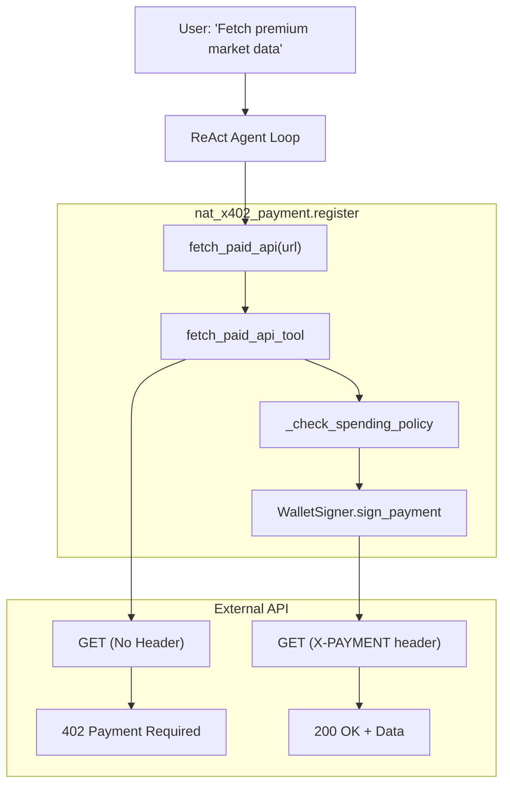
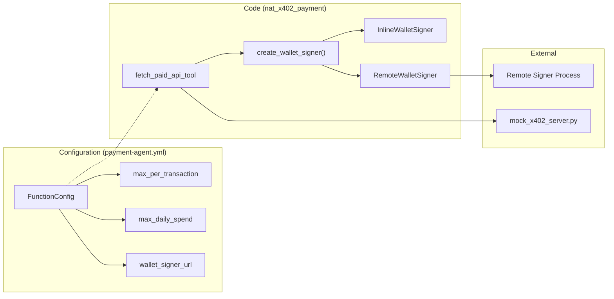

<!-- source: DeepWiki mcp.deepwiki.com · repo NVIDIA/NeMo-Agent-Toolkit-Examples · page 8 Example: x402 Payment Tool · fetched 2026-10-26 -->

# Example: x402 Payment Tool

Relevant source files

The following files were used as context for generating this wiki page:

- [examples/x402_payment_tool/.gitignore](examples/x402_payment_tool/.gitignore)
- [examples/x402_payment_tool/README.md](examples/x402_payment_tool/README.md)
- [examples/x402_payment_tool/pyproject.toml](examples/x402_payment_tool/pyproject.toml)
- [examples/x402_payment_tool/src/nat_x402_payment/__init__.py](examples/x402_payment_tool/src/nat_x402_payment/__init__.py)

The **x402 Payment Tool** example demonstrates how to enable AI agents to autonomously interact with paid APIs that require [x402](https://github.com/coinbase/x402) payment negotiation. This implementation provides a secure framework for agents to encounter an HTTP 402 (Payment Required) response, evaluate the cost against a local spending policy, authorize the payment via an isolated wallet, and retry the request—all within a single tool execution [examples/x402_payment_tool/README.md:20-28]().

### High-Level Architecture

The system is designed around the `fetch_paid_api` tool, which acts as a proxy for HTTP requests. When the tool detects a 402 status code, it triggers a negotiation lifecycle that ensures security by isolating private keys and enforcing strict spending limits [examples/x402_payment_tool/README.md:32-54]().

#### Natural Language to Code: Tool Interaction
The following diagram illustrates how a user's natural language request triggers specific code entities within the x402 example.

**User Request to Tool Execution Flow**

**Sources:** [examples/x402_payment_tool/README.md:32-54](), [examples/x402_payment_tool/src/nat_x402_payment/register.py:38-38]()

### Key Components

#### 1. Payment Negotiation & Spending Policy
The core logic resides in the `fetch_paid_api_tool` registered via the `@register_function` decorator [examples/x402_payment_tool/src/nat_x402_payment/register.py:114-114](). It implements a multi-step lifecycle:
*   **Detection:** Identifies `x402` requirements in the HTTP 402 response headers [examples/x402_payment_tool/README.md:39-39]().
*   **Policy Enforcement:** Before signing any transaction, the tool validates the request against `max_per_transaction`, `max_daily_spend`, and `allowed_recipients` [examples/x402_payment_tool/README.md:73-82]().
*   **State Management:** Tracks spending history in a local `_spend_state` to prevent exceeding daily caps [examples/x402_payment_tool/README.md:88-90]().

For details, see [x402 Payment Negotiation & Spending Policy](#8.1).

#### 2. Wallet Signer Architecture
To maintain security, the toolkit abstracts wallet operations through a `WalletSigner` interface [examples/x402_payment_tool/src/nat_x402_payment/wallet.py:46-46](). This allows for two distinct security modes:
*   **Inline Mode:** Uses the `WALLET_PRIVATE_KEY` environment variable for development [examples/x402_payment_tool/README.md:62-64]().
*   **Remote Signer:** Routes signing requests to an isolated process via `wallet_signer_url`, ensuring the agent process never touches the private key [examples/x402_payment_tool/README.md:65-67]().

For details, see [Wallet Signer Architecture](#8.2).

### System Integration Diagram
This diagram bridges the configuration space (YAML) to the runtime code entities and external dependencies.

**System Entity Mapping**

**Sources:** [examples/x402_payment_tool/src/nat_x402_payment/register.py:38-112](), [examples/x402_payment_tool/src/nat_x402_payment/wallet.py:144-165](), [examples/x402_payment_tool/README.md:158-170]()

### Configuration Summary
The tool is configured via the `nat` YAML system, allowing fine-grained control over the agent's financial autonomy.

| Parameter | Default | Role |
| :--- | :--- | :--- |
| `max_per_transaction` | `0.10` | Hard limit on USDC per payment call [examples/x402_payment_tool/README.md:178-178]() |
| `max_daily_spend` | `5.00` | Rolling 24h budget [examples/x402_payment_tool/README.md:179-179]() |
| `allowed_recipients` | `[]` | List of approved wallet addresses [examples/x402_payment_tool/README.md:180-180]() |
| `wallet_signer_url` | `""` | Endpoint for remote key isolation [examples/x402_payment_tool/README.md:181-181]() |

**Sources:**
* [examples/x402_payment_tool/README.md:20-182]()
* [examples/x402_payment_tool/src/nat_x402_payment/register.py:38-114]()
* [examples/x402_payment_tool/src/nat_x402_payment/wallet.py:46-165]()
* [examples/x402_payment_tool/pyproject.toml:37-38]()

---

