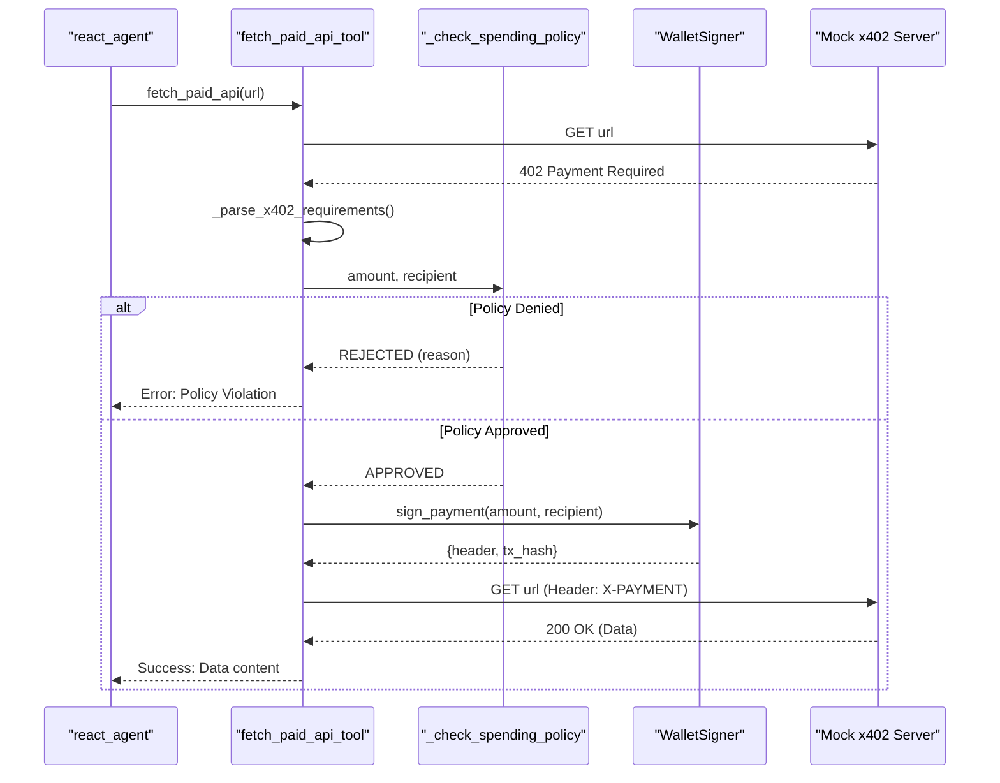
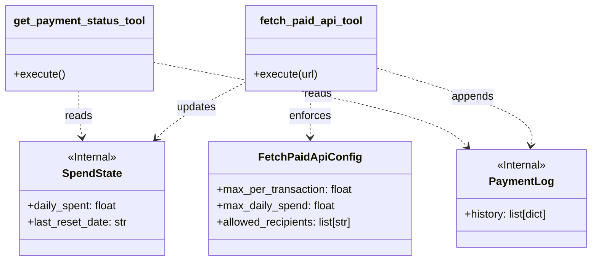

<!-- source: DeepWiki mcp.deepwiki.com · repo NVIDIA/NeMo-Agent-Toolkit-Examples · page 8.1 x402 Payment Negotiation & Spending Policy · fetched 2026-10-26 -->

# x402 Payment Negotiation & Spending Policy

Relevant source files

The following files were used as context for generating this wiki page:

- [examples/x402_payment_tool/scripts/mock_x402_server.py](examples/x402_payment_tool/scripts/mock_x402_server.py)
- [examples/x402_payment_tool/src/nat_x402_payment/configs/payment-agent.example.yml](examples/x402_payment_tool/src/nat_x402_payment/configs/payment-agent.example.yml)
- [examples/x402_payment_tool/src/nat_x402_payment/register.py](examples/x402_payment_tool/src/nat_x402_payment/register.py)
- [examples/x402_payment_tool/src/nat_x402_payment/wallet.py](examples/x402_payment_tool/src/nat_x402_payment/wallet.py)

The x402 Payment Tool example enables autonomous agents to interact with premium, paid APIs by implementing the HTTP 402 (Payment Required) negotiation lifecycle. This system allows an agent to detect payment requirements, evaluate them against a locally enforced spending policy, sign a payment proof using an isolated wallet, and successfully retry the request with the required credentials.

### fetch_paid_api_tool Lifecycle

The `fetch_paid_api_tool` manages the end-to-end flow of requesting data from a URL that may require payment. It acts as a wrapper around standard HTTP requests, injecting a negotiation logic that handles the 402 status code [examples/x402_payment_tool/src/nat_x402_payment/register.py:168-172]().

#### 1. Initial Request and 402 Detection
The tool first attempts a standard GET request to the target URL [examples/x402_payment_tool/src/nat_x402_payment/register.py:194](). If the server responds with a `402 Payment Required` status code, the tool initiates the negotiation logic [examples/x402_payment_tool/src/nat_x402_payment/register.py:204-205]().

#### 2. Requirement Parsing
The `_parse_x402_requirements` function extracts the payment details from either the JSON response body or the `x-payment-required` header [examples/x402_payment_tool/src/nat_x402_payment/register.py:137-146](). It normalizes the data into a standard dictionary containing the amount (converted from the smallest unit based on asset decimals), recipient address, asset contract, and target network [examples/x402_payment_tool/src/nat_x402_payment/register.py:151-164]().

#### 3. Spending Policy Enforcement
Before any signing occurs, the agent evaluates the request against a `FetchPaidApiConfig` policy [examples/x402_payment_tool/src/nat_x402_payment/register.py:64-87](). The `_check_spending_policy` function enforces three primary constraints:
*   **max_per_transaction**: Limits the maximum amount for a single call [examples/x402_payment_tool/src/nat_x402_payment/register.py:119-120]().
*   **max_daily_spend**: Tracks cumulative spending across the day, resetting every 24 hours [examples/x402_payment_tool/src/nat_x402_payment/register.py:114-129]().
*   **allowed_recipients**: An optional allowlist of blockchain addresses. If populated, the agent will only pay these specific recipients [examples/x402_payment_tool/src/nat_x402_payment/register.py:131-132]().

#### 4. Signing and Retry
If the policy check passes, the tool calls the `WalletSigner` to generate a signature [examples/x402_payment_tool/src/nat_x402_payment/register.py:228-233](). The tool then retries the original request, attaching the payment proof to the `X-PAYMENT` HTTP header [examples/x402_payment_tool/src/nat_x402_payment/register.py:240-243]().

**x402 Negotiation Flow**

**Sources:**
* [examples/x402_payment_tool/src/nat_x402_payment/register.py:64-164]()
* [examples/x402_payment_tool/src/nat_x402_payment/register.py:168-250]()
* [examples/x402_payment_tool/scripts/mock_x402_server.py:76-105]()

---

### Spending State & Logging

The system maintains a volatile module-level state to track spending across multiple tool invocations within the same process lifecycle.

#### Spend Tracking (`_spend_state`)
The `_spend_state` dictionary stores the `daily_spent` total and the `last_reset_date` [examples/x402_payment_tool/src/nat_x402_payment/register.py:97-100](). When a new day is detected during a policy check, the `daily_spent` counter is reset to zero [examples/x402_payment_tool/src/nat_x402_payment/register.py:114-117]().

#### Payment Logging (`_payment_log`)
Every payment attempt, whether successful or failed, is recorded in the `_payment_log` list [examples/x402_payment_tool/src/nat_x402_payment/register.py:101](). Logs include the timestamp, URL, amount, recipient, status (e.g., "SUCCESS", "POLICY_REJECTED"), and the transaction hash [examples/x402_payment_tool/src/nat_x402_payment/register.py:217-224]().

#### Status Inspection Tool
The `get_payment_status_tool` allows the agent to inspect its own spending history and current limits [examples/x402_payment_tool/src/nat_x402_payment/register.py:270-285](). This provides the LLM with context regarding how much budget remains for the day.

**Code Entity Relationship: State Management**

**Sources:**
* [examples/x402_payment_tool/src/nat_x402_payment/register.py:95-134]()
* [examples/x402_payment_tool/src/nat_x402_payment/register.py:217-224]()
* [examples/x402_payment_tool/src/nat_x402_payment/register.py:270-295]()

---

### Configuration & Deployment

The behavior of the payment tool is governed by the `payment-agent.yml` configuration file, which maps to the `FetchPaidApiConfig` class.

| Key | Description | Default |
| :--- | :--- | :--- |
| `max_per_transaction` | Maximum USDC allowed for a single API call. | 0.10 |
| `max_daily_spend` | Total budget allowed per 24-hour period. | 5.00 |
| `allowed_recipients` | List of blockchain addresses allowed to receive funds. | `[]` (Allow All) |
| `wallet_signer_url` | URL for the `RemoteWalletSigner`. If empty, uses `InlineWalletSigner`. | `""` |

#### Mock Server for Testing
A `mock_x402_server.py` is provided to simulate the server-side of the negotiation [examples/x402_payment_tool/scripts/mock_x402_server.py:29-38](). It returns a 402 response for `/v1/market-data` and requires a payment of 0.05 USDC [examples/x402_payment_tool/scripts/mock_x402_server.py:55-69]().

**Sources:**
* [examples/x402_payment_tool/src/nat_x402_payment/configs/payment-agent.example.yml:26-33]()
* [examples/x402_payment_tool/src/nat_x402_payment/register.py:64-87]()
* [examples/x402_payment_tool/scripts/mock_x402_server.py:44-69]()

---

